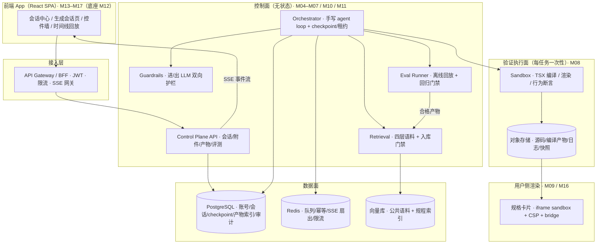
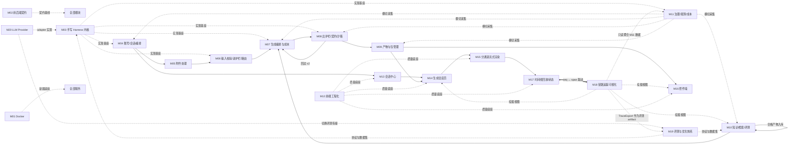

# WidgetPilot · 模块文档集总览与模块地图

> **文档类型**：模块拆分索引 / 全局基线（非模块文档）
> **来源**：`E:\vsc-workspace\widgetpilot\设计方案.md` v1.1（2026-11-12，PRD + 技术方案定稿）
> **版本**：v1.1　|　**拆分日期**：2026-11-15　|　**最近修订**：2026-11-16（v1.3 设计变更，见 `docs/adr/ADR-001-规格输入与执行中询问用户.md`：D-6 规格可选预填+缺省询问、D-7 执行中询问用户通道、D-8 意图识别四级级联；**v1.4 设计变更，见 `docs/adr/ADR-002-记忆管理机制.md`：D-9~D-13 记忆管理机制**）
> **本文件作用**：① 让完全不了解本项目的人用 5 分钟建立全局坐标；② 说明模块怎么切、模块之间怎么依赖、按什么顺序验收；③ 定义所有模块文档必须遵守的统一模板。
> **配套基线**：`01-共享契约基线.md`（协议 / 状态 / 枚举 / REST / 事件 / 错误码的单一事实来源）

---

## 0. 这套文档是怎么组织的

原始 `设计方案.md` 是一份 1150 余行的「PRD + 技术方案」合体文档，按**学科章节**组织（产品概述 → 需求 → 架构 → 数据模型 → 后端 → 前端 → 工程结构 → 上线运营 → Harness 完整性 → 手写内核）。这种写法适合评审，但不适合交付：做某个模块的人必须把全文翻一遍才能拼出自己的边界，且无法单独验收。

本次拆分按**可独立交付、可独立验收的工程模块**重新组织，规则如下：

1. **模块 = 原设计里已有编号的责任单元**：后端 8 个域（D1–D8）、前端 7 个模块（W1–W7），加上 v1.1 新增的手写 Harness 内核（§11），共 **16 个模块，一模块一文档**；另有 **4 个 v1.2 增补模块（拆分评审发现的缺口，非原编号）**，按递进顺序排列：**M01 Docker 部署与本地开发环境**（工程基建前置——项目中使用 db/redis 等工具一律经 docker 安装与连接；原文只有沙箱镜像，没有开发容器栈，已回写原文 §12.2）、**M18 链路追踪可视化**（原文只承诺「重建完整路径」，没设计怎么「看见」，已回写 §12.4）、**M19 评测与优化体系**（有评测执行，没有整合评测集管理、Agent 全链路评测协议与优化实验工作流，已回写 §12.3）、**M20 LLM Provider 模型接入与切换**（有单供应商调用实现，没有「切换」的系统设计，已回写 §12.1）。
2. **横切能力 X1–X12 不单独成模块**：原设计 §2.6 明确「不改变分层、不新增服务与 agent 角色」，因此 X* 作为能力标签映射到承载它的 D/W 模块，在每个模块文档 §1.5 声明，不另建文档。
3. **每份模块文档必须自闭环**：自带最小项目背景、职责边界、技术栈、架构、接口、状态、核心字段、独立验收方案。读者**不需要**先读其他文档也能看懂这个模块是干什么的、怎么验。跨模块引用只作为「延伸阅读」，不作为理解前提。
4. **全局共享内容抽成 `01-共享契约基线.md`** 作为单一事实来源，但模块文档内仍会**重复写出与本模块相关的那部分**（协议片段、字段表、状态枚举、接口行），避免「见某某文档」造成断链。
5. **每个模块给出「可单独验收」方案**：写明验收前置条件、需要打桩的上下游、可断言的用例清单、出口条件。任何一个模块都可以脱离其他模块的开发进度单独提测。

### 文档清单

| 文件 | 层 | 类型 | 对应原编号 | 对应原文章节 |
|---|---|---|---|---|
| `00-总览与模块地图.md` | — | 索引 / 基线 | — | §1–§4、§7、§8、§10、§12、附录 A |
| `01-共享契约基线.md` | — | 契约基线 | — | §4 全章、§6.9、附录 A |
| `M01-Docker部署与本地开发环境.md` | L1 | 模块（补充） | — | **§12.2（v1.2 增补）**、§7.1/7.2 infra |
| `M02-前后端契约.md` | L2 | 模块 | W6 | §6.9、§7.2、§8 W6 |
| `M03-手写Harness内核.md` | L3 | 模块 | §11 / `agent_core` | §11 全章、§10、§0 D-5 |
| `M04-账号会话与编排域.md` | L4 | 模块 | D1 | §5 D1、§11.4、§3.2 |
| `M05-附件处理域.md` | L4 | 模块 | D2 | §5 D2、§3.2 step 2 |
| `M06-输入校验护栏与路由域.md` | L4 | 模块 | D3 | §5 D3、§10.1 #1–3、§2.3 |
| `M07-生成编排与成本域.md` | L4 | 模块 | D4 | §5 D4、§11.3/11.5/11.7 |
| `M08-出护栏契约校验与沙箱测试域.md` | L4 | 模块 | D5 | §5 D5、§10.1 #6–8、§9.3 |
| `M09-产物与包管理域.md` | L4 | 模块 | D6 | §5 D6、§4.3.2/4.3.3 |
| `M10-知识检索与评测域.md` | L5 | 模块 | D7 | §5 D7、§9.5、**§12.3（v1.2 增补）** |
| `M11-治理观测与成本域.md` | L5 | 模块 | D8 | §5 D8、§9.2/9.4、§2.6 X5/X11 |
| `M12-前端工程化与质量.md` | L6 | 模块 | W7 | §6.7/6.8/6.10、§8 W7 |
| `M13-会话中心.md` | L6 | 模块 | W1 | §6.1/6.2、§8 W1 |
| `M14-生成会话页.md` | L6 | 模块 | W2 | §6.2/6.3、§8 W2 |
| `M15-分通道流式渲染.md` | L6 | 模块 | W3 | §6.4、§4.5、§8 W3 |
| `M16-控件墙与包管理.md` | L6 | 模块 | W4 | §6.5、§8 W4 |
| `M17-时间线回放与状态管理.md` | L6 | 模块 | W5 | §6.6、§8 W5 |
| `M18-链路追踪可视化.md` | L7 | 模块（补充） | — | **§12.4（v1.2 增补）**、§2.2、§5 D8、§6.3/6.4/6.5/6.6、§9.4 |
| `M20-LLMProvider模型接入与切换.md` | L7 | 模块（补充） | — | **§12.1（v1.2 增补）**、§11.7、§0 D-4、§9.1/9.2 |
| `M19-评测与优化体系.md` | L7 | 模块（补充） | — | **§12.3（v1.2 增补）**、§9.5、§9.1/9.3、§1.6、§4.1 EvalCase、§11.9 |

> 共 22 个文件：2 个全局文档 + 20 个模块文档（16 个对应原编号 + 4 个 v1.2 增补）；另有 `docs/runbook/` 下 2 份演练 runbook（M20 交付物）。编号即递进顺序（§2.3）。

---

## 1. 项目速览（不懂这个项目的人先读这一节）

### 1.1 这个产品是什么

**WidgetPilot 是一个「用自然语言生成手机桌面控件」的 AI Agent 产品**。用户在网页里输入一句描述（例如「做一个 4x4 的月视图日历，能翻月」），可选用规格选择器预填控件规格（未指定时系统主动询问，见 D-6），可选上传图片/视频/文本附件，系统生成一份 **TSX + React 控件代码**，经过编译、隔离渲染测试与安全校验后，产出带完整证据链的「控件包」，最终在网页上按手机桌面的真实比例渲染成一张可交互卡片。用户可以安装、删除、回滚、查看生成过程与成本。

**业务背景与范围限制（很重要）**：这是对作者曾参与过的真实业务（Lynx + React 控件打包嵌入手机系统）的**作品化复现**。受环境与设备限制，本项目**不生成 Lynx 代码、不编译移动端 bundle、不打包上传、不装机、不接手机系统 API，也不模拟真实设备环境**。产物是能在浏览器隔离 iframe 里渲染的 TSX + React 页面代码，但**严格遵循真实控件的六种规格约束**。

### 1.2 真正要解决的三个问题

生成代码本身不难，决定它能不能成为产品的是：

1. **生成产物不可信** —— 模型吐出的代码可能越权调用能力、越出规格尺寸、渲染报错，必须在渲染前被**确定性**拦住，而不是靠模型自觉。
2. **长任务可恢复** —— 生成 → 编译 → 测试是长链路，用户会打断、会跨天回来继续，状态不能存在前端内存里。
3. **交互要让人看懂 Agent 在做什么** —— 流式输出如果只是 token 刷屏，用户既无法纠偏也无法建立信任。

### 1.3 端到端主流程（14 步）

```
① 登录 → 新建会话（规格可选预填，可不选）
② 输入描述 + 上传附件 → 传输层校验 → 对象存储 → attachment_id
③ 语义层校验（描述充分性 / 附件 role 明确性 / 规格获取）→ 缺规格则确定性抽取描述线索，仍无则 AWAITING_INPUT + SPEC_MISSING 询问用户；不足则 AWAITING_INPUT
④ 进 LLM 护栏（注入 / PII / 意图白名单 / 预算前置）→ 命中不进模型
⑤ 意图四级级联裁定（L1 规则 → L2 语义路由 → L3 小模型分类器 → L4 主 LLM 兜底）→ 规格确定后按 widget_type + grid 确定性预取生成规程
⑥ 上下文装配（公共语料 + 规程 + 高置信记忆片段（v1.4）+ AttachmentInsight，固定槽位、硬过滤优先）
⑦ 生成回路：先出 WidgetSpec，再出 TSX + React 代码；模型分档；模型遇执行不了/不确定/无法做的任务 → ask_user 事件向用户澄清（≤2 次），回答后继续
⑧ 出 LLM 护栏（schema / 能力白名单 / 禁止内容 / PII / 描述符合度 / 规格一致）
⑨ 契约校验：spec ↔ manifest ↔ 代码能力声明 比对 + hash；不过不进沙箱
⑩ 一次性沙箱：TSX 编译 → 挂载渲染 → 尺寸/运行时错误/能力/交互断言 → 证据包
⑪ 生成 WidgetBundle（源码 + 编译产物 + manifest + 校验 + 沙箱结果 + hash），COMPLETED
⑫ 前端 artifact 事件 → 控件墙按 grid 真实比例渲染受限 iframe 卡片
⑬ 评测合格 → 脱敏 → 入库门禁 → 公共语料（可撤回）；失败案例回流为负例
⑭ 全流程按 seq 写 SSE 事件流与只追加审计；成本按模型档位分账
```

**两个闭环**（§10.2）：
- **任务内闭环**：第 ⑧⑨⑩ 步失败 → 回到 ⑦ 自纠正，**最多 2 次**（D-2），超限输出原因码 + 保留部分产物 + 转人工。
- **跨任务闭环**：⑭ 评测合格 → 入库门禁（脱敏 / 质量 / 投毒 / 归属 / 可撤回）→ 回流到 ⑥ 的公共语料。这是「完整」与「不完整」的分界线。

### 1.4 六种控件规格（一等约束，可选预填，缺省询问，系统不推断）

| 规格 | 网格 | 前端卡片像素（`cell=80px`） | 典型信息密度 | 约束示例 |
|---|---|---|---|---|
| `2x1` | 2 列 1 行 | 160×80 | 单行文本 / 数字 | 放不下月视图日历，触发规格冲突 |
| `1x2` | 1 列 2 行 | 80×160 | 竖排短信息 | 不适合宽表格 |
| `2x2` | 2×2 | 160×160 | 日期 + 简短事项 | 中等 |
| `2x4` | 2 列 4 行 | 160×320 | 列表型（待办 / 日程） | 可滚动区域需声明 |
| `4x2` | 4 列 2 行 | 320×160 | 横向多指标 | 横向布局优先 |
| `4x4` | 4×4 | 320×320 | 日历月视图 / 复杂面板 | 信息密度上限最高 |

规格同时约束生成协议的 `layout_slots`、静态校验的尺寸断言、前端卡片的真实比例。

**规格获取方式（v1.3，ADR-001 D-6）**：规格仍是生成前必须确定的**一等约束**，但不再是前端强制前置选择——前端选择器保留但**可跳过**；用户描述文本含明确规格线索（如「4x4 月视图」）时由规则词表确定性解析；二者皆无则系统**主动询问用户**（`AWAITING_INPUT` + `SPEC_MISSING`），**绝不推断**。进入生成回路前 `grid` 必已确定。

### 1.5 三条硬边界与三条设计铁律

**硬边界**：① 控制面与验证执行面不共享进程 / 文件系统 / 凭证；② 生成代码**绝不在编排进程里执行**；③ 用户侧渲染在受限 iframe，控件无法访问宿主页面与用户数据。

**铁律**：
- **确定性门禁高于模型自律**：护栏、能力白名单、金额/次数上限写在代码层，不写在 prompt 里。
- **生成协议与渲染协议共用同一份契约**：`manifest` 声明的能力，静态校验比对它、沙箱按它放行、运行时按它放行、评测按它出判据。
- **私有数据不共享**：只有脱敏后的 spec / 代码 / 过程摘要可进公共语料；附件原文、账号信息、PII 永不入库。

### 1.6 定稿决策（D-1–D13，§0 与 ADR-001/002，所有模块以此为准）

| # | 决策 | 定稿内容 |
|---|---|---|
| D-1 | 跨用户语料入库与撤回 | 「沙箱测试通过 + 自动评分通过」且用户未关闭共享才入库；附件原文/账号/PII 永不入库；用户删除控件 → 公共语料立即失效；入库前脱敏、去重、投毒检测 |
| D-2 | 沙箱测试失败上限 | 自纠正回边 **≤2 次**，之后输出失败原因码 + 保留部分产物 + 转人工，不无限重试 |
| D-3 | 账号系统范围 | JWT + 邮箱密码；两角色 `user` / `curator`；不接 OAuth |
| D-4 | 模型分档 | 简单控件用便宜模型、带附件或复杂交互用强模型；阈值走配置中心版本化，影子验证后再灰度 |
| D-5 | Agent 开发栈 | **不使用任何 Agent 框架**（LangChain / LangGraph / Temporal / AI SDK / CopilotKit / LangFuse / OPA / MCP SDK 等）；agent loop、结构化输出、工具注册、checkpoint 与恢复、双向护栏、检索融合、事件流、评测全部手写（§11 / M03）。通用基础设施（Postgres / Redis / FastAPI / Pydantic / React / OTel / esbuild 等）保留 |
| D-6 | 规格输入方式（v1.3，ADR-001） | 规格是生成前必确定的**一等约束**但**不再强制前置显式选择**：前端选择器可跳过；描述含明确规格线索由规则词表确定性解析；皆无则 `AWAITING_INPUT` + `SPEC_MISSING` **主动询问用户**，**系统不推断**；进入生成回路前 `grid` 必已确定（`Session.grid` 可空 + `grid_source` 溯源） |
| D-7 | 执行中询问用户（v1.3，ADR-001） | 模型在生成回路中遇**执行不了的任务、不确定的信息、无法做的事情**时，产出受控 `ClarificationRequest`：封闭式问题、每任务 **≤2 次**、计入预算、过出护栏校验；会话转 `AWAITING_INPUT`，推 `ask_user` 事件（第 18 种 `AgentEventKind`），用户经 `POST /api/sessions/{id}/clarifications` 回答后回注上下文继续；**转人工仅保留给询问用尽仍失败 / 回边超限无法通过询问解决 / 检索无结果且询问不能弥补**三类场景 |
| D-8 | 意图识别四级级联（v1.3，ADR-001） | M06 意图识别升级为：**L1 规则路由（零成本，安全拦截必过）→ L2 语义路由（本地小 embedding + 意图样本库余弦相似度）→ L3 便宜小模型分类器兜底（仅低置信时）→ L4 主 LLM（仅 L1–L3 均无法裁定时）**；白名单拒绝类（越界意图 / 注入 / PII）永远在 L1 拦截、绝不进任何模型；命中层/置信度/耗时入 trace，升级率与节省成本纳入 M11 指标与 M19 评测；阈值版本化、影子校准、可回滚（沿用 D-4 机制） |
| D-9 | 记忆管理机制（v1.4，ADR-002，含 D-9~D-13 五条） | **三层边界**：工作记忆（M04 checkpoint）/ 情节记忆（`PreferenceEvent` 只追加、TTL 失效不删行）/ 语义记忆（`UserPreference` 证据化字段），禁止混存、禁止与公共语料互通。**写入**：只认四类结构化信号（`PUT /preferences`=1.0 > 澄清点选=0.8 > 纠偏=0.7 > 采用产物=0.3），纯代码 `ADD`/`UPDATE`/`NOOP`/`DELETE` 四操作、写入时权重冲突裁定，**零 LLM 抽取**。**读取**：第 5 槽只注入高置信字段（`weight≥0.7` 或 `evidence_count≥2`），检索期衰减只降权不删除，`preference_version` 进复现指纹。**接入**：M06 `suggest_grid` 首选 `preferred_grids` 但仍由用户点选确认、绝不推断。**遗忘**：清除/删除回滚 → 字段置空 + 证据标失效 + `version+1`，事件留痕可审计。不引入记忆服务/向量库/图库，不新增 ReasonCode / AgentEventKind |

### 1.7 明确不做（非目标）

不生成 Lynx 代码、不编译移动端 bundle、不打包上传服务器、不安装到手机桌面、不接手机系统 API、不做设备环境模拟；不做通用聊天助手（只处理控件生成）；不做多 Agent 角色编排；不提供在线关闭门禁的开关；不做多语言 / 语音。

---

## 2. 整体架构（所有模块共享的坐标系）



**服务划分与模块归属**（§7.1）：

| 服务 | 职责 | 状态 | 主责模块 | 伸缩依据 |
|---|---|---|---|---|
| `web` | React 控制面 SPA | 无 | M13–M17、M12 | CDN / 静态 |
| `bff`（可选） | JWT、首屏聚合、SSE ticket | 无 | M02 | QPS |
| `control-plane` | API、账号、会话、产物索引、评测、审计、trace 只读聚合 | 无（状态在 PG） | M04、M09、M11、M18 | QPS |
| `orchestrator` | 手写 agent loop、checkpoint、租约续跑、事件流、provider adapter | 无 | M04、M07、M03、M20 | 队列深度 |
| `guardrails` | 进/出 LLM 双向护栏、能力白名单 | 无 | M06、M08 | 调用量 |
| `retriever` | 四层语料、硬过滤、混合检索、入库门禁 | 无 | M10 | 检索量 |
| `sandbox-runner` | TSX 编译、渲染、行为断言（一次性） | 一次性 | M08 | 并发沙箱数 |
| `eval-runner` | 离线回放、失败模式 rubric、回归门禁、评测协议与归因 | 无 | M10、M19 | 手动 / CI |

### 2.1 模块依赖关系图



> 说明：M02（契约）、M03（内核）、M11（治理）、M12（工程化）是**支撑型模块**，用虚线表示；其余为**主链路模块**。支撑型模块同样有独立接口、字段与验收，不因「支撑」而免验。

### 2.2 建议的独立验收顺序

模块文档都设计成可单独验收（上下游用桩），但若按依赖顺序联调，推荐：

| 阶段 | 模块 | 出口条件 |
|---|---|---|
| 契约先行 | M02 → 01 基线 | OpenAPI / Zod / 枚举生成物前后端一致，CI 校验通过 |
| 内核先行 | M03 | `decide()` 全分支单测、幂等/租约/回放测试全绿（§11.9 `GATE OK`） |
| P0 可用 | M04 → M05 → M06 → M07 → M08 → M09 → M13 → M14 → M15 → M16 | 描述 + 规格能产出可渲染卡片（§7.4） |
| P1 可信 | M08 加强 + M11 | 注入 / 越权能力 / 投毒 100% 被拦；PII 泄漏 0 |
| P2 可运营 | M10 + M17 + M11 | 影子模式可出报告；跨天恢复成功率达标 |
| P3 可规模化 | M07 分档 + M10 缓存 + M12 性能 | 一次生成通过率与成本 P95 达标 |

### 2.3 层层递进：建设顺序与每层出口（编号即顺序）

模块编号 = 建议的建设与阅读顺序。每层**只依赖更早的层**；每层有自己的出口条件，出口未达成不进入下一层。模块文档的 §8.1 验收桩保证任何模块可脱离后续模块单独提测；按顺序建设时，可用上一层交付的真实件替换桩（越往后桩越少）。

| 层 | 模块 | 这层解决什么 | 依赖上一层什么 | 出口条件（进入下一层的前置） |
|---|---|---|---|---|
| **L1 工程基建** | M01 | 环境可复现：db/redis/minio/otel 全部经 docker 安装与连接，应用本机直连；镜像标准与 CI 容器策略 | —（起点） | `make dev-up` 全绿 + seed 完成；M04–M20 的 §8.1 基础设施行由此满足 |
| **L2 契约基座** | M02 | 前后端说同一种语言：OpenAPI / Zod / 枚举单一事实来源 | L1（CI 在容器依赖上跑） | contracts CI 一致性校验通过；schema 变更即失败的门禁生效 |
| **L3 内核基座** | M03 | Agent 执行机制：手写 loop / checkpoint / 结构化输出 / 工具 / 预算 | L2 契约 + L1 容器 | 内核 `GATE OK`（§11.9）：单测全绿 + 快照一致 + 冒烟通过 |
| **L4 后端主链路** | M04→M05→M06→M07→M08→M09 | 业务逐级递进：身份与会话 → 附件 → 校验护栏路由 → 生成编排 → 出护栏与沙箱验证 → 产物成包 | L3 内核原语 + L2 契约 | 描述 + 规格能产出可渲染卡片（原文 P0）；链路每步有 checkpoint/seq/成本可断言 |
| **L5 知识与治理** | M10→M11 | 越用越准（语料回流+检索）+ 可控（trace/审计/熔断/成本分账） | L4 产物与事件 | 影子模式可出报告；注入/越权/投毒 100% 被拦；PII 泄漏 0 |
| **L6 前端层** | M12→M13→M14→M15→M16→M17 | 人机交互：工程底座 → 导航 → 核心生成页 → 流式 → 控件墙 → 时间线回放 | L2 契约 + L4 REST/SSE | 原文 §6.10 前端验收 7 项全过（TTFT/流式/回放/中断恢复/纠偏/隔离/a11y） |
| **L7 闭环增强** | M18→M19→M20 | 可解释（trace 可视化）→ 可证明（评测体系）→ 可切换（Provider） | L5 trace 数据 / L4 全链路 + M18 artifact / L3 provider 实现 | 各自 §8.4 DoD；M20 切换以 M19 回归门禁为前置（§12.1/§12.3） |

> **递进关系三句话**：① L1–L3 是「跑得起来、说得一致、算得清楚」；② L4–L6 是「业务主链路与交互」；③ L7 是「看得见、换得了、证得了」。任何模块的验收都不被后续模块阻塞（桩隔离），但任何模块**不得跳过前置层的出口条件**直接联调。

---

## 3. 模块清单（按递进层次组织，编号即建设与阅读顺序）

> **编号即顺序**：M01 环境可复现 → M02 统一契约 → M03 执行内核 → M04–M09 后端主链路 → M10–M11 知识与治理 → M12–M17 前端 → M18–M20 闭环增强。每层只依赖更早的层；每个模块文档 §8.1 的验收桩使其可脱离其他模块单独提测，按编号顺序联调时可用上一层真实件替换桩（完整表见 §2.3）。

### 3.1 L1–L3 · 基建与基座（M01–M03）

| 编号 | 层 | 模块 | 一句话职责 | 对应 FR | 承载 X* |
|---|---|---|---|---|---|
| M01 | L1 工程基建 | Docker 部署与本地开发环境 | 本地开发 docker 栈（pg/redis/minio/otel，应用本机直连容器依赖）、四组 profiles、镜像构建标准、CI 容器策略与开发工作流脚本——**项目中使用 db/redis 等工具一律经 docker 安装与连接** | — | —（工程底座） |
| M02 | L2 契约基座 | 前后端契约 (W6) | `packages/contracts` 单一事实来源、OpenAPI 3.1 / Zod / 枚举共享包、CI 一致性 | FR-22 | — |
| M03 | L3 内核基座 | 手写 Harness 内核 (`agent_core`) | 零 Agent 框架下把状态迁移、幂等、恢复、结构化校验、成本计量显式化为可单测代码 | FR-03/09/22 | X1/X2/X4/X11 的实现基座 |

### 3.2 L4 · 后端主链路（M04–M09，逐级递进：身份 → 输入 → 护栏路由 → 生成 → 验证 → 产物）

| 编号 | 模块 | 一句话职责 | 对应 FR | 承载 X* |
|---|---|---|---|---|
| M04 | 账号、会话与编排域 (D1) | 注册登录、JWT、租户隔离、会话状态机、打断/继续/取消、手写 checkpoint/租约续跑 | FR-01/02/03/22 | X1、X5(部分) |
| M05 | 附件处理域 (D2) | 上传与传输层校验、按用户描述判定附件 role、多模态处理产出 `AttachmentInsight` | FR-05/06 | X7(传输层) |
| M06 | 输入校验、护栏与路由域 (D3) | 语义层校验（含规格缺省询问）、四级级联意图识别（规则→语义路由→小模型→主 LLM）、进 LLM 护栏、意图白名单、规格校验、技能渐进式披露 | FR-04/07/08 | X6、X7 |
| M07 | 生成编排与成本域 (D4) | 上下文装配、生成回路、模型分档、结构化输出、自纠正回边、执行中受控询问用户（ask_user ≤2 次）、四维预算、记忆管理（v1.4：偏好学习/证据留痕/衰减遗忘） | FR-09/23 | X2、X3、X4 |
| M08 | 出护栏、契约校验与沙箱测试域 (D5) | 出 LLM 护栏、manifest 比对、TSX 编译、沙箱渲染与尺寸/能力/交互断言 | FR-10/11 | X7(出护栏)、X9 |
| M09 | 产物与包管理域 (D6) | `WidgetBundle` 生成与版本/hash、按用户隔离存储、渲染协议下发、安装/删除/回滚 | FR-12/13 | X9(运行时) |

### 3.3 L5 · 知识与治理（M10–M11，跨链路闭环：越用越准 + 可控）

| 编号 | 模块 | 一句话职责 | 对应 FR | 承载 X* |
|---|---|---|---|---|
| M10 | 知识、检索与评测域 (D7) | 四层语料、入库门禁与撤回、混合检索、离线回放评测、失败模式 rubric、回归门禁 | FR-17/18/20 | X8、X10 |
| M11 | 治理、观测与成本域 (D8) | 全链路 trace、只追加审计、成本分账、配额熔断、粒度化 kill switch、指标告警 | FR-19/21 | X5、X11 |

### 3.4 L6 · 前端层（M12–M17，底座 → 导航 → 核心页 → 流式 → 卡片 → 回放）

| 编号 | 模块 | 一句话职责 | 对应 FR | 承载 X* |
|---|---|---|---|---|
| M12 | 前端工程化与质量 (W7) | Vite/Vitest/MSW/Playwright/Storybook/axe/Sentry、事件序列回放测试、a11y AA | FR-22 | — |
| M13 | 会话中心 (W1) | 全部会话、状态筛选、跨天恢复入口、新建时规格可选预填（缺省由系统询问） | FR-02 | X1(前端侧) |
| M14 | 生成会话页 (W2) | 核心页：输入区（规格可选）、可纠偏规格预览卡、ask_user 澄清问题卡、代码/预览双轨、时间线、链路账、异常态 | FR-04/05/15 | X12 |
| M15 | 分通道流式渲染 (W3) | SSE 分帧、partial-JSON 容错解析、增量代码 patch、rAF 节流、重连与背压 | FR-15 | X12 |
| M16 | 控件墙与包管理 (W4) | 六种规格真实比例卡片网格、受限 iframe、安装/删除/回滚/manifest/trace 入口 | FR-14 | X9 |
| M17 | 时间线回放与状态管理 (W5) | event-sourced reducer、seq 去重、scrubber 回放、服务端/本地状态分层 | FR-16 | X12、X1 |

### 3.5 L7 · 闭环增强（M18–M20，可解释 → 可证明 → 可切换）

| 编号 | 模块 | 一句话职责 | 对应 FR | 承载 X* |
|---|---|---|---|---|
| M18 | 链路追踪可视化 | 把 M11 采集的 trace 数据渲染成「阶段管线图 + Span 瀑布图 + 事件时间线联动 + 成本/护栏叠加」，支持证据钻取与可校验导出；`seq ↔ span` 对齐表是核心资产 | FR-19（呈现侧） | X11（可视化部分） |
| M19 | 评测与优化体系 | 五类整合评测集统一管理（不可变发布 + 标签切片）、Agent 全链路轨迹评测协议（七维度 + 一票否决 + 判定协议）、阶段归因矩阵、RAG 指标体系、回归范围矩阵与实验卡工作流 | FR-18/20（体系侧） | X10（体系设计部分） |
| M20 | LLM Provider 模型接入与切换 | 在 M03 单供应商调用实现之上补齐多 Provider 抽象：adapter 规范、能力矩阵、配置版本化、切换流程（回归门禁 → 影子对比 → 灰度 → 回滚）、fallback 链、embedding 切换与索引重建绑定 | FR-23（协同）、D-4 | X5（降级链的接入层） |

> **为什么需要 M18–M20 增补模块**：原文与 D1–D8/W1–W7 覆盖了「链路上做什么」，评审发现三类缺口无人认领——M18 解决「可重建但不可见」（M14/M16 只有入口、M17 只有事件回放）；M19 解决「有评测执行但没有评测体系」（M10 有 eval-runner，M03 有 GATE OK，但评测集无管理、全链路轨迹无评分协议、优化无实验工作流）；M20 解决「能调一个模型但换不了模型」（M03 `provider.py` 是单供应商实现，「换模型只改配置」缺配置 schema、能力矩阵与切换流程）。M01 则是纯工程底座（原文无 docker compose、无镜像标准）。四者均不改变原架构决策，已以 v1.2 增补章节（§12）回写原文档。**L7 内部按严格依赖排序**：M20 切换的门禁消费 M19 的回归矩阵与实验卡，故评测（M19）先于切换（M20）落地。

## 4. 需求编号 → 模块映射（FR-01 ~ FR-23）

| FR | 需求 | 主责模块 | 协同模块 |
|---|---|---|---|
| FR-01 | 账号注册/登录、JWT、用户级隔离、两角色 | M04 | M02 |
| FR-02 | 会话列表与状态机（含跨天/月恢复） | M04 | M13、M17 |
| FR-03 | 打断/继续/取消，手写 checkpoint + 租约续跑 | M04、M03 | M14 |
| FR-04 | 六种规格约束（可选预填 + 缺省询问，系统不推断）与规格可行性校验 | M06 | M14、M13 |
| FR-05 | 附件上传与传输层校验 | M05 | M14 |
| FR-06 | 附件 role 判定与多模态处理 | M05 | M14 |
| FR-07 | 输入校验（传输层 + 语义层）与进 LLM 护栏 | M06 | M05 |
| FR-08 | 意图白名单路由与技能渐进式披露 | M06 | M03 |
| FR-09 | 生成回路、结构化输出、模型分档、回边 ≤2 | M07、M03 | M08 |
| FR-10 | 出 LLM 护栏与 `WidgetSpec`/`manifest` 契约校验 | M08 | M07 |
| FR-11 | 沙箱内 TSX 编译 + 渲染 + 规格/能力/交互断言 | M08 | M09 |
| FR-12 | `WidgetBundle` 产物、hash、版本与隔离存储 | M09 | M08 |
| FR-13 | 渲染协议：iframe sandbox + CSP + bridge + 能力放行 | M09 | M16、M08 |
| FR-14 | 控件墙：真实规格比例、安装/删除/版本/回滚 | M16 | M09 |
| FR-15 | 分通道类型化 SSE、partial JSON、增量 patch | M15 | M14、M04 |
| FR-16 | event-sourced reducer、seq 回放、scrubber、从这里重生成 | M17 | M15 |
| FR-17 | 跨用户公共语料：入库门禁、脱敏、投毒、撤回、溯源 | M10 | M11 |
| FR-18 | RAG 优化：硬过滤、混合检索 + rerank、版本快照、缓存、负例回流 | M10 | M07、M19（指标体系与引用有效率） |
| FR-19 | 全链路 trace、只追加审计、成本分账、配额与熔断 | M11 | M18（trace 可视化）、全部 |
| FR-20 | 离线回放评测、失败模式 rubric、回归门禁 | M10 | M19（评测体系与全链路协议）、M11、M12 |
| FR-21 | 重试/降级/熔断、粒度化 kill switch | M11 | M08、M07 |
| FR-22 | 前后端契约单一事实来源 | M02 | 全部 |
| FR-23 | 记忆管理（配色 / 常用规格 / 常用控件类型；v1.4 补齐四类信号学习 + 权重冲突 + 衰减遗忘，零 LLM 抽取） | M07 | M04、M06（建议接入）、M11/M19（观测评测） |

## 5. 横切能力 X1–X12 → 承载模块

| X* | 能力 | 主承载 | 协同 |
|---|---|---|---|
| X1 | 会话状态与断点恢复 | M04、M03 | M13、M17 |
| X2 | 上下文管理 | M07、M03 | M10 |
| X3 | 记忆管理 | M07 | M04 |
| X4 | 成本管理 | M07（计量执行）、M11（分账治理）、M03（`meter.py`） | — |
| X5 | 重试 / 降级 / 熔断 | M11 | M04、M08 |
| X6 | 意图路由与技能渐进式披露 | M06 | M03 |
| X7 | 输入校验与双向护栏 | M05（传输层）、M06（语义 + 进护栏）、M08（出护栏 + 沙箱） | M03 |
| X8 | RAG 与语料治理 | M10 | M07 |
| X9 | 沙箱测试与运行时隔离 | M08（测试）、M09（运行时）、M16（卡片） | — |
| X10 | 评测与回归门禁 | M10（执行）、M19（体系设计：评测集/全链路协议/回归矩阵） | M11、M12、M03 |
| X11 | 可观测与审计 | M11（采集/审计/告警）、M18（trace 可视化） | M03 |
| X12 | 流式事件协议与前端回放 | M15、M17 | M14、M04 |

**明确不做**（§2.6）：通用多 Agent 编排、通用工具集（shell / 网络 / 任意文件写）、把模型自报置信度当路由判据、把 X1–X12 做成看板打勾。

---

## 6. 代码落位（Monorepo）

```
widgetpilot/
  apps/
    web/                   # M13–M17（React 控制面，底座 M12）
    bff/                   # M02（可选：JWT / 聚合 / SSE ticket）
  services/
    control_plane/         # api/ accounts/ M04 / sessions/ M04 / bundles/ M09 / audit/ M11
    orchestrator/          # M04、M07、M03（loop.py / decide.py / state.py / checkpoints/ / lease.py）
    guardrails/            # M06 input_guard.py / M08 output_guard.py / capability.py
    retriever/             # M10 corpus/ ingestion_gate.py / hybrid_search.py（自研 RRF）
    sandbox_runner/        # M08 compile.py / render.py / assertions.py / entry.py
    eval_runner/           # M10 datasets/ replay/ regression_gate.py
  packages/
    agent_core/            # M03 手写 harness 内核（§11）
    contracts/             # M02 openapi.yaml / *.schema.json / enums
    sdk/                   # M02 生成的 TS / Python 客户端
    prompts/               # M07 版本化 prompt + recipes/
    widget_bridge/         # M09 / M16 宿主 ↔ iframe bridge
  infra/
    sandbox/               # M08 镜像 / seccomp / cgroups
    deploy/                # M11 Helm / terraform / 网络策略 / CSP 模板
    observability/         # M11 OTel collector / Grafana / 告警规则
  docs/
    modules/               # ★ 本次拆分的 22 份文档
    plan/                  # 权威方案（原 设计方案.md 归档）
    adr/                  # 架构决策记录
    runbook/              # 熔断、语料撤回、事件响应预案
```

---

## 7. 统一模块文档模板（所有 Mxx 必须遵守）

每份模块文档**必须**包含以下 **11 个一级章节（§0–§10）**，章节标题逐字保持一致，且每章都要写到「可据以开发 / 可据以验收」的粒度：

| 章节 | 标题 | 必须写清楚什么 |
|---|---|---|
| §0 | **模块速览（零基础可读）** | 文档元信息（版本/来源/状态）；这个模块在项目链路的第几步、解决什么问题；上下游邻居；对应原设计章节与 FR/X 编号；一句话定义。**不懂项目的人读完这一节就知道模块是干什么的** |
| §1 | **模块定位与职责边界** | 1.1 为什么必须有 / 1.2 做什么（职责清单） / 1.3 **不做什么**（明确排除，含与相邻模块的边界切割） / 1.4 输入输出与上下游契约 / 1.5 本模块承载的横切能力 X* / 1.6 关键设计原则 |
| §2 | **技术栈** | 分层选型表（层 / 选型 / 版本或约束 / 为什么 / 明确不用什么）；硬约束（零 Agent 框架等）；运行时依赖服务与基础设施；落到 monorepo 的代码位置 |
| §3 | **设计架构** | 3.1 内部组件与职责（图 + 表） / 3.2 处理流程与数据流（编号步骤） / 3.3 状态机（若有） / 3.4 关键机制、算法与**不变量** / 3.5 与其他模块的时序 / 3.6 部署形态与伸缩 |
| §4 | **接口契约** | 4.1 对外 REST / RPC / 消息接口清单（方法、路径、权限、请求、响应、状态码） / 4.2 事件接口（SSE `kind` 与 payload） / 4.3 内部接口与被调用的上游接口（函数/方法签名） / 4.4 统一响应与错误码 / 4.5 幂等、重试、超时、限流、并发约定 / 4.6 **接口状态表**（每个接口的契约状态：定稿 / 依赖外部 / 影子校准中 / 可选） |
| §5 | **状态、原因码与 API 状态** | 5.1 本模块拥有或参与的状态机与完整枚举 / 5.2 状态流转表（触发条件 / 前态 / 后态 / 副作用 / 事件） / 5.3 本模块产出或消费的 `ReasonCode` 子集 / 5.4 HTTP 状态码与业务码映射 / 5.5 接口的运行态约定（同步/异步、终态、可重试性、失败去向） |
| §6 | **核心字段与元数据** | 6.1 持久化实体字段表（字段、类型、约束、含义、归属） / 6.2 本模块相关协议 / schema 的**完整定义**（不写「见别处」） / 6.3 枚举与常量 / 6.4 manifest / hash / 版本 / 快照 / trace 等元数据 / 6.5 大对象与引用规范（对象存储 key 约定） |
| §7 | **安全、威胁面与合规** | 不可信输入清单、攻击路径、本模块控制点、明确禁止项、审计留证要求 |
| §8 | **独立验收方案** | 8.1 验收前置条件与**上下游桩**（保证可脱离其他模块单独提测） / 8.2 可断言的验收用例清单（编号 / Given-When-Then / 判据 / 断言方式） / 8.3 量化指标与阈值 / 8.4 出口条件 DoD / 8.5 对抗与回归用例（来自 §9.3） |
| §9 | **依赖、风险与待决** | 外部依赖、风险与缓解、待决项与责任人建议、变更触发的回归范围 |
| §10 | **术语速查与原文对照** | 本模块术语小词典；本模块内容对应 `设计方案.md` 的章节号；延伸阅读指向哪些 Mxx |

**写作硬规则**：
1. 不写「见某文档」作为理解前提，也不得用引用代替本模块应有的内容；**跨文档内容引用只允许出现在 §10 延伸阅读**。正文中标注数据出处（如「原文 §4.4」「01 基线 §9」）属于可追溯性注记，允许保留，但该处内容本身必须已完整写出。
2. 所有接口、字段、枚举必须给出具体名字与类型，不写「等等 / 若干 / 相关字段」。
3. 验收用例必须可断言（能回答「跑什么、看什么、什么算通过」），禁止「功能正常」「表现良好」这类判据。
4. 原文没有明确给出的细节（如请求体示例）允许按核心实体做**最小合理推导**，但必须标注「契约约定，最终以 `openapi.yaml` 为准」，不得伪装成原文结论。
5. 保留原设计的编号体系（D*/W*/X*/FR/ReasonCode），便于回溯评审。

---

## 8. 全局验收口径（所有模块共用）

- **指标口径**：离线结果报分布与置信区间，不报单点估计；一次生成通过率上升但沙箱通过率或安装率下降，判为**无效优化**。
- **门禁不可关闭**：所有对照实验在影子模式或离线回放完成，不提供在线关闭门禁的开关。
- **`GATE OK` 定义**（§11.9）：单元测试全绿 + 快照一致 + 端到端冒烟通过。门禁只断言「已有能力不退化」，不因新增能力缺失而阻塞；新缺口登记 backlog，判据升版时批量并入。
- **证据先于结论**：产物只有通过契约校验与沙箱测试才允许进入控件墙；任何旁路状态必须带**原因码 + 证据引用**，前端不得只显示「失败」。
- **对抗测试清单**（§9.3，每次模型 / prompt / 规程 / 检索 / 阈值变更后重跑，判据是「策略是否拦住动作」而非「模型是否口头拒绝」）：注入指令与外联代码、附件伪装/超大/超限、`eval`/未知 import/系统 API、`2x1` 塞月视图、恶意产物入库、公共语料夹带注入、越权访问、iframe 逃逸、删除后仍被检索、死循环与成本触顶、进程被杀与跨月重连。
- **SLO**：TTFT P95 < 1s；SSE 首事件 P95 < 1.5s；沙箱测试 P95 < 10s；控件卡首帧 P95 < 500ms。

---

## 9. 交付里程碑与全局风险

| 阶段 | 目标 | 涉及模块 | 出口条件 |
|---|---|---|---|
| P0 可用 | 单用户端到端跑通 | M04/M05/M07/M08/M09 最小版 + M14 + M16 | 描述 + 规格能产出可渲染卡片 |
| P1 可信 | 安全与质量门禁齐备 | M06 + M08 完整 + M11 + M02 | 注入 / 越权 / 投毒 100% 被拦；PII 泄漏 0 |
| P2 可运营 | 长任务、语料、评测、成本 | M03 + M10 + M17 + M11 + M13 | 影子模式可出报告；跨天恢复成功率达标 |
| P2.5 可解释 | 链路追踪可视化 | M18 | fixture 全用例过；trace 可看/可联动/可钻取/可导出（§8.4 DoD） |
| P2.7 可演进 | 评测与优化体系 + LLM Provider 切换 | M19 + M20 | 五类数据集发布；回归矩阵接入 CI 并演练；换 Provider 只改配置且评测不退化 |
| P3 可规模化 | 性能与成本可控 | M07 分档 + M10 缓存 + M12 性能 + M15 背压 | 一次生成通过率与成本 P95 达标 |

| 全局风险 | 处理 |
|---|---|
| 模型分档阈值初值来自经验 | 版本化，离线回放验证后再灰度 |
| 公共语料自动评分偏松 | 审核员抽检 + 负例回流，阈值可回滚 |
| 沙箱渲染与用户 iframe 差异 | 共用同一份 `WidgetRuntime` 契约与 bridge，差异进评测集 |
| iframe 并发性能 | 按需加载 / IntersectionObserver、错误隔离、超时熔断 |
| 语料规模与检索成本 | 硬过滤 + 缓存 + 索引快照，按版本裁剪 |
| 手写 harness 正确性 | 以 M03 §8 的测试与判据为硬门禁：状态迁移纯函数单测、故障注入、副作用条数断言 |

### 9.1 跨模块待决项汇总（由 M02 统一收敛，避免各模块各自解释）

各模块文档 §9 里的【推导·需评审】条目中，以下 6 项是**跨模块共性**的，必须由 M02 在 `packages/contracts/` 一次性定稿并固定到 CI；其余模块私有阈值（如附件大小、沙箱超时、检索 top-k、告警阈值）由各模块在影子期实测校准，只在本模块内生效。

| # | 待决项 | 原文状况 | 收敛动作 | 影响模块 |
|---|---|---|---|---|
| Q1 | `401 / 403 / 409` 对应业务码 | §4.2 的 14 个 `ReasonCode` 未含 `UNAUTHORIZED` / `FORBIDDEN` / `CONFLICT` | M02 二选一：①扩充 3 个码 ②复用 `INPUT_INVALID` / `CONTRACT_MISMATCH`；统一写入 `openapi.yaml` 并加契约测试遍历断言 | 全部 |
| Q2 | 平台管理员角色 | §1.3 出现「平台管理员」视图，但 `User.role` 只有 `user` / `curator`（D-3） | M04 + M11 + M02 定稿是否扩充 `User.role`；不扩充则需说明管理员视图如何授权 | M04、M10、M11、M13 |
| Q3 | `/api/auth/refresh` 路径 | §5 D1 只写「短时 + refresh」，§4.4 未列路径 | M02 补入 `openapi.yaml`，M04 实现 | M04、M02 |
| Q4 | SSE 保留窗口 `N` 与租约 TTL / 心跳间隔 | §4.5 写「保留最近 N 条」、§11.4 写租约与心跳但未给数值 | M02 固定为配置项并纳入契约；建议初值 `N=500`、TTL `30s`、心跳 `10s`，影子期校准 | M04、M15、M17、M03 |
| Q5 | 对象存储 key 规范 | 原文只给「大对象一律存引用」，`01-共享契约基线.md` §9 给出建议前缀 | M02 在 `widget_bundle.schema.json` 中把 `*_ref` 约束为带 `hash` 的 key 字符串，前后端共用 | 全部 |
| Q6 | `AgentEventKind` 计数口径 | 原文 §4.5 定稿 **17** 个字面量 | **已核定 18 种**（原文 17 种 + v1.3 ADR-001 D-7 新增 `ask_user`，见 `01-共享契约基线.md` §6）；如需再新增 kind，走 M02 契约变更 + M10 回归门禁 | 全部 |

> **约束**：以上任一项变更都属于「schema / 枚举 / 错误码变更」，必须触发 M02 的 CI 一致性校验与 M10 的回归门禁，并在 `docs/adr/` 记录。各模块不得私自扩枚举或私改错误码语义。

---

## 10. 四阶段灰度（上线运营，所有模块共用）

1. **影子模式**：对历史描述跑生成但不展示给用户，人工对照产物与评测集；语料、模型分档、阈值变更的所有对照在此完成。
2. **内部单用户**：仅内部账号，产物只进内部控件墙，公共语料默认关闭共享。
3. **限流扩展**：按用户并发 / 预算逐步放开，开放公共语料并启用审核员队列。
4. **多用户**：完整配额、隔离、SLO、审计、语料撤回与合规。

**熔断与回滚**：全局开关（停所有新生成）、按用户 / 模型档位 / 能力类型降级、成本异常自动熔断、unsafe-action 超阈值自动隔离；熔断时保留在途会话状态可恢复；公共语料可一键下架并重跑检索索引；任何规程 / prompt / 模型 / 阈值变更可回滚到上一版本。

---

## 11. 术语速查（完整版见 `01-共享契约基线.md` §9 与原文附录 A）

| 术语 | 含义 |
|---|---|
| `WidgetSpec` | 生成协议：可校验的中间契约，含规格、附件 role、能力声明与数据约束 |
| `WidgetBundle` | 产物协议：TSX 源码 + 编译产物 + manifest + 校验与沙箱结果 + hash |
| `WidgetRuntime` | 渲染协议：iframe sandbox / CSP / 窄 postMessage / 能力 bridge |
| `AttachmentRole` | 附件用途（视觉参考 / 内容提取 / 数据源 / 风格参考），由用户描述决定 |
| `Capability` | 控件可用的 webview 能力白名单：时间、定时器、受限存储、静态数据、主题、语言 |
| `bridge` | 宿主与 iframe 之间唯一允许的能力通道，按 manifest 声明放行 |
| `runId` / `seq` | 任务执行标识与每会话单调递增事件号，用于重连与跨天恢复 |
| `checkpoint` | 只存结论与引用的状态快照，大对象放对象存储 |
| `自纠正回边` | 生成/校验失败后回到生成回路修正（≤2 次），不是基础设施重试 |
| `入库门禁` | 脱敏 / 质量筛选 / 投毒防护 / 归属与可撤回，产物进公共语料前必过 |
| `decide()` | 纯函数确定性状态迁移，不调模型；手写 harness 可断言的核心 |

---

> **回溯说明**：本套文档是 `设计方案.md` v1.1 的**结构化拆分与验收化重述**，不新增架构决策、不改变技术选型、不复用原编号体系之外的编号。若模块文档与原文冲突，以 `设计方案.md` 为准并记录到 `docs/adr/`。**v1.3 修订（2026-11-16，ADR-001）例外**：D-6（规格可选预填 + 缺省询问）、D-7（执行中询问用户）、D-8（意图四级级联）经用户确认推翻原文「规格一等输入、用户显式选择、系统不推断」的前置选择方式与「模型处理不了仅转人工」的处理路径，各模块文档已同步修订，与原文冲突处以 ADR-001 与本套 v1.3 文档为准。**v1.4 修订（2026-11-16，ADR-002）例外**：D-9~D-13 补齐记忆管理机制（三层边界、规则优先零 LLM 抽取的偏好学习、检索期衰减、M06 建议接入偏好、失效不删除的遗忘），原文只有「读 + 清」的缺口由此闭合；与原文冲突处以 ADR-002 与本套 v1.4 文档为准。
