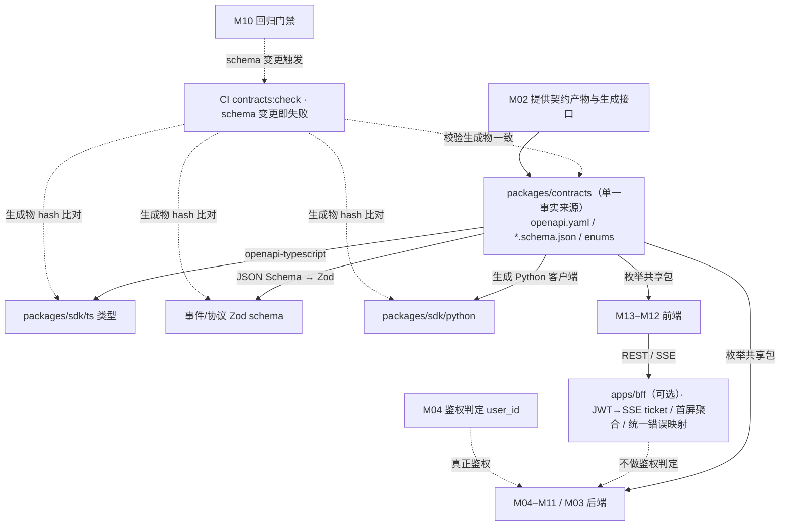
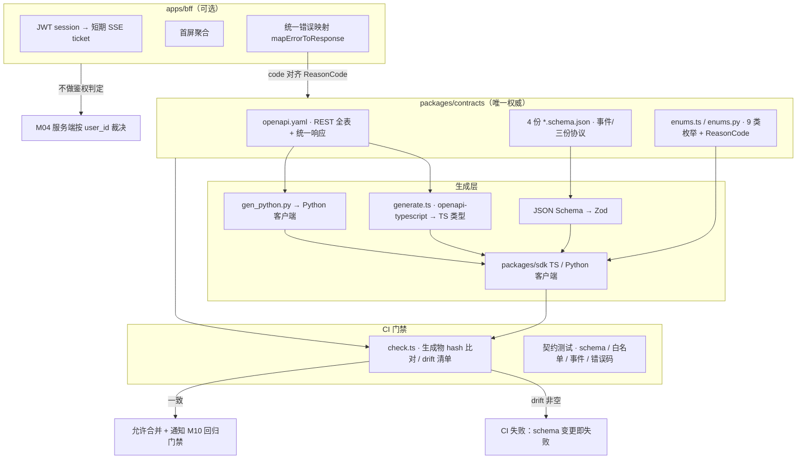
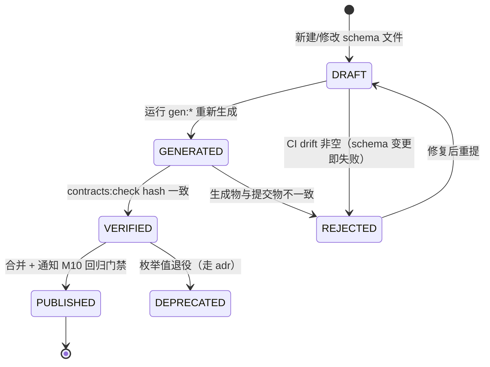

# M02 · 前后端契约（原 W6）

> **⚠ ADR-003 变更覆盖声明（2026-11-21）**：`/api/skills` 端点与 `SkillManifest` schema 已随技能预取整套删除（openapi.yaml 已移除并重新生成 SDK）；下文 §9.0 义务 1 中"`GET /api/skills` 入 openapi"为 v1.0 旧口径，现仅 `/api/guardrails/hits` 保留。事件契约中 `AgentEventKind.SKILL` / skill 事件分支亦已删除（生产零 emit），详见 ADR-003 §13.2。

> **文档类型**：可独立交付 / 可独立验收的模块设计文档
> **来源**：`设计方案.md` v1.1 §6.9、§7.2、§7.3、§4 全章、§6.8、§8 W6 行、§11.9、§1.3、§0 D-3/D-5、§9.6
> **版本**：v1.0　|　**拆分日期**：2026-11-15　|　**状态**：设计定稿（含 4 项待 M02 定稿并固定到 CI）　|　**最近修订**：2026-11-16（v1.3，ADR-001 同步：grid 可空、`SPEC_MISSING`/`CLARIFICATION_REQUIRED`/`CLARIFICATION_LIMIT` 三码、`ask_user` 事件共 18 种、`POST /clarifications` 端点；**v1.4，ADR-002 同步：`GET/PUT/DELETE /api/users/me/preferences`、`UserPreference` 证据化字段、`PreferenceEvent` 只追加表；不新增 ReasonCode / AgentEventKind**；变更项需收敛入 `openapi.yaml`）
> **对应编号**：W6 / FR-22（主责）
> **主责应用或包**：`packages/contracts`、`packages/sdk`、`apps/bff`（可选）
> **一句话定义**：把 REST、事件、三份协议、枚举与错误码收敛到 `packages/contracts` 这一单一事实来源，用生成物 + CI 一致性校验保证前后端对同一份契约的理解永不漂移。

---

## 0. 模块速览（零基础可读）

### 0.1 项目在做什么（本模块所需的最小背景）

WidgetPilot 是一个「用自然语言生成手机桌面控件」的 AI Agent 产品：规格可选预填（缺省由系统询问补全，系统不推断，v1.3 ADR-001 D-6）、输入描述、可传附件，系统生成 TSX + React 代码，经编译与一次性沙箱测试后产出控件包，最终按真实比例渲染成受限 iframe 卡片。整条链路由**多个前后端服务**协作完成：React SPA、可选 BFF、control-plane、orchestrator、guardrails、retriever、sandbox-runner、eval-runner。这些服务之间要交换 REST 请求、SSE 事件流、`WidgetSpec` / `WidgetBundle` / `WidgetRuntime` 三份协议，以及 `SessionState` / `BundleState` / `ReasonCode` 等枚举。

如果每个模块各写一套类型，前后端就会悄悄漂移：后端加了一个 `kind`，前端 reducer 不认识；后端把 `grid` 枚举改了，前端卡片尺寸映射失效；`401` / `403` / `409` 各模块各自定义业务码。FR-22「前后端契约单一事实来源」就是为解决这件事：**契约只在一处定义，前后端产物都从它生成，任何 schema 变更都要过 CI 一致性校验，校验不过即失败**。

### 0.2 本模块在端到端 14 步链路中的位置

```
① 登录 → 新建会话（grid 可选预填，缺省由系统询问补全【v1.3 ADR-001 D-6】）
② 输入描述 + 上传附件 → 传输层校验 → 对象存储 → attachment_id
③ 语义层校验 → 不足则 AWAITING_INPUT
④ 进 LLM 护栏 → 命中不进模型
⑤ 意图与规格确定 → 预取生成规程
⑥ 上下文装配（固定槽位、硬过滤优先）
⑦ 生成回路：先出 WidgetSpec，再出 TSX + React 代码
⑧ 出 LLM 护栏（schema / 能力白名单 / PII / 规格一致）
⑨ 契约校验：spec ↔ manifest ↔ 代码能力声明 + hash
⑩ 沙箱：编译 → 渲染 → 尺寸/运行时错误/能力/交互断言 → 证据包
⑪ 生成 WidgetBundle，COMPLETED
⑫ artifact 事件 → 控件墙按 grid 真实比例渲染卡片
⑬ 评测合格 → 脱敏 → 入库门禁 → 公共语料（可撤回）
⑭ 全流程按 seq 写 SSE 事件流与只追加审计；成本分账
```

本模块**不产生任何业务步骤**，而是为 ①–⑭ 的每一步提供「交换数据的语法与语义」：REST 接口（§4.4）、SSE 事件（§4.5）、三份协议（§4.3）、枚举与错误码（§4.2）。原文 §8 W6 行把它定位为 `OpenAPI 3.1 / openapi-typescript / Zod`，关键要点「单一事实来源，CI 校验一致性」，验收「**schema 变更即失败**」。它是 00 总览 §2.1 中的**支撑型模块**（用虚线连到全部模块），契约先行是建议验收顺序的第一阶段（00 总览 §2.2：`M02 → 01 基线`）。

### 0.3 为什么必须有这个模块

1. **前后端不能各写一套类型**：原文 §6.9 明确 `packages/contracts` 是单一事实来源；`openapi-typescript` 生成 TS 类型、Zod 校验事件与协议、枚举共享包前后端共用同一份（§6.8 契约层）。
2. **schema 演进必须可门禁**：原文 §8 W6 行验收「schema 变更即失败」；§11.9 契约测试要覆盖 `WidgetSpec` / `manifest` schema、能力白名单、事件 schema、错误码。没有 CI 一致性校验，协议演进会静默破坏 M15 分帧、M17 reducer、M16 bridge。
3. **错误语义必须统一**：原文 §4.4 / §6.9 要求错误响应统一 `{ code, message, traceId, retryable, evidenceRef? }` 且与 `ReasonCode` 对齐；否则前端无法「不显示裸失败」。
4. **权限边界必须写进契约**：原文 §6.9「服务端按 `user_id` 对每个 REST 请求与每条 SSE 事件做权限校验；前端隐藏按钮只是体验」「BFF **不做鉴权判定**」。这条边界要在契约与 BFF 职责里被固定，避免把鉴权误放进 BFF。

### 0.4 上下游邻居（mermaid）



- **上游（消费者）**：全部前端模块 M13–M12 与后端模块 M04–M11 / M03 都消费 M02 的生成物；M10 在 schema 变更时触发回归门禁。
- **下游（被消费）**：`packages/sdk`（TS / Python 客户端）、`packages/contracts/enums`（前后端共用）、BFF 的统一错误映射。
- **横切**：M02 是支撑型模块，为所有模块提供契约基线；**它本身不实现业务接口，也不做鉴权判定**。

### 0.5 原文对照表

| 本模块内容 | 原文章节 |
|---|---|
| `packages/contracts` 单一事实来源（OpenAPI 3.1 + JSON Schema/Zod + 枚举与错误码）、CI 一致性、schema 变更即失败 | §6.9、§8 W6 行 |
| `packages/sdk` 生成的 TS / Python 客户端 | §7.2 |
| BFF 职责：OIDC/JWT session → 短期 SSE ticket、聚合首屏数据、统一错误映射、**不做鉴权判定** | §6.9、§7.1、§6.8 |
| 服务端按 `user_id` 对每个 REST 请求与每条 SSE 事件校验；前端隐藏按钮只是体验 | §6.9、§1.3、§7.3 |
| 统一错误响应 `{ code, message, traceId, retryable, evidenceRef? }` 与 `ReasonCode` 对齐 | §4.4、§6.9 |
| `openapi-typescript` 生成 TS 类型；事件与协议用 Zod；枚举共享包 | §6.8 契约层 |
| 枚举共享包 9 类（SessionState / BundleState / GridSpec / WidgetType / AttachmentRole / Capability / ModelTier / ReasonCode / AgentEventKind） | §4.2、§4.5、§6.9 |
| 三份协议 `WidgetSpec` / `WidgetBundle` / `WidgetRuntime` 完整定义 | §4.3 |
| REST API 概要与统一响应 | §4.4 |
| 实时事件协议 `AgentEvent` / `AgentEventKind` | §4.5 |
| 前后端职责划分（事件 schema / 渲染协议 / 状态枚举契约共担） | §7.3 |
| 契约测试（schema / 能力白名单 / 事件 schema / 错误码） | §11.9 |
| 待决项：401/403/409 业务码、管理员角色、refresh 路径、SSE 窗口 N / 租约 TTL | §1.3、§4.2、§5 D1、§9.6、基线 §5.3/§5.4 |

---

## 1. 模块定位与职责边界

### 1.1 为什么必须有（三个不可替代的职责）

1. **单一事实来源**：REST（OpenAPI 3.1）、事件 / 三份协议（JSON Schema / Zod）、枚举与错误码只在一处定义（§6.9）。任何模块不得另写一套类型。
2. **生成物 + CI 一致性门禁**：`openapi-typescript` 生成 TS 类型、`packages/sdk` 生成 TS / Python 客户端；CI 校验前后端生成结果一致，**schema 变更即失败**（§8 W6 行）。这是「契约不被悄悄改坏」的唯一机制。
3. **错误与权限语义的固化**：统一错误响应与 `ReasonCode` 对齐（§4.4）；BFF 只做 SSO / 聚合 / SSE ticket / 错误映射，**不做鉴权判定**（§6.9），真正鉴权在服务端按 `user_id` 执行。

### 1.2 做什么（职责清单）

| # | 职责 | 说明 |
|---|---|---|
| R1 | 维护 `packages/contracts/openapi.yaml`（OpenAPI 3.1，REST 全表） | §4.4 全部接口 |
| R2 | 维护 `events.schema.json` / `widget_spec.schema.json` / `widget_bundle.schema.json` / `widget_runtime.schema.json` | JSON Schema 源，生成 Zod |
| R3 | 维护 `enums`（前后端共用同一份枚举与错误码） | 9 类枚举 + `ReasonCode` |
| R4 | 生成 `packages/sdk` TS / Python 客户端 | §7.2 |
| R5 | `openapi-typescript` 生成 TS 类型 | §6.8、§8 W6 行 |
| R6 | CI 一致性校验脚本 `contracts:check`（生成物 hash 比对，schema 变更即失败） | §6.9、§8 W6 行 |
| R7 | 统一错误响应中间件 / 映射函数 | `{ code, message, traceId, retryable, evidenceRef? }` |
| R8 | BFF 职责（可选）：OIDC/JWT session → 短期 SSE ticket、首屏聚合、统一错误映射 | §6.9、§7.1 |
| R9 | 契约测试：schema / 能力白名单 / 事件 schema / 错误码 | §11.9 |
| R10 | 定稿并固定 4 个待决项到 CI | 见 §9 |
| R11 | schema 变更触发 M10 回归门禁的通知 | §0 变更规则、§9.5 |

### 1.3 不做什么（明确排除，边界切割点）

| 不做 | 归属模块 | 边界说明 |
|---|---|---|
| 实现任何业务 REST 接口（会话 / 附件 / 包 / 语料 / 评测 / 审计） | **各 Mxx 实现**：M04 会话鉴权、M05 附件、M09 包、M10 语料评测、M11 治理观测 | M02 只**描述**接口（openapi.yaml），不写 handler；接口实现分散在各主链路模块 |
| 鉴权判定（JWT 校验、`user_id` 隔离、角色裁剪、403 裁决） | **M04** | BFF 与 M02 都**不做鉴权判定**；原文 §6.9 / §7.3 明确服务端裁决 |
| SSE `seq` 生成、事件扇出、心跳、`Last-Event-ID` 续传 | **M04 / M03** | M02 只定义事件 schema |
| 三份协议的业务产出（生成 `WidgetSpec`、产码、编译、沙箱、CSP 下发） | **M07 / M08 / M09** | M02 只定义协议结构 |
| 前端分帧 / reducer / 渲染 / 卡片 UI | **M15 / M17 / M16 / M14** | M02 只生成类型与 Zod |
| 评测执行、统计口径、回归门禁的判定逻辑 | **M10** | M02 在 schema 变更时**触发**门禁，不实现门禁 |
| 在线关闭门禁的开关 | 全系统禁止 | 原文 §1.7 #8、§8 全局口径 |

> **边界最易混淆的一处**：M02 与 M04 都涉及「鉴权」，但 M04 是**判定与执行**（JWT 校验、`user_id` 过滤、403），M02 只是在契约里写清「权限 = 本人 / 审核员 / 管理员」并让 BFF 把 JWT session 换成短期 SSE ticket；**BFF 不做鉴权判定**（§6.9）。前端隐藏按钮只是体验（§1.3），契约不授予任何权限。

### 1.4 输入 / 输出与上下游契约

| 方向 | 内容 | 契约形式 |
|---|---|---|
| 入 | 原文 §4 全章的实体 / 枚举 / 三份协议 / REST / 事件定义 | 设计定稿，M02 转写为 schema |
| 入 | 各模块对接口的增删诉求 | 变更请求 → 改 `openapi.yaml` / `*.schema.json` |
| 出 | `openapi.yaml` / 4 份 `*.schema.json` / `enums.ts` / `enums.py` | `packages/contracts` 产物 |
| 出 | `packages/sdk/ts` 类型与客户端、`packages/sdk/python` 客户端 | 生成物 |
| 出 | Zod schema（事件 / `WidgetSpec` / `WidgetBundle` / `WidgetRuntime`） | 生成物 |
| 出 | 统一错误映射函数、SSE ticket 签发接口 | `apps/bff` |
| 出 | `contracts:check` 结果（一致 / drift 清单） | CI 报告 |
| 出 | schema 变更事件 → M10 回归门禁 | CI 触发 |

### 1.5 承载的横切能力 X*

- **本模块不承载任何 X1–X12 横切能力**（00 总览 §3.2 中 M02 行的「承载 X*」列为 `—`）。它是 **FR-22「前后端契约单一事实来源」的主责模块**（00 总览 §4、§3.2）。
- **支撑定位**：X* 是能力标签，映射到承载它的 D/W 模块；M02 作为支撑型模块，为所有承载 X* 的模块提供**契约基线**（事件 schema 共担 X12、渲染协议共担 X9、状态枚举契约共担 X1，见 §7.3），但自身不实现这些能力，不另建 X 文档。

### 1.6 关键设计原则

1. **单一事实来源**：契约只在 `packages/contracts` 定义，前后端产物全部生成，禁止手写重复类型（§6.9、§6.8）。
2. **schema 变更即失败**：CI `contracts:check` 比对生成物 hash；任何 schema / 枚举 / 错误码变更若未同步生成物，CI 失败（§8 W6 行）。
3. **前后端共用同一份枚举**：`SessionState` / `BundleState` / `GridSpec` / `WidgetType` / `AttachmentRole` / `Capability` / `ModelTier` / `ReasonCode` / `AgentEventKind` 前后端共用（§6.9、基线 §3）。
4. **错误码与 `ReasonCode` 对齐**：统一响应 `{ code, message, traceId, retryable, evidenceRef? }`，`code` 成功为 `"OK"`、失败为 `ReasonCode`（§4.4、§6.9）。
5. **BFF 不做鉴权判定**：BFF 只做 SSO / 首屏聚合 / SSE ticket / 统一错误映射；权限由服务端按 `user_id` 对每个 REST 请求与每条 SSE 事件裁决（§6.9）。
6. **零 Agent 框架（D-5）**：契约与生成脚本不使用 AI SDK / CopilotKit / AG-UI SDK；`openapi-typescript` / Zod / 代码生成器是通用工具，不是 Agent 框架（§11.1 保留清单）。
7. **变更触发回归**：schema / 枚举 / 错误码变更同步 `packages/contracts/`，触发 M02 CI 校验与 M10 回归门禁，并在 `docs/adr/` 记录（基线 §0 变更规则）。

---

## 2. 技术栈

### 2.1 分层选型表

| 层 | 选型 | 版本 / 约束 | 为什么选 | 明确不用什么 |
|---|---|---|---|---|
| REST 契约 | **OpenAPI 3.1**（`openapi.yaml`） | 3.1.x | 机器可读、工具生态成熟、可由 FastAPI 自动生成再人工校准（§6.9） | 不用 Swagger 2.0 / 手写接口文档当权威 |
| 事件 / 协议契约 | **JSON Schema + Zod** | JSON Schema draft 2020-12；Zod 3.x | 事件 / `WidgetSpec` / `WidgetBundle` / `WidgetRuntime` 用 JSON Schema 作源、生成 Zod 供运行时校验（§6.9、§6.8） | 不用各模块手写 TS interface 当权威 |
| TS 类型生成 | `openapi-typescript` | 由 `openapi.yaml` 生成 `packages/sdk/ts/types.ts` | 前后端 TS 类型一致（§6.8、§8 W6 行） | 不手写重复类型 |
| TS / Python 客户端 | `packages/sdk` 生成物 | TS + Python | §7.2 明确「生成的 TS / Python 客户端」 | 不手搓 fetch 封装当权威 |
| 枚举共享包 | `enums.ts` / `enums.py` | 前后端各一份、同源生成 | 9 类枚举共用同一份（§6.9） | 不前后端各定义一遍 |
| 运行时校验 | Zod（TS）/ Pydantic v2（Python） | final 严格校验 | 事件边界与协议边界校验（§6.8、§11.9） | 不用「信任模型输出」 |
| BFF（可选） | Node/TS（与 `apps/bff` 一致） | 无状态 | JWT session → 短期 SSE ticket、首屏聚合、统一错误映射（§6.9、§7.1） | **不做鉴权判定**；不引入 Agent 框架 |
| CI 一致性 | `contracts:check` 脚本（hash 比对） | CI 必跑 | schema 变更即失败（§8 W6 行） | 不靠人工 review 防漂移 |
| 契约测试 | Vitest（TS）/ pytest（Python） | §11.9 | schema / 能力白名单 / 事件 schema / 错误码 | — |
| Agent 事件层 | 原生 SSE + 自定义事件 schema | 手写 | 分通道、seq、重连、回放由 M15/M17 手写 | **不用** AI SDK / CopilotKit / AG-UI SDK / MCP SDK |

### 2.2 硬约束（D-5 零 Agent 框架）

- **禁止引入**：Vercel AI SDK / `streamUI` / CopilotKit / AG-UI SDK / A2UI SDK / LangChain / LangGraph / Temporal / MCP SDK / LangFuse（原文 §11.1、§0 D-5）。
- **保留的通用基础设施**：FastAPI / Pydantic v2 / React 19 / Vite / TypeScript / Zod / OpenTelemetry SDK / `openapi-typescript` / JSON Schema 工具链（原文 §11.1 保留清单）。代码生成器是通用工具，不是 Agent 框架。
- **契约唯一性硬约束**：任何 `interface` / `enum` / 错误码若未从 `packages/contracts` 生成，CI 视为 drift 并失败。
- **BFF 硬约束**：不得包含 `user_id` 鉴权判定、不得签发长期权限、不得缓存越权数据；ticket 短期有效（§6.9）。
- **错误码硬约束**：统一响应 `code` 必须是 `"OK"` 或 `ReasonCode` 字面量，不得自造业务码（401/403/409 的归属见 §9 待决项，由 M02 定稿）。

### 2.3 运行时依赖

| 依赖 | 用途 | 不可用时的行为 |
|---|---|---|
| CI runner | 跑 `contracts:check` / 生成物 hash 比对 | CI 不可用时**禁止合并**契约变更（fail-closed） |
| `openapi-typescript` / 代码生成器 | 生成 TS 类型与 SDK | 生成失败即 CI 失败 |
| Zod / Pydantic v2 | 运行时 schema 校验 | 校验失败即拒绝请求 / 事件，不降级 |
| `apps/bff`（可选） | SSO / 聚合 / SSE ticket / 错误映射 | 直连 control-plane 亦可；**BFF 不做鉴权判定** |
| M10 回归门禁 | schema 变更触发回归 | 未触发则禁止 schema 上线（基线 §0 变更规则） |
| `docs/adr/` | 契约变更记录 | 变更未记录视为流程不合规 |

### 2.4 monorepo 代码落位（§7.2，完整抄入相关片段）

```
widgetpilot/
  apps/
    web/                   # React 控制面（M13–M12）
    bff/                   # 可选：JWT / 聚合 / SSE ticket（M02）
  packages/
    contracts/             # M02：单一事实来源
      openapi.yaml
      events.schema.json
      widget_spec.schema.json
      widget_bundle.schema.json
      widget_runtime.schema.json
      enums.ts / enums.py
      scripts/generate.ts / gen_python.py / check.ts
    sdk/                   # M02：生成的 TS / Python 客户端
      ts/types.ts / client.ts
      python/widgetpilot_client/
    widget_bridge/         # M09 / M16 宿主 ↔ iframe bridge 类型
  services/control_plane/  # M04/M09/M11 业务接口实现（消费契约，不定义契约）
  infra/deploy/            # CSP 模板等
  docs/adr/                # 契约变更决策记录
```

---

## 3. 设计架构

### 3.1 内部组件与职责（图 + 表）



| 组件 | 职责 | 关键不变量 |
|---|---|---|
| `openapi.yaml` | REST 全表、请求/响应体、权限、统一响应 | 与 §4.4 一致；`code` 只取 `OK`/`ReasonCode` |
| 4 份 schema | 事件 / `WidgetSpec` / `WidgetBundle` / `WidgetRuntime` | 与 §4.3 / §4.5 逐字段一致 |
| `enums` | 9 类枚举 + `ReasonCode` | 前后端同源生成，值集合完全一致 |
| `generate.ts` / `gen_python.py` | 生成 TS 类型 / Zod / Python 客户端 | 输入只有 `packages/contracts` |
| `check.ts` | 生成物 hash 比对、drift 清单 | drift 非空 → CI 非零退出 |
| 契约测试 | schema / 能力白名单 / 事件 / 错误码断言 | §11.9 覆盖项全绿 |
| BFF | SSO / 聚合 / SSE ticket / 错误映射 | **不做鉴权判定**；ticket 短期 |

### 3.2 处理流程与数据流（编号步骤）

1. 设计定稿（原文 §4）→ M02 转写为 `openapi.yaml` + 4 份 `*.schema.json` + `enums`。
2. 开发者改动任一契约文件 → 提交 PR。
3. CI 触发 `contracts:check`：**重新生成** TS 类型 / Zod / Python 客户端 → 与仓库已提交的生成物做 hash 比对。
4. 若生成物不一致（开发者改了 schema 但未重新生成，或前后端生成结果不同）→ drift 清单非空 → **CI 失败**（schema 变更即失败，§8 W6 行）。
5. 开发者跑 `pnpm gen:*` 重新生成并提交生成物 → CI 通过。
6. CI 跑契约测试：`WidgetSpec` / `manifest` schema、能力白名单 `["react","@widget/bridge"]`、事件 schema、错误码（§11.9）。
7. schema / 枚举 / 错误码变更 → 自动通知 **M10 回归门禁**（规程 / prompt / 模型 / 检索 / 阈值变更同样触发，基线 §0），并在 `docs/adr/` 记录。
8. 运行时：BFF 把 OIDC/JWT session 换成短期 SSE ticket（不做鉴权判定）；control-plane 按 `user_id` 对每个 REST 请求与每条 SSE 事件裁决；错误统一经 `mapErrorToResponse` 映射为 `{ code, message, traceId, retryable, evidenceRef? }`。
9. 前端 M15 / M17 / M16 消费生成的 TS 类型与 Zod；后端 M04–M11 / M03 消费 Python / Pydantic 模型。

### 3.3 状态机

**A. 契约产物生命周期状态机（M02 拥有，【推导·需评审】）**



> `DRAFT/GENERATED/VERIFIED/PUBLISHED/REJECTED/DEPRECATED` 为【推导·需评审】：原文只给「CI 校验前后端生成结果一致，schema 变更即失败」，未给产物状态枚举名。

**B. 本模块描述但不拥有的状态机**：`SessionState`（M04，§4.2）、`BundleState`（M09，§4.2）。M02 只在 `enums` 中定义其字面量集合，不实现迁移。

### 3.4 关键机制、算法与不变量清单

**A. 单一事实来源与生成链**

```
packages/contracts/openapi.yaml  --openapi-typescript-->  packages/sdk/ts/types.ts
packages/contracts/*.schema.json --JSON Schema→Zod---->  packages/sdk/ts/schemas.ts
packages/contracts/openapi.yaml  --gen_python.py------->  packages/sdk/python/
packages/contracts/enums        --同源生成------------>  enums.ts / enums.py（前后端共用）
```

**B. CI 一致性校验（`contracts:check`）**：对生成物计算确定性 hash（排序后的文件内容摘要），与仓库已提交生成物比对；drift 非空即非零退出。校验前后端生成结果一致（§6.9）。

**C. 统一错误映射**：`code` 与 `ReasonCode` 对齐；`evidenceRef?` 失败时指向证据；`retryable` 由错误类别决定（§4.4、§6.9）。

**D. 权限边界固化**：契约里写清每个接口的权限（公开 / 本人 / 审核员 / 管理员）；BFF 只换 ticket，服务端按 `user_id` 裁决（§6.9、§7.3）。

**不变量清单**

| # | 不变量 | 断言方式 |
|---|---|---|
| I1 | 所有 REST 接口只在 `openapi.yaml` 定义一处，无重复定义 | 扫描仓库无第二份路径清单 |
| I2 | `enums.ts` 与 `enums.py` 的枚举值集合完全一致 | 生成物集合相等断言 |
| I3 | 生成物与契约源 hash 一致（无 drift） | `contracts:check` 退出码 = 0 |
| I4 | 统一响应 `code ∈ {"OK"} ∪ ReasonCode` | 契约测试遍历错误响应 |
| I5 | 三份协议 schema 与原文 §4.3 逐字段一致 | schema 快照断言 |
| I6 | 事件 schema 覆盖全部 `AgentEventKind`，未知 kind 可容忍 | Zod 测试 + 未知 kind 样例 |
| I7 | 能力白名单恰为 `["react","@widget/bridge"]` | 常量断言（§11.1、§2.4 #2） |
| I8 | BFF 不含鉴权判定逻辑 | 静态扫描无 `user_id` 裁决分支 |
| I9 | 4 个待决项已定稿并固定到 CI | §9 定稿项逐项有测试 |
| I10 | schema 变更触发 M10 回归门禁通知 | CI 事件 spy 断言 |

### 3.5 与其他模块的时序（关键 3 个场景）

**场景 1：契约变更**
`开发者改 openapi.yaml → PR → contracts:check 重新生成 + hash 比对 → drift 非空则 CI 失败（schema 变更即失败）→ 重新 gen:* 并提交 → 通过 → 通知 M10 回归门禁 → 写 docs/adr/`

**场景 2：前端消费**
`M15 分帧 → 用生成的 Zod 校验 AgentEvent → M17 reducer 归约 → M16 用 WidgetRuntime 类型渲染卡片；所有类型来自 packages/sdk/ts`

**场景 3：鉴权边界**
`用户登录 → BFF 用 JWT session 签短期 SSE ticket（不做鉴权判定）→ 前端订阅 /events → control-plane 按 user_id 对每条 SSE 事件裁决 → 越权 403 经统一错误映射返回`

### 3.6 部署形态与伸缩

| 形态 | 说明 |
|---|---|
| `packages/contracts` / `packages/sdk` | 构建期产物，npm/pip 包，随 monorepo 版本发布，无运行时服务 |
| `apps/bff`（可选） | 无状态，按 QPS 伸缩（§7.1）；只做 SSO / 聚合 / ticket / 错误映射 |
| CI `contracts:check` | 每次 PR 必跑，fail-closed；不提供在线关闭开关 |
| 契约测试 | Vitest / pytest 在 CI 跑，覆盖 §11.9 |

---

## 4. 接口契约

> **M02 的特殊性**：它不实现业务接口，而是**提供契约产物与生成接口**。本节 4.1 列出它提供的产物、生成接口与 BFF 接口；4.2–4.6 给出事件 schema、函数签名、统一错误、并发约定与接口状态表。业务 REST 全表（由 M02 维护、各 Mxx 实现）见 4.1.4。

### 4.1 消费 / 提供的接口表

#### 4.1.1 提供的契约产物清单

| 产物 | 路径 | 格式 | 内容 | 消费者 | 权威级别 |
|---|---|---|---|---|---|
| REST 契约 | `packages/contracts/openapi.yaml` | OpenAPI 3.1 | §4.4 全部接口、请求/响应、权限、统一响应 | 全部模块 | **单一事实来源** |
| 事件 schema | `packages/contracts/events.schema.json` | JSON Schema | `AgentEvent` / `AgentEventKind` | M04/M15/M17/M03 | 单一事实来源 |
| 生成协议 schema | `packages/contracts/widget_spec.schema.json` | JSON Schema | `WidgetSpec` | M07/M08/M02 | 单一事实来源 |
| 产物协议 schema | `packages/contracts/widget_bundle.schema.json` | JSON Schema | `WidgetBundle` / `manifest` | M08/M09/M16 | 单一事实来源 |
| 偏好 schema【v1.4】 | `packages/contracts/preference.schema.json` | JSON Schema | `UserPreference`（证据化字段）/ `PreferenceEvent`（只追加）；与 §6.2 字段一致 | M07/M11/M13/M14 | 单一事实来源（ADR-002） |
| 渲染协议 schema | `packages/contracts/widget_runtime.schema.json` | JSON Schema | `WidgetRuntime` / 7 条 bridge | M09/M16 | 单一事实来源 |
| 错误码 | `packages/contracts/enums.ts` / `enums.py` | TS / Python | `ReasonCode` 等 9 类枚举 | 前后端共用 | 单一事实来源 |
| TS 类型 | `packages/sdk/ts/types.ts` | TS | `openapi-typescript` 生成 | M13–M12 | 生成物 |
| Zod schema | `packages/sdk/ts/schemas.ts` | TS | 事件 / 三协议运行时校验 | M15/M17 | 生成物 |
| TS 客户端 | `packages/sdk/ts/client.ts` | TS | REST 客户端 | 前端 | 生成物 |
| Python 客户端 | `packages/sdk/python/` | Python | REST 客户端 + Pydantic 模型 | 后端 | 生成物 |

#### 4.1.2 生成接口（命令 / 函数签名 | 输入 | 输出 | 触发时机）

| 生成接口 | 输入 | 输出 | 触发时机 |
|---|---|---|---|
| `pnpm gen:openapi`（`openapi-typescript`） | `openapi.yaml` | `packages/sdk/ts/types.ts` | 契约变更 / CI |
| `pnpm gen:zod`（JSON Schema → Zod） | 4 份 `*.schema.json` | `packages/sdk/ts/schemas.ts` | 契约变更 / CI |
| `pnpm gen:python`（`gen_python.py`） | `openapi.yaml` + schemas | `packages/sdk/python/` | 契约变更 / CI |
| `pnpm gen:enums` | `enums` 源 | `enums.ts` / `enums.py` | 枚举变更 / CI |
| `pnpm contracts:check` | 契约源 + 已提交生成物 | `{ ok, drift }` | **每次 PR 必跑** |

#### 4.1.3 BFF 提供的接口（方法 | 路径 | 权限 | 请求 | 响应 | 状态码）

| 方法 | 路径 | 权限 | 请求 | 成功响应（【契约约定】） | 状态码 |
|---|---|---|---|---|---|
| `POST` | `/api/bff/sse-ticket` | 已登录（JWT session） | `{ session_id }` | `{ ticket, expires_at, events_url }` | 200 / 401 |
| `GET` | `/api/bff/bootstrap` | 已登录 | — | `{ user, sessions[], metrics_summary }` 首屏聚合 | 200 / 401 |
| `GET` | `/api/bff/health` | 公开 | — | `{ status:"OK" }` | 200 |
| — | 统一错误映射（中间件，非 HTTP 接口） | — | `err` | `ApiResponse<never>` | 见 §5.4 |

> BFF 接口路径、`ticket` / `bootstrap` 字段为【契约约定】：原文 §6.9 只描述职责（SSO / 聚合 / SSE ticket / 错误映射），未列路径与字段名，由 M02 定稿到 `openapi.yaml`。**BFF 不做鉴权判定**（§6.9），`401` 由 JWT session 校验产生，真正 `user_id` 隔离在 M04。

#### 4.1.4 M02 维护的 REST API 全表（§4.4，各 Mxx 实现）

| 方法 | 路径 | 用途 | 权限 | 主责模块 |
|---|---|---|---|---|
| `POST` | `/api/auth/register` / `/login` | 注册 / 登录，签发 JWT | 公开 | M04 |
| `GET` / `POST` | `/api/sessions` | 会话列表 / 新建（`grid` 可选，缺省由系统询问补全，v1.3 ADR-001 D-6） | 本人 | M04 / M13 |
| `GET` | `/api/sessions/{id}` | 会话快照 + 产物引用 | 本人 | M04 / M13 |
| `GET` / `PUT` / `DELETE` | `/api/users/me/preferences` | 读偏好 / 显式写偏好（`explicit`=1.0）/ 清除（可带 `fields`）【v1.4 ADR-002 D-10/D-13】 | 本人 | M07（M04 鉴权与路由） |
| `POST` | `/api/sessions/{id}/messages` | 提交描述 + `attachment_ids` + 可选 `grid`（v1.3 可空） | 本人 | M04 / M14 |
| `POST` | `/api/sessions/{id}/clarifications` | 回答澄清问题（规格缺失 / 模型 `ask_user`），body `{ question_id, answer }`【v1.3 ADR-001 D-7 新增】 | 本人 | M04 / M14 |
| `POST` | `/api/sessions/{id}/interrupt\|resume\|cancel` | 打断 / 继续 / 取消 | 本人 | M04 / M14 |
| `POST` | `/api/attachments` | 附件上传，返回 `attachment_id` | 本人 | M05 |
| `PATCH` | `/api/sessions/{id}/attachment-roles` | 纠偏附件 role | 本人 | M05 / M14 |
| `GET` | `/api/sessions/{id}/events` | SSE 事件流（`Last-Event-ID` + `runId`） | 本人 + 短期 ticket | M04 / M15 |
| `GET` | `/api/bundles` | 当前用户控件包列表 | 本人 | M09 / M16 |
| `POST` | `/api/bundles/{id}/install\|delete\|rollback` | 包状态管理 | 本人 | M09 / M16 |
| `GET` | `/api/bundles/{id}/preview` | 受限 iframe 渲染所需编译产物引用 | 本人 | M09 / M16 |
| `GET` | `/api/bundles/{id}/evidence` | manifest / 静态校验 / 沙箱测试 / trace | 本人 | M09 / M11 |
| `GET` | `/api/corpus` / `POST /api/corpus/{id}/revoke` | 公共语料检索（内部）/ 撤回 | 审核员 | M10 |
| `GET` | `/api/evals` / `/api/metrics` / `/api/audit` | 评测、指标、审计 | 管理员 | M10 / M11 |

> 统一响应 `{ code, message, traceId, retryable, evidenceRef? }`；`code` 与 `ReasonCode` 对齐（原文 §4.4）。`refresh` 路径未列出，见 §9 待决项。

### 4.2 事件接口（SSE `kind` 与 payload）

M02 定义 `events.schema.json`，覆盖原文 §4.5 全部 `AgentEventKind`（完整枚举见 §5.1 / §6.2）。事件统一带 `seq` / `sessionId` / `runId` / `ts` / `kind` / `phase` / `payload` / `traceId`。

| `kind` | payload 形态（原文 §4.5 / §6.4） | schema 校验要点 |
|---|---|---|
| `run` | `{ runId, phase, grid, attempt_no }` | `grid ∈ GridSpec` |
| `plan` | 结论式短句（不是思维链） | string |
| `spec` | 逐步逼近完整的 `WidgetSpec` JSON（partial） | partial  tolerant；final 用 `widget_spec.schema.json` 严格校验 |
| `attachment` | `role` 判定 + `insight_ref` | `role ∈ AttachmentRole` |
| `skill` / `routing` | 规程 id、模型档位、阈值命中 | `model_tier ∈ ModelTier` |
| `code` | 行级增量 patch `{ from_line, to_line, text }` | 行号 ≥ 0 |
| `guard` / `validation` / `sandbox` | 通过项、命中项、失败原因码 | `reason_code ∈ ReasonCode` |
| `artifact` | `bundle_id` + 预览引用 | `bundle_id` 非空 |
| `cost` / `checkpoint` / `interrupted` / `notice` / `error` / `done` | 状态与账目 | `error.code ∈ ReasonCode` |
| `ask_user` | `{ question_id, question, options?, allow_text, clarify_count, clarify_limit }`【v1.3 ADR-001 D-7】 | 封闭式问题（≤3 选项或短文本）；`clarify_count ≤ clarify_limit(=2)` |
| **未知 `kind`** | 任意 | schema 允许扩展；前端 reducer 忽略而非报错（§4.5 向前兼容） |

**可靠性约定写入 schema 注释**：`Last-Event-ID` 续传 + 服务端保留最近 N 条、超窗先拉快照；心跳保活；显式 `done` / `error`（无 `done` 视为截断）；事件按 `seq` 在前端 reducer 去重与乱序丢弃（原文 §4.5）。

### 4.3 内部接口与函数签名（TS / Python）

```ts
// packages/contracts/scripts/generate.ts
export function generateTsTypes(specPath: string, outPath: string): Promise<void>;
export function generateZodSchemas(schemaDir: string, outPath: string): Promise<void>;
export function generateEnums(srcPath: string, tsOut: string, pyOut: string): Promise<void>;

// packages/contracts/scripts/check.ts —— CI 一致性
export function verifyGenerated(contractsDir: string, sdkDir: string): Promise<{ ok: boolean; drift: string[] }>;
export function hashGenerated(dir: string): Promise<string>; // 排序后文件摘要

// packages/sdk/ts/schemas.ts —— 生成物（运行时校验）
export const AgentEventSchema: ZodType<AgentEvent>;
export const WidgetSpecSchema: ZodType<WidgetSpec>;
export const WidgetBundleSchema: ZodType<WidgetBundle>;
export const WidgetRuntimeSchema: ZodType<WidgetRuntime>;

// apps/bff —— 统一错误映射与 SSE ticket
export function mapErrorToResponse(err: unknown, traceId: string): ApiResponse<never>;
export function issueSseTicket(userId: string, sessionId: string): { ticket: string; expires_at: string };
export function aggregateBootstrap(userId: string): Promise<BootstrapView>; // 首屏聚合，不做鉴权判定
```

```python
# packages/contracts/scripts/gen_python.py
def generate_python_client(spec_path: str, out_dir: str) -> None: ...
def check_schema_drift(expected_hash: str, sdk_dir: str) -> bool: ...

# packages/sdk/python —— Pydantic v2 模型（生成物，供后端消费）
class AgentEvent(BaseModel):
    seq: int
    sessionId: str
    runId: str
    ts: str
    kind: str
    phase: str
    payload: object
    traceId: str

def parse_event(raw: dict) -> AgentEvent: ...   # 严格校验
```

**被调用的上游接口**：M10 提供 `regression_gate.notify(schema_change)` 供 schema 变更触发；各 Mxx 通过 `import type { ... } from "packages/sdk/ts"` 消费类型（【契约约定】包名）。

### 4.4 统一响应与错误码（原文 §4.4 / §6.9，完整抄入）

```ts
type ApiResponse<T> = {
  code: string;            // 成功 "OK"；失败为 ReasonCode，与枚举对齐
  message: string;
  traceId: string;
  retryable: boolean;
  evidenceRef?: string;    // 失败时指向证据引用
  data?: T;                // 【契约约定】成功载荷
};
```

`code` 与 `ReasonCode` 对齐。错误响应统一映射，前端按 `code` 展示具体原因与「从断点继续 / 改描述重试」入口，**不显示裸「失败」**（原文 §4.4、§6.9、§1.4）。

### 4.5 幂等、重试、超时、限流、并发约定

| 项 | 约定 |
|---|---|
| 幂等 | 生成脚本 `gen:*` 幂等（同输入同输出）；`contracts:check` 可重复运行；REST 幂等约定由各实现模块遵守（如 `interrupt` / `install` 幂等键） |
| 重试 | CI 生成失败即失败，不自动重试掩盖 drift；瞬时故障（网络拉生成器）指数退避有上限 |
| 超时 | SSE ticket 短期有效；BFF 首屏聚合超时走统一错误映射；心跳保活（§4.5） |
| 限流 | BFF 按 QPS 伸缩；限流入口在网关（§7.1）；契约本身不限流 |
| 并发 | 生成物 hash 比对确定性（排序后摘要）；前后端生成并行但结果必须一致 |
| 变更 | 任何 schema / 枚举 / 错误码变更 → 重新生成 → CI 校验 → 通知 M10 回归门禁 → 写 `docs/adr/`（基线 §0） |

### 4.6 接口状态表（契约状态 / 运行态 / 可重试）

| 接口 / 产物 | 契约状态 | 运行态 | 可重试 | 说明 |
|---|---|---|---|---|
| `openapi.yaml`（§4.4 全表） | **定稿**（原文 §4.4） | 构建期 | — | 路径定稿；请求/响应字段部分【契约约定】 |
| 4 份 `*.schema.json`（§4.3 / §4.5） | **定稿**（原文给出完整 TS 定义） | 构建期 | — | 转写为 JSON Schema，逐字段一致 |
| 9 类枚举 + `ReasonCode` | **定稿**（原文 §4.2） | 构建期 | — | 前后端共用同一份 |
| `openapi-typescript` / Zod / Python 生成 | **定稿**（§6.8 / §7.2） | 构建期同步 | 是（重跑 gen） | 生成物 hash 受 CI 校验 |
| `contracts:check` | **定稿**（§8 W6 行「schema 变更即失败」） | CI 同步 | 是 | drift 非空即失败 |
| BFF `/sse-ticket` / `/bootstrap` | **【契约约定】** | 同步 | 是 | 原文只给职责，路径/字段待 M02 定稿 |
| `/api/auth/refresh` | **【推导·需评审】** | 同步 | 是 | 原文「短时 + refresh」未列路径（§9 待决） |
| `401/403/409` 业务码 | **待 M02 定稿** | — | — | 原文 `ReasonCode` 未含，需定稿「扩充/复用」并固定到 CI |
| 管理员角色 `User.role` | **待 M02 定稿** | — | — | §1.3 提及管理员但只有两角色 |
| SSE 窗口 N / 租约 TTL | **待 M02 定稿** | — | — | 原文未给数值（§9 待决） |
| 统一错误映射 | **定稿**（§4.4 / §6.9） | 运行时同步 | — | `code ∈ {OK} ∪ ReasonCode` |
| v1.3 契约变更（`SPEC_MISSING` 等三码、`ask_user` 事件、`clarifications` 端点、`grid` 可空） | **【v1.3 ADR-001】** | 构建期 | — | 需收敛入 `openapi.yaml` 并触发 CI 一致性校验与 M10 回归门禁 |
| v1.4 契约变更（`GET/PUT/DELETE /api/users/me/preferences`、`UserPreference` 证据化字段、`PreferenceEvent` 表） | **【v1.4 ADR-002】** | 构建期 | — | 需收敛入 `openapi.yaml` 与 schema；**不新增** `ReasonCode` / `AgentEventKind`；触发 CI 一致性校验与 M10 回归门禁 |

> 契约状态取值：**定稿**（原文明确）/ **依赖外部**（依赖 M04/M10 等定稿）/ **影子校准中**（数值待影子期校准，如 N、TTL）/ **可选**（BFF 可选，直连 control-plane 亦可）。

---

## 5. 状态、原因码与 API 状态

### 5.1 拥有或参与的状态机与完整枚举（TS 定义）

M02 **拥有**枚举共享包（`enums.ts` / `enums.py` 同源），以下为前后端共用同一份的完整定义（原文 §4.2 / §4.5）：

```ts
// 会话状态机（M04 拥有状态机，M02 拥有枚举值定义）
type SessionState =
  | "DRAFT" | "RUNNING" | "PAUSED" | "AWAITING_INPUT" | "VALIDATING"
  | "COMPLETED" | "FAILED" | "CANCELLED";

// 产物状态机（M09 拥有状态机，M02 拥有枚举值定义）
type BundleState = "GENERATED" | "INSTALLED" | "DELETED";

// 规格 / 控件类型
type GridSpec = "2x2" | "2x4" | "4x2" | "4x4" | "2x1" | "1x2";
type WidgetType = "calendar" | "clock" | "alarm" | "task" | "custom";

// 附件 role / 能力 / 模型档位
type AttachmentRole = "visual_reference" | "content_extraction" | "data_source" | "style_reference";
type Capability = "date" | "timer" | "local_storage" | "static_data" | "theme" | "locale";
type ModelTier = "cheap" | "standard" | "frontier";

// 角色（D-3 两角色；管理员为 §9 待决项）
type UserRole = "user" | "curator";

// 事件 kind（完整枚举，M02 events.schema.json 覆盖全部；v1.3 共 18 种）
type AgentEventKind =
  | "run" | "plan" | "spec" | "attachment" | "skill" | "routing"
  | "code" | "guard" | "validation" | "sandbox" | "artifact"
  | "cost" | "checkpoint" | "interrupted" | "notice" | "error" | "done"
  | "ask_user";   // v1.3 新增（ADR-001 D-7，共 18 种），需收敛入 events.schema.json

// 错误码（与统一响应 code 对齐，完整 17 个；v1.3 新增 3 个）
type ReasonCode =
  | "INPUT_INVALID" | "INTENT_OUT_OF_SCOPE" | "GUARD_INPUT_HIT" | "GUARD_OUTPUT_HIT"
  | "SPEC_CONFLICT" | "CAPABILITY_DENIED" | "CONTRACT_MISMATCH" | "COMPILE_FAILED"
  | "SANDBOX_TEST_FAILED" | "RETRY_EXHAUSTED" | "BUDGET_EXHAUSTED"
  | "SANDBOX_UNAVAILABLE" | "HUMAN_REQUIRED" | "MODEL_ERROR"
  | "SPEC_MISSING" | "CLARIFICATION_REQUIRED" | "CLARIFICATION_LIMIT";   // v1.3 新增（ADR-001），需收敛入 openapi.yaml

// 【推导·需评审】契约产物生命周期状态机（见 §3.3）
type ContractPhase = "DRAFT" | "GENERATED" | "VERIFIED" | "PUBLISHED" | "REJECTED" | "DEPRECATED";
```

**终态**：`SessionState` 的 `COMPLETED/FAILED/CANCELLED`、`BundleState` 的 `DELETED`、`ContractPhase` 的 `PUBLISHED/REJECTED/DEPRECATED`。

### 5.2 状态流转表

| 触发 | 前态 | 后态 | 副作用 | 事件 / 动作 |
|---|---|---|---|---|
| 修改 schema 文件 | `PUBLISHED` | `DRAFT` | 契约源变更 | PR 提交 |
| 运行 `gen:*` | `DRAFT` | `GENERATED` | 重新生成 TS/Zod/Python/enums | 生成脚本 |
| `contracts:check` hash 一致 | `GENERATED` | `VERIFIED` | drift 为空 | CI 通过 |
| drift 非空 | `DRAFT`/`GENERATED` | `REJECTED` | CI 非零退出（schema 变更即失败） | CI 失败 |
| 合并 | `VERIFIED` | `PUBLISHED` | 通知 M10 回归门禁 + 写 `docs/adr/` | 合并 |
| 枚举值退役 | `PUBLISHED` | `DEPRECATED` | ADR 记录 + 回归门禁 | 变更 |

> 会话 / 产物状态流转表由 M04 / M09 拥有，M02 只保证枚举值集合一致；完整流转见原文 §1.4 / 基线 §3.3。

### 5.3 本模块产出 / 消费的 `ReasonCode`（全表，M02 拥有错误码定义）

| 码 | 触发控制点 | 典型失败去向 | 契约中的表现 |
|---|---|---|---|
| `INPUT_INVALID` | 传输层 / 语义层校验 | 拒绝或 `AWAITING_INPUT` | `400` / `422`，`retryable=false` |
| `INTENT_OUT_OF_SCOPE` | 意图白名单 | 拒绝，不进模型 | `422` |
| `GUARD_INPUT_HIT` | 进 LLM 护栏 | 不进模型 | `422` |
| `GUARD_OUTPUT_HIT` | 出 LLM 护栏 | 自纠正回边（≤2） | 事件 `validation` |
| `SPEC_CONFLICT` | 规格校验 / spec 层 | 提示改选规格 | `400` |
| `SPEC_MISSING` | 语义层规格获取（v1.3 ADR-001 D-6） | `AWAITING_INPUT` 询问用户（`notice` 带 `suggest_grid`） | `AWAITING_INPUT` / 事件 `notice` |
| `CLARIFICATION_REQUIRED` | 模型执行中澄清（v1.3 ADR-001 D-7） | `AWAITING_INPUT`（`ask_user` 事件），回答后继续 | 事件 `ask_user` |
| `CLARIFICATION_LIMIT` | 询问次数 > 2（v1.3 ADR-001 D-7） | `HANDOFF` 转人工 + 保留部分产物 | 事件 `error` |
| `CAPABILITY_DENIED` | 能力白名单 / bridge | 回边或运行时拒绝上报 | 事件 `guard` |
| `CONTRACT_MISMATCH` | 契约校验 | 不进沙箱 | 事件 `validation` |
| `COMPILE_FAILED` | TSX 编译 | 回边 | 事件 `validation` |
| `SANDBOX_TEST_FAILED` | 沙箱断言 | 回边 / 超限转人工 | 事件 `sandbox` |
| `RETRY_EXHAUSTED` | 回边 > 2 | `HANDOFF` 转人工 | 事件 `error` |
| `BUDGET_EXHAUSTED` | 四维预算触顶 | 确定性中断 | `429` |
| `SANDBOX_UNAVAILABLE` | 沙箱启动失败 | 降级为静态校验 + 只读诊断 | `503` |
| `HUMAN_REQUIRED` | 超限 / 检索无结果 | 转人工 | 事件 `error` |
| `MODEL_ERROR` | 模型 429/5xx / 解析失败 | 基础设施重试或降级 | `503` / `5xx` |

> 完整失败去向与证据要求见原文 §10.1 / 基线 §7。**所有 `FAILED` 必须携带 `evidenceRef`，前端不得只显示「失败」**。

### 5.4 HTTP 状态码与业务码映射（基线 §5.3，M02 维护并固定到 CI）

| HTTP | 场景 | `code` | `retryable` | 契约状态 |
|---|---|---|---|---|
| `200` | 成功 | `OK` | — | 定稿 |
| `202` | 异步任务已受理 | `OK` | — | 定稿 |
| `400` | 输入不合法 / 规格冲突 | `INPUT_INVALID`、`SPEC_CONFLICT` | `false` | 定稿 |
| `401` | 未登录 / JWT 失效 | **【待 M02 定稿】** | `false` | 待决 |
| `403` | 越权访问他人会话/包/语料 | **【待 M02 定稿】** | `false` | 待决 |
| `409` | 状态冲突（终态重复 resume / 重复安装） | **【待 M02 定稿】** | `false` | 待决 |
| `422` | 语义校验 / 护栏命中 | `GUARD_INPUT_HIT`、`INTENT_OUT_OF_SCOPE` | `false` | 定稿 |
| `429` | 限流 / 配额触顶 | `BUDGET_EXHAUSTED` | `false` | 定稿 |
| `503` | 沙箱/模型不可用降级 | `SANDBOX_UNAVAILABLE`、`MODEL_ERROR` | `true` | 定稿 |
| `5xx` | 内部错误 | `MODEL_ERROR` / `HUMAN_REQUIRED` | `true` | 定稿 |

> **待决（§9）**：`401/403/409` 对应业务码原文 `ReasonCode` 未显式列出，M02 在生成 `enums` 时必须明确是「扩充枚举」还是「复用现有码」，并在 CI 校验中固定，不允许前后端各自解释。

### 5.5 接口运行态约定（同步 / 异步 / 流式 / 挂起态 / 终态行为）

- **构建期接口**：`gen:*` / `contracts:check` 为同步、可重跑、确定性；无「运行时态」。
- **BFF 同步接口**：`/sse-ticket` / `/bootstrap` 请求即得到终态；ticket 短期有效，`401` 由 JWT session 校验产生。
- **流式接口（契约描述）**：`/api/sessions/{id}/events` 为长连接，终态由显式 `done` / `error` 标志；无 `done` 视为截断并重连；需短期 ticket。
- **挂起态接口行为**：`PAUSED` / `AWAITING_INPUT` 下 `GET /sessions/{id}` 正常返回快照 + `resume_hint`；契约不新增状态。
- **终态接口行为**：`COMPLETED` / `FAILED` / `CANCELLED` 下 `resume` 返回 409；如需重跑走新建 `Run`。
- **契约终态行为**：`ContractPhase=REJECTED` 时禁止合并；`PUBLISHED` 后任何改动重新进入 `DRAFT` 并再走一遍 CI。

---

## 6. 核心字段与元数据

### 6.1 核心字段表（字段 | 类型 | 约束 | 含义）

| 字段 | 类型 | 约束 | 含义 |
|---|---|---|---|
| `ApiResponse.code` | `string` | `OK` ∪ `ReasonCode` | 业务码，与枚举对齐 |
| `ApiResponse.message` | `string` | 非空 | 可读信息 |
| `ApiResponse.traceId` | `string` | 非空 | 关联 trace |
| `ApiResponse.retryable` | `boolean` | — | 是否可重试 |
| `ApiResponse.evidenceRef` | `string?` | 失败时必填 | 证据引用 |
| `ApiResponse.data` | `T?` | 【契约约定】 | 成功载荷 |
| `AgentEvent.seq` | `number` | 每会话单调递增 | 续传 / 去重游标 |
| `AgentEvent.sessionId` / `runId` | `string` | 非空 | 会话 / 恢复锚点 |
| `AgentEvent.ts` | `string` | UTC | 带时区 |
| `AgentEvent.kind` | `AgentEventKind` | 枚举 | 分通道 |
| `AgentEvent.phase` | `SessionState` | 枚举 | 权威状态 |
| `AgentEvent.payload` | `unknown` | 按 kind 收窄 | 分通道载荷 |
| `AgentEvent.traceId` | `string` | 非空 | trace 关联 |
| `WidgetSpec.spec_version` | `string` | 版本化 | 索引与 manifest 绑定 |
| `WidgetSpec.grid` | `GridSpec` | 枚举 | 可选预填 + 缺省询问补全，系统不推断（v1.3 ADR-001 D-6）；生成回路入口处必非空 |
| `WidgetSpec.import_allowlist` | `["react","@widget/bridge"]` | 字面量 | 唯一允许 import |
| `WidgetBundle.hash` | `string`（sha256 hex） | 整包摘要 | 防篡改 |
| `WidgetBundle.state` | `BundleState` | 枚举 | 产物状态 |
| `WidgetRuntime.iframe.sandbox` | `["allow-scripts"]` | 字面量 | 隔离硬约束 |
| `WidgetRuntime.capability_bridge` | `Capability[]` | `manifest ∩ 白名单` | 能力放行 |
| `enums.UserRole` | `UserRole` | `user`/`curator` | 两角色（管理员见 §9） |

### 6.2 相关协议 / schema 完整定义（相关片段完整抄入，不写「见别处」）

**三份核心协议（原文 §4.3，完整抄入）**

```ts
// 4.3.1 生成协议 WidgetSpec
type WidgetSpec = {
  spec_version: string;              // 版本化，索引与 manifest 均绑定
  widget_id: string;
  grid: GridSpec;                    // 可选预填 + 缺省询问补全，系统不推断（v1.3 ADR-001 D-6）；生成回路入口处必非空
  widget_type: WidgetType;
  intent: string;                    // 归一化后的描述
  attachments: {
    attachment_id: string;
    role: AttachmentRole;            // 由描述决定，可在前端纠偏
    insight_ref: string;             // AttachmentInsight 对象引用
  }[];
  layout_slots: { slot: string; content: string }[];   // 受 grid 信息密度约束
  capabilities: Capability[];        // 声明式能力，渲染侧按此放行
  data_contract: {
    sources: ("time" | "local_storage" | "static")[];
    storage_namespace: string;       // 按 user + widget 隔离
  };
  style: { palette?: string[]; radius?: number; font_scale?: number };
  constraints: { forbidden: string[]; max_elements: number };
  language: "tsx";
  react_version: string;
  import_allowlist: ["react", "@widget/bridge"];
  export_contract: { default: "Widget" };
  props_contract: ["grid", "theme", "locale", "tick", "data"];
};

// 4.3.2 产物协议 WidgetBundle
type WidgetBundle = {
  bundle_id: string;
  user_id: string;
  session_id: string;
  spec: WidgetSpec;
  source: { path: "widget.tsx"; content_ref: string; language: "tsx" };
  compiled: { content_ref: string; hash: string };
  manifest: {
    spec_version: string;
    spec_hash: string;
    grid: GridSpec;
    widget_type: WidgetType;
    capabilities: Capability[];      // 与 spec 一致，静态校验比对
    import_allowlist: string[];
    exports: { default: "Widget" };
    props: string[];
    recipe_version: string;          // 所用规程版本
    retrieval_snapshot: string;      // 所用检索快照与引用
    model: string; prompt_version: string; model_tier: ModelTier;
  };
  static_check: { passed: boolean; violations: string[] };
  sandbox_test: {
    passed: boolean;
    cases: { name: string; passed: boolean; detail_ref: string }[];
    log_ref: string; snapshot_ref?: string;
  };
  state: BundleState;
  hash: string;                      // 整包摘要，防篡改
  created_at: string;
};

// 4.3.3 渲染协议 WidgetRuntime
type WidgetRuntime = {
  card: { grid: GridSpec; px: { w: number; h: number } };  // 真实比例
  iframe: {
    sandbox: ["allow-scripts"];       // 不含 allow-same-origin / top-navigation / forms / popups
    csp: string;                      // 禁外联脚本、禁 eval、禁网络
    srcdoc_ref: string;               // 指向 compiled 产物
  };
  bridge_messages: [
    "widget:ready", "widget:resize", "widget:error",
    "host:theme", "host:locale", "host:tick", "host:data"
  ];                                  // 窄协议，非任意 JSON-RPC
  capability_bridge: Capability[];    // = manifest.capabilities ∩ 白名单；未声明调用拒绝并上报
  limits: { render_timeout_ms: number; max_message_rate: number };
};
```

> **同一份 manifest 贯穿四处**（原文 §4.3.2）：生成侧按 spec 产码 → 静态校验比对能力声明 → 沙箱测试按声明放行 → 运行时 bridge 按声明放行 → 评测按声明出判据。M02 的 `widget_bundle.schema.json` 是这四处的共同结构来源。

**实时事件协议（原文 §4.5，完整抄入）**

```ts
type AgentEventKind =
  | "run" | "plan" | "spec" | "attachment" | "skill" | "routing"
  | "code" | "guard" | "validation" | "sandbox" | "artifact"
  | "cost" | "checkpoint" | "interrupted" | "notice" | "error" | "done"
  | "ask_user";   // v1.3 新增（ADR-001 D-7，共 18 种）；payload: { question_id, question, options?, allow_text, clarify_count, clarify_limit }

type AgentEvent = {
  seq: number;                 // 每会话单调递增
  sessionId: string;
  runId: string;               // 重连与跨天恢复的锚点
  ts: string;
  kind: AgentEventKind;
  phase: SessionState;
  payload: unknown;            // 按 kind 用 discriminated union 收窄
  traceId: string;
};
```

**统一响应（原文 §4.4 / §6.9，完整抄入）**

```ts
type ApiResponse<T> = {
  code: string;            // 成功 "OK"；失败为 ReasonCode，与枚举对齐
  message: string;
  traceId: string;
  retryable: boolean;
  evidenceRef?: string;    // 失败时指向证据引用
  data?: T;                // 【契约约定】成功载荷
};
```

**状态与枚举（原文 §4.2，完整抄入）**

```ts
type GridSpec = "2x2" | "2x4" | "4x2" | "4x4" | "2x1" | "1x2";
type WidgetType = "calendar" | "clock" | "alarm" | "task" | "custom";
type AttachmentRole = "visual_reference" | "content_extraction" | "data_source" | "style_reference";
type Capability = "date" | "timer" | "local_storage" | "static_data" | "theme" | "locale";
type ModelTier = "cheap" | "standard" | "frontier";
type SessionState =
  | "DRAFT" | "RUNNING" | "PAUSED" | "AWAITING_INPUT" | "VALIDATING"
  | "COMPLETED" | "FAILED" | "CANCELLED";
type BundleState = "GENERATED" | "INSTALLED" | "DELETED";
type ReasonCode =
  | "INPUT_INVALID" | "INTENT_OUT_OF_SCOPE" | "GUARD_INPUT_HIT" | "GUARD_OUTPUT_HIT"
  | "SPEC_CONFLICT" | "CAPABILITY_DENIED" | "CONTRACT_MISMATCH" | "COMPILE_FAILED"
  | "SANDBOX_TEST_FAILED" | "RETRY_EXHAUSTED" | "BUDGET_EXHAUSTED"
  | "SANDBOX_UNAVAILABLE" | "HUMAN_REQUIRED" | "MODEL_ERROR"
  | "SPEC_MISSING" | "CLARIFICATION_REQUIRED" | "CLARIFICATION_LIMIT";   // v1.3 新增（ADR-001），需 M02 收敛入 openapi.yaml
```

### 6.3 枚举与常量

| 常量 / 枚举 | 值 | 含义 |
|---|---|---|
| 枚举共享包 9 类 | `SessionState` / `BundleState` / `GridSpec` / `WidgetType` / `AttachmentRole` / `Capability` / `ModelTier` / `ReasonCode` / `AgentEventKind` | 前后端共用同一份（§6.9） |
| `import_allowlist` | `["react","@widget/bridge"]` | 生成代码唯一允许的 import |
| `export_contract.default` | `"Widget"` | 默认导出组件名 |
| `bridge_messages` | 7 条：`widget:ready` `widget:resize` `widget:error` `host:theme` `host:locale` `host:tick` `host:data` | 窄协议，非任意 JSON-RPC |
| `iframe.sandbox` | `["allow-scripts"]` | 不含 `allow-same-origin` / `top-navigation` / `forms` / `popups` |
| `cell` | `80px` | 前端卡片网格单元（§6.5） |
| `MAX_ITER` / `MAX_REPAIR` | `12` / `2` | 上线常量，无关闭开关（§11.3 / D-2） |
| `UserRole` | `user` / `curator` | 两角色（D-3；管理员见 §9） |
| `TTFT` P95 / SSE 首事件 P95 | `< 1s` / `< 1.5s` | SLO（§9.4） |
| SSE 保留窗口 N / 租约 TTL | 【推导·需评审】建议 `500` / `30s` | 原文未给数值，见 §9 |

### 6.4 manifest / hash / 版本 / 快照 / trace 等元数据

| 元数据 | 字段 | 契约中的角色 |
|---|---|---|
| manifest | `WidgetBundle.manifest`（§6.2 完整定义） | `widget_bundle.schema.json` 核心对象，贯穿四处 |
| hash | `WidgetBundle.hash` / `compiled.hash` / `spec_hash` | 整包摘要，防篡改；所有对象引用带 hash |
| 版本 | `spec_version` / `recipe_version` / `prompt_version` / `versions[]` | 可复现指纹的组成部分 |
| 检索快照 | `manifest.retrieval_snapshot` | 绑定版本快照，保证可复现（§5 D7） |
| trace | `ApiResponse.traceId` / `AgentEvent.traceId` | 全链路 trace，可重建完整路径 |
| 证据引用 | `ApiResponse.evidenceRef` | 失败时指向证据，不显示裸失败 |
| 快照 / checkpoint | `checkpoint` 事件 `{ rev, node, state_blob_ref }` | 跨天恢复依据，只存引用 |
| 契约产物版本 | `openapi.yaml` 的 `info.version` + 生成物 hash | `contracts:check` 比对基准 |

### 6.5 大对象与引用规范（基线 §9，M02 固定到 schema）

| 前缀 | 内容 | 要求 |
|---|---|---|
| `att/{user_id}/{session_id}/{attachment_id}/original` | 附件原文（**永不进公共语料**） | 带 hash，读取校验 |
| `spec/{session_id}/{run_id}/spec.json` | `WidgetSpec` 快照 | 带 hash |
| `code/{session_id}/{run_id}/widget.tsx` / `compiled.js` | TSX 源码 / 编译产物 | 带 hash |
| `bundle/{user_id}/{bundle_id}/manifest.json` | manifest | 与整包 hash 绑定 |
| `evidence/{session_id}/{run_id}/sandbox.log` / `snapshot.png` | 沙箱日志 / 快照 | 带 hash |
| `checkpoint/{run_id}/{rev}.json` | 状态快照 | 只存引用 |
| `eval/{case_id}/replay.json` | 离线回放轨迹 | 带 hash |
| `audit/{session_id}/{seq}.json` | 审计证据载荷 | 只追加 |

> 所有引用必须带 `hash`，读取时校验，防止对象被替换（基线 §9，【推导·需评审】）。M02 在 `widget_bundle.schema.json` 中把 `*_ref` 字段约束为「对象存储 key 字符串」，保证引用规范前后端一致。

---

## 7. 安全、威胁面与合规

| 不可信输入 | 攻击路径（原文 §2.3） | 本模块控制点 | 明确禁止 |
|---|---|---|---|
| REST 请求 / 事件 payload | ⑤ 越权访问他人会话/包/语料；注入夹带 | 契约写明权限（公开/本人/审核员/管理员）；运行时 Zod / Pydantic 严格校验边界；服务端按 `user_id` 裁决 | **禁止 BFF 做鉴权判定**；禁止只靠前端隐藏按钮；禁止信任模型输出 |
| 篡改的契约 / 生成物 | 前后端类型漂移导致校验被绕过 | `contracts:check` hash 比对，schema 变更即失败 | 禁止手写第二份类型；禁止在线关闭门禁 |
| 错误响应 | 泄漏内部细节 / 只显示裸失败 | 统一 `{ code, message, traceId, retryable, evidenceRef? }`；`code` 限于 `OK`/`ReasonCode` | 禁止自造业务码；禁止返回堆栈/原文 PII |
| SSE ticket | 长期 ticket 被滥用 | ticket 短期有效、绑定 `session_id`；BFF 只换票 | 禁止 BFF 签发长期权限 |
| 公共语料 / 检索结果 | ④ 跨用户投毒 | 契约把检索结果标注为不可信数据字段 | 禁止契约把检索结果当可信代码 |
| 附件原文 | PII 进公共语料 | `User.share_enabled` 与入库门禁由 M10 读 | 附件原文 / 账号 / PII 永不入库（D-1） |
| 枚举值退役 | 旧值仍在用导致误判 | `ContractPhase=DEPRECATED` + ADR + 回归门禁 | 禁止静默删除枚举值 |

**明确禁止**：BFF 内 `user_id` 鉴权判定；前后端各写一套类型；自造 `code`；在线关闭 CI 门禁；把 `202` 当成功；显示裸「失败」。

**审计留证要求**：契约变更写 `docs/adr/`（决策记录）；`contracts:check` 的 drift 清单与生成物 hash 作为可复跑证据；schema 变更触发 M10 回归门禁留痕；统一错误响应的 `traceId` + `evidenceRef` 保证失败可追溯。

**合规**：JWT + 邮箱密码、两角色、不接 OAuth（D-3）；权限裁剪在服务端；前端隐藏按钮只是体验；留存期可配置；用户可关闭共享并可撤回（D-1）。

---

## 8. 独立验收方案（可脱离其他模块单独提测）

### 8.1 验收前置条件与上下游桩

| 依赖 | 本模块验收时的桩 | 说明 |
|---|---|---|
| 各 Mxx 业务实现 | **不需要**——契约验收只针对 schema / 生成物 / CI | 本模块可完全脱离业务模块独立提测 |
| M10 回归门禁 | Fake `regression_gate.notify`（记录调用） | 断言 schema 变更触发通知 |
| M04 鉴权 | Fake `assert_owner`（返回 403 样例） | 断言 BFF 不含鉴权判定 |
| 生成器 | 真实 `openapi-typescript` / Zod 生成 / `gen_python.py` | 生成物是验收对象 |
| CI | 本地复现 `contracts:check`（无需真实 CI 平台） | drift 断言 |
| 契约测试 | Vitest（TS）+ pytest（Python） | §11.9 覆盖项 |

> 契约模块是**最容易独立验收**的模块：输入是 `packages/contracts` 文件，输出是生成物与 CI 结论，不需要模型、沙箱、前端 UI 或真实后端。

### 8.2 可断言的验收用例清单

| # | 用例（Given / When / Then） | 判据 | 断言方式 |
|---|---|---|---|
| D1 | Given 未改动的契约源与生成物；When `contracts:check`；Then `ok=true` 且 `drift=[]` | 一致性（I3） | 退出码 0 + drift 空 |
| D2 | Given 改了 `openapi.yaml` 新增字段但未重新生成；When `contracts:check`；Then `ok=false`、drift 含该字段 | **schema 变更即失败**（§8 W6 行） | 退出码非 0 + drift 非空 |
| D3 | Given 重新跑 `gen:openapi` 并提交生成物；When `contracts:check`；Then `ok=true` | 重新生成后收敛 | 退出码 0 |
| D4 | Given `enums.ts` 与 `enums.py`；Then 9 类枚举值集合完全一致 | 前后端共用同一份（I2） | 集合相等断言 |
| D5 | Given 所有错误响应样例；Then `code ∈ {"OK"} ∪ ReasonCode` | 错误码对齐（I4） | 遍历断言 |
| D6 | Given `widget_spec.schema.json`；Then 与原文 §4.3.1 逐字段一致（含 `import_allowlist`） | 协议完整（I5） | schema 快照比对 |
| D7 | Given `widget_bundle.schema.json`；Then `manifest` / `hash` / `state` 字段齐全 | 产物协议完整 | 字段存在性断言 |
| D8 | Given `widget_runtime.schema.json`；Then `sandbox=["allow-scripts"]`、7 条 bridge、`capability_bridge` 定义齐全 | 渲染协议完整 | schema 断言 |
| D9 | Given `events.schema.json`；Then 覆盖全部 `AgentEventKind`，且未知 kind 样例可容忍 | 事件 schema（I6 / §4.5） | 枚举覆盖 + 未知 kind 样例 |
| D10 | Given 能力白名单常量；Then 恰为 `["react","@widget/bridge"]` | 能力白名单（I7 / §11.9） | 常量相等 |
| D11 | Given `apps/bff` 源码；Then 不含 `user_id` 鉴权判定分支 | BFF 不做鉴权判定（I8 / §6.9） | 静态扫描断言 |
| D12 | Given 统一错误映射输入 `SANDBOX_TEST_FAILED`；Then 输出 `{ code:"SANDBOX_TEST_FAILED", retryable:false, evidenceRef }` | 统一错误响应 | 对象断言 |
| D13 | Given 契约测试套件；Then `WidgetSpec`/`manifest` schema、能力白名单、事件 schema、错误码 4 类全绿 | §11.9 契约测试 | 测试报告全绿 |
| D14 | Given 一次 schema 变更；Then `regression_gate.notify` 被调用且 `docs/adr/` 新增记录 | 变更触发回归（I10） | spy + 文件断言 |
| D15 | Given `openapi.yaml`；Then §4.4 全部 16 类接口路径齐全且权限字段（公开/本人/审核员/管理员）正确 | REST 全表完整 | 路径 + 权限断言 |
| D16 | Given 待决项 4 条；Then 每条在 `enums`/`openapi.yaml`/CI 中有定稿值与测试 | 待决项定稿并固定到 CI（I9） | §9 定稿项逐条断言 |
| D17 | Given `401/403/409` 映射；Then 采用 M02 定稿方案且前后端生成物一致 | 错误码不漂移 | 生成物比对 |
| D18 | Given Python 客户端与 Pydantic 模型；Then 解析同一 `AgentEvent` JSON 与 TS Zod 结果一致 | 前后端生成结果一致 | 跨语言解析比对 |

### 8.3 量化指标与阈值

| 指标 | 目标 | 测量点 |
|---|---|---|
| 生成物 drift | 0（未重新生成即失败） | D1/D2 |
| `enums.ts` / `enums.py` 枚举一致率 | 100% | D4 |
| 契约源 → 生成物覆盖率 | 100%（REST / 事件 / 三协议 / 枚举 / 错误码） | D6–D9/D15 |
| 契约测试通过率 | 100%（§11.9 四类） | D13 |
| BFF 鉴权判定分支数 | 0 | D11 |
| 待决项定稿率 | 4/4，全部有 CI 测试 | D16 |
| schema 变更触发回归通知率 | 100% | D14 |

### 8.4 出口条件（Definition of Done）

- §8.2 的 D1–D18 **全部通过**，且每条断言有自动化测试可复跑；
- `contracts:check` 在 CI 中设为**必需检查**（fail-closed），drift 非空禁止合并；
- 契约测试覆盖 §11.9 的 `WidgetSpec` / `manifest` schema、能力白名单、事件 schema、错误码；
- 4 个待决项（§9）全部由 M02 定稿并固定到 `enums` / `openapi.yaml` / CI 测试；
- 前后端生成物（TS 类型 / Zod / Python 客户端 / enums）一次生成一致；
- `GATE OK` = 契约测试全绿 + 生成物 hash 一致 + 端到端冒烟中契约相关段通过（§11.9）。

### 8.5 对抗与回归用例（来自 §9.3 / §11.9）

| 对抗用例 | 本模块断言 |
|---|---|
| 注入 / 越权代码 | 契约把输入标注为不可信、能力白名单恰为 `["react","@widget/bridge"]`（D10） |
| 越权访问他人会话 / 包 / 语料撤回接口 | 契约权限字段为「本人/审核员」；BFF 不做鉴权判定，服务端 403（D11/D15） |
| 公共语料夹带注入 | 契约把检索结果标为不可信数据，不进可信类型 |
| 事件协议新增未知 kind | `events.schema.json` 容忍扩展，前端 reducer 忽略（D9） |
| schema 变更未同步生成物 | `contracts:check` 立即失败（D2，schema 变更即失败） |
| 规程 / prompt / 模型 / 检索 / 阈值变更 | 与 schema 变更同样触发 M10 回归门禁（D14） |

**回归触发**：`openapi.yaml` / 任一 `*.schema.json` / `enums` / `ReasonCode` / 生成器 / `contracts:check` 任一变更 → 重跑本模块全部用例 + M10 回归门禁 + M15/M17 事件消费测试 + M16 渲染协议测试。

---

## 9. 依赖、风险与待决

### 9.0 【M06 协同】本模块对 M06 的接线义务（v1.5，勿遗漏）

> M06 的只读查询端点与 error 事件需本模块定稿后才对前端生效。M06 已实现 handler 与
> 事件 payload，是否暴露/如何固化由本模块决定。
> 背景见 `docs/modules/M06-模型依赖与测试缺口标注.md` §2.2。定稿时逐项核对：

| # | 接线义务 | M06 侧接线点 | 不定稿的后果 |
|---|---|---|---|
| 1 | **`GET /api/guardrails/hits` / `/api/skills` 入 openapi 定稿**：M06 已在 `services/guardrails/api/main.py::create_app()` 实现 handler（hits 支持 hit_type/rule_id 过滤 + cursor 分页 + FPR；skills 只读 manifest）。设计标【推导·需评审】/可选，由 M02 决定是否纳入 `openapi.yaml` 与客户端生成 | `services/guardrails/api/main.py::create_app()` | 端点存在但无契约，前端无法生成客户端、CI 无法校验 |
| 2 | **`error` 事件 payload 固化**：M06 对越界（`INTENT_OUT_OF_SCOPE`）与预算触顶（`BUDGET_EXHAUSTED`）终态推 `error { code, evidenceRef }`，纳入 `AgentEventKind` 事件契约；`evidenceRef` 指向带 sha256 的输入快照 | M06 §4.2 `error` 事件 / `ValidationResult.evidence_ref` | 前端只显示"失败"，终态无可回放证据（§4.4 全局口径） |
| 3 | **notice.payload 的 spec_missing/spec_conflict 字段**：M06 的规格询问走 `notice`（非 `ask_user`，后者归 M07），payload 含 `suggest_grid: GridSpec[]` 与冲突改选建议，前端 M14/M15 据此渲染询问 UI | M06 §4.2 `notice` 事件 / `_notice_payload()` | 前端无法渲染规格询问闭环（D-6） |

> 责任边界：M06 产 payload；**契约固化、openapi 生成、CI 校验归本模块**。

> 原文有多处「给了方向但未给细节」的地方。按 00 总览 §7 写作规则 4 与基线 §0，这些**由 M02 定稿并固定到 CI**，不允许前后端各自解释。以下逐条给出待决内容、M02 定稿动作与 CI 固定方式。

| # | 待决项（原文缺口） | 原文依据 | M02 定稿动作 | 标注 |
|---|---|---|---|---|
| Q1 | **`ReasonCode` 未含 `401/403/409` 对应业务码**：是「扩充枚举」还是「复用现有码」？ | §4.2 的 14 个 `ReasonCode` 无 `UNAUTHORIZED`/`FORBIDDEN`/`CONFLICT`；基线 §5.3 | M02 在 `enums.ts`/`enums.py`/`widget errors` 中二选一定稿：①扩充 3 个码 ②复用 `INPUT_INVALID`/`CONTRACT_MISMATCH`；**统一写入 `openapi.yaml` 的 401/403/409 响应**，并加契约测试遍历断言 | 【推导·需评审】 |
| Q2 | **§1.3 提到「平台管理员」但 `User.role` 只有 `user`/`curator` 两角色** | §1.3 三角色表 vs §4.1 `User.role(user/curator)`、D-3 两角色 | M02 与 M04/M11 共同定稿：是否扩充 `User.role`（如加 `admin`）或由 `curator` 扩展能力；定稿值写进 `enums` 与 `openapi.yaml` 的 `/api/evals`/`/api/metrics`/`/api/audit` 权限，并加枚举一致性测试 | 【推导·需评审】 |
| Q3 | **`refresh` 路径未列出** | §5 D1「JWT（短时 + refresh）」、§4.4 只列 `register`/`login` | M02 补入 `POST /api/auth/refresh` 到 `openapi.yaml`（请求 `{ refresh_token }`，响应同 login），生成 TS/Python 客户端，并加接口存在性测试 | 【契约约定】 |
| Q4 | **SSE 窗口 N 与租约 TTL 未给数值** | §4.5「服务端保留最近 N 条」、§11.4 租约 `lease_until` 无数值、§9.6 待决 | M02 定稿配置常量（建议 `SSE_WINDOW_N=500`、`LEASE_TTL_S=30`、`HEARTBEAT_S=10`，**影子期实测校准**），写入 `enums`/配置 schema；CI 断言前后端读取同一份常量；数值本身标注为影子校准中 | 【推导·需评审】 |

**M02 对这 4 项的统一固定机制**（写入 CI）：

```
1. 定稿值只落在 packages/contracts/enums 与 openapi.yaml（单一事实来源）；
2. contracts:check 重新生成并比对 enums.ts / enums.py / TS 类型 / Python 客户端，drift 即失败；
3. 契约测试对每条待决项加断言（D16/D17）：枚举值集合、401/403/409 映射、refresh 路径存在、N/TTL 常量前后端一致；
4. 数值类（Q4）标记「影子校准中」，影子期实测后按变更流程更新，触发 M10 回归门禁 + docs/adr/ 记录。
```

**其他依赖与风险**

| 项 | 说明 | 处理 / 责任建议 |
|---|---|---|
| 生成器漂移 | `openapi-typescript` / Zod 生成器版本升级可能改输出 | 锁版本；生成物 hash 纳入 `contracts:check` |
| 前后端语言差异 | TS 与 Python 对同一 schema 解释可能不同 | 跨语言解析比对用例（D18） |
| BFF 可选 | 直连 control-plane 亦可 | 契约不强制 BFF；BFF 不做鉴权判定（§6.9、§7.1） |
| 契约变更频率 | 高频变更会频繁触发回归门禁 | 批量并入判据升版（§11.9「新缺口登记 backlog，判据升版时批量并入」） |
| `ContractPhase` 枚举 | 原文未给产物状态枚举 | 【推导·需评审】本文 §3.3/§5.1 定义需评审 |
| BFF 路径 / 字段 | 原文只给职责 | 【契约约定】4.1.3 路径与字段由 M02 定稿到 `openapi.yaml` |
| 事件 payload 各 kind 结构 | 原文只给通道形态 | 【契约约定】由 M02 用 Zod discriminated union 在 `events.schema.json` 固定 |

**变更触发的回归范围**：任一契约文件 / 枚举 / 错误码 / 生成器变更 → 本模块全量用例 + M10 回归门禁 + M15 分帧 + M17 reducer + M16 渲染协议 + M04 错误映射，全部重跑。

---

## 10. 术语速查与原文对照

| 术语 | 本模块语境下的含义 |
|---|---|
| `packages/contracts` | 单一事实来源：`openapi.yaml` + `*.schema.json` + `enums`，前后端产物都从它生成（§6.9） |
| `packages/sdk` | 生成的 TS / Python 客户端（§7.2） |
| `openapi-typescript` | 由 `openapi.yaml` 生成 TS 类型（§6.8、§8 W6 行） |
| `schema 变更即失败` | CI `contracts:check` 比对生成物 hash，drift 非空即失败（§8 W6 行） |
| 枚举共享包 | 9 类枚举前后端共用同一份：`SessionState`/`BundleState`/`GridSpec`/`WidgetType`/`AttachmentRole`/`Capability`/`ModelTier`/`ReasonCode`/`AgentEventKind`（§6.9） |
| 统一错误响应 | `{ code, message, traceId, retryable, evidenceRef? }`，`code` 与 `ReasonCode` 对齐（§4.4 / §6.9） |
| BFF | 可选层：SSO / 首屏聚合 / 短期 SSE ticket / 统一错误映射；**不做鉴权判定**（§6.9、§7.1） |
| SSE ticket | BFF 用 JWT session 换取的短期事件流订阅凭证 |
| `ContractPhase` | 【推导·需评审】契约产物生命周期状态（DRAFT/GENERATED/VERIFIED/PUBLISHED/REJECTED/DEPRECATED） |
| `drift` | 契约源与生成物不一致的差异清单，CI 据此失败 |
| `docs/adr/` | 契约变更决策记录 |

**原文对照章节号**：§6.9（前后端契约与边界：`packages/contracts` / BFF / 权限 / 统一错误）、§7.2（Monorepo：`packages/contracts` / `packages/sdk` / `apps/bff`）、§7.3（前后端职责划分：事件 schema / 渲染协议 / 状态枚举契约共担）、§4 全章（§4.1 核心实体、§4.2 状态与枚举、§4.3 三份协议、§4.4 REST 与统一响应、§4.5 实时事件协议）、§6.8（前端技术栈「契约」行：OpenAPI 3.1 → `openapi-typescript`）、§8 W6 行（`OpenAPI 3.1 / openapi-typescript / Zod`；单一事实来源，CI 校验一致性；schema 变更即失败）、§11.9（契约测试：`WidgetSpec`/`manifest` schema、能力白名单、事件 schema、错误码）、§1.3（角色 / 权限裁剪）、§0 D-3（两角色、不接 OAuth）、§0 D-5（零 Agent 框架）、§9.6（风险与待决）、§2.3（威胁模型）、§10.1（控制点与证据）。

**延伸阅读**（非理解前提）：
- `00-总览与模块地图.md` —— 全局链路、模块依赖图、契约先行验收顺序、统一模板
- `01-共享契约基线.md` —— 由本模块维护的权威产物：REST 全表、三份协议、事件协议、枚举、ReasonCode 全表、对象存储 key
- `M04-账号会话与编排域.md` —— 真正的鉴权判定 / `user_id` 隔离 / SSE `seq` 生成
- `M15-分通道流式渲染.md` / `M17-时间线回放与状态管理.md` —— 事件 schema 的前端消费方
- `M16-控件墙与包管理.md` —— `WidgetRuntime` schema 的前端消费方
- `M09-产物与包管理域.md` / `M08-出护栏契约校验与沙箱测试域.md` —— 三份协议的后端产出与校验方
- `M10-知识检索与评测域.md` —— schema 变更触发的回归门禁
- `M12-前端工程化与质量.md` —— FR-22 质量侧与契约测试底座
