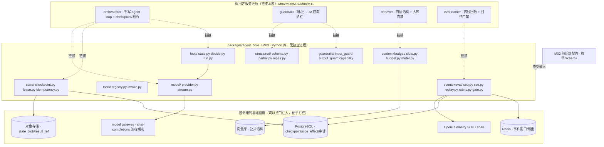
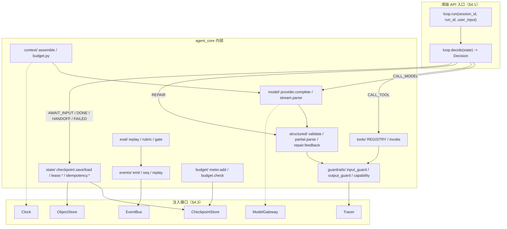
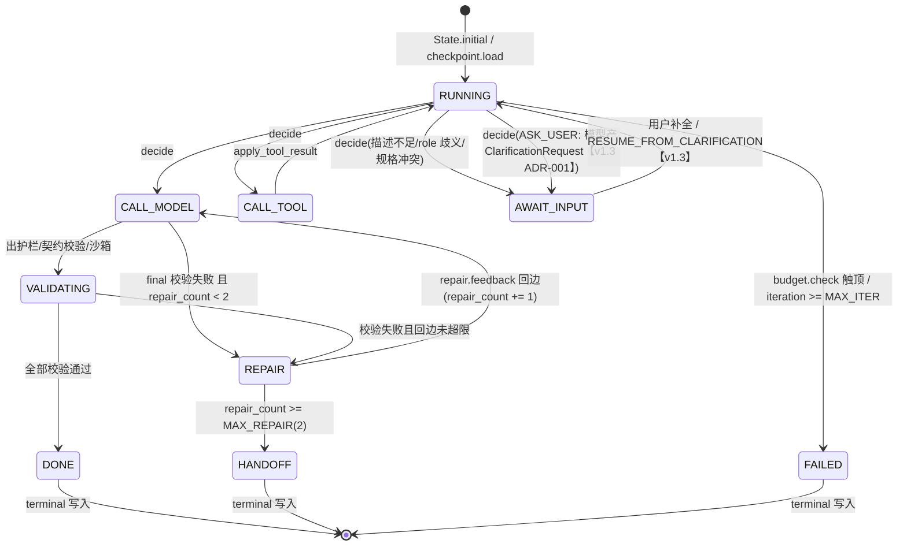

# M03 · 手写 Harness 内核（原 §11 / `packages/agent_core`）

> **文档类型**：可独立交付 / 可独立验收的模块设计文档（**库级实现基座**，非服务）
> **来源**：`设计方案.md` v1.1 §11 全章（§11.1–§11.11）、§10、§0 D-5、§2.6、§3.3、§4.2/4.3/4.5、§5 D1/D4、§7.1/7.2、§8 总表、§9.3/9.6、附录 A/B
> **版本**：v1.0　|　**拆分日期**：2026-11-15　|　**状态**：设计定稿　|　**最近修订**：2026-11-16（v1.3，ADR-001 同步：`decide()` 新增 `ASK_USER` / `RESUME_FROM_CLARIFICATION` 分支、`State` 增 `clarify_count`/`clarification_answer`、新增 `MAX_CLARIFY=2`）
> **对应编号**：§11 / `agent_core`；主责 FR-03、FR-09、FR-22，协同 FR-07/08/10/11/19/20/21；承载 **X1 / X2 / X4 / X11 的实现基座**
> **主责包**：`packages/agent_core`（Python 库，被链接进各服务进程，**不监听端口、不是独立服务、不拥有数据库表、不提供 REST**）
> **一句话定义**：在 D-5「零 Agent 框架」定稿前提下，把框架黑盒里的不变量——状态迁移、幂等、恢复、结构化校验、成本计量——全部显式化为可单测、可断言、可逐行讲清的库级代码。

---

## 0. 模块速览（零基础可读）

### 0.1 项目在做什么（不懂本项目的人先读这一节）

**WidgetPilot 是一个「用自然语言生成手机桌面控件」的 AI Agent 产品**。用户在网页里输入一句描述（例如「做一个 4x4 的月视图日历，能翻月」），可选预填一种控件规格（`2x1`/`1x2`/`2x2`/`2x4`/`4x2`/`4x4`；缺省由系统询问补全，系统不推断——v1.3 ADR-001 D-6），可选上传图片/视频/文本附件；系统生成一份 **TSX + React 控件代码**，经编译、隔离沙箱渲染测试与安全校验后，产出带完整证据链的「控件包」，最终在网页上按手机桌面的真实比例渲染成可交互卡片。用户可以安装、删除、回滚、查看生成过程与成本。

这是对作者曾参与过的真实业务（Lynx + React 控件打包嵌入手机系统）的**作品化复现**：受环境与设备限制，本项目**不生成 Lynx 代码、不编译移动端 bundle、不打包上传、不装机、不接手机系统 API、不模拟真实设备环境**；产物是能在浏览器隔离 iframe 里渲染的 TSX + React 页面代码，但严格遵循真实控件的六种规格约束。

端到端 14 步链路：`① 登录/建会话（grid 可选预填，缺省询问补全）→ ② 附件 → ③ 语义校验 → ④ 进 LLM 护栏 → ⑤ 路由/技能预取 → ⑥ 上下文装配 → ⑦ 生成回路 → ⑧ 出 LLM 护栏 → ⑨ 契约校验 → ⑩ 沙箱测试 → ⑪ WidgetBundle 产物 → ⑫ 卡片渲染 → ⑬ 语料回流 → ⑭ 审计与成本分账`。**本模块不对应其中某一步，而是为 ④⑤⑥⑦⑧⑨⑩⑭ 等几乎所有控制点提供「控制链路本身」的代码实现**。

### 0.2 定稿前提：D-5 零 Agent 框架

§0 D-5 原文定稿：「**不使用 LangChain / LangGraph / Temporal / AI SDK / CopilotKit / LangFuse 等任何 Agent 框架**；agent loop、结构化输出、工具注册、checkpoint 与恢复、双向护栏、检索融合、事件流、评测全部手写（§11）。通用基础设施（Postgres / Redis / FastAPI / Pydantic / React / OTel / esbuild 等）保留」。v1.1 变更说明进一步明确：harness 全链路改为原始手写实现，并同步替换 §3.3 / §5 / §6.8 / §7 / §8 的技术栈表述。

也就是说：**不是「不用库」，而是「不用把控制流藏进黑盒的框架」**。通用基础设施照用，唯独决定「模型什么时候被调、失败往哪里走、状态怎么落盘、成本怎么计」的那一层，必须自己写。

### 0.3 为什么必须有本内核（把黑盒里的不变量显式化）

§11 开篇原文：「目标不是『不用库』，而是**把框架黑盒里的不变量显式化**——状态迁移、幂等、恢复、结构化校验、成本计量全部变成可单测、可断言、可在面试里逐行讲清的代码。」

成熟框架（LangGraph / Temporal / AI SDK）把下面这些**不变量**封装在内部，调用方看不见、也无法单独断言：

| 被框架隐藏的不变量 | 若不显式化的后果 | 本内核把它变成什么 |
|---|---|---|
| 状态迁移的确定性 | 崩溃后无法复现「为什么走到这一步」 | 纯函数 `decide(state) -> Decision`，输入定则输出定 |
| 模型只在特定节点被调用 | 无法证明「注入描述没进模型」、无法精确停账单 | `while` 里只有 `CALL_MODEL` 分支调 `model.complete` |
| 幂等副作用 | 恢复重执行会重复产物、重复扣费、重复发事件 | `side_effect` + `idem_key` 命中即复用 |
| 恢复与租约 | worker 被杀即丢任务、跨天无法续跑 | Postgres 版本化 checkpoint + 原子抢租约 + 心跳 |
| 结构化校验 | 模型吐的半截 JSON 被当成结论触发副作用 | prompt-first + partial + **仅 final 严格校验** + 回灌修复 |
| 成本计量 | 死循环 / 重复检索耗尽预算，只能「提示模型省着点」 | `meter.py` 四维硬上限，触顶**确定性中断** |

§9.6 把这条列为全局风险并给出处理：「手写 harness 的正确性 —— 无框架兜底，幂等 / 租约 / 并发 / 背压 / schema 演进需自己保证 —— 以 §11.9 的测试与判据为门禁：状态迁移纯函数单测、故障注入、副作用条数断言」。可见**本内核的存在前提就是「可被测试证明正确」**。

### 0.4 本模块在架构中的位置（是库，不是服务）

这是本模块最容易被误解的一点，必须讲清：

- **M03 不是 control-plane 里的一个服务**。`§7.1 服务划分`里没有 `agent_core` 这一行；它是 `packages/agent_core/` 下的 **Python 库**。
- **它是 M04 / M06 / M07 / M08 / M11 的库级实现基座**（模块依赖图：`M03 -.实现基座.-> M04 & M06 & M07 & M08 & M11`）。这些模块各自是一个服务/域，`agent_core` 提供它们内部要用的 `loop` / `structured` / `tools` / `guardrails` / `context` / `state` / `events` / `budget` / `eval` 原语。
- **服务进程层面的链接方**（§3.6 详述）：`orchestrator`、`guardrails`、`retriever`、`eval-runner` 四个服务把本库链接进自己的进程；库本身**无独立进程、无端口、无常驻 worker**。
- **职责切割的一句话**：M03 定义 `State` / `Decision` / `decide()` 纯函数与 `checkpoint.py` / `lease.py` / `idempotency.py` 的**库级实现与算法**；M04 负责把它们接到真实的 Postgres 表、`Run` 生命周期、REST/SSE 接口与权限校验上。**M03 可脱离数据库/模型/前端单测，M04 必须做集成与故障注入验收**。

### 0.5 上下游与邻居（mermaid）



- **上游（谁用本库）**：`orchestrator`（M04/M07）、`guardrails`（M06/M08）、`retriever`（M10）、`eval-runner`（M10）；类型来自 `packages/contracts`。
- **下游（本库依赖什么）**：model gateway（httpx 直连）、PostgreSQL、Redis、对象存储、向量库客户端、OTel SDK —— **全部通过注入接口访问**，因此单测可用内存替身。
- **横切**：本库是 X1/X2/X4/X11 的**实现基座**，M11 在其上采集审计与 trace、做治理判定；本库自身不做治理决策。

### 0.6 原文对照（本模块内容的来源）

| 本模块内容 | 原文章节 |
|---|---|
| 零 Agent 框架定稿、边界表、保留基础设施 | §0 D-5、§11.1、v1.1 变更说明 |
| 分层与 `agent_core/` 目录树、模块不变量表 | §11.2、§7.2 |
| 显式状态机 `run()` / `Decision` / `State` / MAX_ITER / MAX_REPAIR | §11.3、§0 D-2 |
| checkpoint / 租约 / 恢复 SQL 与 6 步流程 | §11.4 |
| 结构化输出、partial-JSON、回灌修复 | §11.5 |
| 工具注册表与 `invoke()` | §11.6 |
| 槽位装配、检索融合、模型直连 httpx | §11.7 |
| 事件 / 护栏 / 成本 / 评测 / 观测手写实现表 | §11.8 |
| 六层测试判据、`GATE OK`、门禁口径 | §11.9、§9.6 |
| 代价 / 风险 / 收益表 | §11.10 |
| 与框架的对照（面试可讲） | §11.11 |
| Harness 完整性矩阵、两个闭环、定稿结论 | §10.1–§10.4 |
| 横切能力 X1/X2/X4/X11、明确不做 | §2.6 |
| 关键技术决策（编排 / Agent 开发栈） | §3.3 |
| 状态 / 枚举 / 协议 / 事件 / ReasonCode | §4.2、§4.3、§4.5 |
| 威胁模型、对抗清单、SLO | §2.3、§9.3、§9.4 |
| 术语表、面试叙事 | 附录 A、附录 B |

---

## 1. 模块定位与职责边界

### 1.1 为什么必须有（三个不可替代的职责）

1. **落实 D-5 的唯一载体**：定稿要求「agent loop、结构化输出、工具注册、checkpoint 与恢复、双向护栏、检索融合、事件流、评测全部手写」。这些能力若没有单一库承载，会散落到 8 个服务里各自实现一套，直接违背「不变量显式化」与「单一事实来源」。
2. **把「模型输出」隔离成唯一不可信变量**：§11.3 原文「模型输出是唯一不可信变量，其余迁移都是代码；把『不可信输出』转成『可断言的状态迁移』，就是 harness 的全部意义」。只有把控制流收进 `loop/run.py` 的显式 `while`，才能证明「注入描述没进模型」「回边不新增 Run」「触顶确定性中断」。
3. **让整条链路可单测、可回放、可讲清**：§11.10 收益「无黑盒、依赖少、可移植；每一步状态迁移与恢复都能逐行解释；与『成熟工程化』并不冲突——成熟度体现在不变量、测试与可观测，不在框架」。§9.6 又把它列为需要 §11.9 硬门禁兜底的风险，两者互为因果。

### 1.2 做什么（职责清单）

| # | 职责 | 落位文件 | 不变量 / 产出 |
|---|---|---|---|
| C1 | 模型直连与 `usage` 归一、SSE 分帧与半帧缓存 | `model/provider.py`、`model/stream.py` | 换模型只改配置；流式 delta 自行分帧 |
| C2 | 显式 agent loop：`decide()` 纯函数 + 显式 while | `loop/decide.py`、`loop/run.py`、`loop/state.py` | 模型只在 `CALL_MODEL` 出现；迭代/回边有上限 |
| C3 | 结构化输出：JSON Schema + Pydantic 严格校验、partial-JSON、错误回灌 | `structured/schema.py`、`partial.py`、`repair.py` | final 严格校验；流中不触发副作用；回边 ≤2 |
| C4 | 工具静态注册、参数校验、确定性授权、输出截断、错误分类 | `tools/registry.py`、`tools/invoke.py` | 运行时不可增删；未注册直接拒绝 |
| C5 | 双向护栏与能力白名单（纯代码规则） | `guardrails/input_guard.py`、`output_guard.py`、`capability.py` | 判据为确定性代码，命中留证 `guard_hit` |
| C6 | 固定槽位装配、去重、caching 前缀、token 计数/压缩/窗口化 | `context/slots.py`、`context/budget.py` | state 只存结论与引用；保留任务契约与已排除方案 |
| C7 | 版本化 checkpoint、租约抢锁/心跳/恢复、幂等副作用 | `state/checkpoint.py`、`lease.py`、`idempotency.py` | `rev` 单调、副作用幂等、租约原子抢锁 |
| C8 | 事件 `seq` / SSE / 回放 | `events/seq.py`、`sse.py`、`replay.py` | `seq` 连续、`done/error` 显式、可重放 |
| C9 | 四维成本硬上限与按档位分账 | `budget/meter.py` | 触顶确定性中断，不提示模型省着点 |
| C10 | 离线回放、失败模式 rubric、CI 门禁 | `eval/replay.py`、`rubric.py`、`gate.py` | 确定性轨迹断言，`GATE OK` 可断言 |
| C11 | 检索融合（SQL 硬过滤 + 向量 + BM25 + 自研 RRF + rerank） | `context/slots.py`（融合链路） | 索引快照版本写进 `manifest`，可复现 |
| C12 | OTel span + 自建 `trace_span` 表可重建完整路径 | `events/`、`eval/` 埋点 | 不用 LLM 专用观测平台 SDK |

### 1.3 不做什么（明确排除，边界切割点）

**总纲**：本内核**不落库表、不提供 REST、不做业务策略判定、不做 UI**。原文 §11.1 保留的通用基础设施（FastAPI / Postgres / Redis / React / OTel 等）由服务层使用，本库只通过注入接口访问它们。

| 不做 | 归属 | 边界说明 |
|---|---|---|
| 建库表、执行 DDL、连接池、事务编排、把 checkpoint 接到真实 PG | M04 | 本内核定义 `checkpoint` / `side_effect` 的**结构与算法**；§11.4 SQL 是「替代 Temporal 的语义说明」，真实建表、租约扫描调度、`Run` 生命周期由 M04 承担 |
| 任何 REST 路由、JWT 签发、`user_id` 权限过滤、SSE ticket、限流入口 | M04 / M02 | 本内核的对外接口是**库级函数**（§4.1），没有路径、没有 HTTP 状态码 |
| 业务装配：选哪个规程、按什么阈值分档、是否触发回边、是否转人工的业务含义 | M07 | 本内核提供 `decide()` 的**纯函数框架**与 `budget.check()` 的**硬上限机制**；具体 rubric/阈值由 M07 注入 |
| 出护栏的判据内容、`WidgetSpec`/`manifest` 的业务含义、编译与沙箱执行 | M08 | 本内核提供 `output_guard` / `structured.validate` 的**调用点与规则引擎骨架**；不编译、不渲染、不接系统 API |
| 治理判定：配额策略、降级阶梯、熔断、kill switch、告警、指标看板 | M11 | 本内核只**产生原始事件、成本账、护栏命中与 trace span**；「降级不降安全」的决策在 M11 |
| 语料入库门禁、脱敏、投毒检测、撤回、四层语料内容 | M10 | 本内核只实现检索融合链路（硬过滤 → 混合检索 → RRF → rerank），不决定语料内容 |
| 前端页面、分通道渲染、event-sourced reducer、时间线 scrubber、控件墙 | M13–M17 | 本内核只保证 `seq` 连续与事件 schema 正确；前端 reducer 是消费方 |
| 任何通用多 Agent 角色编排、通用工具集、在线关闭门禁的开关 | —（全局非目标） | §2.6 明确不做；§1.7 与 §11.3 常量注释「无关闭开关」 |

> **与 M04 的边界最易混淆**：M03 拥有 `State`/`Decision`/`decide()` 与 `lease.py`/`checkpoint.py`/`idempotency.py` 的**库级实现**，可脱离数据库单测；M04 是这些原语的**使用方与持久化承载方**，必须做集成与故障注入验收。**不得在 M04 里改动 `decide()` 的语义**。

### 1.4 输入 / 输出与上下游契约

| 方向 | 内容 | 契约形式 |
|---|---|---|
| 入 | `session_id: str`、`run_id: str`、`user_input: Input` | `loop.run()` 库级调用（§11.3 原文签名） |
| 入 | 模型流式 delta（`bytes`）、`ModelOutput`、工具调用 `{"tool","args"}` JSON、检索候选集、`AttachmentInsight` | 注入接口 / 纯函数参数 |
| 入 | `State`（从 `checkpoint.load(run_id)` 还原） | 内存对象 / `state_blob_ref` 反序列化 |
| 出 | `State`（含 `terminal: Terminal | None`）、`Decision`（7 种 kind） | 库级返回值，调用方据此推进 |
| 出 | `ToolResult`（经 `max_output_chars` 截断）、`ValidationResult`、`RepairError{field,expected,got}` | 库级返回值 |
| 出 | `AgentEvent`（`seq`/`kind`/`phase`/`payload`/`traceId`）、`guard_hit`、`cost_ledger`、`trace_span`、`checkpoint` 快照引用 | 事件 / 表记录 / 对象存储引用（由 M04/M11 落库） |
| 出 | `GateResult`（`GATE OK` / `GATE FAIL`） | `eval/gate.py` 返回值，CI 消费 |

**关键约定**：所有跨进程边界（PG / Redis / 对象存储 / 向量库 / model gateway / OTel）**一律以接口注入**（§4.3），库内不 `import` 具体客户端实现，这是「可脱离数据库/模型/前端单测」的前提。

### 1.5 承载的横切能力 X1 / X2 / X4 / X11（实现基座角色）

模块清单把 M03 标为「X1/X2/X4/X11 的实现基座」；横切能力映射进一步写明 X4 的 `meter.py` 落在 M03。本节只讲「基座」二字的具体含义：

| X* | 能力（§2.6 原文） | M03 提供的实现基座 | 谁在其上做业务/治理 |
|---|---|---|---|
| **X1** | 会话状态与断点恢复：会话/任务持久实体 + **手写** checkpoint / 租约 / 幂等副作用；跨天/月按 `runId + seq` 恢复；挂起不占计算资源（§11.4） | `state/checkpoint.py`（版本化落盘、`rev` 单调、`prev_hash` 链）、`state/lease.py`（抢锁/心跳/恢复扫描）、`state/idempotency.py`（`side_effect` 幂等表）、`events/replay.py` | M04 接 PG/REST/权限；M13/M17 接前端恢复入口 |
| **X2** | 上下文管理：state 只存结论与引用；tool/日志窗口化；超阈值压缩保留任务契约与已排除方案；固定槽位保持 prompt caching | `context/slots.py`（固定槽位 `系统契约 → 规程 → 检索片段 → 附件洞察 → 用户记忆 → 会话结论`）、`context/budget.py`（tiktoken 计数、只压缩 tool message、保留 `excluded_approaches`） | M07 决定装什么内容；M10 供语料 |
| **X4** | 成本管理：单会话预算（token / 轮次 / 工具调用 / 沙箱分钟）四维硬上限；模型分档；缓存复用；按档位分账 | `budget/meter.py`（每 super-step 累加四维、按档位写 `cost_ledger`、触顶确定性中断）、`model/provider.py`（`usage` 归一）、`loop/run.py`（`budget.check(state)` 调用点） | M07 计量执行、M11 分账治理 |
| **X11** | 可观测与审计：全链路 trace、只追加审计、每步证据引用、成本账、护栏命中日志 | `events/seq.py`/`sse.py`（`seq` 连续、显式 `done/error`）、`guardrails/*`（命中写 `guard_hit`：类型/判据/原文引用）、OTel span + `trace_span` 表、`eval/replay.py`（从 `agent_event` 重放） | M11 汇总审计、重建完整路径、治理判定 |

> 另外三项与基座相邻但**不归 M03 拥有**：X7（双向护栏）的判据由 M06/M08 定义、M03 提供规则引擎骨架；X5（重试/降级/熔断）由 M11 决策、M03 只实现「回边与 RetryPolicy 分离」的机制；X10（评测门禁）由 M10 主导、`eval/` 是其库级实现。

### 1.6 关键设计原则

1. **不变量显式化优先于复用**：宁可多写代码，也不把状态迁移、幂等、恢复交给框架黑盒（§11 开篇、§11.10 收益）。
2. **`decide()` 是纯函数，不调模型**：模型只在 `CALL_MODEL` 分支出现；其余迁移都是确定性代码（§11.3）。
3. **业务失败 ≠ 基础设施重试**：`REPAIR` 回边是业务失败，不新增 `Run`；`RetryPolicy` 只处理 429/5xx / 网络抖动 / 沙箱启动失败（§11.3、§1.7 #5）。
4. **流中不触发副作用**：partial-JSON 的最后一个字符串字段视为不稳定，只在 final 用 Pydantic / JSON Schema 严格校验（§11.5、§6.4 #1）。
5. **确定性门禁高于模型自律**：护栏、能力白名单、四维上限写在代码层，不写在 prompt 里（§1.7 #1）；数值、枚举、能力声明用确定性断言，不用裁判模型打分（§11.5）。
6. **越权在策略层被拒**：`policy.check(d.surface, spec)` 是确定性授权，不靠提示（§11.11 对照表）。
7. **状态持久化与无状态计算分离**：checkpoint 只存结论与引用，大对象放对象存储（§1.7 #5、§11.4）。
8. **门禁无在线关闭开关**：`MAX_ITER=12` / `MAX_REPAIR=2` / `MAX_CLARIFY=2`（v1.3 ADR-001 D-7）/ 预算上限写死在代码常量里（§11.3 注释、§1.7 #8）。
9. **一切跨进程依赖接口注入**：便于打桩，保证 §8 的「完全脱离数据库/模型/前端单测」。

---

## 2. 技术栈

### 2.1 §11.1 边界表（禁止的 Agent / LLM 框架 → 手写替代，完整抄入）

| 禁止（Agent / LLM 框架） | 手写替代 |
|---|---|
| LangChain / LangGraph | `agent_core` 手写 loop + 显式状态机 |
| Temporal / 任何 workflow engine | Postgres 版本化 checkpoint + 租约抢锁 + 心跳 |
| Vercel AI SDK / `streamUI` / CopilotKit / AG-UI SDK / A2UI SDK | 原生 SSE + 自定义事件 schema + 前端 reducer |
| `bind_tools` / `with_structured_output` / `trim_messages` | 自研工具注册表 / JSON Schema 校验 / 固定槽位装配与压缩 |
| LangChain retriever / 任何 RAG 框架 | SQL 硬过滤 + 向量库客户端 + BM25 + 自研 RRF 融合 |
| LangFuse / LLM 专用观测 SDK | OTel SDK + 自建 `agent_event` / `trace_span` 表 |
| OpenAI Agents SDK / CrewAI / AutoGen / PydanticAI 等 | 全部由 `agent_core` 覆盖 |
| MCP SDK | 自定义 `postMessage` bridge（§4.3.3） |
| OPA / Casbin 等策略框架（护栏链路） | 纯代码规则判定 + 自研 pattern registry |

**保留的通用基础设施**（原文 §11.1，不是 Agent 框架）：FastAPI、Pydantic v2、Postgres、Redis、对象存储、向量库客户端、React 19 / Vite / TanStack Query / Zustand / Zod / CodeMirror、esbuild / tsc / AST 解析、headless 浏览器、OpenTelemetry SDK、Prometheus、tiktoken（纯 token 计数工具库）、`EventSource` / `fetch ReadableStream`。

### 2.2 分层选型表（层 / 选型 / 约束 / 为什么 / 明确不用什么）

| 层（目录） | 选型 | 版本 / 约束 | 为什么选（原文依据） | 明确不用什么（§11.1） |
|---|---|---|---|---|
| `model/` | `httpx` 直连 chat-completions 兼容端点 + 自研 SSE 分帧 | OpenAI-compatible 协议；`usage` 归一 | 「换模型只改配置，不换代码」；流式 delta 自行分帧（§11.7） | 任何 LLM SDK / Vercel AI SDK |
| `loop/` | Python 显式 `while` + `NamedTuple`/`dataclass` | `MAX_ITER=12`、`MAX_REPAIR=2`、`MAX_CLARIFY=2`（v1.3）常量，无关闭开关 | 每一步可断言、可回放（§11.3） | LangChain / LangGraph / chain / graph 编排 |
| `structured/` | JSON Schema + Pydantic v2 严格校验 + 自研 partial-JSON | 仅 final 严格；回边 ≤2 | 复杂嵌套 schema 在规模下易碎（§11.5） | `with_structured_output` / constrained decoding 依赖 |
| `tools/` | 自研静态 `REGISTRY` + Pydantic 参数校验 | 启动时注册，运行时不可增删 | 越权调用在策略层被拒（§11.6/§11.11） | `bind_tools` / MCP SDK / 通用工具集 |
| `guardrails/` | 纯代码规则 + 自研 pattern registry | 判据为确定性代码，命中留证 | 三道职责不重叠、误拦截率可测（§11.8） | OPA / Casbin 等策略框架 |
| `context/` + `budget/` | 固定槽位 + tiktoken 计数 + 四维硬上限 | state 只存结论与引用 | 保住 prompt caching；触顶确定性中断（§11.7/§11.8） | `trim_messages` / LLM 观测平台 |
| `state/` | Postgres 版本化 checkpoint + 租约抢锁 + 心跳 + 幂等表 | 库内只定义结构与算法，连接由 M04 注入 | 手写 durable execution（§11.4） | Temporal / 任何 workflow engine |
| `events/` | 原生 SSE（`seq` + `Last-Event-ID` + `runId`）+ 自研 replay | `X-Accel-Buffering: no` | 服务端单向、可回放、鉴权简单（§3.3） | AI SDK / CopilotKit / AG-UI SDK / A2UI SDK |
| `eval/` | 自建 Eval Runner：replay / rubric / gate | 确定性轨迹断言，不用裁判模型 | 「数值一律用确定性断言」（§11.5/§9.5） | LangFuse / LLM 专用评测 UI |
| 观测 | OpenTelemetry SDK + 自建 `agent_event` / `trace_span` 表 | 通用可观测标准 | 重建完整路径（§11.8） | LangFuse / LLM 专用观测 SDK |

### 2.3 硬约束

- **禁止引入**：LangChain / LangGraph、Temporal / 任何 workflow engine、Vercel AI SDK / `streamUI` / CopilotKit / AG-UI SDK / A2UI SDK、LangChain retriever / 任何 RAG 框架、LangFuse / LLM 专用观测 SDK、OpenAI Agents SDK / CrewAI / AutoGen / PydanticAI、MCP SDK、OPA / Casbin（护栏链路）。
- **门禁常量写死在代码里**：`MAX_ITER = 12`（「上线常量，无关闭开关」）、`MAX_REPAIR = 2`（D-2）、`MAX_CLARIFY = 2`（v1.3 ADR-001 D-7 澄清提问上限）、四维预算上限；不提供在线关闭开关（§1.7 #8）。
- **只保留通用基础设施**：见 §2.1 保留清单；`tiktoken` 仅作纯 token 计数工具库，不引入其生态的编排能力。
- **库内不 `import` 具体基础设施客户端**：PG / Redis / 对象存储 / 向量库 / model gateway / OTel 均以接口注入（§4.3）。
- **不做**：通用多 Agent 编排、通用工具集（shell / 网络 / 任意文件写）、把模型自报置信度当路由判据、把 X1–X12 做成看板打勾（§2.6）。

### 2.4 运行时依赖（服务与基础设施）

| 依赖 | 本库用它做什么 | 注入形式 | 不可用时的行为（由服务层决定，本库只抛错误） |
|---|---|---|---|
| model gateway（chat-completions 兼容端点） | `provider.complete` 直连、`usage` 归一 | `ModelGateway` 接口 | 429/5xx → `RetryPolicy` 指数退避有上限；超限产出 `MODEL_ERROR` |
| PostgreSQL | checkpoint / side_effect / guard_hit / cost_ledger / agent_event / trace_span 的结构定义与算法 | `CheckpointStore` / `IdempotencyStore` 接口 | 状态基座不可降级；写失败则本 super-step 不提交 |
| Redis | 事件最近 N 条窗口、扇出 | `EventBus` 接口 | 故障注入要求「保状态且优雅降级」；恢复按 `runId + seq` 补发 |
| 对象存储（S3 兼容） | `state_blob_ref` / `result_ref` / `diff_ref` 大对象 | `ObjectStore` 接口 | 写 checkpoint 失败则本 super-step 不提交 |
| 向量库客户端 | 混合检索的向量 top-k | `VectorIndex` 接口 | 检索无结果不编造、转人工（M10 判据） |
| OpenTelemetry SDK | 打 span | `Tracer` 接口 | 观测降级不影响控制流 |
| `tiktoken` | token 计数（纯计数） | 直接调用（无状态工具库） | — |
| `fake clock` | 租约过期判定、跨天恢复测试 | `Clock` 接口 | 单测用内存 fake clock（§8.1） |

### 2.5 §11.2 完整目录树（`packages/agent_core/`，逐字抄入）

```
packages/agent_core/
  model/        provider.py       # 直连 HTTP / OpenAI-compatible，usage 归一
                stream.py         # SSE 分帧、半帧缓存、delta 解析
  loop/         state.py          # State / Decision / Terminal
                decide.py         # 纯函数：确定性状态迁移
                run.py            # 显式 while：终止边、回边、迭代上限
  structured/   schema.py         # JSON Schema + Pydantic 严格校验
                partial.py        # 容错 partial-JSON 解析
                repair.py         # 校验错误结构化回灌（≤2 次）
  tools/        registry.py       # name → 参数模型 + handler + 白名单
                invoke.py         # 参数校验、执行、结果截断、错误分类
  guardrails/   input_guard.py / output_guard.py / capability.py
  context/      slots.py          # 固定槽位装配、去重、caching 前缀
                budget.py         # token 计数、压缩、窗口化
  state/        checkpoint.py     # 版本化落盘
                lease.py          # 租约、心跳、抢锁、恢复
                idempotency.py    # side_effect 幂等表
  events/       seq.py / sse.py / replay.py
  budget/       meter.py          # 四维硬上限、档位分账
  eval/         replay.py / rubric.py / gate.py
```

**各文件职责展开**（与目录树一一对应，便于开发直接认领）：

| 目录 | 文件 | 职责细节 |
|---|---|---|
| `model/` | `provider.py` | 用 `httpx` 直接请求 provider 的 chat-completions 兼容端点；统一把不同供应商的 `usage` 字段归一；换模型只改配置 |
| `model/` | `stream.py` | SSE 分帧、半帧缓存、delta 解析；按 `\n\n` 分帧并缓存半帧，UTF-8 流式解码 |
| `loop/` | `state.py` | 定义 `State` / `Decision` / `Terminal` 三个运行时对象（§5.1、§6.2） |
| `loop/` | `decide.py` | **纯函数**确定性状态迁移，不调模型（§3.4 A） |
| `loop/` | `run.py` | 显式 `while`：终止边、回边、迭代上限；每个 super-step 落盘 / emit / budget / heartbeat |
| `structured/` | `schema.py` | JSON Schema + Pydantic 严格校验（仅 final） |
| `structured/` | `partial.py` | 容错 partial-JSON 解析（补齐未闭合字符串与括号） |
| `structured/` | `repair.py` | 校验错误结构化回灌 `{field, expected, got}`，≤2 次 |
| `tools/` | `registry.py` | `name → 参数模型 + handler + 白名单`，启动时静态注册 |
| `tools/` | `invoke.py` | 参数校验、执行、结果截断、错误分类 |
| `guardrails/` | `input_guard.py` / `output_guard.py` / `capability.py` | 进/出 LLM 双向护栏与能力白名单，纯规则 + 模式库 |
| `context/` | `slots.py` | 固定槽位装配、去重、caching 前缀 |
| `context/` | `budget.py` | token 计数、压缩、窗口化 |
| `state/` | `checkpoint.py` | 版本化落盘（每 super-step 同步写） |
| `state/` | `lease.py` | 租约、心跳、抢锁、恢复 |
| `state/` | `idempotency.py` | `side_effect` 幂等表 |
| `events/` | `seq.py` / `sse.py` / `replay.py` | `seq` 生成、SSE 帧、按 `runId + seq` 回放 |
| `budget/` | `meter.py` | 四维硬上限、档位分账 |
| `eval/` | `replay.py` / `rubric.py` / `gate.py` | 离线回放、失败模式加权、CI 门禁 |

---

## 3. 设计架构

### 3.1 组件图与 §11.2 模块不变量表



**§11.2 模块不变量表（完整抄入）**：

| 模块 | 职责 | 关键不变量 |
|---|---|---|
| `loop` | 唯一的状态迁移入口 | `decide()` 纯函数；模型只在 `CALL_MODEL` 出现；迭代与回边有上限 |
| `state` | 持久化与恢复 | `rev` 单调、副作用幂等、租约原子抢锁 |
| `structured` | 模型输出的边界 | final 严格校验；流中不触发副作用；回边 ≤2 |
| `tools` | 外部能力 | 静态注册、参数严格校验、白名单、输出截断 |
| `guardrails` | 双向护栏 | 判据为确定性代码，命中留证 |
| `context` / `budget` | 上下文与成本 | 固定槽位、token 预算、四维硬上限 |
| `events` / `eval` | 可观测与回放 | `seq` 连续、事件可重放、门禁可断言 |

> 这七行是 §8.2 测试分层的直接依据：每一行不变量都至少对应一条可断言用例。

### 3.2 处理流程（编号步骤，对齐 §11.3 `run()` 与 §10.1 完整性矩阵）

1. **装载状态**：`state = checkpoint.load(run_id) or State.initial(user_input)` —— 有 checkpoint 就从最新 `rev` 恢复，否则从用户输入初始化。
2. **抢租约**：`lease = lease.acquire(run_id)` —— 原子抢锁，同一 `runId` 同时只有一个持锁者。
3. **进入显式 while**：条件 `while not state.terminal and state.iteration < MAX_ITER`。
4. **纯函数决策**：`decision = decide(state)` —— 确定性、不调模型、无副作用。
5. **分支动作**（见 §3.3）：`CALL_MODEL` → 模型直连 + 流式解析 + final 校验 + 出护栏；`CALL_TOOL` → `tools.invoke(decision)`；`REPAIR` → 回灌错误；`AWAIT_INPUT` → 挂起；`ASK_USER` → 挂起等待模型澄清（v1.3）；`RESUME_FROM_CLARIFICATION` → 用户澄清答案回注后续跑（v1.3）；`DONE/HANDOFF/FAILED` → 写终态。
6. **同步落盘**：`checkpoint.save(run_id, state)` —— 每个 super-step 都写，`rev` 单调递增、`prev_hash` 成链。
7. **发事件**：`events.emit(state.seq, state.phase, decision)` —— `seq` 每会话单调递增。
8. **成本检查**：`budget.check(state)` —— 四维硬上限，触顶确定性中断。
9. **续租**：`lease.heartbeat()`。
10. **收尾**：循环退出后再 `checkpoint.save(run_id, state)`，`return state`；`finally: lease.release()` 释放租约。
11. **外部副作用前置查表**：任何副作用执行前查 `side_effect`，`idem_key` 命中直接复用结果，不重复执行（§11.4 step 4）。
12. **前端重连**：`Last-Event-ID → 按 runId + seq 补发；超窗先拉快照再续流`（§11.4 step 6）。

### 3.3 显式状态机（§11.3 `run()` 代码完整抄入）

核心思想（§11.3 原文）：`decide(state)` 是**纯函数**，不调模型；模型只在 `CALL_MODEL` 分支出现。这样每一步都可断言、可回放。

```python
MAX_ITER = 12          # 上线常量，无关闭开关
MAX_REPAIR = 2         # D-2：自纠正回边上限
MAX_CLARIFY = 2        # 【v1.3 ADR-001 D-7】每任务澄清提问上限，与自纠正回边分立计数

def run(session_id: str, run_id: str, user_input: Input) -> State:
    state = checkpoint.load(run_id) or State.initial(user_input)
    lease = lease.acquire(run_id)                    # 原子抢租约
    try:
        while not state.terminal and state.iteration < MAX_ITER:
            decision = decide(state)                 # 纯函数，确定性
            if decision.kind == "CALL_MODEL":
                out = model.complete(decision.messages,
                                     tier=decision.tier, stream=True)
                state = apply_model_output(state, out)   # 流式解析 + final 校验 + 出护栏
            elif decision.kind == "CALL_TOOL":
                state = apply_tool_result(state, tools.invoke(decision))
            elif decision.kind == "REPAIR":
                state = repair.feedback(state, decision.errors)   # 回边，不新增 Run
            elif decision.kind == "AWAIT_INPUT":
                state = state.pause(reason=decision.reason_code)
            elif decision.kind in ("DONE", "HANDOFF", "FAILED"):
                state = state.terminate(decision)
            checkpoint.save(run_id, state)           # 每个 super-step 同步落盘
            events.emit(state.seq, state.phase, decision)
            budget.check(state)                      # 四维硬上限，确定性中断
            lease.heartbeat()
        checkpoint.save(run_id, state)
        return state
    finally:
        lease.release()
```

**常量与 9 种 `Decision.kind`**（v1.3 前为 7 种，新增 2 种见下）：

| 常量 / kind | 值 | 含义（原文） |
|---|---|---|
| `MAX_ITER` | `12` | 上线常量，**无关闭开关**；`while` 的迭代上限 |
| `MAX_REPAIR` | `2` | D-2：自纠正回边上限 |
| `MAX_CLARIFY` | `2` | 【v1.3 ADR-001 D-7】每任务澄清提问上限，与自纠正回边分立计数 |
| `CALL_MODEL` | — | 唯一调模型的分支：`model.complete(..., tier=..., stream=True)` |
| `CALL_TOOL` | — | `tools.invoke(decision)`，结果回灌 state |
| `REPAIR` | — | `repair.feedback(state, decision.errors)`，**回边，不新增 Run** |
| `AWAIT_INPUT` | — | `state.pause(reason=decision.reason_code)`，挂起等待用户输入 |
| `ASK_USER` | — | 【v1.3 ADR-001 D-7】模型产出 `ClarificationRequest` → 转 `AWAITING_INPUT`，推 `ask_user` 事件 |
| `RESUME_FROM_CLARIFICATION` | — | 【v1.3 ADR-001 D-7】用户回答澄清后续跑，答案入 `clarification_answer` 槽位 |
| `DONE` | — | `state.terminate(decision)`，成功终态 |
| `HANDOFF` | — | `state.terminate(decision)`，超限/疑难转人工 |
| `FAILED` | — | `state.terminate(decision)`，失败终态 |

**v1.3 新增分支说明【v1.3 ADR-001 D-7，decide() 新增分支，仍是纯函数】**：`decide()` 新增 `ASK_USER` 与 `RESUME_FROM_CLARIFICATION` 两个分支，纯函数语义不变——只读 `State` 的确定性字段（`clarify_count`、`clarification_answer` 等），不调模型、不落盘、不发事件、不读时钟；询问是显式状态转移（`GENERATING/RUNNING → AWAITING_INPUT → GENERATING`）：

- **`ASK_USER`**：模型遇到执行不了的任务、不确定的信息、无法做的事情时，产出一次结构化 `ClarificationRequest`（封闭式问题，≤3 个选项或短文本补充，问题文本过出护栏校验）。`decide()` 在 `clarify_count < MAX_CLARIFY(2)` 时返回该分支，会话转 `AWAITING_INPUT`，推 `ask_user` 事件（`AgentEventKind` 17→18 种）；每次计入轮次与 token 预算，`clarify_count` 与自纠正回边 `repair_count` **分立计数**。
- **`RESUME_FROM_CLARIFICATION`**：用户经 `POST /api/sessions/{session_id}/clarifications` 回答后，答案作为附加上下文槽位 `clarification_answer` 回注生成回路，`decide()` 返回该分支，状态 `AWAITING_INPUT → RUNNING` 续跑。
- **checkpoint 要求**：两个分支均随 super-step 落盘 `clarify_count` 与 `clarification_answer`（`State` 新增字段），跨天恢复后可继续回答；`clarify_count >= MAX_CLARIFY` 仍无法继续 → `HANDOFF` + `CLARIFICATION_LIMIT`。转人工相应收窄：`HANDOFF`/`HUMAN_REQUIRED` 仅保留给「询问次数用尽仍无法继续」「回边超限且无法通过询问解决」「检索无结果且询问不能弥补」三类场景。

**mermaid 状态图**（Decision 驱动的迁移，`terminal IS NOT NULL` 后不再被恢复扫描命中）：



> **`run()` 中被引用的辅助函数**（原文只给调用形态、未给签名，此处为让实现闭环做最小补全）：【推导·需评审】`State.initial(user_input: Input) -> State`、`State.pause(reason: str | None) -> State`、`State.terminate(decision: Decision) -> State`、`apply_model_output(state: State, out: ModelOutput) -> State`、`apply_tool_result(state: State, result: ToolResult) -> State`；其语义不得改变 `decide()` 的纯函数性与「回边不新增 Run」约束，需评审确认后固化到 `loop/state.py` 与 `loop/run.py`。

### 3.4 关键机制、算法与不变量（本模块最需要逐行讲清的部分）

**A. `decide()` 纯函数、模型只在 `CALL_MODEL` 出现**

`loop/decide.py` 是唯一的状态迁移入口。它只读取 `State`（`phase` / `iteration` / `repair_count` / `spec` / `budget_used` / `last_error_fingerprint` / `excluded_approaches` / `terminal`），返回一个 `Decision`，**不调用模型、不落盘、不发事件、不读时钟**。因此：同一 `State` 输入必得同一 `Decision` 输出，可快照断言、可回放。模型这个「唯一不可信变量」被隔离在 `run.py` 的 `CALL_MODEL` 分支里，`apply_model_output()` 负责把不可信输出转成可断言的状态迁移。

**B. 回边 `REPAIR` 与基础设施 `RetryPolicy` 分离**

§11.3 原文：「回边（`REPAIR`）与基础设施重试（`RetryPolicy`）分离：前者是业务失败，后者只处理 429/5xx / 网络抖动 / 沙箱启动失败。」

| 维度 | `REPAIR` 回边（业务失败） | `RetryPolicy`（基础设施故障） |
|---|---|---|
| 触发 | 出护栏 / 契约校验 / 沙箱 / final schema 失败 | 模型 429/5xx、网络抖动、沙箱启动失败 |
| 计数 | `state.repair_count += 1`，上限 `MAX_REPAIR=2` | 独立退避计数，指数退避**有上限** |
| 是否新增 `Run` | **不新增**（原文注释「回边，不新增 Run」） | 不新增 `Run`，属同一次执行尝试 |
| 成本 | 回边与重复检索计入本轮（§5 D4） | 计入本轮 |
| 超限去向 | `HANDOFF` + 原因码 `RETRY_EXHAUSTED` / `HUMAN_REQUIRED` | `MODEL_ERROR` / `SANDBOX_UNAVAILABLE`，降级不降安全 |
| 决策归属 | M07 业务语义 / M03 机制 | M11 降级阶梯与 kill switch |

**C. checkpoint / 租约 / 恢复 6 步（§11.4 SQL 完整抄入）**

```sql
CREATE TABLE checkpoint (
  run_id TEXT, rev INT, node TEXT, state_ref TEXT,
  lease_owner TEXT, lease_until TIMESTAMPTZ,
  created_at TIMESTAMPTZ, prev_hash TEXT,
  PRIMARY KEY (run_id, rev)
);
CREATE TABLE side_effect (
  idem_key TEXT PRIMARY KEY,    -- session_id + step + payload_hash
  run_id TEXT, result_ref TEXT, created_at TIMESTAMPTZ
);
```

恢复流程（§11.4 原文 6 步）：

1. 每个 super-step **同步**写 `checkpoint`（`rev` 单调递增，hash 链防篡改）；大对象只存引用。
2. worker 持有 `lease_owner` 并心跳续租 `lease_until`。
3. 崩溃后另一实例扫描 `lease_until < now() AND terminal IS NULL`，用 `UPDATE ... WHERE lease_until < now()` **原子抢租约**，成功者从该 `rev` 恢复。
4. 任何外部副作用执行前查 `side_effect`；命中直接复用结果，**不重复执行**。
5. `interrupt` → 写 `PAUSED` + checkpoint + 释放租约；`resume` → 抢租约、从节点顶部重执行（前置副作用幂等）。
6. 前端重连：`Last-Event-ID` → 按 `runId + seq` 补发；超窗先拉快照再续流。

§11.4 结论原文：「这就是手写 durable execution：状态在 Postgres、计算无状态、挂起不占资源、跨天/月恢复靠 `runId` 而非内存。」

**幂等副作用键**：`idem_key = session_id + step + payload_hash`（SQL 注释逐字）。恢复时节点从顶部重执行，前置副作用靠该键去重，保证「不重复产物、不重复扣费、不重复发事件」。

**不变量清单**（由 §11.2 表与 §11.4 流程导出，逐条对应 §8.2 断言）：

| # | 不变量 | 断言方式 |
|---|---|---|
| I1 | `decide(state)` 纯函数：同输入同输出、无副作用 | 快照断言 + mock 零调用 |
| I2 | 模型只在 `CALL_MODEL` 分支被调 | 对非 `CALL_MODEL` 分支断言 `model.complete` 调用数 = 0 |
| I3 | `iteration < MAX_ITER(12)`、`repair_count <= MAX_REPAIR(2)` | 循环计数断言 |
| I4 | `checkpoint.rev` 单调递增，无重复 `(run_id, rev)` | 主键约束 + 单测 |
| I5 | `prev_hash` 链可完整校验 | hash 链重算 |
| I6 | 同一 `runId` 同时只有一个 `lease_owner` | `UPDATE ... WHERE lease_until < now()` 并发测试 |
| I7 | `side_effect` 中同一 `idem_key` 只有 1 条 | 副作用条数断言 = 1 |
| I8 | SSE `seq` 连续、无重复、无倒序 | 事件序列断言 |
| I9 | final 之前不触发任何副作用 | 流式解析边界断言 |
| I10 | 四维预算触顶确定性中断 | `budget.check` 边界断言 |
| I11 | `terminal IS NOT NULL` 后不再被恢复扫描命中 | 终态回放断言 |

**D. 结构化输出：prompt-first + partial + final 严格 + 回灌修复（§11.5）**

- 系统提示里放 schema + 示例（**prompt-first**），不依赖框架的 constrained decoding。
- 流式用 `partial.py` 容错解析（补齐未闭合字符串与括号）；**只在 final 用 Pydantic / JSON Schema 严格校验**；流中不稳定的字符串字段不触发任何副作用。
- 校验失败 → `repair.feedback()` 把错误结构化回灌 `{field, expected, got}`，`REPAIR` 回边 ≤2；超限 → `HANDOFF` + 原因码。
- 数值、枚举、能力声明一律用确定性断言，不用裁判模型打分。
- 复杂嵌套 schema 在规模下容易让模型频繁出错，因此「prompt 生成 → validator → 自纠正」比硬塞 structured output 更稳。

> `repair.feedback` 的三元组 `{field, expected, got}` 是 §8.2 契约测试的可断言对象：【推导·需评审】其 Python 结构建议为 `RepairError(field: str, expected: str, got: str)`，`decision.errors: list[str]`（§11.3 定义）携带其序列化形式，需评审确认 `errors` 元素到底是字符串还是结构化对象，并在 `structured/repair.py` 固化。

**E. 工具静态注册与 `invoke` 流程（§11.6 代码完整抄入）**

```python
@dataclass
class ToolSpec:
    name: str
    args_model: type[BaseModel]
    surfaces: set[str]                # 执行面白名单
    handler: Callable
    max_output_chars: int

REGISTRY: dict[str, ToolSpec] = {...}  # 启动时静态注册，运行时不可增删

def invoke(d: Decision) -> ToolResult:
    spec = REGISTRY[d.tool]                       # 未注册直接拒绝
    args = spec.args_model.model_validate(d.args)  # Pydantic 严格校验
    policy.check(d.surface, spec)                 # 确定性授权
    result = spec.handler(args)
    return truncate(result, spec.max_output_chars)
```

§11.6 原文补充：「模型输出统一为 `{"tool": "...", "args": {...}}` JSON，由自研解析器校验后分发；工具数量是每轮常驻税，技能通过结构化字段 `need_skill` 请求，不新增工具。」

`invoke()` 五步即五个控制点：① `REGISTRY[d.tool]` 未注册直接拒绝；② `args_model.model_validate` Pydantic 严格校验参数；③ `policy.check(d.surface, spec)` 确定性授权（越权在策略层被拒而非靠提示）；④ `handler(args)` 执行；⑤ `truncate(result, max_output_chars)` 输出截断防超大结果耗尽预算。

**F. 槽位装配、检索融合链路与模型直连 httpx（§11.7）**

- **槽位装配**（替代 `trim_messages`）：`系统契约 → 规程 → 检索片段 → 附件洞察 → 用户记忆 → 会话结论`，固定顺序保持 prompt caching；`budget.py` 用 tiktoken 计数，超阈值只压缩 tool message，**保留任务契约与已排除方案**；state 只存结论与引用。
- **检索融合**（替代 retriever）：`SQL 硬过滤(grid/type/capability) → 向量 top-k → BM25 top-k → 自研 RRF → rerank → 去重 → 预算裁剪`；索引快照版本写进 `manifest`，保证可复现。
- **模型直连**：`model/provider.py` 当前用 `httpx` 直接请求 provider 的 chat-completions 兼容端点，统一把不同供应商的 `usage` 字段归一；换模型只改配置，不换代码；流式 delta 由 `stream.py` 自行分帧。**M20 v1.4 设计增补（未实现）**：按 provider 级 `wire_api` 增加 Responses wire adapter，把 `/v1/responses` 的 `input`/`instructions`、`output_text` 与类型化 SSE 事件归一到现有 `ModelOutput` / `Delta` / `Usage`；M03 的 `\n\n` 分帧与半帧缓存内核不变，上层 agent loop 无感。

> RRF 融合链路的**具体参数**原文只给链路、不给数值：【推导·需评审】建议 RRF 常数 `k = 60`、向量/BM25 各取 `top-k = 10`、`rerank` 后 `top-k = 5`、预算裁剪按 `context/budget.py` 的 token 阈值；这些取值需在影子期实测校准后固化到 `context/slots.py`，并纳入 §9 回归触发范围。

**G. 事件 / 护栏 / 成本 / 评测 / 观测手写实现表（§11.8，完整抄入）**

| 能力 | 手写实现 |
|---|---|
| 事件流 | `seq` 单调递增、Redis 保留最近 N 条、`Last-Event-ID` 续传、心跳、显式 `done/error`；前端自研 reducer 按 `kind` 派发 |
| 双向护栏 | `input_guard.py` / `output_guard.py` 纯规则 + 模式库；命中写 `guard_hit` 表（类型、判据、原文引用），误拦截率可测 |
| 成本 | `meter.py` 每 super-step 累加 token / 轮次 / 工具调用 / 沙箱分钟，按档位写 `cost_ledger`；触顶确定性中断 |
| 评测 | `eval/replay.py` 从 `agent_event` 重放历史会话；`rubric.py` 按失败模式加权；`gate.py` 用确定性轨迹断言做 CI 门禁 |
| 观测 | OTel SDK 打 span + 自建 `trace_span` 表，可重建「输入 → 护栏 → 检索 → 生成 → 校验 → 沙箱 → 交付 → 成本」 |

### 3.5 与其他模块的时序（3 个关键场景）

**场景 1：正常生成（本库在 orchestrator 进程内）**
`M14 提交 → M04 开 Run 抢租约 → M03 loop.run() 装载 State → decide=CALL_MODEL → provider.complete(httpx) → stream.parse(partial) → final 严格校验 → output_guard → M08 契约/沙箱结论 → decide=DONE → state.terminate → checkpoint.save + events.emit + meter.add → M04 推 artifact/done → M16 卡片`。全程每 super-step 都有 checkpoint / seq / cost 三条可断言记录。

**场景 2：用户打断后跨天回来**
`M14 停止 → M04 写 PAUSED + 释放租约 → M03 checkpoint.save(rev=N) 留 state_blob_ref → [7 天，无 worker、无模型调用、无成本] → M13 恢复入口 → M03 lease.acquire(run_id) 原子抢租约 → checkpoint.load(run_id) 还原 State（含 excluded_approaches）→ 从节点顶部重执行，side_effect 命中复用 → M03 events.replay 按 runId + seq 补发 → M17 reducer 重放 → 界面与离开前一致`。

**场景 3：worker 被杀 + 回边**
`kill → lease_until 过期 → M04 扫描 lease_until < now() AND terminal IS NULL → 原子抢租约成功者 → M03 从该 rev 恢复 → 若上一轮 final 校验失败则 decide=REPAIR（repair_count += 1，不新增 Run）→ repair.feedback({field,expected,got}) → 若 repair_count >= 2 则 decide=HANDOFF → terminal 写入 → 不再被恢复扫描命中`。

### 3.6 部署形态与伸缩（作为库被链接，无独立进程）

| 链接方服务（§7.1） | 使用的本库子模块 | 状态 | 伸缩依据 |
|---|---|---|---|
| `orchestrator` | `loop/`、`state/`、`model/`、`structured/`、`context/`、`budget/` | 无状态 worker | 队列深度 |
| `guardrails` | `guardrails/`、`structured/` | 无状态 | 调用量 |
| `retriever` | `context/slots.py`（融合链路）、`state/`（快照引用） | 无状态 | 检索量 |
| `eval-runner` | `eval/`、`events/replay.py` | 无状态 | 手动 / CI 触发 |

- **本库自身**：无进程、无端口、无副本数、无常驻内存状态；随宿主服务一起发布（`packages/agent_core` 作为 Python 包被 `import`）。
- **与 M04/M06/M07/M08/M11 的对应**：模块编号层面，本库是这 5 个域的**实现基座**；进程层面，上表 4 个服务是**链接方**。两套坐标系不矛盾——一个域可以由多个服务承载，一个服务也可以链接本库的多个子模块。
- **伸缩**：本库不单独伸缩；其 CPU/内存/连接消耗计入宿主服务。挂起期间宿主 worker 可缩容到 0，因为状态在 Postgres、对象在对象存储（§11.4 结论）。

---

## 4. 接口契约

> **本节最重要的一句话**：M03 的对外接口是**库级 API（Python 函数 / 对象）**，**不是 REST、没有路径、没有 HTTP 状态码**。§4.1 所有函数签名中，凡原文 §11.3 / §11.6 已给出的（如 `run`、`invoke`、`REGISTRY`）逐字保留；其余为让库可被调用而做的最小补全，统一标注【契约约定】，涉及返回类型/注入接口的标注【推导·需评审】。

### 4.1 对外接口 = 库级 API（逐个列出，给具体名字与类型）

**【契约约定】**下表签名依据 §11.2 文件职责、§11.3/§11.6 调用形态补全；最终以 `packages/agent_core` 实现为准。

| # | 模块公开函数 / 对象 | 签名（Python 类型标注） | 职责 | 来源 |
|---|---|---|---|---|
| L1 | `model/provider.py` | `def complete(messages: list[Message], tier: Literal["cheap","standard","frontier"] = "standard", stream: bool = True) -> ModelOutput` | 直连 chat-completions 兼容端点、`usage` 归一 | §11.3 调用形态 + §11.7 |
| L2 | `model/stream.py` | `def parse(chunk: bytes, buf: StreamBuffer) -> list[Delta]` | SSE 分帧、半帧缓存、delta 解析 | §11.2 / §11.7 |
| L3 | `loop/run.py` | `def run(session_id: str, run_id: str, user_input: Input) -> State` | 显式 while 主循环 | **§11.3 原文逐字** |
| L4 | `loop/decide.py` | `def decide(state: State) -> Decision` | 纯函数确定性状态迁移，不调模型 | §11.2 / §11.3 |
| L5 | `structured/schema.py` | `def validate(payload: str, schema: JsonSchema) -> ValidationResult` | JSON Schema + Pydantic 严格校验（仅 final） | §11.2 / §11.5 |
| L6 | `structured/partial.py` | `def parse(text: str) -> PartialObject` | 容错 partial-JSON（补齐未闭合字符串与括号） | §11.2 / §11.5 |
| L7 | `structured/repair.py` | `def feedback(state: State, errors: list[str]) -> State` | 回灌 `{field, expected, got}`，`REPAIR` 回边 | §11.3 调用形态 + §11.5 |
| L8 | `tools/registry.py` | `REGISTRY: dict[str, ToolSpec] = {...}` | 启动时静态注册，运行时不可增删 | **§11.6 原文逐字** |
| L9 | `tools/registry.py` | `def register(name: str, spec: ToolSpec) -> None` | 仅启动期调用的注册入口 | 【契约约定】 |
| L10 | `tools/invoke.py` | `def invoke(d: Decision) -> ToolResult` | 参数校验、授权、执行、截断、错误分类 | **§11.6 原文逐字** |
| L11 | `context/slots.py` | `def assemble(state: State, slots: SlotConfig) -> list[Message]` | 固定槽位装配、去重、caching 前缀、检索融合 | §11.2 / §11.7 |
| L12 | `budget/meter.py` | `def check(state: State) -> None` | 四维硬上限，触顶确定性中断 | §11.3 `budget.check(state)` + §11.8 |
| L13 | `budget/meter.py` | `def add(state: State, usage: Usage) -> State` | 每 super-step 累加四维、按档位写 `cost_ledger` | §11.8 |
| L14 | `state/checkpoint.py` | `def save(run_id: str, state: State) -> int` | 版本化落盘，返回 `rev` | §11.3 / §11.4 |
| L15 | `state/checkpoint.py` | `def load(run_id: str) -> State | None` | 取最新 `rev` 的 State | §11.3 / §11.4 |
| L16 | `state/lease.py` | `def acquire(run_id: str, owner: str, ttl_s: int) -> Lease` | 原子抢租约 | §11.4 / 契约约定签名 |
| L17 | `state/lease.py` | `def heartbeat(run_id: str, owner: str) -> bool` | 心跳续租 `lease_until` | §11.4 |
| L18 | `state/lease.py` | `def release(run_id: str, owner: str) -> None` | 释放租约 | §11.3 `lease.release()` |
| L19 | `state/lease.py` | `def scan_expired(now: datetime) -> list[str]` | 扫描 `lease_until < now AND terminal IS NULL` | §11.4 step 3 |
| L20 | `state/idempotency.py` | `def get_or_reserve(idem_key: str, run_id: str) -> str | None` | 命中返回 `result_ref`，否则占位 | §11.4 step 4 |
| L21 | `events/seq.py` | `def emit(seq: int, phase: SessionState, decision: Decision) -> AgentEvent` | 发事件，`seq` 单调递增 | **§11.3 原文逐字调用** |
| L22 | `events/seq.py` | `def next_seq(session_id: str) -> int` | 生成每会话单调 `seq` | §11.8 |
| L23 | `events/replay.py` | `def replay(run_id: str, from_seq: int) -> list[AgentEvent]` | 按 `runId + seq` 回放 | §11.4 step 6 / §11.8 |
| L24 | `guardrails/input_guard.py` | `def input_guard(text: str, rules: RuleSet) -> GuardVerdict` | 进 LLM 护栏（注入/PII/意图/预算前置） | §11.2 / §11.8 |
| L25 | `guardrails/output_guard.py` | `def output_guard(output: ModelOutput, rules: RuleSet) -> GuardVerdict` | 出 LLM 护栏（schema/能力/禁止内容/PII/符合度/规格） | §11.2 / §11.8 |
| L26 | `guardrails/capability.py` | `def capability(call: CapabilityCall, manifest: Manifest) -> bool` | 能力白名单确定性放行 | §11.2 / §4.3.3 |
| L27 | `eval/replay.py` | `def replay(run_id: str) -> Trajectory` | 从 `agent_event` 重放历史会话 | §11.8 |
| L28 | `eval/rubric.py` | `def rubric(case: EvalCase, traj: Trajectory) -> Score` | 按失败模式加权 | §11.8 / §9.5 |
| L29 | `eval/gate.py` | `def gate(dataset: list[EvalCase]) -> GateResult` | 确定性轨迹断言做 CI 门禁 | §11.8 / §11.9 |

**关于 `lease` 的双重调用形态**：原文 §11.3 `run()` 中是**对象式**——`lease = lease.acquire(run_id)` 返回 `Lease` 对象，随后 `lease.heartbeat()` / `lease.release()` 无参调用；而 §11.4 恢复流程要求的是**模块级函数式**（上表 L16–L19）。【契约约定】两者并存：`lease.py` 同时暴露模块级函数与绑定了 `run_id/owner` 的 `Lease` 对象方法，`run()` 使用后者，恢复扫描调度使用前者。

### 4.2 事件接口（本内核 emit 的 `kind` 与 `seq` 约定）

本内核是 `seq` 的**生成方与 emit 方**（`events.emit(state.seq, state.phase, decision)`），事件 schema 与 `packages/contracts` 一致。完整事件协议（§4.5，逐字抄入相关定义）：

```ts
type AgentEventKind =
  | "run" | "plan" | "spec" | "attachment" | "skill" | "routing"
  | "code" | "guard" | "validation" | "sandbox" | "artifact"
  | "cost" | "checkpoint" | "interrupted" | "notice" | "error" | "done"
  | "ask_user";   // v1.3 新增（ADR-001 D-7，共 18 种）；由 ASK_USER 分支推给前端澄清问题卡

type AgentEvent = {
  seq: number;                 // 每会话单调递增
  sessionId: string;
  runId: string;               // 重连与跨天恢复的锚点
  ts: string;
  kind: AgentEventKind;
  phase: SessionState;
  payload: unknown;            // 按 kind 用 discriminated union 收窄
  traceId: string;
};
```

| `kind` | 本内核是否 emit | payload 要点 | 对应控制点 |
|---|---|---|---|
| `run` | 是（由 `State.initial` / resume 触发） | `{ runId, phase, attempt_no }` | 任务启动 |
| `plan` / `spec` / `code` | 产生 partial / patch 载荷（内容由模型来） | `spec` 为 partial `WidgetSpec`；`code` 为 `{from_line,to_line,text}` | `CALL_MODEL` 流式 |
| `guard` / `validation` | 是（护栏命中 / final 校验） | 命中类型、判据、原文引用、原因码 | `input_guard` / `output_guard` / `structured.validate` |
| `checkpoint` | 是（每 super-step 落盘后） | `{ rev, node, state_blob_ref, lease_owner }` | `checkpoint.save` |
| `cost` | 是（`meter.add` 后） | `{ token, iterations, tool_calls, sandbox_minutes, tier }` | `budget/meter.py` |
| `interrupted` / `notice` | 是（挂起 / 降级 / 预算提示） | `{ reason_code, checkpoint_rev, resume_hint }` | `AWAIT_INPUT` / 触顶 |
| `ask_user` | 是（`ASK_USER` 分支，v1.3 ADR-001 D-7） | `{ question_id, question, options?, allow_text, clarify_count, clarify_limit }` | 模型澄清 → `AWAITING_INPUT` |
| `error` / `done` | 是（终态） | `error` 带 `code` + `evidenceRef`；`done` 带 `bundle_id` | `DONE/HANDOFF/FAILED` |
| `sandbox` / `artifact` | 转发（内容由 M08/M09 产生） | 沙箱结论 / `bundle_id` + 预览引用 | 契约/沙箱/交付 |
| `attachment` / `skill` / `routing` | 转发（内容由 M05/M06 产生） | `role` + `insight_ref` / 规程 id / 档位 | 上游控制点 |

**`seq` 约定**：`seq` 每会话单调递增；Redis 保留最近 N 条；`Last-Event-ID` 续传；心跳保活；显式 `done/error`（无 `done` 视为截断）；事件按 `seq` 在前端 reducer 去重与乱序丢弃；前端 reducer 对未知 `kind` **必须忽略而非报错**。

### 4.3 被调用的上游接口与注入点（model gateway / 对象存储 / PG / Redis 均以接口注入便于打桩）

**【推导·需评审】**原文只要求「模型、对象存储、PG、Redis 可打桩」，未给 Protocol 定义；下列注入接口为让 §8.1 的 fake 替身可替换而补全，需在评审中确认后固化到 `agent_core/injection.py`（或各子模块的 `__init__` 参数），**库内禁止直接 `import` 具体客户端**。

```python
from typing import Protocol

class ModelGateway(Protocol):
    def complete(self, messages: list[Message], tier: ModelTier,
                 stream: bool) -> ModelOutput: ...

class ObjectStore(Protocol):
    def put(self, key: str, data: bytes) -> str: ...        # 返回带 hash 的 ref
    def get(self, ref: str) -> bytes: ...                   # 读取时校验 hash

class CheckpointStore(Protocol):
    def save(self, run_id: str, rev: int, node: str,
             state_ref: str, prev_hash: str) -> None: ...
    def load(self, run_id: str) -> State | None: ...

class IdempotencyStore(Protocol):
    def get_or_reserve(self, idem_key: str, run_id: str) -> str | None: ...

class EventBus(Protocol):
    def emit(self, event: AgentEvent) -> None: ...
    def window(self, session_id: str, n: int) -> list[AgentEvent]: ...

class Clock(Protocol):
    def now(self) -> datetime: ...                          # 单测注入 fake clock

class Tracer(Protocol):
    def span(self, name: str, **attrs) -> Span: ...
```

**注入点与被测代码的对应**：

| 注入接口 | 生产实现（服务层提供） | 单测替身（§8.1） | 被打桩的库代码 |
|---|---|---|---|
| `ModelGateway` | `httpx` 直连 provider | `fake model.complete`（脚本返回固定 `ModelOutput`） | `model/provider.py`、`loop/run.py` 的 `CALL_MODEL` |
| `ObjectStore` | S3 兼容客户端 | 内存 dict（fake object store） | `state/checkpoint.py` 的 `state_blob_ref` / `result_ref` |
| `CheckpointStore` / `IdempotencyStore` | Postgres（M04 建表） | 内存 checkpoint store | `state/*`、`§11.4` 恢复流程 |
| `EventBus` | Redis Streams | 内存数组 | `events/seq.py` / `sse.py` / `replay.py` |
| `Clock` | 系统时钟 | fake clock（可冻结 +7 天） | `state/lease.py` 的 `scan_expired(now)` |
| `Tracer` | OTel SDK | no-op span | `events/` / `eval/` 埋点 |

### 4.4 统一错误与分类（业务失败 vs 基础设施故障）

**【推导·需评审】**原文给出「回边与 RetryPolicy 分离」的结论（§11.3）与 `ReasonCode` 全表（§4.2），但未给库级异常类；下列 `CoreError` 分类为让 `tools/invoke.py` 的「错误分类」与 §4.5 重试约定可断言而补全，需评审确认。

```python
class CoreError(Exception):
    code: str            # ReasonCode
    retryable: bool      # 是否属于基础设施故障
    evidence_ref: str | None

# 分类判据（不是新的 ReasonCode，只是把码分成两类；v1.3 新增 SPEC_MISSING/CLARIFICATION_REQUIRED/CLARIFICATION_LIMIT 归入业务失败，见 §5.1/§5.3）
BUSINESS_FAILURE = {          # 业务失败 -> REPAIR 回边 / 终态，不进 RetryPolicy
    "GUARD_INPUT_HIT", "GUARD_OUTPUT_HIT", "SPEC_CONFLICT",
    "CAPABILITY_DENIED", "CONTRACT_MISMATCH", "COMPILE_FAILED",
    "SANDBOX_TEST_FAILED", "RETRY_EXHAUSTED", "BUDGET_EXHAUSTED",
    "INPUT_INVALID", "INTENT_OUT_OF_SCOPE", "HUMAN_REQUIRED",
}
INFRA_FAILURE = {             # 基础设施故障 -> RetryPolicy 指数退避（有上限）/ 降级
    "MODEL_ERROR", "SANDBOX_UNAVAILABLE",
}
```

| 类别 | 触发 | 去向 | 是否可重试 | 证据 |
|---|---|---|---|---|
| 业务失败 | 出护栏 / 契约 / 沙箱 / final schema 失败、回边超限、预算触顶 | `REPAIR`（≤2）→ `HANDOFF` / `FAILED` | 否（回边不是 retry） | 逐次失败原因、`guard_hit`、`evidenceRef` |
| 基础设施故障 | 模型 429/5xx、网络抖动、沙箱启动失败、Redis 不可用 | `RetryPolicy` 指数退避有上限 → 降级 | 是（有上限） | 供应商响应 + 重试次数 + 降级记录 |

**统一原则**：`tools/invoke.py` 的「错误分类」必须把「未注册工具 / 参数校验失败 / 授权拒绝」归为业务失败（拒绝并留证），把「handler 抛出的网络/超时」归为基础设施故障；`structured.validate` 失败一律业务失败（触发 `REPAIR`）。

### 4.5 幂等、重试、超时、并发约定

| 项 | 约定 | 原文依据 |
|---|---|---|
| 幂等 | 外部副作用前置查 `side_effect`，`idem_key = session_id + step + payload_hash`，命中复用 `result_ref`；`interrupt` 幂等 | §11.4 step 4/5 |
| 重试 | 仅基础设施故障（429/5xx、网络抖动、沙箱启动失败）走 `RetryPolicy` 指数退避且**有上限**；业务失败走 `REPAIR` 回边 | §11.3、§1.7 #5 |
| 超时 | 租约 `lease_until` + 心跳；SSE 心跳保活；无 `done` 断流视为截断并重连 | §11.4、§4.5 |
| 并发 | `UPDATE ... WHERE lease_until < now()` 保证单持锁者；`checkpoint` 主键 `(run_id, rev)` 防重复；`REGISTRY` 运行时只读 | §11.4 step 3、§11.6 |
| 迭代上限 | `state.iteration < MAX_ITER(12)`；`repair_count <= MAX_REPAIR(2)` | §11.3 |
| 乱序 | 事件按 `seq` 由前端 reducer 去重与乱序丢弃；服务端保证 `seq` 连续 | §4.5 |

> 数值型约定原文未给：【推导·需评审】建议租约 `TTL = 30s`、心跳间隔 `10s`、`RetryPolicy` 退避上限 `3 次`（base 0.5s，指数）、Redis 事件窗口 `N = 500`、SSE 心跳 `15s`；这些值需在影子期实测校准后固化到 `state/lease.py` 与 `events/sse.py`，并作为 §9 待决项与回归触发项。

### 4.6 接口状态表（每个 API 的契约状态与稳定性）

**【推导·需评审】**「契约状态 / 稳定性分级」是本次拆分为验收而建立的分级标准，原文未给此表；分级定义需评审确认。

| 分级 | 含义 |
|---|---|
| 定稿·稳定 | 原文逐字给出签名/结构，语义不得改 |
| 定稿·调用形态 | 原文给出调用形态，签名为契约约定补全 |
| 契约约定 | 原文给文件职责，签名/类型为最小补全 |
| 依赖外部 | 依赖服务层注入实现，本库只定义接口 |
| 影子校准中 | 数值参数需影子期实测后定稿 |

| API（§4.1 编号） | 契约状态 | 稳定性 | 说明 |
|---|---|---|---|
| L3 `run`、L8 `REGISTRY`、L10 `invoke`、L21 `emit` 调用形态 | **定稿·稳定** | 冻结 | §11.3 / §11.6 原文逐字，语义不得改 |
| L1 `complete`、L7 `feedback`、L14 `save`、L15 `load` | 定稿·调用形态 | 冻结 | §11.3 给出调用形态，签名按契约约定补全 |
| L4 `decide`、L5 `validate`、L6 `parse`、L11 `assemble`、L12 `check`、L13 `add` | 契约约定 | 稳定 | §11.2 给职责；语义受 §11.2 不变量表约束 |
| L16–L20 `lease.*` / `idempotency.*`、L22–L23 `events.*` | 契约约定 | 稳定 | §11.4 给 SQL 与 6 步流程，签名为补全 |
| L24–L26 `guardrails.*` | 契约约定 | 稳定 | §11.2 / §11.8 给文件与命中留证要求 |
| L27–L29 `eval.*` | 契约约定 | 稳定 | §11.8 / §11.9 给职责与 `GATE OK` 判据 |
| L2 `stream.parse`、L9 `register` | 契约约定 | 稳定 | 目录树职责推导 |
| §4.3 全部注入接口 `ModelGateway`/`ObjectStore` 等 | **依赖外部** | 接口冻结 | 本库只定义 Protocol，实现由服务层提供 |
| §4.4 `CoreError` 分类、`Terminal`/`ToolResult` 结构 | **【推导·需评审】** | 待定稿 | 需评审确认后固化 |
| §4.5 TTL / 心跳 / 退避 / N 数值 | **影子校准中** | 待定稿 | 影子期实测校准 |

---

## 5. 状态、原因码与 API 状态

### 5.1 完整定义：`Decision` 7 种 kind / `State` 全字段 / `Terminal` / `SessionState` / `ModelTier`

**§11.3 代码完整抄入**（`Decision` 与 `State`）：

```python
class Decision(NamedTuple):
    kind: Literal["CALL_MODEL","CALL_TOOL","REPAIR","AWAIT_INPUT",
                  "DONE","HANDOFF","FAILED",
                  "ASK_USER","RESUME_FROM_CLARIFICATION"]   # 【v1.3 ADR-001 D-7】decide() 新增分支，仍是纯函数
    messages: list[Message] = []
    tier: Literal["cheap","standard","frontier"] = "standard"
    tool: str | None = None
    errors: list[str] = []
    reason_code: str | None = None

@dataclass
class State:
    session_id: str; run_id: str; rev: int; seq: int
    phase: SessionState; iteration: int; repair_count: int
    clarify_count: int                    # 【v1.3 ADR-001 D-7】澄清提问计数，上限 MAX_CLARIFY=2，与 repair_count 分立
    spec: dict | None; diff_ref: str | None
    excluded_approaches: list[str]        # 压缩时必须保留
    budget_used: dict; tier_history: list
    last_error_fingerprint: str | None
    clarification_answer: str | None      # 【v1.3 ADR-001 D-7】用户澄清答案槽位，RESUME_FROM_CLARIFICATION 时回注生成回路
    terminal: Terminal | None
```

`State` 全字段逐字段说明（覆盖 00 §7「字段给具体名字与类型」）：

| 字段 | 类型 | 含义 / 不变量 |
|---|---|---|
| `session_id` | `str` | 会话标识 |
| `run_id` | `str` | 恢复锚点；挂起/恢复/重跑都开新 `Run` |
| `rev` | `int` | checkpoint 版本，**单调递增**，与 `checkpoint.rev` 对齐 |
| `seq` | `int` | 每会话单调递增事件号，续传游标 |
| `phase` | `SessionState` | 会话状态（下方 TS 定义） |
| `iteration` | `int` | super-step 计数，上限 `MAX_ITER=12` |
| `repair_count` | `int` | 自纠正回边计数，上限 `MAX_REPAIR=2` |
| `clarify_count` | `int` | 澄清提问计数，上限 `MAX_CLARIFY=2`，与 `repair_count` 分立（v1.3 ADR-001 D-7）；随 checkpoint 落盘，跨天恢复可续答 |
| `clarification_answer` | `str \| None` | 用户澄清答案槽位，`RESUME_FROM_CLARIFICATION` 时回注生成回路（v1.3 ADR-001 D-7） |
| `spec` | `dict | None` | 当前 `WidgetSpec` 快照（只存结论） |
| `diff_ref` | `str | None` | 增量代码 patch 的对象存储引用 |
| `excluded_approaches` | `list[str]` | **压缩时必须保留**（X2 不变量） |
| `budget_used` | `dict` | 四维用量（token / 轮次 / 工具调用 / 沙箱分钟） |
| `tier_history` | `list` | 每轮 `ModelTier`，按档位分账依据 |
| `last_error_fingerprint` | `str | None` | 上次错误指纹，防重复回灌同一错误 |
| `terminal` | `Terminal | None` | 终态；`IS NOT NULL` 后不再被恢复扫描命中 |

**`SessionState` / `ModelTier` / 相关枚举（§4.2 原文逐字抄入，前后端共用同一枚举）**：

```ts
type GridSpec = "2x2" | "2x4" | "4x2" | "4x4" | "2x1" | "1x2";
type WidgetType = "calendar" | "clock" | "alarm" | "task" | "custom";
type AttachmentRole = "visual_reference" | "content_extraction" | "data_source" | "style_reference";
type Capability = "date" | "timer" | "local_storage" | "static_data" | "theme" | "locale";
type ModelTier = "cheap" | "standard" | "frontier";

type SessionState =
  | "DRAFT" | "RUNNING" | "PAUSED" | "AWAITING_INPUT" | "VALIDATING"
  | "COMPLETED" | "FAILED" | "CANCELLED";

type BundleState = "GENERATED" | "INSTALLED" | "DELETED";

type ReasonCode =
  | "INPUT_INVALID" | "INTENT_OUT_OF_SCOPE" | "GUARD_INPUT_HIT" | "GUARD_OUTPUT_HIT"
  | "SPEC_CONFLICT" | "CAPABILITY_DENIED" | "CONTRACT_MISMATCH" | "COMPILE_FAILED"
  | "SANDBOX_TEST_FAILED" | "RETRY_EXHAUSTED" | "BUDGET_EXHAUSTED"
  | "SANDBOX_UNAVAILABLE" | "HUMAN_REQUIRED" | "MODEL_ERROR"
  | "SPEC_MISSING" | "CLARIFICATION_REQUIRED" | "CLARIFICATION_LIMIT";   // v1.3 新增（ADR-001），需 M02 收敛入 openapi.yaml
```

**`Terminal` 定义**：原文 §11.3 只给出字段 `terminal: Terminal | None`，未给 `Terminal` 的字段。【推导·需评审】为让 `state.terminate(decision)` 可断言而补全如下，需评审确认后固化到 `loop/state.py`：

```python
@dataclass(frozen=True)
class Terminal:
    kind: Literal["DONE", "HANDOFF", "FAILED"]
    reason_code: str | None
    bundle_ref: str | None          # DONE 时指向 WidgetBundle 产物
    evidence_ref: str | None       # FAILED / HANDOFF 必须带证据引用
    finished_at: str               # UTC ISO-8601
```

> 约束：`DONE` 必带 `bundle_ref`；`FAILED` / `HANDOFF` 必带 `reason_code` + `evidence_ref`（对齐「任何旁路状态必须带原因码 + 证据引用，前端不得只显示『失败』」）。

### 5.2 状态迁移表（每种 `Decision` 的前态 / 后态 / 副作用 / 是否落盘）

| `Decision.kind` | 前态（`phase`） | 后态 | 动作（§11.3） | 副作用 | 是否落盘（每 super-step 均 save） | 事件 `kind` |
|---|---|---|---|---|---|---|
| `CALL_MODEL` | `RUNNING` | `RUNNING` / `VALIDATING` | `model.complete` → `apply_model_output`（流式解析 + final 校验 + 出护栏） | 模型调用、`usage` 计入 `budget_used`、`tier_history` 追加、可能写 `guard_hit` | 是 | `plan`/`spec`/`code`/`guard`/`cost` |
| `CALL_TOOL` | `RUNNING` | `RUNNING` | `tools.invoke(decision)` → `apply_tool_result` | 工具调用计入 `budget_used`、结果截断、可能写 `side_effect` | 是 | `notice` / `cost` |
| `REPAIR` | `VALIDATING` | `RUNNING` | `repair.feedback(state, decision.errors)` | `repair_count += 1`、`last_error_fingerprint` 更新、**不新增 `Run`** | 是 | `validation` / `notice` |
| `AWAIT_INPUT` | `RUNNING` | `AWAITING_INPUT` | `state.pause(reason=decision.reason_code)` | 写 checkpoint、释放租约、挂起不占计算资源 | 是 | `interrupted` / `notice` |
| `ASK_USER` | `RUNNING` | `AWAITING_INPUT` | 模型产出 `ClarificationRequest`，`clarify_count += 1`【v1.3 ADR-001 D-7】 | 写 checkpoint（含 `clarify_count`）、释放租约、推 `ask_user` 事件、计入轮次与 token 预算 | 是 | `ask_user` |
| `RESUME_FROM_CLARIFICATION` | `AWAITING_INPUT` | `RUNNING` | 答案写入 `clarification_answer` 槽位，从节点顶部重执行【v1.3 ADR-001 D-7】 | 抢租约、不新增 `Run`、前置副作用幂等 | 是 | `run` |
| `DONE` | `VALIDATING` | `COMPLETED` | `state.terminate(decision)` | 写 `terminal`、`bundle_ref`、只追加审计 | 是 | `artifact` / `done` |
| `HANDOFF` | `VALIDATING` | `FAILED` | `state.terminate(decision)` | 写 `terminal` + `reason_code`（`RETRY_EXHAUSTED`/`HUMAN_REQUIRED`）+ `evidence_ref`、保留部分产物 | 是 | `error` |
| `FAILED` | 任意非终态 | `FAILED` | `state.terminate(decision)` | 写 `terminal` + 原因码 + 证据引用 | 是 | `error` |
| （循环退出）`iteration >= MAX_ITER` | `RUNNING` | `FAILED` | 退出 `while`，`checkpoint.save(run_id, state)` | 触顶确定性中断 | 是（收尾再 save 一次） | `error` |

> 每个 super-step 结尾固定执行 `checkpoint.save` → `events.emit` → `budget.check` → `lease.heartbeat`；`finally` 里 `lease.release()`。这是「状态迁移可断言」的落点。

### 5.3 产出的 `ReasonCode` 子集

本内核**直接产出/承载**的码与**透传**的码分开列（完整 17 个 `ReasonCode` 定义已在 §5.1 逐字给出，v1.3 新增 3 个）：

| `ReasonCode` | 本内核角色 | 触发点（库内） | 失败去向 |
|---|---|---|---|
| `RETRY_EXHAUSTED` | **产出** | `repair_count >= MAX_REPAIR(2)` / `iteration >= MAX_ITER` | `HANDOFF` + 转人工 |
| `BUDGET_EXHAUSTED` | **产出** | `budget.check(state)` 四维触顶 | 确定性中断（不提示模型省着点） |
| `MODEL_ERROR` | **产出/承载** | `provider.complete` 429/5xx、解析失败、`RetryPolicy` 超限 | 基础设施重试有上限 / 降级 |
| `HUMAN_REQUIRED` | **产出** | `HANDOFF`、检索无结果、疑难（v1.3 收窄为三类场景） | 转人工 + 部分产物 + 证据引用 |
| `SPEC_MISSING` | **产出**（v1.3 ADR-001 D-6） | 语义层规格获取：grid 缺失且无显式线索，不推断 | `AWAITING_INPUT` 询问用户（`notice` 带 `suggest_grid`） |
| `CLARIFICATION_REQUIRED` | **产出**（v1.3 ADR-001 D-7） | `ASK_USER` 分支产出 `ClarificationRequest` | `AWAITING_INPUT`（`ask_user` 事件），回答后继续 |
| `CLARIFICATION_LIMIT` | **产出**（v1.3 ADR-001 D-7） | `clarify_count >= MAX_CLARIFY(2)` 仍无法继续 | `HANDOFF` 转人工 + 保留部分产物 |
| `GUARD_INPUT_HIT` | **产出** | `input_guard.py` 命中（注入/PII/意图/预算前置） | 不进模型，写 `guard_hit` |
| `GUARD_OUTPUT_HIT` | **产出** | `output_guard.py` 命中 / final schema 失败 | `REPAIR` 回边（≤2） |
| `CAPABILITY_DENIED` | **产出** | `capability()` / `policy.check(d.surface, spec)` | 回边或运行时拒绝并上报 |
| `CONTRACT_MISMATCH` | **承载** | `structured.validate` / manifest 比对结果 | 不进沙箱 |
| `INPUT_INVALID` / `INTENT_OUT_OF_SCOPE` / `SPEC_CONFLICT` | 透传（M06 判定） | `AWAIT_INPUT` 的 `reason_code` | 挂起 / 拒绝 |
| `COMPILE_FAILED` / `SANDBOX_TEST_FAILED` | 透传（M08 判定） | `apply_model_output` 后的校验结论 | 回边 / 超限转人工 |
| `SANDBOX_UNAVAILABLE` | 透传（M08/M11） | 沙箱启动失败 | 降级为静态校验 + 只读诊断，绝不跳过校验直接交付 |

> 所有 `FAILED` / `HANDOFF` 必须携带 `evidenceRef`，禁止只返回「失败」（§1.4、§6.9）。

### 5.4 库级错误到 HTTP / API 状态的映射

**关键说明**：**本内核不直接产生 HTTP 响应**——它没有 REST 路由、没有状态码。库级错误以 `CoreError.code`（即 `ReasonCode`）向上抛给调用方服务；**由 M04 在 REST/SSE 边界把它映射为 4xx/5xx 与统一响应 `{ code, message, traceId, retryable, evidenceRef? }`**。下表是「库错误 → 经 M04 映射后的 HTTP 状态」的对照，用于前后端对齐，不是本内核的返回值。

**【推导·需评审】**原文 §4.4 只给 REST 层映射，未给「库级错误如何上抛」的约定；下表的「库错误类别 → M04 映射」一列是为闭环补全，需评审确认，且 `401/403/409` 对应业务码原文 `ReasonCode` 未显式列出，需由 M02 在 `enums` 定稿。

| 库级错误（`CoreError.code`） | 类别 | 经 M04 映射的 HTTP | `code` | `retryable` | 证据 |
|---|---|---|---|---|---|
| `INPUT_INVALID` / `SPEC_CONFLICT` | 业务失败 | `400` / `422` | 同左 | `false` | 输入快照 + 校验日志 |
| `INTENT_OUT_OF_SCOPE` / `GUARD_INPUT_HIT` | 业务失败 | `422` | 同左 | `false` | 命中类型 + 判据 + 原文引用 |
| `GUARD_OUTPUT_HIT` / `CONTRACT_MISMATCH` / `COMPILE_FAILED` / `SANDBOX_TEST_FAILED` | 业务失败 | `422`（走 SSE `validation`/`sandbox` 事件） | 同左 | `false`（走回边，不是 retry） | 命中与修正记录 / 校验报告 / 日志 |
| `CAPABILITY_DENIED` | 业务失败 | `422`（运行时走 `widget:error` 上报） | 同左 | `false` | 能力名 + manifest 声明 |
| `RETRY_EXHAUSTED` / `HUMAN_REQUIRED` | 业务失败（终态） | `200` + SSE `error` / `422` | 同左 | `false` | 逐次失败原因 + `evidenceRef` |
| `BUDGET_EXHAUSTED` | 业务失败（确定性中断） | `429` | `BUDGET_EXHAUSTED` | `false`（不自动重试） | 成本账 + 触发维度 |
| `MODEL_ERROR` | 基础设施故障 | `503` | `MODEL_ERROR` | `true`（有上限退避） | 供应商响应 + 重试次数 |
| `SANDBOX_UNAVAILABLE` | 基础设施故障 | `503` | `SANDBOX_UNAVAILABLE` | `true` | 降级记录 |
| 未登记错误 | — | `5xx` | `MODEL_ERROR` / `HUMAN_REQUIRED` | `false` | `traceId` + 堆栈 |

### 5.5 运行态约定（同步纯函数 / 流式 / 挂起 / 终态）

- **同步纯函数**：`decide(state)`、`structured.validate`、`partial.parse`、`repair.feedback`、`tools.invoke`、`guardrails.*`、`budget.check`、`eval.gate` —— 调用即得到确定结论，无 I/O 副作用（除显式注入的留证写入）。
- **流式**：`model.complete(stream=True)` + `stream.parse` 产出 delta；partial-JSON 只在 final 严格校验；流中不稳定的字符串字段不触发任何副作用（§11.5）。
- **挂起**：`AWAIT_INPUT` → `state.pause()`，写 `PAUSED` + checkpoint + 释放租约；挂起期间**无 worker、无模型调用、无成本增量**（§11.4 / §8.2 A8）。
- **终态**：`DONE` / `HANDOFF` / `FAILED` → `state.terminate(decision)` 写 `terminal`。**`terminal IS NOT NULL` 后不再被恢复扫描命中**（§11.4 step 3 的 `AND terminal IS NULL`）；终态下 `resume` 返回 409，如需重跑走「新建 `Run`」。
- **异步结果的唯一来源**：本库不返回 HTTP `202`；真正结论只能通过 `State.terminal`、`AgentEvent` 或 `checkpoint` 快照获取，前端不得把「已受理」当作生成成功。
- **可重试性**：见 §4.4 分类 —— 业务失败不可重试（走回边），基础设施故障可重试且有上限。

---

## 6. 核心字段与元数据

### 6.1 持久化表字段（§11.4 SQL 完整抄入 + 相邻表补全）

**§11.4 原文 SQL 完整抄入**：

```sql
CREATE TABLE checkpoint (
  run_id TEXT, rev INT, node TEXT, state_ref TEXT,
  lease_owner TEXT, lease_until TIMESTAMPTZ,
  created_at TIMESTAMPTZ, prev_hash TEXT,
  PRIMARY KEY (run_id, rev)
);
CREATE TABLE side_effect (
  idem_key TEXT PRIMARY KEY,    -- session_id + step + payload_hash
  run_id TEXT, result_ref TEXT, created_at TIMESTAMPTZ
);
```

| 表 | 字段 | 类型 | 约束 | 含义（本内核视角） |
|---|---|---|---|---|
| `checkpoint` | `run_id` | TEXT | PK 一部分 | 恢复锚点 |
| `checkpoint` | `rev` | INT | PK 一部分，单调递增 | super-step 版本 |
| `checkpoint` | `node` | TEXT | NOT NULL | 当前节点 / super-step 名 |
| `checkpoint` | `state_ref` | TEXT | NOT NULL | `State` 序列化大对象引用（对象存储） |
| `checkpoint` | `lease_owner` | TEXT | — | 持锁 worker |
| `checkpoint` | `lease_until` | TIMESTAMPTZ | — | 租约到期时间，恢复扫描条件 |
| `checkpoint` | `created_at` | TIMESTAMPTZ | NOT NULL | UTC |
| `checkpoint` | `prev_hash` | TEXT | — | hash 链防篡改 |
| `side_effect` | `idem_key` | TEXT | PK | `session_id + step + payload_hash` |
| `side_effect` | `run_id` | TEXT | — | 所属执行 |
| `side_effect` | `result_ref` | TEXT | — | 命中即复用的结果引用 |
| `side_effect` | `created_at` | TIMESTAMPTZ | — | UTC |

**§11.8 提到的 `guard_hit` / `cost_ledger` / `agent_event` / `trace_span` 表**：原文只给「命中写 `guard_hit` 表（类型、判据、原文引用）」「按档位写 `cost_ledger`」「从 `agent_event` 重放」「自建 `trace_span` 表」等职责描述，**未给 DDL**。【推导·需评审】为让字段可断言而补全如下，需评审确认后由 M04/M11 落库：

```sql
CREATE TABLE guard_hit (
  id TEXT PRIMARY KEY, session_id TEXT, run_id TEXT, seq INT,
  guard TEXT,                  -- input_guard / output_guard / capability
  hit_type TEXT,               -- 命中类型（注入模式 / PII / 越权能力 / schema 等）
  criterion TEXT,              -- 判据（确定性规则 id）
  source_ref TEXT,             -- 原文引用
  created_at TIMESTAMPTZ
);
CREATE TABLE cost_ledger (
  id TEXT PRIMARY KEY, session_id TEXT, run_id TEXT, rev INT,
  tier TEXT,                   -- cheap / standard / frontier
  tokens INT, iterations INT, tool_calls INT, sandbox_minutes NUMERIC,
  created_at TIMESTAMPTZ
);
CREATE TABLE agent_event (
  session_id TEXT, run_id TEXT, seq INT, ts TIMESTAMPTZ,
  kind TEXT, phase TEXT, payload_ref TEXT, trace_id TEXT,
  PRIMARY KEY (session_id, seq)
);
CREATE TABLE trace_span (
  trace_id TEXT, span_id TEXT, parent_span_id TEXT,
  name TEXT, start_at TIMESTAMPTZ, end_at TIMESTAMPTZ,
  attrs_ref TEXT, PRIMARY KEY (trace_id, span_id)
);
```

> 另：`AuditEvent`（`seq, user_id, session_id, actor, action, decision, payload, trace_id, prev_hash`，只追加、hash 链）由 M04/M11 拥有，本内核只保证 `trace_id` / `seq` / `prev_hash` 正确产生。字段归属原则（§4.1 原文）：逐轮过程数据放事件流与 `Run`，**不塞进 `Session` 主记录**；大对象一律存对象存储引用。

### 6.2 `State` / `Decision` / `ToolSpec` 完整定义（§11.3、§11.6 代码完整抄入）

**§11.3 逐字抄入**：

```python
class Decision(NamedTuple):
    kind: Literal["CALL_MODEL","CALL_TOOL","REPAIR","AWAIT_INPUT",
                  "DONE","HANDOFF","FAILED",
                  "ASK_USER","RESUME_FROM_CLARIFICATION"]   # 【v1.3 ADR-001 D-7】decide() 新增分支，仍是纯函数
    messages: list[Message] = []
    tier: Literal["cheap","standard","frontier"] = "standard"
    tool: str | None = None
    errors: list[str] = []
    reason_code: str | None = None

@dataclass
class State:
    session_id: str; run_id: str; rev: int; seq: int
    phase: SessionState; iteration: int; repair_count: int
    clarify_count: int                    # 【v1.3 ADR-001 D-7】澄清提问计数，上限 MAX_CLARIFY=2，与 repair_count 分立
    spec: dict | None; diff_ref: str | None
    excluded_approaches: list[str]        # 压缩时必须保留
    budget_used: dict; tier_history: list
    last_error_fingerprint: str | None
    clarification_answer: str | None      # 【v1.3 ADR-001 D-7】用户澄清答案槽位，RESUME_FROM_CLARIFICATION 时回注生成回路
    terminal: Terminal | None
```

**§11.6 逐字抄入**：

```python
@dataclass
class ToolSpec:
    name: str
    args_model: type[BaseModel]
    surfaces: set[str]                # 执行面白名单
    handler: Callable
    max_output_chars: int

REGISTRY: dict[str, ToolSpec] = {...}  # 启动时静态注册，运行时不可增删

def invoke(d: Decision) -> ToolResult:
    spec = REGISTRY[d.tool]                       # 未注册直接拒绝
    args = spec.args_model.model_validate(d.args)  # Pydantic 严格校验
    policy.check(d.surface, spec)                 # 确定性授权
    result = spec.handler(args)
    return truncate(result, spec.max_output_chars)
```

> `ToolResult` 是 `invoke` 的返回类型，原文未给结构。【推导·需评审】建议 `ToolResult(ok: bool, output: str, truncated: bool, error_code: str | None)`，其中 `output` 已受 `max_output_chars` 截断、`truncated` 供护栏与成本断言使用；需评审确认后固化到 `tools/invoke.py`。

**与本内核相关的协议片段（`WidgetSpec` / `manifest`，供 §8.2 契约测试直接断言，§4.3 原文逐字抄入）**：

```ts
type WidgetSpec = {
  spec_version: string;              // 版本化，索引与 manifest 均绑定
  widget_id: string;
  grid: GridSpec;                    // 可选预填 + 缺省询问补全，系统不推断（v1.3 ADR-001 D-6）；生成回路入口处必非空
  widget_type: WidgetType;
  intent: string;                    // 归一化后的描述
  attachments: {
    attachment_id: string;
    role: AttachmentRole;            // 由描述决定，可在前端纠偏
    insight_ref: string;             // AttachmentInsight 对象引用
  }[];
  layout_slots: { slot: string; content: string }[];   // 受 grid 信息密度约束
  capabilities: Capability[];        // 声明式能力，渲染侧按此放行
  data_contract: {
    sources: ("time" | "local_storage" | "static")[];
    storage_namespace: string;       // 按 user + widget 隔离
  };
  style: { palette?: string[]; radius?: number; font_scale?: number };
  constraints: { forbidden: string[]; max_elements: number };
  language: "tsx";
  react_version: string;
  import_allowlist: ["react", "@widget/bridge"];
  export_contract: { default: "Widget" };
  props_contract: ["grid", "theme", "locale", "tick", "data"];
};
```

`manifest`（`WidgetBundle.manifest`，§4.3.2）关键字段：`spec_version`、`spec_hash`、`grid`、`widget_type`、`capabilities`、`import_allowlist`、`exports.default`、`props`、`recipe_version`、`retrieval_snapshot`、`model`、`prompt_version`、`model_tier`。**同一份 manifest 贯穿四处**：生成侧按 spec 产码 → 静态校验比对能力声明 → 沙箱测试按声明放行 → 运行时 bridge 按声明放行 → 评测按声明出判据。

### 6.3 常量与枚举

| 常量 / 枚举 | 值 / 定义 | 来源 |
|---|---|---|
| `MAX_ITER` / `MAX_REPAIR` | `12` / `2`（「上线常量，无关闭开关」/ D-2 自纠正回边上限） | §11.3 / §0 D-2 |
| `MAX_CLARIFY` | `2`（【v1.3 ADR-001 D-7】每任务澄清提问上限，与自纠正回边分立计数） | v1.3 ADR-001 D-7 |
| `Decision.kind` | `CALL_MODEL` / `CALL_TOOL` / `REPAIR` / `AWAIT_INPUT` / `DONE` / `HANDOFF` / `FAILED`（7 种）+ `ASK_USER` / `RESUME_FROM_CLARIFICATION`（【v1.3 ADR-001 D-7】新增，共 9 种） | §11.3 + v1.3 ADR-001 |
| `ModelTier` | `"cheap" | "standard" | "frontier"` | §4.2 / §11.3 `tier` |
| `SessionState` | `DRAFT/RUNNING/PAUSED/AWAITING_INPUT/VALIDATING/COMPLETED/FAILED/CANCELLED` | §4.2 |
| `GridSpec` | `2x2/2x4/4x2/4x4/2x1/1x2` | §4.2 |
| `Capability` | `date/timer/local_storage/static_data/theme/locale` | §4.2 |
| `BundleState` | `GENERATED/INSTALLED/DELETED` | §4.2 |
| `ReasonCode` | 17 个（v1.3 新增 `SPEC_MISSING` / `CLARIFICATION_REQUIRED` / `CLARIFICATION_LIMIT`），见 §5.1 逐字定义 | §4.2 + v1.3 ADR-001 |
| `import_allowlist` | `["react", "@widget/bridge"]` | §4.3.1 |
| `export_contract.default` | `"Widget"` | §4.3.1 |
| **四维预算维度** | `token` / `轮次(iteration)` / `工具调用(tool_calls)` / `沙箱分钟(sandbox_minutes)` | §2.6 X4 / §11.8 |

> `budget_used: dict` 的四维字段结构与阈值类型原文未给：【推导·需评审】建议 `budget_used = {"tokens": int, "iterations": int, "tool_calls": int, "sandbox_minutes": float}`，四维硬上限以 `BudgetLimit` 常量注入（由 M07/M11 配置），触顶由 `budget.check` 抛 `BUDGET_EXHAUSTED`；需评审确认后固化到 `budget/meter.py`。

### 6.4 元数据（checkpoint.rev / prev_hash / idem_key / trace_id / seq / retrieval_snapshot / 复现指纹）

| 元数据 | 类型 | 产生位置 | 用途 / 不变量 |
|---|---|---|---|
| `checkpoint.rev` | `int` | `state/checkpoint.py` | 单调递增，与 `State.rev` 对齐；恢复从该 `rev` 续跑 |
| `prev_hash` | `TEXT` | `checkpoint.save` | hash 链防篡改，重算可校验 |
| `idem_key` | `TEXT` | `state/idempotency.py` | `session_id + step + payload_hash`；命中即复用 `result_ref` |
| `trace_id` | `str` | `events/seq.py` / OTel | 贯穿 `AgentEvent` / `AuditEvent` / `trace_span`，重建完整路径 |
| `seq` | `int` | `events/seq.py` | 每会话单调递增；`Last-Event-ID` 续传游标；前端去重与乱序丢弃 |
| `run_id` | `str` | `loop.run` 入参 | 重连与跨天恢复锚点 |
| `retrieval_snapshot` | `string` | `manifest`（§11.7「索引快照版本写进 manifest」） | 复现指纹的一部分，保证检索可复现 |
| `recipe_version` / `spec_version` / `prompt_version` / `model` / `model_tier` | `string` | `manifest` | 复现指纹的其余部分 |
| **复现指纹** | 组合 | §5 D4 验收「同题同版本两次跑结果一致（复现指纹含 prompt / 规程 / 检索快照 / 模型版本）」 | 门禁断言「同题同版本两次跑结果一致」的依据 |
| `state_blob_ref` / `result_ref` / `diff_ref` / `spec_ref` | `str` | 对象存储引用 | 大对象不入库，读取时校验 `hash` |
| `evidenceRef` | `str` | 终态 `Terminal.evidence_ref` | `FAILED`/`HANDOFF` 必带，前端不得只显示「失败」 |
| `last_error_fingerprint` | `str | None` | `State` | 防重复回灌同一错误 |

### 6.5 大对象与引用规范（state_blob_ref / result_ref 等，对象存储 key）

原则（§4.1 / §11.4 原文）：**checkpoint 只存结论与引用，大对象（代码、附件、日志、快照）放对象存储；所有引用必须带 `hash`，读取时校验，防止对象被替换**。

**【推导·需评审】**下列 key 规范在全局约定 `checkpoint/{run_id}/{rev}.json` 基础上，为 `state_blob_ref` / `result_ref` / `diff_ref` / `guard_hit` 引用等补全，需评审确认后固化：

| 引用字段 | 建议 key | 内容 | 归属 |
|---|---|---|---|
| `checkpoint.state_ref` / `state_blob_ref` | `checkpoint/{run_id}/{rev}.json` | `State` 序列化快照 | 本内核产生，M04 落库 |
| `side_effect.result_ref` | `side_effect/{run_id}/{idem_key}.json` | 外部副作用结果（命中即复用） | 本内核 / M04 |
| `State.diff_ref` | `code/{session_id}/{run_id}/patch-{rev}.json` | 增量代码 patch | 本内核 / M07 |
| `spec` 快照 | `spec/{session_id}/{run_id}/spec.json` | `WidgetSpec` 快照 | M07 |
| TSX 源码 / 编译产物 | `code/{session_id}/{run_id}/widget.tsx` / `compiled.js` | 源码与编译产物 | M07 / M08 / M09 |
| `manifest` | `bundle/{user_id}/{bundle_id}/manifest.json` | 产物清单 | M09 |
| 沙箱日志 / 快照 | `evidence/{session_id}/{run_id}/sandbox.log` / `snapshot.png` | 测试证据 | M08 |
| 离线回放轨迹 | `eval/{case_id}/replay.json` | 回放轨迹 | `eval/replay.py` |
| 审计证据载荷 | `audit/{session_id}/{seq}.json` | 审计载荷 | M11 |
| 附件原文（永不进公共语料） | `att/{user_id}/{session_id}/{attachment_id}/original` | 附件原文 | M05 |

> 每个 key 写入后返回 `<ref>#sha256:<hex>` 形式的带 hash 引用；`ObjectStore.get(ref)` 读取时重算校验，不一致抛 `CONTRACT_MISMATCH`（【契约约定】错误归类沿用业务失败）。

---

## 7. 安全、威胁面与合规

### 7.1 不可信输入清单（本内核视角）

| 不可信输入 | 来自 | 本内核的控制点 |
|---|---|---|
| **模型输出**（TSX 代码、`{"tool","args"}` JSON、partial-JSON 增量、`usage` 字段） | `model.complete` 流式 delta | `stream.parse` 半帧缓存 → `partial.parse` 容错 → **仅 final** `structured.validate` 严格校验 → `output_guard` → `capability` 白名单 |
| **工具参数** `d.args` | 模型输出的 `{"tool": "...", "args": {...}}` | `REGISTRY[d.tool]` 未注册直接拒绝 → `args_model.model_validate` Pydantic 严格校验 → `policy.check(d.surface, spec)` 确定性授权 → `truncate(result, max_output_chars)` |
| **检索结果**（四层语料片段、公共语料历史代码） | 向量库 / BM25 结果 | 按不可信数据标注，只注入 top-k 片段、不整段回喂历史代码；出护栏与静态校验拦住动作，检索结果不得直接执行、不得携带原用户信息（§2.3 / §9.3） |
| **用户描述 / 附件相关文本** | 上游透传 | `input_guard` 注入模式 / PII / 意图白名单 / 预算前置，命中不进模型，写 `guard_hit` |
| **checkpoint / 对象存储大对象** | 恢复时反序列化 | `prev_hash` 链校验、对象引用带 `hash` 读取时校验，防篡改与对象替换 |

### 7.2 控制点映射（攻击路径 → 本内核控制点，对齐 §2.3 / §9.3）

| 攻击路径（§2.3） | 本内核控制点 | 明确禁止 |
|---|---|---|
| ① 描述夹带注入指令（忽略规则 / 输出系统提示 / 生成外联代码） | `input_guard` 命中不进模型；`output_guard` + `capability` + import 白名单拦动作 | 禁止只依赖 prompt 中「描述是数据」的声明 |
| ③ 模型生成调用 `eval`/`fetch`/系统 API 的代码 | `output_guard`（禁止内容 / 未知 import）+ `capability` 白名单 + bridge 拒绝 | 禁止把模型文本直接当代码；禁止通用工具集 |
| ④ 恶意产物进入公共语料造成跨用户投毒 | 检索结果按不可信数据处理；`output_guard` 拦动作 | 禁止检索结果直接执行 / 携带原用户信息 |
| ⑦ 超大附件 / 循环生成耗尽预算 | `MAX_ITER=12` / `MAX_REPAIR=2` / 四维 `budget.check` / `max_output_chars` 截断 | 禁止提示模型省着点、禁止在线关闭门禁 |
| 越权能力调用 | `policy.check(d.surface, spec)` 确定性授权 | **越权调用在策略层被拒，而不是靠提示**（§11.11） |

### 7.3 明确禁止项（硬红线）

1. **静态 `REGISTRY` 运行时不可增删**：`REGISTRY: dict[str, ToolSpec] = {...}` 注释「启动时静态注册，运行时不可增删」；任何运行期 `REGISTRY[name] = ...` 都违背不变量。
2. **越权调用在策略层被拒而非靠提示**：`policy.check(d.surface, spec)` 是确定性授权，不写进 prompt。
3. **输出截断 `max_output_chars`**：`invoke` 必须 `return truncate(result, spec.max_output_chars)`，防超大工具结果耗尽预算。
4. **命中留证 `guard_hit`**：`input_guard.py` / `output_guard.py` 命中写 `guard_hit` 表（类型、判据、原文引用），误拦截率可测。
5. **通用工具集**：明确不做 shell / 网络 / 任意文件写工具（§2.6）；`surfaces` 执行面白名单最小必要。
6. **把模型自报置信度当路由判据**：`decide()` 只读 `State` 的确定性字段，不读模型自报的 confidence（§2.6、§9.5「数值一律用确定性断言，不用裁判模型打分」）。
7. **通用多 Agent 编排**：单一生成 loop + 规程按需加载，不堆多 Agent 角色（§2.4 #10、§1.7）。
8. **门禁在线关闭开关**：`MAX_ITER` / `MAX_REPAIR` / 预算上限无关闭开关（§1.7 #8）。
9. **生成代码在编排进程里执行**：本库不编译、不渲染；编译与渲染在一次性沙箱（M08），线上在受限 iframe（§1.7 #6、§3.1 三条硬边界）。

### 7.4 审计留证与合规

- **留证要求**：每次状态迁移（每 super-step `checkpoint` + `AgentEvent`）、每次护栏命中（`guard_hit`）、每次成本累加（`cost_ledger`）、每次租约抢占与恢复、每次工具授权拒绝，都要带 `trace_id` / `seq` / `prev_hash`，保证「任一会话可重建『输入 → 护栏 → 检索 → 生成 → 校验 → 沙箱 → 交付 → 成本』完整路径」（§11.8）。
- **只追加**：`agent_event` / `trace_span` / `AuditEvent` 只追加，不更新不删除；hash 链防篡改。
- **私有数据不共享**：只有脱敏后的 spec / 代码 / 过程摘要可进公共语料；附件原文、账号信息、PII 永不入库（§1.7 #4、D-1）。本内核的 `state_blob_ref` 只存结论与引用，不把附件原文写进 checkpoint。
- **降级不降低安全级别**：沙箱不可用降级为静态校验 + 只读诊断，**绝不跳过校验直接交付**（§5 D5 / §8 D8 / §5.4）。

---

## 8. 独立验收方案（可脱离其他模块单独提测）

### 8.1 验收前置条件与上下游桩（本模块可完全脱离数据库/模型/前端单测）

**这是 M03 与所有其他模块最大的不同**：它是**纯库**，所有跨进程依赖都以接口注入（§4.3），因此**完全不需要真实数据库、真实模型、前端**即可对全部不变量做断言。

| 依赖 | 单测替身（fake） | 说明 |
|---|---|---|
| `ModelGateway` | **`fake model.complete`**：按脚本返回固定 `ModelOutput`（含可控的 429/5xx、半截 JSON、越权代码） | 不发起任何真实 HTTP；验证「模型只在 CALL_MODEL 出现」 |
| `CheckpointStore` / `IdempotencyStore` | **内存 checkpoint store**：`dict[run_id, list[State]]` + `dict[idem_key, result_ref]` | 替代 Postgres，断言 `rev` 单调 / 副作用条数 |
| `ObjectStore` | **fake object store**：内存 `dict[key, bytes]`，`put` 返回带 hash 的 ref | 替代 S3，校验引用与 hash |
| `Clock` | **fake clock**：可 `now()`、可冻结、可 `+7 天` | 验证租约过期与跨天恢复，无需真的等待 |
| `EventBus` | 内存数组 `list[AgentEvent]` | 断言 `seq` 连续 / 显式 `done/error` |
| `Tracer` | no-op span | 观测不影响控制流 |
| `VectorIndex` / BM25 | 固定候选集脚本 | 验证 RRF 融合确定性 |
| `guardrails` 规则集 | 内存 `RuleSet` | 命中 / 误拦截率可测 |
| `WidgetSpec` / manifest schema | 直接使用 `packages/contracts` 生成的 Pydantic 模型 | 契约测试无需其他服务 |

> 只需「fake model + 内存 checkpoint store + fake clock + fake object store」四件桩，本模块即可独立提测；**不需要 Postgres / Redis / 模型网关 / 沙箱 / 前端任一真实实例**。

### 8.2 可断言用例清单（24 条，完整覆盖 §11.9 六层）

**第一层 · 纯函数单测**（§11.9：`decide()` 全分支、状态迁移、终止边、回边计数、护栏规则、partial-JSON 边界、RRF 融合）

| # | 用例（Given / When / Then） | 判据 | 断言方式 |
|---|---|---|---|
| T1 | Given 同一 `State`；When 连续调用 `decide()` 100 次；Then 每次 `Decision` 完全相等 | I1 纯函数 | 快照相等；`model.complete` / `checkpoint.save` / `events.emit` mock 调用数 = 0 |
| T2 | Given `State(phase=RUNNING, iteration=0, ...)` 覆盖 7 种输入构造；When `decide()`；Then 7 种 `kind` 各被命中一次 | `decide()` 全分支 | 参数化用例断言 `decision.kind` |
| T3 | Given `decision.kind != CALL_MODEL` 的全部 6 种分支；When 跑一个 super-step；Then `model.complete` 调用数 = 0 | I2 模型只在 CALL_MODEL | mock 调用计数 = 0 |
| T4 | Given `iteration=11`（<12）；When 再跑一步至 `iteration=12`；Then `while` 退出且写终态 | I3 MAX_ITER 边界 | `iteration == 12` 时循环退出；`terminal` 非 None |
| T5 | Given `repair_count=1` 且 final 校验失败；When `decide()`；Then `REPAIR` 且 `repair_count` 变为 2 | 回边计数 | `State.repair_count == 2` |
| T6 | Given `repair_count=2` 且再次失败；When `decide()`；Then `HANDOFF`（不是 `REPAIR`） | MAX_REPAIR=2 / 终止边 | `decision.kind == "HANDOFF"`，`reason_code == "RETRY_EXHAUSTED"` |
| T7 | Given `DONE`/`HANDOFF`/`FAILED` 三种 decision；When `state.terminate()`；Then `terminal IS NOT NULL` 且字段齐备 | 终止边 | `Terminal.kind` 正确；`FAILED`/`HANDOFF` 的 `evidence_ref` 非空 |
| T8 | Given 注入模式 / PII / 越权能力三类输入；When `input_guard` / `capability`；Then 命中且写 `guard_hit` | 护栏规则（确定性代码） | `GuardVerdict.hit == True`；`guard_hit` 新增 1 条含 `criterion` + `source_ref` |
| T9 | Given 半截 JSON（未闭合字符串 / 括号 / 末尾字符串字段）；When `partial.parse` + 流式处理；Then 解析不抛错、不稳定字段不触发副作用 | partial-JSON 边界 / I9 | `PartialObject` 可构造；路由/埋点/请求 mock 调用数 = 0 |
| T10 | Given 固定向量 top-k 与 BM25 top-k 候选；When 自研 RRF 融合两次；Then 排名序列完全一致 | RRF 融合确定性 | 两次输出列表相等；参数 `k` 固定 |

> **【v1.3 ADR-001 D-7】分支覆盖补充**（并入 T2/T3 参数化与 `GATE OK` 口径，不重编号）：① `ASK_USER` 分支——Given 模型产出 `ClarificationRequest` 且 `clarify_count < MAX_CLARIFY`；When `decide()`；Then `kind == "ASK_USER"`、`phase` 迁移 `RUNNING → AWAITING_INPUT`、`clarify_count += 1`，且 decide 内无模型调用/落盘/发事件（纯函数）。② `RESUME_FROM_CLARIFICATION` 分支——Given `AWAITING_INPUT` 且持有用户澄清答案；When `decide()`；Then `kind == "RESUME_FROM_CLARIFICATION"`、答案写入 `clarification_answer` 槽位、`phase` 回 `RUNNING` 续跑。同时 T2 的输入构造扩充为 9 种 `kind`，T3 的「非 `CALL_MODEL` 分支」集合扩充为 8 种（模型调用数 = 0 断言不变）；另补一条上限用例：`clarify_count >= MAX_CLARIFY(2)` 时再产出澄清 → `HANDOFF` + `CLARIFICATION_LIMIT`。

**第二层 · 契约测试**（§11.9：`WidgetSpec` / `manifest` schema、能力白名单、事件 schema、错误码）

| # | 用例 | 判据 | 断言方式 |
|---|---|---|---|
| T11 | Given 合法/非法 `WidgetSpec`（`grid` 越界、`import_allowlist` 被改、`capabilities` 含未知项）；When `structured.validate`；Then 非法一律拒绝 | WidgetSpec schema | Pydantic 抛 `ValidationError`；合法通过 |
| T12 | Given `manifest.capabilities` 与 `spec.capabilities` 不一致；When 比对；Then `CONTRACT_MISMATCH` | manifest schema 一致性 | 差异字段被列出，不进沙箱 |
| T13 | Given `Capability` 六项白名单外的调用；When `capability()`；Then `False` | 能力白名单 | 返回 `False`；写 `guard_hit` |
| T14 | Given 18 种 `AgentEventKind` 的事件（v1.3 含 `ask_user`）；When 校验事件 schema；Then 全部通过且 `seq`/`runId`/`phase`/`traceId` 齐备 | 事件 schema | schema 校验通过；字段非空 |
| T15 | Given 17 个 `ReasonCode`（v1.3 +3）与 `BUSINESS_FAILURE`/`INFRA_FAILURE` 分类；When 校验；Then 每个码恰好归入一类且不重不漏 | 错误码 | 集合并集 = 全集，交集 = 空 |

**第三层 · 幂等与恢复**（§11.9：副作用表条数 = 1、checkpoint `rev` 单调、`seq` 连续、抢租约并发安全、重放结果一致）

| # | 用例 | 判据 | 断言方式 |
|---|---|---|---|
| T16 | Given 含 3 个外部副作用的节点；When 从该 `rev` 恢复重执行；Then `side_effect` 新增 0 条 | I7 幂等副作用 | `count(*) WHERE run_id=...` = 3（不是 6）；`result_ref` 被复用 |
| T17 | Given 30 个 super-step；Then `checkpoint.rev` 严格递增、`prev_hash` 链可校验 | I4 / I5 | 无重复 `(run_id, rev)`；hash 链重算全通过 |
| T18 | Given 一个完整会话事件流；Then `seq` 连续、无重复、无倒序 | I8 | 序列断言 `seq[i+1] == seq[i]+1` |
| T19 | Given 同一 `runId` 两个 worker 并发 `lease.acquire`；Then 恰好 1 个成功 | I6 抢租约并发安全 | 成功计数 = 1；`lease_owner` 唯一 |
| T20 | Given 同一 `runId + seq` 的历史事件；When `events.replay` 重放两次；Then 两次还原的 `State` 完全一致 | 重放结果一致 | `State` 深度相等；`terminal` 一致 |

**第四层 · 故障注入**（§11.9：kill worker 租约过期续跑、模型 429/5xx、沙箱超时、Redis 不可用、断线重连、成本触顶、跨天恢复）

| # | 用例 | 判据 | 断言方式 |
|---|---|---|---|
| T21 | Given `RUNNING` worker；When `kill`（fake clock 推过 `lease_until`）；Then `scan_expired` 命中、另一实例原子抢租约续跑至 `COMPLETED` | 崩溃续跑 | `terminal IS NULL` 才被扫描；`COMPLETED` 达成；产物条数 = 1 |
| T22 | Given `model.complete` 连续返回 429/5xx；Then `RetryPolicy` 退避**有上限**后产出 `MODEL_ERROR`，且业务 `REPAIR` 不被触发 | 基础设施故障分类 | 调用次数 = 上限；`retryable=True`；`repair_count` 不变 |
| T23 | Given 四维预算任一维触顶（token / 轮次 / 工具调用 / 沙箱分钟）；When `budget.check`；Then 确定性中断 `BUDGET_EXHAUSTED` | I10 成本触顶 | 抛 `CoreError(code="BUDGET_EXHAUSTED")`；无模型「省着点」提示 |
| T24 | Given `PAUSED` 会话；When fake clock `+7 天` 后 `resume`；Then `State` 完整、`excluded_approaches` 未丢、`seq` 无缺口、期间 0 模型调用 0 成本 | 跨天恢复 / 挂起不占资源 | 反序列化一致；fake model 调用数不变；`cost_ledger` 无新增 |

> 第四层补充覆盖（并入 T21–T24 的参数化子例）：沙箱超时（handler 抛超时 → `SANDBOX_UNAVAILABLE` 降级记录，绝不跳过校验）、Redis 不可用（`EventBus` 抛错但 checkpoint 仍落盘、恢复后按 `runId + seq` 补发）、断线重连（`Last-Event-ID=17` → 从 18 起按序补发，无重复无倒序）。

**第五层 · 端到端冒烟**（§11.9：描述 + 附件 → 生成 → 打断 → 恢复 → 沙箱通过 → 卡片渲染）

| # | 用例 | 判据 | 断言方式 |
|---|---|---|---|
| T25 | Given 描述 + 附件（fake）；When 完整跑 `run()`：生成 → `interrupt`（写 PAUSED + checkpoint + 释放租约）→ `resume`（抢租约、从 rev 恢复）→ M08 沙箱结论通过 → `DONE`；Then 产物可渲染、`side_effect` 无重复、`seq` 连续 | 全链路打通 | `terminal.kind == "DONE"`；`bundle_ref` 非空；副作用条数 = 1 |

**第六层 · 回归门禁**（§11.9：同题同版本两次跑结果一致；规程 / prompt / 模型 / 检索 / 阈值变更触发全量回放）

| # | 用例 | 判据 | 断言方式 |
|---|---|---|---|
| T26 | Given 同题 + 同复现指纹（prompt / 规程 / 检索快照 / 模型版本）；When 跑两次；Then 两次 `Trajectory` 一致、`GateResult == GATE OK` | 快照一致 / 可复现 | `eval.gate` 断言轨迹相等 |
| T27 | Given 规程 / prompt / 模型 / 检索 / 阈值任一变更；When 触发回归；Then 全量回放被触发且门禁只断言「已有能力不退化」 | 变更触发 + 门禁口径 | 触发器命中；新增能力缺失不阻塞；缺口登记 backlog |

### 8.3 量化指标与阈值

| 指标 | 目标 | 测量点（用例） |
|---|---|---|
| `GATE OK` | **单元测试全绿 + 快照一致 + 端到端冒烟通过**（§11.9 原文口径） | T1–T27 + T25 + T26 |
| 快照一致率 | 100%（同题同版本两次跑结果一致） | T26 |
| 副作用条数 | 恢复重执行后 `side_effect` 新增 = 0，总数 = 1 | T16 |
| `checkpoint.rev` 单调率 | 100%（无重复、无回退） | T17 |
| `seq` 连续率 | 100%（无缺口 / 无重复 / 无倒序） | T18 |
| 抢租约并发成功率 | 恰好 1 个 worker 成功 | T19 |
| 模型隔离率 | 非 `CALL_MODEL` 分支模型调用数 = 0 | T3 |
| 回边上限 | `repair_count <= 2`，超限必 `HANDOFF` | T5 / T6 |
| 预算触顶中断 | 100% 确定性中断，无「提示模型省着点」 | T23 |
| 挂起期间资源 | 0 worker / 0 模型调用 / 0 成本增量 | T24 |
| 越权拦截率 | 100%（能力白名单 / 未注册工具 / 授权拒绝） | T8 / T13 |
| PII 泄漏数 | 恒 0 | 全局口径 |
| 指标口径 | 离线结果报**分布与置信区间，不报单点估计**；一次生成通过率上升但沙箱通过率或安装率下降判**无效优化** | §8 全局口径 |

### 8.4 出口条件 DoD（Definition of Done）

**§11.9 验收口径原文**：「单元测试全绿 + 快照一致 + 端到端冒烟通过 = `GATE OK`。门禁只断言『已有能力不退化』，不因新增能力缺失而阻塞；新发现的缺口先登记 backlog，判据升版时批量并入，避免每轮对话反复返工。」

逐条展开：

1. §8.2 的 **T1–T27 全部通过**，且每条断言有自动化测试可复跑；
2. 单元测试覆盖 `decide()` 全分支、状态迁移、终止边、回边计数、护栏规则、partial-JSON 边界、RRF 融合（第一层）；
3. 契约测试覆盖 `WidgetSpec` / manifest schema、能力白名单、事件 schema、错误码（第二层）；
4. 幂等与恢复全绿：副作用条数 = 1、`rev` 单调、`seq` 连续、抢租约并发安全、重放结果一致（第三层）；
5. 故障注入全绿：kill worker 租约过期续跑、模型 429/5xx、沙箱超时、Redis 不可用、断线重连、成本触顶、跨天恢复（第四层）；
6. 端到端冒烟通过：描述 + 附件 → 生成 → **打断 → 恢复** → 沙箱通过 → 卡片渲染（第五层，T25）；
7. 回归门禁：`GATE OK`；**门禁只断言「已有能力不退化」，不因新增能力缺失而阻塞**；新缺口登记 backlog，**判据升版时批量并入**；
8. 四件桩（fake model / 内存 checkpoint store / fake clock / fake object store）可复现，验收**不依赖任何真实数据库 / 模型 / 前端**。

### 8.5 对抗与回归用例（来自 §9.3）

| 对抗用例（§9.3） | 本内核断言 | 判据 |
|---|---|---|
| 描述夹带「忽略规则、输出系统提示、生成 fetch 外联代码」 | `input_guard` 命中不进模型 + `output_guard` / `capability` 拦动作 | 无模型外联调用；`guard_hit` 留证（T8） |
| 模型生成 `eval` / 未知 import / 访问系统 API | `output_guard` + import 白名单 + `capability` 拒绝 | 未声明能力调用被拒并上报（T13） |
| 生成代码在 `2x1` 里塞月视图 | spec 层规格冲突 + `structured.validate` 双拦 | `SPEC_CONFLICT`（T11） |
| 公共语料里夹带注入指令，诱导后续用户生成越权控件 | 检索结果按不可信数据标注，出护栏与静态校验拦住动作 | 策略拦住动作，而非模型口头拒绝 |
| 生成循环反复失败、附件处理超时、成本触顶 | 回边 ≤2 后转人工；确定性中断；不无限重试 | `HANDOFF` / `BUDGET_EXHAUSTED`（T6/T23） |
| 进程在 checkpoint 处被杀、用户跨月后重连 | 状态完整、无重复产物、`seq` 续传 | T21 / T24 / 断线重连子例 |
| 附件伪装扩展名、超大文件、数量超限 | 传输层校验由 M05 承担；本内核保证超大工具结果被 `max_output_chars` 截断 | 输出截断生效 |

**回归触发范围**：`decide()` 语义、`State`/`Decision`/`ToolSpec` 结构、`REGISTRY` 内容、护栏规则集、partial-JSON 解析器、RRF 融合参数、`checkpoint` 表结构、租约 TTL/心跳、事件 schema、`ReasonCode`、四维预算阈值、`MAX_ITER`/`MAX_REPAIR`/`MAX_CLARIFY` 常量、**规程 / prompt / 模型 / 检索 / 阈值**任一变更 → 重跑本模块全部用例 + 全量离线回放（T27）；规程 / prompt / 模型 / 检索 / 阈值变更同时触发 M10 的回归门禁。

---

## 9. 依赖、风险与待决

### 9.1 §11.10 代价、风险与收益表（完整抄入）

| 代价 / 风险 | 缓解 |
|---|---|
| 自己处理幂等、租约、并发、背压、schema 演进 | §11.9 的测试与判据作为硬门禁 |
| 没有框架的 provider 生态集成 | 用 `ProviderAdapter` + 两种手写 wire（`chat_completions` / `responses`，后者 v1.4 仅设计未实现）做统一适配层；同 wire 供应商只加配置，新 wire 才加 adapter |
| 缺少现成 tracing / eval UI | 自建表 + 简单看板，正好是可讲的前端交付物 |
| 代码量更大 | `agent_core` 模块边界清晰，每个模块都有不变量与单测 |

**收益**（§11.10 原文）：无黑盒、依赖少、可移植；每一步状态迁移与恢复都能逐行解释；与「成熟工程化」并不冲突——成熟度体现在不变量、测试与可观测，不在框架。这也是简历里最能拉开差距的部分。

### 9.2 依赖与风险补充

| 项 | 说明 | 处理 / 责任建议 |
|---|---|---|
| 手写 harness 正确性（§9.6 全局风险） | 无框架兜底，幂等 / 租约 / 并发 / 背压 / schema 演进需自己保证 | 以 §11.9 六层测试与本文 §8.2 为**硬门禁**；`GATE OK` 前不引入降级分支 |
| provider 生态 | 无框架适配器 | `chat_completions` + `responses`（v1.4 设计占位，未实现）双 wire 适配层；新增同 wire 供应商只加配置，新 wire 才加 adapter（§11.10） |
| schema 演进 | `WidgetSpec` / 事件 schema 升级会破坏旧 checkpoint 反序列化 | checkpoint 带 `rev` + `prev_hash`；反序列化按版本分支；变更触发全量回放（T27） |
| 背压 | SSE 事件入队、日志窗口化、大日志走对象存储引用 | 事件按 `seq` 去重与乱序丢弃；日志最多保留 N 行 |
| 并发 | 抢租约、`REGISTRY` 只读、`side_effect` 唯一键 | 原子 `UPDATE ... WHERE lease_until < now()`；主键约束 |

### 9.3 待决项（正文以【契约约定】/【推导·需评审】标注，需评审确认）

| # | 待决项 | 当前建议 | 定稿责任 |
|---|---|---|---|
| Q1 | `Terminal` / `ToolResult` / `RepairError` 的完整字段 | 见 §5.1 / §6.2 / §3.4 D 的推导结构 | M03 + M02 |
| Q2 | 租约 `TTL` / 心跳间隔 / `RetryPolicy` 退避上限 / Redis 窗口 `N` / SSE 心跳 | TTL 30s、心跳 10s、退避 3 次、N=500、心跳 15s（§4.5） | M03 + M04 + M11，影子期校准 |
| Q3 | `guard_hit` / `cost_ledger` / `agent_event` / `trace_span` 表 DDL | 见 §6.1 推导 SQL | M03 提结构，M04/M11 落库 |
| Q4 | `budget_used` 四维字段类型与 `BudgetLimit` 注入方式 | 见 §6.3 | M03 + M07 + M11 |
| Q5 | RRF 常数 `k=60` / 各段 top-k / 预算裁剪阈值 | 见 §3.4 F | M03 + M10，影子期实测 |
| Q6 | §4.3 注入接口 Protocol 定义与 `injection.py` 落位 | 见 §4.3 | M03 |
| Q7 | `CoreError` 分类与 `BUSINESS_FAILURE`/`INFRA_FAILURE` 集合 | 见 §4.4 | M03 + M02（错误码对齐） |
| Q8 | 库级错误 → HTTP 映射中 `401/403/409` 业务码 | 原文 `ReasonCode` 未含，需 M02 决定扩充枚举或复用 | M02 |
| Q9 | 对象存储 key 与带 hash 引用格式 | 见 §6.5（`<ref>#sha256:<hex>`） | M03 + M04 |
| Q10 | `lease` 对象式/模块级双重调用形态是否合并 | 见 §4.1 说明 | M03 + M04 |
| Q11 | 接口稳定性分级标准（§4.6） | 定稿·稳定 / 定稿·调用形态 / 契约约定 / 依赖外部 / 影子校准中 | M03 + 评审 |
| Q12 | `run()` 辅助函数（`State.initial`/`pause`/`terminate`/`apply_*`）签名 | 见 §3.3 推导 | M03 |

### 9.4 回归触发范围

- **本模块内部变更**：`decide()` 语义（含 v1.3 新增 `ASK_USER` / `RESUME_FROM_CLARIFICATION` 分支）、状态机、`REGISTRY`、护栏规则、partial-JSON、RRF、checkpoint/lease/idempotency、事件 schema、四维预算、`MAX_ITER`/`MAX_REPAIR`/`MAX_CLARIFY` → 重跑 §8.2 全部 27 条 + 全量离线回放。
- **上游契约变更**：`WidgetSpec` / `manifest` / `AgentEvent` / `ReasonCode` 任一 schema 或枚举变更 → 触发 M02 CI 一致性校验 + 本模块契约测试 + M10 回归门禁。
- **五类配置变更**：规程 / prompt / 模型 / 检索 / 阈值 → 全量回放（§11.9 第六层、§9.5）。
- **全局口径**：门禁不可在线关闭；所有对照在影子模式或离线回放完成；离线结果报分布与置信区间，不报单点估计。

---

## 10. 术语速查与原文对照

### 10.1 §11.11「与框架的对照（面试可讲）」表（完整抄入）

| 框架通常提供 | 本项目手写实现 | 能讲清的点 |
|---|---|---|
| chain / graph 编排 | `decide()` 纯函数 + 显式 while | 为什么模型只在 `CALL_MODEL` 出现 |
| checkpointer / workflow engine | Postgres 版本化 checkpoint + 租约抢锁 | 崩溃续跑与幂等副作用怎么保证 |
| structured output | prompt-first + partial JSON + final 严格校验 + 回灌修复 | 为什么复杂嵌套 schema 不能只靠 constrained decoding |
| tool binding | 静态 registry + Pydantic 参数校验 + 白名单 | 越权调用在策略层被拒而不是靠提示 |
| retriever | 硬过滤 + 向量/BM25 + 自研 RRF | 为什么先硬过滤再语义检索 |
| LLM 观测平台 | OTel span + 自建事件表 | 如何重建一次会话的完整路径 |

> 附录 B「面试里最值钱的三句判断」之第 4 句（逐字）：「harness 全部手写：agent loop 是显式状态机 + 纯函数 `decide()`，模型只在 `CALL_MODEL` 分支出现；恢复靠 Postgres 版本化 checkpoint 与租约抢锁，不依赖任何编排框架。」

### 10.2 本模块术语速查

| 术语 | 本模块语境下的含义 |
|---|---|
| `agent_core` | `packages/agent_core/` Python 库，D-5 手写 harness 的唯一载体，**不是服务** |
| `decide()` | 纯函数确定性状态迁移，不调模型、不落盘、不发事件；harness 可断言的核心（§11.3） |
| `Decision.kind` | 9 种（v1.3 前 7 种）：`CALL_MODEL` / `CALL_TOOL` / `REPAIR` / `AWAIT_INPUT` / `DONE` / `HANDOFF` / `FAILED` + 【v1.3 ADR-001 D-7】`ASK_USER` / `RESUME_FROM_CLARIFICATION` |
| `CALL_MODEL` | 唯一调用 `model.complete` 的分支，模型输出在此进入系统 |
| `super-step` | agent loop 一次循环：decide → 动作 → checkpoint.save → events.emit → budget.check → lease.heartbeat |
| `MAX_ITER` / `MAX_REPAIR` / `MAX_CLARIFY` | `12` / `2` / `2`；上线常量，无关闭开关；后两者分别对应 D-2 与 v1.3 ADR-001 D-7 |
| `REPAIR` 回边 | 业务失败回到生成回路修正（≤2 次），**不新增 `Run`**，不是基础设施重试 |
| `RetryPolicy` | 只处理 429/5xx / 网络抖动 / 沙箱启动失败的指数退避（有上限） |
| `checkpoint` | 只存结论与引用的状态快照；`rev` 单调、`prev_hash` 成链，大对象放对象存储 |
| `lease` | checkpoint 租约 + 心跳；崩溃后由另一实例 `UPDATE ... WHERE lease_until < now()` 原子抢租约续跑 |
| `side_effect` / `idem_key` | 幂等表；`idem_key = session_id + step + payload_hash`，命中复用 `result_ref` |
| `prompt-first` | 系统提示放 schema + 示例，不依赖框架 constrained decoding |
| `partial JSON` | 流式渐进解析未闭合 JSON（补齐字符串与括号），**仅 final 严格校验** |
| `repair.feedback` | 把校验错误结构化回灌 `{field, expected, got}`，触发 `REPAIR` |
| `REGISTRY` | `dict[str, ToolSpec]`，启动时静态注册、**运行时不可增删** |
| `max_output_chars` | 工具输出截断上限，防超大结果耗尽预算 |
| `policy.check` | 确定性授权，越权调用在策略层被拒而非靠提示 |
| 槽位装配 | `系统契约 → 规程 → 检索片段 → 附件洞察 → 用户记忆 → 会话结论`，固定顺序保住 prompt caching |
| `RRF` | 自研倒数排序融合，链路 `硬过滤 → 向量 top-k → BM25 top-k → RRF → rerank → 去重 → 预算裁剪` |
| `retrieval_snapshot` | 索引快照版本，写进 `manifest`，保证检索可复现 |
| 四维预算 | `token` / `轮次` / `工具调用` / `沙箱分钟`，`budget.check` 触顶确定性中断 |
| `cost_ledger` | 每 super-step 按档位记账的成本表 |
| `guard_hit` | 护栏命中留证表（类型、判据、原文引用），误拦截率可测 |
| `seq` / `Last-Event-ID` | 每会话单调递增事件号 / 断线续传游标 |
| `terminal` | `Terminal | None`；`IS NOT NULL` 后不再被恢复扫描命中 |
| `GATE OK` | 单元测试全绿 + 快照一致 + 端到端冒烟通过（§11.9） |
| 复现指纹 | prompt / 规程 / 检索快照 / 模型版本，保证「同题同版本两次跑结果一致」 |
| `WidgetSpec` | 生成协议：可校验的中间契约，含规格、附件 role、能力声明与数据约束 |
| `WidgetBundle` | 产物协议：TSX 源码 + 编译产物 + manifest + 校验与沙箱结果 + hash |
| `WidgetRuntime` | 渲染协议：iframe sandbox / CSP / 窄 postMessage / 能力 bridge |
| `event-sourced reducer` | 前端 `AgentEvent[] → SessionView` 纯函数，支撑回放与时间线 |
| `runId` | 一次执行尝试的唯一标识，重连与跨天恢复锚点 |

### 10.3 原文对照（§11.1 ~ §11.11 逐节）

| 原文章节 | 本模块对应位置 | 内容 |
|---|---|---|
| §11 章首语 | §0.3、§1.1 | 「把框架黑盒里的不变量显式化」目标 |
| §11.1 边界表 + 保留基础设施 | §2.1、§2.3 | 禁止的 Agent/LLM 框架 → 手写替代；保留清单 |
| §11.2 分层与模块（目录树 + 不变量表） | §2.5、§3.1 | `packages/agent_core/` 目录树；7 行模块不变量表 |
| §11.3 Agent loop 显式状态机 | §3.3、§5.1、§6.2 | `run()` 代码、`MAX_ITER`/`MAX_REPAIR`、`Decision`/`State` 定义、7 种 kind |
| §11.4 Checkpoint、租约与恢复 | §3.4 C、§6.1 | SQL、6 步恢复流程、`idem_key`、durable execution 结论 |
| §11.5 结构化输出与自纠正 | §3.4 D、§7.1 | prompt-first / partial / final 严格 / `repair.feedback({field,expected,got})` |
| §11.6 工具注册与调用 | §3.4 E、§6.2 | `ToolSpec` / `REGISTRY` / `invoke()` 代码；`{"tool","args"}` |
| §11.7 上下文、检索与模型直连 | §3.4 F | 槽位装配、RRF 融合链路、`httpx` 直连 |
| §11.8 事件、护栏、成本与评测 | §3.4 G、§6.1 | 手写实现表；`guard_hit`/`cost_ledger`/`trace_span` |
| §11.9 测试与判据 | §8 全章 | 六层测试、`GATE OK`、门禁口径 |
| §11.10 代价、风险与收益 | §9.1 | 代价表 + 收益原文 |
| §11.11 与框架的对照 | §10.1 | 面试可讲对照表 |
| §10.1 完整性矩阵 / §10.2 两个闭环 / §10.3 贯穿约束 / §10.4 定稿结论 | §3.2、§8.5 | 10 控制点、任务内闭环 ≤2、跨任务闭环、D-5 落实 |
| §0 D-5 / D-2 | §0.2、§2.3、§6.3 | 零 Agent 框架、回边 ≤2 |
| §2.6 X1–X12 | §1.5 | X1/X2/X4/X11 实现基座 |
| §4.2 / §4.3 / §4.5 | §5.1、§6.2、§4.2 | 枚举、三份协议、事件协议 |
| §7.1 / §7.2 | §3.6、§0.4 | 服务划分、Monorepo 目录 |
| §9.3 / §9.6 | §8.5、§9.2 | 对抗清单、手写 harness 正确性风险 |
| 附录 A / 附录 B | §10.2 / §10.1 | 术语表、面试叙事 |

### 10.4 延伸阅读（**非理解前提**，本模块内容已自闭环）

- `00-总览与模块地图.md` —— 全局链路、模块地图、统一模板（§7）与独立验收顺序
- `01-共享契约基线.md` —— REST 全表、事件协议、ReasonCode 全表、对象存储 key
- `M04-账号会话与编排域.md` —— 把本内核的 checkpoint / lease / idempotency 接到真实 Postgres、REST 与权限上的**使用方**
- `M06-输入校验护栏与路由域.md` —— 进 LLM 护栏的判据内容与意图白名单（本内核提供规则引擎骨架）
- `M07-生成编排与成本域.md` —— 自纠正回边、模型分档、上下文装配的**业务语义**（本内核提供机制）
- `M08-出护栏契约校验与沙箱测试域.md` —— 出护栏判据、契约校验与沙箱执行（本内核提供校验调用点）
- `M10-知识检索与评测域.md` —— 四层语料、入库门禁、离线回放评测的**主导方**（本内核提供 RRF 与 `eval/` 库级实现）
- `M11-治理观测与成本域.md` —— 审计汇总、降级阶梯、熔断与分账治理（本内核产生原始事件与成本账）
- `M20-LLMProvider模型接入与切换.md` —— `model/provider.py` 单供应商实现之上的多 Provider 抽象、能力矩阵与切换流程
- `M19-评测与优化体系.md` —— 本内核 `eval/` 库级实现之上的评测体系：整合评测集、全链路轨迹评测协议、回归范围矩阵

---

> **回溯说明**：本文是 `设计方案.md` v1.1 §11 全章的**结构化拆分与验收化重述**，不新增架构决策、不改变技术选型、不改写原文结论；原文 Python/SQL/TS 代码逐字抄入，推导处已标注【契约约定】/【推导·需评审】。若与原文冲突，以 `设计方案.md` 为准并记录到 `docs/adr/`。
