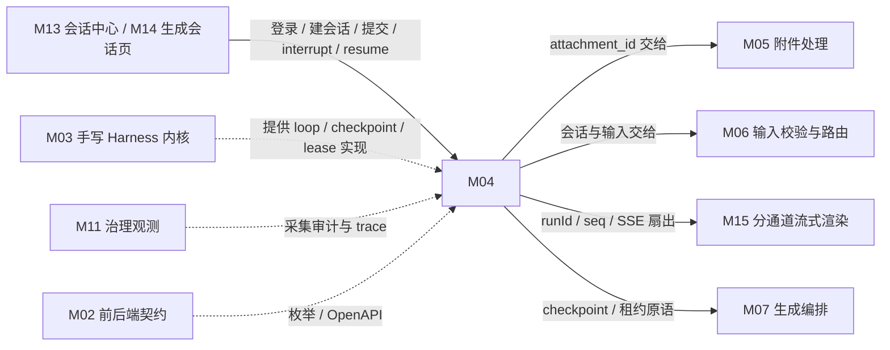
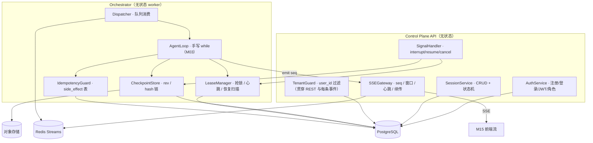
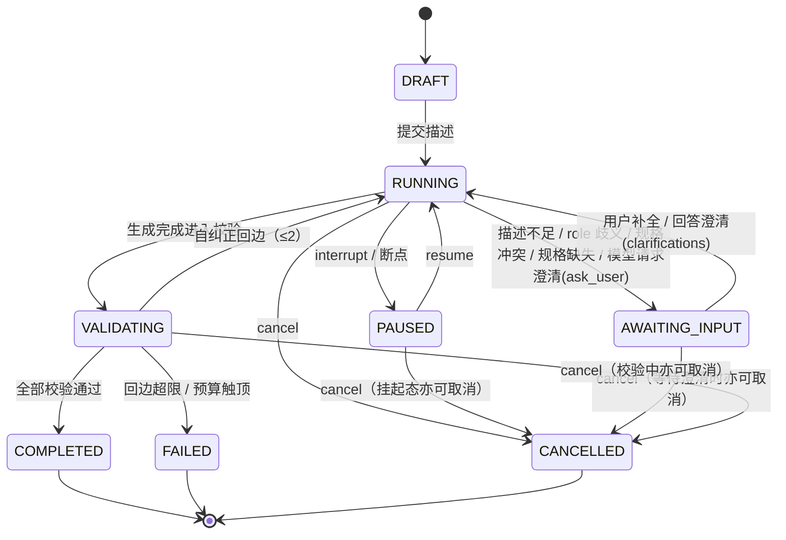

# M04 · 账号、会话与编排域（原 D1）

> **文档类型**：可独立交付 / 可独立验收的模块设计文档
> **来源**：`设计方案.md` v1.1 §5 D1、§11.4、§4.1/4.2/4.4、§3.1/3.2、§7.1/7.3、§10.1 #1/#10、§9.3
> **版本**：v1.4　|　**拆分日期**：2026-11-15　|　**最近修订**：2026-11-16（v1.3，ADR-001：`Session.grid` 可空 + `grid_source`/`clarify_count` 字段、新增 `POST /clarifications` 端点、挂起态扩展至规格缺失与模型澄清）；2026-11-16（v1.4，ADR-002 记忆管理机制：偏好 PUT/DELETE 端点与事件留痕）；2026-11-19（v1.4 落地前自审：§4.3 内部接口签名对齐 M03 Protocol、补 `clarification_answer` 落点、固化认证/租约常量、M02 Q1-Q4 定稿回填）　|　**状态**：设计定稿
> **对应编号**：D1 / FR-01、FR-02、FR-03、FR-22 / X1、X5（部分）
> **主责服务**：`control-plane`（账号、会话、API）、`orchestrator`（编排、checkpoint、租约）
> **一句话定义**：把「谁在用」「进行到哪一步」「被打断后怎么接着跑」这三件事做成持久化、可恢复、越权进不来的服务端能力，是整条生成链路的状态基座。

---

## 0. 模块速览（零基础可读）

### 0.1 项目在做什么（本模块所需的最小背景）

WidgetPilot 是一个用自然语言生成手机桌面控件的 AI Agent 产品：用户输入描述（规格可用选择器可选预填，未说明时系统主动询问补全）、可传附件，系统生成 TSX + React 代码，编译并在隔离沙箱里测试通过后，产出控件包，在网页上按真实比例渲染成卡片。**本项目不装机、不接手机系统 API、不模拟设备**。

端到端 14 步链路里，**本模块负责第 ① 步（登录 / 新建会话，grid 可选预填）以及贯穿全程的「状态与恢复」**：`① 登录 → 新建会话（grid 可选） → ② 附件 → ③ 语义校验（含规格缺省询问） → ④ 进护栏 → ⑤ 级联意图路由 → ⑥ 上下文 → ⑦ 生成（可 ask_user 问用户） → ⑧ 出护栏 → ⑨ 契约校验 → ⑩ 沙箱 → ⑪ 产物 → ⑫ 卡片 → ⑬ 语料回流 → ⑭ 审计与成本`。

### 0.2 为什么必须有这个模块

原文 §1.1 把「长任务可恢复」列为决定产品能否成立的三件事之一：生成、编译、测试是长链路，用户会打断、会跨天回来继续，**状态不能存在前端内存里**。若没有本模块，worker 一被杀任务就丢、用户暂停后无法续跑、跨用户数据会串、SSE 断线无法按 `seq` 补发。

### 0.3 本模块在链路中的位置与邻居



- **上游**：前端 M13 / M14（用户操作）、M02（契约）、M03（内核原语）。
- **下游**：M05（拿到会话与 `attachment_id`）、M06（拿到描述与规格）、M07（拿到 `runId` 与状态）、M15（消费 SSE 流）。
- **横切**：M11 采集审计与 trace；M04 自身也是 X1（会话状态与断点恢复）的主承载。

### 0.4 原文对照

| 本模块内容 | 原文章节 |
|---|---|
| 职责、技术栈、要点、验收 | §5 D1、§8 总表 D1 行 |
| checkpoint / 租约 / 恢复 SQL 与流程 | §11.4、§11.3 |
| 实体与状态枚举 | §4.1、§4.2、§1.4 |
| REST 与 SSE 接口 | §4.4、§4.5 |
| 服务划分与职责边界 | §7.1、§7.3 |
| 对抗用例 | §9.3、§2.3 |
| 里程碑 | §7.4（P0 单用户端到端、P2 跨天恢复） |

---

## 1. 模块定位与职责边界

### 1.1 为什么必须有（三个不可替代的职责）

1. **身份与租户边界**：所有会话、附件、产物都归属 `user_id`。服务端必须在**每个 REST 请求与每条 SSE 事件**上校验归属，否则一次越权就能读他人产物或撤回他人语料。
2. **持久化状态机**：会话与 `Run` 是持久实体，不是前端内存里的对象。跨天/月恢复靠 `runId + seq`，挂起期间不占计算资源。
3. **手写 durable execution**：不使用 Temporal 或任何 workflow 框架（D-5），崩溃续跑、幂等副作用、原子抢租约全部由 Postgres + 手写代码实现（§11.4）。

### 1.2 做什么（职责清单）

| # | 职责 | 说明 |
|---|---|---|
| R1 | 注册 / 登录、JWT 签发与校验（短时 access + refresh） | 邮箱密码，不接 OAuth（D-3） |
| R2 | 两角色 `user` / `curator` 的服务端权限裁剪 | 前端隐藏按钮只是体验优化 |
| R3 | 用户级数据隔离与配额归属 | `user_id` 过滤贯穿 REST 与 SSE |
| R4 | 会话 CRUD 与 `SessionState` 状态机 | `DRAFT/RUNNING/PAUSED/AWAITING_INPUT/VALIDATING/COMPLETED/FAILED/CANCELLED` |
| R5 | `Run` / `Checkpoint` 持久实体 | 挂起/恢复/重跑都开新 `Run`；checkpoint 只存结论与引用 |
| R6 | 任务打断 / 继续 / 取消 | `interrupt` 幂等；取消立即释放沙箱与租约 |
| R7 | 手写 checkpoint / 租约 / 心跳 / 原子抢锁 / 幂等副作用表 | 替代 Temporal，见 §3.4 |
| R8 | Redis Streams 队列与 SSE 扇出、`seq` 生成与持久窗口 | 供 M15 按 `Last-Event-ID` 续传 |
| R9 | BFF/网关协作：短期 SSE ticket、限流入口 | 鉴权判定不在 BFF |
| R10 | 写 `AuditEvent`（只追加、hash 链）与 trace 埋点 | 供 M11 汇总 |
| R11 | 偏好端点的鉴权与路由代理（v1.4 ADR-002） | `GET/PUT/DELETE /api/users/me/preferences` 主责 M07，M04 仅做 `user_id` 鉴权与路由转发，不实现偏好逻辑 |

### 1.3 不做什么（明确排除，边界切割点）

| 不做 | 归属模块 | 边界说明 |
|---|---|---|
| 附件上传、类型嗅探、role 判定、多模态处理 | M05 | M04 只持有 `attachment_id` 与会话关联，不解析文件内容 |
| 语义层校验、进/出 LLM 护栏、意图白名单、技能预取 | M06 / M08 | M04 只保证「请求合法送达」，不判断描述内容 |
| 生成回路、模型分档、上下文装配、成本计量 | M07 / M03 | M04 提供 `runId` 与状态容器，不装配 prompt |
| 编译、沙箱测试、契约校验 | M08 | M04 只在收到其结论后推进 `SessionState` |
| 产物内容生成、CSP、bridge 放行、包版本 | M09 | M04 只提供 `user_id` 隔离与会话快照引用 |
| 分通道渲染、partial-JSON、reducer、回放 UI | M15 / M17 | M04 只保证 `seq` 连续与可续传 |
| 指标看板、告警规则、熔断决策、成本分账 | M11 | M04 产生原始审计与事件，不做治理判定 |
| 前端页面、登录表单、状态标签 | M13 / M14 | M04 是纯服务端能力 |
| `agent_core` 的 `decide()` / `structured` / `tools` 等内核实现 | M03 | M04 是这些原语的**使用方与持久化承载方**；内核单测在 M03 |

> **与 M03 的边界最易混淆**：M03 定义 `State`/`Decision`/`decide()` 纯函数与 `lease.py`/`checkpoint.py`/`idempotency.py` 的库级实现；M04 负责把它们接到真实的 Postgres 表、`Run` 生命周期、REST/SSE 接口与权限校验上。M03 可脱离数据库单测，M04 必须做集成与故障注入验收。

### 1.4 输入 / 输出与上下游契约

| 方向 | 内容 | 契约形式 |
|---|---|---|
| 入 | 注册/登录凭据、会话创建（`grid` 可选）、描述 + `attachment_ids` + 可选 `grid`、澄清回答（`question_id` + `answer`）、`interrupt`/`resume`/`cancel` signal、SSE 重连参数（`runId` + `Last-Event-ID`） | REST（§4） |
| 入 | M03 的状态迁移结论、M08 的校验/沙箱结论、M11 的熔断指令 | 内部接口（§4.3） |
| 出 | `session_id`、`runId`、`SessionState`、`last_seq`、JWT、SSE 事件流、会话快照 + 产物引用 | REST + SSE |
| 出 | `Checkpoint.state_blob_ref`、`side_effect` 幂等记录、`AuditEvent` | PG 表 + 对象存储引用 |

### 1.5 承载的横切能力

- **X1（主承载）**：会话状态与断点恢复 —— 持久实体 + 手写 checkpoint / 租约 / 幂等，跨天/月按 `runId + seq` 恢复，挂起不占计算资源。
- **X5（部分）**：基础设施重试（429/5xx、沙箱启动失败）的指数退避上限与租约恢复；**业务失败是自纠正回边，不属于 M04 的 retry**。降级决策与 kill switch 归 M11。
- **X11（协同）**：产生只追加审计事件与 trace 上下文，治理与看板归 M11。

### 1.6 关键设计原则

1. **状态持久化与无状态计算分离**：会话/任务在 Postgres，worker 可随时被杀；挂起不占计算资源（§1.7 #5）。
2. **`interrupt` 幂等**：重复打断不产生重复 checkpoint 或重复副作用。
3. **业务失败 ≠ 基础设施重试**：生成不合规走 M07 的自纠正回边（≤2），429/5xx 才走 M04 的 RetryPolicy。
4. **checkpoint 只存结论与引用**：大对象（代码、附件、日志、快照）放对象存储，key 见基线 §9。
5. **权限服务端裁决**：`user_id` 过滤在每个请求、每条 SSE 事件上执行。
6. **零 Agent 框架**：不使用 Temporal / 任何 workflow engine（D-5）。

---

## 2. 技术栈

| 层 | 选型 | 版本 / 约束 | 为什么选 | 明确不用什么 |
|---|---|---|---|---|
| API 框架 | FastAPI | Python 3.11+ | 原生 async、Pydantic 集成、SSE 友好、OpenAPI 自动生成（M02 消费） | — |
| 校验 / 序列化 | Pydantic v2 | 严格模式 | 生成协议与请求体统一校验，与 `agent_core` 共用 | — |
| 主库 | PostgreSQL | 14+ | 事务、行级锁、`UPDATE ... WHERE lease_until < now()` 原子抢租约、只追加审计 | 不用内存态 / 不用工作流引擎状态存储 |
| 数据访问层（v1.5 定稿） | **SQLAlchemy 2.x ORM**（声明式模型 + `Session`） | 2.0+ | 声明式映射替代手写 SQL，字段约束单一来源；原子语义用 ORM 的条件 `update()` / 行锁表达，不写原生 SQL 字符串 | **不用裸 psycopg 手写 SQL**；Alembic 仅用于迁移 DDL，不作业务 ORM |
| 队列 / 扇出 / 限流 | Redis Streams | 7+ | 队列深度伸缩、SSE 扇出、最近 N 条事件窗口、幂等辅助、限流 | — |
| 认证 | JWT（短时 access + refresh） | HS256/RS256，【契约约定】access 15min / refresh 7d | 无状态、易与 BFF 集成；不接 OAuth（D-3） | 不接 OAuth / 不用第三方身份平台 |
| 密码 | argon2 / bcrypt | 只存 `password_hash` | 防明文与彩虹表 | 明文 / 可逆加密 |
| 编排 | **手写 agent loop + checkpoint/租约** | `packages/agent_core/loop/`、`state/`（M03 提供） | 无黑盒、每一步可断言、可跨天恢复 | **Temporal / LangGraph / 任何 workflow 框架** |
| 对象存储 | S3 兼容 | 存 `checkpoint/{run_id}/{rev}.json` | 大对象不入库 | 不把代码/日志塞进 PG |
| 可观测 | OpenTelemetry SDK + 自建 `agent_event`/`trace_span` 表 | 通用标准 | 重建完整链路 | **不用 LLM 专用观测平台 SDK** |
| 事件通道 | 原生 SSE（`seq` + `Last-Event-ID` + `runId`） | `X-Accel-Buffering: no` | 服务端单向、可回放、代理与鉴权简单 | AI SDK / CopilotKit / AG-UI SDK |

### 2.1 硬约束

- **禁止引入**：Temporal、LangChain/LangGraph、AI SDK、CopilotKit、任何 workflow engine、MCP SDK、OPA/Casbin（护栏链路）。
- **保留的通用基础设施**：FastAPI、Pydantic v2、Postgres、Redis、对象存储、OTel SDK、`httpx`（M03 模型直连用）。
- **门禁无在线关闭开关**：MAX_ITER / MAX_REPAIR / 预算上限写在代码常量里。

### 2.1.1 数据访问层规格（v1.5 ORM 化定稿）

业务代码**不再手写 SQL**——数据访问统一走 SQLAlchemy 2.x ORM（声明式模型 +
`orm.Session`）。原 psycopg 手写 SQL 实现全部替换。规格如下（场景 6 契约变化清单）：

| 契约项 | 新规格（ORM） | 行为等价要求 |
|---|---|---|
| 声明式模型 | `services/control_plane/models.py` 集中定义 User / Session / Checkpoint / SideEffect / AuditEvent 五张表的 ORM 类；列类型与迁移 0002 逐字段对齐（Text / JSON / Boolean / Integer / BigInteger / DateTime(tz)） | 字段集合、可空性、默认值与 §6.1 一致 |
| Session 管理 | `services/control_plane/db.py` 提供 `make_session_factory(dsn)`（各存储实例构造时绑定 engine，进程级共享）与 `session_scope(factory)` 上下文管理器；每个存储操作一个短 Session，正常提交、异常回滚、总是关闭 | 短连接语义不变（对齐原 psycopg `with connect()` 的退出提交） |
| 存储适配器 | `pg_stores.py` / `adapters.py` 保留类与 Protocol 签名，内部改为 ORM 查询；ORM 模型在 `models.py` 提供 `to_row()`，把原 `_to_*_row` 的容错（未知 role/state 回退、JSON/时间收窄）下沉到模型方法，**仍返回 dataclass** | 对外公开方法签名、返回的数据类形态不变；因 Protocol 声明返回 `UserRow`/`SessionRow`，且异常数据需 fail-safe 收窄、避免 Session 关闭后惰性加载异常 |
| 原子抢租约（A4） | `update(Checkpoint).where(...lease 空闲或过期).values(...)` 条件更新 + `rowcount` 判赢家（ORM 的 `Session.execute(update_stmt)`，非原生 SQL） | 并发恰好 1 赢家，语义等同原 `UPDATE ... WHERE lease_until < now()` |
| 乐观锁（S2） | `update(Session模型).where(id=..., state=期望态).values(...)`（Core update，非 ORM-enabled），0 行命中抛冲突；不依赖 ORM version_id_col（期望态由 service 层传入） | 并发两请求仅一个命中，冲突折叠 ConflictError |
| 租约继承（B2） | save 新 rev 行时先从 ORM 查 `MAX(rev)` 行的 owner/until（`with_for_update()` 行锁，恢复旧单语句快照原子性），写入新行；在单 Session 事务内完成 | 持锁 worker 写 checkpoint 不丢锁 |
| 幂等占位（A5） | 仍走 Redis SETNX（非 SQL，不受影响） | 不变 |
| audit hash 链 | append 逻辑不变，仅持久化从手写 INSERT 改 ORM `add()` | chain_hash 全字段入链不变 |

**兼容性判定**：本次为**实现层替换**，REST 契约（§4.1）、事件契约（§4.2）、表结构（§6.1）均**不变**——additive 到设计文档，breaking 到实现内部（对外无 breaking）。
**迁移**：不改表结构，0002 迁移原样保留；无新数据库迁移。
**双实现保留**：内存实现（InMemoryUserStore/InMemorySessionStore）与 PG ORM 实现共存，Protocol 不变（规则 8/9）。

**认证与租约常量（v1.4 固化，代码常量无在线开关）**：落点在 `services/control_plane/accounts/constants.py`，必须与 M02 `enums.py` 的 Q4 定稿值一致：

| 常量 | 值 | 来源 | 说明 |
|---|---|---|---|
| `ACCESS_TOKEN_TTL_S` | `900` | 【契约约定】access 15min | 短时访问令牌有效期 |
| `REFRESH_TOKEN_TTL_S` | `604800` | 【契约约定】refresh 7d | 刷新令牌有效期 |
| `JWT_ALGORITHM` | `HS256` | 【契约约定】 | 签名算法，密钥从环境注入（不入库、不进 overview） |
| `LEASE_TTL_S` | `30` | M02 Q4 定稿（影子校准中） | 租约 TTL |
| `HEARTBEAT_INTERVAL_S` | `10` | M02 Q4 定稿（影子校准中） | 心跳间隔 |
| `SSE_WINDOW_N` | `500` | M02 Q4 定稿（影子校准中） | SSE 保留窗口，超窗走快照 |

### 2.2 运行时依赖

| 依赖 | 用途 | 不可用时的行为 |
|---|---|---|
| PostgreSQL | 会话 / Run / checkpoint / 审计 / 幂等表 | 拒绝写入，不降级（状态基座不可降级） |
| Redis Streams | 队列 / SSE 扇出 / 限流 | 故障注入验收要求「保状态且优雅降级」；恢复后按 `runId + seq` 补发 |
| 对象存储 | checkpoint 大对象引用 | 写 checkpoint 失败则本 super-step 不提交 |
| BFF（可选） | JWT session → 短期 SSE ticket、首屏聚合 | 直连 control-plane 亦可；**BFF 不做鉴权判定** |

### 2.3 代码落位

```
services/control_plane/
  api/            # REST 路由（§4.1）：server.py 装配 + main.py 生产入口（真实 PG 存储）
  models.py       # v1.5 补：五张表的 SQLAlchemy 声明式 ORM 模型（字段单一来源，对齐 §6.1 / 迁移 0002）
  db.py           # v1.5 补：engine + sessionmaker + get_session() 上下文管理器（短 Session）
  accounts/       # 注册/登录/JWT/角色/配额：stores.py(UserStore协议+内存) / pg_stores.py(PG ORM) / service.py / constants.py
  sessions/       # Session CRUD / 状态机 / signal / SSE：stores.py(SessionStore协议+内存) / pg_stores.py(PG ORM) / service.py / sse.py
  audit/          # AuditEvent 只追加写入（ledger.py hash 链，PG 持久化走 ORM）
  migrations/versions/0002_m04_tables.py  # v1.4 补：users/sessions/checkpoint/side_effect/audit_event 建表（v1.5 不改表结构）
services/orchestrator/
  loop.py  decide.py  state.py     # 由 M03 agent_core 提供，此处仅装配（不重写算法）
  adapters.py                      # M03 Protocol 的真实落库适配器：CheckpointStore/LeaseProvider 走 PG ORM；IdempotencyStore/EventBus 走 Redis
  dispatcher.py                    # v1.4 补：Redis Streams 队列消费 + 恢复扫描调度
packages/agent_core/state/         # M03：checkpoint.py / lease.py / idempotency.py（库级算法函数，唯一实现）
packages/contracts/                # M02：openapi.yaml / enums
```

---

## 3. 设计架构

### 3.1 内部组件与职责



| 组件 | 职责 | 关键不变量 |
|---|---|---|
| `AuthService` | 凭据校验、JWT 签发/刷新、角色读取 | 密码只存 hash；token 带 `user_id` |
| `TenantGuard` | 每个 REST / 每条 SSE 事件按 `user_id` 过滤 | 越权一律 403，不泄漏是否存在该资源 |
| `SessionService` | 会话 CRUD、状态迁移、快照 | 状态迁移集中一处，旁路必带原因码 + 证据引用 |
| `SignalHandler` | 打断/继续/取消 | `interrupt` 幂等；取消立即释放沙箱与租约 |
| `SSEGateway` | `seq` 生成、最近 N 条窗口、心跳、`Last-Event-ID` 续传 | `seq` 每会话单调连续 |
| `CheckpointStore` | 每 super-step 同步落盘 | `rev` 单调递增、`prev_hash` 成链 |
| `LeaseManager` | 原子抢锁、心跳续租、过期扫描 | 同一 `runId` 同时只有一个持锁者 |
| `IdempotencyGuard` | 外部副作用前置查表 | `idem_key` 命中则复用结果，不重复执行 |

### 3.2 处理流程（一次提交的完整数据流）

1. 用户登录 → `AuthService` 校验 `password_hash` → 签发 JWT（含 `user_id`、`role`）。
2. `POST /api/sessions` → `TenantGuard` 取 `user_id` → 写 `Session`（`state=DRAFT`, `grid?`（可空，v1.3）, `last_seq=0`）。
3. `POST /api/sessions/{id}/messages` → 校验归属 →（若带 `grid`）校验枚举 → 状态 `RUNNING` → 开新 `Run`（`run_id`、`attempt_no`、`model_tier`）→ 入 Redis Streams；grid 缺省时由 M06 语义层询问补全（v1.3 D-6），补全前会话停留 `AWAITING_INPUT`。
4. `Dispatcher` 消费 → `LeaseManager.acquire(run_id)` 原子抢租约 → `CheckpointStore.load(run_id)`（无则 `State.initial()`）。
5. 进入手写 agent loop（M03 §3）：每个 super-step 执行 `decide()` → 分支动作 → **同步写 checkpoint** → `emit(seq, phase, decision)` → `budget.check()` → `lease.heartbeat()`。
6. 用户 `interrupt` → `SignalHandler` 写 `PAUSED` + checkpoint + 释放租约 → 取消上游模型调用 → 账单同步停止 → 推 `interrupted` 事件。
7. 用户 `resume` → 抢租约 → 从该 `rev` 节点顶部重执行；前置副作用查 `side_effect` 命中即复用。
8. 校验完成（M08 结论）→ 状态 `COMPLETED` → 写 `AuditEvent` → 推 `artifact` / `done`。
9. 前端重连：`Last-Event-ID` → `SSEGateway` 按 `runId + seq` 补发；超窗先拉 `GET /api/sessions/{id}` 快照再续流。

### 3.3 状态机

本模块拥有 `SessionState`（完整枚举见 §5.1），并参与 `BundleState` 的**读取但不拥有**（产物状态由 M09 管理）。



> **图与表一致性（v1.4 补）**：`cancel` 从**任意非终态**均可触发（对齐 §5.2 流转表与 §5.5 终态约定）；`interrupt` 仅对 `RUNNING` 有效（挂起态调用幂等返回当前状态）；终态 `COMPLETED`/`FAILED`/`CANCELLED` 的 `resume` 一律 409。`AWAITING_INPUT` 的两类进入来源（确定性触发 / 模型 `ask_user`）在图上合并为一条标注，语义以 §5.2 流转表为准。

### 3.4 关键机制与不变量（本模块最需要讲清的部分）

**A. 手写 durable execution（替代 Temporal，§11.4）**

```sql
CREATE TABLE checkpoint (
  run_id TEXT, rev INT, node TEXT, state_ref TEXT,
  lease_owner TEXT, lease_until TIMESTAMPTZ,
  created_at TIMESTAMPTZ, prev_hash TEXT,
  PRIMARY KEY (run_id, rev)
);
CREATE TABLE side_effect (
  idem_key TEXT PRIMARY KEY,    -- session_id + step + payload_hash
  run_id TEXT, result_ref TEXT, created_at TIMESTAMPTZ
);
```

恢复流程（6 步，原文 §11.4）：
1. 每个 super-step **同步**写 checkpoint（`rev` 单调递增，hash 链防篡改）；大对象只存引用。
2. worker 持有 `lease_owner` 并心跳续租 `lease_until`。
3. 崩溃后另一实例扫描 `lease_until < now() AND terminal IS NULL`，用 `UPDATE ... WHERE lease_until < now()` **原子抢租约**，成功者从该 `rev` 恢复。
4. 任何外部副作用执行前查 `side_effect`；命中直接复用结果，**不重复执行**。
5. `interrupt` → 写 `PAUSED` + checkpoint + 释放租约；`resume` → 抢租约、从节点顶部重执行（前置副作用幂等）。
6. 前端重连：`Last-Event-ID` → 按 `runId + seq` 补发；超窗先拉快照再续流。

**不变量清单**：

| # | 不变量 | 断言方式 |
|---|---|---|
| I1 | `checkpoint.rev` 单调递增，无重复 `(run_id, rev)` | 主键约束 + 单测 |
| I2 | `prev_hash` 链可完整校验 | hash 链重算 |
| I3 | 同一 `runId` 同时只有一个 `lease_owner` | 原子 UPDATE 并发测试 |
| I4 | `side_effect` 中同一 `idem_key` 只有 1 条 | 副作用条数断言 = 1 |
| I5 | SSE `seq` 连续、无重复、无倒序 | 事件序列断言 |
| I6 | 挂起期间无 worker 占用、无模型调用、无计费 | 资源与成本账断言 |
| I7 | 跨用户读取一律 403 | 越权用例 |
| I8 | `interrupt()` 幂等 | 连续两次调用状态与副作用条数不变 |

**B. 幂等副作用键**：`idem_key = session_id + step + payload_hash`。恢复时节点从顶部重执行，前置副作用靠该键去重，保证「不重复产物、不重复扣费、不重复发事件」。

**C. 业务失败与基础设施重试分离**：生成不合规（出护栏 / 契约 / 沙箱失败）是 **M07 的自纠正回边**，不新增 `Run`、不计入基础设施重试；只有模型 429/5xx、网络抖动、沙箱启动失败才走 `RetryPolicy` 指数退避（有上限）。降级阶梯与 kill switch 由 M11 决策。

**D. 上下文与状态分离（X2 边界）**：`state` 只存结论与引用；tool / 日志窗口化；超阈值压缩时**保留任务契约与已排除方案**；固定槽位保持 prompt caching。这部分由 M07/M03 执行，M04 只负责把 `state_blob_ref` 安全落盘。

### 3.5 与其他模块的时序（关键 3 个场景）

**场景 1：正常生成**
`M14 提交 → M04(RUNNING, runId, 抢租约) → M05/M06 → M07 → M08 → M04(COMPLETED, artifact/done) → M16 卡片`

**场景 2：用户停止后跨天回来**
`M14 停止 → M04(POST /interrupt, PAUSED + checkpoint + released lease, interrupted) → [7 天，无计算资源] → M13 会话中心恢复入口 → M04(GET 快照 + SSE runId&Last-Event-ID 续传) → M17 reducer 重放 → M14 界面与离开前一致`

**场景 3：worker 被杀**
`kill → lease_until 过期 → 另一实例扫描并原子抢租约 → 从该 rev 恢复 → side_effect 命中复用 → 不重复产物`

### 3.6 部署形态与伸缩

| 服务 | 状态 | 伸缩依据 | 说明 |
|---|---|---|---|
| `control-plane` | 无状态（状态在 PG） | QPS | 可任意水平扩容 |
| `orchestrator` | 无状态 worker | 队列深度 | 任一实例凭 `runId` 接管；挂起不占资源 |
| `bff`（可选） | 无状态 | QPS | 只做 SSO/聚合/SSE ticket，**不做鉴权判定** |

---

## 4. 接口契约

> 完整 REST 全表与统一响应格式见 `01-共享契约基线.md` §5；本节列出**本模块拥有/参与的全部接口**并给出可直接实现的粒度。

### 4.1 对外 REST 接口

| 方法 | 路径 | 权限 | 请求 | 成功响应 | 状态码 |
|---|---|---|---|---|---|
| `POST` | `/api/auth/register` | 公开 | `{ email, password }`【契约约定】 | `{ code:"OK", data:{ access_token, refresh_token, user:{ id, role, share_enabled } } }` | 200 / 400 / 409 |
| `POST` | `/api/auth/login` | 公开 | `{ email, password }` | 同上 | 200 / 401 |
| `POST` | `/api/auth/refresh`【推导·需评审】 | refresh token | `{ refresh_token }` | 同上 | 200 / 401 |
| `GET` | `/api/users/me/preferences`【v1.4 ADR-002】 | 本人 | —（主责 M07，本模块仅负责鉴权与路由） | `{ data: UserPreference }`；无偏好时各字段为空 | 200 |
| `PUT` | `/api/users/me/preferences`【v1.4 ADR-002】 | 本人 | `{ palette?, preferred_grids?, preferred_widget_types? }`（显式设置，主责 M07） | `{ data: UserPreference }`，`version+1` | 200 / 400 / 403 |
| `DELETE` | `/api/users/me/preferences`【v1.4 ADR-002】 | 本人 | 可选 body `{ fields?: ('palette', 'preferred_grids', 'preferred_widget_types')[] }`（不传则全清；主责 M07） | `{ data: UserPreference }`，`version+1` | 200 / 400 / 403 |
| `GET` | `/api/sessions` | 本人 | Query: `state?`, `grid?`, `cursor?`, `limit?` | `{ data:{ items: Session[], next_cursor } }` | 200 |
| `POST` | `/api/sessions` | 本人 | `{ title?: string, grid?: GridSpec }`（v1.3：`grid` 可选） | `{ data: Session }`，`state=DRAFT` | 200 / 400 |
| `GET` | `/api/sessions/{id}` | 本人 | — | `{ data:{ session, last_seq, bundle_refs[], run_id } }` | 200 / 403 / 404 |
| `POST` | `/api/sessions/{id}/messages` | 本人 | `{ description, grid?, attachment_ids }` | `{ code:"OK", data:{ runId, state:"RUNNING" } }` | 202 / 400 / 403 / 422 |
| `POST` | `/api/sessions/{id}/clarifications` | 本人 | `{ question_id, answer }`（v1.3：回答规格缺失 / 模型 ask_user 澄清） | `{ code:"OK", data:{ state:"RUNNING" } }`；校验 `clarify_count` 上限 | 202 / 400 / 403 / 422 |

> **澄清答案落点（v1.4 补）**：`POST /clarifications` 的 `answer` 写入 §6.1 `Session.clarification_answer` 并同步进 M03 `State.clarification_answer` 槽位，随下一个 checkpoint 的 `state_blob_ref` 落盘；会话由 `AWAITING_INPUT` 回 `RUNNING`，从澄清节点顶部重执行。这是 ADR-001 D-7「答案作为附加上下文槽位回注生成回路」的持久化落点。
| `POST` | `/api/sessions/{id}/interrupt` | 本人 | `{}`（独立 POST signal） | `{ data:{ state:"PAUSED", checkpoint_rev, last_seq } }` | 202 / 409 |
| `POST` | `/api/sessions/{id}/resume` | 本人 | `{ runId? }` | `{ data:{ state:"RUNNING", runId } }` | 202 / 409 |
| `POST` | `/api/sessions/{id}/cancel` | 本人 | `{}` | `{ data:{ state:"CANCELLED" } }` | 202 / 409 |
| `GET` | `/api/sessions/{id}/events` | 本人 + 短期 SSE ticket | Query/Header: `runId`, `Last-Event-ID` | `text/event-stream` | 200 / 401 / 403 |

**统一响应**（原文 §4.4）：`{ code, message, traceId, retryable, evidenceRef? }`，`code` 与 `ReasonCode` 对齐；`data` 为【契约约定】补充。最终以 `packages/contracts/openapi.yaml` 为准。

**SSE 响应头约定**【契约约定】：`Content-Type: text/event-stream`、`Cache-Control: no-cache`、`X-Accel-Buffering: no`；每帧 `id: {seq}\nevent: {kind}\ndata: {json}\n\n`；心跳为注释帧 `: keepalive\n\n`；显式 `done` / `error` 事件标志终态。

### 4.2 事件接口（本模块产生 / 转发）

| `kind` | 本模块的职责 | payload 要点 |
|---|---|---|
| `run` | 产生：会话创建、任务启动、resume | `{ runId, phase, grid, attempt_no }` |
| `checkpoint` | 产生：每 super-step 落盘后 | `{ rev, node, state_blob_ref, lease_owner }` |
| `interrupted` | 产生：interrupt / cancel 后 | `{ reason_code, checkpoint_rev, resume_hint }` |
| `done` / `error` | 产生：终态 | `done` 带 `bundle_id`；`error` 带 `code` + `evidenceRef` |
| `notice` | 转发：降级、预算、恢复提示 | `{ message, code }` |
| 其余 `plan/spec/attachment/skill/routing/code/guard/validation/sandbox/artifact/cost` | **只转发，不生成内容** | 由 M05–M11 产生，M04 负责编号 `seq`、持久化窗口与扇出 |

**关键约定**：所有事件必须带 `seq`（每会话单调递增）、`sessionId`、`runId`、`ts`、`phase`、`traceId`（完整结构见基线 §6）。前端 reducer 对未知 `kind` 忽略而非报错。

### 4.3 内部接口（被调用签名，【契约约定】）

> **与 M03 的接线铁律**：本节签名必须与 `packages/agent_core/injection.py` 的 Protocol **逐字一致**——M04 是 M03 的使用方 + 持久化适配方，不是重新定义接口（§1.3）。M03 提供**库级算法函数**（`state/checkpoint.py`、`state/lease.py`、`state/idempotency.py`），M04 提供**落库适配器**（实现 Protocol 并注入 `Deps`）。任何签名漂移即功能断点（编码规则 10）。
>
> **v1.4 修订说明**：旧稿写 `save()->int（返回 rev）`、`acquire()->bool`，与 M03 真实实现不符——M03 `CheckpointStore.save` 返回 `None`（rev 由 `state.rev` 携带、链 hash 由 `save_checkpoint` 返回），`LeaseProvider.acquire` 返回 `Lease` 对象（含无参 `heartbeat()`/`release()`）。以本节为准。

```python
# packages/agent_core/injection.py（M03 定义，M04 落库适配器须实现的 Protocol）
class CheckpointStore(Protocol):
    def save(self, run_id: str, rev: int, node: CheckpointNode, state_ref: str, prev_hash: str) -> None: ...
    def load(self, run_id: str) -> State | None: ...               # 取最新 rev 的 State
    def latest_rev(self, run_id: str) -> int: ...                  # 无记录返回 -1
    def hashes(self, run_id: str) -> list[str]: ...                # 按 rev 排序的 prev_hash，供 hash 链重算

class LeaseProvider(Protocol):
    def acquire(self, run_id: str, owner: str, ttl_s: int) -> Lease: ...  # 原子抢锁，返回 Lease 对象（非 bool）
    def heartbeat(self, run_id: str, owner: str) -> bool: ...
    def release(self, run_id: str, owner: str) -> None: ...
    def scan_expired(self, now: datetime) -> list[str]: ...        # lease_until < now AND terminal IS NULL

class IdempotencyStore(Protocol):
    def get_or_reserve(self, idem_key: str, run_id: str) -> str | None: ...  # 命中返回 result_ref

# packages/agent_core/state/*.py（M03 库级算法函数，M04 编排侧直接调用）
def save_checkpoint(store: CheckpointStore, state: State, node: CheckpointNode) -> str: ...  # 落盘并成链，返回链 hash
def load_checkpoint(store: CheckpointStore, run_id: str) -> State | None: ...
def acquire(provider: LeaseProvider, run_id: str, owner: str, ttl_s: int) -> Lease: ...
def heartbeat(provider: LeaseProvider, run_id: str, owner: str) -> bool: ...
def release(provider: LeaseProvider, run_id: str, owner: str) -> None: ...
def scan_expired(provider: LeaseProvider, now: datetime) -> list[str]: ...
def make_idem_key(session_id: str, step: str, payload_hash: str) -> str: ...  # "sid|step|hash"
def get_or_reserve(store: IdempotencyStore, idem_key: str, run_id: str) -> str | None: ...

# services/control_plane/api/guard.py（M04 自有）
def assert_owner(user_id: str, resource_user_id: str) -> None: ...  # 不等则抛 403
```

**被上游调用**：M08 在校验完成后调用 `session.complete(session_id, bundle_ref)`；M11 在熔断时调用 `session.pause_all(scope)`；M03 在 `HANDOFF` / `FAILED` 时调用 `state.terminate()` 写入终态。

### 4.4 统一响应与错误码

见 §5.4 与本模块 §5.3；`FAILED` / `CANCELLED` 必须带 `evidenceRef`，禁止只返回「失败」。

### 4.5 幂等、重试、超时、限流、并发约定

| 项 | 约定 |
|---|---|
| 幂等 | `interrupt` / `cancel` / `install` 类操作幂等；`idem_key = session_id + step + payload_hash`；重复 `messages` 提交用【契约约定】`Idempotency-Key` 头去重 |
| 重试 | 仅基础设施故障（429/5xx / 网络抖动 / 沙箱启动失败）走指数退避且**有上限**；业务失败走 M07 回边 |
| 超时 | 租约 `lease_until` + 心跳；SSE 心跳保活；无 `done` 的断流视为截断，触发重连 |
| 限流 | Redis 限流，按用户并发 / 预算；与 M11 配额策略对齐 |
| 并发 | 原子 `UPDATE ... WHERE lease_until < now()` 保证单持锁者；`checkpoint` 主键 `(run_id, rev)` 防重复 |
| 乱序 | SSE 事件按 `seq` 由前端去重与乱序丢弃；服务端保证 `seq` 连续 |

### 4.6 接口状态表（契约状态 / API 状态）

| 接口 | 契约状态 | 运行态 | 可重试 | 说明 |
|---|---|---|---|---|
| `/api/auth/register`、`/login` | 定稿（原文 §4.4） | 同步 | 否 | 路径定稿；请求体字段为契约约定 |
| `/api/auth/refresh` | **【推导·需评审】** | 同步 | 是 | 原文提到「短时 + refresh」但未列路径，需 M02 定稿 |
| `/api/sessions` GET/POST | 定稿 | 同步 | GET 是 / POST 否 | — |
| `/api/sessions/{id}` GET | 定稿 | 同步 | 是 | 超窗重连先拉此快照 |
| `/api/sessions/{id}/messages` | 定稿 | **异步**（202 + SSE） | 否（需幂等键） | 真正结果走事件流 |
| `/api/sessions/{id}/interrupt\|resume\|cancel` | 定稿 | 异步 signal（202） | 是（幂等） | 独立 POST，不是关闭 SSE 连接 |
| `/api/sessions/{id}/events` | 定稿 | **流式**（长连接） | 是（`Last-Event-ID`） | 需短期 ticket |
| 内部 `checkpoint/lease/idem` | 定稿（原文 §11.4 给出 SQL 与流程） | 同步 | — | 函数签名为契约约定 |
| `401/403/409` 业务码映射 | **待 M02 定稿** | — | — | 原文 `ReasonCode` 未含鉴权/冲突码，见基线 §5.3 |

---

## 5. 状态、原因码与 API 状态

### 5.1 本模块拥有的状态与枚举（完整定义，见基线 §3）

```ts
type SessionState =
  | "DRAFT" | "RUNNING" | "PAUSED" | "AWAITING_INPUT" | "VALIDATING"
  | "COMPLETED" | "FAILED" | "CANCELLED";

type GridSpec = "2x2" | "2x4" | "4x2" | "4x4" | "2x1" | "1x2";
type ModelTier = "cheap" | "standard" | "frontier";
type UserRole = "user" | "curator";
```

**终态**：`COMPLETED` / `FAILED` / `CANCELLED`（`terminal IS NOT NULL`，不再被恢复扫描命中）。
**挂起态**：`PAUSED` / `AWAITING_INPUT`（释放租约与计算资源，保留 checkpoint）。

### 5.2 状态流转表

| 触发 | 前态 | 后态 | 副作用 | 事件 | 原因码 |
|---|---|---|---|---|---|
| 新建会话 | — | `DRAFT` | 写 `Session`，`last_seq=0` | `run` | — |
| 提交描述 | `DRAFT` | `RUNNING` | 开新 `Run`、分配 `runId`、抢租约、入队 | `run` | — |
| 描述不足 / role 歧义 / 规格冲突 / 规格缺失 / 模型请求澄清 | `RUNNING` | `AWAITING_INPUT` | 写 checkpoint（含 `clarify_count`）、释放租约；模型澄清推 `ask_user` 事件 | `notice` / `ask_user` | `INPUT_INVALID` / `SPEC_CONFLICT` / `SPEC_MISSING` / `CLARIFICATION_REQUIRED` |
| 用户补全 / 回答澄清 | `AWAITING_INPUT` | `RUNNING` | 抢租约、答案入 `clarification_answer` 槽位、`clarify_count += 1`、节点顶部重执行 | `run` | — |
| 用户停止 | `RUNNING` | `PAUSED` | checkpoint、释放租约、取消上游模型、账单同步停止 | `interrupted` | — |
| 用户继续 | `PAUSED` | `RUNNING` | 按 `runId + seq` 恢复 | `run` | — |
| 生成完成 | `RUNNING` | `VALIDATING` | 触发 M08 校验链 | `validation` | — |
| 校验失败且回边 < 2 | `VALIDATING` | `RUNNING` | `REPAIR`，`repair_count += 1` | `notice` | `GUARD_OUTPUT_HIT` 等 |
| 全部通过 | `VALIDATING` | `COMPLETED` | 写 `AuditEvent`、产物引用 | `artifact` / `done` | — |
| 回边 > 2 / 预算触顶 | `VALIDATING` | `FAILED` | 原因码 + 证据引用 + 保留部分产物 | `error` | `RETRY_EXHAUSTED` / `BUDGET_EXHAUSTED` |
| 用户取消 | 任意非终态 | `CANCELLED` | 立即释放沙箱与租约 | `interrupted` | — |

### 5.3 本模块产出 / 消费的 `ReasonCode`

| 码 | 本模块角色 | 场景 |
|---|---|---|
| `INPUT_INVALID` | 产出 | `grid` 非法、描述为空、请求体校验失败 |
| `SPEC_MISSING` | 转发（M06 判定，v1.3） | 规格缺失询问：转 `AWAITING_INPUT`，`notice.spec_missing.suggest_grid` |
| `CLARIFICATION_REQUIRED` / `CLARIFICATION_LIMIT` | 转发（M07 判定，v1.3） | 模型执行中澄清：转 `AWAITING_INPUT`（`ask_user` 事件）；次数超限转人工 |
| `SPEC_CONFLICT` | 转发（M06 判定） | 转 `AWAITING_INPUT`，前端提示改选规格 |
| `INTENT_OUT_OF_SCOPE` | 转发（M06 判定） | 转 `FAILED` |
| `GUARD_INPUT_HIT` | 转发（M06 判定） | 转 `FAILED`，不进模型 |
| `BUDGET_EXHAUSTED` | 转发（M07/M11 判定） | 转 `FAILED`，确定性中断 |
| `RETRY_EXHAUSTED` | 转发（M03 判定） | 转 `FAILED` + `HANDOFF` |
| `SANDBOX_UNAVAILABLE` | 转发（M08/M11 判定） | 降级记录，状态不直接 `FAILED` |
| `HUMAN_REQUIRED` | 转发 | 转 `FAILED` 或人工队列 |
| `MODEL_ERROR` | 产出 / 转发 | 基础设施重试上限后转 `FAILED` |

> 完整 **17** 个 `ReasonCode` 见基线 §7（原文 14 个 + v1.3 新增 3 个）；所有 `FAILED` 必须携带 `evidenceRef`，**前端不得只显示「失败」**。

### 5.4 HTTP 状态码与业务码映射

| HTTP | 场景 | `code` | `retryable` |
|---|---|---|---|
| 200 | 查询 / 登录成功 | `OK` | — |
| 202 | 生成已受理、signal 已排队 | `OK` | — |
| 400 | 请求体 / `grid` 非法 | `INPUT_INVALID` | `false` |
| 401 | 未登录 / JWT 失效 | 【待 M02 定稿，见基线 §5.3】 | `false` |
| 403 | 越权访问他人会话 | 【待 M02 定稿】 | `false` |
| 409 | 对终态会话重复 resume / 重复提交 | 【待 M02 定稿】 | `false` |
| 422 | 语义校验 / 进护栏命中 | `GUARD_INPUT_HIT` / `INTENT_OUT_OF_SCOPE` | `false` |
| 429 | 限流 / 配额触顶 | `BUDGET_EXHAUSTED` | `false`（确定性中断，不自动重试） |
| 503 | 模型 / 沙箱不可用 | `MODEL_ERROR` / `SANDBOX_UNAVAILABLE` | `true`（有上限退避） |

### 5.5 接口的运行态约定（API 状态）

- **同步接口**：auth、会话 CRUD、快照查询 —— 请求即得到终态结论。
- **异步接口**：`messages` 返回 `202` 只是「已受理」，**真正结论只能通过 SSE 事件或会话快照获取**；前端不得把 202 当作生成成功。
- **流式接口**：`events` 为长连接，终态由显式 `done` / `error` 标志；无 `done` 的断连一律视为截断并重连。
- **挂起态接口行为**：`PAUSED` / `AWAITING_INPUT` 下 `GET /sessions/{id}` 正常返回快照 + `checkpoint_rev` + `resume_hint`；`interrupt` 在挂起态调用应幂等返回当前状态而非报错。
- **终态接口行为**：`COMPLETED` / `FAILED` / `CANCELLED` 下 `resume` 返回 409；如需重跑，走「新建 `Run`」（原文：挂起/恢复/重跑都开新记录）。

---

## 6. 核心字段与元数据

### 6.1 持久化实体字段表（本模块拥有）

| 实体 | 字段 | 类型【推导·需评审】 | 约束 | 含义 |
|---|---|---|---|---|
| `User` | `id` | uuid | PK | 账号标识 |
| | `email` | citext | UNIQUE | 登录名 |
| | `password_hash` | text | NOT NULL | 只存 hash |
| | `role` | enum(`user`,`curator`) | NOT NULL | 两角色（D-3） |
| | `share_enabled` | bool | 默认按灰度策略 | 是否允许产物进公共语料（D-1） |
| | `quota` | jsonb | NOT NULL | 配额归属，M11 消费 |
| | `created_at` | timestamptz | NOT NULL | UTC |
| `Session` | `id` | uuid | PK | 会话标识 |
| | `user_id` | uuid | FK, INDEX | **租户隔离键** |
| | `title` | text | — | 会话标题 |
| | `state` | enum(`SessionState`) | NOT NULL | 状态机 |
| | `grid` | enum(`GridSpec`) | NULLABLE | 可选预填；缺省由 M06 语义层询问补全（v1.3 D-6）；`RUNNING` 态必非空 |
| | `grid_source` | enum(`"selector"|"explicit_text"|"clarified"`) | NULLABLE | 规格来源溯源（v1.3 契约约定） |
| | `clarify_count` | int | NOT NULL DEFAULT 0 | 本任务已回答澄清次数（v1.3 D-7，上限 2） |
| | `clarification_answer` | text | NULLABLE | **v1.4 补**：当前待回注的用户澄清答案（`POST /clarifications` 写入）；跨天恢复时随 checkpoint 的 `state_blob_ref` 一并还原，M03 `State.clarification_answer` 是其在内存态的对应字段 |
| | `created_at` / `updated_at` | timestamptz | NOT NULL | UTC |
| | `last_seq` | bigint | NOT NULL, ≥0 | SSE 重连锚点 |
| `Run` | `id` | uuid | PK | 执行记录 |
| | `session_id` | uuid | FK | 所属会话 |
| | `run_id` | text | UNIQUE | 恢复锚点 |
| | `attempt_no` | int | ≥0 | 第几次执行尝试 |
| | `checkpoint_rev` | int | ≥0 | 当前 rev |
| | `model_tier` | enum(`ModelTier`) | — | 档位 |
| | `started_at` / `ended_at` | timestamptz | — | 生命周期 |
| `Checkpoint` | `session_id` / `run_id` | uuid / text | FK | 归属 |
| | `rev` | int | PK 一部分，单调 | 版本 |
| | `node` | text | NOT NULL | 当前 super-step / 节点名 |
| | `state_blob_ref` | text | NOT NULL | 对象存储引用，不存大对象 |
| | `created_at` | timestamptz | NOT NULL | UTC |
| `AuditEvent` | `seq`, `user_id`, `session_id`, `actor`, `action`, `decision`, `payload`, `trace_id`, `prev_hash` | — | 只追加 | hash 链防篡改；**M04 产生原始事件（模块 R10），M11 负责汇总/看板/治理（00-总览 §2/§6），二者不矛盾** |

**字段归属原则（原文 §4.1）**：逐轮过程数据（spec 增量、代码 patch、护栏命中、回边、成本）放事件流与 `Run`，**不塞进 `Session` 主记录**。

### 6.2 checkpoint / side_effect 表定义（原文 §11.4，完整复制）

```sql
CREATE TABLE checkpoint (
  run_id TEXT, rev INT, node TEXT, state_ref TEXT,
  lease_owner TEXT, lease_until TIMESTAMPTZ,
  created_at TIMESTAMPTZ, prev_hash TEXT,
  PRIMARY KEY (run_id, rev)
);
CREATE TABLE side_effect (
  idem_key TEXT PRIMARY KEY,    -- session_id + step + payload_hash
  run_id TEXT, result_ref TEXT, created_at TIMESTAMPTZ
);
```

### 6.3 运行时状态对象（M03 定义，M04 落盘，完整复制自 §11.3）

```python
class Decision(NamedTuple):
    kind: Literal["CALL_MODEL","CALL_TOOL","REPAIR","AWAIT_INPUT",
                  "DONE","HANDOFF","FAILED"]
    messages: list[Message] = []
    tier: Literal["cheap","standard","frontier"] = "standard"
    tool: str | None = None
    errors: list[str] = []
    reason_code: str | None = None

@dataclass
class State:
    session_id: str; run_id: str; rev: int; seq: int
    phase: SessionState; iteration: int; repair_count: int
    spec: dict | None; diff_ref: str | None
    excluded_approaches: list[str]        # 压缩时必须保留
    budget_used: dict; tier_history: list
    last_error_fingerprint: str | None
    terminal: Terminal | None
```

> `State` 由 M03 定义，M04 只负责把序列化结果写到 `state_blob_ref` 并在恢复时还原；**不得在 M04 里改动 `decide()` 的语义**。

### 6.4 事件与元数据字段（完整复制自基线 §6）

```ts
type AgentEvent = {
  seq: number;                 // 每会话单调递增
  sessionId: string;
  runId: string;               // 重连与跨天恢复的锚点
  ts: string;
  kind: AgentEventKind;        // 18 种（原文 §4.5 17 种 + v1.3 新增 ask_user，全文档集统一口径）
  phase: SessionState;
  payload: unknown;
  traceId: string;
};
```

**元数据 / 证据字段**：`checkpoint.rev`（版本）、`prev_hash`（hash 链）、`AuditEvent.trace_id` + `prev_hash`（可完整重放）、`side_effect.idem_key`（幂等）、`Session.last_seq`（续传游标）、`Run.run_id` + `attempt_no`（恢复与重跑锚点）、`evidenceRef`（失败证据引用）。

### 6.5 大对象与引用规范（本模块使用）

| 前缀 | 内容 | 要求 |
|---|---|---|
| `checkpoint/{run_id}/{rev}.json` | `State` 序列化快照 | 必须带 `hash`，读取时校验；`prev_hash` 成链 |
| `audit/{session_id}/{seq}.json` | 审计证据载荷 | 只追加，不更新不删除 |
| `evidence/{session_id}/{run_id}/*` | 失败时保留的部分产物 | `FAILED` 的 `evidenceRef` 指向此处 |

引用规范全文见基线 §9【推导·需评审】。

---

## 7. 安全、威胁面与合规

| 不可信输入 | 攻击路径（原文 §2.3） | 本模块控制点 | 明确禁止 |
|---|---|---|---|
| 用户描述 / 附件 / 模型输出 / 检索结果 | ⑤ 越权访问他人会话/包 | `TenantGuard` 按 `user_id` 过滤每个 REST 请求与每条 SSE 事件；403 不泄漏资源是否存在 | 禁止只靠前端隐藏按钮；禁止 BFF 做鉴权判定 |
| 同上 | ⑦ 超大附件 / 循环生成耗尽预算 | 限流 + 配额 + `MAX_ITER=12` 常量 | 禁止在线关闭门禁的开关 |
| 同上 | 描述夹带注入指令 | 本模块只透传；由 M06 进护栏拦截 | 本模块不做内容判定，避免职责重叠 |
| JWT / 凭据 | 凭据泄漏、token 伪造 | 短时 access + refresh、只存 `password_hash`、服务端校验签名 | 明文密码 / 前端信任 role 声明 |
| checkpoint / 审计 | 状态被篡改、审计被删改 | `prev_hash` hash 链、只追加表、对象引用带 hash 校验 | 禁止 UPDATE/DELETE 审计表 |
| 公共语料 | 用户关闭共享后仍被入库 | `User.share_enabled` 由 M10 入库门禁读取 | 附件原文 / 账号 / PII 永不入库 |

**审计留证要求**：每次状态迁移、每次 `interrupt`/`resume`/`cancel`、每次租约抢占与恢复、每次越权拒绝都要写 `AuditEvent`（`actor`、`action`、`decision`、`trace_id`、`prev_hash`），保证 M11 能「完整重放一次会话」。

**合规**：附件与会话按用户隔离；留存期可配置；用户可关闭共享并可撤回（D-1，撤回执行在 M10）。

---

## 8. 独立验收方案（可脱离其他模块单独提测）

### 8.1 验收前置条件与上下游桩

| 依赖 | 本模块验收时的桩 | 说明 |
|---|---|---|
| M05 附件处理 | `attachment_id` 造假数据，不校验文件内容 | 只需会话关联字段 |
| M06/M07/M08 校验与生成 | **Fake DecisionSource**：按脚本返回 `CALL_MODEL` / `REPAIR` / `DONE` / `FAILED`，不调真实模型、不编译 | 验证状态机与恢复，不验证生成质量 |
| M03 内核 | 使用真实 `agent_core`，但注入 fake `model.complete` | 保持 `decide()` 语义真实 |
| M11 治理 | Fake `AuditSink`（内存数组） | 断言审计条数与顺序 |
| M15 前端 | **SSE 客户端脚本**（记录 `seq`、`Last-Event-ID` 续传） | 无需真实 UI |
| M02 契约 | 使用 `openapi.yaml` 生成的请求/响应模型 | 保证字段一致 |
| 基础设施 | 真实 Postgres + Redis（测试容器）+ 本地对象存储（MinIO 或 FS 适配） | 状态基座不能用内存替身验收 |

> 有了 Fake DecisionSource 与 SSE 脚本，本模块**完全不需要模型、沙箱、前端就能独立提测**。

**双轨验收（v1.4 落地实测）**：

- **内存轨（无 Docker 亦可跑）**：与 M03 同构的内存适配器跑 §8.2 全用例——`tests/conftest.py` 的 `InMemoryCheckpointStore`/`InMemoryIdempotencyStore`/`FakeLeaseProvider`/`InMemoryEventBus`；M04 补 `InMemoryUserStore`/`InMemorySessionStore`。`tests/unit/test_m04_*.py` 覆盖全部状态机/幂等/租约/seq/越权断言。
- **真实轨（Docker 已验证）**：`tests/integration/test_m04_infra.py` 连真实 PG/Redis（`docker compose --profile full up -d`），覆盖 A3（租约过期接管）、A4（SQL 原子抢锁 `UPDATE ... WHERE lease_until < now()`，并发恰好 1 赢家）、A5（Redis SETNX 幂等）、A10（PG checkpoint rev 单调 + 主键约束）、A11（Redis Streams XADD/XRANGE/XTRIM）、以及 PgUserStore/PgSessionStore 的落库往返与租户隔离。生产 `main.py` 用 `PgUserStore`/`PgSessionStore` 接真实 PG，已实测容器重启后数据不丢。
- 两轨全绿（154 用例）方可宣称 `GATE OK`；仅内存轨绿时，真实轨项在 overview 登记未验证，不冒充完成。

### 8.2 可断言的验收用例清单

| # | 用例（Given / When / Then） | 判据 | 断言方式 |
|---|---|---|---|
| A1 | Given 用户 A 的会话；When 用户 B `GET /api/sessions/{A.id}`；Then 403 | 越权一律拒绝 | HTTP 403 + `AuditEvent` 记一条 `deny` |
| A2 | Given 用户 B 订阅 `/api/sessions/{A.id}/events`；When 连接；Then 403 | SSE 也做租户过滤 | 连接未建立 / 首帧 error 403 |
| A3 | Given `RUNNING` worker；When `kill -9`；Then 另一实例续跑至 `COMPLETED` | 崩溃续跑 | `lease_owner` 变更；`COMPLETED` 达成；产物条数 = 1 |
| A4 | Given 同一 `runId` 两个 worker 并发抢租约；Then 恰好 1 个成功 | 原子抢锁 | 数据库返回 affected rows；成功计数 = 1 |
| A5 | Given 含 3 个外部副作用的节点；When 从该 rev 恢复重执行；Then `side_effect` 新增 0 条 | 幂等副作用 | `SELECT count(*) WHERE run_id=...` = 3（不是 6） |
| A6 | Given `RUNNING`；When 连续两次 `POST /interrupt`；Then 状态仍 `PAUSED` | interrupt 幂等 | 状态不变；checkpoint `rev` 只 +1；`interrupted` 事件只 1 条 |
| A7 | Given `PAUSED` 会话；When 冻结时间 7 天后 `resume`；Then 状态完整、seq 连续 | 跨天恢复 | `State` 反序列化与暂停前一致；`excluded_approaches` 未丢；`seq` 无缺口 |
| A8 | Given `PAUSED` 7 天；Then 期间无 worker、无模型调用、无成本增量 | 挂起不占资源 | worker 数 = 0；fake model 调用次数不变；成本账不变 |
| A9 | Given `RUNNING` 且沙箱在跑；When `cancel`；Then 沙箱立即释放 | 取消即时性 | 沙箱进程/容器不存在；`CANCELLED` |
| A10 | Given 30 个 super-step；Then `checkpoint.rev` 严格递增、hash 链可校验 | I1/I2 | 重算 hash 链全通过；无重复 `(run_id, rev)` |
| A11 | Given SSE 流人为丢包/乱序注入；When 用 `Last-Event-ID=17` 重连；Then 从 18 起按序补发 | 续传 | 客户端收到 seq 18,19,20… 无重复无倒序 |
| A12 | Given 超窗（> N 条）重连；Then 先返回快照再续流 | 超窗处理 | 首包为 snapshot，其后首事件 seq = `last_seq+1` |
| A13 | Given `COMPLETED`；When `resume`；Then 409 | 终态保护 | HTTP 409 |
| A14 | Given `FAILED`；Then 响应带 `code` 与 `evidenceRef` | 证据先于结论 | 两字段非空；证据对象可读 |
| A15 | Given 事件流插入未知 `kind="future_kind"`；Then 前端 reducer 不报错（由脚本断言） | 向前兼容 | 无异常抛出，事件被忽略 |
| A16 | Given 模型返回 429 三次；Then 重试有上限后转 `FAILED` 且原因码 `MODEL_ERROR` | 基础设施重试 | 调用次数 = 上限；`retryable` 语义正确 |
| A17 | Given 生成不合规（Fake `REPAIR`）；Then 不新增 `Run`、不走基础设施重试 | 业务失败 ≠ retry | `Run` 计数不变；`repair_count` +1 |
| A18 | Given 完整会话；Then `AuditEvent` 可完整重放「输入 → … → 交付」 | 只追加审计 | 按 `seq` 重放状态与终态一致；`prev_hash` 链通 |

### 8.3 量化指标与阈值

| 指标 | 目标 | 测量点 |
|---|---|---|
| 跨天/月恢复成功率 | 达标值由影子期校准（§9.4 设告警阈值） | A7 用例统计 |
| SSE 首事件 P95 | < 1.5s | `run` 事件首帧 |
| TTFT P95 | < 1s | 协同 M07/M15 |
| `seq` 连续率 | 100%（无缺口 / 无重复 / 无倒序） | A11 |
| 越权拦截率 | 100%（REST 与 SSE） | A1/A2 |
| 副作用重复率 | 0 | A5 |
| 暂停期间计算资源占用 | 0 worker、0 模型调用、0 成本 | A8 |

### 8.4 出口条件（Definition of Done）

- §8.2 的 A1–A18 **全部通过**，且每条断言有自动化测试可复跑；
- 单元测试覆盖状态机全分支、租约并发、hash 链、幂等表（对齐 M03 §11.9）；
- 故障注入（kill worker、Redis 不可用、断线重连、跨天恢复）全绿；
- 端到端冒烟：描述 → 生成 → **打断 → 恢复** → 沙箱通过 → 卡片渲染（本模块负责其中的打断/恢复段）；
- `GATE OK` = 单元测试全绿 + 快照一致 + 端到端冒烟通过（§11.9）。

### 8.5 对抗与回归用例（来自 §9.3）

| 对抗用例 | 本模块断言 |
|---|---|
| 越权访问他人会话 / 包 / 语料撤回接口 | 服务端 `user_id` 过滤，403（A1/A2） |
| 进程在 checkpoint 处被杀、用户跨月后重连 | 状态完整、无重复产物、`seq` 续传（A3/A7/A11） |
| 生成循环反复失败、附件处理超时、成本触顶 | 回边 ≤2 后转人工；确定性中断；不无限重试（A16/A17） |
| 公共语料里夹带注入指令 | 本模块只保证透传与留痕，拦截由 M06/M08 断言 |

**回归触发**：`checkpoint` 表结构、租约 TTL、状态枚举、SSE 协议、JWT 策略、幂等键算法任一变更 → 重跑本模块全部用例 + M03 内核测试 + M17 回放测试。

---

## 9. 依赖、风险与待决

| 项 | 说明 | 处理 / 责任建议 |
|---|---|---|
| Postgres 是单点状态基座 | 不可像无状态服务那样随意降级 | 主库高可用；`GATE OK` 前不引入降级分支 |
| Redis 不可用 | SSE 扇出与队列受影响 | 故障注入验收要求「保状态且优雅降级」；恢复后按 `runId + seq` 补发 |
| 手写 durable execution 的正确性 | 无框架兜底，幂等 / 租约 / 并发 / 背压 / schema 演进需自己保证 | 以 M03 §11.9 与本文 §8.2 为硬门禁 |
| 租约 TTL 与心跳间隔取值 | 原文未给数值 | **已定稿**：M02 Q4 = TTL 30s / 心跳 10s（影子校准中），落点 §2.1 常量表 `services/control_plane/accounts/constants.py`；影子期实测只调数值不改接口 |
| `401/403/409` 业务码 | 原文 `ReasonCode` 未含 | **已定稿**：M02 Q1 = 扩充 3 码 `UNAUTHORIZED`/`FORBIDDEN`/`CONFLICT`（`http_reason_codes` 扩展集，已在 `enums.py`/`openapi.yaml`）；M04 按此返回 |
| 管理员角色 | §1.3 提到平台管理员，但 `role` 只有两角色 | **已定稿**：M02 Q2 = 复用 `curator` 承载管理员能力，`User.role` 维持两角色；`/api/evals\|metrics\|audit` 权限标 `curator` |
| `/api/auth/refresh` 路径 | 原文只写「短时 + refresh」未列路径 | **已定稿**：M02 Q3 = `POST /api/auth/refresh`，已入 `openapi.yaml` |
| SSE 事件保留窗口 N | 原文写「保留最近 N 条」未给 N | **已定稿**：M02 Q4 = N=500（影子校准中），超窗走快照；落点 §2.1 常量表 |

---

## 10. 术语速查与原文对照

| 术语 | 本模块语境下的含义 |
|---|---|
| `runId` | 一次执行尝试的唯一标识，重连与跨天恢复的锚点；挂起/恢复/重跑都开新 `Run` |
| `seq` | 每会话单调递增的事件号；`Last-Event-ID` 续传游标；前端按它去重与乱序丢弃 |
| `checkpoint` | 只存结论与引用的状态快照（大对象放对象存储），`rev` 单调、`prev_hash` 成链 |
| `lease` | checkpoint 租约 + 心跳；崩溃后由另一实例原子抢租约续跑 |
| `side_effect` | 幂等表，`idem_key = session_id + step + payload_hash`，命中即复用结果 |
| `super-step` | agent loop 的一次循环：decide → 动作 → 落盘 → emit → budget → heartbeat |
| `自纠正回边` | 业务失败回到生成回路（≤2 次），**不是**本模块的基础设施重试 |
| `interrupt` | 独立 POST signal，写 checkpoint 并推 `interrupted`，**不是关闭 SSE 连接** |
| `TenantGuard` | 【契约约定】本模块内部命名，指贯穿 REST 与 SSE 的 `user_id` 过滤层 |

**原文对照**：§5 D1（功能/技术栈/要点/验收）、§11.4（checkpoint/租约/恢复 6 步与 SQL）、§11.3（State/Decision 定义）、§4.1（核心实体）、§4.2（枚举）、§4.4（REST）、§4.5（事件）、§3.1（分层）、§3.2（时序）、§7.1（服务划分）、§7.3（职责划分）、§7.4（里程碑）、§10.1 #1/#10（控制点）、§2.3（威胁模型）、§9.3（对抗清单）、§9.4（SLO）。

**延伸阅读**（非理解前提）：
- `00-总览与模块地图.md` —— 全局链路与模块地图
- `01-共享契约基线.md` —— REST 全表、事件协议、ReasonCode 全表、对象存储 key
- `M03-手写Harness内核.md` —— `decide()` / checkpoint / lease 的库级实现与单测
- `M07-生成编排与成本域.md` —— 自纠正回边与预算的业务语义
- `M13-会话中心.md`、`M14-生成会话页.md`、`M15-分通道流式渲染.md` —— 本模块接口的前端消费方
- `M11-治理观测与成本域.md` —— 审计汇总、熔断与降级决策
