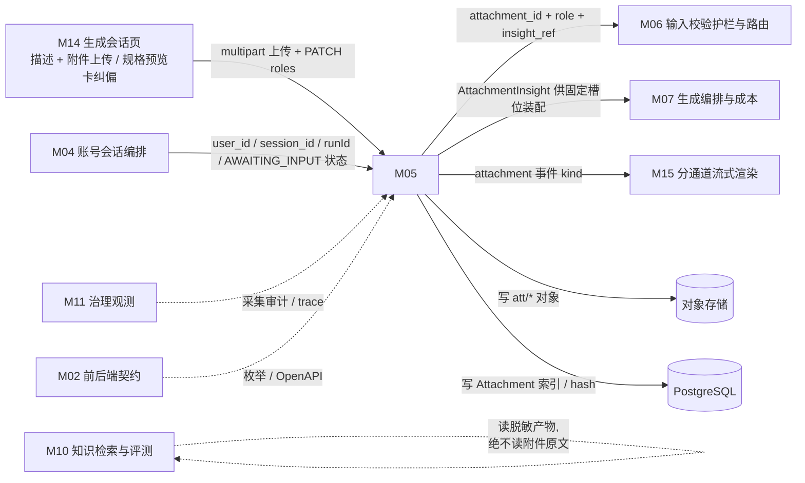
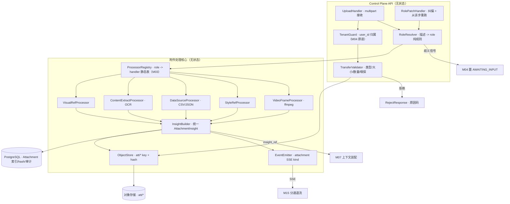
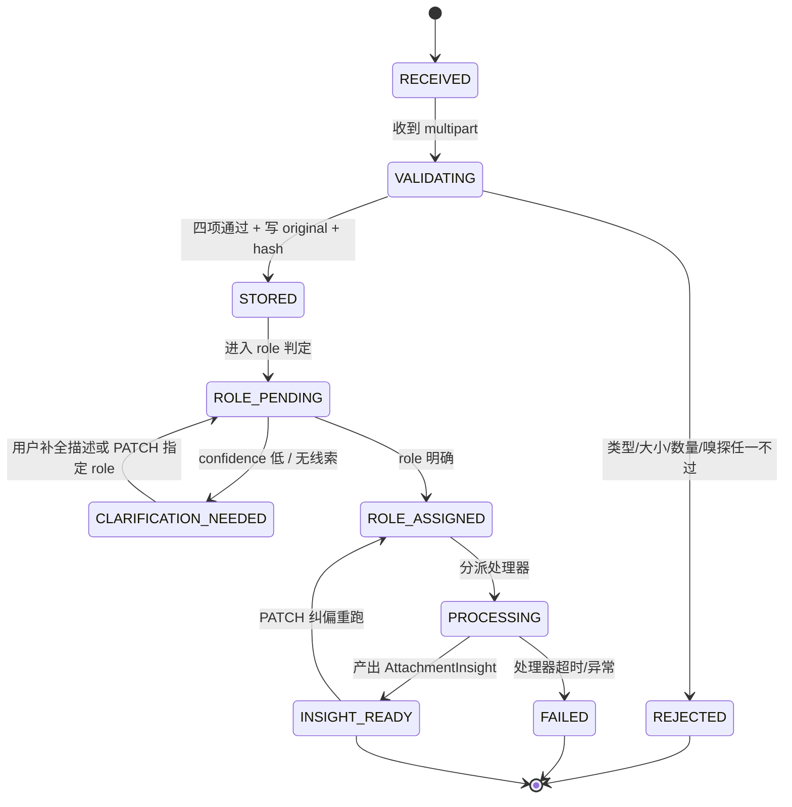

# M05 · 附件处理域（原 D2）

> **文档类型**：可独立交付 / 可独立验收的模块设计文档
> **来源章节**：`设计方案.md` v1.1 §5 D2、§3.2 step 2、§4.1 `Attachment`、§4.3.1 `attachments`、§4.4 `POST /api/attachments` + `PATCH /api/sessions/{id}/attachment-roles`、§6.3 规格预览卡、§6.4 `attachment` 通道、§9.3 附件用例、§2.3 威胁模型、§7.3 职责划分、§8 总表 D2 行、§11.6 工具注册
> **版本**：v1.0　|　**拆分日期**：2026-11-15　|　**最近修订**：2026-11-16（v1.3，ADR-001：grid 注释对齐 D-6「可选预填 + 缺省询问补全」、ReasonCode 追加 3 码、事件通道对齐 18 种含 `ask_user`、role 澄清与 D-7 受控询问通道统一）　|　**状态**：设计定稿（细节推导项见 §9 待决清单）
> **对应编号**：D2 / FR-05、FR-06 / X7（传输层部分）
> **主责服务**：`control-plane`（附件上传 API 与元数据）、`orchestrator`（role 判定编排、多模态处理调度）
> **一句话定义**：把用户上传的图片 / 视频 / 文本附件，经过「传输层校验 → 对象存储 → 按用户描述判定 role → 分派多模态处理器」变成带引用的 `AttachmentInsight`，是整条链路里唯一允许接触附件原文、且绝不让它流入公共语料的域。

---

## 0. 模块速览（零基础可读）

### 0.1 项目在做什么（本模块所需的最小背景）

WidgetPilot 是一个「用自然语言生成手机桌面控件」的 AI Agent 产品：用户输入一句描述（控件规格 `2x1`/`1x2`/`2x2`/`2x4`/`4x2`/`4x4` 可选预填，缺省由系统询问补全，系统不推断——v1.3 ADR-001 D-6）、可附带图片 / 视频 / 文本附件，系统生成 TSX + React 代码，编译并在隔离沙箱里测试通过后，产出控件包，在网页上按真实比例渲染成一张可交互卡片。**本项目不装机、不接手机系统 API、不模拟设备环境**，产物是能在浏览器受限 iframe 里渲染的页面代码，但严格遵循真实控件规格。

一个关键产品设定：**附件不是「随便贴的图」，它的用途由用户的自然语言描述决定**。同一张图片，配「把这张图当背景」和配「提取图片右上角的日期」，系统要走两条完全不同的处理路径，前者产出视觉参考描述，后者产出 OCR 提取出的结构化日期。这个「描述决定用途」的机制，就是本模块存在的核心理由。

### 0.2 端到端 14 步链路中本模块的位置

```
① 登录 → 新建会话（grid 可选预填）
② 输入描述 + 上传附件 → 传输层校验 → 对象存储 → attachment_id      ← ★ 本模块主战场（step 2）
③ 语义层校验（描述充分性 / 附件 role 明确性 / grid 合法）→ 不足则 AWAITING_INPUT
④ 进 LLM 护栏（注入 / PII / 意图白名单 / 预算前置）→ 命中不进模型
⑤ 意图与规格确定 → 按 widget_type + grid 确定性预取生成规程
⑥ 上下文装配（公共语料 + 规程 + 记忆 + AttachmentInsight，固定槽位、硬过滤优先）  ← 本模块产物在此注入
⑦ 生成回路：先出 WidgetSpec，再出 TSX + React 代码；模型分档
⑧ 出 LLM 护栏 → ⑨ 契约校验 → ⑩ 沙箱 → ⑪ WidgetBundle → ⑫ 卡片
⑬ 评测合格 → 脱敏 → 入库门禁 → 公共语料（附件原文永不入库）       ← 本模块是这条红线的技术守门人
⑭ 全流程按 seq 写 SSE 事件流与只追加审计；成本按档位分账
```

本模块**主责第 ② 步**（上传、校验、落对象存储、返回 `attachment_id`），**产出第 ⑥ 步要用的 `AttachmentInsight`**，并在**第 ③ 步 role 歧义时触发 `AWAITING_INPUT`**、在**第 ⑬ 步保证附件原文永不进公共语料**。它还通过 `PATCH /api/sessions/{id}/attachment-roles` 支撑 §6.3「规格预览卡」上的 role 纠偏与「从该步重跑」。

### 0.3 为什么必须有这个模块

| 若没有本模块 | 会发生什么 |
|---|---|
| 没有传输层校验 | 伪造扩展名（把 `.exe` 改名 `.png`）、超大附件、数量超限会直接进入系统，成为 §2.3 攻击路径 ②⑦ 的入口，耗尽预算或污染下游 |
| 没有 role 判定 | 系统不知道一张图是「当背景」还是「提取文字」，只能猜，猜错就生成错控件；原文明确「role 不明确时请求澄清，不猜测」 |
| 没有统一 `AttachmentInsight` | 下游上下文装配（M07）要各自解析图片 / 视频 / 文本，无法用单一带引用的结构注入固定槽位，也无法做 prompt caching |
| 没有「原文永不入库」边界 | 私有附件会随脱敏产物跨用户传播，直接违反 D-1 与 §1.7 铁律「私有数据不共享」 |

原文 §5 D2 把本模块的验收写得很具体：**同一图片两种描述走出两条处理路径；伪造扩展名被拒；超大附件被拒且给出原因码；role 纠偏后可从该步重跑**。这四条是本模块可独立提测的锚点。

### 0.4 上下游邻居（mermaid）



- **上游**：M14（用户上传与纠偏交互）、M04（`user_id`/`session_id` 归属与状态机）、M02（契约枚举）。
- **下游**：M06（拿 `attachment_id` + `role` 做语义层校验）、M07（拿 `AttachmentInsight` 做上下文装配）、M15（消费 `attachment` 事件）、M10（只拿脱敏产物，附件原文对其不可见）。
- **横切**：M11 采集审计与 trace；本模块承载 X7 的**传输层部分**。

### 0.5 原文对照表

| 本模块内容 | 原文章节 |
|---|---|
| 功能、技术栈、要点、验收 | §5 D2、§8 总表 D2 行 |
| step 2 上传 / 校验 / 对象存储 / `attachment_id` | §3.2 step 2 |
| `Attachment` 实体字段 | §4.1、01 基线 §1 |
| `WidgetSpec.attachments` 与 `AttachmentRole` | §4.3.1、§4.2 |
| `POST /api/attachments`、`PATCH /api/sessions/{id}/attachment-roles` | §4.4 |
| 规格预览卡「可纠偏」与「从该步重跑」 | §6.3、§6.4 亮点 1 |
| `attachment` SSE 通道 payload | §4.5、§6.4 |
| 附件伪装 / 超大 / 超限对抗用例 | §9.3、§2.3 |
| role 判定「由描述决定」「不猜测」 | §5 D2、§10.1 #1 |
| 前后端职责（后端判定 role、前端纠偏交互） | §7.3 |
| 工具注册（处理器作为静态注册能力） | §11.6 |
| 对象存储 key 约定 | 01 基线 §9（【推导·需评审】） |

---

## 1. 模块定位与职责边界

### 1.1 为什么必须有（四个不可替代的职责）

1. **传输层唯一入口**：类型 / 大小 / 数量 / 内容嗅探（magic number）必须在「上传时」完成（§5 D2「大小/数量/类型/内容嗅探校验在上传时完成」），这是把不可信二进制挡在控制面之外的第一道也是唯一一道确定性门禁。
2. **role 由描述决定的判定权**：`visual_reference` / `content_extraction` / `data_source` / `style_reference` 四种用途不是文件属性，而是用户意图属性。原文明确「同一附件不同描述走不同处理器」，判定权必须收敛在一处，否则下游无法解释「为什么这张图被当成背景」。
3. **歧义不猜测**：role 不明确时返回 `AWAITING_INPUT` 请求澄清（§5 D2），而不是用默认 role 蒙混过关——这是「证据先于结论」在附件域的具体化。
4. **私有数据红线的技术执行**：附件原文**永不进入公共语料**（§1.7 #4、D-1），必须在存储层就用独立 key 前缀 + 独立访问权限实现，而不是靠下游自觉。

### 1.2 做什么（职责清单）

| # | 职责 | 说明 | 原文依据 |
|---|---|---|---|
| R1 | 接收 multipart 上传（图片 / 视频 / 文本） | 绑定 `user_id` + `session_id`，返回 `attachment_id` | §4.4 `POST /api/attachments` |
| R2 | 传输层校验：声明类型白名单 | 图片 / 视频 / 文本三类 `kind` | §5 D2、§3.2 step2 |
| R3 | 传输层校验：大小上限、单会话数量上限 | 超限拒绝并给原因码 | §9.3、§2.3 ⑦ |
| R4 | 传输层校验：magic number 内容嗅探 | 声明扩展名与真实文件头不一致即拒（伪扩展名） | §5 D2、§9.3 |
| R5 | 落对象存储并返回 `hash` | 原文写 `att/.../original`，带 sha256 | §4.1 `object_key`/`hash`、01 基线 §9 |
| R6 | role 判定（由描述驱动） | 四种 role 映射到不同处理器 | §5 D2 |
| R7 | role 歧义 → 触发 `AWAITING_INPUT` 澄清 | 不猜测，写澄清建议（v1.3：与 ADR-001 D-7 统一为受控询问通道，确定性代码触发） | §5 D2、§10.1 #1 |
| R8 | 多模态处理器分派 | 图片 / 关键帧 / OCR / 结构化文本解析 | §5 D2 技术栈 |
| R9 | 产出统一 `AttachmentInsight{source_ref, extracted, confidence}` | 带引用、可溯源 | §5 D2 |
| R10 | `PATCH attachment-roles` 纠偏并「从该步重跑」 | 重跑只重算该附件之后的步骤 | §6.3、§6.4 亮点 1 |
| R11 | 产生 `attachment` SSE 事件（`role` + `insight_ref`） | 供规格预览卡标用途、给纠偏入口 | §4.5、§6.4 |
| R12 | 保证附件原文不进公共语料、不进 `WidgetBundle` | 独立 key 前缀 + 只读授权隔离 | §1.7 #4、D-1 |
| R13 | 写 `Attachment` 索引与只追加审计 | `hash` 防篡改、`trace_id` 可回放 | §4.1、§11.8 |

### 1.3 不做什么（明确排除，边界切割点）

| 不做 | 归属模块 | 边界说明（这块归哪个 Mxx） |
|---|---|---|
| 描述充分性判定、附件 role 是否**明确的语义判定**、`grid` 枚举合法性 | **M06** | M05 只做「role 判定」这一个动作；「描述够不够 / role 判定结果是否明确到可以放行 / grid 合不合法」属于语义层，归 M06 §5 D3 |
| 进 LLM 护栏（注入模式 / PII / 意图白名单 / 预算前置） | **M06** | 附件里若夹带注入文本，语义层与护栏拦截归 M06；M05 只负责把它作为 `extracted` 数据交付，不做内容判定 |
| 出 LLM 护栏、契约校验、沙箱测试 | **M08** | 本模块不解析、不执行任何生成代码 |
| `WidgetSpec` 装配、`TSX` 代码生成、模型分档、成本计量 | **M07 / M03** | M05 只提供 `AttachmentInsight` 作为固定槽位的一个输入，不装配 prompt |
| 公共语料入库门禁、脱敏、投毒检测、撤回 | **M10** | 本模块只保证「原文不出现在对外可见对象里」；入库门禁逻辑归 M10 |
| 前端规格预览卡、纠偏按钮、乐观预览、上传进度 | **M14 / M15** | M05 提供 REST 与 SSE 数据，UI 交互归前端 |
| 会话状态机本身（`AWAITING_INPUT` 的持久化与恢复） | **M04** | M05 在 role 歧义时返回澄清信号并调用 M04 置状态；状态机归 M04 |
| `agent_core` 工具注册表的库级实现 | **M03** | 多模态处理器通过 M03 的静态 registry 挂接，库级实现归 M03 |

> **最易混淆的两条切割**：①「role 判定」和「判定 role 是否明确」是两件事——前者是 M05 的职责（给出一个 role 或明确说歧义），后者是 M06 语义层职责（拿 M05 的 `confidence` 与澄清标记决定放行还是 `AWAITING_INPUT`）；②「附件原文不入库」是 M05 的存储边界，「脱敏产物才能入库」是 M10 的门禁边界，两者共同实现 D-1，不互相替代。

### 1.4 输入 / 输出与上下游契约

| 方向 | 内容 | 契约形式 |
|---|---|---|
| 入 | 附件二进制 + 声明 `kind`/`mime`、`session_id`、用户描述（用于 role 判定）、纠偏后的 `roles[]` | REST multipart / JSON（§4.1） |
| 入 | M04 的 `user_id` / `session_id` / `runId` 归属校验结论 | 内部接口（§4.3） |
| 出 | `attachment_id`、`kind`、`mime`、`size`、`object_key`、`hash`、`role`、`insight_ref` | REST 响应 + `Attachment` 表 |
| 出 | `AttachmentInsight`（`source_ref` / `extracted` / `confidence`） | 对象存储 `insight.json` + 引用 |
| 出 | `attachment` SSE 事件、`role 歧义` 澄清信号、审计事件 | SSE / 内部接口 |
| 出（禁止） | 附件原文 | **绝不**流向 M07 的 prompt 之外的公共语料 / M10 入库门禁 / 前端 `artifact` |

### 1.5 承载的横切能力 X*

- **X7（传输层部分，主承载之一）**：输入校验与双向护栏的「三层分离」中，本模块是**第一层：传输层**——类型 / 大小 / 数量 / 内容嗅探。X7 的语义层与进护栏在 M06、出护栏与沙箱验证在 M08，三者职责不重叠（§2.4 #1、§5 D3）。
- **X2（协同，非承载）**：本模块产出的 `AttachmentInsight` 是 M07 固定槽位「附件洞察」的唯一数据来源；M05 保证它是「带引用的小块结论」而非原文，从而支撑「state 只存结论与引用」。
- **X11（协同）**：每次上传、校验拒绝、role 判定、纠偏都写只追加审计与 trace 埋点，供 M11 汇总。

### 1.6 关键设计原则

1. **role 由描述决定，不由文件决定**：同一 `attachment_id` 在不同描述下走不同处理器（§5 D2）；role 是「附件 × 描述」的绑定，不是附件的固有属性。
2. **歧义不猜测**：`confidence` 低于阈值或描述无有效 role 线索时，返回澄清并让会话进入 `AWAITING_INPUT`，绝不默认 `visual_reference`。
3. **原文与洞察分离**：原文存 `att/.../original`，派生数据存 `insight.json`，下游只见 `insight_ref`；两者用 `hash` 关联。
4. **私有数据物理隔离**：附件 key 前缀独立于 spec/code/bundle，且对 M10 入库链路不开放读权限（§1.7 #4、D-1）。
5. **校验在上传时完成**：类型 / 大小 / 数量 / 嗅探一次做完，拒绝要在写对象存储之前（§5 D2）。
6. **纠偏可重跑**：`PATCH role` 后只从「该附件的 role 判定步」重跑，不重跑已通过的其他附件与前置步骤（§6.3、§6.4）。
7. **确定性门禁高于模型自律**：所有校验是纯代码规则，不依赖模型判断「这文件安不安全」（§1.7 #1、§2.4 #1）。
8. **零 Agent 框架**：多模态处理器用自研静态注册，不用任何 Agent/LLM 框架做文件解析（D-5）。

---

## 2. 技术栈

### 2.1 分层选型表

| 层 | 选型 | 版本 / 约束 | 为什么选 | 明确不用什么 |
|---|---|---|---|---|
| API 框架 | FastAPI | Python 3.11+ | 原生 async、multipart 友好、Pydantic 集成、OpenAPI 供 M02 消费 | — |
| 校验 / 序列化 | Pydantic v2 | 严格模式 | 上传元数据、`AttachmentInsight`、`PatchRolesReq` 统一校验 | — |
| 对象存储 | S3 兼容（MinIO / 云 OSS） | 服务端直传或预签名 | 大对象不入库；`hash` 校验读取 | **不把二进制塞进 PostgreSQL** |
| 类型嗅探 | magic number 嗅探（自研签名表） | 文件头前 N 字节比对 | 识破伪扩展名（§9.3） | **不信任客户端 `Content-Type` / 扩展名** |
| 图片处理 | Pillow / libvips | 只读解码、像素上限 | 缩略图、主色、视觉参考描述生成 | 不执行图片内嵌脚本 / 不解析任意压缩炸弹 |
| 视频关键帧 | ffmpeg（关键帧抽取 + 元信息） | 单次超时、帧数上限 | 视频「取关键帧 / 元信息」（§5 D2） | 不整段解码、不落整段视频到内存 |
| OCR / 内容提取 | OCR 引擎 + 版面定位 | 区域化提取（如「右上角日期」） | `content_extraction` 处理器 | 不把 OCR 结果当可信指令 |
| 结构化文本解析 | CSV / JSON / 键值解析器（自研） | 严格 schema + 行数上限 | 文本作 `data_source` | 不 `eval`、不执行文本里的表达式 |
| role 判定 | 自研 rule/pattern registry（纯代码） | 描述关键词 → role 映射表 | 确定性、可归因、误判可测 | **不调模型判 role**、不用 prompt / 策略框架 |
| 处理器注册 | `agent_core/tools/registry.py`（M03 提供） | 启动时静态注册、运行时不可增删 | 四种 role → 四种 handler，静态白名单 | 不新增常驻工具、不用 `bind_tools` |
| 索引库 | PostgreSQL | 14+ | `Attachment` 索引、`hash`、`user_id` 隔离 | — |
| 可观测 | OpenTelemetry SDK + 自建审计 | 通用标准 | 每步证据引用 | **不用 LLM 专用观测平台 SDK** |

### 2.2 硬约束

- **D-5 零 Agent 框架**：不使用 LangChain / LangGraph / Temporal / AI SDK / CopilotKit / LangFuse / OPA / Casbin / MCP SDK 等任何 Agent 或策略框架。文件解析、role 判定、处理器分派全部手写或用通用库（§11.1）。
- **保留的通用基础设施**：FastAPI、Pydantic v2、Postgres、对象存储、Pillow / libvips、ffmpeg、OTel SDK、`httpx`。tiktoken / 模型调用**不属于**本模块。
- **原文永不入库**：`att/.../original` 不下发给 M07 的公共语料路径、不进 M10 入库门禁、不进 `WidgetBundle`（§1.7 #4、D-1）。
- **校验纯代码**：传输层与 role 判定均为确定性规则，命中留「类型 + 判据 + 原文引用」（§11.8）。
- **门禁无在线关闭开关**：大小 / 数量 / 嗅探上限写为代码常量（§1.7 #8）。

### 2.3 运行时依赖

| 依赖 | 用途 | 不可用时的行为 |
|---|---|---|
| PostgreSQL | `Attachment` 索引、`hash`、审计 | 上传写索引失败则不返回 `attachment_id`，不产生「无索引对象」 |
| 对象存储（S3） | 原文 / 洞察 / 派生关键帧 | 写失败则本次上传整体失败并回滚索引，避免悬空引用 |
| ffmpeg（视频路径） | 关键帧 / 元信息 | 【推导·需评审】视频处理器超时或不可用时降级为「仅元信息」并标记 `confidence` 下降，不跳过校验 |
| OCR 引擎 | `content_extraction` | 【推导·需评审】OCR 失败时 `extracted` 置空 + `confidence=0`，触发 M06 的 `AWAITING_INPUT` 二次澄清 |
| M04 `TenantGuard` | `user_id` 归属校验 | 归属不通过直接 403，不读文件内容 |
| M03 `tools/registry` | 处理器静态注册 | registry 未注册某 role 时拒绝该 role 并告警，不动态补注册 |

### 2.4 monorepo 代码落位

```
services/control_plane/
  api/attachments.py            # POST /api/attachments、PATCH /api/sessions/{id}/attachment-roles
  attachments/
    upload.py                   # multipart 接收、流式落盘
    sniff.py                    # magic number 签名表与内容嗅探
    limits.py                   # 类型/大小/数量硬上限常量（代码常量，无关闭开关）
    store.py                    # 对象存储 att/* key 生成、hash、读写校验
    insight_store.py            # AttachmentInsight 落 insight.json
    role_resolver.py            # 描述 -> AttachmentRole 的纯代码规则 registry
    processors/
      visual_reference.py       # 图片 -> 视觉参考描述 / 主色 / 缩略图引用
      content_extraction.py     # 图片 OCR 区域提取 / 视频关键帧 OCR
      data_source.py            # 文本 CSV/JSON 结构化解析
      style_reference.py        # 风格描述提取
      video_frames.py           # ffmpeg 关键帧 + 元信息
    registry.py                 # role -> handler 静态注册（挂 M03 registry）
    rerun.py                    # PATCH role 后从该步重跑的编排
    audit.py                    # 只追加审计事件
packages/agent_core/tools/      # M03：registry.py / invoke.py（本模块是被调用方）
packages/contracts/             # M02：openapi.yaml / enums / attachment schema
```

---

## 3. 设计架构

### 3.1 内部组件与职责



| 组件 | 职责 | 关键不变量 |
|---|---|---|
| `UploadHandler` | 流式接收 multipart，绑定 `user_id`/`session_id` | 不落临时明文到共享目录；先校验后写存储 |
| `TransferValidator` | 类型白名单 / 大小 / 数量 / magic number 嗅探 | 四项**全部在写对象存储之前**完成；任一不过即拒 |
| `ObjectStore` | 生成 `att/*` key、写原文、算 `hash`、读时校验 | 原文 key 与洞察 key 前缀分离；读必校验 `hash` |
| `RoleResolver` | 描述关键词 → `AttachmentRole` 的纯代码映射 | 不调模型；歧义不默认；产出 `confidence` |
| `ProcessorRegistry` | `role → handler` 静态注册（M03 原语） | 运行时不可增删；未注册 role 直接拒绝 |
| 四个处理器 | 按 role 产出 `extracted` | 输出是「数据」不是「指令」；不执行、不外联 |
| `InsightBuilder` | 统一封装 `{source_ref, extracted, confidence}` | 所有 role 输出结构一致；`source_ref` 必带 `hash` |
| `RolePatchHandler` | 纠偏后重算 role 并从该步重跑 | 重跑范围 = 该附件 role 判定步及其后置洞察，不动其他附件 |
| `EventEmitter` | 产生 `attachment` SSE 事件 | `seq` 由 M04 统一编号，本模块只产 payload |
| `TenantGuard` | 归属校验 | 越权一律 403，不泄漏附件是否存在 |

### 3.2 处理流程与数据流（编号步骤）

1. 用户在 M14 生成会话页选择附件并输入描述 → `POST /api/attachments`（multipart：`file`、`session_id`，附带当次 `description` 供 role 判定）【契约约定：描述随上传一并提交或由 `session_id` 关联最近一条 `messages`，最终以 `openapi.yaml` 为准】。
2. `TenantGuard` 校验 JWT 中的 `user_id` 对 `session_id` 的归属；不通过 → 403，不读文件。
3. `TransferValidator` 依次执行四类校验（顺序固定）：声明 `kind` 是否在 `{image, video, text}` 白名单 → `size` 是否 ≤ `MAX_ATTACHMENT_BYTES` → 该 `session_id` 下附件数是否 ≤ `MAX_ATTACHMENTS_PER_SESSION` → 读取文件头 N 字节做 magic number 嗅探，与声明 `mime` 比对。
4. 任一校验不过 → 拒绝，写审计与 `INPUT_INVALID` 原因码 + 具体判据，**不写对象存储**（§9.3「传输层校验拒绝 + 原因码」）。
5. 校验通过 → `ObjectStore` 计算 `hash = sha256(bytes)`，写 `att/{user_id}/{session_id}/{attachment_id}/original`，返回 `attachment_id`、`kind`、`mime`、`size`、`object_key`、`hash`。
6. `RoleResolver` 用描述做纯规则匹配，产出 `role` 与 `confidence`：
   - 「把这张图当背景 / 用这张图做底图」→ `visual_reference`
   - 「提取右上角的日期 / 读出图里的文字」→ `content_extraction`
   - 「按这个表的数值 / 用这份数据」→ `data_source`
   - 「参考这个配色 / 学这个风格」→ `style_reference`
7. 若 `confidence < ROLE_CLARIFY_THRESHOLD` 或描述无有效线索 → 不猜测，返回澄清信号，调用 M04 将会话置 `AWAITING_INPUT`，写澄清建议（例：「请说明这张图是当背景、提取内容、作为数据源还是风格参考」）。
8. role 明确 → `ProcessorRegistry` 查静态表分派：
   - `visual_reference` → 图片解码 → 主色 / 布局 / 缩略图引用；视频走 `VideoFrameProcessor` 取关键帧。
   - `content_extraction` → OCR（图片按描述定位区域，视频对关键帧 OCR）→ 结构化文本。
   - `data_source` → 文本 CSV/JSON/键值解析 → 行列数据（行数上限内）。
   - `style_reference` → 提主色 / 字号 / 圆角等风格描述。
9. 处理器输出交给 `InsightBuilder` 统一封装为 `AttachmentInsight`，写 `att/{user_id}/{session_id}/{attachment_id}/insight.json`，`source_ref` 指向 original（带 `hash`），`insight_ref` 回写 `Attachment` 表。
10. `EventEmitter` 产生 `attachment` SSE 事件（`role` + `insight_ref` + `confidence`），M15 渲染到规格预览卡并提供「纠偏入口」。
11. 用户在规格预览卡把「内容提取」改成「视觉参考」→ `PATCH /api/sessions/{id}/attachment-roles` → `RolePatchHandler` 更新 `Attachment.role`，**从该附件的 role 判定步重跑**（重新分派处理器 → 重新生成 `insight.json` → 推新的 `attachment` 事件），并触发 M07 从该步重算上下文；其他附件与前置校验不重跑（§6.3、§6.4 亮点 1）。
12. 全过程写只追加审计：上传、每次校验拒绝、role 判定（含命中判据与原文引用）、处理器分派、纠偏前后 role、重跑范围。

### 3.3 状态机

**(A) 本模块参与的会话状态**：`AWAITING_INPUT`（role 歧义时由 M05 触发、M04 持久化）。本模块**不拥有** `SessionState`，只在 §5.1 列出参与关系。

**(B) 本模块拥有的附件处理状态**【推导·需评审：原文未定义附件内部状态机，为可独立验收补齐】：



| 状态 | 含义 | 是否终态 |
|---|---|---|
| `RECEIVED` | 已接收字节流，未校验 | 否 |
| `VALIDATING` | 四类传输层校验中 | 否 |
| `REJECTED` | 校验拒绝，已给原因码 | 是（旁路） |
| `STORED` | 原文已落对象存储，`hash` 已算 | 否 |
| `ROLE_PENDING` | 等待 role 判定 / 澄清 | 否 |
| `CLARIFICATION_NEEDED` | role 歧义，会话进入 `AWAITING_INPUT` | 否（挂起） |
| `ROLE_ASSIGNED` | role 明确且已绑定 | 否 |
| `PROCESSING` | 多模态处理器运行中 | 否 |
| `INSIGHT_READY` | `AttachmentInsight` 就绪，`insight_ref` 可用 | 是（可被纠偏重新打开） |
| `FAILED` | 处理器不可恢复失败 | 是（旁路） |

### 3.4 关键机制、算法与不变量清单

**A. magic number 嗅探（识破伪扩展名）**
读取文件前 N 字节与静态签名表比对【推导·需评审：签名表条目与 N 取值需评审定稿，建议 N=16】：

| 声明 `kind` | 合法 `mime` | 文件头签名（十六进制，【推导·需评审】） |
|---|---|---|
| `image` | `image/png` | `89 50 4E 47 0D 0A 1A 0A` |
| `image` | `image/jpeg` | `FF D8 FF` |
| `image` | `image/webp` | `52 49 46 46 .... 57 45 42 50` |
| `image` | `image/gif` | `47 49 46 38` |
| `video` | `video/mp4` | `.... 66 74 79 70`（`ftyp`） |
| `text` | `text/plain` / `text/csv` / `application/json` | 可打印 UTF-8 / 无二进制控制字符 |

判定：`declared_mime` 与 `sniffed_mime` 不一致 → 拒绝，判据写「声明 `image/png`，实际 `application/x-msdownload`」。**扩展名与 `Content-Type` 均不参与信任，只作提示**。

**B. role 判定纯规则 registry**
`RoleResolver` 是「描述片段 → role 关键词模式」的静态表，命中产出 `role` 与 `confidence`（0..1）。多条命中取最高分；全不命中或最高分 < 阈值 → 歧义。**判定不调用模型**（§5 D3「护栏不依赖 prompt」的同构要求，role 判定同样确定性）。命中记录写「类型 + 判据 + 原文引用」，供误判归因。

**C. 纠偏重跑范围**
`rerun_from_role_step(attachment_id, new_role)`：以该附件 `ROLE_ASSIGNED` 为界，作废旧 `insight.json`（保留旧版本作审计，不物理删），重新分派处理器 → 写新 `insight.json` → 更新 `insight_ref` → 推 `attachment` 事件 → 通知 M07 从「附件洞察槽位」重算。**不重跑传输层校验、不重跑其他附件、不重跑已通过的前置会话步骤**（§6.4 亮点 1）。

**不变量清单**：

| # | 不变量 | 断言方式 |
|---|---|---|
| I1 | 拒绝的附件在对象存储中不存在 `original` 对象 | 按 `attachment_id` 查对象存储，`404` |
| I2 | 每个 `original` 的 `hash` 与内容 sha256 一致 | 重算 hash 比对 |
| I3 | `AttachmentInsight` 的 `source_ref` 必指向带 `hash` 的 `original` 或派生件 | 引用结构校验 |
| I4 | 同一 `attachment_id` 不同描述 → 不同 `role` → 不同处理器调用记录 | 处理器调用日志断言（§8.2 A1） |
| I5 | role 歧义时 `role` 字段为 `null`，不落任何默认 role | 字段断言 + `AWAITING_INPUT` 触发 |
| I6 | 附件原文 key 永不出现在 M10 入库链路 / `WidgetBundle` 引用中 | 引用扫描断言 |
| I7 | `PATCH` 纠偏后 `insight_ref` 变化、其他附件 `insight_ref` 不变 | 前后快照 diff |
| I8 | `confidence ∈ [0,1]`，`extracted` 永不为空指针 | schema 校验 |
| I9 | 越权读取他人附件一律 403，且不泄漏存在性 | 越权用例 |
| I10 | 每个 `Attachment` 有且仅有一条 `hash` 记录，只追加不可改 | 审计条数与 hash 链 |

### 3.5 与其他模块的时序（关键 3 个场景）

**场景 1：正常上传 + 明确 role**
`M14 上传 → M05(校验通过 → original → hash → role=visual_reference → InsightBuilder → insight.json → attachment 事件) → M06 拿 attachment_id+role 做语义校验 → M07 装配「附件洞察」槽位 → M15 规格卡标「视觉参考」`

**场景 2：role 歧义澄清**
`M14 上传「这张图…」(无线索) → M05(confidence<阈值 → CLARIFICATION_NEEDED → 调 M04 置 AWAITING_INPUT + 澄清建议) → M14 展示「请说明用途」 → 用户选/补描述或 PATCH role → M05 从 ROLE_PENDING 续 → ROLE_ASSIGNED → INSIGHT_READY`

**场景 3：规格预览卡纠偏后重跑**
`M14 规格卡显示 role=content_extraction，用户改 visual_reference → PATCH /attachment-roles → M05(role 更新 → 作废旧 insight → 重跑 role 判定步 → 新 insight.json → 新 attachment 事件) → M07 从附件洞察槽位重算上下文 → 后续 spec/代码随之变化（§6.3）`

### 3.6 部署形态与伸缩

| 服务 | 状态 | 伸缩依据 | 说明 |
|---|---|---|---|
| `control-plane`（附件 API） | 无状态（索引在 PG、二进制在对象存储） | 上传 QPS | 可任意水平扩容 |
| 附件处理器 worker | 无状态、CPU/IO 密集 | 处理队列深度 | OCR / ffmpeg 可独立扩缩；单任务超时强制销毁（§9.3） |
| 对象存储 | 有状态 | 容量 | `att/*` 按 `user_id` 前缀做租户隔离与生命周期 |
| `orchestrator` | 无状态 | 队列深度 | 编排 role 判定与重跑；实现归 M03 |

**边界**：附件处理器与编排进程**不共享文件系统 / 凭证**（§3.1 三条硬边界之一）；ffmpeg / OCR 在受限子进程中运行，禁止网络访问。

---

## 4. 接口契约

### 4.1 对外 REST 接口表

| 方法 | 路径 | 权限 | 请求 | 成功响应 | 状态码 |
|---|---|---|---|---|---|
| `POST` | `/api/attachments` | 本人（JWT，`user_id` 对 `session_id` 归属） | `multipart/form-data`：`file`（二进制）、`session_id`（text）、`description`（text，【契约约定】供 role 判定） | `{ code:"OK", message, traceId, retryable:false, data:{ attachment_id, kind, mime, size, object_key, hash, role, insight_ref, confidence } }` | 200 / 400 / 403 / 413 / 422 |
| `PATCH` | `/api/sessions/{id}/attachment-roles` | 本人 | `{ roles: { attachment_id: string, role: AttachmentRole }[] }`【契约约定：01 基线 §5.2 `PatchRolesReq`】 | `{ code:"OK", data:{ updated: [{ attachment_id, role, insight_ref }], rerun_from: "ROLE_ASSIGNED" } }` | 200 / 400 / 403 / 409 / 422 |
| `GET` | `/api/sessions/{id}/attachments` | 本人 | — | `{ data:{ items: Attachment[] } }`【契约约定：原文 §4.4 未列该查询，为规格卡回显补齐，最终以 `openapi.yaml` 为准】 | 200 / 403 |
| `GET` | `/api/attachments/{id}/insight` | 本人 | — | `{ data: AttachmentInsight }`【推导·需评审：原文未列独立洞察查询接口，`insight_ref` 也可由调用方直接读对象存储，是否暴露 REST 需评审】 | 200 / 403 / 404 |

**统一响应**（原文 §4.4）：`{ code, message, traceId, retryable, evidenceRef? }`，`code` 与 `ReasonCode` 对齐；`data` 为【契约约定】补充。完整结构见 §6.2。

**上传响应头 / 错误约定**【契约约定】：`413` 用于 `size` 超限、`422` 用于嗅探不符 / role 歧义、`400` 用于请求体字段缺失、`403` 用于越权、`409` 用于对 `REJECTED`/终态附件重复 PATCH。

### 4.2 事件接口（SSE `kind` 与 payload）

| `kind` | 本模块职责 | payload 要点 |
|---|---|---|
| `attachment` | **产生**：role 判定完成 / 纠偏重跑完成 | `{ attachment_id, role, confidence, insight_ref, source_ref, kind, mime, size }` |
| `notice` | 产生：role 歧义澄清建议、处理器降级提示 | `{ message, code:"INPUT_INVALID", clarify_hint, attachment_id }` |
| `error` | 转发：处理器不可恢复失败 | `{ code:"MODEL_ERROR"/"INPUT_INVALID", evidenceRef, attachment_id }` |
| 其余 `plan/spec/skill/routing/code/guard/validation/sandbox/artifact/cost/checkpoint/interrupted/done/run` | **只转发或无关** | 由 M04/M06/M07/M08 产生；M05 不生成其内容。v1.3 新增 `ask_user`（ADR-001 D-7，M07 生成回路产生，M05 同样只转发不产生），`AgentEventKind` 共 18 种 |

**关键约定**（原文 §4.5）：所有事件带 `seq`（每会话单调，由 M04 统一编号）、`sessionId`、`runId`、`ts`、`phase`、`traceId`；`phase` 在 role 歧义时为 `AWAITING_INPUT`。前端 reducer 对未知 `kind` 忽略而非报错。`attachment` 通道 payload 形态见原文 §6.4「`role` 判定 + `insight_ref` → 附件卡片标出用途，提供纠偏入口」。

### 4.3 内部接口与被调用签名（【契约约定】）

```python
# services/control_plane/attachments/sniff.py
def sniff_mime(head: bytes) -> str: ...                  # 返回真实 mime 或 "application/octet-stream"

# services/control_plane/attachments/limits.py
MAX_ATTACHMENT_BYTES: int                                   # 代码常量，无关闭开关
MAX_ATTACHMENTS_PER_SESSION: int
ALLOWED_KINDS: frozenset[str] = frozenset({"image", "video", "text"})

# services/control_plane/attachments/validate.py
def validate_transfer(declared_kind: str, declared_mime: str,
                      size: int, head: bytes,
                      session_count: int) -> ValidateResult: ...
# ValidateResult = { ok: bool, reason_code: str, detail: str }

# services/control_plane/attachments/store.py
def put_original(user_id: str, session_id: str, attachment_id: str,
                 data: bytes) -> ObjectRef: ...           # 返回 { key, hash, size }
def put_insight(user_id: str, session_id: str, attachment_id: str,
                insight: "AttachmentInsight") -> str: ... # 返回 insight_ref
def get_with_hash_verify(key: str, expected_hash: str) -> bytes: ...

# services/control_plane/attachments/role_resolver.py
def resolve_role(description: str, kind: str) -> RoleDecision: ...
# RoleDecision = { role: AttachmentRole | None, confidence: float,
#                  matched_rule: str, excerpt: str }   # 歧义时 role=None

# services/control_plane/attachments/registry.py（挂 M03 agent_core/tools）
def dispatch(role: AttachmentRole, ref: ObjectRef,
             description: str) -> Extracted: ...          # 查静态表，未注册 role 抛拒绝
def register(role: AttachmentRole, handler: Callable) -> None: ...  # 仅启动期

# services/control_plane/attachments/insight_builder.py
def build(ref: ObjectRef, extracted: Extracted,
          confidence: float) -> "AttachmentInsight": ...

# services/control_plane/attachments/rerun.py
def rerun_from_role_step(attachment_id: str,
                         new_role: AttachmentRole) -> str: ...  # 返回新 insight_ref

# 被上游 / 被调用
def assert_owner(user_id: str, session_id: str) -> None: ...    # M04 TenantGuard
def request_clarification(session_id: str, hint: str) -> None: ... # 调 M04 置 AWAITING_INPUT
def emit_attachment_event(session_id: str, payload: dict) -> int: ... # 调 M04/M15 编号 seq
def on_insight_ready(session_id: str, insight_ref: str) -> None: ...  # 通知 M07 重算上下文
```

**被下游调用**：M06 以 `get_attachment(attachment_id)` 取 `role` 与 `confidence` 做语义层校验；M07 以 `read_insight(insight_ref)` 取 `AttachmentInsight` 注入固定槽位；M10 入库门禁**无任何接口可读取 `original`**。

### 4.4 统一响应与错误码

```ts
// 原文 §4.4 / 01 基线 §5.1，完整抄入
type ApiResponse<T> = {
  code: string;            // 成功 "OK"；失败为 ReasonCode
  message: string;
  traceId: string;
  retryable: boolean;
  evidenceRef?: string;
  data?: T;                // 【契约约定】成功载荷
};
```

`code` 与 `ReasonCode` 对齐（§5.3）。传输层拒绝的 `message` 必须给**具体判据**（例：「声明 image/png，嗅探为 application/x-msdownload」），禁止只返回「上传失败」（§8 全局口径「原因码 + 证据引用」）。

### 4.5 幂等、重试、超时、限流、并发约定

| 项 | 约定 |
|---|---|
| 幂等 | `POST /api/attachments` 用【契约约定】`Idempotency-Key: sha256(file_bytes + session_id)` 去重，重复上传返回同一 `attachment_id` 与 `hash`，不产生第二份对象；`PATCH roles` 以 `(session_id, attachment_id, new_role)` 幂等，重复 PATCH 不重复重跑 |
| 重试 | 仅基础设施故障（对象存储 5xx / OCR 子进程启动失败）指数退避且**有上限**；**校验拒绝是终态，不重试**（§10.1 #1）；role 歧义是 `AWAITING_INPUT` 挂起，不是 retry |
| 超时 | 单次上传接收、单次处理器（ffmpeg / OCR）各有硬超时【推导·需评审：建议上传 30s、单处理器 20s，影子期校准】，超时强制销毁子进程并写审计（§9.3「附件处理超时 → 确定性中断」） |
| 限流 | 按 `user_id` 并发上传数与单会话附件数双重限流；与 M11 配额策略对齐 |
| 并发 | 同一 `attachment_id` 的 `insight.json` 写入用对象存储条件写 + `hash` 校验，避免纠偏重跑与首次处理竞争覆盖 |
| 乱序 | `attachment` 事件按 `seq` 由前端 reducer 去重与乱序丢弃；纠偏产生的事件 `seq` 必然大于首次事件 |

### 4.6 接口状态表（契约状态 / 运行态 / 可重试）

| 接口 | 契约状态 | 运行态 | 可重试 | 说明 |
|---|---|---|---|---|
| `POST /api/attachments` | 定稿（原文 §4.4 列路径） | 同步（大文件可流式） | 是（幂等键） | 请求体字段为【契约约定】 |
| `PATCH /api/sessions/{id}/attachment-roles` | 定稿（原文 §4.4） | 同步受理 + 异步重跑 | 是（幂等） | 触发「从该步重跑」，结果走 `attachment` 事件 |
| `GET /api/sessions/{id}/attachments` | **【推导·需评审】** | 同步 | 是 | 规格卡回显补齐，需 M02 定稿是否入 `openapi.yaml` |
| `GET /api/attachments/{id}/insight` | **可选 + 【推导·需评审】** | 同步 | 是 | 原文未列；可仅走 `insight_ref` 直读对象存储 |
| `attachment` SSE 事件 | 定稿（原文 §4.5 / §6.4） | 流式 | 是（`Last-Event-ID`） | payload 字段为契约约定 |
| `notice` 澄清事件 | 定稿（§10.1 #1 `AWAITING_INPUT`） | 流式 | — | role 歧义时产生 |
| 内部 `sniff/validate/store/dispatch` | 定稿方向 + 签名【契约约定】 | 同步 | — | 函数签名与阈值待评审定稿 |
| 拒绝原因码细分（伪扩展名/超大/超限） | **依赖外部 / 影子校准中** | — | — | 原文只给 `INPUT_INVALID`，细分子码需 M02 定稿（§9 待决） |

> 契约状态四态含义：**定稿** = 原文明确；**依赖外部** = 需 M02 `openapi.yaml`/枚举定稿或依赖 OCR/ffmpeg 校准；**影子校准中** = 阈值类（大小/数量/超时/confidence）需影子期实测；**可选** = 是否暴露该接口待定。

---

## 5. 状态、原因码与 API 状态

### 5.1 拥有或参与的状态机与完整枚举（TS 定义）

```ts
// 本模块拥有的附件处理状态【推导·需评审：原文未定义，为独立验收补齐】
type AttachmentProcessingState =
  | "RECEIVED" | "VALIDATING" | "REJECTED" | "STORED"
  | "ROLE_PENDING" | "CLARIFICATION_NEEDED" | "ROLE_ASSIGNED"
  | "PROCESSING" | "INSIGHT_READY" | "FAILED";

// 本模块参与（不拥有）的会话状态，完整定义抄自原文 §4.2
type SessionState =
  | "DRAFT" | "RUNNING" | "PAUSED" | "AWAITING_INPUT" | "VALIDATING"
  | "COMPLETED" | "FAILED" | "CANCELLED";

// 本模块判定产出的 role，完整定义抄自原文 §4.2
type AttachmentRole =
  | "visual_reference" | "content_extraction" | "data_source" | "style_reference";

// 附件类别（本模块声明白名单）【契约约定：原文只写 图片/视频/文本，此处给枚举名】
type AttachmentKind = "image" | "video" | "text";

// ModelTier / GridSpec / WidgetType / Capability 在本模块不参与判定，仅登记以保持编号体系完整
type GridSpec = "2x2" | "2x4" | "4x2" | "4x4" | "2x1" | "1x2";
type WidgetType = "calendar" | "clock" | "alarm" | "task" | "custom";
type Capability = "date" | "timer" | "local_storage" | "static_data" | "theme" | "locale";
type ModelTier = "cheap" | "standard" | "frontier";
```

**终态**：`REJECTED` / `FAILED` / `INSIGHT_READY`（`INSIGHT_READY` 可被 `PATCH` 纠偏重新打开，是「可重入终态」）。
**挂起态**：`CLARIFICATION_NEEDED`（对应会话 `AWAITING_INPUT`，不占处理器资源）。

### 5.2 状态流转表

| 触发 | 前态 | 后态 | 副作用 | 事件 `kind` | 原因码 |
|---|---|---|---|---|---|
| 收到 multipart | — | `RECEIVED` | 绑定 `user_id`/`session_id` | — | — |
| 开始四类校验 | `RECEIVED` | `VALIDATING` | 读文件头 | — | — |
| 类型/大小/数量/嗅探任一不过 | `VALIDATING` | `REJECTED` | 写审计 + 判据，不写存储 | `notice`/`error` | `INPUT_INVALID` |
| 四项通过 | `VALIDATING` | `STORED` | 写 `original` + `hash` + `Attachment` 索引 | — | — |
| 进入 role 判定 | `STORED` | `ROLE_PENDING` | 载入描述 | — | — |
| `confidence` 低 / 无线索 | `ROLE_PENDING` | `CLARIFICATION_NEEDED` | 调 M04 置 `AWAITING_INPUT` + 澄清建议 | `notice` | `INPUT_INVALID` |
| 用户补全 / PATCH 指定 role | `CLARIFICATION_NEEDED` | `ROLE_PENDING` | 抢回处理，会话回 `RUNNING` | `run` | — |
| role 明确 | `ROLE_PENDING` | `ROLE_ASSIGNED` | 写 `Attachment.role` + 命中判据/原文引用 | `attachment` | — |
| 分派处理器 | `ROLE_ASSIGNED` | `PROCESSING` | 调静态 registry handler | — | — |
| 处理器成功 | `PROCESSING` | `INSIGHT_READY` | 写 `insight.json` + `insight_ref` + `attachment` 事件 | `attachment` | — |
| 处理器超时/异常 | `PROCESSING` | `FAILED` | 销毁子进程 + 审计 + 证据引用 | `error` | `MODEL_ERROR` / `HUMAN_REQUIRED` |
| PATCH 纠偏 | `INSIGHT_READY` | `ROLE_ASSIGNED` | 作废旧洞察（留审计）、从该步重跑 | `attachment` | — |

### 5.3 本模块产出 / 消费的 `ReasonCode` 子集

| 码 | 本模块角色 | 场景 | 证据 |
|---|---|---|---|
| `INPUT_INVALID` | **产出** | 类型不在白名单 / 大小超限 / 数量超限 / 嗅探不符 / role 歧义 | 输入快照 + 具体判据 + 原文引用 |
| `INTENT_OUT_OF_SCOPE` | 不产出（转发 M06） | 附件描述夹带非控件意图 | 本模块只交付 `extracted` 数据 |
| `GUARD_INPUT_HIT` | 不产出（转发 M06） | 附件内文本触发进护栏 | 本模块不做内容判定 |
| `MODEL_ERROR` | 产出 / 转发 | OCR/ffmpeg 子进程不可恢复失败（复用基础设施错码）【推导·需评审：原文 `MODEL_ERROR` 语义为模型错误，附件处理器失败是否复用需 M02 定稿】 | 供应商/子进程响应 + 重试次数 |
| `HUMAN_REQUIRED` | 转发 | 附件处理反复超时转人工（§9.3） | 部分产物 + 原因码 + 证据引用 |
| `BUDGET_EXHAUSTED` | 不产出（M07/M11） | 超大附件/循环处理耗尽预算 | 本模块在上传时即拦截，不留到预算阶段 |

> 完整 `ReasonCode` 定义见 §6.3（原文 14 个 + v1.3 新增 3 个，抄自原文 §4.2 与 ADR-001）；本模块只用其中少数。所有旁路必须带 `evidenceRef`，前端不得只显示「失败」。

**细分子码**【推导·需评审】：为让「超大附件被拒且给出原因码」可区分，建议在 `INPUT_INVALID` 下用 `detail.code` 细分 `ATTACHMENT_TYPE_FORGED` / `ATTACHMENT_TOO_LARGE` / `ATTACHMENT_COUNT_EXCEEDED` / `ATTACHMENT_KIND_DENIED` / `ATTACHMENT_ROLE_AMBIGUOUS`，是否扩充 `ReasonCode` 主枚举由 M02 定稿。

### 5.4 HTTP 状态码与业务码映射

| HTTP | 场景 | `code` | `retryable` |
|---|---|---|---|
| 200 | 上传成功 / PATCH 成功 / 查询成功 | `OK` | — |
| 400 | 请求体字段缺失、`session_id` 非法 | `INPUT_INVALID` | `false` |
| 403 | 越权访问他人会话/附件 | 【待 M02 定稿，01 基线 §5.3】 | `false` |
| 409 | 对 `REJECTED`/终态附件重复 PATCH、重复上传无幂等键 | 【待 M02 定稿】 | `false` |
| 413 | `size > MAX_ATTACHMENT_BYTES` | `INPUT_INVALID` + `detail.code=ATTACHMENT_TOO_LARGE` | `false` |
| 422 | 嗅探不符 / `kind` 不在白名单 / 数量超限 / role 歧义 | `INPUT_INVALID`（细分见上） | `false` |
| 503 | 对象存储 / OCR / ffmpeg 不可用 | `MODEL_ERROR` / `SANDBOX_UNAVAILABLE` | `true`（有上限退避） |
| 5xx | 内部错误 | `HUMAN_REQUIRED` | `false` |

### 5.5 接口运行态约定

- **同步接口**：`POST /api/attachments`（小文件同步返回；大文件流式接收但结论仍是本次响应）、查询、`PATCH` 受理 —— 请求即得到「受理 / 拒绝」终态结论。
- **异步部分**：`PATCH` 触发的「从该步重跑」是**异步**的，`200` 只表示已受理，真正新 `insight_ref` 通过后续 `attachment` 事件或会话快照获取；前端不得把 `200` 当作重跑完成。
- **流式接口**：`attachment` / `notice` 事件走 SSE 长连接，终态由显式 `done` / `error` 标志；无 `done` 的断连视为截断并重连。
- **挂起态接口行为**：`CLARIFICATION_NEEDED`（会话 `AWAITING_INPUT`）下 `GET /api/sessions/{id}/attachments` 正常返回 `role=null` 与 `clarify_hint`；此时重复 `POST` 新附件应被拒或排队，不覆盖挂起态。
- **终态接口行为**：`REJECTED` 附件不可 PATCH（409）；`INSIGHT_READY` 可 PATCH（这是「可重入终态」，是纠偏的设计要求，不是状态冲突）。

---

## 6. 核心字段与元数据

### 6.1 持久化实体字段表（本模块拥有 `Attachment`）

| 实体 | 字段 | 类型【推导·需评审】 | 约束 | 含义 |
|---|---|---|---|---|
| `Attachment` | `id` | uuid / text(ULID) | PK，服务端生成 | `attachment_id` |
| | `user_id` | uuid | FK, INDEX, NOT NULL | **租户隔离键** |
| | `session_id` | uuid | FK, INDEX, NOT NULL | 所属会话 |
| | `kind` | enum(`AttachmentKind`) | NOT NULL，白名单 | `image`/`video`/`text` |
| | `mime` | text | NOT NULL | 嗅探确认后的真实 mime（非声明值） |
| | `size` | bigint | ≥0, ≤ `MAX_ATTACHMENT_BYTES` | 字节数 |
| | `object_key` | text | NOT NULL | `att/.../original` |
| | `role` | enum(`AttachmentRole`) \| NULL | 歧义时为 NULL | 由描述判定，可纠偏 |
| | `insight_ref` | text \| NULL | 指向 `insight.json` | `AttachmentInsight` 引用 |
| | `hash` | text（sha256 hex） | NOT NULL | 原文摘要，读时校验 |
| | `processing_state` | enum(`AttachmentProcessingState`) | NOT NULL | 本模块状态机（§5.1） |
| | `confidence` | numeric(4,3) | 0..1 | role 判定置信度 |
| | `created_at` | timestamptz | NOT NULL, UTC | 上传时间 |
| `AttachmentAudit`（只追加）【推导·需评审】 | `seq`, `attachment_id`, `actor`, `action`, `decision`, `rule_hit`, `excerpt`, `trace_id`, `prev_hash` | — | 只追加 | role 命中判据 / 原文引用 / 纠偏前后 |

**字段归属原则**（原文 §4.1）：大对象（原文、洞察、关键帧）一律存对象存储引用，不塞进 `Attachment` 表；逐轮过程（role 命中、重跑、拒绝）放审计与事件流，不塞进主记录。

### 6.2 本模块相关协议 schema 完整定义（相关片段完整抄入）

```ts
// ── AttachmentRole（原文 §4.2，完整抄入）──────────────────────────
type AttachmentRole =
  | "visual_reference"     // 视觉参考：「把这张图当背景」
  | "content_extraction"   // 内容提取：「提取图片右上角的日期」
  | "data_source"          // 数据源：文本可作数据源
  | "style_reference";     // 风格参考：参考配色/风格

// ── AttachmentInsight（原文 §5 D2 给三字段；01 基线 §4.4 补全类型）──
// 【契约约定】三字段原文明确，类型补全为可调用结构
type AttachmentInsight = {
  source_ref: string;      // 指向附件原文或派生中间件的对象存储引用（带 hash）
  extracted: unknown;      // 按 role 不同：参考图描述 / OCR 文本 / 结构化数据 / 风格描述
  confidence: number;      // 0..1，用于 role 歧义判定与 AWAITING_INPUT 触发
};

// 各 role 下 extracted 的具体形态【契约约定：为可断言补齐】
type VisualRefExtracted = {
  thumbnail_ref: string;   // 缩略图对象引用
  palette: string[];       // 主色（hex）
  layout_hint: string;     // 布局/构图描述
  width: number; height: number;
};
type ContentExtractExtracted = {
  ocr_text: string;        // OCR 全文
  regions: { label: string; bbox: [number, number, number, number]; text: string }[];
  // 「右上角日期」被解析为具名区域
  parsed_fields: { name: string; value: string }[];
};
type DataSourceExtracted = {
  format: "csv" | "json" | "kv";
  columns: string[];
  rows: Record<string, string | number>[];
  row_count: number;
};
type StyleRefExtracted = {
  palette: string[]; radius_hint: number; font_scale_hint: number;
  style_words: string[];
};

// ── WidgetSpec（原文 §4.3.1 完整抄入；本模块只提供 attachments[] 内容）──
type WidgetSpec = {
  spec_version: string;
  widget_id: string;
  grid: GridSpec;                    // 可选预填 + 缺省询问补全，系统不推断（v1.3 ADR-001 D-6）
  widget_type: WidgetType;
  intent: string;                    // 归一化后的描述
  attachments: {
    attachment_id: string;
    role: AttachmentRole;            // ★ 本模块判定，可在前端纠偏（§6.3）
    insight_ref: string;             // ★ 本模块产出的 AttachmentInsight 引用
  }[];
  layout_slots: { slot: string; content: string }[];
  capabilities: Capability[];
  data_contract: {
    sources: ("time" | "local_storage" | "static")[];
    storage_namespace: string;
  };
  style: { palette?: string[]; radius?: number; font_scale?: number };
  constraints: { forbidden: string[]; max_elements: number };
  language: "tsx";
  react_version: string;
  import_allowlist: ["react", "@widget/bridge"];
  export_contract: { default: "Widget" };
  props_contract: ["grid", "theme", "locale", "tick", "data"];
};

// ── 请求/响应（原文 §4.4 + 01 基线 §5.2，【契约约定】）──────────────
// POST /api/attachments 成功 data
type AttachmentUploadResult = {
  attachment_id: string; kind: AttachmentKind; mime: string; size: number;
  object_key: string; hash: string;
  role: AttachmentRole | null; insight_ref: string | null; confidence: number;
};
// PATCH /api/sessions/{id}/attachment-roles（01 基线 §5.2）
type PatchRolesReq = {
  roles: { attachment_id: string; role: AttachmentRole }[];
};  // 触发从该步重跑
// POST /api/sessions/{id}/messages 中引用附件（01 基线 §5.2；v1.3 grid 改为可选，ADR-001 D-6）
type PostMessageReq = {
  description: string; grid?: GridSpec; attachment_ids: string[];
};

// ── 统一响应（原文 §4.4，完整抄入）──────────────────────────────
type ApiResponse<T> = {
  code: string; message: string; traceId: string; retryable: boolean;
  evidenceRef?: string; data?: T;
};

// ── attachment 事件 payload（原文 §6.4「role 判定 + insight_ref」）──
type AttachmentEventPayload = {
  attachment_id: string; role: AttachmentRole | null; confidence: number;
  insight_ref: string | null; source_ref: string;
  kind: AttachmentKind; mime: string; size: number;
};
```

> 规格冲突（如 `2x1` + 月视图）在 spec 层被拒并提示改选（原文 §4.3.1 末），该判定属 M06/M07，本模块只保证 `attachments[]` 的 `role` 与 `insight_ref` 是已校验、带引用的合法值。

### 6.3 枚举与常量

```ts
// 原文 §4.2 完整 ReasonCode（14 个）+ v1.3 新增 3 个【v1.3 ADR-001】（抄入以保持编号体系完整，需 M02 收敛入 openapi.yaml）
type ReasonCode =
  | "INPUT_INVALID" | "INTENT_OUT_OF_SCOPE" | "GUARD_INPUT_HIT" | "GUARD_OUTPUT_HIT"
  | "SPEC_CONFLICT" | "CAPABILITY_DENIED" | "CONTRACT_MISMATCH" | "COMPILE_FAILED"
  | "SANDBOX_TEST_FAILED" | "RETRY_EXHAUSTED" | "BUDGET_EXHAUSTED"
  | "SANDBOX_UNAVAILABLE" | "HUMAN_REQUIRED" | "MODEL_ERROR"
  | "SPEC_MISSING" | "CLARIFICATION_REQUIRED" | "CLARIFICATION_LIMIT";   // v1.3 新增（ADR-001）
```

| 常量 | 值 | 含义 | 标注 |
|---|---|---|---|
| `ALLOWED_KINDS` | `{image, video, text}` | 附件类别白名单 | 【契约约定】原文「图片/视频/文本」 |
| `MAX_ATTACHMENT_BYTES` | 待影子期校准 | 单附件大小上限 | 【推导·需评审】建议初值 10 MiB |
| `MAX_ATTACHMENTS_PER_SESSION` | 待影子期校准 | 单会话附件数量上限 | 【推导·需评审】建议初值 5 |
| `ROLE_CLARIFY_THRESHOLD` | 待影子期校准 | `confidence` 低于此值触发 `AWAITING_INPUT` | 【推导·需评审】建议初值 0.6 |
| `SNIFF_HEAD_BYTES` | 建议 16 | 嗅探读取文件头字节数 | 【推导·需评审】 |
| `PROCESSOR_TIMEOUT_S` | 建议 20 | 单个处理器超时（ffmpeg/OCR） | 【推导·需评审】 |
| `UPLOAD_TIMEOUT_S` | 建议 30 | 单次上传接收超时 | 【推导·需评审】 |
| `MAX_KEYFRAMES` | 建议 3 | 视频关键帧抽取上限 | 【推导·需评审】 |
| `MAX_TEXT_ROWS` | 建议 1000 | `data_source` 解析行数上限 | 【推导·需评审】 |
| `import_allowlist` | `["react", "@widget/bridge"]` | 生成代码 import 白名单（本模块不产出代码，登记以保持体系完整） | 【原文】 |

### 6.4 metadata（hash / 版本 / 快照 / trace）

| 元数据 | 字段 / 位置 | 用途 |
|---|---|---|
| 原文摘要 | `Attachment.hash`（sha256 hex） | 读时校验，防止对象被替换（01 基线 §9「所有引用必须带 hash」） |
| 洞察引用 | `insight_ref` → `att/.../insight.json` | 带 `source_ref + hash`，可溯源到原文 |
| 派生件引用 | `thumbnail_ref` / 关键帧 `frame_ref` | `extracted` 内部引用，同样带 `hash` |
| 版本 / 快照 | `insight.json` 纠偏后保留旧版为 `insight.v{n}.json`【推导·需评审】 | 「从该步重跑」可回放、可对比前后差异 |
| 命中留证 | `AttachmentAudit.rule_hit` / `excerpt` / `decision` | role 判定与校验拒绝的「判据 + 原文引用」，供误判归因 |
| trace | `AttachmentAudit.trace_id` + `prev_hash` | M11 可完整重放一次附件处理链路 |
| 证据引用 | `ApiResponse.evidenceRef` | 拒绝 / 失败时指向证据对象，前端不显示裸「失败」 |

### 6.5 大对象与引用规范（对象存储 key）

本模块使用的 key（**完整写出以便独立实现**，01 基线 §9 标注为【推导·需评审】）：

| 前缀 | 内容 | 归属 | 权限 |
|---|---|---|---|
| `att/{user_id}/{session_id}/{attachment_id}/original` | 附件原文（**永不进公共语料**） | M05 | 仅 `user_id` 本人 + M05 处理器可读；**对 M10 入库链路不可见** |
| `att/{user_id}/{session_id}/{attachment_id}/insight.json` | `AttachmentInsight` | M05 | M06 / M07 可读引用 |
| `att/{user_id}/{session_id}/{attachment_id}/insight.v{n}.json` | 纠偏前历史洞察版本 | M05 | 只追加审计，不物理删【推导·需评审】 |
| `att/{user_id}/{session_id}/{attachment_id}/derived/thumbnail.webp` | 视觉参考缩略图 | M05 | 带 `hash` |
| `att/{user_id}/{session_id}/{attachment_id}/derived/frame_{nnnn}.jpg` | 视频关键帧 | M05 | 带 `hash`，帧数 ≤ `MAX_KEYFRAMES` |
| `att/{user_id}/{session_id}/{attachment_id}/meta.json` | 视频元信息 / 嗅探详情 | M05 | 带 `hash`【推导·需评审】 |

**红线**：`att/*` 前缀与 `spec/*`、`code/*`、`bundle/*`、`evidence/*` 物理/逻辑隔离；任何引用必须带 `hash`，读取时校验；`original` 绝不出现在 `WidgetBundle`、`CorpusItem`、检索快照或前端 `artifact` 事件中。

---

## 7. 安全、威胁面与合规

| 不可信输入 | 攻击路径（原文 §2.3） | 本模块控制点 | 明确禁止 |
|---|---|---|---|
| 附件二进制 + 声明 `mime`/扩展名 | ② 附件伪装类型或夹带恶意内容 | `TransferValidator` magic number 嗅探，声明与真实不符即拒 | 禁止信任 `Content-Type` / 扩展名；禁止只按扩展名放行 |
| 超大附件 / 海量小附件 | ⑦ 超大附件 / 循环生成耗尽预算 | `MAX_ATTACHMENT_BYTES` / `MAX_ATTACHMENTS_PER_SESSION` 硬上限，先校验后写存储 | 禁止在线关闭上限开关；禁止先落盘再校验 |
| 图片压缩炸弹 / 畸形视频 | ②⑦ 处理器资源耗尽 | 解码像素上限、ffmpeg 超时 + 帧数上限 + 子进程隔离 | 禁止在编排进程内解码；禁止无超时处理器 |
| 附件内文本（OCR 结果 / CSV 单元格） | ① 描述夹带注入指令 | 本模块只把其当 `extracted` 数据交付，不执行、不外联；语义判定交 M06 | 禁止把 OCR 文本拼进指令；禁止 `eval` 解析文本 |
| `session_id` / `attachment_id` 越权 | ⑤ 越权访问他人会话/包 | `TenantGuard` 每个请求按 `user_id` 过滤，403 不泄漏存在性 | 禁止只靠前端隐藏；禁止按可枚举 id 直接取对象 |
| 对象被替换 / 重放 | 状态被篡改 | 所有引用带 `hash`，读时校验；`original` 只读 | 禁止无 `hash` 引用；禁止 UPDATE 审计表 |
| 附件原文 | ④ 恶意产物进入公共语料 | `att/*` 独立前缀 + M10 无读权限，D-1 红线 | **附件原文 / 账号 / PII 永不入库** |

**攻击路径 → 控制点映射**（原文 §2.3 与本模块关系）：① 注入指令由 M06 拦截（本模块不判内容）；② 伪装/恶意内容、⑦ 超大/超限由本模块传输层拦截；③ 模型生成越权代码由 M08；④ 投毒由 M10 入库门禁；⑤ 越权由 M04/M05 租户过滤；⑥ iframe 逃逸由 M09/M16。本模块是 ②⑦ 的**主控制面**，并给 ④ 提供「原文不可达」的存储前提。

**明确禁止清单**：
1. 把附件原文写进公共语料、检索快照、`WidgetBundle` 或前端 `artifact`；
2. role 不明确时默认任一 role（必须 `AWAITING_INPUT` 澄清）；
3. 用模型 / prompt / 策略框架判定文件类型或 role；
4. 在编排进程内解码图片 / 跑 ffmpeg / OCR；
5. 传输层校验通过前写对象存储；
6. 无 `hash` 的对象引用、可写的审计表、可枚举的越权 id。

**审计留证要求**：每次上传、每次四类校验（含通过项的判据）、每次拒绝（含具体判据与原文引用）、每次 role 判定（`matched_rule` + `excerpt` + `confidence`）、每次处理器分派、每次 PATCH 纠偏前后 role、每次重跑范围，都写只追加 `AttachmentAudit`（`actor`、`action`、`decision`、`rule_hit`、`excerpt`、`trace_id`、`prev_hash`），保证 M11 能「完整重放一次附件处理链路」（§11.8、§2.2 可观测）。

**合规**：附件与会话按用户隔离（§2.2 合规）；留存期可配置；用户删除控件后 `att/*` 原文按生命周期清理，且公共语料中本就无附件原文（D-1）。

---

## 8. 独立验收方案（可脱离其他模块单独提测）

### 8.1 验收前置条件与上下游桩

| 依赖 | 本模块验收时的桩 | 说明 |
|---|---|---|
| M04 账号/会话 | **Fake TenantGuard + Fake SessionStateSink**：内存 dict 记录 `user_id→session_id` 归属与 `AWAITING_INPUT` 置位 | 不启动真实登录/状态机；只断言归属校验与澄清信号 |
| M06 语义层/护栏 | **Fake SemanticConsumer**：只接收 `attachment_id + role + confidence`，不做注入判定 | 验证「role 判定」与「role 明确性判定」边界，不需要真实护栏 |
| M07 上下文装配 | **Fake InsightSink**：记录收到的 `insight_ref` 与 `source_ref` | 断言洞察结构与引用，不装配 prompt |
| M10 语料/检索 | **Fake CorpusProbe**：扫描所有对外引用，断言不含 `att/.../original` | 验证「原文永不入库」红线 |
| M15 前端流 | **SSE 客户端脚本**：记录 `attachment` / `notice` 事件的 `seq` 与 payload | 无需真实 UI |
| M03 工具注册 | 使用真实静态 registry，但注入 fake handler（返回固定 `extracted`） | 保持「静态注册、未注册即拒」语义真实 |
| M02 契约 | `openapi.yaml` 生成的请求/响应模型 | 保证字段一致 |
| 基础设施 | 真实 Postgres（测试容器）+ MinIO/FS 对象存储 + 本地 ffmpeg/OCR **桩或轻量实现** | 校验/存储/key/hash 不能用内存替身验收；处理器可用 fake handler 替代真实 OCR |

> 有了 Fake TenantGuard / InsightSink / CorpusProbe / SSE 脚本 + fake handler，本模块**完全不需要真实模型、真实护栏、真实前端、真实语料库就能独立提测**；真实 OCR/ffmpeg 仅作为 §8.5 的集成冒烟。

### 8.2 可断言的验收用例清单（≥12 条）

| # | 用例（Given / When / Then） | 判据 | 断言方式 |
|---|---|---|---|
| A1 | Given 同一 `png` 附件 + 描述「把这张图当背景」；When 上传；Then `role=visual_reference` 且调用 `VisualRefProcessor` | role 由描述决定 | `Attachment.role` 断言 + 处理器调用日志中出现 `VisualRefProcessor` |
| A2 | Given **同一**附件 + 描述「提取图片右上角的日期」；When 上传；Then `role=content_extraction` 且调用 `ContentExtractProcessor`，与 A1 路径不同 | 同图两种描述走两条路径（§5 D2 验收） | 两次 `role` 不同、两次 `handler` 不同、`insight_ref` 不同 |
| A3 | Given 将 `evil.exe` 改名 `photo.png` 声明 `image/png`；When 上传；Then 拒绝 | 伪造扩展名被拒（§9.3） | 嗅探判据含「声明 image/png，实际非 PNG」；对象存储无该 `original`；`code=INPUT_INVALID` |
| A4 | Given `size = MAX_ATTACHMENT_BYTES + 1`；When 上传；Then 拒绝且响应含原因码 | 超大附件被拒且给原因码（§5 D2 验收） | HTTP 413 + `code=INPUT_INVALID` + `detail.code=ATTACHMENT_TOO_LARGE`；无对象写入 |
| A5 | Given 会话已有 `MAX_ATTACHMENTS_PER_SESSION` 个附件；When 再传 1 个；Then 拒绝 | 数量超限被拒（§9.3） | HTTP 422 + `detail.code=ATTACHMENT_COUNT_EXCEEDED` |
| A6 | Given 声明 `kind=application/x-msdownload`（非白名单）；When 上传；Then 拒绝 | 类型白名单 | `detail.code=ATTACHMENT_KIND_DENIED`，不进入嗅探后路径 |
| A7 | Given 描述「这张图…」（无 role 线索）；When 上传；Then `role=null`、会话被置 `AWAITING_INPUT`、返回澄清建议 | 歧义不猜测 | `Attachment.role IS NULL`；Fake SessionStateSink 收到 `AWAITING_INPUT`；`notice.clarify_hint` 非空 |
| A8 | Given A7 挂起态；When 用户 PATCH 指定 `role=style_reference`；Then 从 `ROLE_PENDING` 续到 `INSIGHT_READY` | 澄清后可续 | `role=style_reference`；`insight_ref` 非空；`attachment` 事件新 `seq` > 首次 |
| A9 | Given `INSIGHT_READY`（role=content_extraction）；When PATCH 为 `visual_reference`；Then 新 `insight_ref`、旧洞察保留为 `v1`、其他附件 `insight_ref` 不变 | 纠偏后可从该步重跑（§5 D2 验收） | 前后快照 diff：仅该附件 `insight_ref` 变化；`rerun_from="ROLE_ASSIGNED"`；其他附件引用不变 |
| A10 | Given 任一成功附件；When Fake CorpusProbe 扫描全部对外引用；Then 不含 `att/.../original` | 原文永不进公共语料（D-1） | 引用集合断言：`original` 出现次数 = 0 |
| A11 | Given 成功写入 `original`；When 按 `hash` 读取并校验；Then 内容 sha256 == `Attachment.hash` | hash 防篡改 | 重算 hash 相等；篡改 1 字节后 `get_with_hash_verify` 抛错 |
| A12 | Given 用户 B 请求 `GET /api/sessions/{A.id}/attachments`；Then 403 | 越权一律拒绝 | HTTP 403；`AttachmentAudit` 记一条 `deny`；响应不泄漏附件是否存在 |
| A13 | Given 重复上传同一文件（带同一 `Idempotency-Key`）；When 两次 POST；Then 返回同一 `attachment_id`、对象存储仅 1 份 `original` | 上传幂等 | 两个响应 `attachment_id` 相等；`LIST att/.../original` 计数 = 1 |
| A14 | Given `visual_reference` 的 PNG；When 处理完成；Then `AttachmentInsight` 满足 `source_ref` 带 hash、`confidence∈[0,1]`、`extracted` 为 `VisualRefExtracted` | 统一带引用结构 | Pydantic 严格校验通过；`source_ref` 含 `hash` 字段 |
| A15 | Given 视频附件 + 描述「提取画面里的日期」；When 处理；Then 调用 `VideoFrameProcessor`，关键帧数 ≤ `MAX_KEYFRAMES`，`extracted` 含 OCR 区域 | 视频取关键帧/元信息 | 调用日志断言；`len(frames) <= MAX_KEYFRAMES`；`regions` 非空 |
| A16 | Given 文本 CSV（含 `"=1+1"` 单元格）；When `role=data_source` 处理；Then `extracted.rows` 为字符串值，无表达式执行 | 文本不执行 | `rows[0].cell == "=1+1"`（字符串）；无 `eval` 调用记录 |
| A17 | Given 处理器 handler 抛超时；When 超过 `PROCESSOR_TIMEOUT_S`；Then 子进程被销毁、状态 `FAILED`、带 `evidenceRef` | 确定性中断（§9.3） | 进程不存在；`Attachment.processing_state=FAILED`；`ApiResponse.evidenceRef` 非空 |
| A18 | Given 未注册的 `role`（伪造枚举值）；When dispatch；Then 拒绝且写告警，不动态补注册 | 静态注册白名单 | 抛 `UnregisteredRoleError`；registry 条目数不变 |

### 8.3 量化指标与阈值

| 指标 | 目标 | 测量点 |
|---|---|---|
| 伪扩展名拦截率 | 100%（声明/嗅探不一致全部拒） | A3 |
| 超大 / 超限拦截率 | 100%，且 100% 带具体原因码 | A4 / A5 / A6 |
| role 歧义默认猜测率 | 0（歧义必 `role=null`） | A7 |
| 纠偏重跑范围正确率 | 100%（只重跑该附件，其他附件引用不变） | A9 |
| 附件原文外泄次数 | 恒 0（公共语料 / Bundle / artifact 扫描） | A10 |
| 对象 `hash` 校验通过率 | 100% | A11 |
| 越权拦截率 | 100%（REST） | A12 |
| 重复上传对象重复率 | 0 | A13 |
| `AttachmentInsight` schema 合规率 | 100% | A14 |
| 处理器超时销毁率 | 100%（无僵尸子进程） | A17 |
| 上传→`attachment` 首事件延迟 | 贡献 SSE 首事件 P95 < 1.5s 的一部分（§9.4） | 事件时间戳 |

### 8.4 出口条件（Definition of Done）

- §8.2 的 A1–A18 **全部通过**，且每条断言有自动化测试可复跑；
- 纯函数单测覆盖：签名表全条目、四类校验全组合、role 规则全映射、`confidence` 边界、纠偏 diff；
- 契约测试：`AttachmentInsight` / `PatchRolesReq` / `ApiResponse` / `attachment` 事件 schema 全绿；
- 故障注入：对象存储不可用、OCR 超时、ffmpeg 超时、重复上传、越权、篡改对象全绿；
- 集成冒烟（真实 OCR/ffmpeg 可选）：图片两种描述 → 两条路径 → 纠偏重跑 → 新 `attachment` 事件；
- `GATE OK` = 单元测试全绿 + 快照（`insight.json` 结构）一致 + 端到端冒烟通过（§11.9）；
- 红线扫描：任何对外引用中 `att/.../original` 出现次数 = 0。

### 8.5 对抗与回归用例（来自原文 §9.3）

| 对抗用例（§9.3 原文） | 本模块断言 |
|---|---|
| 附件伪装扩展名、超大文件、数量超限 → 传输层校验拒绝 + 原因码 | A3/A4/A5：拒绝 + `INPUT_INVALID` + 具体判据 + 无对象写入 |
| 描述夹带「忽略规则、输出系统提示、生成 fetch 外联代码」 | 本模块只把其作为 `extracted` 数据交付；拦截由 M06 进护栏 / M08 静态扫描断言（本模块不做内容判定，A16 保证不执行） |
| 生成循环反复失败、**附件处理超时**、成本触顶 → 确定性中断、不无限重试 | A17：超时销毁 + `FAILED` + 证据引用；拒绝类不重试（§4.5） |
| 越权访问他人会话 / 包 / 语料撤回接口 | A12：服务端 `user_id` 过滤 403 |
| 恶意产物试图进入公共语料 / 公共语料夹带注入 | A10：附件原文对语料链路不可达；脱敏产物门禁归 M10 |
| 用户删除控件后仍被检索到 | 本模块按生命周期清理 `att/*`；语料撤回归 M10 |

**回归触发**：签名表条目、`MAX_*` 上限、`ROLE_CLARIFY_THRESHOLD`、role 规则映射、`AttachmentInsight` schema、`att/*` key 规范、`PatchRolesReq` 任一变更 → 重跑本模块全部用例 + M06 语义层用例（role 明确性判定）+ M07 上下文装配用例（洞察槽位）+ M02 契约一致性 + M10 入库门禁红线扫描。

---

## 9. 依赖、风险与待决

| 项 | 说明 | 处理 / 责任建议 |
|---|---|---|
| 大小 / 数量 / 超时 / `confidence` 阈值无原文数值 | 原文只说「大小/数量/类型/内容嗅探校验」，未给数 | **【推导·需评审】** 建议初值见 §6.3，全部影子期实测校准，M05 + M11 定稿，阈值版本化 |
| role 判定用纯规则还是轻量模型 | 原文 D3 要求「护栏不依赖 prompt」，role 判定原文未明确实现 | **【推导·需评审】** 本设计取纯规则 registry（确定性、可归因）；是否允许轻量分类器需评审，但**不得**引入 Agent 框架 |
| 拒绝原因码细分 | 原文 `ReasonCode` 只有 `INPUT_INVALID` | **【推导·需评审】** 建议用 `detail.code` 细分（§5.3），是否扩主枚举由 M02 定稿 |
| `AttachmentProcessingState` 状态机 | 原文未定义附件内部状态 | **【推导·需评审】** §5.1 补齐，供独立验收；需与 M04 `SessionState` 对齐不冲突 |
| `GET /api/sessions/{id}/attachments` / `GET /attachments/{id}/insight` 接口 | 原文 §4.4 未列 | **【推导·需评审】/可选** 由 M02 决定是否入 `openapi.yaml`；不暴露则走 `insight_ref` 直读 |
| `MODEL_ERROR` 复用给附件处理器失败 | 原文该码语义为模型错误 | **【推导·需评审】** 是否新增 `ATTACHMENT_PROCESS_FAILED` 或复用，由 M02 定稿 |
| OCR / ffmpeg 可用性 | 外部二进制依赖，可能超时 | 子进程隔离 + 硬超时 + 降级为「仅元信息 / `confidence` 下降」，**绝不跳过校验**；降级记录入审计 |
| 视频关键帧与 OCR 一致性 | 关键帧漏抽导致「右上角日期」提取失败 | 帧数上限 + 区域化 OCR + `confidence=0` 触发 M06 二次澄清，不猜测 |
| 压缩炸弹 / 畸形文件 | 解码耗尽资源 | 像素上限、超时、子进程 cgroups 限制，不在编排进程解码 |
| 对象存储不可用 | 上传写失败 | 整体失败并回滚索引，避免悬空 `attachment_id`；基础设施重试有上限 |
| 纠偏重跑与首次处理并发 | 同时写 `insight.json` 竞争覆盖 | 条件写 + `hash` 校验 + 版本号 `v{n}`，旧版只追加保留 |
| 管理员 / 401/403/409 业务码 | 全局未定稿 | 随 M02 `enums` 与 01 基线 §5.3 统一，本模块不单独解释 |

**变更触发的回归范围**：签名表 / 上限常量 / role 规则 / `AttachmentInsight` schema / `att/*` key / PATCH 语义 / 事件 payload 任一变更 → 本模块全量用例 + M06（语义层）+ M07（上下文槽位）+ M14/M15（规格卡与事件渲染）+ M02（CI 一致性）+ M10（红线扫描）。

---

## 10. 术语速查与原文对照

| 术语 | 本模块语境下的含义 |
|---|---|
| `AttachmentRole` | 附件用途四枚举，由**用户描述决定**而非文件属性：`visual_reference` / `content_extraction` / `data_source` / `style_reference` |
| `role 判定` | M05 的职责：描述 → role + `confidence`；与 M06 的「role 是否明确的语义判定」是两件事 |
| `AttachmentInsight` | 统一输出 `{source_ref, extracted, confidence}`，带引用、可溯源；下游只吃它不吃原文 |
| `magic number 嗅探` | 读文件头字节比对签名表，识破伪扩展名；不信 `Content-Type`/扩展名 |
| `传输层校验` | X7 第一层：类型 / 大小 / 数量 / 内容嗅探，在写对象存储之前完成 |
| `AWAITING_INPUT`（参与） | role 歧义时由本模块触发、M04 持久化的会话挂起态；本模块不拥有该状态机 |
| `role 纠偏` | 用户在规格预览卡改 role，`PATCH` 后从「该附件 role 判定步」重跑（§6.3/§6.4） |
| `att/*` | 附件对象存储独立 key 前缀；`original` 永不进公共语料（D-1 红线） |
| `source_ref` / `insight_ref` | 分别指向原文/派生件与 `AttachmentInsight`；均带 `hash` |
| `ProcessorRegistry` | `role → handler` 静态注册表（挂 M03 `agent_core/tools`），运行时不可增删 |
| `evidenceRef` | 拒绝 / 失败时指向证据对象；前端不显示裸「失败」 |
| `confidence` | role 判定置信度 0..1，低于阈值触发澄清，不参与模型路由判据（§2.6 明确不做） |

**原文对照章节号**：§5 D2（功能/技术栈/要点/验收）、§8 总表 D2 行、§3.2 step 2（上传/校验/对象存储/`attachment_id`）、§4.1（`Attachment` 实体）、§4.2（`AttachmentRole` 枚举 / `ReasonCode`）、§4.3.1（`WidgetSpec.attachments`）、§4.4（`POST /api/attachments`、`PATCH .../attachment-roles`）、§4.5（`AgentEventKind` / `attachment` 通道）、§6.3（规格预览卡可纠偏）、§6.4（`attachment` 通道 payload 与亮点 1）、§7.3（前后端职责：后端判定 role、前端纠偏交互）、§9.3（对抗清单：伪装/超大/超限、附件处理超时）、§2.3（威胁模型 ②⑦）、§1.7 #4 与 §0 D-1（原文永不入库）、§10.1 #1（输入校验控制点）、§11.6（工具静态注册）、§11.8（命中留证 / 审计）、01 基线 §9（对象存储 key，【推导·需评审】）。

**延伸阅读**（非理解前提，仅用于联调定位）：
- `M04-账号会话与编排域.md` —— `user_id` 归属、`AWAITING_INPUT` 状态机、`seq` 编号
- `M06-输入校验护栏与路由域.md` —— 语义层「role 明确性」判定与进护栏（本模块的下游边界）
- `M07-生成编排与成本域.md` —— `AttachmentInsight` 如何注入固定槽位
- `M10-知识检索与评测域.md` —— 入库门禁与「原文不可达」红线
- `M14-生成会话页.md`、`M15-分通道流式渲染.md` —— 规格预览卡纠偏交互与 `attachment` 事件渲染
- `M03-手写Harness内核.md` —— `tools/registry.py` 静态注册库级实现
- `M11-治理观测与成本域.md` —— 审计汇总与 trace
- `01-共享契约基线.md`、`00-总览与模块地图.md` —— 全局契约与模块地图
