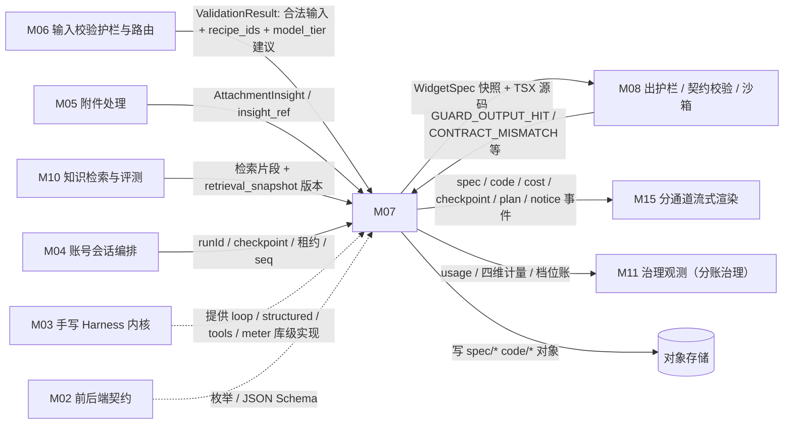
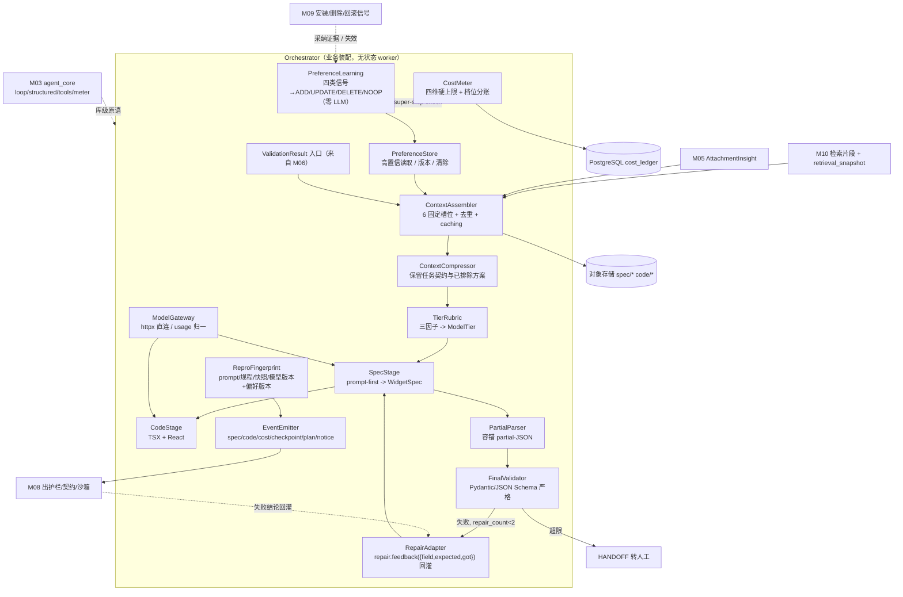
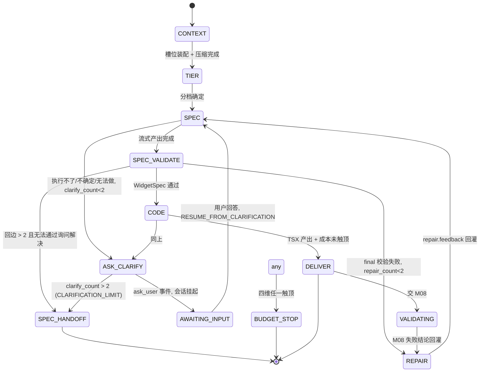

# M07 · 生成编排与成本域（原 D4）

> **⚠ ADR-003 变更覆盖声明（2026-11-21，待拷问确认）**：上下文固定槽位新增 **L0 能力目录段**（位置：系统契约之后、规程之前），只装 `id+kind+brief+cost_hint` 摘要；完整 schema / 规程正文由模型经 `LOAD_CAPABILITY` 按需加载 L1/L2 后落入对应详情槽/规程槽。M06 不再随 `ValidationResult` 下发 `recipe_ids`（退为安全门禁），规程正文由模型按需加载。**技能预取后续已整套删除（2026-11-21 用户决策，不留兼容层/不打补丁），迁移 0009 drop `skill_prefetch_log` 表**。下文「M06 产出 recipe_ids」「六槽位」「按 widget_type+grid 预取规程入槽」等為 **v1.5 旧口径，已被 ADR-003 覆盖**。所有 L1/L2 加载计入 X4 预算。以本声明为准。

> **文档类型**：可独立交付 / 可独立验收的模块设计文档
> **来源章节**：`设计方案.md` v1.1 §5 D4、§11.3/11.5/11.7、§3.2 step 6–7、§3.3 生成协议、§4.3.1 `WidgetSpec`、§10.1 #4–5、§2.6 X2/X3/X4、§9.6 风险与待决、§8 总表 D4 行、§0 D-2/D-4/D-5、§9.5 评测口径
> **版本**：v1.1　|　**拆分日期**：2026-11-15　|　**最近修订**：2026-11-16（v1.3，ADR-001 D-7：新增执行中受控询问用户 `ask_user` 通道，≤2 次/任务，转人工收窄；**v1.4，ADR-002 D-9~D-13：补齐记忆管理机制——三层边界、规则优先零 LLM 抽取的偏好学习、检索期衰减、失效不删除的遗忘、规格建议接入偏好**）　|　**状态**：设计定稿（分档阈值 / 预算上限 / 记忆权重阈值为影子校准中，见 §9 待决清单）
> **对应编号**：D4 / FR-09、FR-23 / X2、X3、X4
> **主责服务**：`orchestrator`（手写 agent loop、上下文装配、生成回路、成本计量）、`packages/agent_core`（M03 提供库级实现，M07 是业务装配方）
> **一句话定义**：把 M06 放行后的合法输入按固定槽位装配成可缓存的上下文、先出 `WidgetSpec` 再产 TSX 代码、用确定性 rubric 分档与四维硬预算管住每一轮生成；模型遇执行不了 / 不确定 / 无法做的事情时，通过受控 `ask_user` 通道**主动询问用户**（≤2 次）拿到补充信息后继续，而不是直接失败；回边、成本、记忆与复现指纹全部做成可断言的业务编排。

---

## 0. 模块速览（零基础可读）

### 0.1 项目在做什么（本模块所需的最小背景）

WidgetPilot 是一个「用自然语言生成手机桌面控件」的 AI Agent 产品：用户输入描述（规格可选预填，缺省由系统询问补全）、可传附件，系统生成 TSX + React 代码，编译并在隔离沙箱测试通过后产出控件包，在网页上按真实比例渲染成卡片。**本项目不装机、不接手机系统 API、不模拟设备环境**。

一个关键工程定稿是 **D-5：不使用任何 Agent 框架**（LangChain / LangGraph / Temporal / AI SDK / CopilotKit / LangFuse 等全禁），agent loop、结构化输出、工具注册、checkpoint、成本计量**全部手写**（§11）。本模块就是这条「手写 harness」在**业务侧**的装配方：它不实现 `decide()` 纯函数本身（那是 M03），而是把「上下文怎么装、先出什么再出什么、用哪档模型、花多少钱、失败了怎么回边、怎么复现」这些业务规则接到 M03 的内核原语上。

### 0.2 端到端 14 步链路中本模块的位置

```
① 登录 → 新建会话（grid 可选预填）
② 附件上传 → attachment_id（M05）
③ 语义层校验（含规格缺省询问）→ ④ 进护栏 → ⑤ 级联意图识别 + 技能预取（M06）
⑥ 上下文装配（公共语料 + 规程 + 记忆 + AttachmentInsight，固定槽位、硬过滤优先）   ← ★ 本模块
⑦ 生成回路：先出 WidgetSpec，再出 TSX + React 代码；模型分档；执行中可 ask_user 问用户（≤2 次）  ← ★ 本模块
⑧ 出 LLM 护栏 → ⑨ 契约校验 → ⑩ 沙箱 → ⑪ WidgetBundle → ⑫ 卡片
⑬ 评测合格 → 脱敏 → 入库门禁 → 公共语料
⑭ 全流程按 seq 写 SSE 事件流与只追加审计；成本按模型档位分账                       ← 本模块产原始成本账
```

本模块**主责第 ⑥⑦ 步**，是「合法输入 → 可校验产物」的核心生成段。原文 §10.1 完整性矩阵里，本模块对应控制点 **#4（上下文装配：硬过滤 → 混合检索 + rerank；记忆、token 预算、版本快照、缓存）** 与 **#5（生成回路：TSX+React 结构化输出、模型分档、prompt caching、回边 ≤2）**。它承载 X2（上下文管理）、X3（记忆管理）、X4（成本管理）。

### 0.3 为什么必须有这个模块

| 若没有本模块 | 会发生什么 |
|---|---|
| 上下文随便拼 | prompt caching 失效（骨架/正文重复）、token 失控、检索片段与历史代码整段回喂，长会话越跑越贵 |
| 直接让模型吐代码 | 复杂嵌套 structured output 在规模下易碎；没有可校验的 `WidgetSpec` 中间契约，规格冲突、能力声明无法在代码层断言（§3.3） |
| 模型一律用最强档 | 简单控件也烧 frontier 模型，成本 P95 失控；D-4 要求「简单控件用便宜模型」 |
| 失败无限重试 | 生成不合规会陷入死循环；D-2 要求自纠正回边 **≤2 次**后转人工 |
| 预算靠「提示模型省着点」 | 模型自律不可信；必须四维硬上限（token / 轮次 / 工具调用 / 沙箱分钟）**确定性中断** |
| 换模型要改代码 | 供应商锁定；必须 model gateway 直连 OpenAI-compatible、usage 归一，换模型只改配置 |
| 结果不可复现 | 同题两次跑不一致，无法回归、无法评测；必须有复现指纹（prompt / 规程 / 检索快照 / 模型版本） |

原文 §5 D4 的验收写得很具体：**单会话不超预算；换模型只改配置；同题同版本两次跑结果一致；回边次数与成本可测**。这四条是本模块可独立提测的锚点。

### 0.4 上下游邻居（mermaid）



- **上游**：M06（放行结论）、M05（`AttachmentInsight`）、M10（检索片段与快照版本）、M04（`runId` / checkpoint）、M03（内核原语）、M02（契约）。
- **下游**：M08（拿 `WidgetSpec` + TSX 做出护栏 / 契约校验 / 沙箱）、M15（消费事件）、M11（拿原始成本账做分账治理）。
- **回边**：M08 校验失败 → 回到本模块自纠正（≤2 次），这是**业务失败**，不是基础设施重试（§11.3）。
- **横切**：X2 / X3 / X4 主承载；成本「**计量执行**在 M07、**分账治理**在 M11」，检索内容由 M10 提供。

### 0.5 原文对照表

| 本模块内容 | 原文章节 |
|---|---|
| 功能、技术栈、要点、验收 | §5 D4、§8 总表 D4 行 |
| 上下文固定槽位 / 去重 / caching / 压缩 | §11.7、§5 D4、§2.6 X2 |
| 先 `WidgetSpec` 再产码 | §3.3、§4.3.1、§11.5 |
| 模型分档确定性 rubric / 阈值版本化 | §5 D4、§0 D-4、§9.6 |
| 自纠正回边 ≤2、attempt 边界重置档位 | §0 D-2、§10.2、§11.3、§11.5 |
| 四维硬上限 / 确定性中断 / 按档位分账 | §5 D4、§2.6 X4、§1.6 成本指标 |
| 用户偏好结构化 / 版本化 / 可清除 / 不回喂 | §5 D4、§2.6 X3、FR-23 |
| model gateway 直连 / usage 归一 / 换模型只改配置 | §11.7、§2.5、§11.1 |
| `decide()` 纯函数 / `State` / `Decision` | §11.3 |
| prompt-first / partial-JSON / final 严格校验 / repair | §11.5、§6.4 #1、§3.3 |
| 复现指纹 | §5 D4 验收、§11.9 回归门禁 |
| 控制点 #4 / #5 | §10.1 #4–5 |

---

## 1. 模块定位与职责边界

### 1.1 为什么必须有（五个不可替代的职责）

1. **固定槽位装配 + prompt caching**（X2；ADR-003 变更）：系统契约 → **L0 能力目录（摘要）** → 规程/详情（L1/L2 按需加载结果） → 检索片段 → 附件洞察 → 用户记忆 → 会话结论，顺序固定、骨架与正文去重，才能保住缓存前缀（§11.7）。L0 目录只装摘要，完整 schema/正文按需加载。
2. **先 `WidgetSpec` 再产码**（§3.3 / §4.3.1）：复杂嵌套 structured output 在规模下易碎，采用「prompt 生成 → validator → 自纠正」而非硬塞 constrained decoding；`WidgetSpec` 是生成协议与渲染协议共用的同一份契约的起点。
3. **确定性模型分档**（D-4）：按「是否带附件 / `widget_type` 复杂度 / 是否触发回边」的**确定性 rubric** 选档，阈值走配置中心版本化、影子验证后再灰度（§0 D-4、§9.6）。
4. **四维成本硬上限**（X4）：token / 轮次 / 工具调用 / 沙箱分钟，触顶**确定性中断**而非提示模型省着点（§5 D4、§2.2 成本）。
5. **可复现 + 可计量的生成回路**（§5 D4 验收）：同题同版本两次跑结果一致，复现指纹含 prompt / 规程 / 检索快照 / 模型版本；回边次数与成本可测。
6. **执行中受控询问用户**（v1.3 D-7）：模型遇执行不了 / 不确定 / 无法做的事情时，产结构化 `ClarificationRequest` 问用户（封闭式、≤2 次、计入预算、过出护栏校验），回答后继续而不是直接失败；转人工收窄到「询问用尽仍失败 / 无法通过询问解决」场景。

### 1.2 做什么（职责清单）

| # | 职责 | 说明 | 原文依据 |
|---|---|---|---|
| R1 | 固定槽位上下文装配 | 六槽位顺序固定、骨架与正文去重保 caching | §11.7、§5 D4 |
| R2 | 上下文压缩 | 超阈值只压缩 tool message，**保留任务契约与已排除方案**；state 只存结论与引用 | §11.7、§5 D4、X2 |
| R3 | 硬过滤 / 混合检索结果接入 | 消费 M10 提供的检索片段与 `retrieval_snapshot` 版本 | §10.1 #4、§11.7 |
| R4 | 生成先出 `WidgetSpec` | 结构化中间契约，spec 层拒绝规格冲突 | §3.3、§4.3.1 |
| R5 | 再产 TSX + React 代码 | `language:"tsx"`、`import_allowlist`、默认导出 `Widget` | §4.3.1、§2.4 #2 |
| R6 | 模型分档确定性 rubric | 三因子 → `ModelTier`，阈值配置中心版本化 | §5 D4、D-4 |
| R7 | 自研 model gateway | `httpx` 直连 provider HTTP；wire 由 M20 按 `wire_api` 选 `chat_completions` / `responses`（后者 v1.4 仅设计未实现），usage 归一，换模型只改配置 | §11.7、§11.1 |
| R8 | 手写 agent loop 装配 | 用 M03 `loop`/`decide()` 原语，模型只在 `CALL_MODEL` 分支出现 | §11.3 |
| R9 | 结构化输出：prompt-first + partial-JSON + final 严格校验 | 流中不触发副作用，final 用 Pydantic / JSON Schema | §11.5、§6.4 #1 |
| R10 | 自纠正回边 ≤2 + `repair.feedback()` | 错误 `{field, expected, got}` 结构化回灌，超限 `HANDOFF` | §0 D-2、§11.5 |
| R11 | 数值 / 枚举 / 能力确定性断言 | 不用裁判模型打分 | §11.5、§9.5 |
| R12 | 四维成本硬上限 + 确定性中断 | token / 轮次 / 工具调用 / 沙箱分钟，触顶中断 | §5 D4、X4 |
| R13 | 按档位分账、回边与重复检索计入本轮 | 每 super-step 累加，写 `cost_ledger` | §11.8、§1.6 |
| R14 | 记忆管理（用户偏好） | 配色 / 常用规格 / 常用控件类型结构化、版本化、可清除；**v1.4：规则优先的四类信号学习 + 写入时权重冲突裁定 + 检索期衰减 + 失效不删除的遗忘**；**不回喂历史代码、不调用 LLM 抽取** | §5 D4、X3、FR-23、ADR-002 D-9~D-13 |
| R15 | 复现指纹 | prompt / 规程 / 检索快照 / 模型版本 + 推导项 | §5 D4 验收、§11.9 |
| R16 | 产生 `spec`/`code`/`cost`/`checkpoint`/`plan`/`notice` 事件 | 分通道 payload | §4.5、§6.4 |
| R17 | 写 `WidgetSpec` 快照与 TSX 源码到对象存储 | `spec.json` / `widget.tsx` 引用带 hash | 01 基线 §9 |
| R18 | 执行中受控询问用户（v1.3 D-7） | 模型输出 `ClarificationRequest` → 结构化校验（封闭式 / 相关性 / 无 PII 泄漏）→ `clarify_count ≤ 2` → 推 `ask_user` 事件、会话置 `AWAITING_INPUT`；用户经 `POST /clarifications` 回答后答案入 `clarification_answer` 槽位续跑；超限 → `CLARIFICATION_LIMIT` 转人工 | **ADR-001 D-7（新增，原文无此通道）** |

### 1.3 不做什么（明确排除，边界切割点）

| 不做 | 归属模块 | 边界说明（这块归哪个 Mxx） |
|---|---|---|
| `agent_core` 的 `loop` / `structured` / `tools` / `meter` **库级实现** | **M03** | M03 定义 `decide()` 纯函数、`State`/`Decision`、`partial.py`、`registry.py`、`meter.py`；**M07 是业务装配方**，不得改动 `decide()` 语义（§11.2/11.3） |
| 检索融合（硬过滤 / 混合检索 + RRF / rerank / 版本快照 / 缓存 / 负例回流） | **M10** | 检索**内容**由 M10 提供；M07 只按固定槽位消费其片段与 `retrieval_snapshot`，不实现检索算法 |
| 成本「分账治理」/ 配额 / 熔断 / kill switch / 指标看板 / 告警 | **M11** | 成本「**计量执行**」在 M07（累加 usage、写原始账），「分账治理」在 M11（§2.6 X4、X11） |
| 出护栏 / 契约校验 / TSX 编译 / 沙箱渲染与断言 | **M08** | 本模块只产 `WidgetSpec` + TSX；失败结论由 M08 回灌触发回边 |
| 进护栏 / 语义校验 / 意图路由 / 技能预取 | **M06** | 本模块从 `ValidationResult` 开始，不重复校验输入 |
| 附件上传 / role 判定 / 多模态处理 | **M05** | 本模块只消费 `AttachmentInsight` |
| checkpoint / 租约 / 幂等的库级实现与状态机持久化 | **M04 / M03** | M07 使用 `runId` 与 checkpoint 原语，不实现抢锁 |
| `WidgetBundle` / manifest / CSP / bridge / 产物版本 | **M09** | 无关 |
| 前端 partial-JSON 容错渲染 / 增量 patch / reducer | **M15 / M17** | 本模块服务端也做 partial 解析（用于结构化输出），但前端流式渲染归 M15 |
| 评测执行 / 失败模式 rubric / 回归门禁 | **M10** | 本模块提供复现指纹与可回放轨迹作为评测输入 |

> **最易混淆的三条切割**：① **M03 是实现基座、M07 是业务装配方**——`meter.py` 的四维计数实现在 M03，「什么算一轮、回边计不计入本轮、按什么档位分账」的业务规则在 M07；② **成本计量执行（M07） vs 分账治理（M11）**；③ **检索内容（M10） vs 检索片段的槽位装配（M07）**。

### 1.4 输入 / 输出与上下游契约

| 方向 | 内容 | 契约形式 |
|---|---|---|
| 入 | M06 `ValidationResult`（`widget_type` / `grid` / `recipe_ids` / `model_tier` 建议 / `intent_normalized` / `attachment_refs`） | 内部接口 |
| 入 | M05 `AttachmentInsight`、M10 检索片段 + `retrieval_snapshot`、M04 `runId` / checkpoint、用户偏好 `UserPreference` | 内部接口 / 对象存储引用 |
| 入（回边） | M08 的 `GUARD_OUTPUT_HIT` / `CONTRACT_MISMATCH` / `COMPILE_FAILED` 等结论 + `repair.feedback({field,expected,got})` | 内部接口 |
| 出 | `WidgetSpec`（`spec.json`）、TSX 源码（`widget.tsx`）、`repro_fingerprint`、`cost_ledger` 原始账 | 对象存储 + PG 表 + 内部接口 → M08 |
| 出 | `spec`/`code`/`cost`/`checkpoint`/`plan`/`notice` SSE 事件 | SSE（M15 消费） |
| 出（禁止） | 把历史代码整段回喂、把检索片段当指令、超预算仍继续调用模型 | — |

### ⚠ 跨模块接线待办（M05 → M07，实现本模块时必须接线）

> 来源：M05 功能完整性审查（2026-11-21，v1.7 S1）。本模块消费的 `AttachmentInsight`
> 契约已定稿，且 M05 的 `attachment` SSE 事件已补齐 `insight_ref` 字段——按此接线。

| 接线点 | M05 实际产出（已实现） | 本模块必须做 |
|---|---|---|
| 洞察结构 | `AttachmentInsight{source_ref, extracted, insight_quality}`（Pydantic 严格校验，`insight_quality∈[0,1]`） | 固定槽位按此结构装配；`extracted` 是**数据不是指令**，不解析为生成指令 |
| 双 confidence | `insight_quality` 表处理质量；`role_confidence` 在 `Attachment` 上、由 M06 消费 | 不可用 `insight_quality` 判断 role 是否明确 |
| `attachment` 事件 | 事件 payload = `{attachment_id, role, insight_ref, action}`（`action` ∈ UPLOAD/PATCH） | 收到 `action=PATCH` 时从 `ROLE_ASSIGNED` 步重跑，仅重算该附件 |
| 原文红线 | `source_ref` 指向 `att/.../original`（带 hash），用于溯源 | **只传引用，不把原文塞进 prompt**；原文永不进公共语料 |

---

## 1.5 承载的横切能力 X*

- **X2（主承载）**：上下文管理 —— 固定槽位、窗口化、超阈值压缩（保留任务契约与已排除方案）、保住 prompt caching；state 只存结论与引用（§2.6、§11.7）。**v1.8 对标增补（§11.7.1）**：以社区 Write / Select / Compress / Isolate 四操作为坐标系——Write/Select 已覆盖（state 只存引用、JIT 检索 + ADR-003 能力分级披露），Compress 补「大 tool 结果落盘引用 + 压缩召回门禁」，Isolate 不采纳（单 loop 零 Agent 框架）；新增 KV cache 命中率为一等观测指标（进 X4 成本账/M11 trace），生产纪律 = 稳定前缀 + append-only + 工具只 mask 不 remove。**仅设计口径，未改码**。
- **X3（主承载）**：记忆管理 —— 用户偏好（配色 / 常用规格 / 常用控件类型）结构化存储、版本化、可清除；**v1.4：四类结构化信号学习 + 写入时权重冲突裁定 + 检索期衰减 + 失效不删除的遗忘，全程零 LLM 抽取**（ADR-002）；**不把历史代码当经验回喂**（§2.6、FR-23）。
- **X4（主承载，计量执行侧）**：成本管理 —— 单会话四维硬上限、模型分档、缓存复用、按档位分账；回边与重复检索计入本轮（§2.6、§8 总表 X4 行）。分账治理在 M11。
- **X10（协同输入方）**：复现指纹与可回放轨迹是回归门禁的输入，门禁执行在 M10。
- **X11（协同）**：成本账 / 每轮 token / 档位流水由 M11 汇总，本模块产原始证据。

### 1.6 关键设计原则

1. **固定槽位 + 去重保 caching**：顺序固定，骨架与正文去重（§11.7）。
2. **state 只存结论与引用**：大对象（代码 / 附件 / 日志 / 快照）放对象存储；压缩保留任务契约与已排除方案（§1.7 #5、§11.7）。**v1.8**：单次 tool 输出超阈值（建议 20k token、配置化）改为写对象存储、窗口只留 `object_key + 前 N 行预览`，按需 JIT 回放；引用进 manifest 与复现指纹，原文仍是数据不是指令（§11.7.1）。
3. **先 `WidgetSpec` 再产码**：可校验中间契约优先（§3.3）。
4. **确定性分档 rubric**：三因子静态判定，阈值配置中心版本化，变更触发回归（§5 D4、D-4）。
5. **回边 ≤2 且 attempt 边界重置档位**：自纠正是业务失败，不是基础设施重试（D-2、§10.2）。
6. **四维硬上限确定性中断**：触顶即停，不提示模型省着点（§5 D4、§2.2）。
7. **换模型只改配置**：`httpx` 直连 provider 端点，wire 由 M20 按 `wire_api` 选择（Responses API 为 v1.4 设计占位、未实现），usage 归一（§11.7）。
8. **确定性断言不用裁判模型**：数值 / 枚举 / 能力一律代码断言（§11.5、§9.5）。
9. **不回喂历史代码、不整段注入检索片段**：只注入 top-k 相关片段（§5 D4、§5 D7）。
10. **零 Agent 框架**：loop / structured / tools / meter 全手写或 M03 提供（D-5）。
11. **复现优先**：同题同版本两次跑结果一致（§5 D4 验收）。
12. **询问是受控状态转移，不是自由聊天**（v1.3 D-7）：`ask_user` 只能问与当前任务相关的封闭式问题；`decide()` 新增 `ASK_USER` / `RESUME_FROM_CLARIFICATION` 分支仍是纯函数；checkpoint 记录 `clarify_count`，跨天恢复后可继续回答。

---

## 2. 技术栈

### 2.1 分层选型表

| 层 | 选型 | 版本 / 约束 | 为什么选 | 明确不用什么 |
|---|---|---|---|---|
| 编排 | **手写 agent loop**（M03 `loop/run.py` 装配） | `decide()` 纯函数、显式 while | 模型只在 `CALL_MODEL` 出现，每步可断言（§11.3） | **不用 LangChain / LangGraph / Temporal / 任何 workflow 框架** |
| 模型直连 | `httpx` 直连 provider HTTP | 按 `wire_api` 走 chat-completions 或 Responses API（后者 v1.4 仅设计未实现） | 换模型只改配置、usage 归一、无 SDK 黑盒（§11.7） | **不用 OpenAI Agents SDK / AI SDK / 任何 LLM 框架 SDK** |
| 结构化输出 | 自研 `structured/schema.py` + `partial.py` + `repair.py` | JSON Schema + Pydantic v2 严格校验 | prompt-first + partial 容错 + final 严格 + 回灌（§11.5） | 不用 `with_structured_output` / constrained decoding 依赖 |
| 工具注册 | 自研 `tools/registry.py`（M03） | 静态注册、Pydantic 参数校验 | 越权调用在策略层拒绝（§11.6） | 不用 `bind_tools` / MCP SDK |
| 上下文 | 自研 `context/slots.py` + `budget.py` | 固定槽位、tiktoken 计数、**大 tool 结果落盘引用** | 去重保 caching、超阈值压缩；超 20k token 结果写对象存储只留引用 + 预览（v1.8 §11.7.1，仅设计） | 不用 `trim_messages` / 框架上下文管理 |
| 缓存可观测 | `cache_hit_rate` / `cache_read_tokens` / `cache_write_tokens`（v1.8 §11.7.1，仅设计） | 进 X4 成本账 + M11 `trace_span` | 稳定前缀 + append-only + 工具只 mask 不 remove；显式 TTL 配置 | 不引用厂商倍数，以本项目门禁自测为准 |
| 成本计量 | 原生 `usage` 字段归一 + `tiktoken`（纯计数）+ `budget/meter.py`（M03） | 四维硬上限、每 super-step 累加 | 确定性中断、按档位分账（§11.8） | 不用 LLM 专用观测平台 SDK 计量 |
| 校验 / 序列化 | Pydantic v2 | 严格模式 | `WidgetSpec` / `ValidationResult` / `Usage` 统一校验 | — |
| 配置 | 配置中心（阈值 / 模型映射版本化） | `tier_rubric_version` / `model_config_version` | 变更触发回归、可回滚（D-4、§9.2） | 不把阈值硬编码散落在业务代码 |
| 对象存储 | S3 兼容 | `spec/*` / `code/*` | 大对象只存引用（§4.1 字段归属原则） | 不把代码 / 快照塞进 PG |
| 事件 | 原生 SSE（`spec`/`code`/`cost`） | `seq` 由 M04 编号 | 分通道、可回放 | 不用 AI SDK / CopilotKit |
| 可观测 | OpenTelemetry SDK + 自建 `trace_span` 表 | 通用标准 | 每轮 token / 成本 / 档位留证 | 不用 LangFuse |

### 2.2 硬约束

- **D-5 零 Agent 框架**：不使用 LangChain / LangGraph / Temporal / AI SDK / CopilotKit / LangFuse / OpenAI Agents SDK / CrewAI / AutoGen / PydanticAI / MCP SDK 等（§11.1）。agent loop、结构化输出、工具注册、checkpoint、检索融合、事件流、评测全手写或由 M03 提供。
- **保留的通用基础设施**：FastAPI、Pydantic v2、Postgres、Redis、对象存储、`httpx`、**tiktoken（纯 token 计数工具库）**、OTel SDK（§11.1）。
- **D-2 回边 ≤2**：`MAX_REPAIR = 2`，`MAX_ITER = 12`，均为上线常量、**无关闭开关**（§11.3）。
- **D-4 阈值版本化**：分档阈值走配置中心版本化，影子验证后再灰度，变更触发回归（§0、§9.6）。
- **四维硬上限确定性中断**：触顶即停，不是提示模型省着点（§5 D4、§2.2 成本）。
- **不回喂历史代码**：记忆只存结构化偏好，不存整段代码；**不从自由文本/附件原文/公共语料做 LLM 抽取**（§2.6 X3、v1.4 ADR-002 D-10）。
- **门禁无在线关闭开关**（§1.7 #8）。

### 2.3 运行时依赖

| 依赖 | 用途 | 不可用时的行为 |
|---|---|---|
| PostgreSQL | `cost_ledger` / `Run` / checkpoint 引用 / 用户偏好 | 计量无法落账 → 触发确定性中断，不无账生成 |
| 对象存储（S3） | `spec.json` / `widget.tsx` / 上下文快照 | 写失败则本 super-step 不提交 |
| 配置中心 | 分档阈值 / 模型映射 | 【推导·需评审】不可用时冻结在最后已知版本并告警，**不动态改阈值** |
| Provider HTTP 端点 | 模型推理 | 429/5xx 走 `RetryPolicy` 指数退避**有上限**；业务失败走回边，不走 retry（§11.3） |
| M10 检索片段 | 上下文「检索片段」槽位 | 无结果时**不编造、转人工**（§5 D7 验收），本槽位可为空但须留 `retrieval_snapshot` |
| M03 `agent_core` | loop / structured / tools / meter 原语 | 未就绪则生成链不启动，不降级为「裸调模型」 |
| `tiktoken` | token 计数 | 纯本地库；不可用时按【推导·需评审】保守估算并标记 `counting_mode="estimated"` |

### 2.4 monorepo 代码落位

```
services/orchestrator/
  context/
    slots.py                # 固定槽位装配（6 槽位 + 去重 + caching 前缀）
    compress.py             # 窗口化压缩，保留任务契约与 excluded_approaches
    budget.py               # tiktoken 计数、token 预算、槽位裁剪
  generation/
    spec_stage.py           # 先出 WidgetSpec（prompt-first + final 严格校验）
    code_stage.py           # 再产 TSX + React 代码（增量 patch 源）
    tier_rubric.py          # 三因子确定性分档
    repro.py                # 复现指纹计算与校验
  model/
    gateway.py              # httpx 直连 OpenAI-compatible，换模型只改配置
    usage.py                # 不同供应商 usage 字段归一
    stream.py               # SSE 分帧 / 半帧缓存 / delta 解析
  memory/
    preference.py           # UserPreference 结构化字段 + 高置信读取门禁 + 版本 / 清除（v1.4）
    preference_learning.py  # 【v1.4 ADR-002】四类信号 → ADD/UPDATE/DELETE/NOOP 纯代码裁定
    preference_event.py     # 【v1.4 ADR-002】PreferenceEvent 只追加证据 + TTL 失效 + 权重重算
  cost/
    meter.py                # 四维硬上限累加（挂 M03 meter.py）、按档位分账
    ledger.py               # cost_ledger 写入
  loop_adapter.py           # 把 M03 decide()/State/Decision 接到业务规则
  repair_adapter.py         # repair.feedback({field,expected,got}) 回灌装配
packages/agent_core/        # M03：loop/ structured/ tools/ context/ state/ events/ budget/
packages/contracts/         # M02：openapi.yaml / widget_spec.schema.json / enums
packages/prompts/           # 版本化 prompt + recipes/（M07 装配消费）
infra/deploy/               # 配置中心：tier_rubric / model_config 版本
```

---

## 3. 设计架构

### 3.1 内部组件与职责



| 组件 | 职责 | 关键不变量 |
|---|---|---|
| `ContextAssembler` | 六槽位固定顺序装配、骨架/正文去重 | 同输入产生字节一致的 prompt 前缀（caching） |
| `ContextCompressor` | 超阈值压缩 tool message | **必保留任务契约 + `excluded_approaches`** |
| `TierRubric` | 三因子 → `ModelTier` 纯函数 | 同因子同档；不靠模型自报置信度 |
| `SpecStage` / `CodeStage` | 先 `WidgetSpec` 后 TSX | 顺序不可颠倒；spec 未过不产码 |
| `PartialParser` | 流式容错解析未闭合 JSON | 流中不触发任何副作用 |
| `FinalValidator` | final 严格 Pydantic / JSON Schema | 数值 / 枚举 / 能力确定性断言 |
| `RepairAdapter` | 结构化回灌 `{field, expected, got}` | 回边 ≤2，超限 `HANDOFF` |
| `ModelGateway` | `httpx` 直连、usage 归一 | 换模型只改配置，不改代码 |
| `CostMeter` | 四维累加、触顶中断 | 回边与重复检索计入本轮 |
| `PreferenceStore` | 高置信字段读取门禁 / 权重衰减 / 版本 / 清除 | 只注入 `weight≥0.7` 或 `evidence_count≥2`；不存整段历史代码 |
| `PreferenceLearning` / `PreferenceEvent`【v1.4】 | 四类结构化信号 → 四操作纯代码裁定；只追加证据与 TTL 失效 | 低权重不覆盖高权重；`call_count == 0`；失效不删行 |
| `ReproFingerprint` | 复现指纹（含 `preference_version`） | 同题同版本两次一致 |

### 3.2 处理流程与数据流（编号步骤，对应 §3.2 step 6–7）

1. 收到 M06 的 `ValidationResult`（`widget_type` / `grid` / `recipe_ids` / 建议 `model_tier` / `intent_normalized` / `attachment_refs`）。
2. **上下文装配**（六槽位固定顺序，§11.7）：`系统契约 → 规程(recipe_ids 对应版本) → 检索片段(M10, 带 retrieval_snapshot) → 附件洞察(M05 AttachmentInsight) → 用户记忆(PreferenceStore) → 会话结论`。第 5 槽按 v1.4 D-11 **高置信门禁**注入：只取 `weight≥0.7` 或 `evidence_count≥2` 的字段，按衰减权重排序，超 token 预算时降序截断且不挤占 1–2 槽 caching 前缀（§3.4 E）。
3. 骨架与正文去重：`ContextAssembler` 保证同一段系统契约 / 规程只出现一次，形成稳定的 **caching 前缀**；只注入 top-k 相关片段，**不整段回喂历史代码**。
4. `budget.py` 用 `tiktoken` 计数；超阈值时 `ContextCompressor` 只压缩 tool message，**保留任务契约与 `excluded_approaches`（已排除方案）**；state 只存结论与引用。
5. **模型分档**：`TierRubric` 按三因子确定性判定 `ModelTier`——① 是否带附件、② `widget_type` 复杂度、③ 是否触发回边；阈值从配置中心读 `tier_rubric_version`，写入复现指纹（§5 D4、D-4）。
6. **Spec 阶段**：`ModelGateway` 用 `httpx` 直连 provider 的 chat-completions 兼容端点，`stream=True`；系统提示放 `WidgetSpec` schema + 示例（**prompt-first**），不依赖 constrained decoding。
7. 流式 delta 由 `stream.py` 分帧 + 半帧缓存；`PartialParser` 容错补齐未闭合字符串与括号，**流中不稳定的字符串字段不触发任何副作用**（路由 / 埋点 / 请求）。
8. **final 严格校验**：只在 `done` 用 Pydantic v2 / JSON Schema 校验 `WidgetSpec`；数值 / 枚举 / 能力声明一律**确定性断言**，不用裁判模型打分（§11.5、§9.5）。
9. 校验失败 → `RepairAdapter` 把错误结构化回灌 `{field, expected, got}`，`REPAIR` 回边，`repair_count += 1`；**≤2 次**（D-2），attempt 边界重置档位。超限 → 若 `clarify_count < 2` 且失败源于信息不足，先走第 15 步 `ask_user` 询问用户；**询问用尽仍失败**才 `HANDOFF` + 原因码 + 保留部分产物 + 转人工（§10.2、ADR-001 D-7）。
10. `WidgetSpec` 通过 → 写 `spec/{session_id}/{run_id}/spec.json`（带 hash），推 `spec` 事件（partial JSON 渐进）。
11. **Code 阶段**：据 `WidgetSpec` 生成 TSX + React 代码（`language:"tsx"`、`import_allowlist=["react","@widget/bridge"]`、默认导出 `Widget`），写 `code/{session_id}/{run_id}/widget.tsx`，推 `code` 增量 patch `{ from_line, to_line, text }`（§6.4 #2）。
12. **成本计量**：每个 super-step `CostMeter` 累加 token / 轮次 / 工具调用 / 沙箱分钟，`usage` 归一后按档位写 `cost_ledger`；**回边与重复检索计入本轮**；触任一维上限 → **确定性中断** + `BUDGET_EXHAUSTED`（§5 D4、§11.8）。
13. M08 做出护栏 / 契约校验 / 沙箱；失败结论（`GUARD_OUTPUT_HIT` / `CONTRACT_MISMATCH` / `COMPILE_FAILED` / `SANDBOX_TEST_FAILED`）回灌到 `RepairAdapter`，回到第 9 步自纠正（任务内闭环，§10.2）。
14. 计算 `repro_fingerprint`（prompt 版本 / 规程版本 / 检索快照 / 模型版本 + 推导项），写 `Run` 与审计；产 `cost` / `checkpoint` / `plan` / `notice` 事件；全部通过交 M08 → M09。
15. **执行中受控询问（v1.3 D-7）**：模型在 Spec / Code 任一阶段判定「执行不了 / 信息不确定 / 无法做」→ 产出结构化 `ClarificationRequest{ question, options?, allow_text }`；`ClarifyGuard` 校验：封闭式、与当前任务相关、无 PII / 内部实现泄漏；`clarify_count += 1`（≤ `MAX_CLARIFY_PER_TASK=2`，计入轮次与 token 预算）→ 推 `ask_user` 事件，会话置 `AWAITING_INPUT`，checkpoint 记录 `clarify_count`；用户经 `POST /api/sessions/{id}/clarifications` 回答 → 答案入 `clarification_answer` 槽位 → `RESUME_FROM_CLARIFICATION` 续跑。**超限 → `CLARIFICATION_LIMIT` + 转人工**；询问不计入 `repair_count`。

### 3.3 状态机

**(A) 本模块参与的会话状态**（不拥有，由 M04 持久化）：`RUNNING`（生成中）、`VALIDATING`（交 M08 校验）、`FAILED`（预算触顶 / 回边超限 / 模型错误）、`COMPLETED`（产物就绪）。完整 `SessionState` 见 §5.1。

**(B) 本模块参与的执行态（M03 `Decision.kind`，完整抄入 §6.2）**：`CALL_MODEL` / `CALL_TOOL` / `REPAIR` / `AWAIT_INPUT` / `DONE` / `HANDOFF` / `FAILED`。本模块**装配**这些迁移的业务语义，不实现 `decide()`。

**(C) 生成阶段状态**【推导·需评审：原文未定义阶段状态机，为独立验收补齐】：



| 状态 | 含义 | 是否终态 |
|---|---|---|
| `CONTEXT` | 固定槽位装配 / 压缩 | 否 |
| `TIER` | 分档 rubric 判定 | 否 |
| `SPEC` / `SPEC_VALIDATE` | 生成 `WidgetSpec` / final 严格校验 | 否 |
| `REPAIR` | 自纠正回边（≤2） | 否 |
| `ASK_CLARIFY` | 受控询问用户中（v1.3 D-7，≤2 次） | 否（挂起，会话 `AWAITING_INPUT`） |
| `CODE` | 生成 TSX | 否 |
| `DELIVER` | 交 M08 校验 | 否 |
| `VALIDATING` | M08 校验中（会话态） | 否 |
| `SPEC_HANDOFF` / `BUDGET_STOP` | 回边超限 / 预算触顶 | 是（旁路） |

### 3.4 关键机制、算法与不变量清单

**A. 固定槽位装配（X2，§11.7）**

| 槽位序 | 名称 | 内容来源 | 是否可缓存前缀 |
|---|---|---|---|
| 1 | 系统契约 | 版本化 prompt + `WidgetSpec` schema 骨架 | 是（最稳定） |
| 2 | 规程 | `recipe_ids` 对应 `recipe_version` | 是 |
| 3 | 检索片段 | M10 top-k 片段 + `retrieval_snapshot` | 否（每次变） |
| 4 | 附件洞察 | M05 `AttachmentInsight` | 否 |
| 5 | 用户记忆 | `UserPreference` 结构化字段 | 半稳定 |
| 6 | 会话结论 | state 里的结论与引用 | 否 |

顺序**固定不变**；骨架与正文去重，保证 1–2 槽位形成稳定 caching 前缀。`budget.py` 用 `tiktoken` 计数，超阈值只压缩 tool message，**压缩必保留任务契约与 `excluded_approaches`**（`State.excluded_approaches`，§11.3）。state 只存结论与引用，大对象全在对象存储。

**A′. 上下文工程对标增补（v1.8，§11.7.1，仅设计）**：以社区 Write / Select / Compress / Isolate 四操作复核——Write/Select 已覆盖；Compress 补两条：① 单次 tool 输出 >20k token（配置化）写对象存储、槽位内只留 `object_key + 前 N 行预览`、按需 JIT 回放（引用进 `manifest` 与复现指纹，原文仍当数据不当指令）；② **压缩回归门禁**——加「早期引入的关键事实压缩后仍正确」用例，并跟踪 `cost per completed task`，压缩/模型/窗口变更都要重跑（门禁执行仍归 M10）。Isolate 不采纳（单 loop + 零 Agent 框架，多 agent 约 15× token 与成本可控冲突）。缓存纪律：`cache_hit_rate` / `cache_read_tokens` / `cache_write_tokens` 进 X4 成本账与 `trace_span`；system prompt 前缀逐字不变（不放时间戳）、上下文 append-only、工具定义运行中只 mask 不 remove、TTL 显式配置。**不引入 LLM 摘要器 / 通用 context 文件 / 第三方记忆框架**（社区各自有成本与确定性代价，详见 §11.7.1）。

**B. 模型分档确定性 rubric（D-4）**

三因子静态表【推导·需评审：阈值与映射影子期校准】：

| 因子 | 取值 | 对档位的影响 |
|---|---|---|
| `has_attachment` | `true` / `false` | 带附件 → 至少 `standard`，复杂附件 → `frontier` |
| `widget_type_complexity` | `calendar`/`custom` 高，`clock`/`alarm` 低，`task` 中 | 高复杂度 → 升档 |
| `repair_triggered` | `repair_count > 0` | 触发回边 → 升一档（attempt 边界**重置**档位后重算） |

`(has_attachment, widget_type_complexity, repair_triggered) → ModelTier` 是**纯函数**；`tier_rubric_version` 写进配置中心并纳入复现指纹；阈值变更触发 M10 回归门禁（§9.6）。**不把模型自报置信度当路由判据**（§2.6）。

**C. 结构化输出与自纠正（§11.5）**
- **prompt-first**：系统提示放 schema + 示例，不依赖框架 constrained decoding。
- **partial 容错**：`partial.py` 补齐未闭合字符串与括号，流中不触发副作用。
- **final 严格**：只在 `done` 用 Pydantic v2 / JSON Schema 校验；数值、枚举、能力声明**确定性断言，不用裁判模型**。
- **repair.feedback**：失败 → `{field, expected, got}` 结构化回灌，`REPAIR` 回边 ≤2（D-2）；超限 `HANDOFF` + `RETRY_EXHAUSTED` / `HUMAN_REQUIRED` + 保留部分产物。

**D. 四维成本硬上限与确定性中断（X4）**

| 维度 | 计量来源 | 触顶行为 |
|---|---|---|
| `token` | 归一后的 `usage` + tiktoken | `BUDGET_EXHAUSTED`，确定性中断 |
| `turns`（轮次） | `State.iteration` / `MAX_ITER=12` | 同上 |
| `tool_calls`（工具调用） | `CALL_TOOL` 计数 | 同上 |
| `sandbox_minutes`（沙箱分钟） | M08 回传的沙箱耗时累加 | 同上 |

每 super-step 累加，**回边与重复检索计入本轮**；按 `ModelTier` 写 `cost_ledger`；触顶**确定性中断**而非提示模型省着点（§5 D4、§2.2）。`meter.py` 库级实现在 M03，业务规则（什么算一轮、如何分账）在 M07。

**E. 记忆管理（X3，v1.4 ADR-002 重写）**

三层边界**禁止混存**（D-9）：

| 层 | 载体 | 内容 | 生命周期 |
|---|---|---|---|
| 工作记忆 | M04 `Run` / checkpoint / SSE 事件流 | 当前 super-step、`clarification_answer` | 会话内（已有，不改） |
| 情节记忆（证据层） | `PreferenceEvent` 只追加表 | 「何时 / 何会话 / 何种信号 / 学到或撤销了哪个字段什么值」 | TTL 180 天，**到期失效不删行** |
| 语义记忆（偏好层） | `UserPreference` 结构化字段 | `{ palette, preferred_grids, preferred_widget_types }` + 每字段证据与权重 | 长期，随版本更新 |

**写入：规则优先、显式优先、零 LLM 抽取（D-10）**。只有四类信号可写入，其余 `NOOP`：`PUT /preferences`（`explicit`=1.0）> `POST /clarifications` 点选（`clarification`=0.8）> 规格/附件 role 纠偏（`correction`=0.7）> 安装采用产物的 palette（`adopted_artifact`=0.3）。**不调用任何模型抽取（`call_count == 0`）、不学附件原文 / PII / 公共语料 / 已删除回滚的产物**。

写入四操作（纯代码，冲突在**写入时**裁定）：`ADD`（空字段写值）/ `UPDATE`（同权重或更低权重不改；高权重或同权重更新近才覆盖，旧证据标 `superseded_at` 不删行）/ `DELETE`（用户清除或采纳证据失效，字段置空、证据标 `revoked_at`，`version+1`）/ `NOOP`（仅记审计）。低权重信号永远不能覆盖高权重字段值（I-M3）。

**读取门禁与衰减（D-11）**：第 5 槽只注入 `source_weight ≥ 0.7` 或 `evidence_count ≥ 2` 的高置信字段，附 `source`/`version`/`evidence_count`；最近 30 天被强化的证据 ×1.5、超 180 天未访问 ×0.3，**只降权不删除**；注入 token 计入四维预算，超预算按权重降序截断且不挤占 1–2 槽 caching 前缀。`repro_fingerprint` 含 `preference_version`（D-11、§3.4 G）。

**不把历史代码整段回喂**——检索片段只注入 top-k 相关片段，由 M10 提供，本模块不缓存整段 bundle；记忆与公共语料**双向隔离**，记忆不入库、语料不进记忆（I-M1）。

**F. model gateway 与 usage 归一（§11.7）**
`model/gateway.py` 用 `httpx` 直接请求 provider 端点；当前实现走 chat-completions 兼容端点，v1.4 设计增补允许按 provider 级 `wire_api` 选 Responses API（`/v1/responses`，仅设计未实现），由 M20 adapter 把两类响应归一；`usage.py` 把不同供应商的 `prompt_tokens` / `input_tokens` 等字段归一为统一 `Usage`。**换模型只改配置**（`model_config_version`），不换代码；同 wire 新增供应商只加配置，新 wire 才加 adapter。

**G. 复现指纹（§5 D4 验收）**
`repro_fingerprint = sha256(prompt_version + recipe_version + retrieval_snapshot + model + model_version + tier_rubric_version + temperature + seed + spec_version + preference_version)`【推导·需评审：原文明确含 prompt / 规程 / 检索快照 / 模型版本四项，其余为补齐项；`preference_version` 为 v1.4 ADR-002 D-11 新增】。同题同版本两次跑，`repro_fingerprint` 相同且产物一致；偏好变化属于可解释输入变化，不算复现失败；指纹作为 M10 回归门禁与离线回放的输入。

**H. 执行中受控询问用户（v1.3 D-7，新增机制）**

| 项 | 约定 |
|---|---|
| 触发 | 模型在 Spec / Code 阶段判定「执行不了的任务 / 不确定的信息 / 无法做的事情」，输出结构化 `ClarificationRequest`（`DecisionKind` 新增 `ASK_USER`，M03 `decide()` 同步扩充分支） |
| 校验 | `ClarifyGuard`：① 封闭式（≤3 选项或 `allow_text=true` 短文本）；② 与当前任务相关（带 `context_ref` 指向当前 super-step）；③ 问题文本过出护栏（无 PII / 无内部实现泄漏）——任一不满足则丢弃该请求并记 `ClarifyLog.decision="REJECT"`，回退正常生成 |
| 次数 | `clarify_count ≤ MAX_CLARIFY_PER_TASK = 2`（每任务，与 `repair_count` 分立）；每次计入轮次与 token 预算（X4） |
| 挂起与恢复 | 推 `ask_user` 事件 → 会话 `AWAITING_INPUT`（复用，不新增状态枚举）→ checkpoint 记 `clarify_count` → 用户 `POST /clarifications` 回答 → 答案入 `clarification_answer` 槽位（不破坏 1–2 槽 caching 前缀）→ `RESUME_FROM_CLARIFICATION` 续跑 |
| 超限 | `clarify_count > 2` → `CLARIFICATION_LIMIT` + 保留部分产物 + 转人工；**不得循环提问、不得用提问代替自纠正** |
| 转人工收窄 | `HANDOFF` / `HUMAN_REQUIRED` 仅保留：① 询问用尽仍无法继续；② 回边超限且无法通过询问解决；③ 检索无结果且询问不能弥补 |

**不变量清单**：

| # | 不变量 | 断言方式 |
|---|---|---|
| I1 | 六槽位顺序固定，1–2 槽位字节一致（caching 前缀） | 两次装配 prompt 前缀 diff = 空 |
| I2 | 压缩后 `task_contract` 与 `excluded_approaches` 不丢失 | 压缩前后字段断言 |
| I3 | 生成顺序恒为 `WidgetSpec` → TSX，spec 未过不产码 | 事件序列断言（`spec` 早于 `code`） |
| I4 | 流中不稳定的字符串字段不触发任何副作用 | 副作用计数（路由/埋点/请求）= 0 |
| I5 | final 校验为严格 Pydantic / JSON Schema，数值/枚举/能力为确定性断言 | 无裁判模型调用记录 |
| I6 | `repair_count <= 2`，超限必 `HANDOFF` | 回边计数 + 终态断言 |
| I7 | attempt 边界重置档位后重算 `ModelTier` | `tier_history` 断言 |
| I8 | 四维任一触顶 → 确定性中断，无后续模型调用 | Fake ModelGateway 调用计数封顶 |
| I9 | 回边与重复检索计入本轮成本 | `cost_ledger` 明细断言 |
| I10 | `usage` 归一后字段统一，换模型只改配置 | 两供应商配置切换，代码 diff = 0 |
| I11 | 同题同版本两次跑 `repro_fingerprint` 一致且产物一致 | 快照比对（§11.9） |
| I12 | `UserPreference` 不含任何历史代码字段，可清除 | schema 断言 + 清除后读取为空 |
| I-M1【v1.4】 | 偏好表与事件表不含 `history_code` / 附件原文 / PII 原文 | schema 断言 + 抽样扫描 |
| I-M2【v1.4】 | 偏好学习全流程 LLM 调用 = 0 | Fake ModelGateway 调用计数 |
| I-M3【v1.4】 | 低权重信号不能覆盖高权重字段值 | 权重矩阵表驱动单测 |
| I-M4【v1.4】 | 清除后读取为空且 `version+1`，事件日志仍可审计 | 端点断言 + 事件表断言 |
| I-M5【v1.4，M06 协同】 | 有 `preferred_grids` 时 `suggest_grid` 首位为其合法项 | M06 用例断言 |
| I-M6【v1.4】 | `preference_version` 进复现指纹，同版本同结果 | 指纹对比断言 |
| I-M7【v1.4】 | 租户隔离：`user_id` 过滤生效，跨用户偏好不可读/不可学 | 越权用例 |
| I13 | 检索无结果时**不编造**、转人工 | `notice` + `HUMAN_REQUIRED` 断言 |
| I14 | 模型只在 `CALL_MODEL` 分支出现（装配不改 `decide()` 语义） | M03 `decide()` 单测 + 调用点扫描 |
| I15 | 每轮 token / 成本 / 档位可测、可出账 | `cost_ledger` 聚合断言 |
| I16 | `clarify_count <= 2`，超限必 `CLARIFICATION_LIMIT` 转人工 | 计数 + 终态断言（v1.3） |
| I17 | 每个 `ask_user` 都过 `ClarifyGuard`（封闭式 / 相关性 / 无泄漏），被拒问题不入事件流 | `ClarifyLog` 断言 + 事件流检索 |
| I18 | 用户回答后答案在 `clarification_answer` 槽位且 1–2 槽 caching 前缀不变 | 前后缀 diff 断言（v1.3） |
| I19 | `ask_user` 与 `repair_count` 分立计数，互不挤占 | 字段独立断言 |

### 3.5 与其他模块的时序（关键 3 个场景）

**场景 1：正常生成**
`M06 放行 → M07(六槽位装配 → rubric 分档 → WidgetSpec → final 严格通过 → spec.json → TSX → widget.tsx → cost_ledger) → M08(出护栏/契约/沙箱) → M09(WidgetBundle) → M16 卡片`

**场景 2：自纠正回边（≤2）**
`M07 出 WidgetSpec/代码 → M08 返回 CONTRACT_MISMATCH → M07(repair.feedback({field,expected,got}) → REPAIR, repair_count=1 → attempt 边界重置档位 → 重新生成) → 再失败 repair_count=2 → 仍失败 → HANDOFF + RETRY_EXHAUSTED + 保留部分产物 + 转人工`

**场景 3：预算触顶 / 换模型**
`M07 某 super-step 四维之一触顶 → 确定性中断 + BUDGET_EXHAUSTED + cost 事件，后续 0 次模型调用`；`运维改 model_config_version（cheap 指向新供应商）→ M07 仅重载配置，业务代码 0 改动 → 同题复现指纹仅模型版本项变化，其余一致`

**场景 4：执行中询问用户（v1.3 D-7）**
`M07 Spec 阶段模型判定「附件图片是图标还是截图看不出来」→ 产 ClarificationRequest → ClarifyGuard 通过 → clarify_count=1 → ask_user 事件（options=["图标","截图"]）→ 会话 AWAITING_INPUT → 用户回答「图标」（POST /clarifications）→ 答案入 clarification_answer 槽位 → RESUME_FROM_CLARIFICATION 续跑 → 正常完成`

### 3.6 部署形态与伸缩

| 服务 | 状态 | 伸缩依据 | 说明 |
|---|---|---|---|
| `orchestrator`（装配） | 无状态 worker | 队列深度 | 凭 `runId` 接管；挂起不占资源；生成代码不在此进程执行 |
| `model/gateway` | 无状态 | 并发模型调用数 | `httpx` 连接池，供应商配置热加载（版本化） |
| 配置中心 | 有状态 | — | 阈值 / 模型映射版本化、可回滚 |
| PostgreSQL | 有状态 | — | `cost_ledger` / `Run` / `UserPreference` |
| 对象存储 | 有状态 | 容量 | `spec/*` / `code/*` 引用带 hash |

**边界**：控制面与验证执行面不共享进程 / 文件系统 / 凭证（§3.1 三条硬边界）；M07 只产代码文本，**绝不在编排进程里执行** TSX（执行在 M08 一次性沙箱）。

---

## 4. 接口契约

### 4.1 对外 REST 接口表

> 原文 §4.4 未给 M07 独立端点：生成由 M04 的 `POST /api/sessions/{id}/messages` 触发，M07 是**内部编排段**，其结论通过 SSE 事件与会话快照暴露。下表列出本模块「参与 / 推导」的全部对外接口。

| 方法 | 路径 | 权限 | 请求 | 成功响应 | 状态码 | 主责 |
|---|---|---|---|---|---|---|
| `POST` | `/api/sessions/{id}/messages` | 本人 | `{ description, grid, attachment_ids }` | 放行后 `{ code:"OK", data:{ runId, state:"RUNNING" } }`（202） | 202 / 400 / 403 / 422 | **M04 拥有路径，M07 是生成编排段** |
| `GET` | `/api/sessions/{id}` | 本人 | — | `{ data:{ session, last_seq, spec_ref?, cost_summary?, run_id } }` | 200 / 403 | M04 拥有；M07 写 `spec_ref` / 成本摘要引用 |
| `GET` | `/api/sessions/{id}/events` | 本人 + ticket | `runId`, `Last-Event-ID` | `text/event-stream`（`spec`/`code`/`cost` 事件） | 200 | M04/M15；M07 产事件 payload |
| `POST` | `/api/sessions/{id}/interrupt\|resume` | 本人 | `{}` / `{ runId? }` | 202 | 202 / 409 | M04 拥有；中断时 M07 取消上游模型调用、账单同步停止 |
| `GET` | `/api/users/me/preferences` | 本人 | — | `{ data: UserPreference }` | 200 / 403 | 「可清除 / 版本化」读端点，v1.4 ADR-002 保持 |
| `PUT` | `/api/users/me/preferences` | 本人 | `Partial<Pick<UserPreference, palette \| preferred_grids \| preferred_widget_types>>` | `{ code:"OK", data:{ preference: UserPreference, version, decision:"ADD"\|"UPDATE"\|"NOOP" } }` | 200 / 400 / 403 | **【v1.4 ADR-002 D-10】** 显式写入（`explicit`=1.0），写 `PreferenceEvent`；低权重信号不可覆盖本端点写入的值 |
| `DELETE` | `/api/users/me/preferences` | 本人 | 可选 `{ fields: PreferenceField[] }`（省略=全清） | `{ code:"OK", data:{ cleared:true, fields, version } }` | 200 / 403 | **【v1.4 ADR-002 D-13】** 全清或单字段清除；字段置空、`version+1`、证据标 `revoked_at`，事件日志保留可审计 |
| `GET` | `/api/metrics` | 管理员 | Query: `from?`, `to?`, `tier?` | 成本 P50/P95（由 M11 出账） | 200 / 403 | M11 主责；M07 提供 `cost_ledger` 原始数据 |

**统一响应**（原文 §4.4）：`{ code, message, traceId, retryable, evidenceRef? }`，`code` 与 `ReasonCode` 对齐；`data` 为【契约约定】补充。完整定义见 §6.2。

### 4.2 事件接口（SSE `kind` 与 payload）

| `kind` | 本模块职责 | payload 要点 |
|---|---|---|
| `spec` | **产生**：`WidgetSpec` partial JSON 渐进 | `{ delta: string, partial: object, spec_ref?: string }`（逐步逼近完整 JSON） |
| `code` | **产生**：TSX 行级增量 patch | `{ from_line, to_line, text }`（§6.4 #2） |
| `cost` | **产生**：每轮 / 每 super-step 成本 | `{ tier, prompt_tokens, completion_tokens, turns, tool_calls, sandbox_minutes, budget_used, budget_limit }` |
| `plan` | 产生：结论式计划（不是思维链） | `{ steps: string[] }` |
| `checkpoint` | 转发：每 super-step 落盘后 | `{ rev, node, state_blob_ref }`（M04 编号） |
| `notice` | 产生：分档命中、缓存命中、降级、转人工提示 | `{ message, code, tier?, repro_fingerprint? }` |
| `ask_user` | **产生（v1.3 D-7）**：执行中向用户澄清 | `{ question_id, question, options?: string[], allow_text: bool, clarify_count, clarify_limit }` |
| `error` | 转发：预算触顶 / 回边超限 / 模型错误 | `{ code, evidenceRef, repro_fingerprint }` |
| `skill` / `routing` | 消费（M06 产生） | 本模块据 `recipe_ids` / 档位装配上下文 |
| 其余 `run/plan/attachment/guard/validation/sandbox/artifact/interrupted/done` | 无关或只转发 | 由 M04/M05/M06/M08/M09 产生 |

**关键约定**（原文 §4.5 / §6.4）：所有事件带 `seq`（M04 统一编号）、`sessionId`、`runId`、`ts`、`phase`、`traceId`；`spec` 用 **partial JSON 容错解析 + 骨架占位**，`code` 只更新变化块**不全文重绘**；前端 reducer 对未知 `kind` 忽略而非报错。

### 4.3 内部接口与被调用签名（【契约约定】）

```python
# services/orchestrator/context/slots.py
def assemble_slots(v: "ValidationResult", retrieval: "RetrievalView",
                   insights: list["AttachmentInsight"],
                   pref: "UserPreference",
                   conclusions: "StateConclusions") -> "PromptSlots": ...
# PromptSlots = { system_contract, recipes, retrieval_chunks,
#                 attachment_insights, user_memory, session_conclusions }  固定 6 槽位

# services/orchestrator/context/compress.py
def compress(slots: "PromptSlots", token_budget: int) -> "PromptSlots": ...
# 必保留 task_contract + excluded_approaches

# services/orchestrator/generation/tier_rubric.py
def decide_tier(has_attachment: bool, widget_type: "WidgetType",
                repair_triggered: bool,
                rubric_version: str) -> "ModelTier": ...   # 纯函数

# services/orchestrator/model/gateway.py
def complete(messages: list["Message"], tier: "ModelTier",
             stream: bool = True) -> "ModelStream": ...    # httpx 直连 OpenAI-compatible
def normalize_usage(raw: dict) -> "Usage": ...              # 供应商 usage 归一

# services/orchestrator/generation/spec_stage.py
def gen_spec(slots: "PromptSlots", tier: "ModelTier") -> "WidgetSpec": ...  # final 严格校验

# services/orchestrator/generation/code_stage.py
def gen_code(spec: "WidgetSpec") -> "CodePatchStream": ...

# services/orchestrator/generation/repro.py
def fingerprint(ctx: "ReproContext") -> str: ...            # sha256(见 §3.4 G)

# services/orchestrator/cost/meter.py（挂 M03 agent_core/budget/meter.py）
def check(state: "State") -> "BudgetCheck": ...             # 四维硬上限，触顶确定性中断
def accrue(state: "State", usage: "Usage", tier: "ModelTier") -> None: ...

# services/orchestrator/memory/preference.py
def get_preference(user_id: str) -> "UserPreference": ...
def clear_preference(user_id: str) -> int: ...               # 返回新 version

# services/orchestrator/loop_adapter.py（装配 M03，不改 decide 语义）
def run_generation(session_id: str, run_id: str,
                   v: "ValidationResult") -> "State": ...
# 内部：state = checkpoint.load(run_id) or State.initial(v)
#       while not terminal and iteration < 12:
#           d = decide(state)   # M03 纯函数
#           ... CALL_MODEL / REPAIR / HANDOFF ...
#           checkpoint.save; events.emit; meter.check; lease.heartbeat

# 被上游 / 被调用
def partial_parse(delta: str) -> object: ...                 # M03 structured/partial.py
def final_validate(raw: str, schema: str) -> "WidgetSpec": ... # M03 Pydantic/JSON Schema
def repair_feedback(state: "State", errors: list[dict]) -> "State": ...  # M03 repair.py
def get_retrieval(v: "ValidationResult") -> "RetrievalView": ...  # M10
def read_insight(insight_ref: str) -> "AttachmentInsight": ...     # M05
def emit(session_id: str, kind: str, payload: dict) -> int: ...    # M04 编号 seq
```

**被下游调用**：M08 以 `read_spec(spec_ref)` / `read_code(code_ref)` 取产物校验；M08 失败时调用 `repair_feedback` 回灌；M11 以 `read_cost_ledger(run_id)` 出账；M10 以 `read_repro(run_id)` 做离线回放。

### 4.4 统一响应与错误码

```ts
// 原文 §4.4 / 01 基线 §5.1，完整抄入
type ApiResponse<T> = {
  code: string;            // 成功 "OK"；失败为 ReasonCode
  message: string;
  traceId: string;
  retryable: boolean;
  evidenceRef?: string;
  data?: T;                // 【契约约定】成功载荷
};
```

`code` 与 `ReasonCode` 对齐（§5.3）。预算触顶 / 回边超限 / 模型错误必须带 `evidenceRef`（指向 `cost_ledger` / `checkpoint` / 部分产物）与 `repro_fingerprint`，前端不显示裸「失败」。

### 4.5 幂等、重试、超时、限流、并发约定

| 项 | 约定 |
|---|---|
| 幂等 | 生成提交用【契约约定】`Idempotency-Key` 去重；重复检索命中 M10 缓存键 `(spec_hash, recipe_version, retrieval_snapshot)` 复用结果、不重复计费；回边不新增 `Run`（§10.2） |
| 重试 | **业务失败是自纠正回边（≤2），不是基础设施 retry**；仅模型 429/5xx / 网络抖动 / 沙箱启动失败走 `RetryPolicy` 指数退避**有上限**（§11.3） |
| 超时 | 单次模型调用、单次沙箱分钟计入四维；租约心跳（M04）；无 `done` 的断流视为截断触发重连 |
| 限流 | 按用户并发 / 预算限流（M11 配额）；`MAX_ITER=12` 硬上限无关闭开关 |
| 并发 | 同一 `runId` 单持锁者（M04 租约）；`spec.json` / `widget.tsx` 条件写 + hash 校验；`cost_ledger` 只追加 |
| 乱序 | 事件按 `seq` 由前端 reducer 去重与乱序丢弃；服务端保证 `seq` 连续 |
| 中断 | `interrupt` → 取消上游模型调用 + **账单同步停止** + checkpoint（§6.4 #6） |

### 4.6 接口状态表（契约状态 / 运行态 / 可重试）

| 接口 | 契约状态 | 运行态 | 可重试 | 说明 |
|---|---|---|---|---|
| `POST /api/sessions/{id}/messages`（M07 生成段） | 定稿（原文 §4.4 / §3.2 step6–7） | **异步**（202 + SSE） | 否（需幂等键） | 真正结果走事件流 |
| `/api/sessions/{id}` 的 `spec_ref`/成本摘要 | 定稿方向 + 字段【契约约定】 | 同步 | 是 | 会话快照回显 |
| `spec`/`code`/`cost`/`plan`/`notice` 事件 | 定稿（原文 §4.5 / §6.4） | 流式 | 是（`Last-Event-ID`） | payload 字段为契约约定 |
| `GET/PUT/DELETE /api/users/me/preferences` | **【v1.4 ADR-002 定稿】** | 同步 | GET 是 / PUT 否 / DELETE 否 | PUT 显式写偏好（最高权重）；DELETE 支持 `fields` 单字段清除；M02 收敛入 `openapi.yaml` |
| 内部 `assemble_slots/decide_tier/gen_spec/complete` | 定稿方向 + 签名【契约约定】 | 同步 | — | 函数签名待评审 |
| 分档阈值 / 模型映射 / 四维预算上限 | **影子校准中 + 依赖外部** | — | — | 配置中心版本化，依赖 M02 枚举与影子期校准 |
| `repro_fingerprint` 补充项 | **【推导·需评审】** | — | — | 原文明确 4 项，其余补齐项需评审 |
| `usage` 归一字段 | **依赖外部** | — | — | 依赖各 provider 响应；新增供应商只加 adapter |

> 契约状态四态：**定稿** = 原文明确；**依赖外部** = 需 M02/M03/M10/provider 定稿；**影子校准中** = 阈值 / 预算需影子期实测；**可选** = 是否暴露端点待定。

---

## 5. 状态、原因码与 API 状态

### 5.1 拥有或参与的状态机与完整枚举（TS 定义）

```ts
// 本模块参与（不拥有）的会话状态，完整定义抄自原文 §4.2
type SessionState =
  | "DRAFT" | "RUNNING" | "PAUSED" | "AWAITING_INPUT" | "VALIDATING"
  | "COMPLETED" | "FAILED" | "CANCELLED";

// 本模块参与的执行决策（M03 定义；v1.3 扩充 ASK_USER / RESUME_FROM_CLARIFICATION，完整定义见 §6.2）
type DecisionKind =
  | "CALL_MODEL" | "CALL_TOOL" | "REPAIR" | "AWAIT_INPUT"
  | "ASK_USER" | "RESUME_FROM_CLARIFICATION"
  | "DONE" | "HANDOFF" | "FAILED";

// 本模块生成阶段状态【推导·需评审：原文未定义，为独立验收补齐；v1.3 增 ASK_CLARIFY】
type GenerationStage =
  | "CONTEXT" | "TIER" | "SPEC" | "SPEC_VALIDATE" | "REPAIR"
  | "ASK_CLARIFY" | "CODE" | "DELIVER" | "VALIDATING"
  | "SPEC_HANDOFF" | "BUDGET_STOP";

// 消费 / 产出的枚举，完整定义抄自原文 §4.2
type GridSpec = "2x2" | "2x4" | "4x2" | "4x4" | "2x1" | "1x2";
type WidgetType = "calendar" | "clock" | "alarm" | "task" | "custom";
type AttachmentRole = "visual_reference" | "content_extraction" | "data_source" | "style_reference";
type Capability = "date" | "timer" | "local_storage" | "static_data" | "theme" | "locale";
type ModelTier = "cheap" | "standard" | "frontier";

// 预算四维【契约约定：原文给「token/轮次/工具调用/沙箱分钟」四方向，此处给枚举名】
type BudgetDimension = "token" | "turns" | "tool_calls" | "sandbox_minutes";
```

**终态**：`SPEC_HANDOFF`（回边超限且无法通过询问解决 / 询问用尽转人工）、`BUDGET_STOP`（预算触顶）、`DONE`（交 M08 后由 M04 置 `COMPLETED`）。
**挂起态**：`AWAIT_INPUT` / `ASK_CLARIFY`（会话 `AWAITING_INPUT`）/ `PAUSED`（由 M04 管理，本模块不占计算资源）。

### 5.2 状态流转表

| 触发 | 前态 | 后态 | 副作用 | 事件 `kind` | 原因码 |
|---|---|---|---|---|---|
| 收到 `ValidationResult` | — | `CONTEXT` | 载入检索 / 洞察 / 偏好 | — | — |
| 槽位装配 + 压缩完成 | `CONTEXT` | `TIER` | 写 checkpoint | `checkpoint` | — |
| rubric 判定档位 | `TIER` | `SPEC` | 写 `tier_rubric_version` 入指纹 | `notice` | — |
| 流式 `WidgetSpec` 完成 | `SPEC` | `SPEC_VALIDATE` | final 严格校验 | `spec` | — |
| final 校验失败且 `repair_count<2` | `SPEC_VALIDATE` | `REPAIR` | `repair.feedback`，`repair_count+=1`，重置档位 | `notice` | `GUARD_OUTPUT_HIT` 等（消费 M08/校验结论） |
| 回灌后重生成 | `REPAIR` | `SPEC` | 不新增 `Run` | `spec` | — |
| 回边 > 2 | `SPEC_VALIDATE` | `SPEC_HANDOFF` | `HANDOFF` + 保留部分产物（v1.3：若 `clarify_count<2` 且失败源于信息不足，先走 `ASK_CLARIFY`） | `error` | `RETRY_EXHAUSTED` / `HUMAN_REQUIRED` |
| 模型产出 ClarificationRequest 且 ClarifyGuard 通过（v1.3） | `SPEC`/`CODE` | `ASK_CLARIFY` | `clarify_count+=1`，推 `ask_user`，会话置 `AWAITING_INPUT`，写 checkpoint | `ask_user` | `CLARIFICATION_REQUIRED` |
| 用户回答澄清（v1.3） | `ASK_CLARIFY` | 原 `SPEC`/`CODE` | 答案入 `clarification_answer` 槽位，续跑 | `run` | — |
| 询问次数 > 2（v1.3） | `ASK_CLARIFY` | `SPEC_HANDOFF` | 保留部分产物 + 转人工 | `error` | `CLARIFICATION_LIMIT` |
| `WidgetSpec` 通过 | `SPEC_VALIDATE` | `CODE` | 写 `spec.json` | `spec` | — |
| TSX 产出 | `CODE` | `DELIVER` | 写 `widget.tsx` + `cost_ledger` | `code` / `cost` | — |
| 交 M08 校验 | `DELIVER` | `VALIDATING` | 触发出护栏 / 契约 / 沙箱 | `validation` | — |
| M08 失败且未超限 | `VALIDATING` | `REPAIR` | 任务内闭环回边（§10.2） | `notice` | `CONTRACT_MISMATCH` 等 |
| 四维任一触顶 | 任意 | `BUDGET_STOP` | 确定性中断 + 账单停止 | `cost` / `error` | `BUDGET_EXHAUSTED` |
| 模型 429/5xx 超限 | 任意 | `FAILED`（会话） | `RetryPolicy` 上限后转 | `error` | `MODEL_ERROR` |
| 用户中断 | 任意 | `PAUSED`（会话） | 取消模型调用 + 账单停止 + checkpoint | `interrupted` | — |

### 5.3 本模块产出 / 消费的 `ReasonCode` 子集

| 码 | 本模块角色 | 场景 | 证据 |
|---|---|---|---|
| `BUDGET_EXHAUSTED` | **产出** | 四维任一触顶，确定性中断 | 成本账 + 触发维度 + `budget_used/limit` |
| `RETRY_EXHAUSTED` | **产出** | 自纠正回边 > 2（D-2） | 逐次失败原因 + `repair_count` |
| `HUMAN_REQUIRED` | **产出** | 询问用尽仍失败 / 回边超限无法通过询问解决 / 检索无结果且询问不能弥补 → 转人工（v1.3 收窄） | 部分产物 + 原因码 + `evidenceRef` |
| `CLARIFICATION_REQUIRED` | **产出（v1.3）** | 模型执行中需要澄清，推 `ask_user` | 问题 + 上下文快照 + `clarify_count` |
| `CLARIFICATION_LIMIT` | **产出（v1.3）** | 询问次数 > 2 | 逐次问答记录 |
| `MODEL_ERROR` | **产出 / 转发** | 模型 429/5xx / 解析失败重试超限 | 供应商响应 + 重试次数 |
| `GUARD_OUTPUT_HIT` | **消费（M08 判定）** | 出护栏命中触发回边 | 命中与修正记录 |
| `CONTRACT_MISMATCH` | **消费（M08 判定）** | 契约校验失败触发回边 | 校验报告 |
| `COMPILE_FAILED` / `SANDBOX_TEST_FAILED` | **消费（M08 判定）** | 编译 / 沙箱失败触发回边 | 编译日志 / 测试用例 |
| `INPUT_INVALID` / `INTENT_OUT_OF_SCOPE` / `GUARD_INPUT_HIT` / `SPEC_CONFLICT` | 不产出（M06 判定） | 本模块从放行结论开始 | — |
| `SANDBOX_UNAVAILABLE` | 转发（M08/M11） | 沙箱降级记录 | 降级记录 |

> 完整 **17** 个 `ReasonCode` 定义见 §6.3（原文 14 个 + v1.3 新增 `SPEC_MISSING` / `CLARIFICATION_REQUIRED` / `CLARIFICATION_LIMIT`）。所有旁路必须带 `evidenceRef` 与 `repro_fingerprint`，前端不得只显示「失败」。

### 5.4 HTTP 状态码与业务码映射

| HTTP | 场景 | `code` | `retryable` |
|---|---|---|---|
| 200 | 快照 / 偏好 / 指标查询 | `OK` | — |
| 202 | 生成已受理 | `OK` | — |
| 400 | 请求体非法（M06 已拦，登记） | `INPUT_INVALID` | `false` |
| 403 | 越权访问他人会话 / 偏好 | 【待 M02 定稿，01 基线 §5.3】 | `false` |
| 409 | 对终态会话重复 `resume` | 【待 M02 定稿】 | `false` |
| 422 | 语义 / 护栏（M06 产出） | `GUARD_INPUT_HIT` 等 | `false` |
| 429 | 预算前置 / 四维触顶 / 限流 | `BUDGET_EXHAUSTED` | `false`（确定性中断，不自动重试） |
| 503 | 模型 / 沙箱不可用 | `MODEL_ERROR` / `SANDBOX_UNAVAILABLE` | `true`（有上限退避） |
| 5xx | 内部错误 / 转人工 | `HUMAN_REQUIRED` | `false` |

### 5.5 接口运行态约定

- **同步接口**：会话快照、偏好读写、指标查询 —— 请求即得到终态结论。
- **异步接口**：`messages` 返回 `202` 只是「已受理」，**真正生成结论只能通过 SSE 事件或会话快照获取**；前端不得把 202 当作生成成功。
- **流式接口**：`spec`（partial JSON）/ `code`（增量 patch）/ `cost` 走 SSE 长连接；终态由显式 `done` / `error` 标志；无 `done` 的断连视为截断并重连。
- **挂起态接口行为**：`PAUSED` / `AWAITING_INPUT` 下 `GET /sessions/{id}` 正常返回快照 + `checkpoint_rev` + `resume_hint`；中断时**账单同步停止**、无模型调用、无成本增量。
- **终态接口行为**：`FAILED`（预算触顶 / 回边超限 / 模型错误）下 `resume` 返回 409；如需重跑走「新建 `Run`」（M04 语义）。

---

## 6. 核心字段与元数据

### 6.1 持久化实体字段表（本模块拥有 / 参与）

| 实体 | 字段 | 类型【推导·需评审】 | 约束 | 含义 |
|---|---|---|---|---|
| `Run`（参与，M04 拥有） | `run_id` / `session_id` / `attempt_no` / `checkpoint_rev` / `model_tier` / `started_at` / `ended_at` | — | — | 一次执行尝试；挂起/恢复/重跑开新记录 |
| `CostLedger`（本模块拥有）【推导·需评审】 | `id` | bigint / uuid | PK | 账目行 |
| | `session_id` / `run_id` | uuid / text | INDEX, NOT NULL | 归属 |
| | `tier` | enum(`ModelTier`) | NOT NULL | 按档位分账 |
| | `dimension` | enum(`BudgetDimension`) | NOT NULL | 四维之一 |
| | `amount` | numeric | ≥0 | 本 step 增量 |
| | `prompt_tokens` / `completion_tokens` | int | ≥0 | 归一 usage |
| | `turns` / `tool_calls` / `sandbox_minutes` | int / numeric | ≥0 | 其余三维 |
| | `is_repair` / `is_repeated_retrieval` | bool | NOT NULL | **回边与重复检索计入本轮** |
| | `trace_id` / `prev_hash` | text | NOT NULL | 只追加、hash 链 |
| | `created_at` | timestamptz | UTC | — |
| `UserPreference`（本模块拥有）【v1.4 ADR-002 升级】 | `user_id` | uuid | PK, FK | 归属 |
| | `palette` / `preferred_grids` / `preferred_widget_types` | jsonb / `GridSpec[]` / `WidgetType[]` | — | 语义记忆字段；每字段附 `source` / `source_weight` / `evidence_count` / `updated_at`（等价并列元数据字段） |
| | `version` | int | ≥0 | **版本化**，任何 `ADD`/`UPDATE`/`DELETE` 即 +1，进 `repro_fingerprint` |
| | `updated_at` | timestamptz | UTC | — |
| `PreferenceEvent`（只追加）【v1.4 ADR-002】 | `user_id` / `session_id?` / `field` / `old_value` / `new_value` / `source`(`explicit`\|`clarification`\|`correction`\|`adopted_artifact`) / `source_weight` / `decision`(`ADD`\|`UPDATE`\|`NOOP`\|`DELETE`) | — | NOT NULL | 情节证据层；**不含对话/附件原文与代码** |
| | `superseded_at?` / `revoked_at?` / `trace_id` / `created_at` | — | 可空 / UTC | **失效不删行**；TTL 180 天到期仅失效；`user_id` 租户隔离，M11 审计消费 |
| `ReproRecord`（本模块拥有）【推导·需评审】 | `run_id` / `repro_fingerprint` / `prompt_version` / `recipe_version` / `retrieval_snapshot` / `model` / `model_version` / `tier_rubric_version` / `spec_version` | — | 只追加 | 复现与离线回放输入 |
| `ClarifyLog`（只追加）【v1.3 契约约定】 | `session_id`, `run_id`, `question_id`, `question`, `options?`, `allow_text`, `decision`(`EMIT`/`REJECT`), `reject_reason?`, `answer?`, `answered_at?`, `clarify_count`, `trace_id` | — | 只追加 | 询问全链路留证：被拒问题、用户回答、次数可复算 |

**字段归属原则**（原文 §4.1）：逐轮过程（spec 增量、代码 patch、回边、成本）放事件流与 `Run` / `CostLedger`，**不塞进 `Session` 主记录**；大对象（`spec.json` / `widget.tsx`）存对象存储引用。

### 6.2 本模块相关协议 schema 完整定义（相关片段完整抄入）

```ts
// ── 生成协议 WidgetSpec（原文 §4.3.1，完整抄入）────────────────
type WidgetSpec = {
  spec_version: string;              // 版本化，索引与 manifest 均绑定
  widget_id: string;
  grid: GridSpec;                    // 可选预填 + 缺省询问补全，系统不推断（v1.3 ADR-001 D-6）；进入本模块时必非空
  widget_type: WidgetType;
  intent: string;                    // 归一化后的描述
  attachments: {
    attachment_id: string;
    role: AttachmentRole;            // 由描述决定，可在前端纠偏
    insight_ref: string;             // AttachmentInsight 对象引用
  }[];
  layout_slots: { slot: string; content: string }[];   // 受 grid 信息密度约束
  capabilities: Capability[];        // 声明式能力，渲染侧按此放行
  data_contract: {
    sources: ("time" | "local_storage" | "static")[];
    storage_namespace: string;       // 按 user + widget 隔离
  };
  style: { palette?: string[]; radius?: number; font_scale?: number };
  constraints: { forbidden: string[]; max_elements: number };
  language: "tsx";
  react_version: string;
  import_allowlist: ["react", "@widget/bridge"];
  export_contract: { default: "Widget" };
  props_contract: ["grid", "theme", "locale", "tick", "data"];
};

// ── 枚举（原文 §4.2，完整抄入）──────────────────────────────
type GridSpec = "2x2" | "2x4" | "4x2" | "4x4" | "2x1" | "1x2";
type WidgetType = "calendar" | "clock" | "alarm" | "task" | "custom";
type AttachmentRole = "visual_reference" | "content_extraction" | "data_source" | "style_reference";
type Capability = "date" | "timer" | "local_storage" | "static_data" | "theme" | "locale";
type ModelTier = "cheap" | "standard" | "frontier";
type ReasonCode =
  | "INPUT_INVALID" | "INTENT_OUT_OF_SCOPE" | "GUARD_INPUT_HIT" | "GUARD_OUTPUT_HIT"
  | "SPEC_CONFLICT" | "SPEC_MISSING" | "CAPABILITY_DENIED" | "CONTRACT_MISMATCH" | "COMPILE_FAILED"
  | "SANDBOX_TEST_FAILED" | "RETRY_EXHAUSTED" | "BUDGET_EXHAUSTED"
  | "SANDBOX_UNAVAILABLE" | "HUMAN_REQUIRED" | "MODEL_ERROR"
  | "CLARIFICATION_REQUIRED" | "CLARIFICATION_LIMIT";   // v1.3 新增

// ── 运行时状态对象（原文 §11.3；v1.3 State 增 clarify_count / clarification_answer 字段）──
// Decision(kind, messages, tier, tool, errors, reason_code)
// State(session_id, run_id, rev, seq, phase, iteration, repair_count,
//       clarify_count, clarification_answer, spec, diff_ref,
//       excluded_approaches, budget_used, tier_history,
//       last_error_fingerprint, terminal)
// MAX_ITER = 12; MAX_REPAIR = 2; MAX_CLARIFY = 2

// ── 本模块内部协议（【契约约定】为可断言补齐）──────────────────
type ClarificationRequest = {        // v1.3 D-7：执行中询问用户
  question_id: string;
  question: string;                  // 封闭式问题文本
  options?: string[];                // ≤3 个选项；allow_text=true 时可短文本补充
  allow_text: boolean;
  context_ref: string;               // 指向当前 super-step，供相关性校验
};
type AskUserEventPayload = {
  question_id: string; question: string; options?: string[];
  allow_text: boolean; clarify_count: number; clarify_limit: number;  // limit = 2
};
type Usage = {                       // 归一后的 usage（换模型只改配置）
  prompt_tokens: number; completion_tokens: number; total_tokens: number;
  provider: string; model: string; model_version: string;
};
type BudgetLimit = {                 // 四维硬上限
  token: number; turns: number; tool_calls: number; sandbox_minutes: number;
};
type BudgetUsed = {
  token: number; turns: number; tool_calls: number; sandbox_minutes: number;
};
// 【v1.4 ADR-002】偏好字段带证据元数据，禁止 history_code / 原文类字段
type PreferenceField<T> = {
  value: T;
  source: "explicit" | "clarification" | "correction" | "adopted_artifact";
  weight: number;          // 1.0 / 0.8 / 0.7 / 0.3
  evidence_count: number;
  updated_at: string;
};
type UserPreference = {
  palette: PreferenceField<string[]>;
  preferred_grids: PreferenceField<GridSpec[]>;
  preferred_widget_types: PreferenceField<WidgetType[]>;
  version: number; updated_at: string;
};
type PreferenceEvent = {  // 只追加证据，失效不删行
  user_id: string; session_id?: string;
  field: "palette" | "preferred_grids" | "preferred_widget_types";
  old_value: unknown; new_value: unknown;
  source: PreferenceField<unknown>["source"]; source_weight: number;
  decision: "ADD" | "UPDATE" | "NOOP" | "DELETE";
  superseded_at?: string; revoked_at?: string;
  trace_id: string; created_at: string;
};
type ReproContext = {                // 复现指纹输入
  prompt_version: string; recipe_version: string; retrieval_snapshot: string;
  model: string; model_version: string; tier_rubric_version: string;
  spec_version: string; temperature: number; seed: number;
};
type RepairItem = { field: string; expected: string; got: string };
type ValidationResult = {           // 来自 M06
  ok: boolean; widget_type: WidgetType; grid: GridSpec;
  recipe_ids: string[]; model_tier: ModelTier;
  intent_normalized: string; attachment_refs: string[];
};
type SpecEventPayload = { delta: string; partial: object; spec_ref?: string };
type CodeEventPayload = { from_line: number; to_line: number; text: string };
type CostEventPayload = {
  tier: ModelTier; prompt_tokens: number; completion_tokens: number;
  turns: number; tool_calls: number; sandbox_minutes: number;
  budget_used: BudgetUsed; budget_limit: BudgetLimit;
};

// ── 统一响应（原文 §4.4，完整抄入）──────────────────────────
type ApiResponse<T> = {
  code: string; message: string; traceId: string; retryable: boolean;
  evidenceRef?: string; data?: T;
};

// ── 事件协议（原文 §4.5 17 种 + v1.3 新增 ask_user，共 18 种）────
type AgentEventKind =
  | "run" | "plan" | "spec" | "attachment" | "skill" | "routing"
  | "code" | "guard" | "validation" | "sandbox" | "artifact"
  | "cost" | "checkpoint" | "interrupted" | "notice" | "error" | "done"
  | "ask_user";
type AgentEvent = {
  seq: number; sessionId: string; runId: string; ts: string;
  kind: AgentEventKind; phase: SessionState;
  payload: unknown; traceId: string;
};
```

> **同一份 manifest 贯穿四处**（原文 §4.3.2 末）：生成侧按 spec 产码 → 静态校验比对能力声明 → 沙箱按声明放行 → 运行时按声明放行 → 评测按声明出判据。本模块产出的 `WidgetSpec.capabilities` 是这条链的起点，M07 不实现其校验（归 M08）。

### 6.3 枚举与常量

| 常量 | 值 | 含义 | 标注 |
|---|---|---|---|
| `MAX_ITER` | `12` | agent loop 上线常量，无关闭开关 | 【原文】§11.3 |
| `MAX_REPAIR` | `2` | 自纠正回边上限（D-2） | 【原文】§0 D-2、§11.3 |
| `MAX_CLARIFY_PER_TASK` | `2` | 执行中询问用户上限（与 `MAX_REPAIR` 分立计数） | 【v1.3 ADR-001 D-7】 |
| `SLOT_ORDER` | `系统契约,规程,检索片段,附件洞察,用户记忆,会话结论` | 固定槽位顺序 | 【原文】§11.7 |
| `BUDGET_DIMENSIONS` | `token, turns, tool_calls, sandbox_minutes` | 四维硬上限 | 【原文】§5 D4、§2.6 X4 |
| `import_allowlist` | `["react", "@widget/bridge"]` | 生成代码唯一允许 import | 【原文】§4.3.1 |
| `export_contract.default` | `"Widget"` | 默认导出组件名 | 【原文】§4.3.1 |
| `cell` | `80px` | 前端卡片网格单元（登记保持体系完整） | 【原文】§6.5 |
| `MAX_*` 预算数值 | 待影子期校准 | 四维具体上限 | 【推导·需评审】建议初值：token 32000 / turns 12 / tool_calls 24 / sandbox_minutes 10 |
| `TIER_RUBRIC` 阈值 | 待影子期校准 | 三因子→档位映射 | 【推导·需评审】版本化 `tier_rubric_version` |
| `temperature` / `seed` | 待评审 | 复现指纹补齐项 | 【推导·需评审】建议 `temperature=0`、`seed` 固定 |
| `TTFT` P95 | `< 1s` | 首 token 延迟（协同 M15） | 【原文】§9.4 |

### 6.4 metadata（hash / 版本 / 快照 / trace）

| 元数据 | 字段 / 位置 | 用途 |
|---|---|---|
| `spec_version` / `recipe_version` | `WidgetSpec.spec_version`、`Run`、`ReproRecord` | 版本化，索引与 manifest 均绑定 |
| `retrieval_snapshot` | M10 提供、写 `manifest` 与 `ReproRecord` | 索引快照版本保证可复现（§11.7、§5 D7） |
| `model` / `model_version` / `model_tier` | `Usage`、`manifest`、`ReproRecord` | 复现指纹含模型版本；按档位分账 |
| `repro_fingerprint` | `ReproRecord`、`error`/`notice` 事件 | 同题同版本两次跑一致；回归门禁输入 |
| `hash` | `spec.json` / `widget.tsx` 引用 | 读取时校验，防止对象被替换（01 基线 §9） |
| `CostLedger.prev_hash` / `trace_id` | 只追加账目 | 成本账可完整重放、防篡改 |
| `checkpoint.rev` / `prev_hash` | M04/M03 落盘，M07 使用 | 每个 super-step 同步落盘，大对象只存引用 |
| `evidenceRef` | `ApiResponse` / `error` 事件 | 预算触顶 / 回边超限时指向部分产物与成本账 |
| `UserPreference.version` | 任何 `ADD`/`UPDATE`/`DELETE`/清除即 +1；进 `repro_fingerprint`（v1.4） | 版本化、可清除、可追溯、可复现 |

### 6.5 大对象与引用规范（对象存储 key）

本模块使用的 key（**完整写出以便独立实现**，01 基线 §9 标注【推导·需评审】）：

| 前缀 | 内容 | 归属 | 权限 |
|---|---|---|---|
| `spec/{session_id}/{run_id}/spec.json` | `WidgetSpec` 快照 | M07 | 带 `hash`；M08 读去做契约校验 |
| `code/{session_id}/{run_id}/widget.tsx` | TSX 源码 | M07 / M09 | 带 `hash`；M08 读去编译 |
| `checkpoint/{run_id}/{rev}.json` | `State` 序列化快照（state 只存结论与引用） | M04 / M03 | M07 使用，不实现 |
| `evidence/{session_id}/{run_id}/context_snapshot.json` | 固定槽位装配快照（不含附件原文）【推导·需评审】 | M07 | 带 `hash`，复现/回放输入 |
| `att/{user_id}/{session_id}/{attachment_id}/insight.json` | `AttachmentInsight`（本模块只读，不产） | M05 | 只见洞察不见 `original` |

**红线**：`spec.json` / `widget.tsx` 引用必须带 `hash`，读取时校验；上下文快照**不得**包含附件原文二进制或整段历史代码；大对象一律不入库，只存引用。

---

## 7. 安全、威胁面与合规

| 不可信输入 | 攻击路径（原文 §2.3） | 本模块控制点 | 明确禁止 |
|---|---|---|---|
| 模型输出（`WidgetSpec` / TSX 流式文本） | ③ 模型生成调用 `eval`/`fetch`/系统 API 的代码 | final 严格 JSON Schema / Pydantic 校验 + 确定性断言；`import_allowlist` 由 M08 静态校验 | 禁止把模型文本直接当代码执行；禁止在编排进程执行 TSX |
| 检索片段（M10 提供） | ④ 公共语料夹带注入指令 | 检索片段按**不可信数据**只作槽位内容，不拼进指令；不整段回喂 | 禁止把检索结果当指令、禁止携带原用户信息 |
| 附件洞察（M05 提供） | ② 附件内嵌恶意文本 | 只消费 `AttachmentInsight.extracted` 作为数据，不读 `original` | 禁止把 `extracted` 当指令执行 |
| 用户偏好 | 记忆投毒 / 隐私残留 | `UserPreference` 只存结构化偏好、版本化、可清除 | 禁止存历史代码整段、禁止存 PII 原文 |
| 成本 / 预算 | ⑦ 循环生成耗尽预算 | 四维硬上限 + `MAX_ITER=12` + `MAX_REPAIR=2` 确定性中断 | 禁止提示模型省着点；禁止在线关闭门禁 |
| `runId` / checkpoint | 状态被篡改、重复扣费 | checkpoint hash 链、`CostLedger` 只追加 + `prev_hash`、幂等副作用 | 禁止 UPDATE 成本账 / 审计表 |
| 模型配置 | 供应商切换被劫持 | `model_config_version` 版本化、可回滚，换模型只改配置 | 禁止在业务代码硬编码供应商密钥 |
| `usage` 字段 | 计量被绕过 | 归一后统一计量，回边与重复检索计入本轮 | 禁止漏计回边 / 重复检索 |

**攻击路径 → 控制点映射**（原文 §2.3）：① 注入由 M06 进护栏 + M08 静态扫描；② 附件伪装由 M05；③ 模型越权代码由 M08 出护栏 / import 白名单 / bridge；④ 投毒由 M10 入库门禁 + 本模块「检索片段当不可信数据」；⑤ 越权由 M04；⑥ iframe 逃逸由 M09/M16；⑦ 超大附件 / 循环生成由 M05 传输层 + **本模块四维预算 + 回边 ≤2**。**本模块是 ⑦（循环 / 成本）与 ③④（不可信数据不执行）的主控制面之一**。

**明确禁止清单**：
1. 在编排进程执行任何生成代码（TSX 只在 M08 一次性沙箱跑）；
2. 把模型自报置信度当路由 / 分档判据；
3. 用裁判模型给数值 / 枚举 / 能力打分（一律确定性断言）；
4. 把检索片段 / 附件 `extracted` / 历史代码整段当指令回喂；
5. 业务失败走基础设施 retry（必须走自纠正回边，≤2）；
6. 触顶后仍继续调用模型，或靠 prompt 让模型省 token；
7. 改动 M03 `decide()` 语义、绕过 checkpoint / 租约裸调模型；
8. 在线关闭 `MAX_ITER` / `MAX_REPAIR` / 预算上限；
9. 生成代码 import 超出 `["react","@widget/bridge"]`。

**审计留证要求**：每轮 `CALL_MODEL` 的 token / 档位 / 成本、每次回边（`repair.feedback` 的 `{field,expected,got}`）、每次预算 `check` 结果、每次 `spec.json`/`widget.tsx` 写入（带 hash）、每次分档 rubric 命中、每次复现指纹计算、每次中断（账单同步停止），都写 `CostLedger` / `ReproRecord` / `AuditEvent`（`actor`、`action`、`decision`、`trace_id`、`prev_hash`），保证 M11 能「完整重放一次会话的成本与生成路径」（§11.8、§2.2 可观测）。

**合规**：用户偏好可清除（FR-23）；私有数据不共享，只有脱敏后的 spec / 代码 / 过程摘要可进公共语料（D-1，入库归 M10）；留存期可配置；本模块不把附件原文写入任何公共对象。

---

## 8. 独立验收方案（可脱离其他模块单独提测）

### 8.1 验收前置条件与上下游桩

| 依赖 | 本模块验收时的桩 | 说明 |
|---|---|---|
| M06 放行结论 | **Fake ValidationResult**（脚本给 `widget_type`/`grid`/`recipe_ids`/`model_tier`/`attachment_refs`） | 不启动真实语义校验 / 护栏 |
| M05 附件洞察 | **Fake InsightProvider**：返回固定 `AttachmentInsight`（含 `extracted` 文本） | 断言「附件洞察」槽位，不解析二进制 |
| M10 检索 | **Fake Retriever**：返回固定 top-k 片段 + 固定 `retrieval_snapshot` 版本；可造「无结果」 | 支撑复现指纹与「无结果不编造」 |
| **模型 provider** | **Fake ModelGateway（可脚本化）**：按 `model_config_version` 返回预设的流式 delta / 完整 `WidgetSpec` / TSX / usage；记录调用次数、入参 messages、tier | **换模型只改配置**靠切换配置版本断言；预算触顶靠调用计数封顶断言；不真调外部模型 |
| M03 内核 | **使用真实 `agent_core`**（`decide()` / `partial.py` / `schema.py` / `meter.py`），仅注入 fake `model.complete` | 保持 loop / 结构化校验 / 计量语义真实（与 M04 验收口径一致） |
| M08 校验 | **Fake ValidatorSink**：按脚本返回 `PASS` / `GUARD_OUTPUT_HIT` / `CONTRACT_MISMATCH` 触发回边 | 验证回边闭环，不编译 / 不进沙箱 |
| M04 状态机 / checkpoint | **Fake SessionSink**：内存 `runId` / `seq` / checkpoint rev | 不启动真实 PG 状态机 |
| 基础设施 | 真实 Postgres（测试容器）+ 本地对象存储（MinIO/FS）+ 真实 tiktoken | `cost_ledger` / `spec.json` 落盘不能用内存替身验收 |

> 有了可脚本化 Fake ModelGateway + Fake Retriever + Fake ValidatorSink + 真实 `agent_core`，本模块**完全不需要真实模型、真实检索、真实沙箱、真实前端就能独立提测**；「单会话不超预算」「换模型只改配置」「同题同版本可复现」「回边次数与成本可测」四条验收全部可闭环。

### 8.2 可断言的验收用例清单（≥12 条）

| # | 用例（Given / When / Then） | 判据 | 断言方式 |
|---|---|---|---|
| A1 | Given `BudgetLimit.token=1000`、Fake 模型每轮返回 400 token；When 跑到第 3 轮；Then 触顶后 `BUDGET_EXHAUSTED` 且后续模型调用次数 = 0 | **单会话不超预算**（§5 D4 验收） | `cost_ledger` token 累计 ≤ 1000；`call_count` 封顶不再增；`code=BUDGET_EXHAUSTED` |
| A2 | Given 四维分别设为极小值（4 个子例）；When 触发对应维度；Then 各自确定性中断 | 四维硬上限全覆盖 | 四次均 `BUDGET_EXHAUSTED` + 对应 `dimension` 记录；无后续调用 |
| A3 | Given `model_config_version=v1` 指向 provider A、切到 `v2` 指向 provider B；When 同题重跑；Then 业务代码 diff = 0、usage 归一字段一致 | **换模型只改配置**（§5 D4 验收） | 代码库 diff = 空；两次 `Usage` 字段结构相同；仅 `model`/`model_version` 不同 |
| A4 | Given 同题 + 同 `prompt_version`/`recipe_version`/`retrieval_snapshot`/`model_version`；When 跑两次；Then `repro_fingerprint` 相同且 `spec.json`/`widget.tsx` 内容一致 | **同题同版本两次跑结果一致**（§5 D4 验收） | 两次指纹字符串相等；两产物 sha256 相等（§11.9 快照一致） |
| A5 | Given Fake ValidatorSink 连续返回 `CONTRACT_MISMATCH` 3 次；When 生成；Then `repair_count <= 2`，第 3 次转 `HANDOFF` | **回边 ≤2（D-2）** | `State.repair_count == 2`；终态 `HANDOFF`；`code=RETRY_EXHAUSTED`；保留部分产物 |
| A6 | Given 一次回边；Then `cost_ledger` 中该轮回边行 `is_repair=true` 且计入本轮累计 | **回边次数与成本可测**（§5 D4 验收） | `SELECT count(*) WHERE is_repair=true` = 回边数；本轮累计 = 各 step 之和 |
| A7 | Given 一次重复检索（相同缓存键命中）；Then 计入本轮成本且 `is_repeated_retrieval=true` | 重复检索计入本轮 | `CostLedger` 有该标记行；无重复计费遗漏 |
| A8 | Given 合法输入；When 生成；Then 事件序列中 `spec` 必早于 `code`，且 `spec` 未过 final 前无 `code` 事件 | **先 WidgetSpec 再产码** | 事件 `seq` 顺序断言；`FinalValidator` 通过日志早于 `gen_code` |
| A9 | Given 流式 delta 为未闭合 JSON `{"grid":"4x4",`；When partial 解析；Then 不抛错、不触发任何副作用 | partial 容错、流中不触发副作用 | 副作用计数（路由/埋点/请求）= 0；`done` 时严格校验才生效 |
| A10 | Given final `WidgetSpec` 中 `max_elements="ten"`（应为 number）；When 严格校验；Then 失败并 `repair.feedback({field:"constraints.max_elements",expected:"number",got:"string"})` | **确定性断言 + 结构化回灌**（§11.5） | 校验错误对象三字段齐全；无裁判模型调用记录 |
| A11 | Given `WidgetSpec.capabilities=["date","fetch"]`；When 校验；Then 能力枚举确定性断言失败，不用裁判模型 | 数值/枚举/能力确定性断言 | Pydantic 严格模式抛 `ValidationError`；裁判模型调用次数 = 0 |
| A12 | Given 同 `(has_attachment, widget_type, repair_triggered)` 两次；Then `ModelTier` 相同 | 分档 rubric 确定性 | `decide_tier` 纯函数两次相等；`tier_rubric_version` 写入指纹 |
| A13 | Given 触发一次回边后进入新 attempt；Then 档位按 rubric **重置后重算** | attempt 边界重置档位 | `tier_history` 显示新 attempt 档位由三因子重算，非沿用旧档 |
| A14 | Given 超 token 预算触发压缩；Then 压缩后 `task_contract` 与 `excluded_approaches` 字段不丢失 | 压缩保留任务契约与已排除方案 | 压缩前后 `State.excluded_approaches` 内容相等；`task_contract` 非空 |
| A15 | Given 两次同输入装配；Then 槽位 1–2（系统契约 + 规程）字节一致 | 固定槽位 + caching 前缀 | 两次 prompt 前缀 diff = 空；槽位顺序恒为 6 项 |
| A16 | Given `UserPreference` 含版本；When `DELETE /preferences`；Then 读取为空且 `version+1`，且 schema 中无任何 `history_code` 字段 | 偏好可清除 / 不回喂历史代码 | 清除后 `get_preference` 返回空；schema 断言无整段代码字段 |
| A26【v1.4】 | Given 四类信号（explicit/clarification/correction/adopted_artifact）各一；When 偏好学习；Then 仅白名单信号写偏好且各产生 1 条 `PreferenceEvent`，自由文本/附件原文信号 `NOOP` | 规则优先、零 LLM 抽取（D-10） | Fake ModelGateway `call_count == 0`；事件表行数与 decision 断言 |
| A27【v1.4】 | Given 当前 `preferred_grids=["4x4"]` 来自 `explicit`；When 收到 `adopted_artifact` 的 `2x2`；Then 值不变、事件记 `NOOP`；再收到 `explicit` 的 `2x2` 才覆盖 | 低权重不覆盖高权重（I-M3） | 前后 `get_preference` 对比 + 事件 decision 断言 |
| A28【v1.4】 | Given 一字段 `weight=0.3, evidence_count=1`、另一字段 `weight=0.8`；When 装配第 5 槽；Then 仅注入后者且带 source/version/evidence_count | 高置信门禁 + 衰减（D-11） | prompt 快照断言；token 计数 ≤ 预算 5% |
| A29【v1.4】 | Given 证据创建 181 天前；When 衰减重算；Then 该证据权重 ×0.3 且仍可审计（`revoked_at` 为空）；用户删除/回滚产物 → 对应 `adopted_artifact` 证据失效并重算字段 | 失效不删除（D-13） | 事件表行数不变；权重断言；清除后无注入 |
| A30【v1.4】 | Given 同一 prompt 与偏好版本；When 跑两次；Then `repro_fingerprint` 一致且产物一致；偏好版本 +1 后指纹变化 | 偏好进复现指纹（I-M6） | 指纹对比 + 产物 hash 断言 |
| A17 | Given Fake Retriever 返回「无结果」；When 上下文装配；Then `notice` 提示 + `HUMAN_REQUIRED`，不编造检索片段 | 检索无结果不编造、转人工（§5 D7 验收） | `retrieval_chunks` 为空；`code=HUMAN_REQUIRED`；无虚构片段 |
| A18 | Given 完整会话；Then `cost_ledger` 可按 `tier` 聚合出 token/轮次/工具/沙箱四维账，且 `prev_hash` 链通 | 按档位分账、成本可出账（§11.8） | 聚合 SQL 结果 = 逐行之和；hash 链重算通过 |
| A19 | Given 中断（interrupt）；Then 上游模型调用被取消、`CostLedger` 无新增、checkpoint 写入 | 中断账单同步停止（§6.4 #6） | `call_count` 不再增；账目行数不变；`checkpoint.rev` +1 |
| A20 | Given 模型返回 429 三次；Then 基础设施重试有上限后 `MODEL_ERROR`，且**不新增 `Run`、不计入回边** | 业务失败 ≠ 基础设施重试 | `Run` 计数不变；`repair_count` 不变；重试次数 = 上限 |
| A21 | Given Fake 模型在 Spec 阶段输出合法 `ClarificationRequest`；When 走生成回路；Then `ask_user` 事件产生、会话 `AWAITING_INPUT`、`clarify_count=1`、checkpoint 写入 | **执行中询问用户**（v1.3 D-7） | `ClarifyLog.decision="EMIT"`；Fake SessionSink 状态 = `AWAITING_INPUT`；`clarify_count == 1` |
| A22 | Given A21 后用户经 Fake 端点回答；When `RESUME_FROM_CLARIFICATION`；Then 答案在 `clarification_answer` 槽位、生成续跑且 1–2 槽 prompt 前缀字节不变 | 询问闭环 + caching 前缀不破坏（v1.3，I18） | 续跑后正常完成；装配前缀 diff = 空 |
| A23 | Given Fake 模型连续 3 次输出 `ClarificationRequest`；When 走生成回路；Then 第 3 次被拒，`CLARIFICATION_LIMIT` + 保留部分产物 + 转人工 | **询问 ≤2 次硬上限**（v1.3，I16） | `ClarifyLog` 第 3 条 `decision="REJECT"`；终态 `SPEC_HANDOFF`；`code=CLARIFICATION_LIMIT` |
| A24 | Given `ClarificationRequest.question` 含开放域闲聊 / PII / 内部实现泄漏（三个子例）；When ClarifyGuard 校验；Then 全部 `decision="REJECT"` 且不产生 `ask_user` 事件、回退正常生成 | 询问防滥用（v1.3，I17） | 三种输入事件流无 `ask_user`；`ClarifyLog.reject_reason` 非空 |
| A25 | Given 一次 `ask_user`；Then `repair_count` 不变、该轮 token/轮次计入 `cost_ledger` | 询问与回边分立 + 计入预算（v1.3，I19） | `repair_count == 0`；`cost_ledger` 有对应行 |

### 8.3 量化指标与阈值

| 指标 | 目标 | 测量点 |
|---|---|---|
| 单会话四维预算超限次数 | **0**（触顶即确定性中断） | A1/A2 |
| 触顶后模型调用次数 | **0** | A1（Fake 计数） |
| 换模型业务代码改动量 | **0**（仅配置版本变化） | A3 |
| 同题同版本产物一致率 | 100%（指纹 + sha256 双一致） | A4 |
| 回边次数上限 | `<= 2`（D-2） | A5 |
| 回边 / 重复检索计入本轮率 | 100% | A6/A7 |
| `WidgetSpec` → TSX 顺序正确率 | 100% | A8 |
| final 严格校验覆盖率 | 100%（数值/枚举/能力确定性断言，裁判模型 0 次） | A10/A11 |
| 分档确定性 | 同因子同档 100% | A12 |
| 压缩后任务契约 / 已排除方案保留率 | 100% | A14 |
| caching 前缀一致率 | 100% | A15 |
| 偏好可清除 / 无历史代码回喂 | 100% | A16、A26 |
| 偏好学习 LLM 调用次数 / 清除后残留率【v1.4】 | 0 / 0 | A26、A28、A29 |
| 权重冲突裁定正确率【v1.4】 | 100% | A27 |
| 检索无结果编造率 | 0 | A17 |
| `ask_user` 次数上限 | `<= 2`/任务，超限必转人工 | A21/A23（v1.3） |
| `ask_user` 防滥用拦截率 | 100%（开放域 / PII / 泄漏问题不入事件流） | A24（v1.3） |
| 询问后任务完成率 | 影子期校准（目标显著高于「直接失败」基线） | A21/A22（v1.3） |
| `cost_ledger` 可出账率 / hash 链通率 | 100% | A18 |
| TTFT P95 | < 1s（协同 M15，§9.4） | 事件时间戳 |

### 8.4 出口条件（Definition of Done）

- §8.2 的 A1–A30 **全部通过**，且每条断言有自动化测试可复跑；
- 纯函数单测覆盖：`assemble_slots` 顺序 / 去重、`compress` 保留字段、`decide_tier` 全因子组合、`partial_parse` 边界、`fingerprint` 一致性、`meter.check` 四维边界（对齐 M03 §11.9）；
- 契约测试：`WidgetSpec` / `Usage` / `ReproContext` / `ApiResponse` / `AgentEvent` schema 全绿；能力枚举 / import 白名单断言；
- 故障注入：模型 429/5xx、预算触顶、回边超限、检索无结果、中断、重复检索、配置切换全绿；
- 集成冒烟：合法输入 → 六槽位装配 → 分档 → `WidgetSpec` → TSX → `cost_ledger` → Fake ValidatorSink PASS → `done`；
- `GATE OK` = 单元测试全绿 + 快照（同题两次产物）一致 + 端到端冒烟通过（§11.9）；
- 红线扫描：编排进程内无 TSX 执行、无裁判模型调用、预算触顶后 0 次模型调用。

### 8.5 对抗与回归用例（来自原文 §9.3）

| 对抗用例（§9.3 原文） | 本模块断言 |
|---|---|
| 描述夹带「忽略规则、输出系统提示、生成 fetch 外联代码」 | 进护栏由 M06；本模块保证模型文本不当代码直接执行、final 严格校验 `import_allowlist`（A8/A11），静态扫描归 M08 |
| 附件伪装扩展名、超大文件、数量超限 | 传输层归 M05；本模块只读 `AttachmentInsight`，不读 `original` |
| 模型生成 `eval` / 未知 import / 访问系统 API | 出护栏 + import 白名单 + bridge 归 M08；本模块产 `WidgetSpec` 供其比对 |
| 生成代码在 `2x1` 里塞月视图 | spec 层规格冲突（M06 前置 / 本模块 spec 校验）+ 沙箱尺寸断言（M08）双拦 |
| 恶意产物试图进入公共语料 / 公共语料夹带注入 | 入库门禁归 M10；本模块把检索片段当不可信数据、不整段回喂（A17） |
| 越权访问他人会话 / 包 | 归 M04 `TenantGuard` |
| iframe 逃逸 / 外联 / 弹窗 | 归 M09/M16 |
| 用户删除控件后仍被检索到 | 归 M10 语料撤回 |
| **生成循环反复失败、附件处理超时、成本触顶 → 回边 ≤2 后转人工；确定性中断；不无限重试** | **A1/A2/A5/A20：四维触顶确定性中断、回边 ≤2 `HANDOFF`、基础设施重试有上限且不新增 `Run`** |
| 进程在 checkpoint 处被杀、用户跨月后重连 | 归 M04/M03；本模块凭 `runId` 接管、state 只存结论与引用 |

**回归触发**：规程 / prompt / 模型 / 检索 / 阈值（分档 / 预算 / 槽位）任一变更 → 重跑本模块全部用例 + M03 内核测试（`decide()` 全分支、partial、meter）+ M10 回归门禁 + M02 CI 一致性 + M06（放行结论）+ M08（回边结论消费）+ M15（事件渲染）。**同题同版本两次跑结果一致**是回归门禁的硬断言（§11.9）。

---

## 9. 依赖、风险与待决

### 9.0 【M06 协同】本模块对 M06 的接线义务（v1.5，勿遗漏）

> M06 的四级意图级联中 **L4 主 LLM 兜底**由本模块经 ModelGateway 前沿档位提供；
> 同时本模块是 M06 放行结论的下游消费者。M06 已定义好注入端口与默认零依赖实现。
> 背景见 `docs/modules/M06-模型依赖与测试缺口标注.md` §1.3 / §2.2。实现本模块时逐项核对：

| # | 接线义务 | M06 侧接线点 | 不接的后果 |
|---|---|---|---|
| 1 | **L4 主 LLM → `IntentGateway`**：经 ModelGateway 前沿档位实现 `services.guardrails.ports.IntentGateway`（`resolve(text, max_tokens)->LowTierResult`），注入 `classify_intent(gateway=...)`（经 `validate_chain(gateway=...)` 透传）。**安全红线**：L4 只做放行方向归类，禁止返回 `OUT_OF_SCOPE` 作裁判（M06 已拒收此类输出） | `ports.py::IntentGateway`（runtime_checkable）/ `StructuredFallback` 为默认 | L4 恒用结构化兜底，长尾裁定质量不可验收；或误把 L4 当安全裁判破 I14 |
| 2 | **消费 `ValidationResult`**：本模块从 M06 放行结论开始装配上下文（§4.3 入参：`widget_type` / `grid` / `recipe_ids` / 建议 `model_tier` / `intent_normalized` / `attachment_refs` / `evidence_ref`），不重复校验输入 | `services/orchestrator/validate_chain.py::validate_chain()` 返回 | 与 M06 重复校验或丢失 recipe_ids/档位建议 |
| 3 | **降级告警接 M11**：`validate_chain(on_fallback=callback)` 收到的 `fallback_reason`（L2/L3/L4 端点不可用或输出违规）需转 M11 告警，不静默吞 | `on_fallback: Callable[[str], object]` | 端点劣化无告警，A25 升级率不可复算（I15） |
| 4 | **生产编排接线**：编排层（M04 dispatcher / 本模块编排）在 `run()` 前调 `validate_chain`；命中/挂起按 AWAITING_INPUT/FAILED 回写，不直进模型 | M06 `validate_chain()` 全参已就位 | 护栏绕过（详见 M04 §9.0 #1） |

> 责任边界：M06 只做级联判定与留证；模型调用、凭证持有、成本账归本模块。

| 项 | 说明 | 处理 / 责任建议 |
|---|---|---|
| 模型分档阈值初值来自经验 | 原文 §9.6 明确「需影子期统计校准」 | **【推导·需评审】** 阈值版本化 `tier_rubric_version`，离线回放验证后再灰度，M07 + M11 定稿 |
| 四维预算具体上限无原文数值 | 原文只给四方向 | **【推导·需评审】** 建议初值见 §6.3，影子期实测校准，M07 + M11 定稿 |
| 复现指纹补充项 | 原文明确含 prompt / 规程 / 检索快照 / 模型版本四项 | **【推导·需评审】** `temperature`/`seed`/`tier_rubric_version`/`spec_version` 为补齐项，需 M10/M02 评审 |
| `GenerationStage` 阶段状态机 | 原文未定义 | **【推导·需评审】** §5.1 补齐供独立验收，需与 M04 `SessionState`、M03 `DecisionKind` 对齐不冲突 |
| `/api/users/me/preferences` 读写端点 | 原文只说「可清除 / 版本化」，未列路径 | **【v1.4 ADR-002 定稿】** `GET/PUT/DELETE` 三端点；PUT 与 `DELETE.fields` 由 M02 收敛入 `openapi.yaml`；权重阈值 / TTL 仍为影子校准待决 |
| `Usage` / `BudgetLimit` / `ReproContext` 具体字段 | 原文给方向未给结构 | **【契约约定】/【推导·需评审】** §6.2 补齐，最终以 `enums` / schema 为准 |
| `UserPreference` 字段与 `PreferenceEvent` schema | 原文只给三字段方向 | **【v1.4 ADR-002 定稿】** §3.4 E / §6.2 / §6.3 已给证据化结构与四操作；`source_weight` 阈值、衰减系数、TTL 180 天为影子校准待决（ADR-002 §5） |
| `CostLedger` / `ReproRecord` 表结构 | 原文 §11.8 只说 `cost_ledger` | **【推导·需评审】** §6.1 补齐 |
| 供应商 usage 字段差异 | 新增供应商需适配；Responses API 又引入类型化事件与不同 usage 键名 | M20 双 wire 统一适配层（`chat_completions` / `responses`，后者 v1.4 仅设计未实现），归一后上层无感（§11.10） |
| 手写 harness 正确性 | 无框架兜底，幂等 / 租约 / 并发 / schema 演进需自己保证 | 以 M03 §11.9 与本模块 §8.2 为硬门禁 |
| 检索无结果 / 检索内容投毒 | 不可信数据 | 不编造转人工（A17）；检索结果当数据不执行；能力边界与隔离由 M08 兜底 |
| 上下文膨胀 / caching 失效 | 槽位顺序或去重被破坏 | 固定槽位 + 骨架去重 + 纯函数装配单测（I1/I15） |
| 沙箱分钟计量来源 | 依赖 M08 回传 | 接口约定 `sandbox_minutes` 由 M08 回传累加；不可用时按【推导·需评审】保守计 |
| `tiktoken` 不可用 | 纯本地库 | 保守估算 + `counting_mode="estimated"` 标记，需评审 |
| `ask_user` 被模型滥用（循环提问、用提问代替生成） | 新增通道的固有风险（v1.3） | `MAX_CLARIFY_PER_TASK=2` 硬上限 + `ClarifyGuard` 封闭式/相关性校验 + A23/A24 验收；滥用率入 M11 指标 |
| 用户不回答澄清导致会话长期挂起 | `AWAITING_INPUT` 不占计算资源但占会话 | 会话可随时取消/继续；挂起不计成本；恢复语义与跨天恢复一致（M04） |

### 9.5 来自 M04 的待接线项（2026-11-21 生产接线修复后标注，实现本模块时勿漏）

> M04 生产编排回路已接通：Redis Streams 任务队列 → `deps.build_deps` →
> `Dispatcher.process_one` → M03 `agent_core.run()` → 终态回写会话，真实 PG/Redis 全链路已测。
> 但 dispatcher 当前**直调 M03 内核 `run()`**，未经过本模块（M07）的生成编排能力。
> 下列缺口因 M07 尚未落地而存在，本模块实现时必须回头与 M04 接线，否则 M04 侧会一直停留在
> "内核裸跑"状态。证据见 `overviews/2026-11-20/ce3f186d-M1-M4功能完整性校验.md`。

| # | 缺口（M04 现状） | M04 侧已就绪的接线点 | 本模块实现时必须完成的接线动作 |
|---|---|---|---|
| 1 | `dispatcher.process_one`（`services/orchestrator/dispatcher.py:289`）直接 `run(session_id, run_id, Input, deps)`，**未过上下文装配、模型分档、技能预取、进 LLM 护栏、自纠正回边**——即 M07 §3.2/§4 承诺的生成回路与成本能力未接入 | `deps.build_deps`（`deps.py:241`）已把 `ModelGateway`/checkpoint/lease/幂等/事件/clock 全部真实注入 `Deps`；任务载荷带 `session_id`/`user_id`/`run_id`/`description`/`grid` | 在 dispatcher 调 `run()` 之前或之内接入 M07 的上下文装配与护栏链（M06 的 `validate_chain` 目前也仅测试调用，未接生产）；把分档决策、预算上限、回边计数交给 M07；**禁止绕过护栏直连模型** |
| 2 | 澄清答案只写入 `SessionRow.clarification_answer`（`sessions/service.py:answer_clarification`），**未回注到 checkpoint 的 `State.clarification_answer` 槽位**；回答后靠租约过期扫描恢复，非即时续跑 | M03 `State.bump(clarification_answer=...)` 与 M04 checkpoint 落库链已就绪；任务队列 `enqueue` 支持携带任意字段 | 实现 D-7 完整落点：在 dispatcher 恢复前把 `SessionRow.clarification_answer` 回注进从 checkpoint load 的 `State`，再入队/续跑；避免"入队但答案未生效"的假续跑（M04 曾因此否决了直接入队的半成品改动） |
| 3 | `deps._EnvModelGateway`（`deps.py:188`）当前用统一 `MODEL_NAME` 配置，**未做模型分档**（tier 参数透传但端点单一） | `Deps.model.complete(messages, tier, stream)` 的 tier 参数已按契约传入 `run.py:142` | 本模块的模型分档（`tier_rubric_version`）需与 M20 的 `model_providers.yaml` 对接后，让 `build_deps` 按 tier 选端点；本模块定稿分档阈值后回填 M04 装配 |
| 4 | M04 会话终态 `COMPLETED` 只改 state，`complete(session_id, bundle_ref)` 的 `bundle_ref` **不落 SessionRow**（按 §6.1 字段归属产物引用走 M09） | 任务载荷与 checkpoint 已携带 `bundle_ref`/`evidence_ref` 槽位 | 与 M09 协同确定产物引用快照的权威存储（M09 `WidgetBundle` 或会话视图聚合），确保 M04 COMPLETED 后可查到 bundle_ref，不丢证据链 |

**变更触发的回归范围**：规程 / prompt / 模型 / 模型版本 / 检索快照 / 分档阈值 / 预算上限 / 槽位顺序 / `WidgetSpec` schema / 复现指纹构成 任一变更 → 本模块全量用例 + M03 内核 + M10 回归门禁 + M02 CI + M06/M08/M15 契约用例；按 §9.3 每次变更后重跑对抗清单。

---

## 10. 术语速查与原文对照

| 术语 | 本模块语境下的含义 |
|---|---|
| `固定槽位` | 系统契约 → 规程 → 检索片段 → 附件洞察 → 用户记忆 → 会话结论，六槽位顺序固定保 prompt caching |
| `prompt caching` | 骨架与正文去重，1–2 槽位形成稳定缓存前缀 |
| `state 只存结论与引用` | 大对象（代码 / 附件 / 日志 / 快照）放对象存储；压缩保留任务契约与 `excluded_approaches` |
| `WidgetSpec` | 生成协议：先产出的可校验中间契约，规格 / 附件 role / 能力声明 / 数据约束 |
| `先 spec 后代码` | 复杂嵌套 structured output 易碎，采「prompt 生成 → validator → 自纠正」 |
| `模型分档 rubric` | 三因子（是否带附件 / `widget_type` 复杂度 / 是否触发回边）确定性判 `ModelTier`，阈值版本化 |
| `自纠正回边` | 业务失败回到生成回路修正（≤2 次，D-2），**不是基础设施重试**；attempt 边界重置档位 |
| `ask_user`（v1.3） | 执行中受控询问用户：模型遇执行不了/不确定/无法做的事时产 `ClarificationRequest`，封闭式、≤2 次、计入预算、过 `ClarifyGuard`，回答后 `RESUME_FROM_CLARIFICATION` 续跑；转人工仅保留给询问用尽仍失败等场景（ADR-001 D-7） |
| `repair.feedback` | 把校验错误结构化回灌 `{field, expected, got}`，不用裁判模型 |
| `四维硬上限` | token / 轮次 / 工具调用 / 沙箱分钟，触顶**确定性中断**而非提示模型省着点 |
| `按档位分账` | `CostLedger` 按 `ModelTier` 记账，回边与重复检索计入本轮（计量执行在 M07，分账治理在 M11） |
| `model gateway` | `httpx` 直连 OpenAI-compatible，usage 归一，换模型只改配置 |
| `复现指纹` | sha256(prompt/规程/检索快照/模型版本 + 推导项)，同题同版本两次跑一致 |
| `UserPreference` | 配色 / 常用规格 / 常用控件类型结构化、版本化、可清除；v1.4 每字段带证据权重；**不回喂历史代码** |
| `PreferenceEvent`【v1.4】 | 只追加的情节证据层，记录信号来源与 `ADD`/`UPDATE`/`NOOP`/`DELETE` 决策；TTL 到期失效不删行 |
| 高置信门禁【v1.4】 | 第 5 槽只注入 `weight≥0.7` 或 `evidence_count≥2` 的偏好字段，按衰减权重排序 |
| `X2/X3/X4` | 上下文管理 / 记忆管理 / 成本管理（计量执行侧），本模块主承载 |
| `M03 是基座、M07 是装配方` | `loop/structured/tools/meter` 库级实现在 M03，业务规则在 M07，不得改 `decide()` 语义 |
| `evidenceRef` | 预算触顶 / 回边超限时指向部分产物与成本账；前端不显示裸「失败」 |

**原文对照章节号**：§5 D4（功能/技术栈/要点/验收）、§8 总表 D4 行、§11.3（agent loop / `State` / `Decision` / `MAX_ITER` / `MAX_REPAIR`）、§11.5（结构化输出与自纠正 / prompt-first / partial / final / repair / 确定性断言）、§11.7（槽位装配 / 检索融合 / 模型直连 / usage 归一）、§3.2 step 6–7（上下文装配 / 生成回路）、§3.3（生成协议决策表）、§4.3.1（`WidgetSpec` 完整定义）、§4.2（枚举 / `ReasonCode`）、§4.5（事件协议）、§6.4（partial JSON / 增量 patch / abort 账单停止）、§10.1 #4/#5（控制点）、§10.2（两个闭环 / attempt 边界重置档位）、§2.6 X2/X3/X4、§0 D-2/D-4/D-5、§9.6（分档阈值风险）、§9.5（评测口径：确定性断言、报分布）、§9.3（对抗清单：循环 / 成本触顶）、§1.6（成本指标：回边与重复检索计入本轮）、§1.7 #5/#8（状态与计算分离、无关闭开关）、§2.2（成本可预测、超限确定性中断）、§11.8（成本 `meter.py` / `cost_ledger`）、§11.9（回归门禁 / 同题同版本一致）、01 基线 §9（对象存储 key，【推导·需评审】）。

**延伸阅读**（非理解前提，仅用于联调定位）：
- `M03-手写Harness内核.md` —— `loop`/`structured`/`tools`/`meter` 的库级实现与单测（本模块的实现基座）
- `M06-输入校验护栏与路由域.md` —— `ValidationResult` 的来源（本模块的上游边界）
- `M08-出护栏契约校验与沙箱测试域.md` —— 失败结论回灌触发回边（本模块的下游边界）
- `M10-知识检索与评测域.md` —— 检索片段 / `retrieval_snapshot` / 回归门禁
- `M11-治理观测与成本域.md` —— 成本分账治理 / 配额 / 熔断
- `M05-附件处理域.md` —— `AttachmentInsight` 的来源
- `M04-账号会话与编排域.md` —— `runId` / checkpoint / 租约 / `seq` 编号
- `M15-分通道流式渲染.md`、`M17-时间线回放与状态管理.md` —— `spec`/`code`/`cost` 事件的前端消费
- `M09-产物与包管理域.md` —— `WidgetSpec` 如何进入 `WidgetBundle.manifest`
- `M20-LLMProvider模型接入与切换.md` —— 本模块 `model_config_version` 背后的多 Provider 抽象、能力矩阵与切换流程（分档 rubric 在本模块，切换执行在 M20）
- `M19-评测与优化体系.md` —— 分档阈值 / prompt / 规程变更的回归范围矩阵与实验卡（本模块的变更要过它的门）
- `01-共享契约基线.md`、`00-总览与模块地图.md` —— 全局契约与模块地图
