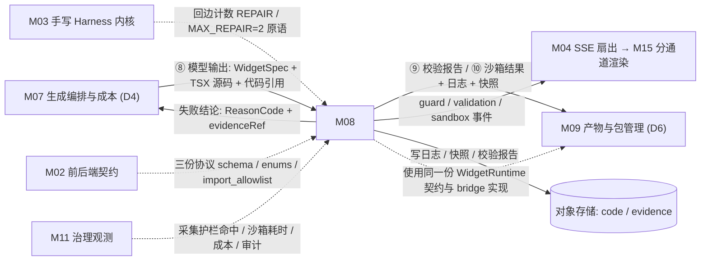
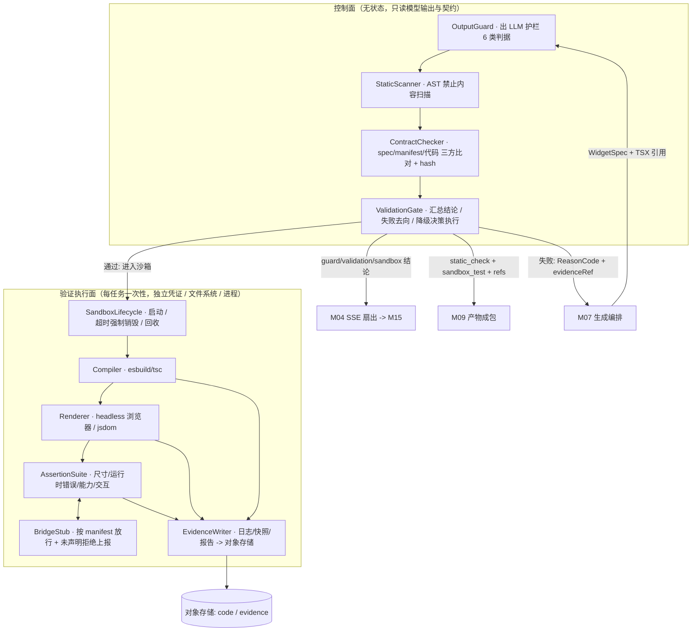
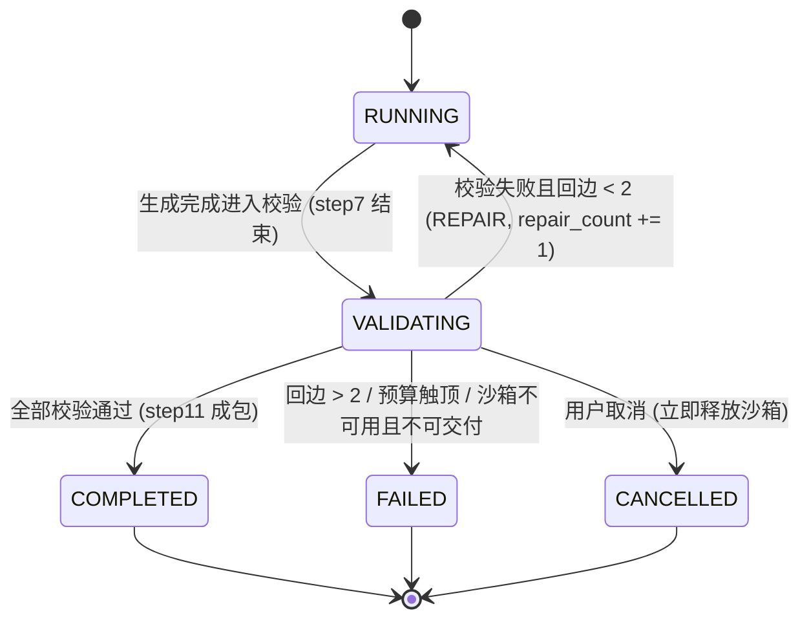

# M08 · 出护栏、契约校验与沙箱测试域（原 D5）

> **文档类型**：可独立交付 / 可独立验收的模块设计文档
> **来源章节**：`设计方案.md` v1.1 §5 D5、§10.1 #6–8、§9.3、§4.3、§2.4、§3.2 step8–10、§2.6 X7/X9、§11.9、§8 总表 D5 行、§7.1 `sandbox-runner`
> **版本**：v1.0　|　**拆分日期**：2026-11-15　|　**最近修订**：2026-11-16（v1.3，ADR-001：§0 背景与 grid 注释对齐 D-6「可选预填 + 缺省询问补全」、ReasonCode 追加 3 码、`AgentEventKind` 18 种含 `ask_user`）　|　**状态**：设计定稿
> **对应编号**：D5 / FR-10（出 LLM 护栏与 `WidgetSpec`/`manifest` 契约校验）、FR-11（沙箱内 TSX 编译 + 渲染 + 规格/能力/交互断言） / X7（出护栏部分）、X9（沙箱测试部分）
> **主责服务**：`guardrails`（出 LLM 护栏 `output_guard.py` / `capability.py` / 契约校验 / 静态扫描）、`sandbox-runner`（一次性沙箱：TSX 编译 / 渲染 / 行为断言，一次性，按并发沙箱数伸缩）
> **一句话定义**：把模型吐出的「不可信代码」在进控件墙之前，用确定性出护栏、`spec ↔ manifest ↔ 代码` 三方契约比对和一次性沙箱执行验证，拦成「可交付」或「带证据地退回」，是整条链路里把「模型自律」换成「代码裁决」的门禁域。

---

## 0. 模块速览（零基础可读）

### 0.1 项目在做什么（本模块所需的最小背景）

WidgetPilot 是一个用自然语言生成手机桌面控件的 AI Agent 产品。用户在网页里输入一句描述（例如「做一个 4x4 的月视图日历，能翻月」；控件规格 `2x1`/`1x2`/`2x2`/`2x4`/`4x2`/`4x4` 六种为一等约束，可选预填，缺省由系统询问补全，系统不推断——v1.3 ADR-001 D-6）、可选上传图片/视频/文本附件，系统由模型生成一份 **TSX + React 控件代码**，编译并在隔离沙箱里测试通过后，产出带完整证据链的「控件包」`WidgetBundle`，最终在网页上按手机桌面真实比例渲染成一张受限 iframe 卡片，用户可安装、删除、回滚、查看生成过程与成本。

**范围限制**：本项目不生成 Lynx 代码、不编译移动端 bundle、不打包上传、不装机、不接手机系统 API、不模拟真实设备环境。产物是能在浏览器隔离 iframe 里渲染的 TSX + React 页面代码，但严格遵循真实控件的六种规格约束。

**本模块要解决的核心矛盾**：模型生成的代码是**不可信输入**（原文 §1.1、§2.3）。它可能越权调用能力、越出规格尺寸、渲染报错、夹带 `eval` / `fetch` 外联 / 未知 import / 系统 API 调用。原文 §1.7 #1 定下铁律「确定性门禁高于模型自律」——护栏、能力白名单、上限写在代码层，不写在 prompt 里。M08 就是这条铁律的落地点：**在渲染前用确定性手段把不可信产物拦住**。

### 0.2 端到端 14 步链路中本模块的位置

原文 §3.2 与 `00` 总览 §1.3 把一次任务拆成 14 步，本模块独占 **第 ⑧、⑨、⑩ 三步**，是 `VALIDATING`（会话状态机里「出护栏 + 契约校验 + 沙箱测试」）的全部内容：

```
① 登录 → 新建会话（grid 可选预填）
② 输入描述 + 上传附件 → 传输层校验 → 对象存储 → attachment_id
③ 语义层校验（描述充分性 / 附件 role 明确性 / grid 合法）→ 不足则 AWAITING_INPUT
④ 进 LLM 护栏（注入 / PII / 意图白名单 / 预算前置）→ 命中不进模型
⑤ 意图与规格确定 → 按 widget_type + grid 确定性预取生成规程
⑥ 上下文装配（公共语料 + 规程 + 记忆 + AttachmentInsight，固定槽位、硬过滤优先）
⑦ 生成回路：先出 WidgetSpec，再出 TSX + React 代码；模型分档
⑧ 出 LLM 护栏（schema / 能力白名单 / 禁止内容 / PII / 描述符合度 / 规格一致）  ★ M08
⑨ 契约校验：spec ↔ manifest ↔ 代码能力声明 比对 + hash；不过不进沙箱          ★ M08
⑩ 一次性沙箱：TSX 编译 → 挂载渲染 → 尺寸/运行时错误/能力/交互断言 → 证据包   ★ M08
⑪ 生成 WidgetBundle（源码 + 编译产物 + manifest + 校验 + 沙箱结果 + hash），COMPLETED
⑫ 前端 artifact 事件 → 控件墙按 grid 真实比例渲染受限 iframe 卡片
⑬ 评测合格 → 脱敏 → 入库门禁 → 公共语料（可撤回）；失败案例回流为负例
⑭ 全流程按 seq 写 SSE 事件流与只追加审计；成本按模型档位分账
```

- 第 ⑧ 步失败 → 自纠正回边（≤2 次，D-2）或转人工；
- 第 ⑨ 步失败 → **不进沙箱**（原文 §3.2 step9 / §10.1 #7）；
- 第 ⑩ 步失败 → 回边或按 D-2 转人工，日志与快照进证据包。

**任务内闭环**（原文 §10.2）：`⑧ / ⑨ / ⑩ 失败 → 回到 ⑦ 自纠正（≤2 次）`，失败原因逐条记录，attempt 边界重置档位，成本按轮次分账。M08 只产出「失败结论 + 原因码 + 证据引用」，**回边调度语义不属于本模块**（归 M07/M03，见 §1.3）。

### 0.3 为什么必须有这个模块

| 没有 M08 会怎样 | 原文依据 |
|---|---|
| 模型吐出的 `fetch` 外联 / `eval` / 未知 import 代码直接进入渲染，越权能力 100% 穿透 | §2.3 威胁模型 ③、§9.3 对抗清单 |
| `2x1` 规格里塞进月视图日历，产物尺寸越界却无人拦截 | §1.5 规格约束、§9.3「生成代码在 2x1 里塞月视图」 |
| 生成代码在编排进程里跑，一次恶意输出即可拖垮控制面 | §1.7 #6、§3.1 三条硬边界 ② |
| 产物没有校验/沙箱证据，无法回答「为什么可信」，也无法回放 | §1.7 #7 证据先于结论、§10.1 完整性矩阵 |
| 沙箱不可用时要么卡死、要么跳过校验直接交付 | §5 D5「绝不跳过校验直接交付」、§2.6 X5 |

### 0.4 上下游与邻居（mermaid）



- **上游**：M07（第 ⑦ 步的模型输出：`WidgetSpec` + TSX 源码 + 代码对象引用）、M03（`REPAIR` 回边计数 / `MAX_REPAIR` 原语）、M02（协议 schema 与枚举单一事实来源）。
- **下游**：M09（校验/沙箱结论写入 `WidgetBundle.static_check` 与 `sandbox_test` 后才允许成包）、M04/M15（把 `guard` / `validation` / `sandbox` 三类事件编号 `seq` 后扇出）、对象存储（证据大对象）。
- **横切**：M11 采集护栏命中日志、沙箱机时与审计；M08 自身是 X7（出护栏部分）与 X9（沙箱测试部分）的主承载。

### 0.5 原文对照表

| 本模块内容 | 原文章节 |
|---|---|
| 出 LLM 护栏 / 契约校验 / 沙箱测试的功能、技术栈、要点、验收 | §5 D5、§8 总表 D5 行 |
| 完整性矩阵控制点 #6 / #7 / #8 的确定性判据、失败去向、证据 | §10.1 #6–8 |
| 两步闭环（任务内 ⑧⑨⑩ → ⑦）与贯穿约束 | §10.2、§10.3 |
| 三份协议 `WidgetSpec` / `WidgetBundle` / `WidgetRuntime` 与 `AgentEvent` | §4.3、§4.5 |
| 架构约束（确定性护栏、import 白名单、一次性沙箱、不模拟设备） | §2.4 #1/#2/#3/#6 |
| 时序 step8–10 | §3.2 step8、step9、step10 |
| 横切能力 X7 / X9 | §2.6 |
| 手写内核测试与判据（纯函数单测、契约测试、故障注入、回归门禁） | §11.9 |
| 服务划分 `sandbox-runner`（一次性 / 并发沙箱数） | §7.1 |
| 三条硬边界（控制面与验证执行面隔离） | §3.1 |
| 对抗测试清单（外联代码 / eval / 2x1 月视图 / 死循环） | §9.3 |
| 交付里程碑 P0（最小版）/ P1（门禁齐备） | §7.4 |

---

## 1. 模块定位与职责边界

### 1.1 为什么必须有（三个不可替代的职责）

1. **出 LLM 护栏是「两次 LLM 边界 + 一次执行验证」中的第二道边界**（原文 §1.7 #3、§2.6 X7）。进 LLM 护栏（M06）管「不进模型」，本模块管「模型出来的东西不直接当代码」，渲染前沙箱验证是第三道，**三者职责不重叠**。
2. **契约校验把开放代码关进可校验的笼子**（原文 §3.3「产物形态」决策）。生成协议与渲染协议共用同一份 `manifest` 契约：`manifest` 声明的能力，静态校验比对它、沙箱按它放行、运行时按它放行、评测按它出判据。本模块执行其中的「静态比对 + hash」。
3. **执行验证是唯一能证明产物可信的手段**（原文 §1.7 #6/#7）。编译 + 渲染 + 尺寸/运行时错误/能力/交互断言在一次性沙箱内完成，生成代码**绝不在编排进程里跑**；证据先于结论，未通过者不得进入控件墙。

### 1.2 做什么（职责清单）

| # | 职责 | 说明 | 原文依据 |
|---|---|---|---|
| R1 | 出 LLM 护栏：结构化 schema 校验 | 模型输出先过 `WidgetSpec` / TSX 结构化 schema，**不把模型文本直接当代码** | §5 D5、§10.1 #6 |
| R2 | 出 LLM 护栏：能力白名单判定 | 比对 `manifest.capabilities` 与全局 `Capability` 白名单，越权命中 `CAPABILITY_DENIED` | §5 D5、§2.4 #5 |
| R3 | 出 LLM 护栏：禁止内容扫描 | `eval` / 外联（`fetch` 等）/ 未知 import / 系统 API 访问，AST 静态分析拦下 | §5 D5、§9.3 |
| R4 | 出 LLM 护栏：PII / 描述符合度 / 规格一致性 | PII 泄漏恒 0；产物与 `intent`、`grid` 一致；`2x1` + 月视图在 spec 层即冲突 | §5 D5、§1.6 指标、§9.3 |
| R5 | 契约校验 `spec ↔ manifest ↔ 代码` 三方比对 | 比对 manifest 声明与代码实际 import / 能力调用；**不一致不进沙箱**，产出校验报告 | §5 D5、§10.1 #7 |
| R6 | 契约校验 hash 绑定 | `spec_hash` / `compiled.hash` / 整包 `hash` 校验，防对象被替换 | §4.3.2、基线 §9 |
| R7 | TSX 编译 | esbuild / tsc 把 `widget.tsx` 编译为 `compiled.js`，失败 `COMPILE_FAILED` 回边 | §5 D5、§10.1 #8 |
| R8 | 一次性沙箱挂载渲染 | headless 浏览器或 jsdom 等价环境，**不模拟真实设备环境、不接系统 API** | §5 D5、§2.4 #3 |
| R9 | 规格尺寸断言 | 按 `grid` 真实像素（`cell=80px`）断言渲染尺寸，`2x1` 越界被拦 | §5 D5、§6.5、§9.3 |
| R10 | 无运行时错误断言 | 挂载/渲染/交互期间不得抛出未捕获错误 | §10.1 #8 |
| R11 | 能力调用全走 bridge + 未声明调用拒绝上报 | 沙箱内 bridge 桩按 `manifest` 放行，越权调用拒绝并写 `widget:error` 证据 | §5 D5、§9.3、§4.3.3 |
| R12 | 交互行为断言 | 日历翻月、时钟 tick、闹钟开关、任务勾选四类确定性断言 | §5 D5 |
| R13 | 证据包写入 | 测试日志与快照（及校验报告）进证据包，带 `hash`，供 M09/M11 回放 | §5 D5、§10.1 #8 |
| R14 | 失败去向判定 | 按 D-2 回边（≤2）或转人工；输出 `ReasonCode` + `evidenceRef` + 保留部分产物 | §5 D5、§0 D-2 |
| R15 | 沙箱不可用降级 | 降级为**静态校验 + 只读诊断**，绝不跳过校验直接交付 | §5 D5、§2.6 X5、§10.1 |
| R16 | 一次性沙箱生命周期 | gVisor/Kata 或容器 + seccomp/cgroups；**超时强制销毁**；每任务一次性 | §5 D5、§7.1 |
| R17 | 产生分通道事件 | `guard` / `validation` / `sandbox` 三类结论性事件（通过项、命中项、失败原因码） | §4.5、§6.4 |

### 1.3 不做什么（明确排除，含与相邻模块的边界切割）

| 不做 | 归属模块 | 边界说明 |
|---|---|---|
| 运行时 iframe 放行、CSP 下发、bridge 线上放行 | **M09** | M08 在**沙箱内**用 bridge 桩验证「能力调用全走 bridge」；线上受限 iframe 的 `sandbox` / `csp` / `capability_bridge` 下发与 `widget:error` 上报由 M09 负责。二者共用同一份 `WidgetRuntime` 契约与 bridge 实现（原文 §9.6） |
| 产物版本、`WidgetBundle` 生成、`GENERATED→INSTALLED→DELETED` 状态机、回滚 | **M09** | M08 只产出 `static_check` / `sandbox_test` / 日志 / 快照结论供其成包；不写产物索引、不管理版本链 |
| 回边调度语义（`REPAIR` 决策、`repair_count` 累加、attempt 边界重置档位、转人工队列） | **M07 / M03** | M08 只给「失败 + 原因码 + 证据引用」的**结论**；`decide()` 是否回边、`MAX_REPAIR=2` 计数、`HANDOFF` 由 M07/M03 决定（§11.3）。M08 不得自行重跑生成 |
| 进 LLM 护栏、语义层输入校验、意图白名单、技能预取、PII 前置脱敏 | **M06**（传输层归 M05） | 三道职责不重叠：进护栏管「不进模型」，出护栏管「模型输出不可信」 |
| 生成回路、`WidgetSpec` 产出、模型分档、上下文装配、成本计量 | **M07 / M03** | M08 是 `WidgetSpec` 的**消费/校验方**，不是生产方 |
| 生成代码本身、TSX 源码落盘 | **M07 / M09** | 源码由 M07 产出、`code/.../widget.tsx` 由 M09 纳入包；M08 只读引用并产出编译产物 `compiled.js` |
| 公共语料入库门禁、脱敏、投毒检测、撤回、评测 rubric | **M10** | M08 的「沙箱测试通过」是入库的**前置条件之一**（D-1），但入库动作不在本模块 |
| 卡片网格、iframe 渲染 UI、安装/删除/回滚按钮、时间线 scrubber | **M16 / M14 / M17** | M08 是纯服务端验证域，无前端界面 |
| 全链路 trace 汇总、成本分账、熔断与 kill switch 决策、审计看板 | **M11** | M08 产生原始命中日志、机时、审计事件；治理判定归 M11。降级触发判定与 kill switch 归 M11，M08 只执行「静态校验 + 只读诊断」这一降级动作 |
| `agent_core` 的 `decide()` / `structured` / `tools` 库级实现与单测 | **M03** | M08 使用 `output_guard.py` / `capability.py` 的规则原语，内核纯函数单测在 M03 |

> **最易混淆的两处边界**：① **M08 与 M09 都碰 bridge**——M08 在一次性沙箱内用 bridge 桩做「能力调用是否被正确收口」的**测试断言**，M09 在用户侧 iframe 做**运行时放行**；② **M08 与 M07 都碰回边**——M08 判定「这次校验没过」，M07/M03 判定「要不要回边、第几次回边、何时转人工」。

### 1.4 输入 / 输出与上下游契约

| 方向 | 内容 | 契约形式 |
|---|---|---|
| 入 | M07 第 ⑦ 步产物：`WidgetSpec`（含 `grid` / `capabilities` / `import_allowlist` / `data_contract` / `constraints`）、TSX 源码对象引用 `code/{session_id}/{run_id}/widget.tsx`、拟生成的 `manifest` 草稿 | 内部 RPC（§4.3）+ 对象存储引用 |
| 入 | M02 的三份协议 schema、`Capability` / `GridSpec` 枚举、`import_allowlist = ["react", "@widget/bridge"]`、`export_contract.default = "Widget"` | `packages/contracts` 编译期依赖 |
| 入 | M03 的 `REPAIR` 回边计数与 `MAX_REPAIR = 2` 常量（只读，用于判断是否已达上限） | 内部接口（只读） |
| 入 | M11 的沙箱不可用降级指令（触发降级路径） | 内部接口 |
| 出 | 出护栏结论：`OutputGuardReport`（通过/命中项/原因码）、`validation` 事件 | 内部结论 + SSE |
| 出 | 契约校验报告：`ContractCheckReport`（三方差异、hash 校验结果）、`validation` 事件 | 内部结论 + SSE |
| 出 | 编译产物 `code/{session_id}/{run_id}/compiled.js` + `compiled.hash` | 对象存储引用（§6.5） |
| 出 | 沙箱结果：`SandboxResult`（`passed` / `cases[]` / `log_ref` / `snapshot_ref`）、`sandbox` 事件 | 供 M09 写入 `WidgetBundle.sandbox_test` |
| 出 | 证据包：`evidence/{session_id}/{run_id}/sandbox.log` / `snapshot.png` / `check_report.json` | 对象存储（带 `hash`） |
| 出 | 失败结论：`ReasonCode` + `evidenceRef` + 保留部分产物（交 M07/M03 决定回边或转人工） | 内部结论 + `error` / `notice` 事件 |

### 1.5 承载的横切能力 X*

- **X7（出护栏部分，主承载）**：原文 §2.6 X7 =「传输层 → 语义层 → 进 LLM 护栏；出 LLM 护栏；渲染前沙箱测试作为执行验证（三者不重叠）」，落在 `D2 / D3 / D5`。M08 承担其中**出 LLM 护栏**与**渲染前沙箱执行验证**两段；判据均为确定性代码，命中留命中类型、判据与原文引用，误拦截率可测（§11.8）。
- **X9（沙箱测试部分，主承载）**：原文 §2.6 X9 =「TSX 编译、渲染、尺寸/能力/交互断言在一次性沙箱；线上 iframe sandbox + CSP + bridge」，落在 `D5 / D6 / W4`。M08 承担**一次性沙箱测试**，M09 承担**运行时隔离**，M16 承担卡片渲染，三者共用同一份 `WidgetRuntime` 契约。
- **X5（协同，非主承载）**：沙箱不可用时的「降级为静态校验 + 只读诊断」是 X5 降级阶梯的一环；降级决策与 kill switch 归 M11（§5 D8、§2.6 X5）。
- **X11（协同）**：护栏命中日志、沙箱机时、审计事件供 M11 汇总，M08 只产生不留治理判定。

### 1.6 关键设计原则

1. **确定性门禁高于模型自律**（§1.7 #1）：护栏判据、能力白名单、禁止内容清单写在代码层，不写在 prompt 里，不用裁判模型打分（§11.5「数值、枚举、能力声明一律用确定性断言」）。
2. **不把模型文本直接当代码**（§5 D5）：先结构化校验 `WidgetSpec` / TSX，再编译，再执行；模型输出是唯一不可信变量，其余迁移都是代码（§11.3）。
3. **三道职责不重叠**（§1.7 #3、§2.6 X7）：进护栏 / 出护栏 / 渲染前执行验证各自有独立判据、命中日志与误拦截率指标。
4. **同一份 manifest 贯穿四处**（§4.3.2）：静态校验比对能力声明 → 沙箱按声明放行 → 运行时 bridge 按声明放行 → 评测按声明出判据。
5. **生成代码绝不在编排进程里执行**（§1.7 #6、§3.1 硬边界 ②）：编译与渲染测试在一次性沙箱，线上渲染在受限 iframe。
6. **控制面与验证执行面不共享进程 / 文件系统 / 凭证**（§3.1 硬边界 ①）：沙箱一次性、超时强制销毁、独立凭证。
7. **证据先于结论**（§1.7 #7）：产物只有通过契约校验与沙箱测试才允许进入控件墙；任何失败必带原因码 + 证据引用，前端不得只显示「失败」。
8. **绝不跳过校验直接交付**（§5 D5）：沙箱不可用时降级为静态校验 + 只读诊断，降级**不降低安全级别**，且降级结果不视为「通过」。
9. **不模拟真实设备环境、不接系统 API**（§2.4 #3、§5 D5）：只对 webview 等价环境（DOM + JS）做确定性验收。
10. **门禁没有「关掉」这个开关**（§1.7 #8、§10.3）：所有对照实验在影子模式或离线回放完成。
11. **零 Agent 框架**（D-5）：护栏规则、静态分析、编译、渲染、断言全部手写或用通用基础设施，不引入策略框架 / LLM 观测框架 / MCP SDK。

---

## 2. 技术栈

### 2.1 分层选型表

| 层 | 选型 | 版本 / 约束 | 为什么选 | 明确不用什么 |
|---|---|---|---|---|
| 出护栏规则判定 | 纯代码规则引擎 + 自研 pattern registry | Python 3.11+，规则与模式库版本化 | 判据为确定性代码、命中留证、误拦截率可测（§2.4 #1、§11.8） | **不用 OPA / Casbin 等策略框架**；不把护栏写进 prompt；不用裁判模型打分 |
| 结构化 schema 校验 | Pydantic v2 + JSON Schema 严格校验 | 严格模式，final 才严格校验 | 落实「结构化 schema」判据；与 `packages/contracts` 共用 | 不用 `with_structured_output` / constrained decoding 当唯一兜底 |
| 静态分析 | AST 静态分析（TS/TSX parser） | 解析 import / 调用表达式 / 标识符 | 精确比对 `import_allowlist`、能力调用、禁止内容（`eval` / 外联 / 未知 import / 系统 API） | 不靠全文正则做语义判定；不把模型文本直接当代码 |
| 编译 | esbuild / tsc | TSX → JS，产出 `compiled.js` | 编译是沙箱第一步，失败即 `COMPILE_FAILED` 回边 | 不在编排进程内编译执行；不编译移动端 bundle |
| 渲染环境 | headless 浏览器或 jsdom 等价环境 | DOM + JS 等价，webview 等价 | 一次性挂载渲染，可对尺寸 / 运行时错误 / 交互做确定性断言 | **不模拟真实设备环境、不接系统 API**（§2.4 #3、§2.5） |
| 沙箱隔离 | 一次性沙箱（gVisor / Kata 或容器 + seccomp / cgroups） | 每任务一次性，**超时强制销毁** | 落实三条硬边界 ①②；控制面与验证执行面不共享进程/文件系统/凭证 | 不复用沙箱、不与编排同进程、不共享凭证 |
| 能力通道（沙箱内） | `bridge_stub`（与线上 `@widget/bridge` 同源实现） | 按 `manifest.capabilities` 放行 | 验证「能力调用全走 bridge」，未声明调用拒绝并上报 | 不开放任意网络请求 / 系统能力 / 任意 JSON-RPC |
| 证据存储 | 对象存储（S3 兼容） | 日志 / 快照 / 校验报告带 `hash` | 证据先于结论、可回放；大对象不入库（§2.4 #6） | 不把代码 / 日志 / 快照塞进 Postgres |
| 事件通道 | 原生 SSE 分通道（`seq` + `guard`/`validation`/`sandbox`） | 结论式事件，失败项可展开证据 | 分步清单可纠偏、可回放（§6.4） | 不用 AI SDK / CopilotKit / AG-UI SDK 的事件封装 |
| 可观测 | OpenTelemetry SDK + 自建 `agent_event` / `trace_span` 表 | 通用标准 | 护栏命中、沙箱机时可被 M11 采集 | **不用 LLM 专用观测平台 SDK**（§5 D8、§11.1） |

### 2.2 硬约束（尤其 D-5 零 Agent 框架）

- **D-5 禁止引入**：LangChain / LangGraph、Temporal 或任何 workflow engine、Vercel AI SDK / `streamUI` / CopilotKit / AG-UI SDK / A2UI SDK、`bind_tools` / `with_structured_output` / `trim_messages`、LangChain retriever / 任何 RAG 框架、LangFuse / LLM 专用观测 SDK、OpenAI Agents SDK / CrewAI / AutoGen / PydanticAI、MCP SDK、OPA / Casbin（护栏链路）。
- **保留的通用基础设施**（不是 Agent 框架，原文 §11.1）：FastAPI、Pydantic v2、Postgres、Redis、对象存储、React 19 / Vite 等前端栈、**esbuild / tsc / AST 解析、headless 浏览器**、OpenTelemetry SDK、Prometheus、tiktoken、`EventSource` / `fetch ReadableStream`。本模块正是这些「保留项」的直接使用方。
- **三条硬边界**（§3.1）：① 控制面与验证执行面不共享进程 / 文件系统 / 凭证；② 生成代码绝不在编排进程里执行；③ 用户侧渲染在受限 iframe（③ 由 M09 承担，M08 只复用其契约）。
- **import 白名单唯一允许**（§2.4 #2、基线 §4.5）：`["react", "@widget/bridge"]`；默认导出组件名固定为 `"Widget"`；生成代码只使用 TSX + React。
- **门禁无在线关闭开关**：`MAX_ITER = 12`、`MAX_REPAIR = 2`、能力白名单、禁止内容清单写在代码常量里（§11.3、§10.3）。
- **`MAX_REPAIR = 2`（D-2）是只读上限**：M08 读取回边计数用于给出「已达上限 → 转人工」的结论，但不得自行累加或触发回边（归 M07/M03）。

### 2.3 运行时依赖

| 依赖 | 用途 | 不可用时的行为 |
|---|---|---|
| 对象存储（S3 兼容） | 读 TSX 源码引用、写 `compiled.js` / `sandbox.log` / `snapshot.png` / `check_report.json` | 证据写入失败则本步不判「通过」，按失败结论交 M07；**绝不跳过校验直接交付** |
| 一次性沙箱运行时（gVisor / Kata / 容器 + seccomp/cgroups） | TSX 编译 + 渲染 + 行为断言 | **沙箱不可用 → 降级为静态校验 + 只读诊断**（§5 D5、X5）；降级结果不视为通过，不进控件墙；写降级记录与 `SANDBOX_UNAVAILABLE` |
| headless 浏览器 / jsdom 等价环境 | 挂载渲染与交互断言 | 随沙箱启动失败一并走降级路径 |
| Postgres（经 M04） | 只写结论与引用，不写大对象 | 结论落库失败则不推进 `COMPLETED` |
| Redis Streams（经 M04） | `guard` / `validation` / `sandbox` 事件扇出、`seq` 编号 | 保状态、按 `runId + seq` 补发（M04 负责） |
| M02 `packages/contracts` | `WidgetSpec` / `WidgetBundle` / `WidgetRuntime` schema、`Capability` / `GridSpec` 枚举 | 编译期依赖；schema 变更即 CI 失败并触发回归门禁 |
| M03 `agent_core` | `output_guard` / `capability` 规则原语、`REPAIR` 计数只读 | 缺失则护栏不可判，拒绝推进 |
| M11 治理 | 降级指令、护栏命中采集、机时计量 | 降级触发判定归 M11；M08 只执行降级动作 |

### 2.4 Monorepo 代码落位（原文 §7.2 / 00 总览 §6）

```
services/guardrails/
  input_guard.py          # M06：进 LLM 护栏（本模块不使用）
  output_guard.py         # ★ 出 LLM 护栏：schema / 能力白名单 / 禁止内容 / PII / 描述符合度 / 规格一致
  capability.py           # ★ 能力白名单与 CAPABILITY_DENIED 判定
  contract_check.py       # ★ spec <-> manifest <-> 代码 三方比对 + hash 校验
  static_scan.py          # ★ AST 静态分析：eval / 外联 / 未知 import / 系统 API
services/sandbox_runner/
  compile.py              # ★ esbuild / tsc：widget.tsx -> compiled.js
  render.py               # ★ 一次性沙箱挂载渲染
  assertions.py           # ★ 尺寸 / 运行时错误 / 能力 / 交互行为断言
  bridge_stub.py          # ★ 沙箱内 bridge 桩，按 manifest 放行并上报 widget:error
  evidence.py             # ★ 日志 / 快照 / 校验报告写对象存储
  entry.py                # ★ 一次性沙箱入口、超时强制销毁、生命周期回收
packages/agent_core/guardrails/   # M03：output_guard.py / capability.py 库级实现与纯函数单测
packages/contracts/               # M02：widget_spec / widget_bundle / widget_runtime schema、enums
infra/sandbox/                    # ★ 一次性沙箱镜像 / seccomp / cgroups 配置
```

---

## 3. 设计架构

### 3.1 内部组件与职责



| 组件 | 职责 | 关键不变量 |
|---|---|---|
| `OutputGuard` | 出 LLM 护栏 6 类判据（schema / 能力白名单 / 禁止内容 / PII / 描述符合度 / 规格一致） | 判据全为确定性代码；命中留类型、判据、原文引用；不把模型文本直接当代码 |
| `StaticScanner` | AST 扫 `eval` / 外联 / 未知 import / 系统 API | import 只放行 `react` / `@widget/bridge`；默认导出 `Widget` |
| `ContractChecker` | `spec ↔ manifest ↔ 代码` 能力声明比对 + `spec_hash` / `compiled.hash` 校验 | **不一致不进沙箱**；产出三方差异报告 |
| `ValidationGate` | 汇总结论、判定失败去向（回边结论 / 转人工结论）、执行降级动作 | 沙箱不可用时绝不判「通过」；失败必带原因码 + 证据引用 |
| `Compiler` | esbuild / tsc 编译 `widget.tsx → compiled.js` | 编译只在一次性沙箱内；失败即 `COMPILE_FAILED` |
| `Renderer` | headless 浏览器 / jsdom 等价环境挂载渲染 | 不模拟真实设备、不接系统 API |
| `AssertionSuite` | 尺寸 / 无运行时错误 / 能力走 bridge / 交互行为四类断言 | 顺序固定、逐条留 `cases[]` 结论 |
| `BridgeStub` | 沙箱内唯一能力通道，按 `manifest` 放行 | 未声明能力调用拒绝并上报 `widget:error`；不放行任意网络 |
| `EvidenceWriter` | 写 `sandbox.log` / `snapshot.png` / `check_report.json` 到对象存储 | 引用带 `hash`，读取时校验 |
| `SandboxLifecycle` | 一次性启动、独立凭证 / 文件系统 / 进程、超时强制销毁 | 每任务一次性；超时即销毁，不留残留进程 |

### 3.2 处理流程与数据流（编号步骤，对应 §3.2 step8–10）

**阶段 A · 出 LLM 护栏（step8，控制面，不执行代码）**

1. M07 交付本轮模型输出：`WidgetSpec` 对象、TSX 源码引用 `code/{session_id}/{run_id}/widget.tsx`、拟生成 `manifest` 草稿。
2. `OutputGuard` 判据 1 **结构化 schema**：按 `widget_spec.schema.json` / Pydantic 严格校验 `WidgetSpec`；TSX 必须能解析为 AST 且默认导出 `Widget`。**不把模型文本直接当代码**。
3. 判据 2 **能力白名单**：`manifest.capabilities ⊆ Capability 全集`，且 `spec.capabilities === manifest.capabilities`；越权命中 `CAPABILITY_DENIED`。
4. 判据 3 **禁止内容**：`StaticScanner` 用 AST 扫 `eval`、`fetch`/`XMLHttpRequest`/`WebSocket` 外联、`import_allowlist` 之外的 import、`window.parent` / `process` / 系统 API 访问。命中 `GUARD_OUTPUT_HIT`。
5. 判据 4 **PII**：扫描 spec / 代码文本中的邮箱、手机号、身份标识等模式；PII 泄漏数恒 0（§1.6）。
6. 判据 5 **描述符合度**：产物 `widget_type` / `layout_slots` 与归一化 `intent` 一致（确定性断言，不用裁判模型）。
7. 判据 6 **规格一致性**：`grid` 与 `layout_slots` 信息密度一致；`2x1` + 月视图在 spec 层即 `SPEC_CONFLICT`（原文 §4.3.1、§9.3）。
8. 任一判据失败 → 产出 `OutputGuardReport`（命中项 + 原因码 + 原文引用），`ValidationGate` 给出「回边结论」交 M07/M03（≤2 次，D-2），写 `guard` 事件；**不进入阶段 B**。

**阶段 B · 契约校验（step9，控制面，不执行代码）**

9. `ContractChecker` 做三方比对：`WidgetSpec.capabilities/import_allowlist/grid/data_contract` ↔ `manifest.capabilities/import_allowlist/grid/exports/props` ↔ 代码 AST 实际 import 与能力调用点。
10. 校验 `spec_hash`（由 `WidgetSpec` 计算）与 `manifest.spec_hash` 一致；后续 `compiled.hash` 与整包 `hash` 绑定同一条链。
11. 产出 `ContractCheckReport`（三方差异清单、通过/失败、hash 校验结果），写 `validation` 事件。
12. **不一致不进沙箱**：失败产出 `CONTRACT_MISMATCH` + 校验报告引用，交 M07/M03 回边；**不创建沙箱、不编译、不渲染**。

**阶段 C · 沙箱测试（step10，验证执行面，一次性）**

13. `SandboxLifecycle` 申请一次性沙箱（gVisor/Kata 或容器 + seccomp/cgroups），分配独立进程 / 文件系统 / 凭证，挂载只读的 TSX 源码引用与 `WidgetRuntime` 契约。
14. **TSX 编译**：`Compiler` 用 esbuild / tsc 编译 `widget.tsx → compiled.js`，写 `code/{session_id}/{run_id}/compiled.js` 与 `compiled.hash`；失败 `COMPILE_FAILED` 并记编译日志。
15. **一次性沙箱挂载渲染**：`Renderer` 在 headless 浏览器 / jsdom 等价环境挂载编译产物；**不模拟真实设备环境、不接系统 API**。
16. **规格尺寸断言**：按 `grid` 真实像素（`cell = 80px`）断言渲染根尺寸与布局槽位，越界（如 `2x1` 塞月视图）判失败。
17. **无运行时错误断言**：挂载 / 渲染 / 交互期间监听未捕获异常与 console error，出现即判失败。
18. **能力调用全走 bridge 断言**：`BridgeStub` 按 `manifest.capabilities` 放行；任何未声明能力调用（越权 `fetch` / 系统能力）被拒绝并上报 `widget:error` 证据，判 `CAPABILITY_DENIED`。
19. **交互行为断言**：日历翻月、时钟 tick、闹钟开关、任务勾选四类确定性断言逐条执行并留 `cases[]` 结论。
20. `EvidenceWriter` 把测试日志 `sandbox.log`、快照 `snapshot.png`、校验报告 `check_report.json` 写入证据包（带 `hash`），产出 `SandboxResult{passed, cases[], log_ref, snapshot_ref}`，写 `sandbox` 事件。
21. 全部通过 → `ValidationGate` 交付 `static_check` + `sandbox_test` + 引用给 M09 成包（step11）；任一失败 → 按 D-2 产出「回边结论」或「转人工结论」+ `ReasonCode` + `evidenceRef` + 保留部分产物，交 M07/M03。
22. **收尾**：无论成功失败，`SandboxLifecycle` 强制销毁本次沙箱；超时（见 §6.3 推导值）同样强制销毁，不留残留进程 / 文件系统 / 凭证。

**降级路径（沙箱不可用）**：步骤 13 申请失败 / 启动超时 → 跳过阶段 C 的执行验证，执行 **静态校验（阶段 A + B 全量）+ 只读诊断**（输出静态扫描与契约校验报告、标注「未做执行验证」），写 `SANDBOX_UNAVAILABLE` 降级记录与 `notice` 事件；**绝不跳过校验直接交付**，降级结果不判 `passed = true`，不进控件墙。

### 3.3 状态机

本模块**不拥有** `SessionState`，但独占其 `VALIDATING` 段的推进结论；也不拥有 `BundleState`（归 M09）。为让校验链可断言，内部维护一个阶段状态机。

**参与的会话状态机片段（原文 §4.2 / §1.4）**：



**内部校验链阶段 `ValidationStage`**（【推导·需评审】：原文只给聚合态 `VALIDATING`，此处拆成可断言的子阶段，需在评审中确认是否纳入 `agent_event`）：

```ts
// 【推导·需评审】内部阶段枚举，非原文 SessionState
type ValidationStage =
  | "OUTPUT_GUARD"        // 出 LLM 护栏 6 类判据
  | "CONTRACT_CHECK"      // spec <-> manifest <-> 代码 三方比对 + hash
  | "COMPILE"             // esbuild / tsc
  | "RENDER"              // 一次性沙箱挂载渲染
  | "SIZE_ASSERT"         // 规格尺寸断言
  | "RUNTIME_ASSERT"      // 无运行时错误断言
  | "CAPABILITY_ASSERT"   // 能力调用全走 bridge / 未声明拒绝上报
  | "INTERACTION_ASSERT"  // 日历翻月 / 时钟 tick / 闹钟开关 / 任务勾选
  | "EVIDENCE_WRITE"      // 日志 + 快照 + 报告写证据包
  | "PASSED"              // 全部通过，交 M09
  | "FAILED_STAGE";       // 某阶段失败，带 ReasonCode + evidenceRef
```

阶段推进是**单向、有序、短路**的：任一阶段失败即进入 `FAILED_STAGE`，其后阶段一律不执行；`PASSED` 是唯一允许交付给 M09 的阶段。

### 3.4 关键机制、算法与不变量清单

**A. 出 LLM 护栏 6 类判据与命中留证**（§5 D5、§10.1 #6、§11.8）

| 判据 | 确定性检查 | 失败原因码 | 留证 |
|---|---|---|---|
| 结构化 schema | `WidgetSpec` / TSX AST / 默认导出 `Widget` 严格校验 | `GUARD_OUTPUT_HIT` | 校验错误 `{field, expected, got}` |
| 能力白名单 | `manifest.capabilities ⊆ Capability` 且等于 `spec.capabilities` | `CAPABILITY_DENIED` | 能力名 + manifest 声明 |
| 禁止内容 | AST 扫 `eval` / 外联 / 未知 import / 系统 API | `GUARD_OUTPUT_HIT` | 命中节点位置 + 原文引用 |
| PII | 邮箱 / 手机号 / 身份标识模式匹配 | `GUARD_OUTPUT_HIT` | 命中类型 + 脱敏后位置 |
| 描述符合度 | `widget_type` / `layout_slots` 与 `intent` 一致性断言 | `GUARD_OUTPUT_HIT` | intent 快照 + 差异项 |
| 规格一致性 | `grid` 与信息密度 / `layout_slots` 一致 | `SPEC_CONFLICT` | spec 快照 + 冲突项 |

确定性判据失败去向统一为「回灌自纠正」（≤2 次）+「命中与修正记录」（§10.1 #6）。**误拦截率可测**：每次命中写 `guard_hit` 表（类型、判据、原文引用），影子期统计误拦截（§11.8）。

**B. 契约校验三方比对算法**（§5 D5、§10.1 #7、`WidgetBundle.manifest` 贯穿四处）

```
输入: spec(WIDGET_SPEC), manifest_draft, code_ast
1. required_capability_set = set(spec.capabilities)
2. declared_capability_set = set(manifest_draft.capabilities)
3. actual_import_set = collect_imports(code_ast)
4. actual_capability_calls = collect_bridge_calls(code_ast)
5. 断言 required_capability_set == declared_capability_set          // spec <-> manifest
6. 断言 actual_import_set <= {"react", "@widget/bridge"}            // import 白名单
7. 断言 actual_capability_calls <= declared_capability_set          // 代码 <-> manifest
8. 断言 manifest_draft.grid == spec.grid
9. 断言 manifest_draft.spec_hash == sha256(canonical_json(spec))
10. 输出 ContractCheckReport{ passed, violations[], spec_hash, refs }
任一不等 -> passed=false, CONTRACT_MISMATCH, 不创建沙箱
```

**C. 沙箱断言顺序不变量**：`编译 → 挂载渲染 → 尺寸 → 无运行时错误 → 能力走 bridge → 交互行为` 顺序固定（§3.2 step10、§5 D5 原文顺序），前一阶段不过不进下一阶段；每阶段写 `cases[]` 一条 `{ name, passed, detail_ref }`。

**D. 一次性沙箱与硬边界**：每任务独立进程 / 文件系统 / 凭证，超时强制销毁；控制面不持有沙箱内凭证，沙箱内不持有控制面数据库/对象存储写凭证（仅通过受控 `EvidenceWriter` 出口写证据）。

**E. 降级不降低安全级别**（§2.6 X5、§5 D8）：沙箱不可用 → 静态校验 + 只读诊断；`SANDBOX_UNAVAILABLE` 写降级记录；结果不判通过、不进控件墙、不省略 A/B 阶段。

**不变量清单**：

| # | 不变量 | 断言方式 |
|---|---|---|
| I1 | 模型文本不直接当代码：必须先过结构化 schema + AST 解析 | 单测：喂纯文本 / 非法 TSX，护栏必须拒绝 |
| I2 | 出护栏 6 类判据全为确定性代码，无模型调用 | 单测：注入 fake model，护栏路径调用次数 = 0 |
| I3 | `spec ↔ manifest ↔ 代码` 三方能力声明与 import 完全一致才进沙箱 | 契约测试：篡改任一方，`passed=false` 且沙箱创建次数 = 0 |
| I4 | 不一致不进沙箱（阶段 B 短路） | 流程断言：`CONTRACT_MISMATCH` 时无 `SandboxLifecycle` 调用 |
| I5 | 生成代码不在编排进程里执行 | 故障注入：编排进程内无 `eval`/`exec`/子进程编译记录 |
| I6 | 编译 / 渲染在一次性沙箱，独立凭证 / 文件系统 / 进程 | 部署断言：沙箱容器与控制面不共享 volume / service account |
| I7 | 沙箱超时强制销毁，无残留进程 | 故障注入：超时后 `ps` / 容器列表为空，资源回收 |
| I8 | 能力调用全走 bridge，未声明调用被拒绝并上报 `widget:error` | 对抗用例：越权 `fetch` 被拒 + 上报记录 = 1 |
| I9 | 交互断言四类（日历翻月 / 时钟 tick / 闹钟开关 / 任务勾选）逐条留 `cases[]` | 断言：`cases[].name` 覆盖四类且各含 `passed` |
| I10 | 证据先于结论：日志 / 快照 / 报告写入且引用带 `hash` 才可判 `PASSED` | 断言：对象存在 + hash 校验通过，缺一不判通过 |
| I11 | 失败必带 `ReasonCode` + `evidenceRef` + 保留部分产物 | 失败路径断言：三字段非空，证据对象可读 |
| I12 | 沙箱不可用时**绝不跳过校验直接交付**，降级结果 `passed=false` | 降级用例：A/B 仍执行、无 `PASSED`、写降级记录 |
| I13 | 同一产物重复测试结果一致 | 回归用例：同一 `compiled.hash` 两次跑 `SandboxResult` 逐字段一致 |
| I14 | 回边 ≤2 由 M07/M03 计数，M08 不自行重跑生成 | 流程断言：M08 输出中无 `iteration` 自增、无模型调用 |

### 3.5 与其他模块的时序（关键 3 个场景）

**场景 1：正常通过**
`M07(step7 产出 spec+源码) → M08(⑧ 出护栏 6 判据全过 → ⑨ 三方比对 + hash 一致 → ⑩ 一次性沙箱 编译/渲染/尺寸/运行时/能力/交互断言全过 → 证据包) → M04(写 SSE guard/validation/sandbox) → M09(step11 把 static_check+sandbox_test 写入 WidgetBundle, COMPLETED) → M16(卡片)`

**场景 2：校验失败回边（≤2）**
`M08(⑧ 命中 GUARD_OUTPUT_HIT 或 ⑨ CONTRACT_MISMATCH 或 ⑩ SANDBOX_TEST_FAILED, 输出 ReasonCode + evidenceRef) → M07/M03(REPAIR, repair_count += 1, 回到 step7) → 重新进入 M08 → ... 第 3 次仍失败 → HANDOFF 转人工 + RETRY_EXHAUSTED + 保留部分产物`

**场景 3：沙箱不可用降级**
`M08(step13 申请失败 / 启动超时) → 执行阶段 A + B 全量静态校验 + 只读诊断 → 写 SANDBOX_UNAVAILABLE 降级记录 + notice 事件 → 结果 passed=false, 不进控件墙 → 交 M07/M03 决定转人工; 全程无「跳过校验直接交付」路径`

**场景 4：用户取消**
`M04(cancel) → M08 收到取消 → SandboxLifecycle 立即强制销毁一次性沙箱并回收 → 不写 PASSED、不产出成包结论`

### 3.6 部署形态与伸缩

| 服务 | 状态 | 伸缩依据 | 说明 |
|---|---|---|---|
| `guardrails`（出护栏 / 契约校验 / 静态扫描） | 无状态 | 调用量（§7.1） | 纯 CPU 规则判定，可任意水平扩容；不持有沙箱凭证 |
| `sandbox-runner` | **一次性** | 并发沙箱数（§7.1） | 每任务一个隔离实例，超时强制销毁；与 `guardrails` / `orchestrator` 不共享进程 / 文件系统 / 凭证 |
| `infra/sandbox` | 镜像 / seccomp / cgroups | 并发沙箱数 | 资源限额由 cgroups 限定，防止单任务耗尽预算 |
| 对象存储 | 有状态（外部） | 容量 | 只经 `EvidenceWriter` 受控写入；引用带 `hash` |

**伸缩约束**：新增沙箱实例不得复用已销毁实例的凭证或文件系统；并发上限与单任务超时共同构成防「循环生成耗尽预算」的硬边界（§2.3 威胁 ⑦、§9.3）。

---

## 4. 接口契约

> 本模块**不拥有面向浏览器的公网 REST 路由**：原文 §4.4 的 REST 表中，`/api/bundles/*` 归 M09、`/api/sessions/*` 归 M04。M08 的对外可见面是 ① 被 `orchestrator` 调用的内部验证入口，② 经 M09 路由对外暴露的**证据读取 payload 由本模块产出**，③ 分通道 SSE 事件。为对齐模板「方法 / 路径 / 权限 / 请求 / 响应 / 状态码」，下表把内部入口以逻辑路径列出并标注来源。所有请求/响应字段为【契约约定】，最终以 `packages/contracts/openapi.yaml` 与内部接口契约为准。

### 4.1 对外接口表

| 方法 | 路径 | 权限 | 请求 | 响应 | 状态码 |
|---|---|---|---|---|---|
| `RPC`（内部） | `d5/validate` 【契约约定】 | 仅 `orchestrator`（服务间鉴权，不暴露公网） | `{ session_id, run_id, spec_ref, source_ref, manifest_draft, repair_count }` | `{ passed, output_guard: OutputGuardReport, contract_check: ContractCheckReport, sandbox_test: SandboxResult, reason_code?, evidence_ref? }` | 内部：200 / 422（护栏命中）/ 503（沙箱不可用降级） |
| `GET` | `/api/bundles/{id}/evidence`（路由归 M09，**payload 由 M08 产出**） | 本人 | — | `{ data:{ manifest, static_check, sandbox_test, trace } }`，其中 `static_check` / `sandbox_test` / 日志快照引用为本模块产物 | 200 / 403 / 404 |
| `EVENT`（SSE） | `/api/sessions/{id}/events` 中的 `guard`/`validation`/`sandbox` 帧 | 本人 + 短期 ticket | 订阅 `runId` + `Last-Event-ID` | `text/event-stream`，帧见 §4.2 | 200 / 401 / 403 |
| `POST`（内部信号） | `d5/sandbox/cancel` 【契约约定】 | 仅 `orchestrator` | `{ run_id }` | `{ destroyed: true }` | 内部：200 |

> 说明：`GET /api/bundles/{id}/evidence` 在原文 §4.4 定义为「manifest / 静态校验 / 沙箱测试 / trace」，主责模块 M09/M11；本模块列出它是因为 `static_check`、`sandbox_test`、`sandbox.log`、`snapshot.png` 的证据内容由 M08 生成，**M08 不拥有该路由的鉴权与版本逻辑**。

### 4.2 事件接口（SSE `kind` 与 payload）

原文 §4.5 / §6.4 定义三类与本模块直接相关的通道：`guard`（护栏命中）、`validation`（护栏/契约/沙箱结果）、`sandbox`（沙箱分步结果）。每类独立渲染组件，失败项可展开证据。

```ts
// 【契约约定】本模块产生的三类 payload，字段最终以 events.schema.json 为准
type GuardPayload = {
  hit: boolean;
  judge: "schema" | "capability_allowlist" | "forbidden_content" | "pii" | "intent_match" | "spec_consistency";
  reason_code?: string;          // GUARD_OUTPUT_HIT / CAPABILITY_DENIED / SPEC_CONFLICT
  source_ref: string;            // 命中原文引用
};

type ValidationPayload = {
  stage: string;                 // OUTPUT_GUARD / CONTRACT_CHECK / COMPILE / ...
  passed: boolean;
  violations: string[];         // 三方差异 / 命中项
  report_ref: string;           // check_report.json 引用
};

type SandboxPayload = {
  case_name: string;             // 见 §6.3 断言用例名
  passed: boolean;
  detail_ref: string;            // 指向 sandbox.log / snapshot.png
  reason_code?: string;          // COMPILE_FAILED / SANDBOX_TEST_FAILED / CAPABILITY_DENIED
};
```

| `kind` | 本模块职责 | payload 要点 |
|---|---|---|
| `guard` | **产生**：出护栏 6 类判据命中/通过 | `hit` / `judge` / `reason_code` / `source_ref` |
| `validation` | **产生**：契约校验报告、编译结论、降级记录 | `stage` / `passed` / `violations` / `report_ref` |
| `sandbox` | **产生**：逐条尺寸 / 运行时错误 / 能力 / 交互断言结论 | `case_name` / `passed` / `detail_ref` |
| `notice` | **产生/转发**：沙箱不可用降级、回边提示 | `{ message, code: "SANDBOX_UNAVAILABLE" }` |
| `error` | **产生（结论）**：终态失败（转人工 / 回边超限由 M07/M03 定） | `code` + `evidenceRef` |
| `artifact` | **不产生**：由 M09 在成包后产生；M08 只提供 `static_check` / `sandbox_test` | — |

**关键约定**：所有事件带 `seq`（每会话单调递增）、`sessionId`、`runId`、`ts`、`phase`（`VALIDATING`）、`traceId`（完整 `AgentEvent` 结构见 §6.2）。前端 reducer 对未知 `kind` 忽略而非报错。

### 4.3 内部接口与被调用签名（给代码签名，【契约约定】）

```python
# services/guardrails/output_guard.py
def check_output_guard(
    spec: WidgetSpec,
    source_ref: str,
    manifest_draft: dict,
) -> OutputGuardReport: ...
    # 6 类判据；hit=False 才允许进入契约校验

# services/guardrails/static_scan.py
def scan_forbidden(ast_root: object) -> list[Violation]: ...
    # 返回 eval / 外联 / 未知 import / 系统 API 命中节点

# services/guardrails/contract_check.py
def check_contract(
    spec: WidgetSpec,
    manifest_draft: dict,
    code_ast: object,
) -> ContractCheckReport: ...
    # 三方比对 + spec_hash 校验；passed=False -> 不创建沙箱

# services/guardrails/capability.py
def assert_capability_allowed(
    capability: str,
    declared: set[str],
) -> bool: ...
    # 未声明返回 False，触发 CAPABILITY_DENIED + widget:error 上报

# services/sandbox_runner/entry.py
def run_sandbox(
    run_id: str,
    source_ref: str,
    manifest: dict,
    limits: dict,
) -> SandboxResult: ...
    # 一次性；内部按固定顺序调用 compile/render/assertions/bridge_stub/evidence

# services/sandbox_runner/compile.py
def compile_tsx(source_ref: str) -> tuple[str, str]: ...
    # 返回 (compiled_ref, compiled_hash)

# services/sandbox_runner/assertions.py
def assert_size(grid: GridSpec, render_metrics: dict) -> bool: ...
def assert_no_runtime_error(errors: list[str]) -> bool: ...
def assert_capabilities_via_bridge(events: list[dict], declared: set[str]) -> bool: ...
def assert_interactions(widget_type: WidgetType, cases: list[dict]) -> bool: ...

# services/sandbox_runner/evidence.py
def write_evidence(run_id: str, report: dict, log: bytes, snapshot: bytes | None) -> EvidenceRefs: ...
    # 写 evidence/{session_id}/{run_id}/*，返回带 hash 的引用

# services/sandbox_runner/entry.py（生命周期）
def destroy_sandbox(run_id: str, reason: str) -> None: ...
    # 成功 / 失败 / 超时 / 取消 四条路径都调用；强制销毁

# 被上游调用（M07 / M03 / M11）
def validate_and_test(req: ValidateReq) -> ValidateResult: ...   # 汇总入口
def on_sandbox_unavailable(run_id: str) -> ValidateResult: ...    # 降级：静态校验 + 只读诊断
```

**被上游调用关系**：M07 在 step7 结束后调用 `validate_and_test(req)`；M03 在读取本模块结论后由 `decide()` 决定是否 `REPAIR` / `HANDOFF`；M11 在沙箱不可用时触发 `on_sandbox_unavailable(run_id)`；M09 在结论为 `PASSED` 后读取 `static_check` / `sandbox_test` 成包。**M08 不调用 `session.complete()`，也不写 `BundleState`。**

### 4.4 统一响应与错误码

统一响应（原文 §4.4 / §6.9）：`{ code, message, traceId, retryable, evidenceRef? }`，`code` 与 `ReasonCode` 对齐。本模块内部结论对象补充 `data`/`report` 为【契约约定】。失败一律携带 `evidenceRef`（指向 `check_report.json` / `sandbox.log` / `snapshot.png`），**禁止只返回「失败」**（§1.4「任何旁路状态必须带原因码 + 证据引用」）。`retryable` 语义：业务校验失败（`GUARD_OUTPUT_HIT` / `CONTRACT_MISMATCH` / `SANDBOX_TEST_FAILED`）对「同一产物」不可重试，只对「回边后新产物」有意义；基础设施失败（`SANDBOX_UNAVAILABLE`）可触发降级而非无限重试。

### 4.5 幂等、重试、超时、限流、并发约定

| 项 | 约定 |
|---|---|
| 幂等 | `validate_and_test` 的幂等键 = `session_id + run_id + payload_hash(spec_ref + source_ref + manifest_draft)`【契约约定】；同一键重复调用复用既有 `SandboxResult`，**不重复创建沙箱、不重复计费、不重复写证据** |
| 重试 | **业务失败是自纠正回边（≤2），不是基础设施重试**（§11.3、§1.6 原则 3）；只有沙箱启动失败等瞬时故障走有上限退避，且失败后走降级而非无限重试 |
| 超时 | 一次性沙箱硬超时（取值见 §6.3【推导·需评审】）**强制销毁**；编译、渲染、断言各阶段共享同一总超时预算；SLO 沙箱测试 P95 < 10s（§9.4） |
| 限流 | 并发沙箱数上限（§7.1 伸缩依据）+ cgroups 资源限额；与 M11 配额 / 熔断策略对齐 |
| 并发 | 同一 `run_id` 同时最多一个一次性沙箱；重复 `cancel` 幂等；控制面与沙箱凭证隔离 |
| 乱序 | SSE 事件按 `seq` 由 M04 编号、前端去重与乱序丢弃；本模块只保证结论事件顺序与 `ValidationStage` 顺序一致 |
| 降级 | 沙箱不可用 → 静态校验 + 只读诊断；写 `SANDBOX_UNAVAILABLE` 降级记录；**绝不跳过校验直接交付** |

### 4.6 接口状态表（契约状态 / 运行态 / 可重试）

| 接口 | 契约状态 | 运行态 | 可重试 | 说明 |
|---|---|---|---|---|
| 内部 `d5/validate` | **【契约约定】**（原文只给职责，未给 RPC 名） | 同步长任务（内部阻塞至沙箱结论） | 否（幂等键复用） | 最终以内部接口契约为准 |
| 内部 `d5/sandbox/cancel` | **【契约约定】** | 同步 | 是（幂等） | 取消即时销毁沙箱 |
| `guard` / `validation` / `sandbox` 事件 | 定稿（原文 §4.5 定义 `kind`） | **流式**（SSE 分通道） | 是（`Last-Event-ID`） | payload 字段为【契约约定】 |
| `GET /api/bundles/{id}/evidence` | 定稿（原文 §4.4） | 同步 | 是 | 路由归 M09，证据内容由 M08 产出 |
| 出护栏 6 类判据 / 三方比对 / 沙箱断言顺序 | 定稿（原文 §5 D5、§10.1 #6–8、§3.2 step10） | 同步（阶段内） | — | 判据与顺序不得改写 |
| 降级路径「静态校验 + 只读诊断」 | 定稿（原文 §5 D5、X5） | 同步 | 否（降级不视为通过） | 绝不跳过校验直接交付 |
| 一次性沙箱类型（gVisor/Kata/容器 + seccomp/cgroups） | 定稿（原文 §5 D5） | 一次性 | — | 超时强制销毁 |
| `ValidationStage` 子阶段枚举 | **【推导·需评审】** | — | — | 原文只给聚合态 `VALIDATING`，见 §3.3 |
| 沙箱硬超时 / `render_timeout_ms` / `max_message_rate` 取值 | **【推导·需评审】** | — | — | 原文只给字段名与 SLO，见 §6.3 |

---

## 5. 状态、原因码与 API 状态

### 5.1 本模块拥有或参与的状态机与完整枚举（TS 定义）

本模块**参与** `SessionState`（独占 `VALIDATING` 段）、**不拥有** `BundleState`（归 M09）；校验链内部阶段 `ValidationStage` 见 §3.3。以下为本模块判定所依赖的完整枚举（原文 §4.2，前后端共用同一枚举）。

```ts
type GridSpec = "2x2" | "2x4" | "4x2" | "4x4" | "2x1" | "1x2";
type WidgetType = "calendar" | "clock" | "alarm" | "task" | "custom";
type AttachmentRole = "visual_reference" | "content_extraction" | "data_source" | "style_reference";
type Capability = "date" | "timer" | "local_storage" | "static_data" | "theme" | "locale";
type ModelTier = "cheap" | "standard" | "frontier";

type SessionState =
  | "DRAFT" | "RUNNING" | "PAUSED" | "AWAITING_INPUT" | "VALIDATING"
  | "COMPLETED" | "FAILED" | "CANCELLED";

type BundleState = "GENERATED" | "INSTALLED" | "DELETED";  // 归 M09，M08 只读

type ReasonCode =
  | "INPUT_INVALID" | "INTENT_OUT_OF_SCOPE" | "GUARD_INPUT_HIT" | "GUARD_OUTPUT_HIT"
  | "SPEC_CONFLICT" | "CAPABILITY_DENIED" | "CONTRACT_MISMATCH" | "COMPILE_FAILED"
  | "SANDBOX_TEST_FAILED" | "RETRY_EXHAUSTED" | "BUDGET_EXHAUSTED"
  | "SANDBOX_UNAVAILABLE" | "HUMAN_REQUIRED" | "MODEL_ERROR"
  | "SPEC_MISSING" | "CLARIFICATION_REQUIRED" | "CLARIFICATION_LIMIT";   // v1.3 新增（ADR-001），需 M02 收敛入 openapi.yaml

// 【推导·需评审】内部校验链阶段（非原文 SessionState）
type ValidationStage =
  | "OUTPUT_GUARD" | "CONTRACT_CHECK" | "COMPILE" | "RENDER"
  | "SIZE_ASSERT" | "RUNTIME_ASSERT" | "CAPABILITY_ASSERT"
  | "INTERACTION_ASSERT" | "EVIDENCE_WRITE" | "PASSED" | "FAILED_STAGE";
```

**终态结论**：`PASSED`（交 M09 成包）/ `FAILED_STAGE`（交 M07/M03 回边或转人工）。**挂起态**：本模块不产生挂起；用户 `cancel` 时立即销毁沙箱、不产出结论。

### 5.2 状态流转表（本模块参与的 `VALIDATING` 段）

| 触发 | 前态 | 后态 | 副作用 | 事件 `kind` | 原因码 |
|---|---|---|---|---|---|
| 生成完成进入校验 | `RUNNING` | `VALIDATING` | 触发出护栏 / 契约校验 / 沙箱 | `validation` | — |
| 出护栏命中且回边 < 2 | `VALIDATING` | `RUNNING` | `REPAIR`，`repair_count += 1`（M07/M03 执行），命中与修正记录 | `guard`、`notice` | `GUARD_OUTPUT_HIT` / `CAPABILITY_DENIED` / `SPEC_CONFLICT` |
| 契约校验不一致且回边 < 2 | `VALIDATING` | `RUNNING` | `REPAIR`，校验报告入库，不创建沙箱 | `validation` | `CONTRACT_MISMATCH` |
| 编译失败且回边 < 2 | `VALIDATING` | `RUNNING` | `REPAIR`，编译日志入证据 | `sandbox` | `COMPILE_FAILED` |
| 沙箱断言失败且回边 < 2 | `VALIDATING` | `RUNNING` | `REPAIR`，日志 + 快照入证据 | `sandbox` | `SANDBOX_TEST_FAILED` / `CAPABILITY_DENIED` |
| 全部校验通过 | `VALIDATING` | `COMPLETED` | 交付 `static_check` + `sandbox_test` 给 M09 成包，写审计 | `validation`、`sandbox`、`artifact`(M09) | — |
| 回边 > 2 / 预算触顶 | `VALIDATING` | `FAILED` | 原因码 + 证据引用 + 保留部分产物 + 转人工 | `error` | `RETRY_EXHAUSTED` / `BUDGET_EXHAUSTED` / `HUMAN_REQUIRED` |
| 沙箱不可用 | `VALIDATING` | 保持 `VALIDATING` 结论为未通过 | 静态校验 + 只读诊断、降级记录、不进控件墙 | `notice`、`validation` | `SANDBOX_UNAVAILABLE` |
| 用户取消 | `VALIDATING` | `CANCELLED` | 立即强制销毁一次性沙箱、释放租约（M04） | `interrupted` | — |

### 5.3 本模块产出 / 消费的 `ReasonCode` 子集

| 码 | 本模块角色 | 触发控制点（§10.1） | 失败去向 / 必须留存的证据 |
|---|---|---|---|
| `GUARD_OUTPUT_HIT` | **产出** | 出 LLM 护栏（#6）：schema / 禁止内容 / PII / 描述符合度 | 回灌自纠正（≤2）；命中与修正记录、原文引用 |
| `CAPABILITY_DENIED` | **产出** | 能力白名单（#6）/ bridge 未声明调用（#8） | 回边或运行时拒绝上报；能力名 + manifest 声明 |
| `SPEC_CONFLICT` | **产出** | 规格一致性（`2x1` + 月视图） | 提示改选规格；spec 快照 + 冲突项 |
| `CONTRACT_MISMATCH` | **产出** | 契约校验（#7） | 不进沙箱；校验报告（spec/manifest/代码三方差异） |
| `COMPILE_FAILED` | **产出** | TSX 编译（#8） | 回边；编译日志 |
| `SANDBOX_TEST_FAILED` | **产出** | 沙箱断言（#8） | 回边 / 超限转人工；测试用例 + 日志 + 快照 |
| `SANDBOX_UNAVAILABLE` | **产出** | 沙箱启动失败（X5 降级） | 降级为静态校验 + 只读诊断，**绝不跳过校验直接交付**；降级记录 |
| `RETRY_EXHAUSTED` | 转发（M07/M03 判定） | 回边 > 2 | `HANDOFF` 转人工；逐次失败原因 |
| `HUMAN_REQUIRED` | 转发（M07/M03 判定） | 超限 / 疑难 | 部分产物 + 原因码 + 证据引用 |
| `BUDGET_EXHAUSTED` | 转发（M07/M11 判定） | 四维预算触顶 | 确定性中断；成本账 + 触发维度 |
| `GUARD_INPUT_HIT` | 不消费（M06 产出） | 进 LLM 护栏 | 三道职责不重叠 |
| `INPUT_INVALID` / `INTENT_OUT_OF_SCOPE` | 不消费（M06 产出） | 输入 / 意图 | — |

> 完整 `ReasonCode` 已在 §5.1 抄入（原文 14 个 + v1.3 新增 `SPEC_MISSING` / `CLARIFICATION_REQUIRED` / `CLARIFICATION_LIMIT`【v1.3 ADR-001】，本模块不直接产出 v1.3 新码）；所有失败结论必须携带 `evidenceRef`，**前端不得只显示「失败」**。

### 5.4 HTTP 状态码与业务码映射

本模块主要通过内部 RPC 与 SSE 暴露结论，以下为经 M09/M04 路由对外时适用的映射（原文 §4.4 / 基线 §5.3，【契约约定】细化）：

| HTTP | 场景 | `code` | `retryable` |
|---|---|---|---|
| 200 | 证据读取成功 / 内部验证返回结论 | `OK` | — |
| 202 | 生成已受理（由 M04 返回，非本模块） | `OK` | — |
| 400 | 请求体 / `grid` 非法（M06 侧） | `INPUT_INVALID` | `false` |
| 401 / 403 | 未登录 / 越权读取他人证据 | 【待 M02 定稿，见 §9 待决项】 | `false` |
| 422 | 出护栏命中 / 语义校验 | `GUARD_OUTPUT_HIT` / `SPEC_CONFLICT` / `CAPABILITY_DENIED` | `false`（同一产物） |
| 409 | 契约 / 状态冲突（重复成包等） | `CONTRACT_MISMATCH`（或扩充） | `false` |
| 429 | 限流 / 配额触顶 | `BUDGET_EXHAUSTED` | `false`（确定性中断） |
| 503 | 沙箱不可用降级 | `SANDBOX_UNAVAILABLE` | `true`（触发降级，非无限重试） |
| 5xx | 内部错误 | `MODEL_ERROR` / `HUMAN_REQUIRED` | `false` |

> 原文 `ReasonCode` 未含 `401/403/409` 的鉴权/冲突码；是「扩充枚举」还是「复用现有码」需 M02 定稿（见 §9、基线 §5.3）。本模块不自行解释。

### 5.5 接口的运行态约定（同步 / 异步 / 流式 / 挂起态 / 终态行为）

- **同步接口**：内部 `d5/validate` 是同步长任务（调用方阻塞至出护栏 + 契约 + 沙箱结论）；证据读取 `GET /api/bundles/{id}/evidence` 同步返回终态快照。
- **异步接口**：本模块不提供 202 型接口；生成受理的 `202` 由 M04 返回，真正结论只能经 SSE 或会话快照获取，前端不得把 202 当校验通过。
- **流式接口**：`guard` / `validation` / `sandbox` 为 SSE 分通道长连接上的**分步结论**，每阶段一条，失败项可展开证据；终态由 M09 的 `artifact` / `done` 或 `error` 标志。
- **挂起态行为**：本模块不产生 `PAUSED` / `AWAITING_INPUT`；若调用方在 `VALIDATING` 期间被暂停，一次性沙箱由 `SandboxLifecycle` 按超时/取消强制销毁，恢复后凭幂等键复用既有结论或重跑，不残留进程。
- **终态行为**：`PASSED` 后不再重复创建沙箱（幂等键复用 `SandboxResult`）；`FAILED_STAGE` 保留部分产物与证据，不自动重跑生成（回边由 M07/M03 决定）；沙箱在成功 / 失败 / 超时 / 取消四条路径**一律销毁**。

---

## 6. 核心字段与元数据

### 6.1 持久化实体字段表（本模块产出 / 使用）

M08 不拥有业务主表；大对象一律存对象存储引用，Postgres 只存结论与引用（§2.4 #6、§4.1 字段归属原则）。以下为本模块产出的结论对象与证据引用字段（类型为【推导·需评审】）。

| 实体 / 对象 | 字段 | 类型【推导·需评审】 | 约束 | 含义 |
|---|---|---|---|---|
| `OutputGuardReport` | `passed` | bool | NOT NULL | 6 类判据是否全过 |
| | `hits` | jsonb[] | — | 命中项：`{ judge, reason_code, source_ref }` |
| | `spec_snapshot_ref` | text | NOT NULL | 命中时的 spec 快照引用 |
| `ContractCheckReport` | `passed` | bool | NOT NULL | 三方比对是否一致（false → 不进沙箱） |
| | `violations` | text[] | — | spec/manifest/代码三方差异清单 |
| | `spec_hash` | text(sha256 hex) | NOT NULL | 与 `manifest.spec_hash` 比对 |
| | `report_ref` | text | NOT NULL | `check_report.json` 对象引用 |
| `SandboxResult` | `passed` | bool | NOT NULL | 全部断言是否通过 |
| | `cases` | jsonb[] | NOT NULL | `{ name, passed, detail_ref }[]`，覆盖四类断言 |
| | `log_ref` | text | NOT NULL | `sandbox.log` 引用 |
| | `snapshot_ref` | text | 可空 | `snapshot.png` 引用 |
| | `compiled_hash` | text(sha256 hex) | NOT NULL | 编译产物摘要 |
| `EvidenceRefs` | `log_ref` / `snapshot_ref` / `report_ref` | text | 各带 `hash` | 读取时校验，防对象被替换 |
| `guard_hit` 表（§11.8） | `type` / `judge` / `source_ref` / `trace_id` | text | 只追加 | 护栏命中日志，误拦截率可测 |
| `WidgetBundle`（M09 拥有，M08 只写两片段） | `static_check` / `sandbox_test` | jsonb | 见 §6.2 | 产物索引里的校验与沙箱结论 |

**字段归属原则**（原文 §4.1）：逐轮过程数据（spec 增量、代码 patch、护栏命中、回边、成本）放事件流与 `Run`，**不塞进 `Session` 主记录**；大对象一律存对象存储引用。

### 6.2 本模块相关协议 schema 完整定义（完整抄入，不写「见别处」）

> 以下四份定义直接抄自原文 §4.3 / §4.5，是本模块判定与成包交付所依赖的完整契约。M08 与 M09 共用同一份 `WidgetRuntime` 契约与 bridge 实现，headless 沙箱与用户 iframe 的细微差异进评测集（原文 §9.6）。

**生成协议 `WidgetSpec`（原文 §4.3.1，完整）**——M08 用它做 schema / 能力白名单 / 规格一致性判据：

```ts
type WidgetSpec = {
  spec_version: string;              // 版本化，索引与 manifest 均绑定
  widget_id: string;
  grid: GridSpec;                    // 可选预填 + 缺省询问补全，系统不推断（v1.3 ADR-001 D-6）
  widget_type: WidgetType;
  intent: string;                    // 归一化后的描述
  attachments: {
    attachment_id: string;
    role: AttachmentRole;            // 由描述决定，可在前端纠偏
    insight_ref: string;             // AttachmentInsight 对象引用
  }[];
  layout_slots: { slot: string; content: string }[];   // 受 grid 信息密度约束
  capabilities: Capability[];        // 声明式能力，渲染侧按此放行
  data_contract: {
    sources: ("time" | "local_storage" | "static")[];
    storage_namespace: string;       // 按 user + widget 隔离
  };
  style: { palette?: string[]; radius?: number; font_scale?: number };
  constraints: { forbidden: string[]; max_elements: number };
  language: "tsx";
  react_version: string;
  import_allowlist: ["react", "@widget/bridge"];
  export_contract: { default: "Widget" };
  props_contract: ["grid", "theme", "locale", "tick", "data"];
};
```

生成侧先产出可校验的 `WidgetSpec`，再据此生成代码；规格冲突（如 `2x1` + 月视图）在 spec 层即被拒绝并提示用户改选（原文 §4.3.1）。

**产物协议 `WidgetBundle`（原文 §4.3.2，完整）**——M08 产出其中 `static_check` 与 `sandbox_test` 两个片段交 M09 成包：

```ts
type WidgetBundle = {
  bundle_id: string;
  user_id: string;
  session_id: string;
  spec: WidgetSpec;
  source: { path: "widget.tsx"; content_ref: string; language: "tsx" };
  compiled: { content_ref: string; hash: string };
  manifest: {
    spec_version: string;
    spec_hash: string;
    grid: GridSpec;
    widget_type: WidgetType;
    capabilities: Capability[];      // 与 spec 一致，静态校验比对
    import_allowlist: string[];
    exports: { default: "Widget" };
    props: string[];
    recipe_version: string;          // 所用规程版本
    retrieval_snapshot: string;      // 所用检索快照与引用
    model: string; prompt_version: string; model_tier: ModelTier;
  };
  static_check: { passed: boolean; violations: string[] };   // ★ M08 产出
  sandbox_test: {                                            // ★ M08 产出
    passed: boolean;
    cases: { name: string; passed: boolean; detail_ref: string }[];
    log_ref: string; snapshot_ref?: string;
  };
  state: BundleState;
  hash: string;                      // 整包摘要，防篡改
  created_at: string;
};
```

**同一份 manifest 贯穿四处**（原文 §4.3.2）：生成侧按 spec 产码 → 静态校验比对能力声明 → 沙箱测试按声明放行 → 运行时 bridge 按声明放行 → 评测按声明出判据。

**渲染协议 `WidgetRuntime`（原文 §4.3.3，完整）**——M08 沙箱内 bridge 桩按此契约放行，与 M09 线上 iframe 同源：

```ts
type WidgetRuntime = {
  card: { grid: GridSpec; px: { w: number; h: number } };  // 真实比例
  iframe: {
    sandbox: ["allow-scripts"];       // 不含 allow-same-origin / top-navigation / forms / popups
    csp: string;                      // 禁外联脚本、禁 eval、禁网络
    srcdoc_ref: string;               // 指向 compiled 产物
  };
  bridge_messages: [
    "widget:ready", "widget:resize", "widget:error",
    "host:theme", "host:locale", "host:tick", "host:data"
  ];                                  // 窄协议，非任意 JSON-RPC
  capability_bridge: Capability[];    // = manifest.capabilities ∩ 白名单；未声明调用拒绝并上报
  limits: { render_timeout_ms: number; max_message_rate: number };
};
```

宿主 ↔ 控件只走上述消息；时间统一由 `host:tick` 提供，本地存储按 `storage_namespace` 隔离；控件不得 `fetch`、不得访问父页面 DOM、不得调用系统 API（原文 §4.3.3）。

**实时事件协议 `AgentEvent`（原文 §4.5，完整）**——M08 产生 `guard` / `validation` / `sandbox` 三类 `kind`：

```ts
type AgentEventKind =
  | "run" | "plan" | "spec" | "attachment" | "skill" | "routing"
  | "code" | "guard" | "validation" | "sandbox" | "artifact"
  | "cost" | "checkpoint" | "interrupted" | "notice" | "error" | "done"
  | "ask_user";   // v1.3 新增（ADR-001 D-7，M07 生成回路产生），共 18 种

type AgentEvent = {
  seq: number;                 // 每会话单调递增
  sessionId: string;
  runId: string;               // 重连与跨天恢复的锚点
  ts: string;
  kind: AgentEventKind;
  phase: SessionState;
  payload: unknown;            // 按 kind 用 discriminated union 收窄
  traceId: string;
};
```

分通道约定（原文 §4.5 / §6.4）：`guard` / `validation` / `sandbox` 的 payload 形态为「通过项、命中项、失败原因码」，前端按分步清单渲染，失败项可展开证据。可靠性：`Last-Event-ID` 续传、心跳、显式 `done` / `error`、按 `seq` 去重与乱序丢弃。

### 6.3 枚举与常量（本模块使用）

| 常量 / 枚举 | 值 | 来源 | 含义 |
|---|---|---|---|
| `import_allowlist` | `["react", "@widget/bridge"]` | 原文 §4.3.1 / 基线 §4.5 | 生成代码唯一允许的 import |
| `export_contract.default` | `"Widget"` | 原文 §4.3.1 | 默认导出组件名 |
| `Capability` | `date` / `timer` / `local_storage` / `static_data` / `theme` / `locale` | 原文 §4.2 | 能力白名单全集 |
| `GridSpec` | `2x1` / `1x2` / `2x2` / `2x4` | 原文 §4.2 | 规格枚举 |
| `cell` | `80px` | 原文 §6.5 / 基线 §4.5 | 卡片网格单元，尺寸断言基准 |
| `MAX_REPAIR` | `2` | 原文 §0 D-2 / §11.3 | 自纠正回边上限（**只读，归 M07/M03**） |
| `MAX_ITER` | `12` | 原文 §11.3 | agent loop 上线常量，无关闭开关 |
| 沙箱测试 P95 | `< 10s` | 原文 §9.4 | 单次沙箱耗时 SLO |
| `sandbox_hard_timeout_ms` | `15000` | **【推导·需评审】** | 一次性沙箱硬超时，到点强制销毁；与 P95 `< 10s` 留余量，影子期实测校准 |
| `render_timeout_ms` | `5000` | **【推导·需评审】** | 单次挂载渲染超时（`WidgetRuntime.limits` 字段取值，M08 沙箱侧共用） |
| `max_message_rate` | `60` 条/秒 | **【推导·需评审】** | bridge 消息速率上限（`WidgetRuntime.limits` 字段取值） |
| `FORBIDDEN_PATTERNS` | `eval` / `fetch` / `XMLHttpRequest` / `WebSocket` / 白名单外 import / `window.parent` / `process` / 系统 API 标识符 | **【契约约定】** | 静态扫描禁止内容清单（原文给方向「eval / 外联 / 未知 import」，此处补全具体模式） |
| `ASSERTION_CASES` | `size_assert` / `runtime_no_error` / `capability_via_bridge` / `calendar_next_month` / `clock_tick` / `alarm_toggle` / `task_check` | **【契约约定】** | 断言用例名，写入 `sandbox_test.cases[].name` |

### 6.4 manifest / hash / 版本 / 快照 / trace 元数据

| 元数据 | 本模块用法 | 原文依据 |
|---|---|---|
| `manifest.spec_hash` | `ContractChecker` 校验 `sha256(canonical_json(spec)) === manifest.spec_hash`，不一致 `CONTRACT_MISMATCH` | §4.3.2、§10.1 #7 |
| `compiled.hash` | 编译产物摘要，写入 `WidgetBundle.compiled.hash`，与整包 `hash` 绑定 | §4.3.2 |
| `WidgetBundle.hash` | 整包摘要防篡改；M08 交付的 `static_check` / `sandbox_test` 参与整包 hash 计算（由 M09 执行） | §4.3.2 |
| `spec_version` / `recipe_version` / `retrieval_snapshot` | 契约校验的可复现指纹组成；同一指纹重复测试结果一致 | §4.3.2、§11.9 回归门禁 |
| 检索快照 `retrieval_snapshot` | 复现指纹的一项，变更触发回归门禁 | §5 D7、§11.9 |
| `check_report.json` / `sandbox.log` / `snapshot.png` | 校验报告 / 测试日志 / 快照进证据包 | §5 D5、§10.1 #8 |
| `traceId` / `seq` | 每步证据引用与护栏命中日志关联，供 M11 重建完整路径 | §4.5、§11.8 |
| `prev_hash`（审计） | M11 维护 hash 链；本模块只追加命中与结论事件 | §4.1、§5 D8 |

**复现指纹**（原文 §11.9 / §5 D4）：`prompt_version + recipe_version + retrieval_snapshot + spec_hash + model_version + compiled_hash`。同一指纹下「同一产物重复测试结果一致」是硬验收项（§5 D5）。

### 6.5 大对象与引用规范（对象存储 key，本模块使用）

大对象一律不入库，只存引用；所有引用必须带 `hash`，读取时校验，防止对象被替换（基线 §9）。以下前缀为本模块读写范围（基线 §9 的 key 规范为【推导·需评审】，此处沿用并补细文件名，同为【推导·需评审】）：

| 前缀 | 内容 | 读写方 | 要求 |
|---|---|---|---|
| `code/{session_id}/{run_id}/widget.tsx` | TSX 源码（M07 产出） | M08 **只读** | 带 `hash`，禁止改写 |
| `code/{session_id}/{run_id}/compiled.js` | 编译产物 | M08 **写** | 同时写 `compiled.hash`；M09 纳入包 |
| `evidence/{session_id}/{run_id}/sandbox.log` | 沙箱测试日志 | M08 **写** | 带 `hash`，`SandboxResult.log_ref` 指向 |
| `evidence/{session_id}/{run_id}/snapshot.png` | 渲染快照 | M08 **写** | 带 `hash`，`SandboxResult.snapshot_ref` 指向 |
| `evidence/{session_id}/{run_id}/check_report.json` | 契约校验报告 | M08 **写** | 带 `hash`，`ContractCheckReport.report_ref` 指向 |
| `evidence/{session_id}/{run_id}/cases/{case_name}.json` | 单条断言明细 | M08 **写** | `cases[].detail_ref` 指向 |
| `evidence/{session_id}/{run_id}/partial/` | 失败时保留的部分产物 | M08 **写** | `FAILED` 的 `evidenceRef` 指向此处 |
| `bundle/{user_id}/{bundle_id}/manifest.json` | manifest（M09 写） | M08 **只读** | 校验 `spec_hash` 与能力声明 |

> 本模块不写 `att/*`（附件原文，M05）、`spec/*`（spec 快照，M07）、`bundle/*`（成包，M09）、`audit/*`（审计，M11）。证据对象由 `EvidenceWriter` 单一出口写入，沙箱内不持有对象存储的任意写权限。

---

## 7. 安全、威胁面与合规

### 7.1 不可信输入清单、攻击路径与控制点

| 不可信输入 | 攻击路径（原文 §2.3 / §9.3） | 本模块控制点 | 明确禁止 |
|---|---|---|---|
| 模型输出（TSX 代码 / `WidgetSpec` / manifest 草稿） | ③ 模型生成调用 `eval` / `fetch` / 系统 API 的代码 | 出护栏禁止内容扫描 + AST import 白名单 + bridge 拒绝；命中 `GUARD_OUTPUT_HIT` / `CAPABILITY_DENIED` | 禁止把模型文本直接当代码；禁止在编排进程执行生成代码；禁止放行任意 import |
| 模型输出 | 描述夹带「忽略规则、输出系统提示、生成 fetch 外联代码」 | 进护栏（M06）+ **出护栏 + 静态扫描**双拦，无模型外联 | 禁止只依赖 prompt 里「描述是数据」的声明 |
| 模型输出 / 检索结果 | 公共语料里夹带注入指令诱导生成越权控件 | 检索结果按不可信数据标注，出护栏与静态校验拦住**动作** | 禁止把历史代码整段回喂后直接执行 |
| 模型输出 | 生成代码在 `2x1` 里塞月视图 | spec 层规格冲突 + **沙箱尺寸断言双拦** | 禁止跳过尺寸断言 |
| 模型输出 | 未声明能力调用（越权 `fetch` / 定时器 / 本地存储） | `capability_bridge` 按 `manifest.capabilities` 放行，未声明调用拒绝并上报 `widget:error` | 禁止任意网络请求 / 系统能力 / 任意 JSON-RPC |
| 模型输出 | 死循环 / 超长渲染耗尽预算 | 一次性沙箱硬超时强制销毁 + cgroups 限额 + 回边 ≤2 | 禁止无超时沙箱；禁止在线关闭门禁 |
| 沙箱运行环境 | 沙箱逃逸触及控制面文件系统 / 凭证 | ① 控制面与验证执行面不共享进程 / 文件系统 / 凭证；独立凭证 + seccomp/cgroups | 禁止共享 service account / volume；禁止复用沙箱 |
| 对象引用 | 证据对象被替换 / 篡改 | 所有引用带 `hash`，读取时校验；`check_report.json` 与 `compiled.hash` 绑定 | 禁止无 hash 校验直接读取证据 |

### 7.2 本模块控制点小结（对应 §10.1 #6–8）

- **#6 出 LLM 护栏**：确定性判据 = schema / 能力白名单 / 禁止内容 / PII / 描述符合度 / 规格一致；失败去向 = 回灌自纠正（≤2）；证据 = 命中与修正记录。
- **#7 契约校验**：确定性判据 = `spec ↔ manifest ↔ 代码能力声明` 比对 + hash；失败去向 = **不通过不进沙箱**；证据 = 校验报告。
- **#8 沙箱测试**：确定性判据 = 编译 / 渲染 / 尺寸 / 无运行时错误 / 能力调用走 bridge / 交互断言；失败去向 = 失败回边 / 超限转人工；证据 = 日志 + 快照 + 结果。

### 7.3 明确禁止项（汇总）

1. 禁止把模型文本直接当代码；禁止在编排进程里执行 / 编译 / 渲染生成代码。
2. 禁止跳过契约校验直接进沙箱、跳过校验直接交付（含沙箱不可用的降级路径）。
3. 禁止放行 `import_allowlist` 之外的 import、`eval`、任意外联、系统 API、父页面 DOM 访问。
4. 禁止未声明能力调用；禁止任意 JSON-RPC 式 bridge。
5. 禁止模拟真实设备环境、禁止接系统 API、禁止装机。
6. 禁止复用一次性沙箱、共享控制面凭证 / 文件系统；超时必须强制销毁。
7. 禁止用裁判模型给数值 / 枚举 / 能力声明打分（一律确定性断言）。
8. 禁止提供在线关闭门禁的开关；禁止 M08 自行累加回边计数或触发重跑。
9. 禁止把大对象（源码 / 日志 / 快照 / 报告）塞进 Postgres。
10. 禁止无 `hash` 的对象引用；禁止 UPDATE/DELETE 护栏命中与审计记录。

### 7.4 审计留证要求

- 每次出护栏命中写 `guard_hit`（类型、判据、原文引用），误拦截率可测（§11.8）。
- 每次契约校验写 `check_report.json`（三方差异 + `spec_hash`）。
- 每次沙箱测试写 `sandbox.log` + `snapshot.png` + `cases/*.json`，逐条断言留 `passed`。
- 每次降级写 `SANDBOX_UNAVAILABLE` 降级记录；每次失败写 `ReasonCode` + `evidenceRef` + 保留部分产物。
- 所有事件带 `traceId` / `seq`，供 M11「完整重放一次会话」与重建「输入 → 护栏 → 检索 → 生成 → 校验 → 沙箱 → 交付 → 成本」路径（§5 D8、§11.8）。
- **合规**：附件原文、账号信息、PII 永不进证据包之外的公共语料；PII 泄漏数恒 0（§1.6 / D-1）；沙箱与 iframe 双重隔离（§2.2 安全）。

---

## 8. 独立验收方案（可脱离其他模块单独提测）

### 8.1 验收前置条件与上下游桩（脱离其他模块单独提测）

| 依赖 | 本模块验收时的桩 | 说明 |
|---|---|---|
| M07 生成编排 | **Fake ModelOutputSource**：按脚本直接喂 `WidgetSpec` + TSX 源码文本 + `manifest_draft`（含预置的合规/越权/尺寸越界/未知 import 变体） | 不调真实模型、不装配上下文、不计量成本 |
| M03 内核 | **Fake RepairCounter**：返回固定的 `repair_count`（0/1/2），只验证 M08 读取上限后给出的结论，不验证回边调度 | `decide()` 语义不在本模块验收 |
| M02 契约 | 使用 `packages/contracts` 的真实 schema / 枚举（编译期依赖，不 mock） | 保证 `WidgetSpec` / 三份协议字段一致 |
| M09 产物成包 | **Fake BundleSink**（内存对象）：接收 `static_check` / `sandbox_test` 并断言字段 | 不写 Postgres、不建版本链 |
| M04 SSE 扇出 | **Fake EventSink**（内存数组）：记录 `guard` / `validation` / `sandbox` 事件的 `kind` 与 `seq` | 无需真实 Redis / 前端 |
| M11 治理 | **Fake DegradeTrigger**：可强制触发「沙箱不可用」；**Fake AuditSink** 记录命中日志 | 不跑真实熔断 |
| 一次性沙箱 | **真实轻量沙箱**（容器 + seccomp/cgroups）或 **SandboxHarness**（本地一次性进程 + 超时回收）；headless 浏览器 / jsdom 用真实实例 | 隔离与超时销毁是本模块核心，不能用「直接调函数」替代 |
| 对象存储 | 本地对象存储（MinIO 或 FS 适配） | 验证带 `hash` 的证据引用与重复测试一致性 |

> 有了 `Fake ModelOutputSource`、`Fake RepairCounter`、`Fake BundleSink` 与一次性沙箱 Harness，本模块**完全不需要真实模型、真实前端、真实 M09 成包、真实语料就能独立提测**。

### 8.2 可断言的验收用例清单（≥12 条，跑什么 / 看什么 / 什么算通过）

| # | 用例（Given / When / Then） | 判据 | 断言方式 |
|---|---|---|---|
| A1 | Given 合规 TSX（只 import `react`/`@widget/bridge`、默认导出 `Widget`）；When 跑出护栏 6 判据；Then 全过 | 结构化 schema 判据 | `OutputGuardReport.passed === true`；`hits` 为空；fake model 调用次数 = 0 |
| A2 | Given 代码中含 `fetch("https://evil")`；When 静态扫描；Then 命中并拦下 | 注入「生成 fetch 外联代码」被静态扫描拦下（§5 D5 验收） | `GuardPayload.reason_code === "GUARD_OUTPUT_HIT"`；`scan_forbidden` 返回命中节点；沙箱创建次数 = 0 |
| A3 | Given 代码含 `eval(...)` / 未知 import `import fs from "fs"`；When 出护栏；Then 命中 | 「禁止内容 eval / 未知 import」被拦（§9.3） | `hits` 含 `judge="forbidden_content"`；`actual_import_set ⊆ {"react","@widget/bridge"}` 断言失败 |
| A4 | Given `spec.capabilities=["date"]` 但 `manifest.capabilities=["date","timer"]`；When 契约校验；Then 不一致且不进沙箱 | `spec ↔ manifest ↔ 代码` 三方比对（§10.1 #7） | `ContractCheckReport.passed === false`；`violations` 含 `timer`；`SandboxLifecycle` 调用次数 = 0 |
| A5 | Given `manifest.spec_hash` 被篡改；When 契约校验；Then `CONTRACT_MISMATCH` | hash 绑定防篡改 | `sha256(spec) !== manifest.spec_hash`；`reason_code === "CONTRACT_MISMATCH"` |
| A6 | Given 语法错误 TSX；When 编译；Then `COMPILE_FAILED` 且写编译日志 | 编译在一次性沙箱内、失败回边 | `SandboxResult.passed === false`；`cases` 含 `runtime_no_error` 失败；`sandbox.log` 存在且带 `hash` |
| A7 | Given `grid="2x1"` 但代码渲染月视图（宽度超出 160px）；When 尺寸断言；Then 被拦 | 「2x1 尺寸越界被断言拦下」（§5 D5 验收） | `assert_size("2x1", metrics)` 返回 `false`；`reason_code === "SANDBOX_TEST_FAILED"`；`snapshot.png` 存在 |
| A8 | Given 代码调用未声明能力 `timer`（manifest 未声明）；When bridge 断言；Then 拒绝并上报 | 「未声明能力调用被 bridge 拒绝并上报」（§5 D5 验收） | `BridgeStub` 拒绝记录 = 1；`widget:error` 证据存在；`reason_code === "CAPABILITY_DENIED"` |
| A9 | Given 日历控件；When 交互断言；Then 翻月 / 时钟 tick / 闹钟开关 / 任务勾选四类逐条留结论 | 交互行为断言完整 | `cases[].name` 覆盖 `calendar_next_month` / `clock_tick` / `alarm_toggle` / `task_check` 且各含 `passed` |
| A10 | Given 渲染期间抛未捕获异常；When 运行时错误断言；Then 判失败 | 无运行时错误 | `assert_no_runtime_error` 返回 `false`；`detail_ref` 指向日志 |
| A11 | Given 沙箱运行超过硬超时；When 计时到点；Then 强制销毁、无残留 | 「沙箱超时强制销毁」（§5 D5 验收） | 容器/进程列表为空；`destroy_sandbox` 被调用且 `reason="timeout"`；资源回收 |
| A12 | Given 同一 `compiled.hash` 的合规产物；When 连续两次跑完整校验链；Then 结果一致 | 「同一产物重复测试结果一致」（§5 D5 验收） | 两次 `SandboxResult` 逐字段相等；`cases[]` 顺序与结论一致；幂等键命中复用 |
| A13 | Given 强制「沙箱不可用」；When 触发降级；Then 执行静态校验 + 只读诊断且不判通过 | 绝不跳过校验直接交付 | A/B 阶段仍执行；`passed === false`；写 `SANDBOX_UNAVAILABLE` 降级记录；`Fake BundleSink` 未收到成包结论 |
| A14 | Given 出护栏命中；When 读取结论；Then 不带回边动作、只给 `ReasonCode + evidenceRef` | 回边调度归 M07/M03 | M08 输出中无 `iteration` 自增、无模型调用；`evidence_ref` 非空且对象可读 |
| A15 | Given 成功 / 失败 / 超时 / 取消四条路径；Then 每条都销毁一次性沙箱 | 一次性、无残留 | `destroy_sandbox` 调用次数 = 路径数；控制面与沙箱凭证不共享（部署断言） |
| A16 | Given 全流程；Then `guard`/`validation`/`sandbox` 事件 `seq` 连续且 `phase=VALIDATING` | 分通道事件协议 | `Fake EventSink` 记录 `seq` 无缺口 / 无重复 / 无倒序；`traceId` 一致 |
| A17 | Given 证据对象被人为替换；When 读取校验；Then `hash` 校验失败且拒绝采用 | 证据引用带 hash 防篡改 | 重算 `hash` 不等；读取方抛错，不判 `PASSED` |
| A18 | Given 含 PII（邮箱/手机号）的 spec 文本；When 出护栏；Then 命中且 PII 不进证据包 | PII 泄漏数恒 0 | `hits` 含 `judge="pii"`；证据包内容不含明文 PII |

### 8.3 量化指标与阈值

| 指标 | 目标 | 测量点 | 来源 |
|---|---|---|---|
| 越权能力拦截率 | **100%**（外联 / eval / 未知 import / 未声明能力） | A2/A3/A8 | §1.6、§9.3 |
| PII 泄漏数 | **恒 0** | A18 | §1.6、D-1 |
| 沙箱测试 P95 | **< 10s** | A11 计时 | §9.4 SLO |
| 一次性沙箱残留进程 | **0**（成功/失败/超时/取消后） | A11/A15 | §5 D5 |
| 重复测试一致率 | **100%**（同 `compiled.hash` 两次结果逐字段一致） | A12 | §5 D5 验收 |
| 契约不一致时沙箱创建次数 | **0** | A4 | §10.1 #7 |
| 降级时误判「通过」次数 | **0** | A13 | §5 D5 |
| `seq` 连续率 | **100%**（无缺口 / 重复 / 倒序） | A16 | §4.5 |
| 出护栏误拦截率 | 可测（影子期统计，阈值由影子期校准） | `guard_hit` 表 | §11.8、§9.4 |
| 生成代码在编排进程执行次数 | **0** | 故障注入 I5 | §3.1 硬边界 ② |

### 8.4 出口条件 DoD（Definition of Done）

- §8.2 的 **A1–A18 全部通过**，且每条断言有自动化测试可复跑；
- 单元测试覆盖出护栏 6 类判据全分支、`scan_forbidden` 边界、三方比对算法、`decide()` 无关的护栏纯函数（对齐 §11.9「纯函数单测 / 契约测试」）；
- 契约测试覆盖 `WidgetSpec` / `manifest` schema、能力白名单、事件 schema、错误码（§11.9）；
- 故障注入全绿：沙箱超时、沙箱不可用降级、对象存储写失败、cancel 即时销毁、证据对象篡改；
- 端到端冒烟：描述 → 生成（Fake）→ 出护栏 → 契约校验 → 沙箱通过 → 结论交 `Fake BundleSink`（本模块负责校验段）；
- 回归门禁：同题同版本两次跑结果一致；规程 / prompt / 模型 / 检索 / 阈值变更触发全量回放（§11.9）；
- `GATE OK` = 单元测试全绿 + 快照一致 + 端到端冒烟通过（§11.9）；门禁只断言「已有能力不退化」，新缺口登记 backlog。

### 8.5 对抗与回归用例（来自原文 §9.3，判据 = 策略是否拦住动作）

| §9.3 对抗用例 | 本模块断言 |
|---|---|
| 描述夹带「忽略规则、输出系统提示、生成 fetch 外联代码」 | 出护栏 + 静态扫描拦下，无模型外联（A2）；进护栏由 M06 断言 |
| 模型生成 `eval` / 未知 import / 访问系统 API | 出护栏 + import 白名单 + bridge 拒绝（A3/A8） |
| 生成代码在 `2x1` 里塞月视图 | spec 层规格冲突 + 沙箱尺寸断言**双拦**（A7） |
| 公共语料里夹带注入指令，诱导后续用户生成越权控件 | 检索结果按不可信数据标注，出护栏与静态校验拦住动作（A2/A3，语料入库门禁由 M10 断言） |
| 生成循环反复失败、附件处理超时、成本触顶 | 回边 ≤2 后转人工（M08 只给 `RETRY_EXHAUSTED`/`HUMAN_REQUIRED` 结论，计数归 M07/M03）；确定性中断；不无限重试（A14） |
| 沙箱超时 / 进程在验证时被杀 | 超时强制销毁、无残留（A11/A15）；状态与 `seq` 由 M04 保证 |
| iframe 尝试访问父页面 DOM / 外联 / 弹窗 | 本模块在沙箱内断言「能力调用全走 bridge」（A8）；线上 sandbox + CSP 由 M09 断言 |
| 附件伪装扩展名 / 超大 / 数量超限 | 传输层由 M05 断言，本模块不涉及 |

**变更触发的回归范围**：出护栏判据 / 禁止内容清单 / 能力白名单 / `import_allowlist` / 三份协议 schema / 断言用例集 / 沙箱超时常量 / `WidgetRuntime.limits` / bridge 桩实现任一变更 → 重跑本模块 A1–A18 全部用例 + M03 内核护栏单测 + M10 回归门禁 + M09 证据读取联调。每次模型 / prompt / 规程 / 检索 / 阈值变更后按 §9.3 重跑对抗清单。

---

## 9. 依赖、风险与待决

### 9.0 【M07 协同】本模块对 M07 的接线义务（勿遗漏）

> M7 本次全量实现记忆三层与四维预算：情节记忆 `PreferenceEvent` 要从纠偏行为取 `correction` 信号，
> 四维硬预算要累加沙箱机时，校验失败要触发自纠正回边。`change-contract-m7-memory.md` Open 明确
> 「`correction` 写入信号依赖前端/M08 纠偏事件……责任人 M08」（:42）；M7 盘点 §3.3 记 M08 沙箱分钟未接、
> `budget_used.sandbox_minutes` 恒 0（`run.py:346-347`）。逐项核对：

| # | 接线义务 | M07 侧接线点 | 不接的后果 |
|---|---|---|---|
| 1 | **`correction` 写入信号发事件**：规格预览卡纠偏、附件 role 纠偏（`patchRoles`）须发可被 M07 消费的纠偏事件，供其写 `PreferenceEvent(source=correction)` | `services/orchestrator/memory/` 的 `PreferenceEventStore`（规划，见 change-contract Delta :7-8）；M07 文档 :885 `PreferenceEvent.source` | correction 信号缺失，纠偏无法沉淀为偏好；`change-contract...md:42` 退出条件（纠偏事件上线后接线）不达成 |
| 2 | **回传 `sandbox_minutes`**：沙箱测试实际耗时须回传，供 M07 四维预算 `budget_used.sandbox_minutes` 累加（当前恒 0） | `packages/agent_core/loop/run.py:346-347`；`packages/agent_core/types.py:139-140`（`budget_used` 字段，M7 盘点 :91/:136） | 沙箱机时不计入四维硬预算，`cost_ledger` 少算一维（B7），预算与成本账失真 |
| 3 | **校验失败回边结果供 M07 自纠正（≤2）**：静态校验/沙箱失败结论须作回边信号交 M07 自纠正（REPAIR），计数累计仍归 M07/M03（本模块 :1012 仅给 `RETRY_EXHAUSTED`/`HUMAN_REQUIRED`） | M07 文档 §9.0 #4「`run()` 前过校验链」；本模块 §9.1「M07/M03 提供 `REPAIR` 计数原语」；A14 | 校验失败无法触发自纠正闭环，或计数语义不一致导致无限重试 / 提前转人工 |

> 维护约定：新增 M07 协同缺口时同步到 M07 文档与本文档，并在 M7 模型缺口文档反向索引留痕。

### 9.1 外部依赖

| 依赖 | 用途 | 不可降级项 |
|---|---|---|
| M07 / M03 | 模型输出与 `REPAIR` 计数原语 | 回边计数语义变更会影响「转人工」结论 |
| M02 `packages/contracts` | 三份协议 schema、枚举、`import_allowlist` | schema 变更即 CI 失败并触发回归门禁 |
| M09 | 接收 `static_check` / `sandbox_test` 成包；证据读取路由 | M08 结论字段变更需同步 `WidgetBundle` |
| M04 / M15 | SSE 编号与扇出、`phase=VALIDATING` | 事件 `kind` 变更需前端 reducer 兼容 |
| M11 | 降级触发、护栏命中采集、机时计量、审计 | 降级判定不在 M08 |
| 一次性沙箱运行时 / headless 浏览器 / 对象存储 | 编译渲染隔离与证据持久化 | 不可用即走降级，绝不跳过校验 |

### 9.2 风险与缓解

| 风险 | 说明 | 缓解 |
|---|---|---|
| 静态扫描漏判混淆外联 | 模型可能用间接拼接绕过 `fetch` 字面量 | AST 层面同时查调用目标与动态成员访问；沙箱内 bridge 桩做**执行期**二次拦截，双保险（原文 §2.3「能力边界与运行时隔离才是最终控制面」） |
| headless 沙箱与用户 iframe 渲染差异 | §9.6 明确指出两者可能有细微差异，尺寸断言在沙箱通过但线上不一致 | 用同一份 `WidgetRuntime` 契约与 bridge 实现（§9.6），差异进评测集；M08 与 M09 共用 `capability_bridge` 定义 |
| 沙箱不可用被误当作「通过」 | 降级实现若把静态校验结果当 `passed=true` | 降级结果硬编码 `passed=false`、写 `SANDBOX_UNAVAILABLE` 记录、不进控件墙（A13） |
| 一次性沙箱超时值不当 | 过短误杀复杂控件、过长耗尽预算 | 硬超时取值【推导·需评审】，影子期实测校准；cgroups 限额兜底 |
| 手写校验链的正确性 | 无框架兜底，阶段短路 / 幂等 / 并发需自己保证 | 以 §11.9 与 §3.4 不变量清单为硬门禁：纯函数单测、契约测试、故障注入、副作用条数断言 |
| 证据对象被替换 | 大对象走引用，存在替换风险 | 所有引用带 `hash`，读取时校验（A17） |
| 回边与基础设施重试混淆 | 可能把校验失败当 429 重试导致无限循环 | 业务失败 = 自纠正回边（≤2），基础设施故障才走有上限退避；职责边界写入 §1.3 |

### 9.3 待决项（均为【推导·需评审】/ 需 M02 定稿）

| # | 待决项 | 标注 | 责任建议 |
|---|---|---|---|
| Q1 | `ValidationStage` 内部子阶段枚举（原文只给聚合态 `VALIDATING`），是否纳入 `agent_event` 持久化 | **【推导·需评审】** | M08 + M02 + M03 定稿 |
| Q2 | `sandbox_hard_timeout_ms = 15000` 取值（原文只给 SLO「沙箱测试 P95 < 10s」与「超时强制销毁」） | **【推导·需评审】** | M08 + M11 影子期实测校准 |
| Q3 | `render_timeout_ms = 5000` / `max_message_rate = 60` 取值（原文只给 `WidgetRuntime.limits` 字段名） | **【推导·需评审】** | M08 + M09 + M02 定稿（与 §6.3 同源） |
| Q4 | 内部 RPC 名 `d5/validate` / `d5/sandbox/cancel` 与请求/响应字段（原文只给职责） | **【契约约定】** | M02 纳入内部接口契约 |
| Q5 | 证据对象 key 补细文件名 `check_report.json` / `cases/{case_name}.json` / `partial/`（基线 §9 本身为【推导·需评审】） | **【推导·需评审】** | M08 + M09 + M11 定稿 |
| Q6 | 结论对象字段类型（`OutputGuardReport` / `ContractCheckReport` / `SandboxResult` / `EvidenceRefs`） | **【推导·需评审】** | M02 纳入 schema |
| Q7 | `FORBIDDEN_PATTERNS` 具体模式清单与 `ASSERTION_CASES` 用例名（原文给方向，未给枚举） | **【契约约定】** | M08 + M02 定稿 |
| Q8 | 出护栏「描述符合度」的确定性判据算法（原文只给判据名） | **【契约约定】** | M08 + M10 定稿，禁止用裁判模型 |
| Q9 | `401/403/409` 业务码是「扩充枚举」还是「复用现有码」 | 需 M02 定稿（基线 §5.3） | M02 在 `enums` 固定，CI 校验 |
| Q10 | 降级「只读诊断」的输出内容边界（原文只给名词） | **【契约约定】** | M08 + M11 定稿 |
| Q11 | 幂等键 `session_id + run_id + payload_hash(...)` 的 hash 输入定义 | **【契约约定】** | M08 + M03 对齐 `side_effect.idem_key` 约定 |

### 9.5 来自 M04 的待接线项（2026-11-21 生产接线修复后标注，实现本模块时勿漏）

> M04 生产编排回路已接通（Redis Streams → `Dispatcher.process_one` → M03 `run()` → 终态回写），
> 但**出护栏 / 契约校验 / 沙箱测试尚未接入**——agent loop 直接由模型 signal 走到 DONE。
> 下列缺口因 M08 尚未落地而存在，本模块实现时必须回头与 M04 接线。证据见
> `overviews/2026-11-20/ce3f186d-M1-M4功能完整性校验.md` 与
> `docs/modules/M04-模型依赖与测试缺口标注.md` §2.4。

| # | 缺口（M04 现状） | M04 侧已就绪的接线点 | 本模块实现时必须完成的接线动作 |
|---|---|---|---|
| 1 | DONE 终态的 `bundle_ref` **来自模型自报 JSON**（`run.py` 白名单字段 `bundle_ref`），未经 M08 编译/渲染/断言；M04 仅对空 `bundle_ref` 转 FAILED（`NO_VERIFIED_BUNDLE`），**非空但伪造的仍会 COMPLETED** | `Dispatcher._write_back`（`dispatcher.py:255`）的 DONE 分支；`SessionService.complete(session_id, bundle_ref)`；checkpoint 的 `evidence_ref` 槽位 | 在 dispatcher 置 DONE **之前**插入 M08 校验：编译→渲染→尺寸/能力/交互断言通过后才产出可信 `bundle_ref` 与证据；校验失败走 REPAIR 回边（≤2）或 FAILED，**不得让模型自报的产物直接触发 COMPLETED**；把 `static_check`/`sandbox_test` 结论写入 `evidence_ref` |
| 2 | 任务队列直调 `run()`，**未过出护栏**（schema / 能力白名单 / 禁止内容 / PII / 描述符合度 / 规格一致） | `deps.build_deps` 已注入全部真实依赖；任务载荷带 `description`/`grid`/`attachment_ids` | 本模块的出护栏能力需在生成后、DONE 前被 dispatcher 或 M07 生成回路调用；命中失败走回边而非直接完成；输出 `guard.*` 事件按 §4.2 kind 定义（M04 只转发不生成） |
| 3 | M04 事件扇出（`RedisEventBus`）对 `VALIDATING` 阶段与 `phase=VALIDATING` 已就绪，但**无 M08 校验阶段事件**来源 | `AgentEventKind` 含校验相关 kind；`seq` 单调；M04 SSE 端点已支持转发 | 本模块按 §4.2 产生 `validation.*` / `sandbox.*` 事件，由 M04 编号 seq 并扇出；事件 payload 需符合 `events.schema.json`；变更 kind 需走 M02 契约评审并通知 M15 reducer |

### 9.4 变更触发的回归范围

| 变更 | 回归范围 |
|---|---|
| 出护栏 6 类判据 / `FORBIDDEN_PATTERNS` / 能力白名单 / `import_allowlist` | A1–A5、A18 + M03 护栏单测 + M10 对抗回归 |
| 三份协议 schema / `ReasonCode` / 事件 `kind` | A4/A5/A16 + M02 CI 一致性 + M09/M15 契约测试 |
| 断言用例集 / 尺寸映射 / 交互断言 | A7/A9/A10/A12 + M16 卡片联调 |
| 沙箱隔离 / 超时常量 / `WidgetRuntime.limits` | A11/A13/A15 + M09 运行时隔离 + M11 熔断 |
| bridge 桩 / `capability_bridge` 定义 | A8 + M09/M16 bridge 联调 |
| 模型 / prompt / 规程 / 检索 / 阈值 | 按 §9.3 全量对抗清单 + M10 回归门禁 |

---

## 10. 术语速查与原文对照

### 10.1 术语速查表

| 术语 | 本模块语境下的含义 |
|---|---|
| `出 LLM 护栏` | 模型输出后的确定性门禁：schema / 能力白名单 / 禁止内容 / PII / 描述符合度 / 规格一致性六类判据；**不把模型文本直接当代码** |
| `契约校验` | `spec ↔ manifest ↔ 代码实际 import/能力调用` 三方比对 + hash；不一致**不进沙箱** |
| `一次性沙箱` | 每任务独立的 gVisor/Kata 或容器 + seccomp/cgroups 环境，独立进程 / 文件系统 / 凭证，超时强制销毁 |
| `bridge 桩` | 沙箱内模拟线上 `@widget/bridge` 的能力通道，按 `manifest.capabilities` 放行，未声明调用拒绝并上报 `widget:error` |
| `交互行为断言` | 日历翻月 / 时钟 tick / 闹钟开关 / 任务勾选四类确定性断言 |
| `证据包` | `sandbox.log` + `snapshot.png` + `check_report.json` + `cases/*.json`，引用带 `hash` |
| `自纠正回边` | 生成/校验失败后回到生成回路修正（≤2 次）；**M08 只产出失败结论，调度归 M07/M03** |
| `D-2` | 沙箱测试失败上限：自纠正回边 ≤2 次，之后原因码 + 保留部分产物 + 转人工 |
| `降级（沙箱不可用）` | 静态校验 + 只读诊断；写 `SANDBOX_UNAVAILABLE`；**绝不跳过校验直接交付**，结果不判通过 |
| `三条硬边界` | ① 控制面与验证执行面不共享进程/文件系统/凭证；② 生成代码绝不在编排进程执行；③ 用户侧渲染在受限 iframe（③ 由 M09 承担） |
| `manifest 贯穿四处` | 静态校验比对 / 沙箱放行 / 运行时 bridge 放行 / 评测判据共用同一份能力声明 |
| `复现指纹` | `prompt_version + recipe_version + retrieval_snapshot + spec_hash + model_version + compiled_hash`，同一指纹重复测试结果一致 |
| `ValidationStage` | 【推导·需评审】本模块内部把 `VALIDATING` 拆成的有序子阶段，用于逐阶段断言与短路 |
| `evidenceRef` | 失败结论指向证据包的引用，任何旁路状态必须携带，前端不得只显示「失败」 |
| `误拦截率` | 出护栏 `guard_hit` 表统计的指标，影子期校准，与命中率独立统计 |

### 10.2 原文对照章节号

| 本模块内容 | `设计方案.md` v1.1 章节 |
|---|---|
| 功能 / 技术栈 / 要点 / 验收 | §5 D5、§8 总表 D5 行 |
| 完整性矩阵 #6 / #7 / #8 判据与证据 | §10.1 #6–8 |
| 两个闭环（任务内 ⑧⑨⑩ → ⑦） | §10.2、§10.3、§10.4 |
| 三份协议与事件协议 | §4.3.1 / §4.3.2 / §4.3.3 / §4.5 |
| 状态与枚举、统一响应、REST、HTTP 映射 | §4.2 / §4.4 / §6.9 |
| 架构约束（确定性护栏 / import 白名单 / 一次性沙箱 / 不模拟设备 / 大对象） | §2.4 #1/#2/#3/#6、§2.5 |
| 时序 step8–10 | §3.2 step8、step9、step10 |
| 三条硬边界、分层图 | §3.1、§3.3 关键技术决策 |
| 横切能力 X7 / X9 / X5 / X11 | §2.6、§8 总表 X7/X9 行 |
| 手写内核测试与判据、护栏命中日志、成本计量 | §11.8、§11.9 |
| 服务划分 `sandbox-runner` / `guardrails`、代码落位 | §7.1、§7.2 |
| 威胁模型、对抗清单、SLO | §2.3、§9.3、§9.4 |
| 定稿决策 D-2 / D-5 | §0 |
| 设计原则「确定性门禁 / 证据先于结论 / 生成代码不在编排进程」 | §1.7 #1/#6/#7/#8 |
| 里程碑 P0 / P1 | §7.4 |

### 10.3 延伸阅读（**非理解前提**，本模块可独立阅读与验收）

- `00-总览与模块地图.md` —— 全局 14 步链路、三条硬边界、模块依赖图、统一模板（§7）
- `01-共享契约基线.md` —— 三份协议 schema、枚举全表、REST 全表、ReasonCode 全表、对象存储 key 规范
- `M04-账号会话与编排域.md` —— `SessionState.VALIDATING` 的推进、SSE `seq` 编号与扇出、checkpoint/租约
- `M06-输入校验护栏与路由域.md` —— 进 LLM 护栏（与本模块出护栏职责不重叠的边界）
- `M07-生成编排与成本域.md` —— 自纠正回边（≤2）的业务语义、`WidgetSpec` 产出
- `M09-产物与包管理域.md` —— `WidgetBundle.static_check` / `sandbox_test` 成包、运行时 iframe / CSP / bridge 放行、证据读取路由
- `M10-知识检索与评测域.md` —— 回归门禁、失败模式 rubric、投毒/入库门禁（沙箱通过是入库前置）
- `M11-治理观测与成本域.md` —— 降级触发判定、护栏命中汇总、机时与审计、kill switch
- `M15-分通道流式渲染.md`、`M16-控件墙与包管理.md` —— `guard`/`validation`/`sandbox` 事件的前端消费方、卡片渲染
- `M02-前后端契约.md` —— `packages/contracts` 单一事实来源与 CI 一致性校验
- `M03-手写Harness内核.md` —— `decide()` / `REPAIR` 回边计数 / `MAX_REPAIR` / 纯函数单测与故障注入
- `M01-Docker部署与本地开发环境.md` —— 本模块沙箱镜像（infra/sandbox）的开发构建、CI 容器策略与本地沙箱 profile
- `M19-评测与优化体系.md` —— 沙箱断言作为其确定性断言执行器（`sandbox_all_pass` 等），对抗集（D3）的消费方
