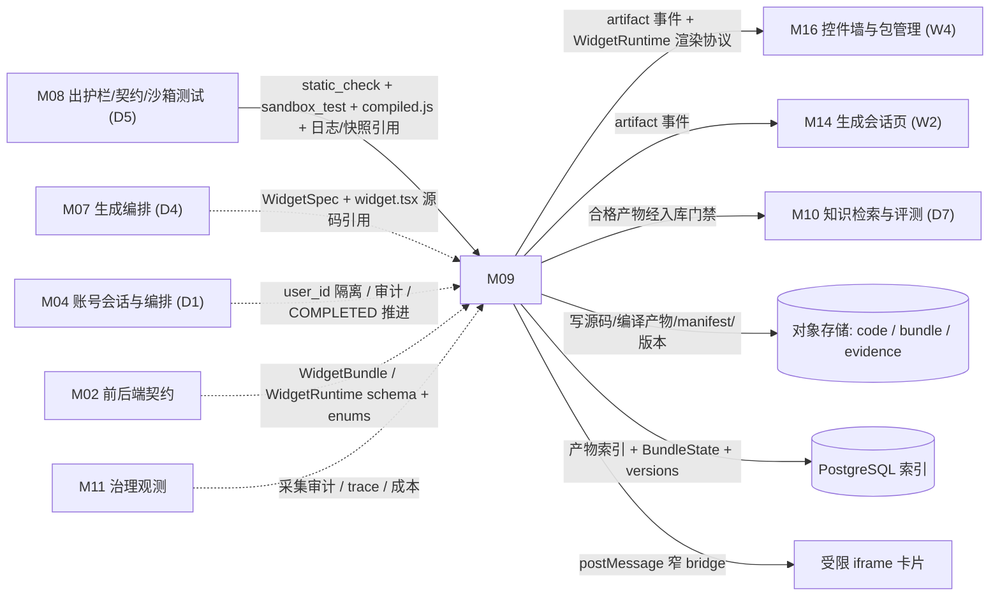
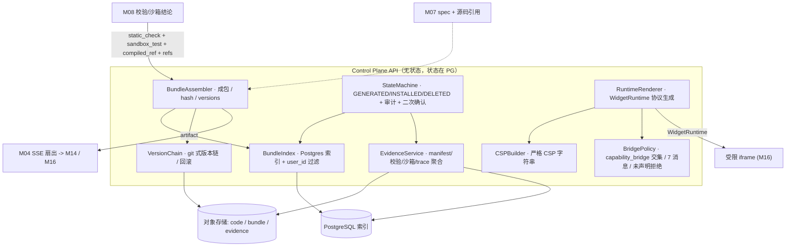
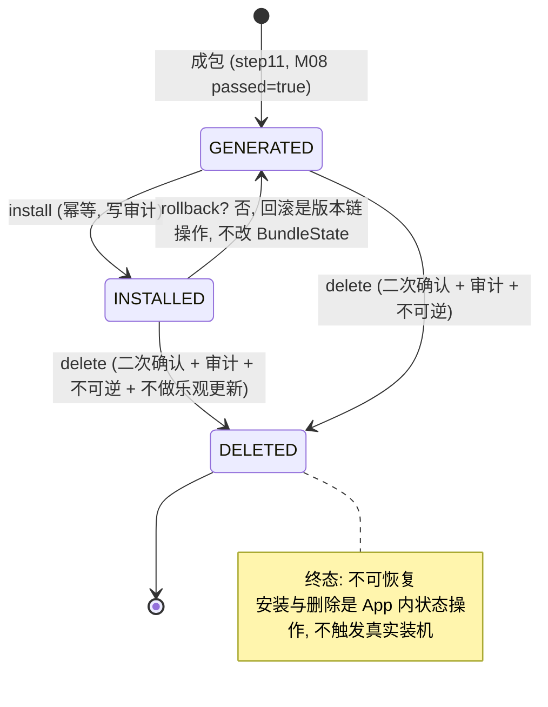

# M09 · 产物与包管理域（原 D6）

> **文档类型**：可独立交付 / 可独立验收的模块设计文档
> **来源章节**：`设计方案.md` v1.1 §5 D6、§4.3.2 `WidgetBundle`、§4.3.3 `WidgetRuntime`、§4.4 bundles 相关接口、§3.2 step11–12、§6.5、§2.4 #4–5、§9.3 iframe 用例、§9.6、§8 总表 D6 行、§7.1 `control-plane`
> **版本**：v1.0　|　**拆分日期**：2026-11-15　|　**最近修订**：2026-11-16（v1.3，ADR-001：§0 背景与 grid 注释对齐 D-6「可选预填 + 缺省询问补全」、ReasonCode 追加 3 码、`AgentEventKind` 18 种含 `ask_user`）　|　**状态**：设计定稿
> **对应编号**：D6 / FR-12（`WidgetBundle` 产物、hash、版本与按用户隔离存储）、FR-13（渲染协议：iframe sandbox + CSP + bridge + 能力放行） / X9（运行时隔离部分）
> **主责服务**：`control-plane`（`bundles/` 产物索引、`WidgetBundle` 生成与版本、CSP 生成、渲染协议下发、状态机）、`packages/widget_bridge/`（宿主 ↔ iframe 的 `postMessage` bridge 实现与类型）
> **一句话定义**：把 M08 验证通过的代码收成一份「源码与编译产物双存、hash 绑定 manifest、按用户隔离、可版本回滚」的 `WidgetBundle`，并按 `WidgetRuntime` 下发受限 iframe 渲染协议与窄 bridge，是产物从「验证结论」变成「用户可管理卡片」的唯一出口。

---

## 0. 模块速览（零基础可读）

### 0.1 项目在做什么（本模块所需的最小背景）

WidgetPilot 是一个用自然语言生成手机桌面控件的 AI Agent 产品。用户在网页里输入描述（控件规格 `2x1`/`1x2`/`2x2`/`2x4`/`4x2`/`4x4` 六种为一等约束，可选预填，缺省由系统询问补全，系统不推断——v1.3 ADR-001 D-6，进入生成回路前由会话确定：选择器 / 描述线索 / 询问补全，见 `grid_source`）、可选上传附件，系统由模型生成 **TSX + React 控件代码**，经出护栏、契约校验、一次性沙箱测试（M08）后，产出带完整证据链的「控件包」`WidgetBundle`，最终在网页上按手机桌面真实比例渲染成一张受限 iframe 卡片，用户可安装、删除、回滚、查看 manifest 与 trace。

**范围限制**：本项目不生成 Lynx 代码、不编译移动端 bundle、不打包上传、不装机、不接手机系统 API、不模拟真实设备环境。产物是能在浏览器隔离 iframe 里渲染的 TSX + React 页面代码，但严格遵循真实控件的六种规格约束。

**本模块要解决的核心矛盾**：M08 只产出「这份代码通过/不通过」的**结论**，用户要的是一份**可定位、可隔离渲染、可安装/删除/回滚、且越权进不来**的实体产物。原文 §1.7 #7「证据先于结论」要求产物只有通过契约校验与沙箱测试才允许进入控件墙；M09 就是把这个「通过」收敛成 `WidgetBundle`，并用 iframe sandbox + CSP + 窄 bridge 把开放代码关进用户侧渲染的笼子（§1.7 #6、§2.4 #4/#5、§3.3「渲染协议」决策）。

### 0.2 端到端 14 步链路中本模块的位置

原文 §3.2 与 `00` 总览 §1.3 把一次任务拆成 14 步，本模块负责 **第 ⑪ 步（成包）** 与 **第 ⑫ 步的渲染协议下发**，并贯穿其后的「安装 / 删除 / 版本 / 回滚」管理：

```
① 登录 → 新建会话（grid 可选预填）
② 输入描述 + 上传附件 → 传输层校验 → 对象存储 → attachment_id
③ 语义层校验（描述充分性 / 附件 role 明确性 / grid 合法）→ 不足则 AWAITING_INPUT
④ 进 LLM 护栏（注入 / PII / 意图白名单 / 预算前置）→ 命中不进模型
⑤ 意图与规格确定 → 按 widget_type + grid 确定性预取生成规程
⑥ 上下文装配（公共语料 + 规程 + 记忆 + AttachmentInsight，固定槽位、硬过滤优先）
⑦ 生成回路：先出 WidgetSpec，再出 TSX + React 代码；模型分档
⑧ 出 LLM 护栏（schema / 能力白名单 / 禁止内容 / PII / 描述符合度 / 规格一致）
⑨ 契约校验：spec ↔ manifest ↔ 代码能力声明 比对 + hash；不过不进沙箱
⑩ 一次性沙箱：TSX 编译 → 挂载渲染 → 尺寸/运行时错误/能力/交互断言 → 证据包
⑪ 生成 WidgetBundle（源码 + 编译产物 + manifest + 校验 + 沙箱结果 + hash），COMPLETED  ★ M09
⑫ 前端 artifact 事件 → 控件墙按 grid 真实比例渲染受限 iframe 卡片          ★ M09 下发渲染协议
⑬ 评测合格 → 脱敏 → 入库门禁 → 公共语料（可撤回）；失败案例回流为负例
⑭ 全流程按 seq 写 SSE 事件流与只追加审计；成本按模型档位分账
```

- 第 ⑪ 步：M09 汇总 M08 的 `static_check` / `sandbox_test` / 日志快照引用，生成 `WidgetBundle`，写 `hash` 与 `versions[]`，状态置 `COMPLETED`（会话侧由 M04 推进）。
- 第 ⑫ 步：M09 按 `WidgetRuntime` 下发 `iframe.sandbox` / `csp` / `srcdoc_ref` / `bridge_messages` / `capability_bridge` / `limits`，M16 据此渲染卡片；`artifact` 事件触发 iframe 热更新。
- 其后：用户安装 / 删除 / 回滚 / 查看 manifest 与 trace，全部走 M09 的状态机与证据接口。

**产物状态机**（原文 §1.4）：`GENERATED → INSTALLED → DELETED`。安装与删除是 App 内的状态操作，**不触发真实装机**；删除不可逆，需二次确认 + 审计，不做乐观更新。

### 0.3 为什么必须有这个模块

| 没有 M09 会怎样 | 原文依据 |
|---|---|
| 校验通过的结论无处落地，产物无法定位到 spec / manifest / 校验 / 沙箱结果 / trace | §5 D6 验收、§1.7 #7 |
| 源码与编译产物不双存、hash 不绑定 manifest，产物可被替换且无法复现 | §4.3.2、§5 D6 |
| 用户在受限 iframe 里直接拿到无 sandbox / 无 CSP 的页面，可访问父页面与用户数据、可外联 | §2.4 #4、§9.3 iframe 用例、§3.1 硬边界 ③ |
| 能力放行无依据，未声明能力调用不被拒绝、时间/存储不隔离 | §2.4 #5、§4.3.3 |
| 安装 / 删除产生重复副作用、删除被乐观更新误回滚、版本无法回滚 | §5 D6、§6.5、§6.6 |
| 跨用户读取他人包无 403、公共语料无法按 `bundle_id` 撤回 | §2.3 ⑤、D-1 |

### 0.4 上下游与邻居（mermaid）



- **上游**：M08（校验/沙箱结论、编译产物、证据引用）、M07（`WidgetSpec` 与 TSX 源码引用）、M04（`user_id` 隔离与审计）、M02（协议 schema 与枚举）、M11（审计采集）。
- **下游**：M16（控件墙卡片与操作 UI）、M14（`artifact` 事件消费）、M10（合格产物经入库门禁进公共语料）、对象存储与 Postgres 索引（持久化）、用户侧受限 iframe（渲染协议下发）。
- **横切**：M11 采集审计与 trace；M09 自身是 **X9（运行时隔离部分）** 的主承载，X9 的「沙箱测试部分」归 M08、「卡片渲染」归 M16。

### 0.5 原文对照表

| 本模块内容 | 原文章节 |
|---|---|
| 功能 / 技术栈 / 要点 / 验收 | §5 D6、§8 总表 D6 行 |
| 产物协议 `WidgetBundle` 完整定义 | §4.3.2 |
| 渲染协议 `WidgetRuntime` 完整定义 | §4.3.3 |
| bundles 相关 REST 接口 | §4.4 |
| 时序 step11–12 | §3.2 step11、step12 |
| 控件墙尺寸映射 / `widget:ready` / `widget:error` / 包操作 / 卡片详情 | §6.5 |
| 渲染协议架构约束（iframe sandbox + CSP + 窄 bridge + 能力放行） | §2.4 #4/#5 |
| iframe 对抗用例 | §9.3 |
| 沙箱渲染一致性 / iframe 并发性能风险 | §9.6 |
| 完整性矩阵 #9（交付与运行时） | §10.1 #9 |
| 服务划分 `control-plane`、代码落位 `widget_bridge` | §7.1、§7.2 |
| 产物状态机、乐观更新边界 | §1.4、§6.6 |
| 前后端职责划分（产物与预览） | §7.3 |
| 交付里程碑 P0 | §7.4 |

---

## 1. 模块定位与职责边界

### 1.1 为什么必须有（三个不可替代的职责）

1. **产物是「证据先于结论」的唯一载体**（原文 §1.7 #7、§10.1 #9）：一份 `WidgetBundle` 必须能定位到 spec / manifest / 静态校验 / 沙箱结果 / trace，否则「通过校验」只是内存里的一个布尔值，无法回放、无法审计、无法进控件墙。
2. **运行时隔离是第三条硬边界**（原文 §3.1 硬边界 ③、§2.4 #4）：用户侧渲染必须在受限 iframe，`sandbox="allow-scripts"` + 严格 CSP + 窄 `postMessage` bridge，控件无法访问宿主页面与用户数据。M09 是这份渲染协议的**生成与下发方**。
3. **状态操作必须可审计、不可逆操作必须受控**（原文 §5 D6、§6.5、§6.6）：`GENERATED → INSTALLED → DELETED` 带审计与二次确认，删除不可逆且不做乐观更新；版本可回滚。前端只提供操作入口，裁决在服务端。

### 1.2 做什么（职责清单）

| # | 职责 | 说明 | 原文依据 |
|---|---|---|---|
| R1 | 生成 `WidgetBundle` | 汇总 `WidgetSpec`、源码、编译产物、manifest、静态校验、沙箱结果，写 `bundle_id` | §4.3.2、§3.2 step11 |
| R2 | 源码与编译产物双存 | `source.content_ref`（`widget.tsx`）与 `compiled.content_ref`（`compiled.js`）分别落对象存储 | §5 D6 |
| R3 | hash 绑定 manifest | `manifest.spec_hash` / `compiled.hash` / 整包 `hash` 绑定，防篡改 | §4.3.2、§5 D6 |
| R4 | 按用户隔离存储 | 对象 key 带 `user_id`，Postgres 索引按 `user_id` 过滤，越权 403 | §5 D6、§2.3 ⑤ |
| R5 | 渲染协议按 `WidgetRuntime` 下发 | 生成 `card.px` / `iframe.sandbox` / `iframe.csp` / `srcdoc_ref` / `bridge_messages` / `capability_bridge` / `limits` | §4.3.3、§5 D6 |
| R6 | `capability_bridge` 计算 | `= manifest.capabilities ∩ 全局白名单`；未声明调用拒绝并上报 | §4.3.3、§5 D6 |
| R7 | iframe sandbox 与 CSP 生成 | `sandbox=["allow-scripts"]`（不含 `allow-same-origin`/`top-navigation`/`forms`/`popups`）、严格 CSP（禁外联脚本/禁 eval/禁网络） | §2.4 #4、§4.3.3 |
| R8 | 7 条窄 `bridge_messages` | `widget:ready` / `widget:resize` / `widget:error` / `host:theme` / `host:locale` / `host:tick` / `host:data`，非任意 JSON-RPC | §4.3.3 |
| R9 | 时间由 `host:tick` 提供、存储按 `storage_namespace` 隔离 | 控件不得自行取系统时间 / 不得跨 namespace 读写 | §4.3.3、§5 D6 |
| R10 | `widget:error` 运行时错误上报 | 控件运行时错误与未声明能力拒绝上报并写事件 | §5 D6、§6.5 |
| R11 | `GENERATED → INSTALLED → DELETED` 状态机 | 状态操作带审计；删除不可逆 + 二次确认 + 不做乐观更新 | §5 D6、§6.5 |
| R12 | `git` 式版本链与回滚 | `versions[]`；回滚沿用上一版编译产物 | §5 D6、§4.1 |
| R13 | `limits` 下发 | `render_timeout_ms` 与 `max_message_rate` | §4.3.3 |
| R14 | 证据链对外 | `GET /api/bundles/{id}/evidence` 返回 manifest / 静态校验 / 沙箱测试 / trace | §4.4、§6.5 |
| R15 | 预览产物引用 | `GET /api/bundles/{id}/preview` 返回受限 iframe 渲染所需编译产物引用 | §4.4 |
| R16 | 产生 `artifact` 事件 | 成包后推 `artifact`（`bundle_id` + 预览引用），触发 iframe 热更新 | §3.2 step12、§6.4 |

### 1.3 不做什么（明确排除，含与相邻模块的边界切割）

| 不做 | 归属模块 | 边界说明 |
|---|---|---|
| 产生代码、`WidgetSpec` 产出、TSX 源码生成、模型分档、上下文装配 | **M07** | M09 是产物的**收纳方**；`widget.tsx` 由 M07 产出，M09 只把它纳入 `source.content_ref`。M09 不调模型、不改 spec |
| 出护栏、契约校验、TSX 编译、沙箱渲染与断言、测试日志与快照生成 | **M08** | M09 只接收 M08 产出的 `static_check` / `sandbox_test` / `compiled.js` / `log_ref` / `snapshot_ref`，写入包；**不重新测试、不修改校验结论** |
| 前端卡片网格、按真实比例渲染的 UI、安装/删除/回滚按钮、manifest/trace 展示面板、时间线 scrubber | **M16 / M14 / M17** | M09 提供 REST 与渲染协议，是纯服务端能力；M16 负责 iframe 卡片网格与操作 UI；M14 消费 `artifact`；M17 负责回放 |
| 公共语料入库门禁、脱敏、投毒检测、撤回、质量评分、评测 rubric | **M10** | M09 提供「合格产物」与 `bundle_id` 供 D-1 入库；撤回执行在 M10（用户删除控件 → 公共语料立即失效由 M10 联动） |
| 会话状态机、JWT 签发、checkpoint / 租约、SSE `seq` 编号与扇出 | **M04 / M03** | M09 只在成包时提供产物引用供 M04 推进 `COMPLETED`；不写 `SessionState`、不编号 `seq` |
| 全链路 trace 汇总、成本分账、熔断与 kill switch、指标看板 | **M11** | M09 写只追加审计事件与 trace 上下文；治理判定归 M11 |
| 线上 iframe 之外的运行时能力实现（主题/语言/真实数据注入策略的 UI 侧） | **M16 协同** | M09 定义并下发 `WidgetRuntime` 契约与 `@widget/bridge` 实现类型；宿主侧消息发送由 M16 装配，但消息名与放行规则由 M09 定稿 |
| `agent_core` 内核实现、协议 schema 的权威生成 | **M03 / M02** | M09 消费 `packages/contracts` 的 schema；schema 变更即 CI 失败并触发回归门禁 |

> **最易混淆的两处边界**：① **M08 与 M09 都碰 `WidgetRuntime`**——M08 在一次性沙箱内用同一份契约与 bridge 桩做**测试**，M09 在用户侧做**运行时下发与放行**，二者共用契约（原文 §9.6）；② **M09 与 M16 都碰 iframe**——M09 生成 `sandbox` / `csp` / `srcdoc_ref` / `capability_bridge` / `limits` 的**协议值**，M16 把它们装到真实 DOM 上并渲染卡片网格。

### 1.4 输入 / 输出与上下游契约

| 方向 | 内容 | 契约形式 |
|---|---|---|
| 入 | M08 结论：`static_check{passed, violations}`、`sandbox_test{passed, cases[], log_ref, snapshot_ref}`、`compiled.content_ref` + `compiled.hash` | 内部接口（§4.3）+ 对象存储引用 |
| 入 | M07 的 `WidgetSpec` 与 `widget.tsx` 源码引用 `code/{session_id}/{run_id}/widget.tsx` | 对象存储引用 |
| 入 | M04 的 `user_id` / `session_id` / `runId`、审计与 `COMPLETED` 推进协作 | 内部接口 |
| 入 | M02 的 `WidgetBundle` / `WidgetRuntime` schema、`Capability` / `GridSpec` / `BundleState` 枚举 | `packages/contracts` 编译期依赖 |
| 入 | 用户操作：`install` / `delete`（带二次确认）/ `rollback` / 列表查询 / 预览 / 证据查询 | REST（§4.1） |
| 出 | `WidgetBundle`（`bundle_id` / `hash` / `versions[]` / `state=GENERATED` / `created_at`） | Postgres 索引 + 对象存储 |
| 出 | `WidgetRuntime`（`card` / `iframe` / `bridge_messages` / `capability_bridge` / `limits`） | `GET /api/bundles/{id}/preview` + `artifact` 事件 |
| 出 | `artifact` 事件（`bundle_id` + 预览引用）、`notice` / `error` 事件 | SSE（经 M04 编号扇出） |
| 出 | 7 条 `postMessage` bridge 消息类型与 `@widget/bridge` 实现 | `packages/widget_bridge/` |
| 出 | 只追加审计事件（安装 / 删除 / 回滚 / 越权拒绝）、`evidenceRef` | PG 审计表（M11 汇总） |

### 1.5 承载的横切能力

- **X9（运行时隔离部分，主承载）**：原文 §2.6 X9 =「TSX 编译、渲染、尺寸/能力/交互断言在一次性沙箱；线上 iframe sandbox + CSP + bridge」，落在 `D5 / D6 / W4`。M09 承担**线上 iframe sandbox + CSP + bridge 的运行时隔离**，M08 承担一次性沙箱测试，M16 承担卡片渲染；三者共用同一份 `WidgetRuntime` 契约与 bridge 实现（原文 §9.6「用同一份 `WidgetRuntime` 契约与 bridge 实现，差异进评测集」）。
- **X11（协同）**：安装 / 删除 / 回滚 / 越权拒绝写只追加审计与 trace，供 M11 完整重放一次会话；治理与看板归 M11。
- **X1（协同，非主承载）**：包状态与版本是持久实体，可跨天/月恢复读取；断点恢复主承载在 M04/M03。
- **明确不做**（§2.6）：通用多 Agent 编排、通用工具集、把模型自报置信度当路由判据、把 X* 做成看板打勾。

### 1.6 关键设计原则

1. **证据先于结论**（§1.7 #7）：产物只有通过契约校验与沙箱测试才允许进控件墙；任一包必须可定位到 spec / manifest / 校验 / 沙箱结果 / trace。
2. **生成协议与渲染协议共用同一份契约**（§1.7 #2）：`manifest` 声明的能力，静态校验比对它（M08）、沙箱按它放行（M08）、**运行时 bridge 按它放行（M09）**、评测按它出判据。
3. **生成代码不在编排进程里执行、用户侧渲染在受限 iframe**（§1.7 #6、§3.1 硬边界 ②③）：M09 下发的 iframe 不含 `allow-same-origin` / `top-navigation` / `forms` / `popups`，CSP 禁外联脚本 / 禁 eval / 禁网络。
4. **能力白名单最小必要**（§2.4 #5、§2.2 安全）：`capability_bridge = manifest.capabilities ∩ 全局白名单`；时间统一由 `host:tick` 提供，本地存储按 `storage_namespace` 隔离；禁止任意网络请求与系统能力。
5. **窄协议而非任意 JSON-RPC**（§4.3.3）：宿主 ↔ 控件只走 7 条固定 `bridge_messages`；未声明能力调用拒绝并上报 `widget:error`。
6. **不可逆操作不做乐观更新**（§6.6）：删除不可逆、二次确认 + 审计；乐观更新只用于附件本地预览、草稿、面板切换等可逆操作。
7. **按用户隔离 + 权限服务端裁决**（§1.3、§6.9）：`user_id` 过滤在每个 REST 请求上执行，前端隐藏按钮只是体验优化。
8. **大对象不入库**（§2.4 #6）：源码 / 编译产物 / 日志 / 快照放对象存储，Postgres 只存索引与引用，引用带 `hash`。
9. **零 Agent 框架**（D-5）：产物索引、版本链、CSP 生成、`postMessage` bridge 全部手写或用通用基础设施，不引入任何 Agent / LLM 框架。
10. **门禁不可在线关闭**（§1.7 #8）：iframe sandbox / CSP / 能力白名单是代码常量，不提供关闭开关。

---

## 2. 技术栈

### 2.1 分层选型表

| 层 | 选型 | 版本 / 约束 | 为什么选 | 明确不用什么 |
|---|---|---|---|---|
| 产物索引 | PostgreSQL | 14+ | `WidgetBundle` 索引、`BundleState`、`versions[]` 引用、按 `user_id` 过滤、只追加审计 | 不把源码 / 编译产物 / 日志 / 快照塞进 PG |
| 大对象存储 | 对象存储（S3 兼容） | key 带 `user_id` / `bundle_id`，引用带 `hash` | 源码与编译产物双存、按用户隔离、防替换 | 不入库、不共享跨用户前缀 |
| 版本管理 | `git` 式版本链（`versions[]` + parent 指针） | 沿用上一版编译产物的回滚 | 版本可回滚、父子可追溯、不重复编译 | 不用完整 git 仓库 / 不做分支合并 |
| 渲染隔离 | iframe `sandbox="allow-scripts"` + 严格 CSP | 不含 `allow-same-origin`/`top-navigation`/`forms`/`popups` | 与宿主隔离，控件无法访问父页面与用户数据（§2.4 #4） | 不放宽 sandbox token、不引入 `unsafe-eval`、不开放 `connect-src` |
| 能力通道 | 原生 `postMessage` + 自研 `@widget/bridge` | 7 条固定消息，非任意 JSON-RPC | 窄协议、按 `manifest` 放行、未声明拒绝上报（§4.3.3） | 不用 MCP SDK / 不做通用 RPC / 不放行 `fetch` |
| CSP 生成 | 服务端确定性字符串拼装 | 禁外联脚本 / 禁 eval / 禁网络 | 每次预览按同一模板生成，可断言、可回归 | 不靠前端拼 CSP、不依赖第三方 CSP 框架 |
| 时间 / 存储隔离 | `host:tick` 统一授时 + `storage_namespace` | 按 `user + widget` 隔离 | 控件不得自行取系统时间、不得跨 namespace 读写 | 不用设备系统时钟 / 不用全局 localStorage |
| 事件通道 | 原生 SSE（`artifact`）+ `postMessage` | `seq` 由 M04 编号 | 成包事件触发 iframe 热更新（§6.4） | 不用 AI SDK / CopilotKit / AG-UI SDK |
| 可观测 | OpenTelemetry SDK + 自建 `agent_event` / `trace_span` 表 | 通用标准 | 审计可完整重放一次会话 | 不用 LLM 专用观测平台 SDK |
| 契约 | `packages/contracts`（OpenAPI 3.1 / Zod / 枚举共享包） | 单一事实来源，CI 校验一致性 | 前后端 `WidgetBundle` / `WidgetRuntime` 字段一致 | 不各写一套 schema |

### 2.2 硬约束（尤其 D-5 零 Agent 框架）

- **D-5 禁止引入**：LangChain / LangGraph、Temporal 或任何 workflow engine、Vercel AI SDK / `streamUI` / CopilotKit / AG-UI SDK / A2UI SDK、LangFuse / LLM 专用观测 SDK、OpenAI Agents SDK / CrewAI / AutoGen / PydanticAI、**MCP SDK**（bridge 用自定义 `postMessage`）、OPA / Casbin。
- **保留的通用基础设施**（原文 §11.1）：FastAPI、Pydantic v2、Postgres、Redis、对象存储、React 19 / Vite / TanStack Query / Zustand / Zod / CodeMirror、esbuild / tsc、OpenTelemetry SDK、`EventSource` / `fetch ReadableStream`。本模块使用其中的 FastAPI / Pydantic v2 / Postgres / 对象存储 / React（bridge 宿主侧）/ Zod。
- **iframe sandbox 定值**（§2.4 #4、§4.3.3）：`sandbox = ["allow-scripts"]`，**不含** `allow-same-origin` / `allow-top-navigation` / `allow-forms` / `allow-popups`；`csp` 禁外联脚本、禁 `eval`、禁网络。
- **7 条 bridge 消息定值**（§4.3.3）：`widget:ready` / `widget:resize` / `widget:error` / `host:theme` / `host:locale` / `host:tick` / `host:data`；**非任意 JSON-RPC**。
- **import 白名单与导出契约**（§2.4 #2）：生成代码只 import `react` / `@widget/bridge`，默认导出 `Widget`；M09 下发 `srcdoc_ref` 时按此校验编译产物。
- **门禁无在线关闭开关**：sandbox token 集合、CSP 模板、`capability_bridge` 交集规则、`limits` 上限写在代码常量里（§10.3）。
- **删除不可逆**：`DELETED` 为终态，不做乐观更新（§6.5、§6.6），二次确认 + 审计。

### 2.3 运行时依赖

| 依赖 | 用途 | 不可用时的行为 |
|---|---|---|
| PostgreSQL | `WidgetBundle` 索引、`BundleState`、`versions[]`、审计 | 拒绝写入，不降级（产物索引是状态基座） |
| 对象存储（S3 兼容） | 源码 / 编译产物 / manifest / 版本对象 | 写入失败则不生成 `WidgetBundle`、不推 `artifact` |
| M08 校验结论 | `static_check` / `sandbox_test` / 编译产物引用 | 缺失则不生成包（证据先于结论） |
| M02 `packages/contracts` | `WidgetBundle` / `WidgetRuntime` schema、枚举 | 编译期依赖；schema 变更即 CI 失败并触发回归门禁 |
| M04 / M11 | `user_id` 隔离、审计、`seq` 编号扇出 | SSE 扇出不可用时按 `runId + seq` 补发（M04 负责） |
| 浏览器 `postMessage` / iframe（用户侧，经 M16） | 运行时渲染与 bridge 通信 | 控件运行时错误上报 `widget:error`，失败卡片显示原因码与「查看沙箱日志」（§6.5） |

### 2.4 Monorepo 代码落位（原文 §7.2 / 00 总览 §6）

```
services/control_plane/
  api/            # REST 路由（含 §4.1 的 bundles 系列）
  accounts/       # M04
  sessions/       # M04
  bundles/        # ★ M09：WidgetBundle 生成 / hash / versions / BundleState / evidence / preview
  audit/          # M11（M09 写审计事件）
packages/widget_bridge/   # ★ M09 / M16：宿主 ↔ iframe 的 postMessage bridge 实现与类型
packages/contracts/       # M02：widget_bundle.schema.json / widget_runtime.schema.json / enums
infra/deploy/             # M11：CSP 模板 / 网络策略（M09 消费 CSP 模板生成）
apps/web/                 # M13–M12（M16 装配 iframe 与卡片网格）
```

---

## 3. 设计架构

### 3.1 内部组件与职责



| 组件 | 职责 | 关键不变量 |
|---|---|---|
| `BundleAssembler` | 汇总 spec / 源码 / 编译产物 / manifest / 校验 / 沙箱结果，计算整包 `hash` | 只有 M08 `passed=true` 才成包；源码与编译产物双存 |
| `BundleIndex` | Postgres 产物索引、`user_id` 过滤、`state` / `versions[]` | 越权一律 403，不泄漏资源是否存在 |
| `VersionChain` | `git` 式版本链、回滚沿用上一版编译产物 | 父子指针单调、回滚不重新编译、不产生新代码 |
| `StateMachine` | `GENERATED → INSTALLED → DELETED` + 审计 + 二次确认 | 删除不可逆、不做乐观更新、安装/删除幂等 |
| `RuntimeRenderer` | 按 `WidgetRuntime` 生成 `card.px` / `iframe` / `bridge_messages` / `limits` | 六种规格真实比例、字段完整 |
| `CSPBuilder` | 生成严格 CSP 字符串 | 禁外联脚本 / 禁 eval / 禁网络；模板确定性 |
| `BridgePolicy` | 计算 `capability_bridge = manifest.capabilities ∩ 全局白名单`，定义 7 条消息 | 未声明能力调用拒绝并上报 `widget:error`；非任意 JSON-RPC |
| `EvidenceService` | 聚合 manifest / 静态校验 / 沙箱测试 / trace 供 `evidence` 接口 | 任一包可定位完整证据链 |

### 3.2 处理流程与数据流（编号步骤，对应 §3.2 step11–12）

**阶段 A · 成包（step11）**

1. M08 交付 `PASSED` 结论：`static_check{passed,violations}`、`sandbox_test{passed,cases[],log_ref,snapshot_ref}`、`compiled.content_ref` + `compiled.hash`；`ValidationGate` 只在全部通过时允许进入本阶段。
2. `BundleAssembler` 读取 `WidgetSpec`（M07 产出）、`widget.tsx` 源码引用、`compiled.js` 编译产物引用，组装 `manifest`（`spec_version` / `spec_hash` / `grid` / `widget_type` / `capabilities` / `import_allowlist` / `exports` / `props` / `recipe_version` / `retrieval_snapshot` / `model` / `prompt_version` / `model_tier`）。
3. 校验 `manifest.capabilities === spec.capabilities`、`manifest.spec_hash === sha256(canonical_json(spec))`；不满足则不生成包并回溯交 M08/M07。
4. **源码与编译产物双存**：分别写 `code/{session_id}/{run_id}/widget.tsx` 与 `code/{session_id}/{run_id}/compiled.js` 到对象存储（M08 已写编译产物，M09 校验 `compiled.hash` 后纳入包）。
5. 计算整包 `hash = sha256(canonical_json(bundle_without_hash))`，把 `hash` 写回；`hash` 绑定 `manifest`（`spec_hash` / `compiled.hash` 参与同一条链）。
6. 写 Postgres 索引：`bundle_id` / `user_id` / `session_id` / `spec_ref` / `source_ref` / `compiled_ref` / `manifest` / `static_check` / `sandbox_test` / `state = GENERATED` / `hash` / `versions[]` / `created_at`。
7. 初始化 `git` 式版本链首节点（`versions[0]` 指向本次编译产物与 manifest，parent 为空）。
8. 写只追加审计事件（成包动作、`actor`、`decision`、`trace_id`、`prev_hash`），供 M04 推进 `COMPLETED`。

**阶段 B · 渲染协议下发（step12）**

9. `RuntimeRenderer` 按 `grid` 计算 `card.px`：以 `cell = 80px` 映射六种规格真实像素（见 §6.3）。
10. `CSPBuilder` 生成严格 CSP（禁外联脚本 / 禁 `eval` / 禁网络），`iframe.sandbox = ["allow-scripts"]`，`srcdoc_ref` 指向 `compiled.content_ref`。
11. `BridgePolicy` 计算 `capability_bridge = manifest.capabilities ∩ 全局白名单`，固定 `bridge_messages` 为 7 条；时间统一由 `host:tick` 提供，本地存储按 `storage_namespace` 隔离。
12. 设定 `limits = { render_timeout_ms, max_message_rate }`，组装完整 `WidgetRuntime`。
13. 推 `artifact` 事件（`bundle_id` + 预览引用）→ M14 原子替换占位卡 → M16 按 `grid` 真实比例热更新受限 iframe 卡片（§6.4）。

**阶段 C · 状态操作（安装 / 删除 / 回滚 / 预览 / 证据）**

14. `install`：`GENERATED → INSTALLED`，写审计；幂等（重复安装不产生重复副作用）。
15. `delete`：`INSTALLED → DELETED`，**二次确认** + 审计 + 不可逆 + **不做乐观更新**；用户删除控件 → 公共语料立即失效的联动由 M10 执行（D-1）。
16. `rollback`：在 `versions[]` 中定位上一版编译产物，**沿用上一版编译产物**，不重新编译、不产生新代码；写审计与新版本节点。
17. `preview`：返回受限 iframe 渲染所需编译产物引用与 `WidgetRuntime`（含 `srcdoc_ref` / `csp` / `capability_bridge` / `limits`）。
18. `evidence`：返回 `manifest` / `static_check` / `sandbox_test` / `trace`（含 M08 的日志与快照引用），保证「任一包可定位到 spec / manifest / 校验 / 沙箱结果 / trace」。
19. iframe 运行期：`widget:ready` / `widget:resize` 上报；运行时错误或未声明能力调用 → 拒绝并上报 `widget:error`，失败卡片显示原因码与「查看沙箱日志」（§6.5）。

### 3.3 状态机

本模块**拥有** `BundleState`（原文 §4.2），**参与** `SessionState.COMPLETED` 的推进（由 M04 写）。

```ts
type BundleState = "GENERATED" | "INSTALLED" | "DELETED";
```



**版本链状态（非 `BundleState`）**：`versions[]` 是独立维度，回滚追加新版本节点、沿用上一版编译产物，不改变 `BundleState`（【契约约定】：回滚不改变 `state`，见 §9 待决项 Q12）。`DELETED` 为终态，不再接受 `install` / `rollback` / `preview` 的写操作（只读证据可按留存策略保留引用）。

### 3.4 关键机制、算法与不变量清单

**A. hash 绑定链**（§4.3.2、§5 D6）

```
spec_hash      = sha256(canonical_json(WidgetSpec))
compiled.hash  = sha256(compiled.js bytes)
manifest.spec_hash == spec_hash
bundle.hash    = sha256(canonical_json(bundle_without_hash))   // 含 spec_hash / compiled.hash / static_check / sandbox_test
读取任一引用时校验 hash, 不一致拒绝采用
```

**B. `capability_bridge` 交集算法**（§4.3.3、§2.4 #5）

```
global_allowlist = 平台允许的能力全集 (Capability 全集 ∩ 策略开关)  // 【推导·需评审】见 §9 Q5
capability_bridge = set(manifest.capabilities) ∩ set(global_allowlist)
运行时收到能力调用 c:
  if c not in capability_bridge: 拒绝 + 上报 widget:error + 写审计
  else: 按 7 条 bridge_messages 之一处理 (时间统一 host:tick, 存储按 storage_namespace)
```

**C. 严格 CSP 生成**（§2.4 #4、§4.3.3）：`csp` 是确定性字符串，禁外联脚本（`script-src` 不含外部源）、禁 `eval`（不含 `unsafe-eval`）、禁网络（`connect-src 'none'`）。具体指令串为【推导·需评审】（见 §6.3、§9 Q1）。`iframe.sandbox` 固定 `["allow-scripts"]`，**不含** `allow-same-origin` / `top-navigation` / `forms` / `popups`。

**D. 7 条窄 bridge 协议**（§4.3.3，完整）：`widget:ready` / `widget:resize` / `widget:error` / `host:theme` / `host:locale` / `host:tick` / `host:data`。宿主 ↔ 控件只走上述消息，**非任意 JSON-RPC**；任何其它消息名或未声明能力调用一律拒绝并上报 `widget:error`。时间统一由 `host:tick` 提供，本地存储按 `WidgetSpec.data_contract.storage_namespace` 隔离。

**E. 状态操作幂等与二次确认**（§5 D6、§6.5、§6.6）

| 操作 | 幂等键【契约约定】 | 二次确认 | 乐观更新 | 审计 |
|---|---|---|---|---|
| `install` | `bundle_id + "install"` | 否 | 否 | 必写 |
| `delete` | `bundle_id + "delete" + confirm_token` | **是** | **禁止** | 必写 |
| `rollback` | `bundle_id + "rollback" + target_version_id` | 否 | 否 | 必写 |
| `preview` / `evidence` | 只读 | — | — | 越权拒绝必写 |

**F. `git` 式版本链与回滚**（§5 D6、§4.1 `versions[]`）：每个版本节点记录 `parent_id` / `compiled_ref` / `compiled_hash` / `manifest_hash` / `created_at`；回滚「沿用上一版编译产物」——定位 `versions[]` 中当前节点的前一节点，复用其 `compiled_ref`，**不重新编译、不调模型、不产生新代码**，仅追加一个新版本节点并写审计（【契约约定】：回滚选取规则见 §9 Q12）。

**不变量清单**：

| # | 不变量 | 断言方式 |
|---|---|---|
| I1 | 只有 M08 `static_check.passed && sandbox_test.passed` 才生成 `WidgetBundle` | 成包用例：缺任一结论则不写索引、不推 `artifact` |
| I2 | 源码与编译产物双存，两个 `content_ref` 均存在且带 `hash` | 对象存在性 + hash 校验 |
| I3 | `manifest.spec_hash === sha256(spec)`、`compiled.hash === sha256(compiled.js)`、整包 `hash` 可重算 | 重算 hash 全链通过 |
| I4 | `manifest.capabilities === spec.capabilities` | 契约测试：篡改任一方拒绝成包 |
| I5 | `capability_bridge = manifest.capabilities ∩ 全局白名单`，未声明调用拒绝并上报 | 对抗用例：未声明 `timer` 调用被拒 + `widget:error` = 1 |
| I6 | iframe `sandbox` 恰为 `["allow-scripts"]`，不含 4 个禁用 token | 协议断言：字符串精确比对 |
| I7 | CSP 禁外联脚本 / 禁 eval / 禁网络 | 协议断言 + 浏览器拦截外联脚本用例 |
| I8 | `bridge_messages` 恰为 7 条固定消息，非任意 JSON-RPC | 协议断言：消息集合精确比对；未知消息名被拒 |
| I9 | 时间统一 `host:tick`、存储按 `storage_namespace` 隔离 | 运行期断言：控件无系统时间读取、跨 namespace 读写被拒 |
| I10 | `GENERATED → INSTALLED → DELETED` 单向；`DELETED` 不可逆 | 状态机用例：DELETED 下 install/rollback 返回 409 |
| I11 | 安装 / 删除不产生重复副作用 | 幂等用例：重复操作审计条数 = 1、副作用条数 = 1 |
| I12 | 删除带二次确认、不做乐观更新 | 用例：无 confirm 时拒绝；UI 状态不在确认前变更（脚本断言） |
| I13 | 版本回滚沿用上一版编译产物、不重新编译 | 用例：`compiled_ref` 等于上一版；编译器调用次数 = 0 |
| I14 | 任一包可定位 spec / manifest / 静态校验 / 沙箱结果 / trace | `evidence` 用例：五类引用全部非空可读 |
| I15 | 按 `user_id` 隔离，越权 403 | 越权用例：他人 `GET /api/bundles/{id}` 一律 403 |
| I16 | 大对象不入库，只存引用 | 部署断言：PG 表无源码 / 编译产物 / 日志 / 快照大字段 |

### 3.5 与其他模块的时序（关键 4 个场景）

**场景 1：正常成包与渲染**
`M08(PASSED: static_check + sandbox_test + compiled_ref + refs) → M09(成包: hash 绑定 manifest / versions[0] / state=GENERATED / 审计) → M04(COMPLETED, artifact/done 编号扇出) → M14(原子替换占位卡) → M16(按 grid 真实比例渲染受限 iframe, 按 WidgetRuntime 装配 CSP + bridge) → iframe(widget:ready)`

**场景 2：安装 / 删除**
`M16 安装按钮 → M09(install: GENERATED→INSTALLED, 幂等, 写审计) → ... → M16 删除按钮(二次确认弹窗) → M09(delete: INSTALLED→DELETED, 校验 confirm_token, 不做乐观更新, 写审计) → M10(用户删除控件 → 公共语料立即失效)`

**场景 3：版本回滚**
`M16 回滚入口 → M09(versions[] 定位上一版, 沿用其 compiled_ref, 追加新版本节点, 写审计, 不重新编译) → M16(iframe 热更新到上一版编译产物)`

**场景 4：运行时越权 / 错误**
`iframe 内控件调用未声明能力 / 抛运行时错误 → @widget/bridge 按 capability_bridge 拒绝 → 上报 widget:error → M09 写运行时错误事件与审计 → M16 失败卡片显示原因码 + 「查看沙箱日志」 → widget:error 不拖垮宿主页面(§6.7)`

**场景 5：iframe 逃逸尝试**
`iframe 尝试访问 parent.document / fetch 外联 / window.open 弹窗 / 表单提交 → sandbox=["allow-scripts"] + 严格 CSP + 窄 bridge 拒绝并上报(§9.3) → 控件无法访问父页面与用户数据`

### 3.6 部署形态与伸缩

| 服务 | 状态 | 伸缩依据 | 说明 |
|---|---|---|---|
| `control-plane`（`bundles/`） | 无状态（状态在 PG） | QPS（§7.1） | 可任意水平扩容；`user_id` 过滤在每个请求上执行 |
| `packages/widget_bridge/` | 前端运行时库（随 `web` 交付） | 静态 CDN | 宿主侧消息装配由 M16 使用，协议由 M09 定稿 |
| PostgreSQL 索引 | 有状态 | 连接数 / 容量 | 产物索引、版本链、审计；主库高可用 |
| 对象存储 | 有状态（外部） | 容量 | 源码 / 编译产物 / manifest / 版本对象，引用带 `hash` |
| 用户侧 iframe（M16） | 浏览器内 | 卡片数 | §9.6 风险：并发多卡片按需加载 / IntersectionObserver、错误隔离、超时熔断 |

**伸缩约束**：`iframe` 并发性能是原文 §9.6 明确风险——控件墙多卡片同时渲染需按需加载 / `IntersectionObserver`、错误隔离、`render_timeout_ms` 超时熔断；`widget:error` 不会拖垮宿主页面（§6.7）。

---

## 4. 接口契约

> 本模块**拥有**原文 §4.4 中的 bundles 系列 REST 接口。所有请求/响应字段为【契约约定】（原文给出路径与用途，未给请求体/响应体），最终以 `packages/contracts/openapi.yaml` 为准。统一响应格式与错误码见 §4.4 / §5.4。

### 4.1 对外 REST 接口表

| 方法 | 路径 | 权限 | 请求 | 成功响应 | 状态码 |
|---|---|---|---|---|---|
| `GET` | `/api/bundles` | 本人 | Query: `state?`, `grid?`, `cursor?`, `limit?`【契约约定】 | `{ code:"OK", data:{ items: WidgetBundle[], next_cursor } }` | 200 / 401 / 403 |
| `POST` | `/api/bundles/{id}/install` | 本人 | `{}`（独立 POST）【契约约定】 | `{ data:{ bundle_id, state:"INSTALLED" } }` | 200 / 403 / 404 / 409 |
| `POST` | `/api/bundles/{id}/delete` | 本人 | `{ confirm_token: string }`【契约约定】（二次确认） | `{ data:{ bundle_id, state:"DELETED" } }` | 200 / 400 / 403 / 404 / 409 |
| `POST` | `/api/bundles/{id}/rollback` | 本人 | `{ target_version_id?: string }`【契约约定】 | `{ data:{ bundle_id, version_id, compiled_ref } }` | 200 / 403 / 404 / 409 |
| `GET` | `/api/bundles/{id}/preview` | 本人 | — | `{ data:{ srcdoc_ref, runtime: WidgetRuntime } }` | 200 / 403 / 404 |
| `GET` | `/api/bundles/{id}/evidence` | 本人 | — | `{ data:{ manifest, static_check, sandbox_test, trace } }` | 200 / 403 / 404 |
| `GET`（可选，【契约约定】） | `/api/bundles/{id}/delete-confirm` | 本人 | — | `{ data:{ confirm_token, expires_at } }` | 200 / 403 / 404 |
| `EVENT`（SSE） | `/api/sessions/{id}/events` 中 `artifact` 帧 | 本人 + 短期 ticket | 订阅 `runId` + `Last-Event-ID` | `text/event-stream`（帧见 §4.2） | 200 / 401 / 403 |

> **二次确认链路**【契约约定】：先 `GET /api/bundles/{id}/delete-confirm` 拿短期 `confirm_token`，再 `POST /api/bundles/{id}/delete` 带该 token 执行；无 token / 过期 / 不匹配一律 400，且**不做乐观更新**。原文只给「删除不可逆，二次确认 + 审计」，此处为让接口可调用的最小推导（见 §9 Q4）。
>
> **权限**：服务端按 `user_id` 对**每个 REST 请求**做过滤（§6.9）；前端隐藏按钮只是体验优化。越权一律 403，不泄漏资源是否存在。

### 4.2 事件接口（SSE `kind` 与 payload；以及 `postMessage` bridge）

**SSE 分通道**（原文 §4.5 / §6.4）：M09 **产生** `artifact`（产物就绪），参与 `notice` / `error`（状态与账目）；其余 `kind` 由 M05–M11 产生，M04 负责编号 `seq` 与扇出。

```ts
// 【契约约定】artifact payload，字段最终以 events.schema.json 为准
type ArtifactPayload = {
  bundle_id: string;
  preview_ref: string;        // 指向 compiled 产物 / preview 引用
  grid: GridSpec;
  state: BundleState;         // "GENERATED"
  hash: string;               // 整包摘要
};
```

| `kind` | 本模块职责 | payload 要点 |
|---|---|---|
| `artifact` | **产生**：成包后原子替换占位卡、触发 iframe 热更新 | `{ bundle_id, preview_ref, grid, state, hash }` |
| `notice` | **产生**：降级 / 回滚 / 版本提示 | `{ message, code }` |
| `error` | **产生（结论）**：运行时错误 / 越权拒绝上报 | `code` + `evidenceRef` |
| `validation` / `sandbox` | **转发**：证据内容由 M08 产出 | 本模块只聚合进 `evidence` 接口 |
| 其余 `plan/spec/attachment/skill/routing/code/guard/cost/checkpoint/interrupted/done` | **只转发 / 不生成内容** | 由 M04–M11 产生 |

**`postMessage` bridge（7 条窄消息，非 SSE）**（原文 §4.3.3）：宿主 ↔ iframe 只走以下集合，任何其它消息名或未声明能力调用拒绝并上报 `widget:error`。

| 消息 | 方向 | 语义 | payload【契约约定】 |
|---|---|---|---|
| `widget:ready` | 控件 → 宿主 | iframe 挂载完成 | `{ bundle_id, grid }` |
| `widget:resize` | 控件 → 宿主 | 请求/上报尺寸变化 | `{ w: number, h: number }` |
| `widget:error` | 控件 → 宿主 | 运行时错误 / 未声明能力拒绝上报 | `{ code: string, message: string, capability?: string }` |
| `host:theme` | 宿主 → 控件 | 下发主题 | `{ theme: "light" | "dark" }` |
| `host:locale` | 宿主 → 控件 | 下发语言 | `{ locale: string }` |
| `host:tick` | 宿主 → 控件 | **统一授时**（时间唯一来源） | `{ ts: number, timezone: string }` |
| `host:data` | 宿主 → 控件 | 下发静态/受限数据 | `{ namespace: string, payload: unknown }` |

> **非任意 JSON-RPC**：bridge 不接受通用方法名调用；`capability_bridge = manifest.capabilities ∩ 全局白名单` 决定哪些能力可用；时间统一由 `host:tick` 提供，本地存储按 `storage_namespace` 隔离。消息 payload 的字段类型为【推导·需评审】（见 §9 Q8）。

### 4.3 内部接口与被调用签名（给代码签名，【契约约定】）

```python
# services/control_plane/bundles/assemble.py
def assemble_bundle(
    user_id: str,
    session_id: str,
    spec: WidgetSpec,
    source_ref: str,
    compiled_ref: str,
    compiled_hash: str,
    static_check: dict,
    sandbox_test: dict,
) -> WidgetBundle: ...
    # 校验 passed / spec_hash / capabilities 一致性后成包; 返回 state=GENERATED

# services/control_plane/bundles/hash.py
def compute_bundle_hash(bundle_without_hash: dict) -> str: ...
def verify_ref(ref: str, expected_hash: str) -> bool: ...
    # 读取对象时校验 hash, 不一致拒绝采用

# services/control_plane/bundles/versions.py
def append_version(bundle_id: str, compiled_ref: str, manifest_hash: str) -> VersionNode: ...
def rollback(bundle_id: str, target_version_id: str | None) -> VersionNode: ...
    # 沿用上一版 compiled_ref, 不重新编译; 追加新节点

# services/control_plane/bundles/state.py
def transition(bundle_id: str, action: Literal["install","delete"], confirm_token: str | None) -> BundleState: ...
    # delete 校验 confirm_token; 幂等; 写审计; DELETED 不可逆

# services/control_plane/bundles/runtime.py
def build_runtime(bundle: WidgetBundle, global_allowlist: set[str]) -> WidgetRuntime: ...
    # capability_bridge = manifest.capabilities ∩ global_allowlist

def build_csp() -> str: ...
    # 确定性严格 CSP: 禁外联脚本 / 禁 eval / 禁网络

def build_capability_bridge(manifest: dict, global_allowlist: set[str]) -> list[str]: ...

# services/control_plane/bundles/evidence.py
def get_evidence(bundle_id: str, user_id: str) -> Evidence: ...
    # 聚合 manifest / static_check / sandbox_test / trace, 越权抛 403

# packages/widget_bridge/（宿主侧类型，M16 使用）
def assert_message_allowed(kind: str, capability_bridge: set[str]) -> bool: ...
    # 非 7 条消息 / 未声明能力 -> 拒绝 + 上报 widget:error

# 被上游调用（M08 / M04 / M10 / M11）
def on_validation_passed(req: ValidationPassedReq) -> WidgetBundle: ...   # M08 结论触发成包
def on_bundle_deleted(bundle_id: str) -> None: ...                        # M10 联动语料失效
```

**被上游调用关系**：M08 在 `PASSED` 后调用 `on_validation_passed(req)`；M04 在成包后推进 `COMPLETED` 并编号 `artifact`；M10 在用户删除控件后由 `on_bundle_deleted` 联动公共语料立即失效（D-1）；M11 采集审计与 trace。**M09 不调用模型、不调用编译器、不写 `SessionState`。**

### 4.4 统一响应与错误码

统一响应（原文 §4.4 / §6.9）：`{ code, message, traceId, retryable, evidenceRef? }`，`code` 与 `ReasonCode` 对齐；`data` 为【契约约定】补充。失败一律携带可解释的原因与证据引用，**前端不得只显示「失败」**（§1.4）。本模块相关失败：`CONTRACT_MISMATCH`（hash / manifest 不一致、状态冲突）、`CAPABILITY_DENIED`（运行时未声明能力拒绝）、`INPUT_INVALID`（非法 `confirm_token` / 非法版本目标）、越权 403。

### 4.5 幂等、重试、超时、限流、并发约定

| 项 | 约定 |
|---|---|
| 幂等 | `install` / `delete` / `rollback` 幂等（`idem_key` 见 §3.4 E）【契约约定】；重复调用不产生重复副作用、不重复写审计、不重复成包；成包幂等键 = `session_id + run_id + spec_hash + compiled_hash` |
| 重试 | 只读查询可重试；`install`/`delete`/`rollback` 为状态操作，**业务失败不自动重试**；瞬时基础设施故障（429/5xx）走有上限退避（归 M11 RetryPolicy） |
| 超时 | `render_timeout_ms` 限制 iframe 渲染；`max_message_rate` 限制 bridge 消息速率；无 `done` 的断流视为截断重连（M04 负责）；取值【推导·需评审】见 §6.3 / §9 Q2 |
| 限流 | 按用户并发 / 预算（Redis 限流，与 M11 配额策略对齐）；iframe 并发按 §9.6 按需加载 + 超时熔断 |
| 并发 | 同一 `bundle_id` 的状态迁移串行化（Postgres 行锁）；`versions[]` 追加用乐观锁防止并发回滚互相覆盖 |
| 乱序 | SSE 事件按 `seq` 由前端 reducer 去重与乱序丢弃；本模块保证 `artifact` 只在成包事务提交后产生一次 |
| 乐观更新 | **禁止**用于 `delete` / `cancel` 等不可逆操作（§6.6）；仅附件本地预览 / 草稿 / 面板切换等可逆操作可用 |

### 4.6 接口状态表（契约状态 / 运行态 / 可重试）

| 接口 | 契约状态 | 运行态 | 可重试 | 说明 |
|---|---|---|---|---|
| `GET /api/bundles` | 定稿（原文 §4.4） | 同步 | 是 | 请求 Query 为【契约约定】 |
| `POST /api/bundles/{id}/install` | 定稿 | 同步 | 是（幂等） | 状态操作带审计 |
| `POST /api/bundles/{id}/delete` | 定稿 | 同步 | 是（幂等，需 token） | 二次确认 + 不可逆 + 不做乐观更新 |
| `POST /api/bundles/{id}/rollback` | 定稿 | 同步 | 是（幂等） | 沿用上一版编译产物 |
| `GET /api/bundles/{id}/preview` | 定稿 | 同步 | 是 | 返回 `WidgetRuntime` |
| `GET /api/bundles/{id}/evidence` | 定稿 | 同步 | 是 | manifest / 校验 / 沙箱 / trace |
| `GET /api/bundles/{id}/delete-confirm` | **【契约约定】**（原文只给「二次确认」，未列路径） | 同步 | 是 | 短期 `confirm_token`，需 M02 定稿 |
| `artifact` / `notice` / `error` 事件 | 定稿（`kind` 见 §4.5） | **流式**（SSE） | 是（`Last-Event-ID`） | payload 字段为【契约约定】 |
| 7 条 `bridge_messages` | 定稿（原文 §4.3.3） | 运行期 `postMessage` | — | 消息名固定，payload 为【契约约定】 |
| `iframe.sandbox` / `csp` / `capability_bridge` | 定稿（原文 §2.4 #4/#5、§4.3.3） | 同步生成 | — | 具体 CSP 指令串为【推导·需评审】 |
| `WidgetRuntime.limits` 取值 | **【推导·需评审】** | — | — | 原文只给字段名，见 §6.3 / §9 Q2 |
| `versions[]` 节点结构 | **【推导·需评审】** | — | — | 原文只给 `versions[]` 与「git 式版本链」，见 §6.1 / §9 Q3 |
| `401/403/409` 业务码映射 | 待 M02 定稿 | — | — | 原文 `ReasonCode` 未含鉴权/冲突码 |

---

## 5. 状态、原因码与 API 状态

### 5.1 本模块拥有或参与的状态机与完整枚举（TS 定义）

本模块**拥有** `BundleState`，**参与** `SessionState.COMPLETED`；依赖 `WidgetRuntime` 的 7 条 `bridge_messages` 元组与 `Capability` / `GridSpec` 枚举。以下为本模块判定所依赖的完整枚举（原文 §4.2，前后端共用同一枚举）。

```ts
type GridSpec = "2x2" | "2x4" | "4x2" | "4x4" | "2x1" | "1x2";
type WidgetType = "calendar" | "clock" | "alarm" | "task" | "custom";
type AttachmentRole = "visual_reference" | "content_extraction" | "data_source" | "style_reference";
type Capability = "date" | "timer" | "local_storage" | "static_data" | "theme" | "locale";
type ModelTier = "cheap" | "standard" | "frontier";

type SessionState =
  | "DRAFT" | "RUNNING" | "PAUSED" | "AWAITING_INPUT" | "VALIDATING"
  | "COMPLETED" | "FAILED" | "CANCELLED";

type BundleState = "GENERATED" | "INSTALLED" | "DELETED";   // ★ 本模块拥有

type ReasonCode =
  | "INPUT_INVALID" | "INTENT_OUT_OF_SCOPE" | "GUARD_INPUT_HIT" | "GUARD_OUTPUT_HIT"
  | "SPEC_CONFLICT" | "CAPABILITY_DENIED" | "CONTRACT_MISMATCH" | "COMPILE_FAILED"
  | "SANDBOX_TEST_FAILED" | "RETRY_EXHAUSTED" | "BUDGET_EXHAUSTED"
  | "SANDBOX_UNAVAILABLE" | "HUMAN_REQUIRED" | "MODEL_ERROR"
  | "SPEC_MISSING" | "CLARIFICATION_REQUIRED" | "CLARIFICATION_LIMIT";   // v1.3 新增（ADR-001），需 M02 收敛入 openapi.yaml

// WidgetRuntime 的窄协议（原文 §4.3.3）
type BridgeMessage =
  | "widget:ready" | "widget:resize" | "widget:error"
  | "host:theme" | "host:locale" | "host:tick" | "host:data";

type IframeSandboxToken = "allow-scripts";  // 且仅有此一项
```

**终态**：`DELETED`（不可逆，不再接受写操作）。**挂起态**：本模块不产生挂起；`GENERATED` / `INSTALLED` 为可操作态。

### 5.2 状态流转表

| 触发 | 前态 | 后态 | 副作用 | 事件 `kind` | 原因码 |
|---|---|---|---|---|---|
| M08 `PASSED` 成包（step11） | — | `GENERATED` | 写索引 / 对象 / `versions[0]` / 审计 / 整包 `hash` | `artifact` | — |
| `install` | `GENERATED` | `INSTALLED` | 幂等写状态 + 审计 | `notice` | — |
| 重复 `install` | `INSTALLED` | `INSTALLED` | 无（幂等，不重复副作用） | — | — |
| `delete`（带有效 `confirm_token`） | `GENERATED` / `INSTALLED` | `DELETED` | 二次确认 + 审计 + 不可逆 + 不做乐观更新；联动 M10 语料失效 | `notice` | — |
| `delete` 无 / 过期 / 错误 token | 任意 | 不变 | 拒绝，400 | `error` | `INPUT_INVALID` |
| `rollback` | `GENERATED` / `INSTALLED` | 不变（版本链追加节点） | 沿用上一版 `compiled_ref` + 审计 + 新版本节点 | `notice` | — |
| `DELETED` 下 `install` / `rollback` / 写操作 | `DELETED` | 不变 | 拒绝，409 | `error` | `CONTRACT_MISMATCH`（或扩充） |
| 越权访问他人包 | 任意 | 不变 | 403 + 写越权审计 | `error` | 【待 M02 定稿】 |
| 运行时未声明能力调用 | 任意 | 不变 | 拒绝 + 上报 `widget:error` + 审计 | `error` | `CAPABILITY_DENIED` |
| 成包时 hash / manifest 不一致 | — | 不成包 | 拒绝 + 回溯 M08/M07 | `error` | `CONTRACT_MISMATCH` |

### 5.3 本模块产出 / 消费的 `ReasonCode` 子集

| 码 | 本模块角色 | 场景 | 失败去向 / 证据 |
|---|---|---|---|
| `CONTRACT_MISMATCH` | **产出** | `spec_hash` / `manifest.capabilities` / 整包 `hash` 不一致；`DELETED` 下重复写；状态冲突 409 | 拒绝成包 / 409；校验报告（三方差异） |
| `CAPABILITY_DENIED` | **产出（运行时）** | iframe 内未声明能力调用 | 拒绝并上报 `widget:error`；能力名 + `manifest` 声明 |
| `INPUT_INVALID` | **产出** | 非法 / 过期 / 不匹配的 `confirm_token`、非法 `grid`、非法版本目标 | 400；输入快照 |
| `SPEC_CONFLICT` | 消费（M06/M08 判定） | `2x1` + 月视图 | 本模块按 `grid` 下发 `card.px`，不改判 |
| `GUARD_OUTPUT_HIT` / `CONTRACT_MISMATCH`(M08) / `SANDBOX_TEST_FAILED` | 消费（M08 判定） | 校验未过则**不成包** | 证据先于结论 |
| `SANDBOX_UNAVAILABLE` | 消费（M08/M11 判定） | 降级结果 `passed=false` 不进控件墙 | 本模块不生成 `WidgetBundle` |
| `RETRY_EXHAUSTED` / `HUMAN_REQUIRED` / `BUDGET_EXHAUSTED` | 消费（M07/M03/M11 判定） | 转人工 / 中断 | 本模块不生成 `WidgetBundle` |
| `MODEL_ERROR` | 不消费 | 模型故障 | — |

> 完整 `ReasonCode` 已在 §5.1 抄入（原文 14 个 + v1.3 新增 `SPEC_MISSING` / `CLARIFICATION_REQUIRED` / `CLARIFICATION_LIMIT`【v1.3 ADR-001】）；`401/403/409` 对应业务码原文未显式列出，需 M02 定稿（见 §9 Q9、基线 §5.3）。

### 5.4 HTTP 状态码与业务码映射

| HTTP | 场景 | `code` | `retryable` |
|---|---|---|---|
| 200 | 列表 / 安装 / 删除 / 回滚 / 预览 / 证据成功 | `OK` | — |
| 400 | 非法 `confirm_token` / 非法版本目标 / 请求体校验失败 | `INPUT_INVALID` | `false` |
| 401 | 未登录 / JWT 失效 | 【待 M02 定稿，见 §9 Q9】 | `false` |
| 403 | 越权访问他人包 / 预览 / 证据 / 语料撤回接口 | 【待 M02 定稿】 | `false` |
| 404 | 包不存在（且不泄漏他人资源是否存在） | 【待 M02 定稿】 | `false` |
| 409 | `DELETED` 下重复 `install` / `rollback`、状态冲突、hash 冲突 | `CONTRACT_MISMATCH`（或扩充） | `false` |
| 429 | 限流 / 配额触顶 | `BUDGET_EXHAUSTED` | `false`（确定性中断） |
| 503 | 依赖不可用（对象存储 / 模型侧由 M11 判定） | `MODEL_ERROR` / `SANDBOX_UNAVAILABLE` | `true`（有上限退避） |
| 5xx | 内部错误 | `MODEL_ERROR` / `HUMAN_REQUIRED` | `false` |

### 5.5 接口的运行态约定（同步 / 异步 / 流式 / 挂起态 / 终态行为）

- **同步接口**：`GET /api/bundles`、`install` / `delete` / `rollback`、`preview` / `evidence` / `delete-confirm` —— 请求即得到终态结论；删除在 `confirm_token` 校验通过后才变更状态。
- **异步接口**：本模块不提供 202 型接口；生成受理的 `202` 由 M04 返回，真正产物就绪以 `artifact` 事件为准，前端不得把 202 当成包已生成。
- **流式接口**：`artifact` / `notice` / `error` 为 SSE 分通道长连接上的事件；`artifact` 只在成包事务提交后产生一次，触发 M14 原子替换占位卡与 M16 iframe 热更新；终态由显式 `done` / `error` 标志。
- **iframe 挂起态行为**：`render_timeout_ms` 触发渲染超时熔断，失败卡片显示原因码与「查看沙箱日志」，`widget:error` 不拖垮宿主页面（§6.5、§6.7）；bridge 消息超 `max_message_rate` 被限流丢弃并上报。
- **终态行为**：`DELETED` 不可逆，`install` / `rollback` / 写操作返回 409；只读 `evidence` 可按留存策略保留引用（合规留存期可配置，§2.2）。
- **挂起态（会话侧）**：本模块不产生 `PAUSED` / `AWAITING_INPUT`；产物索引为持久实体，跨天/月可恢复读取（X1 协同）。

---

## 6. 核心字段与元数据

### 6.1 持久化实体字段表（本模块拥有）

大对象一律不入库，只存引用；引用带 `hash`，读取时校验（基线 §9）。字段类型为【推导·需评审】。

| 实体 | 字段 | 类型【推导·需评审】 | 约束 | 含义 |
|---|---|---|---|---|
| `WidgetBundle`（索引） | `id` / `bundle_id` | uuid / text(ULID) | PK / UNIQUE | 产物标识 |
| | `user_id` | uuid | FK, INDEX, NOT NULL | **租户隔离键** |
| | `session_id` | uuid | FK, NOT NULL | 所属会话 |
| | `spec_ref` | text | NOT NULL | `spec/{session_id}/{run_id}/spec.json` 引用 |
| | `source_ref` | text | NOT NULL | `widget.tsx` 源码引用（双存之一） |
| | `compiled_ref` | text | NOT NULL | `compiled.js` 编译产物引用（双存之一） |
| | `manifest` | jsonb | NOT NULL | 见 §6.2，与 spec 一致 |
| | `static_check` | jsonb | NOT NULL | M08 产出 `{passed, violations[]}` |
| | `sandbox_test` | jsonb | NOT NULL | M08 产出 `{passed, cases[], log_ref, snapshot_ref}` |
| | `state` | enum(`BundleState`) | NOT NULL | `GENERATED` / `INSTALLED` / `DELETED` |
| | `hash` | text(sha256 hex) | NOT NULL | 整包摘要，防篡改 |
| | `versions` | jsonb[] | NOT NULL | `git` 式版本链节点引用 |
| | `created_at` | timestamptz | NOT NULL | UTC |
| `BundleVersion`（版本链节点）【推导·需评审】 | `version_id` | text | PK | 版本节点标识 |
| | `bundle_id` | uuid | FK | 所属包 |
| | `parent_id` | text | 可空（首节点） | 父版本，构成链式 |
| | `compiled_ref` / `compiled_hash` | text | NOT NULL | 该版编译产物引用（回滚沿用） |
| | `manifest_hash` | text(sha256 hex) | NOT NULL | 该版 manifest 摘要 |
| | `created_at` | timestamptz | NOT NULL | UTC |
| `AuditEvent`（只追加，M11 汇总） | `seq`, `user_id`, `session_id`, `actor`, `action`, `decision`, `payload`, `trace_id`, `prev_hash` | — | 只追加 | 安装 / 删除 / 回滚 / 越权拒绝 / 运行时错误上报 |

**字段归属原则**（原文 §4.1）：逐轮过程数据（spec 增量、代码 patch、护栏命中、回边、成本）放事件流与 `Run`，**不塞进 `Session` 主记录**；大对象一律存对象存储引用。

### 6.2 本模块相关协议 schema 完整定义（完整抄入，不写「见别处」）

> 以下四份定义直接抄自原文 §4.3 / §4.5，是本模块成包、下发渲染协议与证据聚合所依赖的完整契约。M09 与 M08 共用同一份 `WidgetRuntime` 契约与 bridge 实现，headless 沙箱与用户 iframe 的细微差异进评测集（原文 §9.6）。

**生成协议 `WidgetSpec`（原文 §4.3.1，完整）**——`manifest` 与 `capability_bridge` 的能力声明来源、`storage_namespace` 来源：

```ts
type WidgetSpec = {
  spec_version: string;              // 版本化，索引与 manifest 均绑定
  widget_id: string;
  grid: GridSpec;                    // 可选预填 + 缺省询问补全，系统不推断（v1.3 ADR-001 D-6）
  widget_type: WidgetType;
  intent: string;                    // 归一化后的描述
  attachments: {
    attachment_id: string;
    role: AttachmentRole;            // 由描述决定，可在前端纠偏
    insight_ref: string;             // AttachmentInsight 对象引用
  }[];
  layout_slots: { slot: string; content: string }[];   // 受 grid 信息密度约束
  capabilities: Capability[];        // 声明式能力，渲染侧按此放行
  data_contract: {
    sources: ("time" | "local_storage" | "static")[];
    storage_namespace: string;       // 按 user + widget 隔离
  };
  style: { palette?: string[]; radius?: number; font_scale?: number };
  constraints: { forbidden: string[]; max_elements: number };
  language: "tsx";
  react_version: string;
  import_allowlist: ["react", "@widget/bridge"];
  export_contract: { default: "Widget" };
  props_contract: ["grid", "theme", "locale", "tick", "data"];
};
```

生成侧先产出可校验的 `WidgetSpec`，再据此生成代码；规格冲突（如 `2x1` + 月视图）在 spec 层即被拒绝并提示用户改选（原文 §4.3.1）。

**产物协议 `WidgetBundle`（原文 §4.3.2，完整）**——本模块拥有的核心协议：

```ts
type WidgetBundle = {
  bundle_id: string;
  user_id: string;
  session_id: string;
  spec: WidgetSpec;
  source: { path: "widget.tsx"; content_ref: string; language: "tsx" };
  compiled: { content_ref: string; hash: string };
  manifest: {
    spec_version: string;
    spec_hash: string;
    grid: GridSpec;
    widget_type: WidgetType;
    capabilities: Capability[];      // 与 spec 一致，静态校验比对
    import_allowlist: string[];
    exports: { default: "Widget" };
    props: string[];
    recipe_version: string;          // 所用规程版本
    retrieval_snapshot: string;      // 所用检索快照与引用
    model: string; prompt_version: string; model_tier: ModelTier;
  };
  static_check: { passed: boolean; violations: string[] };
  sandbox_test: {
    passed: boolean;
    cases: { name: string; passed: boolean; detail_ref: string }[];
    log_ref: string; snapshot_ref?: string;
  };
  state: BundleState;
  hash: string;                      // 整包摘要，防篡改
  created_at: string;
};
```

**同一份 manifest 贯穿四处**（原文 §4.3.2）：生成侧按 spec 产码 → 静态校验比对能力声明 → 沙箱测试按声明放行 → **运行时 bridge 按声明放行（M09）** → 评测按声明出判据。

**渲染协议 `WidgetRuntime`（原文 §4.3.3，完整）**——本模块下发的核心协议：

```ts
type WidgetRuntime = {
  card: { grid: GridSpec; px: { w: number; h: number } };  // 真实比例
  iframe: {
    sandbox: ["allow-scripts"];       // 不含 allow-same-origin / top-navigation / forms / popups
    csp: string;                      // 禁外联脚本、禁 eval、禁网络
    srcdoc_ref: string;               // 指向 compiled 产物
  };
  bridge_messages: [
    "widget:ready", "widget:resize", "widget:error",
    "host:theme", "host:locale", "host:tick", "host:data"
  ];                                  // 窄协议，非任意 JSON-RPC
  capability_bridge: Capability[];    // = manifest.capabilities ∩ 白名单；未声明调用拒绝并上报
  limits: { render_timeout_ms: number; max_message_rate: number };
};
```

宿主 ↔ 控件只走上述消息；时间统一由 `host:tick` 提供，本地存储按 `storage_namespace` 隔离；控件不得 `fetch`、不得访问父页面 DOM、不得调用系统 API（原文 §4.3.3）。

**实时事件协议 `AgentEvent`（原文 §4.5，完整）**——本模块产生 `artifact` / `notice` / `error`：

```ts
type AgentEventKind =
  | "run" | "plan" | "spec" | "attachment" | "skill" | "routing"
  | "code" | "guard" | "validation" | "sandbox" | "artifact"
  | "cost" | "checkpoint" | "interrupted" | "notice" | "error" | "done"
  | "ask_user";   // v1.3 新增（ADR-001 D-7，M07 生成回路产生），共 18 种

type AgentEvent = {
  seq: number;                 // 每会话单调递增
  sessionId: string;
  runId: string;               // 重连与跨天恢复的锚点
  ts: string;
  kind: AgentEventKind;
  phase: SessionState;
  payload: unknown;            // 按 kind 用 discriminated union 收窄
  traceId: string;
};
```

分通道约定（原文 §6.4）：`artifact` 的 payload 为 `bundle_id + 预览引用`，前端**原子替换占位卡片，触发 iframe 热更新**；`notice` / `error` 更新状态条与链路账。可靠性：`Last-Event-ID` 续传、心跳、显式 `done` / `error`、按 `seq` 去重与乱序丢弃；未知 `kind` 必须忽略而非报错。

### 6.3 枚举与常量

| 常量 / 枚举 | 值 | 来源 | 含义 |
|---|---|---|---|
| `BundleState` | `GENERATED` / `INSTALLED` / `DELETED` | 原文 §4.2 | 产物状态机，删除不可逆 |
| `iframe.sandbox` | `["allow-scripts"]` | 原文 §2.4 #4 / §4.3.3 | **不含** `allow-same-origin` / `top-navigation` / `forms` / `popups` |
| `bridge_messages` | `widget:ready` / `widget:resize` / `widget:error` / `host:theme` / `host:locale` / `host:tick` / `host:data` | 原文 §4.3.3 | 7 条窄协议，非任意 JSON-RPC |
| `Capability` | `date` / `timer` / `local_storage` / `static_data` / `theme` / `locale` | 原文 §4.2 | 能力白名单全集 |
| `import_allowlist` | `["react", "@widget/bridge"]` | 原文 §4.3.1 | 生成代码唯一允许的 import |
| `export_contract.default` | `"Widget"` | 原文 §4.3.1 | 默认导出组件名 |
| `cell` | `80px` | 原文 §6.5 | 卡片网格单元 |
| 尺寸映射 | `2x1→160×80`、`1x2→80×160`、`2x2→160×160`、`2x4→160×320`、`4x2→320×160`、`4x4→320×320` | 原文 §6.5 | 按真实比例渲染，不统一拉伸 |
| `csp` 指令串 | `default-src 'none'; script-src 'self' 'unsafe-inline'; style-src 'self' 'unsafe-inline'; img-src 'self' data:; connect-src 'none'; object-src 'none'; base-uri 'none'; form-action 'none'; frame-ancestors 'none'` | **【推导·需评审】** | 原文只给「禁外联脚本、禁 eval、禁网络」，此处补全具体指令；不含 `unsafe-eval`、不含外部源、`connect-src 'none'` |
| `render_timeout_ms` | `5000` | **【推导·需评审】** | 原文只给 `limits` 字段名；iframe 渲染超时熔断，影子期校准 |
| `max_message_rate` | `60` 条/秒 | **【推导·需评审】** | 原文只给 `limits` 字段名；bridge 消息速率上限 |
| `全局白名单` | `Capability` 全集 ∩ 平台策略开关 | **【推导·需评审】** | `capability_bridge = manifest.capabilities ∩ 全局白名单`；原文未给白名单具体内容，见 §9 Q5 |
| `confirm_token` TTL | `120` 秒 | **【推导·需评审】** | 二次确认 token 有效期，见 §9 Q4 |

### 6.4 manifest / hash / 版本 / 快照 / trace 元数据

| 元数据 | 本模块用法 | 原文依据 |
|---|---|---|
| `manifest.spec_hash` | 与 `sha256(canonical_json(spec))` 比对；不一致拒绝成包 | §4.3.2、§5 D6 |
| `compiled.hash` | 编译产物摘要，纳入整包 `hash` 链；回滚沿用上一版该值 | §4.3.2、§5 D6 |
| `WidgetBundle.hash` | 整包摘要防篡改；含 `spec_hash` / `compiled.hash` / `static_check` / `sandbox_test` | §4.3.2 |
| `versions[]` | `git` 式版本链；节点含 `parent_id` / `compiled_ref` / `compiled_hash` / `manifest_hash`；回滚沿用上一版编译产物 | §4.1、§5 D6 |
| `spec_version` / `recipe_version` / `retrieval_snapshot` | 可复现指纹组成，写入 manifest；供 M10 评测与回归门禁 | §4.3.2、§11.9 |
| `retrieval_snapshot` | 复现指纹的一项；变更触发回归门禁 | §5 D7、§11.9 |
| `log_ref` / `snapshot_ref` | M08 沙箱日志与快照引用，聚合进 `evidence` | §4.3.2、§5 D6 |
| `traceId` / `seq` / `prev_hash` | 只追加审计与证据引用，供 M11「完整重放一次会话」 | §4.1、§4.5、§5 D8 |
| `storage_namespace` | 本地存储按 `user + widget` 隔离，运行时不得跨 namespace 读写 | §4.3.1、§4.3.3 |

**复现指纹**（原文 §11.9）：`prompt_version + recipe_version + retrieval_snapshot + spec_hash + model_version + compiled_hash`。`WidgetBundle` 一经生成不改，回滚只追加版本节点，保证任一包可复现。

### 6.5 大对象与引用规范（对象存储 key，本模块使用）

大对象一律不入库，只存引用；所有引用必须带 `hash`，读取时校验，防止对象被替换（基线 §9）。基线 §9 的 key 规范为【推导·需评审】，此处沿用并补细文件名，同为【推导·需评审】。

| 前缀 | 内容 | 读写方 | 要求 |
|---|---|---|---|
| `code/{session_id}/{run_id}/widget.tsx` | TSX 源码（双存之一，M07 产出） | M09 **纳入包 / 只读** | 带 `hash`，`source.content_ref` 指向 |
| `code/{session_id}/{run_id}/compiled.js` | 编译产物（双存之一，M08 产出） | M09 **纳入包 / 只读** | 带 `hash`，`compiled.content_ref` / `compiled.hash` 指向 |
| `bundle/{user_id}/{bundle_id}/manifest.json` | manifest | M09 **写** | 带 `hash`；按 `user_id` 隔离前缀 |
| `bundle/{user_id}/{bundle_id}/versions/{version_id}.json` | 版本链节点 | M09 **写** | 带 `hash`；`versions[]` 引用指向 |
| `spec/{session_id}/{run_id}/spec.json` | `WidgetSpec` 快照（M07 产出） | M09 **只读** | `spec_ref` 指向 |
| `evidence/{session_id}/{run_id}/sandbox.log` / `snapshot.png` | 沙箱日志 / 快照（M08 产出） | M09 **只读聚合** | `sandbox_test.log_ref` / `snapshot_ref` 指向 |
| `audit/{session_id}/{seq}.json` | 审计证据载荷（M11 汇总） | M09 **写事件** | 只追加，不更新不删除 |

> 本模块**不写** `att/*`（附件原文，M05，永不进公共语料）、`eval/*`（评测回放，M10）、`checkpoint/*`（状态快照，M04/M03）。`WidgetBundle` 索引只存上述引用与 `hash`，不存源码 / 编译产物 / 日志 / 快照本体（§2.4 #6）。

---

## 7. 安全、威胁面与合规

### 7.1 不可信输入清单、攻击路径与控制点

| 不可信输入 | 攻击路径（原文 §2.3 / §9.3） | 本模块控制点 | 明确禁止 |
|---|---|---|---|
| 编译产物（`compiled.js`，源自模型输出） | ⑥ iframe 逃逸或访问父页面；尝试 `parent.document` / 用户数据 | `iframe.sandbox=["allow-scripts"]`（不含 `allow-same-origin`）+ 严格 CSP + 窄 bridge | 禁止放宽 sandbox token；禁止 `allow-same-origin` / `top-navigation` / `forms` / `popups` |
| 编译产物 | 外联脚本 / `eval` / 网络请求（`fetch`） | CSP 禁外联脚本 / 禁 eval（`unsafe-eval`）/ 禁网络（`connect-src 'none'`）；控件不得 `fetch` | 禁止 `unsafe-eval`、禁止外部 `script-src`、禁止开放 `connect-src` |
| 编译产物 | 未声明能力调用（越权定时器 / 本地存储 / 系统能力） | `capability_bridge = manifest.capabilities ∩ 全局白名单`；未声明调用拒绝并上报 `widget:error` | 禁止任意 JSON-RPC、禁止任意网络请求与系统能力 |
| 编译产物 / 控件 | 弹窗 / 表单提交 / 顶层导航 | sandbox 不含 `allow-popups` / `allow-forms` / `allow-top-navigation`；CSP `form-action 'none'` / `frame-ancestors 'none'` | 禁止放行上述 token |
| 控件 | 自行读取系统时间 / 跨 `storage_namespace` 读写 | 时间统一 `host:tick`；本地存储按 `storage_namespace` 隔离 | 禁止设备系统时钟 / 禁止全局 localStorage |
| 用户操作（install / delete / rollback） | ⑤ 越权访问他人会话 / 包 / 语料撤回接口 | 服务端 `user_id` 过滤每个 REST 请求；403 不泄漏资源是否存在 | 禁止只靠前端隐藏按钮；禁止信任前端传来的 `user_id` |
| 用户操作 | 删除被误回滚 / 重复副作用 | 删除二次确认 + 不可逆 + 不做乐观更新 + 幂等 + 审计 | 禁止乐观更新删除态；禁止无 token 删除 |
| bridge 消息 | 伪造任意消息名 / 高频消息拖垮宿主 | 7 条固定消息白名单 + `max_message_rate` 限流 + 错误隔离 | 禁止通用方法名调用；`widget:error` 不拖垮宿主页面 |
| 对象引用 | 证据 / 编译产物被替换 | 所有引用带 `hash`，读取时校验；整包 `hash` 绑定 manifest | 禁止无 hash 校验直接读取 |
| 公共语料联动 | 用户删除控件后仍被检索到 | `on_bundle_deleted` 联动 M10「语料立即失效」 | 附件原文 / 账号 / PII 永不入库（D-1） |

### 7.2 本模块控制点小结（对应 §10.1 #9）

**#9 交付与运行时**：确定性判据 = iframe sandbox + CSP + bridge 按声明放行、卡片按 `grid`；失败去向 = 运行时错误上报、能力拒绝；证据 = 渲染事件。本模块正是该控制点的主责方。

### 7.3 明确禁止项（汇总）

1. 禁止放宽 `iframe.sandbox`：不得含 `allow-same-origin` / `top-navigation` / `forms` / `popups`。
2. 禁止 CSP 引入外部脚本源、`unsafe-eval`、开放 `connect-src`；控件不得 `fetch`、不得访问父页面 DOM、不得调用系统 API。
3. 禁止任意 JSON-RPC 式 bridge；只放行 7 条固定消息；未声明能力调用必须拒绝并上报 `widget:error`。
4. 禁止控件自行取系统时间、禁止跨 `storage_namespace` 读写。
5. 禁止删除做乐观更新、禁止无二次确认删除、禁止 `DELETED` 后恢复或重复写。
6. 禁止把源码 / 编译产物 / 日志 / 快照塞进 Postgres；禁止无 `hash` 的对象引用。
7. 禁止只靠前端隐藏按钮做权限控制；越权一律 403。
8. 禁止 M09 产生代码、重新编译、重新测试、修改 M08 校验结论、写 `SessionState`。
9. 禁止提供在线关闭 sandbox / CSP / 能力白名单门禁的开关。
10. 禁止 UPDATE/DELETE 审计表；审计只追加、hash 链防篡改。
11. 禁止附件原文 / 账号信息 / PII 进入公共语料（D-1）。

### 7.4 审计留证要求

- 每次成包、安装、删除、回滚、越权拒绝、运行时错误上报写 `AuditEvent`（`actor` / `action` / `decision` / `trace_id` / `prev_hash`），保证 M11 能「完整重放一次会话」（§5 D8、§11.8）。
- 每次删除必须记录二次确认 `confirm_token` 的校验结果与不可逆决策；每次回滚记录沿用的上一版 `compiled_ref`。
- 每个 `WidgetBundle` 必须可通过 `GET /api/bundles/{id}/evidence` 定位到 spec / manifest / 静态校验 / 沙箱结果 / trace（§5 D6 验收）。
- **合规**：附件与会话按用户隔离；脱敏后才可进公共语料；用户可关闭共享并可撤回（D-1，撤回执行在 M10）；留存期可配置（§2.2 合规）。

---

## 8. 独立验收方案（可脱离其他模块单独提测）

### 8.1 验收前置条件与上下游桩（脱离其他模块单独提测）

| 依赖 | 本模块验收时的桩 | 说明 |
|---|---|---|
| M08 校验 / 沙箱 | **Fake ValidationSink**：按脚本返回 `static_check` / `sandbox_test` / `compiled_ref` / `compiled_hash` / `log_ref` / `snapshot_ref`（含通过 / 不通过变体） | 不跑真实出护栏、不编译、不启沙箱 |
| M07 spec / 源码 | **Fake SpecSource**：喂固定 `WidgetSpec` 与 `widget.tsx` 文本引用 | 不调模型、不装配上下文 |
| M04 会话 / SSE | **Fake EventSink**（内存数组）记录 `artifact` / `notice` / `error` 的 `kind` 与 `seq`；**Fake TenantGuard** 造两个 `user_id` | 无需真实 Redis / JWT 签发 |
| M10 / M11 治理 | **Fake CorpusLink**（记录 `on_bundle_deleted` 调用）、**Fake AuditSink**（内存数组） | 不跑真实语料 / 看板 |
| M02 契约 | 使用 `packages/contracts` 的真实 `WidgetBundle` / `WidgetRuntime` schema 与枚举（编译期依赖，不 mock） | 保证字段一致 |
| M16 前端 | **Fake BridgeHost**（脚本模拟 iframe `postMessage` 收发）+ 真实浏览器 iframe/CSP 测试环境（Playwright/headless） | 验证 sandbox / CSP / 7 条消息，不需完整控件墙 UI |
| 基础设施 | 真实 Postgres（测试容器）+ 本地对象存储（MinIO 或 FS 适配） | 产物索引与引用不能用内存替身验收 |

> 有了 `Fake ValidationSink`、`Fake BridgeHost`、真实 Postgres + 对象存储 + headless 浏览器，本模块**完全不需要真实模型、真实沙箱、真实前端控件墙、真实语料就能独立提测**。

### 8.2 可断言的验收用例清单（≥12 条，跑什么 / 看什么 / 什么算通过）

| # | 用例（Given / When / Then） | 判据 | 断言方式 |
|---|---|---|---|
| A1 | Given M08 `static_check.passed=true` 且 `sandbox_test.passed=true`；When 成包；Then 生成 `WidgetBundle`，`state=GENERATED` | 证据先于结论 | PG 索引新增 1 条；`source_ref` / `compiled_ref` 均存在；`artifact` 事件 1 条 |
| A2 | Given M08 任一 `passed=false`；When 触发成包；Then 不生成包、不推 `artifact` | 未通过不得进控件墙 | PG 索引新增 0 条；`Fake EventSink` 无 `artifact` |
| A3 | Given 任一已生成包；When 查 `GET /api/bundles/{id}/evidence`；Then 五类证据齐全 | 「任一包可定位到 spec / manifest / 校验 / 沙箱结果 / trace」（§5 D6 验收） | `spec_ref` / `manifest` / `static_check` / `sandbox_test` / `trace` 全部非空且对象可读 |
| A4 | Given 源码与编译产物；When 成包；Then 双存且 `hash` 绑定 manifest | hash 绑定、双存 | 两个对象存在；`manifest.spec_hash === sha256(spec)`；`compiled.hash === sha256(compiled.js)`；整包 `hash` 可重算 |
| A5 | Given 篡改 `manifest.capabilities` 使其 ≠ `spec.capabilities`；When 成包；Then 拒绝并 `CONTRACT_MISMATCH` | 同一份 manifest 贯穿四处 | 索引新增 0 条；`code === "CONTRACT_MISMATCH"` |
| A6 | Given `manifest.capabilities=["date","timer"]` 且全局白名单不含 `timer`；When 生成 `WidgetRuntime`；Then `capability_bridge=["date"]` | `capability_bridge = manifest.capabilities ∩ 全局白名单` | 集合精确相等；`timer` 被剔除 |
| A7 | Given 生成的 `WidgetRuntime.iframe`；Then `sandbox` 恰为 `["allow-scripts"]` 且 CSP 禁外联/eval/网络 | iframe sandbox + 严格 CSP（§2.4 #4） | `sandbox` 精确比对；不含 4 个禁用 token；CSP 不含 `unsafe-eval` / 外部源 / `connect-src` 开放 |
| A8 | Given `WidgetRuntime.bridge_messages`；Then 恰为 7 条固定消息 | 窄协议非任意 JSON-RPC | 集合精确等于 7 条；注入第 8 条任意消息名被 `assert_message_allowed` 拒绝 |
| A9 | Given iframe 内调用未声明能力 `timer`；When bridge 处理；Then 拒绝并上报 `widget:error` | 未声明能力调用拒绝并上报（§5 D6） | `widget:error` 事件 = 1；`code === "CAPABILITY_DENIED"`；审计记一条 |
| A10 | Given iframe 内尝试 `fetch("https://evil")` / 加载外联 `<script>`；Then 被 CSP 拦截 | 「CSP 拦截外联脚本」（§5 D6 验收 / §9.3） | 浏览器控制台出现 CSP 违规；网络请求数 = 0；控件未获得数据 |
| A11 | Given iframe 内尝试 `parent.document` / `window.open` / 表单提交；Then 被 sandbox 拒绝且无法访问父页面与用户数据 | 「iframe 内无法访问父页面与用户数据」（§5 D6 验收 / §9.3） | `parent.document` 访问抛错；弹窗数 = 0；表单提交数 = 0；上报 `widget:error` |
| A12 | Given `GENERATED` 包连续两次 `install`；Then `INSTALLED` 且无重复副作用 | 「安装与删除不产生重复副作用」（§5 D6 验收） | `state=INSTALLED`；审计条数 = 1；副作用条数 = 1 |
| A13 | Given `INSTALLED` 包无 `confirm_token` 调 `delete`；Then 400 且状态不变；带有效 token 再调；Then `DELETED` | 删除二次确认 + 不可逆 | 首调 400 + `INPUT_INVALID`；二调 `state=DELETED`；不做乐观更新（UI 脚本断言确认前状态未变） |
| A14 | Given `DELETED` 包；When `install` / `rollback`；Then 409 | 删除不可逆 | HTTP 409；`state` 仍 `DELETED` |
| A15 | Given 含 2 个版本节点的包；When `rollback`；Then 沿用上一版 `compiled_ref` 且不重新编译 | 版本可回滚（沿用上一版编译产物） | 新节点 `compiled_ref === versions[0].compiled_ref`；编译器调用次数 = 0；`BundleState` 不变 |
| A16 | Given 用户 B 访问用户 A 的 `GET /api/bundles/{A.id}` / `preview` / `evidence` / `delete`；Then 一律 403 | 按用户隔离、越权 403 | 四个接口 HTTP 403；`Fake AuditSink` 记 `deny`；不泄漏资源是否存在 |
| A17 | Given `grid` 六种取值；When 生成 `card.px`；Then 与 160×80 / 80×160 / 160×160 / 160×320 / 320×160 / 320×320 逐一对应 | 按真实规格比例渲染（§6.5） | 六组 `px` 精确相等；不统一拉伸 |
| A18 | Given 时间由 `host:tick` 下发、存储按 `storage_namespace` 隔离；When 控件尝试读系统时间 / 跨 namespace 写；Then 被拒 | 时间统一 / 存储隔离 | 控件无 `Date.now()` 直取（静态断言）；跨 namespace 写入被拒并上报 |
| A19 | Given `render_timeout_ms` 超时 / bridge 消息超 `max_message_rate`；Then 熔断并上报 `widget:error`，宿主页面不受影响 | `limits` 生效（§9.6 错误隔离） | 失败卡片显示原因码；宿主页面无未捕获异常；`widget:error` 不拖垮宿主 |
| A20 | Given 成包后证据对象被人为替换；When 读取校验；Then `hash` 校验失败且拒绝采用 | 引用带 hash 防篡改 | 重算 `hash` 不等；读取方抛错，`preview` 拒绝下发 |

### 8.3 量化指标与阈值

| 指标 | 目标 | 测量点 | 来源 |
|---|---|---|---|
| 越权拦截率（REST） | **100%**（403） | A16 | §2.3 ⑤、§6.9 |
| 越权能力拦截率 | **100%**（未声明调用被拒 + 上报） | A9 | §1.6、§9.3 |
| CSP 拦截外联脚本率 | **100%**（外联请求数 = 0） | A10 | §5 D6 验收、§9.3 |
| iframe 逃逸拦截率 | **100%**（父页面 DOM / 弹窗 / 表单 / 顶层导航均被拒） | A11 | §9.3、§2.4 #4 |
| 安装 / 删除重复副作用 | **0**（审计与副作用条数 = 1） | A12/A13 | §5 D6 验收 |
| 证据链完整率 | **100%**（五类引用全部非空可读） | A3 | §5 D6 验收 |
| hash 校验通过率 | **100%**（spec / compiled / 整包三条链） | A4/A5/A20 | §4.3.2 |
| 控件卡首帧 P95 | **< 500ms** | A19 计时（协同 M16） | §9.4 SLO |
| `bridge_messages` 集合精确率 | **100%**（恰 7 条，无多余） | A8 | §4.3.3 |
| 回滚重编译次数 | **0**（沿用上一版编译产物） | A15 | §5 D6 |
| 删除乐观更新次数 | **0** | A13 | §6.6 |

### 8.4 出口条件 DoD（Definition of Done）

- §8.2 的 **A1–A20 全部通过**，且每条断言有自动化测试可复跑；
- 单元测试覆盖 `BundleState` 全分支、hash 绑定链、`capability_bridge` 交集、CSP 生成、版本链追加与回滚、幂等键（对齐 §11.9「纯函数单测 / 契约测试」）；
- 契约测试覆盖 `WidgetBundle` / `WidgetRuntime` schema、能力白名单、7 条 bridge 消息、错误码（§11.9）；
- 故障注入全绿：对象存储写失败、证据对象篡改、iframe 超时、bridge 洪泛、越权访问、删除无 token；
- 浏览器 E2E：真实 iframe + CSP 下外联脚本被拦、父页面不可访问、`widget:ready` / `widget:error` 上报；
- 回归门禁：同题同版本两次成包 `hash` 一致；规程 / prompt / 模型 / 检索 / 阈值变更触发全量回放（§11.9）；
- `GATE OK` = 单元测试全绿 + 快照一致 + 端到端冒烟通过（§11.9）；门禁只断言「已有能力不退化」，新缺口登记 backlog。

### 8.5 对抗与回归用例（来自原文 §9.3 / §9.6，判据 = 策略是否拦住动作）

| §9.3 / §9.6 对抗用例 | 本模块断言 |
|---|---|
| iframe 尝试访问父页面 DOM / 外联 / 弹窗 | sandbox + CSP + 窄 bridge 拒绝并上报（A10/A11）；「iframe 内无法访问父页面与用户数据」（A11） |
| 描述夹带「生成 fetch 外联代码」 | 外联代码在 M08 静态扫描被拦；即便进入产物，CSP `connect-src 'none'` 二次拦截（A10） |
| 模型生成 `eval` / 未知 import / 系统 API | M08 出护栏 + import 白名单拦下；CSP 禁 `unsafe-eval` 二次拦截（A7） |
| 越权访问他人会话 / 包 / 语料撤回接口 | 服务端 `user_id` 过滤，403（A16） |
| 用户删除控件后仍被检索到 | `on_bundle_deleted` 联动 M10 语料立即失效（D-1），撤回生效时延可测 |
| 沙箱渲染与用户 iframe 差异（§9.6 风险） | 用同一份 `WidgetRuntime` 契约与 bridge 实现，差异进 M10 评测集（A6/A7/A8） |
| iframe 并发性能（§9.6 风险） | 按需加载 / IntersectionObserver、错误隔离、`render_timeout_ms` 超时熔断（A19） |
| 恶意产物试图进入公共语料 | 入库门禁（M10）拒绝；本模块保证产物 `passed` 结论不可篡改（A2/A5） |
| 生成循环反复失败 / 成本触顶 | 回边 ≤2 后转人工（M07/M03）；本模块不生成包（A2） |

**变更触发的回归范围**：`WidgetBundle` / `WidgetRuntime` schema、`BundleState`、`bridge_messages`、CSP 模板、sandbox token 集合、尺寸映射、`capability_bridge` 交集规则、`limits` 取值、版本链结构、`confirm_token` 机制任一变更 → 重跑本模块 A1–A20 全部用例 + M02 CI 一致性 + M08 契约校验联调 + M16 卡片/iframe 联调 + M10 回归门禁。每次模型 / prompt / 规程 / 检索 / 阈值变更后按 §9.3 重跑对抗清单。

---

## 9. 依赖、风险与待决

### 9.1 外部依赖

| 依赖 | 用途 | 不可降级项 |
|---|---|---|
| M08 校验 / 沙箱结论 | `static_check` / `sandbox_test` / `compiled_ref` / 证据引用 | 缺失或 `passed=false` 一律不成包（证据先于结论） |
| M07 / M02 | `WidgetSpec` 与源码引用、协议 schema 与枚举 | schema 变更即 CI 失败并触发回归门禁 |
| M04 / M11 | `user_id` 隔离、审计、`seq` 编号扇出 | 越权过滤与审计只追加不可省 |
| M10 | 合格产物入库门禁、删除联动语料失效 | D-1 撤回生效时延依赖此联动 |
| M16 / M14 | iframe 卡片渲染、`artifact` 事件消费 | 渲染协议字段变更需前端同步 |
| PostgreSQL / 对象存储 | 产物索引 / 版本链 / 大对象 | 产物索引是状态基座，不做内存替身 |

### 9.2 风险与缓解

| 风险 | 说明 | 缓解 |
|---|---|---|
| 沙箱渲染与用户 iframe 差异 | §9.6 明确指出两者可能有细微差异，导致尺寸/能力行为在沙箱通过、线上不一致 | 用同一份 `WidgetRuntime` 契约与 bridge 实现（§9.6），差异进 M10 评测集；M08 与 M09 共用 `capability_bridge` 定义（I5） |
| iframe 并发性能 | §9.6：控件墙多卡片同时渲染可能阻塞 | 按需加载 / IntersectionObserver、错误隔离、`render_timeout_ms` 超时熔断；`widget:error` 不拖垮宿主页面（§6.7） |
| CSP 过松导致外联穿透 | 推导的 CSP 指令串若含外部源或 `unsafe-eval` | CSP 模板确定性生成 + A7/A10 协议与浏览器双断言；不含 `unsafe-eval`、不含外部 `script-src`、`connect-src 'none'` |
| 二次确认被绕过 | 前端直接 POST delete 不带 token | 服务端强制校验 `confirm_token`，无/过期/不匹配 400；不做乐观更新（A13） |
| 删除后语料仍可检索 | §9.3「用户删除控件后仍被检索到」 | `on_bundle_deleted` 联动 M10「公共语料立即失效」（D-1），撤回生效时延可测 |
| 版本回滚误重新编译 | 回滚实现若重新走编译/模型 | 回滚只追加版本节点、沿用上一版 `compiled_ref`，编译器调用次数断言 = 0（A15） |
| 对象引用被替换 | 大对象走引用存在替换风险 | 所有引用带 `hash`，读取时校验；整包 `hash` 绑定 manifest（A4/A20） |
| 并发状态迁移 / 回滚互相覆盖 | 两个操作同时改 `state` / `versions[]` | Postgres 行锁串行化 + `versions[]` 乐观锁（§4.5） |

### 9.3 待决项（均为【推导·需评审】/ 需 M02 定稿）

| # | 待决项 | 标注 | 责任建议 |
|---|---|---|---|
| Q1 | 严格 CSP 的具体指令串（原文只给「禁外联脚本 / 禁 eval / 禁网络」） | **【推导·需评审】** | M09 + M11 + M02 定稿，纳入 `infra/deploy` CSP 模板 |
| Q2 | `render_timeout_ms = 5000` / `max_message_rate = 60` 取值（原文只给 `limits` 字段名） | **【推导·需评审】** | M09 + M08 + M02 定稿，影子期实测校准 |
| Q3 | `BundleVersion` 版本链节点字段类型与 `versions[]` 结构（原文只给 `versions[]` 与「git 式版本链」） | **【推导·需评审】** | M09 + M02 纳入 schema |
| Q4 | 二次确认机制：`GET delete-confirm` + `confirm_token` + TTL `120s`（原文只给「二次确认」） | **【推导·需评审】**（链路为【契约约定】） | M09 + M02 定稿 `openapi.yaml` |
| Q5 | 「全局白名单」的具体内容（原文只给 `capability_bridge = manifest.capabilities ∩ 全局白名单`） | **【推导·需评审】** | M09 + M11 + M02 定稿，建议 = `Capability` 全集 ∩ 平台策略开关 |
| Q6 | 删除不可逆的物理/软删除策略、审计引用留存期（原文只给「不可逆 + 留存期可配置」） | **【推导·需评审】** | M09 + M11 定稿合规留存 |
| Q7 | 对象存储 key 补细 `bundle/{user_id}/{bundle_id}/versions/{version_id}.json`（基线 §9 本身为【推导·需评审】） | **【推导·需评审】** | M09 + M08 + M11 定稿 |
| Q8 | 7 条 `bridge_messages` 的 payload 字段类型（原文只给消息名） | **【推导·需评审】**（结构为【契约约定】） | M09 + M16 + M02 纳入 `widget_bridge` 类型 |
| Q9 | `401/403/404/409` 业务码是「扩充枚举」还是「复用现有码」 | 需 M02 定稿（基线 §5.3） | M02 在 `enums` 固定，CI 校验 |
| Q10 | `install` / `delete` / `rollback` 请求体字段与幂等键定义 | **【契约约定】** | M02 纳入 `openapi.yaml` |
| Q11 | `artifact` / `notice` / `error` payload 字段、`widget:error` 上报字段 | **【契约约定】** | M09 + M02 纳入 `events.schema.json` |
| Q12 | 回滚「沿用上一版编译产物」的选取规则与「回滚不改 `BundleState`」 | **【契约约定】** | M09 + M16 定稿 |
| Q13 | 结论对象（`Evidence` / `WidgetRuntime` 下发体）字段类型 | **【推导·需评审】** | M02 纳入 schema |

### 9.5 来自 M04 的待接线项（2026-11-21 生产接线修复后标注，实现本模块时勿漏）

> M04 生产编排回路已接通，`SessionService.complete(session_id, bundle_ref)` 会把会话置 COMPLETED，
> 但**产物引用 `bundle_ref` 不落 SessionRow**（按 M04 §6.1 字段归属，产物引用属 M09）。
> 当前 DONE 的 `bundle_ref` 是模型自报字符串，未经 M08 校验、也未经本模块成包。
> 本模块实现时必须回头与 M04 接线，否则 COMPLETED 会话查不到真实产物。证据见
> `overviews/2026-11-20/ce3f186d-M1-M4功能完整性校验.md`。

| # | 缺口（M04 现状） | M04 侧已就绪的接线点 | 本模块实现时必须完成的接线动作 |
|---|---|---|---|
| 1 | 会话 COMPLETED 后 `bundle_ref` 无权威落点：`complete()` 只改 state，不写 SessionRow；模型自报的 `bundle_ref` 可能指向不存在的对象 | `SessionService.complete(session_id, bundle_ref)`（`sessions/service.py:304`）；`GET /api/sessions/{id}` 快照返回 `bundle_refs[]`；checkpoint 的 `bundle_ref`/`evidence_ref` 槽位 | 本模块成包后把真实 `bundle_id`/`version` 回写 M04 会话视图（或在快照聚合时从 M09 产物索引查），确保 COMPLETED 会话可定位完整产物；`bundle_ref` 必须带 hash 校验，删除/回滚联动 M04 会话状态与审计 |
| 2 | `artifact` 事件（控件包下发）当前无 M09 来源 | M04 SSE 端点转发 `artifact` 事件，`RedisEventBus` 扇出与 seq 编号已就绪 | 成包后按 §4.2 产生 `artifact` 事件（`bundle_id`），由 M04 转发前端；payload 符合 `events.schema.json`；kind 变更走 M02 评审并通知 M15/M16 |
| 3 | 删除/回滚的审计联动：M04 审计账本已落 PG（audit_event 表），但 M09 的产物删除/回滚事件尚未写入 M04 审计 | `PgAuditLedger.append`（`audit/pg_ledger.py`）接口与 `AuditActions` 常量已就绪 | 安装/删除/回滚走 M04 审计留证（谁的 token、何时、哪个 bundle），payload 不含 PII；与 M11 WORM 归档协同 |

### 9.4 变更触发的回归范围

| 变更 | 回归范围 |
|---|---|
| `WidgetBundle` / `WidgetRuntime` schema、`BundleState`、`ReasonCode` | A1–A5、A14–A16 + M02 CI 一致性 + M08/M16 契约测试 |
| `bridge_messages` / `capability_bridge` / 全局白名单 | A6/A8/A9/A18 + M08 沙箱 bridge 桩 + M16 iframe 联调 |
| CSP 模板 / sandbox token 集合 / `limits` | A7/A10/A11/A19 + M11 熔断 + M16 浏览器 E2E |
| 尺寸映射 / `card.px` | A17 + M16 卡片网格 |
| 版本链 / 回滚 / `confirm_token` / 幂等键 | A12/A13/A15 + M11 审计 + M10 撤回联动 |
| 对象存储 key / hash 算法 | A4/A20 + M08 证据写入 + M11 审计 |
| 模型 / prompt / 规程 / 检索 / 阈值 | 按 §9.3 全量对抗清单 + M10 回归门禁 |

---

## 10. 术语速查与原文对照

### 10.1 术语速查表

| 术语 | 本模块语境下的含义 |
|---|---|
| `WidgetBundle` | 产物协议：TSX 源码 + 编译产物 + manifest + 静态校验 + 沙箱结果 + 整包 hash + `versions[]`；本模块生成与拥有 |
| `WidgetRuntime` | 渲染协议：iframe sandbox / CSP / 7 条窄 `postMessage` / `capability_bridge` / `limits`；本模块生成与下发 |
| `manifest 贯穿四处` | 同一份能力声明同时约束静态校验（M08）、沙箱放行（M08）、运行时 bridge 放行（M09）、评测判据（M10） |
| `capability_bridge` | `= manifest.capabilities ∩ 全局白名单`；未声明能力调用拒绝并上报 `widget:error` |
| 窄 bridge 协议 | 7 条固定消息：`widget:ready` / `widget:resize` / `widget:error` / `host:theme` / `host:locale` / `host:tick` / `host:data`，**非任意 JSON-RPC** |
| `host:tick` | 宿主统一下发的时间，控件时间的唯一来源；控件不得自行读系统时间 |
| `storage_namespace` | 按 `user + widget` 隔离的本地存储命名空间，控件不得跨 namespace 读写 |
| `BundleState` | `GENERATED → INSTALLED → DELETED`；安装与删除是 App 内状态操作，不触发真实装机；`DELETED` 不可逆 |
| 二次确认 | 删除前先取短期 `confirm_token`，再带 token 执行；删除不做乐观更新 |
| `git` 式版本链 | `versions[]` 以 `parent_id` 串成链；回滚**沿用上一版编译产物**，不重新编译 |
| 源码与编译产物双存 | `source.content_ref`（`widget.tsx`）与 `compiled.content_ref`（`compiled.js`）分别落对象存储 |
| hash 绑定 manifest | `spec_hash` / `compiled.hash` / 整包 `hash` 组成防篡改链，读取引用时校验 |
| 严格 CSP | 禁外联脚本、禁 `eval`（`unsafe-eval`）、禁网络（`connect-src 'none'`）；与 `sandbox=["allow-scripts"]` 双重隔离 |
| `artifact` 事件 | 成包后推 `bundle_id + 预览引用`，触发 M14 原子替换占位卡与 M16 iframe 热更新 |
| 证据链 | 任一包可经 `GET /api/bundles/{id}/evidence` 定位 spec / manifest / 静态校验 / 沙箱结果 / trace |
| 乐观更新边界 | 仅用于可逆操作（附件预览 / 草稿 / 面板切换）；包删除、取消生成等不可逆操作禁止 |
| X9 运行时隔离部分 | 线上 iframe sandbox + CSP + bridge，与 M08 沙箱测试、M16 卡片渲染共用同一份 `WidgetRuntime` 契约 |

### 10.2 原文对照章节号

| 本模块内容 | `设计方案.md` v1.1 章节 |
|---|---|
| 功能 / 技术栈 / 要点 / 验收 | §5 D6、§8 总表 D6 行 |
| 产物协议 `WidgetBundle` 完整定义 | §4.3.2 |
| 渲染协议 `WidgetRuntime` 完整定义 | §4.3.3 |
| 生成协议 `WidgetSpec`、事件协议 `AgentEvent` | §4.3.1、§4.5 |
| 核心实体 / 状态与枚举 / 统一响应 / REST / HTTP 映射 | §4.1 / §4.2 / §4.4 / §6.9 |
| 时序 step11–12、产物状态机 | §3.2 step11、step12、§1.4 |
| 控件墙尺寸映射 / `widget:ready` / `widget:error` / 包操作 / 卡片详情 | §6.5 |
| 乐观更新边界、流式交互 `artifact` | §6.6、§6.4 |
| 渲染协议架构约束（iframe sandbox + CSP + 窄 bridge + 能力放行） | §2.4 #4/#5、§3.3 关键技术决策 |
| 三条硬边界、分层图、服务划分 `control-plane` | §3.1、§7.1 |
| 完整性矩阵 #9（交付与运行时） | §10.1 #9 |
| 横切能力 X9 / X11 / X1 | §2.6、§8 总表 X9 行 |
| 威胁模型、对抗清单、风险与待决、SLO | §2.3、§9.3、§9.6、§9.4 |
| 定稿决策 D-1（语料撤回）/ D-5（零 Agent 框架） | §0 |
| 设计原则「证据先于结论 / 生成协议与渲染协议共用契约 / 私有数据不共享」 | §1.7 #2/#4/#7 |
| 代码落位 `widget_bridge` / `control_plane/bundles` | §7.2、§6.9 |
| 前后端职责划分（产物与预览）、交付里程碑 P0 | §7.3、§7.4 |

### 10.3 延伸阅读（**非理解前提**，本模块可独立阅读与验收）

- `00-总览与模块地图.md` —— 全局 14 步链路、三条硬边界、模块依赖图、统一模板（§7）
- `01-共享契约基线.md` —— 三份协议 schema、枚举全表、REST 全表、ReasonCode 全表、对象存储 key 规范
- `M04-账号会话与编排域.md` —— `user_id` 隔离、`SessionState.COMPLETED` 推进、SSE `seq` 编号与扇出、审计
- `M07-生成编排与成本域.md` —— `WidgetSpec` 与 TSX 源码产出、自纠正回边（≤2）
- `M08-出护栏契约校验与沙箱测试域.md` —— `static_check` / `sandbox_test` / 编译产物 / 证据引用的产出方、同一份 `WidgetRuntime` 契约的沙箱侧测试
- `M10-知识检索与评测域.md` —— 合格产物入库门禁、删除联动语料失效、回归门禁与失败模式 rubric
- `M11-治理观测与成本域.md` —— 审计汇总、trace、成本分账、熔断与 CSP 模板归属
- `M14-生成会话页.md`、`M16-控件墙与包管理.md`、`M17-时间线回放与状态管理.md` —— `artifact` 事件消费、iframe 卡片网格与操作 UI、回放
- `M02-前后端契约.md` —— `packages/contracts` 单一事实来源与 CI 一致性校验
- `M03-手写Harness内核.md` —— 零 Agent 框架下的状态迁移、幂等与恢复原语
