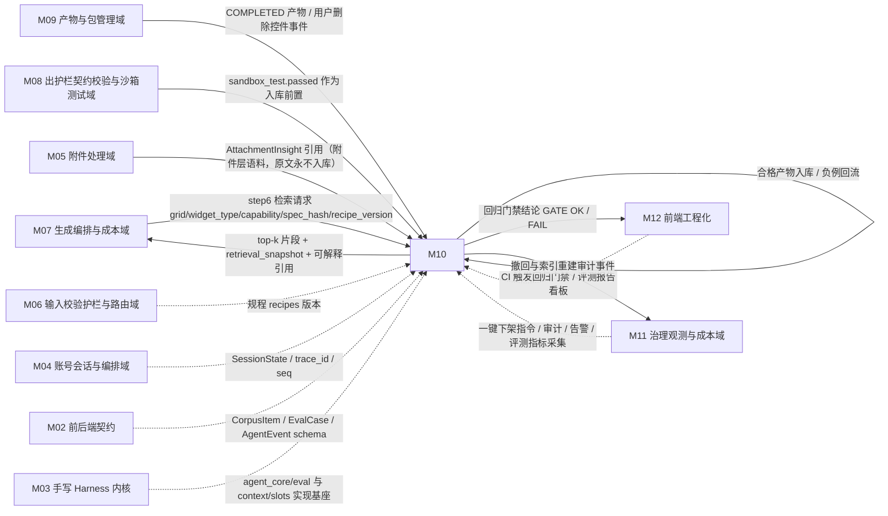
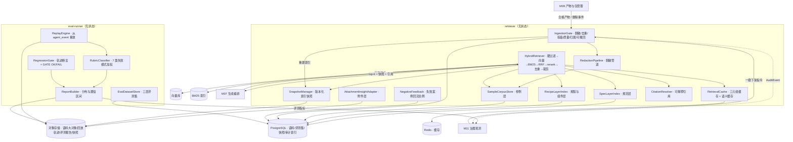
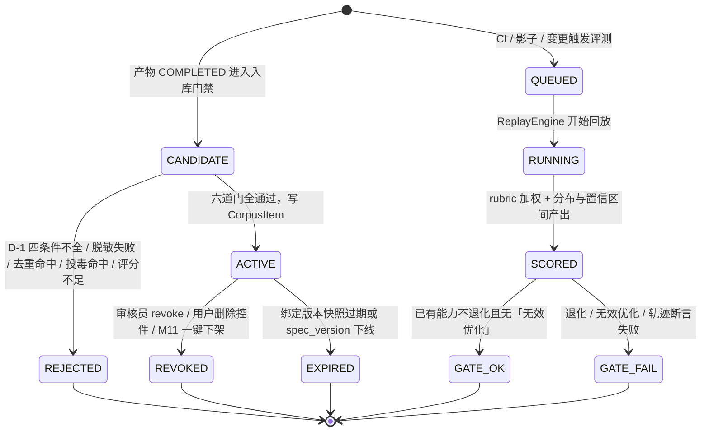

# M10 · 知识、检索与评测域（原 D7）

> **⚠ 规程库归属口径澄清（ADR-003，2026-11-21）**：规程正文由 **M06/M07 维护**（`packages/prompts/recipes/`），本模块**只索引与检索**（§1.8 146 行、§6 266 行口径为准）。`services/guardrails/skill_router.py:11` 注释「M10 维护规程库」为旧口径，与本文冲突，实现阶段（节点⑤）须改正。ADR-003 下规程作为 `kind=skill` 的 Capability 经 L2 按需加载，M10 仍只负责检索索引。

> **文档类型**：可独立交付 / 可独立验收的模块设计文档
> **来源章节**：`设计方案.md` v1.1 §5 D7、§9.5 评测体系与指标口径、§9.3 对抗测试清单、§9.1 四阶段灰度（影子模式）、§0 定稿决策 D-1、§2.6 横切能力 X8/X10、§3.2 一次任务完整时序 step6/step13、§4.1 核心实体（CorpusItem / EvalCase / AuditEvent）、§4.3.2 manifest 元数据、§4.4 REST API 概要、§4.5 实时事件协议、§7.1 服务划分（retriever / eval-runner）、§7.2 Monorepo 目录、§8 总表 D7 行、§10.1 #4/#10 控制点、§10.2 两个闭环、§11.7/§11.8 手写检索与评测实现、§9.6 风险与待决
> **版本**：v1.0　|　**拆分日期**：2026-11-15　|　**最近修订**：2026-11-16（v1.3，ADR-001：规格硬过滤前置条件改为「可选预填 + 缺省询问」，检索发生时 grid 必已确定；补 `SPEC_MISSING`/`CLARIFICATION_REQUIRED`/`CLARIFICATION_LIMIT` 原因码与 `ask_user` 事件；回归触发源新增意图级联样本库/阈值/分类器版本变更）　|　**状态**：设计定稿（v1.3）
> **对应编号**：D7 / FR-17（跨用户公共语料）、FR-18（RAG 优化）、FR-20（离线回放评测）/ X8（RAG 与语料治理，主承载）、X10（评测与回归门禁，主承载）/ D-1（跨用户语料入库与撤回）
> **主责服务**：`retriever`（四层语料、入库门禁、混合检索、版本快照、撤回）、`eval-runner`（离线回放、失败模式 rubric、回归门禁）
> **一句话定义**：把「历史合格产物经入库门禁沉淀成可撤回的公共语料 → 按版本快照检索并只注入 top-k 片段给生成 → 用离线回放与失败模式 rubric 守住每一次变更不退化」做成可复现、可解释、脱离其他模块也能单独提测的跨任务闭环。

---

## 0. 模块速览（零基础可读）

### 0.1 项目最小背景（不懂本模块的人先读这一段）

WidgetPilot 是一个「用自然语言生成手机桌面控件」的 AI Agent 产品：用户在网页里选一种规格（`2x1`/`1x2`/`2x2`/`2x4`/`4x2`/`4x4`）、输入描述、可选上传图片/视频/文本附件，系统生成 **TSX + React 控件代码**，经编译、隔离沙箱测试、双向护栏与契约校验后产出「控件包」，最终在网页上按手机桌面真实比例渲染成受限 iframe 卡片。**受环境与设备限制，本项目不生成 Lynx 代码、不编译移动端 bundle、不打包上传、不装机、不接手机系统 API、不模拟真实设备环境**（原文 §1.2 非目标）。

决定它能不能成为产品的不是「生成」本身，而是三件事：生成产物不可信（要确定性拦截）、长任务可恢复、交互要让人看懂 Agent 在做什么（原文 §1.1）。**本模块解决的是第四件、也是让产品「越用越准」的事**：把合格的历史经验沉淀下来复用，并用可复现的评测证明每次改动确实让「一次生成通过率」变好而不是变坏。

原文 §0 的 D-1 是本模块的最高约束：**跨用户共享的前提是私有数据不共享**。只有「脱敏 + 沙箱测试通过 + 自动评分通过 + 用户未关闭共享」的产物才能进公共语料；附件原文、账号信息、PII 永不入库。这条约束把本模块从「一个检索服务」变成「一条带安全门禁的治理链路」。

### 0.2 端到端 14 步链路中本模块的位置

原文 §3.2 定义了 14 步主链路，本模块**主责第 ⑥ 步的检索供给、第 ⑬ 步的入库回流，并旁路承担全程的离线评测与回归门禁**：

```
① 登录 → 新建会话（grid 可选预填，缺省由系统询问补全，v1.3 ADR-001 D-6）
② 输入描述 + 上传附件 → 传输层校验 → 对象存储 → attachment_id
③ 语义层校验（描述充分性 / 附件 role 明确性 / grid 合法）→ 不足则 AWAITING_INPUT
④ 进 LLM 护栏（注入 / PII / 意图白名单 / 预算前置）→ 命中不进模型
⑤ 意图与规格确定 → 按 widget_type + grid 确定性预取生成规程
⑥ 上下文装配（公共语料 + 规程 + 记忆 + AttachmentInsight，固定槽位、硬过滤优先）★ 检索结果由 M10 提供
⑦ 生成回路：先出 WidgetSpec，再出 TSX + React 代码；模型分档
⑧ 出 LLM 护栏（schema / 能力白名单 / 禁止内容 / PII / 描述符合度 / 规格一致）
⑨ 契约校验：spec ↔ manifest ↔ 代码能力声明 比对 + hash；不过不进沙箱
⑩ 一次性沙箱：TSX 编译 → 挂载渲染 → 尺寸/运行时错误/能力/交互断言 → 证据包
⑪ 生成 WidgetBundle（源码 + 编译产物 + manifest + 校验 + 沙箱结果 + hash），COMPLETED
⑫ 前端 artifact 事件 → 控件墙按 grid 真实比例渲染受限 iframe 卡片
⑬ 评测合格 → 脱敏 → 入库门禁 → 公共语料（可撤回）；失败案例回流为负例 ★ M10 主责
⑭ 全流程按 seq 写 SSE 事件流与只追加审计；成本按模型档位分账
```

- **任务内闭环**（§10.2）：第 ⑧⑨⑩ 步失败 → 回到 ⑦ 自纠正，最多 2 次（D-2）。本模块记录每次失败模式的 rubric 归类，作为评测数据。
- **跨任务闭环**（§10.2）：第 ⑬ 步「评测合格 → 入库门禁（脱敏 / 质量筛选 / 投毒防护 / 归属与可撤回）→ 回流到 ⑥ 的公共语料」，失败案例回流为负例。**原文明确：第二个闭环是跨用户共享需求带来的，也是「完整」与「不完整」的分界线**——本模块就是这条闭环的全部承载者。
- **影子模式旁路**（§9.1）：对历史描述跑生成但**不展示给用户**，人工对照产物与评测集；**X8 语料、模型分档、阈值变更的所有对照在此完成**。离线回放评测只在影子/离线做准入，不做最终上线结论（§9.5）。

### 0.3 为什么必须有这个模块（不可替代性）

1. **没有它，每次生成都从零开始**：规格约束、日历/时钟/闹钟/任务各自的生成规程、历史成功 `spec → bundle` 对无法复用，一次生成通过率无法随使用量提升（§5 D7 四层语料）。
2. **没有它，无法证明「优化」是不是真的优化**：原文 §9.5 判定规则「一次通过率上升但沙箱通过率或安装率下降 → 判无效优化」需要离线回放 + 分布与置信区间；只靠线上感觉或 top-k 命中率会得出错误结论。
3. **没有它，变更会静默退化**：规程 / prompt / 模型 / 检索 / 阈值任一变更必须触发回归门禁（§5 D7、§9.5），否则一次改 prompt 可能把越权代码拦截率打掉而无人知晓。
4. **没有它，跨用户共享会变成投毒传播通道**：公共语料里的历史代码也是不可信数据（§2.3），必须过脱敏、去重、投毒检测、可撤回的入库门禁。
5. **没有它，任务无法复现**：索引必须绑定版本快照、manifest 记录 `retrieval_snapshot`，否则「任一任务可在离线回放中复现」（§5 D7 验收）不成立。

### 0.4 上下游邻居与 mermaid 图



- **上游（给本模块输入）**：M07（检索请求与 `spec_hash`/`recipe_version`）、M09（`WidgetBundle` 与删除事件）、M08（沙箱结论）、M05（`AttachmentInsight`）、M06（规程版本）、M11（下架指令）、M02（契约）。
- **下游（消费本模块输出）**：M07（拿到检索片段装进固定槽位）、M12/CI（拿到回归门禁结论）、M11（拿到评测指标与审计事件）、前端评测与回归页（拿到报告数据）。
- **横切**：M11 采集本模块的审计/trace/成本，M03 提供 `agent_core/eval/` 与 `context/slots.py` 的库级实现，M02 提供 schema 单一事实来源。
- **自环**：合格产物经入库门禁回流到本模块自己的样例层语料（跨任务闭环，§10.2）。

### 0.5 原文对照表

| 本模块内容 | 原文章节 / 编号 |
|---|---|
| 四层语料、入库门禁（D-1）、检索优化、优化目标、评测、验收 | §5 D7、§8 总表 D7 行 |
| 三层评测体系、失败模式 rubric 7 类、主/配套指标、判定规则、离线只做准入 | §9.5 |
| 影子模式（X8 语料与阈值对照在此完成） | §9.1、§0 D-4 关联 |
| 对抗清单：恶意产物入库、公共语料夹带注入、删除后仍被检索 | §9.3 |
| 跨用户语料入库与撤回的全部约束 | §0 D-1、§1.7 #4、§2.4 #7 |
| 横切能力 X8 / X10 定义 | §2.6 X8/X10、§5 X* 表 |
| 主链路 step6 上下文装配、step13 评测合格入库 | §3.2 step6 / step13 |
| `CorpusItem` / `EvalCase` / `AuditEvent` 实体字段 | §4.1 |
| manifest 的 `retrieval_snapshot` / `recipe_version` / `spec_version` | §4.3.2 |
| `/api/corpus` 检索与撤回、`/api/evals` | §4.4 |
| `AgentEvent` 事件协议（检索引用与评测摘要的载体） | §4.5 |
| `retriever` / `eval-runner` 服务划分与伸缩依据 | §7.1 |
| `services/retriever/`、`services/eval_runner/`、`packages/agent_core/eval/` 代码落位 | §7.2、§11.2 |
| 控制点 #4（上下文装配 RAG）、#10（观测/评测/成本/审计） | §10.1 |
| 跨任务闭环（评测合格 → 入库门禁 → 回流公共语料 → 负例） | §10.2 |
| 检索融合 RRF、脱敏管道、评测手写实现 | §11.7、§11.8 |
| 公共语料质量评分偏松、语料规模与检索成本风险 | §9.6 |
| 规则 + 轨迹断言 + 人工抽检、版本化索引快照 | §5 D7 技术栈 |

---

## 1. 模块定位与职责边界

### 1.1 为什么必须有（三条不可替代的职责）

1. **跨任务经验的唯一沉淀地**：四层语料（规范层 / 规程与组件层 / 样例层 / 附件层）只有在这里被索引、被绑定版本、被授权撤回；别处存的是「一次性产物」，这里存的是「可复用且可追责的知识」。
2. **生成质量的可复现供给**：检索结果必须与 `retrieval_snapshot` 绑定并写进 manifest，做到「同题同版本两次跑结果一致」（§8 D4 行验收口径，本模块提供其中的检索快照部分），且只注入 top-k 相关片段、不整段回喂历史代码。
3. **变更不退化守门人**：规程 / prompt / 模型 / 检索 / 阈值变更触发回归门禁，用确定性轨迹断言 + 分布与置信区间判定，是「门禁不可在线关闭」原则的执行主体之一。

### 1.2 做什么（职责清单）

| # | 职责 | 原文依据 / 说明 |
|---|---|---|
| R1 | 维护四层语料：规范层（6 种规格尺寸/信息密度/可用能力）、规程与组件层（日历/时钟/闹钟/任务各自生成规程 + 可复用片段）、样例层（历史成功 `spec → bundle` 对）、附件层（本次 `AttachmentInsight`） | §5 D7 |
| R2 | 跨用户公共语料**入库门禁**：脱敏 + 沙箱测试通过 + 自动评分通过 + 用户未关闭共享，四者全真才入库 | §0 D-1 |
| R3 | 入库前脱敏、去重、投毒检测（恶意描述 / 越权代码 / 重复灌水） | §0 D-1、§5 D7 |
| R4 | 绑定 `grid` / `widget_type` / `spec_version` / `recipe_version` 元数据到每条语料 | §5 D7 |
| R5 | 用户删除控件 → 公共语料立即失效；`revoke` 撤回后立即不再被检索到 | §0 D-1、§5 D7 验收 |
| R6 | 生成时可解释「参考了哪个控件」（引用可溯源），并把 `retrieval_snapshot` 写进 manifest | §5 D7、§4.3.2 |
| R7 | 检索管线：硬过滤优先（`grid + widget_type + capability`）→ 向量 + BM25（规程名/API 名靠关键词）→ 自研 RRF → rerank → 去重 → 预算裁剪 | §5 D7、§11.7 |
| R8 | 版本化索引快照；固定槽位 + 去重保住 prompt caching；只注入 top-k 相关片段，不整段回喂历史代码 | §5 D7 |
| R9 | 缓存：键 `(spec_hash, recipe_version, retrieval_snapshot)` + 高频描述语义缓存；失败案例回流为负例 | §5 D7 |
| R10 | 优化目标管理：降低回边次数、提高一次生成通过率，**而非只看 top-k 命中率** | §5 D7 |
| R11 | 离线回放评测 + 失败模式 rubric 7 类（按严重度加权）+ 确定性断言（不用裁判模型）+ 跑多次报分布与置信区间 | §5 D7、§9.5 |
| R12 | 三层评测体系：CI 快速回归门禁（私有集 + 确定性轨迹断言）、离线回放集（脱敏历史 60% / 失败案例 30% / 专家构造 10%）、人工抽检校准 | §9.5 |
| R13 | 变更触发回归门禁：规程 / prompt / 模型 / 检索 / 阈值变更 → 全量回放；报主指标与配套指标、执行「无效优化」判定规则 | §5 D7、§9.5 |
| R14 | 影子模式对照执行：X8 语料、模型分档、阈值变更的所有对照在影子/离线完成；离线只做准入不做最终上线结论 | §9.1、§9.5 |
| R15 | 一键下架公共语料并重跑检索索引（执行侧），撤回/下架动作写审计 | §9.2，执行归 M10、指令归 M11 |
| R16 | 写 `AuditEvent`（入库、拒绝、撤回、回归门禁、负例回流）与 trace 埋点，供 M11 汇总 | §4.1、§10.1 #10 |

### 1.3 不做什么（明确排除，含与相邻模块的边界切割）

| 不做 | 这块归哪个 Mxx | 边界说明 |
|---|---|---|
| 成本告警、配额、成本异常自动熔断、SLO 告警阈值与 runbook | **M11** | 本模块只把评测指标与审计事件喂给 M11；不做告警判定、不做熔断决策 |
| 上下文装配（固定槽位顺序、token 预算、压缩、prompt caching 前缀决策） | **M07 / M03** | 本模块只返回 `RetrievalResult`（top-k 片段 + 快照 + 引用），由 M07 决定怎么装进槽位 |
| 生成回路、结构化输出、自纠正回边、模型分档、模型调用 | **M07 / M03** | 本模块不调模型，也不调用 model gateway；评测中的「回放」是读历史事件重放，不是重新生成 |
| 出 LLM 护栏、契约校验、TSX 编译、沙箱渲染与行为断言 | **M08** | 本模块只消费 `sandbox_test.passed` 作为入库前置，不重跑校验 |
| 沙箱不可用时的降级执行（静态校验 + 只读诊断） | **M08** | 本模块只记录降级事实为评测数据 |
| 产物内容生成、`WidgetBundle` hash/版本链、CSP、bridge 放行 | **M09** | 本模块只读 `WidgetBundle`；manifest 中的 `retrieval_snapshot` 由本模块提供，但 manifest 由 M09 落盘 |
| 会话状态机、checkpoint、租约、`seq` 生成与 SSE 扇出 | **M04 / M03** | 本模块产生 `AgentEvent` 的 payload 内容，不负责编号与扇出 |
| 附件原文上传、类型嗅探、role 判定、多模态处理 | **M05** | 附件层语料只引用 `AttachmentInsight`；**附件原文永不入库** |
| 规程内容编写与版本化 prompt 的维护 | **M06 / M07（`packages/prompts/recipes/`）** | 本模块只索引与检索规程，不编写规程正文 |
| 评测报告可视化、指标分布图、门禁结果 UI | **前端 M12 / 评测与回归页（§6.1/§6.2）** | 本模块只产出报告对象与结构化数据 |
| 语料下架/熔断的**治理指令下发**、全局开关、kill switch | **M11** | 本模块执行「下架 + 重跑索引」，指令与审计归档归 M11 |
| 用裁判模型给数值打分、把模型自报置信度当路由判据 | **明确禁止（§2.6、§11.5）** | 数值一律用确定性断言 |

> **最易混淆的两条边界**：① 「上下文装配」在 M07，本模块只做「检索」这一段，返回的是片段而非拼好的 prompt；② 「语料一键下架」在 §9.2 归治理域描述，但**执行（撤回 + 索引重建）在本模块**，M11 只下发指令并留审计。

### 1.4 输入 / 输出与上下游契约

| 方向 | 内容 | 契约形式 |
|---|---|---|
| 入 | 检索请求：`grid` / `widget_type` / `capability[]` / `spec_hash` / `recipe_version` / 归一化描述 / `token_budget` | 内部接口 `retriever.search()`（§4.3） |
| 入 | 合格产物：`WidgetBundle`（含 `manifest`、`static_check`、`sandbox_test`、`hash`）、`User.share_enabled`、`sandbox_test.passed` | 内部接口 `ingestion_gate.evaluate()`（§4.3） |
| 入 | 附件层：`AttachmentInsight{source_ref, extracted, confidence}` 引用 | 对象存储引用（§6.5） |
| 入 | 删除/撤回/下架指令、`AuditEvent` trace 上下文 | REST（§4.1）+ 内部接口 |
| 入 | 变更事件（规程/prompt/模型/检索/阈值版本变更） | CI / 影子模式触发（§4.3 `regression_gate.check()`） |
| 出 | `RetrievalResult`：`top-k` 片段、`retrieval_snapshot`、`citations[]`（可解释「参考了哪个控件」）、空结果标记 | 内部接口，供 M07 装配 |
| 出 | `IngestionDecision`：入库 / 拒绝（含拒绝原因）、`corpus_id` | 内部接口 + `AuditEvent` |
| 出 | `EvalReport`：主指标/配套指标、失败模式分布、置信区间、`GateVerdict` | 对象存储 `eval/runs/{eval_run_id}/report.json` + REST `/api/evals` |
| 出 | `CorpusItem` / `EvalCase` / `NegativeExample` / `RetrievalSnapshot` 持久记录 | PG 表 + 对象存储引用 |
| 出 | 评测/入库/撤回/门禁相关 `AgentEvent.payload`、`AuditEvent` | SSE 通道（由 M04 编号扇出）+ 只追加审计 |

### 1.5 承载的横切能力 X*

- **X8（主承载，RAG 与语料治理）**：四层语料、硬过滤优先、混合检索 + rerank、版本快照、缓存、负例回流；跨用户语料入库门禁与撤回（§2.6）。「私有数据不共享；可撤回；负例回流」是本模块的安全基线。
- **X10（主承载，评测与回归门禁）**：离线回放 + 失败模式 rubric；规程/prompt/模型/检索变更触发回归；报告含分布与置信区间（§2.6）。
- **X2（协同）**：上下文管理中的「检索片段」由本模块供给，固定槽位与 prompt caching 决策在 M07/M03；本模块通过「只注入 top-k + 去重」配合保住 caching 前缀。
- **X3（协同）**：记忆管理（用户偏好）在 M07；本模块的「样例层」与「负例回流」是跨用户级经验，不把历史代码整段回喂（与 X3 边界一致）。
- **X11（协同）**：可观测与审计主责在 M11；本模块负责把入库拒绝、投毒命中、撤回、回归门禁结论写成 `AuditEvent` 供其重放。

### 1.6 关键设计原则

1. **私有数据不共享（§1.7 #4）**：只有脱敏后的 spec / 代码 / 过程摘要可进公共语料；附件原文、账号信息、PII 永不入库。
2. **可撤回优先于可复用**：用户删除控件 → 公共语料立即失效；`revoke` 后立即不再被检索到；引用必须可溯源到具体 `corpus_id`。
3. **可复现优先于「更准」**：索引绑定版本快照，manifest 记录 `retrieval_snapshot`，任一任务可在离线回放中复现（§5 D7 验收）。
4. **确定性断言（§11.5、§9.5）**：数值、枚举、能力声明一律用确定性断言，不用裁判模型打分；离线结果报分布与置信区间，不报单点估计。
5. **优化目标是「回边次数下降 + 一次生成通过率上升」**，不是 top-k 命中率（§5 D7）；判定规则「一次通过率上升但沙箱通过率或安装率下降 → 无效优化」。
6. **只注入 top-k 相关片段，不整段回喂历史代码**；检索结果一律按不可信数据标注（§2.3、§9.3）。
7. **门禁不可在线关闭（§1.7 #8）**：所有 A/B 对照在影子模式或离线回放完成；离线只做准入，不做最终上线结论。
8. **零 Agent / RAG 框架（D-5、§11.1）**：检索融合（SQL 硬过滤 + 向量库客户端 + BM25 + 自研 RRF）与 Eval Runner 全部手写。
9. **失败案例回流为负例**：一次失败必须变成下一次评测集的一部分，而不是被丢弃。

---

## 2. 技术栈

### 2.1 分层选型表（层 | 选型 | 版本/约束 | 为什么 | 明确不用什么）

| 层 | 选型 | 版本 / 约束 | 为什么选 | 明确不用什么 |
|---|---|---|---|---|
| 规范层语料 | 版本化 JSON + Postgres 索引（`grid` 规格表） | 随 `spec_version` 版本化 | 规格是生成前必确定的硬过滤第一维；获取方式为可选预填 + 缺省询问（`grid_source: selector/explicit_text/clarified`），系统不推断（v1.3 ADR-001 D-6）；检索发生时 grid 必已确定；确定性、可断言 | 不让模型推断规格、不把规格写死在 prompt 里 |
| 规程与组件层 | `packages/prompts/recipes/` 版本化文件 + PG 索引 | 绑定 `recipe_version` | 日历/时钟/闹钟/任务各自生成规程 + 可复用片段，按 `widget_type + grid` 预取 | 不新增常驻工具、不做多 Agent 角色 |
| 样例层 | 脱敏 `spec → bundle` 对 + 对象存储引用 | 仅 `sandbox_test.passed=true` 且 `quality_score` 达标 | 历史成功样例是提升一次通过率的主要语料 | 附件原文 / 账号信息 / PII 永不入库 |
| 附件层 | `AttachmentInsight` 对象引用（只读） | 仅本次会话、按 `user_id` 隔离 | 作为检索的第 4 层上下文，不落公共库 | 不落附件原文、不跨用户共享 |
| 向量检索 | 向量库客户端（pgvector / 独立向量库） | 【推导·需评审】`dim` 与 embedding 模型版本写入 `retrieval_snapshot` | 语义相似召回；原文明确「向量库」 | **不用 LangChain retriever / 任何 RAG 框架**（§11.1） |
| 关键词检索 | BM25（自研或独立库） | 索引字段含规程名 / API 名 | 原文「规程名/API 名靠关键词」，语义检索补不了精确标识符 | 不用纯向量检索替代关键词 |
| 融合 | **自研 RRF**（Reciprocal Rank Fusion） | `k=60`【推导·需评审】 | 无权重调参、对两路 rank 稳健；§11.7 明确「自研 RRF 融合」 | 不用框架内置 fusion、不用模型自报置信度加权 |
| 重排 | rerank（cross-encoder 或规则重排） | 【依赖外部 / 推导·需评审】版本写入快照 | 提升 top-k 精度，支撑「只注入 top-k」 | 不用 LLM 当 rerank 裁判 |
| 索引快照 | 版本化索引快照 + manifest `retrieval_snapshot` | 快照只读、不可原地改 | 保证可复现（§5 D7、§11.7） | 不允许「在线热改索引」破坏复现 |
| 缓存 | Redis：结果缓存 + 高频描述语义缓存 | 键 `(spec_hash, recipe_version, retrieval_snapshot)` | 降低重复检索成本（§5 D7、§9.6） | 缓存不跨 `retrieval_snapshot` 复用 |
| 入库门禁 | 脱敏管道 + 去重 + 投毒检测 + 自动评分 + 归属校验（纯代码） | 五项全通过才入库（D-1） | 堵住 PII 泄漏与跨用户投毒传播 | 不靠模型口头拒绝、不跳过任一门 |
| 评测执行 | **自建 Eval Runner**（`eval_runner` 服务） | 手动 / CI 触发 | 离线回放 + 失败模式 rubric + 回归门禁全部可断言 | 不用 LLM 专用评测平台、不用裁判模型打数值 |
| 断言方式 | 规则 + 确定性轨迹断言 + 人工抽检校准 | 三层评测体系（§9.5） | 数值确定性、人工校准自动评分一致性 | 不把模型自报置信度当判据 |
| 持久化 | PostgreSQL（语料元数据 / 评测集 / 快照表）+ 对象存储（大对象） | 大对象只存引用 | 与全局「状态持久化、大对象外置」一致 | 不把代码/日志塞进 PG |
| 可观测 | OpenTelemetry SDK + 自建 `agent_event` / `trace_span` 表 | 通用标准，由 M11 提供采集面 | 重建完整链路、评测报告可追溯 | **不用 LLM 专用观测平台 SDK**（§11.1） |
| 服务框架 | FastAPI + Pydantic v2 | Python 3.11+ | 与全局技术栈一致、OpenAPI 由 M02 消费 | 不引入 AI SDK / Agent 框架 |

### 2.2 硬约束

- **D-5 零 Agent 框架（§11.1）**：禁止 LangChain / LangGraph、`LangChain retriever` / 任何 RAG 框架、`bind_tools`、LLM 专用观测 SDK（LangFuse）、裁判模型。检索融合必须写成「SQL 硬过滤 + 向量库客户端 + BM25 + 自研 RRF」；评测必须写成自建 `eval_runner`（`datasets/ replay/ regression_gate.py` + `agent_core/eval/` 的 `replay.py / rubric.py / gate.py`）。
- **D-1 私有数据不共享**：附件原文、账号信息、PII 永不入库；`User.share_enabled=false` 时产物不得进公共语料。
- **门禁无在线关闭开关（§1.7 #8）**：入库门禁与回归门禁不可在线关闭；所有对照在影子/离线完成。
- **数值确定性（§11.5、§9.5）**：数值、枚举、能力声明用确定性断言；离线结果报分布与置信区间。
- **可撤回**：任何语料必须可 `revoke`；删除控件 → 立即失效。
- **保留的通用基础设施**：FastAPI、Pydantic v2、Postgres、Redis、对象存储、向量库客户端、OTel SDK、tiktoken（纯计数）、`httpx`。

### 2.3 运行时依赖

| 依赖 | 用途 | 不可用时的行为 |
|---|---|---|
| PostgreSQL | `CorpusItem` / `EvalCase` / `RetrievalSnapshot` / 评测集 / 审计索引 | 入库与评测写操作拒绝，不降级（语料一致性不可降级）；检索可走只读快照缓存 |
| 向量库 | 语义召回 | 降级为 BM25 + 硬过滤 + 规则 rerank，并在 `RetrievalResult.degraded=true` 标记；不编造结果 |
| BM25 索引 | 关键词召回（规程名 / API 名） | 降级为硬过滤 + 向量；不跳过硬过滤 |
| Redis | 结果缓存 / 语义缓存 / 限流 | 缓存失效直接走完整检索管线，不返回陈旧结果 |
| 对象存储 | 语料 spec/源码/摘要、回放轨迹、评测报告、索引快照文件 | 写失败则本条入库不提交；评测报告写失败则门禁不出 `GATE OK` |
| rerank 服务【依赖外部】 | top-k 重排 | 降级为 RRF 原始排序；`RetrievalResult.degraded=true` |
| OTel / M11 采集面 | trace 与审计 | 本模块仍写本地 `AuditEvent`，恢复后补报，不丢审计 |
| `packages/contracts`（M02） | `CorpusItem` / `EvalCase` / `AgentEvent` schema | CI 一致性校验失败即阻断发布 |

### 2.4 monorepo 代码落位（原文 §7.2、§11.2）

```
widgetpilot/
  services/
    retriever/                     # M10 主服务（无状态，按检索量伸缩）
      corpus/                      # 四层语料索引与 CorpusItem 读写
        spec_layer.py              # 规范层：6 种规格尺寸/信息密度/可用能力
        recipe_layer.py            # 规程与组件层：日历/时钟/闹钟/任务规程 + 可复用片段
        sample_layer.py            # 样例层：历史成功 spec -> bundle 对
        attachment_layer.py        # 附件层：本次 AttachmentInsight 引用（只读）
      ingestion_gate.py            # 入库门禁：脱敏/去重/投毒/质量/归属/可撤回
      hybrid_search.py             # 硬过滤 -> 向量 -> BM25 -> 自研 RRF -> rerank -> 去重 -> 预算裁剪
      snapshot.py                  # 版本化索引快照 + retrieval_snapshot 生成
      cache.py                     # (spec_hash, recipe_version, retrieval_snapshot) 缓存
      negative.py                  # 失败案例回流为负例
      citations.py                 # 可解释「参考了哪个控件」
      redact.py                    # 脱敏管道
    eval_runner/                   # M10 主服务（无状态，手动 / CI 触发）
      datasets/                    # 私有集 / 离线回放集 / 专家构造集
      replay/                      # 从 agent_event 重放历史会话
      rubric.py                    # 失败模式 rubric 7 类 + 严重度加权
      regression_gate.py           # 确定性轨迹断言 + GATE OK / FAIL
      report.py                    # 分布与置信区间、主/配套指标
  packages/
    agent_core/
      context/slots.py             # M03 提供：固定槽位装配（本模块只供片段）
      eval/replay.py               # M03 提供：回放库级实现
      eval/rubric.py               # M03 提供：rubric 库级实现
      eval/gate.py                 # M03 提供：门禁库级实现
    contracts/                     # M02：*.schema.json / enums
    prompts/recipes/               # M06/M07 维护规程正文，本模块只索引
  infra/
    observability/                 # M11：OTel collector / Grafana / 告警规则
  docs/runbook/                    # 语料撤回预案（§9.2）
```

---

## 3. 设计架构

### 3.1 内部组件与职责（图 + 表）



| 组件 | 职责 | 关键不变量 |
|---|---|---|
| `SpecLayerIndex` | 六种规格的尺寸 / 信息密度 / 可用能力索引 | 规格是生成前必确定的硬过滤第一维；获取方式为可选预填 + 缺省询问（`grid_source: selector/explicit_text/clarified`），系统不推断（v1.3 ADR-001 D-6）；检索发生时 grid 必已确定（不变量 I-G1），硬过滤必带 `grid` |
| `RecipeLayerIndex` | 日历/时钟/闹钟/任务各自规程 + 可复用片段 | 绑定 `recipe_version`；规程名/API 名进 BM25 字段 |
| `SampleCorpusStore` | 历史成功 `spec → bundle` 对 | 只存脱敏产物；`revoked_at != null` 立即不可检索 |
| `AttachmentInsightAdapter` | 本次 `AttachmentInsight` 只读引用 | 附件原文永不入库；不跨用户共享 |
| `IngestionGate` | 六道门全通过才入库 | D-1 四条件 + 脱敏 + 去重 + 投毒检测，任一项失败即拒绝并留证 |
| `RedactionPipeline` | 脱敏 | PII / 账号 / 附件原文清零后才允许写样例层 |
| `HybridRetriever` | 七级检索管线 | 硬过滤先于任何语义召回；输出必带 `retrieval_snapshot` |
| `SnapshotManager` | 版本化索引快照 | 快照只读；`retrieval_snapshot` 与索引内容一一对应 |
| `RetrievalCache` | 三元组缓存 + 高频描述语义缓存 | 缓存键含 `retrieval_snapshot`，快照变更即失效 |
| `NegativeFeedback` | 失败案例回流负例 | 失败案例进离线回放集（占 30%，§9.5） |
| `CitationResolver` | 可解释引用 | 每个注入片段可溯源到 `corpus_id` + `bundle_id` |
| `ReplayEngine` | 从 `agent_event` 重放历史会话 | 不重新生成、不调模型；轨迹可复现 |
| `RubricClassifier` | 7 类失败模式 + 严重度加权 | 数值用确定性断言，不用裁判模型 |
| `RegressionGate` | 轨迹断言 + 无效优化判定 | 门禁只断言「已有能力不退化」；不可在线关闭 |
| `ReportBuilder` | 分布与置信区间、主/配套指标 | 报分布不报点估计；离线只做准入 |

### 3.2 处理流程与数据流（编号步骤）

**流程 A · 检索（对应主链路 step6，服务 M07）**

1. M07 发 `RetrievalQuery{grid, widget_type, capability[], spec_hash, recipe_version, intent, token_budget}`。
2. `RetrievalCache` 用 `(spec_hash, recipe_version, retrieval_snapshot)` 查缓存；命中且快照未变 → 直接返回 `RetrievalResult`（`cache_hit=true`）。
3. `HybridRetriever` 先做 **SQL 硬过滤**：`WHERE grid=? AND widget_type=? AND capability ⊆ ? AND revoked_at IS NULL`，把候选集收敛到同规格、同类型、能力兼容、未撤回的语料。
4. 向量库对归一化描述做语义召回 `top-k_vec`；BM25 对「规程名 / API 名 / spec 字段」做关键词召回 `top-k_bm25`（规程名/API 名靠关键词）。
5. 自研 RRF 融合两路 rank：`RRF(d) = Σ 1/(k + rank_i(d))`，`k=60`【推导·需评审】。
6. rerank 重排 → 去重（同 `bundle_id` / 同片段 hash 只留一条）→ 预算裁剪到 `token_budget`。
7. `SnapshotManager` 固化本次 `retrieval_snapshot`（含索引版本、embedding 版本、BM25 版本、rerank 版本、候选集摘要 hash）。
8. `CitationResolver` 为每个片段附 `corpus_id` / `bundle_id` / `grid` / `recipe_version`，支持「参考了哪个控件」。
9. 返回 `RetrievalResult{chunks[], retrieval_snapshot, citations[], empty, degraded}`；**`empty=true` 时不编造、不回喂整段历史代码，输出 `HUMAN_REQUIRED` 转人工**（§10.1 #4、§5 D7 验收）。
10. 结果写缓存；片段引用随 `AgentEvent` 的检索引用通道交给 M07 装配进固定槽位（§4.2）。

**流程 B · 入库（对应主链路 step13，跨任务闭环 §10.2）**

1. M09 在产物 `COMPLETED` 后投递 `WidgetBundle` + `sandbox_test.passed` + `User.share_enabled`。
2. `IngestionGate` 校验 **D-1 四条件**：`sandbox_test.passed=true` ∧ `auto_score>=threshold` ∧ `User.share_enabled=true` ∧ 未撤回；任一不满足即拒绝。
3. `RedactionPipeline` 脱敏：移除账号信息、PII、附件原文引用，只保留脱敏 spec / 代码 / 过程摘要。
4. **去重**：按 `(spec_hash, code_hash, grid, widget_type)` 判定，重复灌水直接拒绝。
5. **投毒检测**：恶意描述（注入指令）、越权代码（未声明 capability / 未知 import / `fetch` / `eval`）、重复灌水三类；命中即拒绝（§9.3「投毒样本 100% 被拦」）。
6. **自动评分**：`quality_score` 由确定性规则产出（不用裁判模型）；阈值版本化、影子校准（§9.6「自动评分初值可能偏松」）。
7. 通过 → 生成 `CorpusItem`，绑定 `grid` / `widget_type` / `spec_version` / `recipe_version` / `retrieval_snapshot` 元数据，写 PG + 对象存储。
8. 写 `AuditEvent`（`action=CORPUS_INGEST`，`decision=ALLOW`，含 `trace_id` / `prev_hash`）。
9. 触发 `SnapshotManager` 增量更新索引快照；旧快照保留供复现。
10. 用户删除控件 / 审核员 `revoke` → `revoked_at=now()`，硬过滤立即排除；**撤回生效时延可测**（§9.3）。
11. M11 下发「一键下架」→ 批量 `revoked_at` + 重跑检索索引（§9.2），写审计。
12. 生成失败案例 → `NegativeFeedback` 回流为负例，进离线回放集（占 30%）。

**流程 C · 评测与回归门禁（旁路 / 影子 / CI）**

1. 触发源：CI 快速回归门禁、影子模式对照、规程/prompt/模型/检索/阈值变更、人工抽检校准；v1.3 新增——意图级联样本库（`intent_samples`）变更、L2 相似度阈值变更、L3 分类器版本变更同样触发本模块回归门禁（v1.3 ADR-001 D-8）。
2. `EvalDatasetStore` 取三层评测集：私有集（CI 用，含确定性轨迹断言）/ 离线回放集（脱敏历史 60% + 失败案例 30% + 专家构造 10%）/ 人工抽检集。
3. `ReplayEngine` 从 `agent_event` 按 `seq` 重放历史会话轨迹（不重新生成、不调模型）。
4. `RubricClassifier` 把每次结果归入 7 类失败模式，按严重度加权。
5. `ReportBuilder` 跑多次（`times>=5`【推导·需评审】）产出**分布与置信区间**，不报单点估计。
6. 计算主指标：一次生成通过率、规格合规率、沙箱测试通过率、安装率；配套指标：回边次数、重复描述率、跨天恢复成功率、单会话总成本（含重试与沙箱机时）（§1.6、§9.5）。
7. 执行判定规则：**一次通过率上升但沙箱通过率或安装率下降 → 判无效优化，回查评测集或护栏阈值**（§9.5）。
8. `RegressionGate` 用确定性轨迹断言比对基线，输出 `GATE OK` / `GATE FAIL`；门禁只断言「已有能力不退化」，不因新增能力缺失而阻塞（§11.9）。
9. 报告写对象存储 `eval/runs/{eval_run_id}/report.json`，指标推 M11 告警面，评测结论推前端评测与回归页。
10. **离线只做准入，不做最终上线结论**（§9.5）；所有对照在影子/离线完成，不提供在线关闭门禁的开关。

### 3.3 状态机

本模块**拥有** `CorpusItemState` / `IngestionDecision` / `EvalRunState` / `GateVerdict`（完整 TS 定义见 §5.1），**参与但不拥有** `SessionState`（M04）、`BundleState`（M09）。



### 3.4 关键机制、算法与「不变量清单」

**A. 四层语料（原文 §5 D7，完整展开）**

| 层 | 内容 | 关键字段 | 是否进公共语料 |
|---|---|---|---|
| 规范层 | 6 种规格的**尺寸 / 信息密度 / 可用能力** | 见下表 | 是（全局规范，无私有数据） |
| 规程与组件层 | 日历 / 时钟 / 闹钟 / 任务**各自生成规程** + 可复用片段 | `widget_type`、`recipe_version`、规程名、API 名 | 是（版本化规程） |
| 样例层 | 历史成功 `spec → bundle` 对 | `spec_hash`、`bundle_id`、`quality_score`、脱敏代码 | 是（须过入库门禁） |
| 附件层 | 本次 `AttachmentInsight` | `source_ref`、`extracted`、`confidence` | **否**（原文永不入库，仅本次会话只读引用） |

规范层 6 种规格（原文 §1.5，尺寸/信息密度/可用能力）：

| `grid` | 网格 | 前端像素（`cell=80px`） | 典型可用信息密度 | 约束示例 / 可用能力 |
|---|---|---|---|---|
| `2x1` | 2 列 1 行 | 160×80 | 单行文本 / 数字 | 放不下月视图日历，触发规格冲突；`date`/`static_data` |
| `1x2` | 1 列 2 行 | 80×160 | 竖排短信息 | 不适合宽表格；`date`/`timer` |
| `2x2` | 2×2 | 160×160 | 日期 + 简短事项 | 中等；`date`/`timer`/`local_storage` |
| `2x4` | 2 列 4 行 | 160×320 | 列表型（待办 / 日程） | 可滚动区域需声明；`date`/`local_storage`/`static_data` |
| `4x2` | 4 列 2 行 | 320×160 | 横向多指标 | 横向布局优先；`date`/`timer`/`theme` |
| `4x4` | 4×4 | 320×320 | 日历月视图 / 复杂面板 | 信息密度上限最高；全部 6 种 `Capability` |

规程与组件层按 `widget_type` 各有一套生成规程（§6 交互断言：日历翻月、时钟 tick、闹钟开关、任务勾选），并沉淀「可复用片段」；规程名与 API 名必须进 BM25 索引字段，因为**语义向量对精确标识符不可靠**。

**B. 入库门禁六道门（D-1 全约束，布尔表达式）**

```
allow = sandbox_test.passed
     && quality_score >= score_threshold        # 自动评分通过
     && User.share_enabled == true              # 用户未关闭共享
     && redaction.pii_count == 0                # 脱敏完成，附件原文/账号/PII 清零
     && !duplicate(spec_hash, code_hash, grid, widget_type)   # 去重
     && !toxicity.malicious_desc
     && !toxicity.overprivileged_code           # 越权代码 / 未知 import / fetch / eval
     && !toxicity.flood                        # 重复灌水
```

任一项为假 → `IngestionDecision=REJECT` + 具体 `reject_reason` + `AuditEvent`。**「用户删除控件 → 公共语料立即失效」与「revoke 可撤回」是门禁之外的独立硬约束**，由 `revoked_at` 字段保障。

**C. 混合检索算法（§11.7）**

1. SQL 硬过滤（先执行，缩小候选集）：`grid` + `widget_type` + `capability` 兼容 + `revoked_at IS NULL`。
2. 向量 `top-k_vec` 与 BM25 `top-k_bm25` 并行召回；BM25 字段含规程名 / API 名 / `spec_version`。
3. 自研 RRF：`RRF(d) = Σ_{i∈{vec,bm25}} 1/(k + rank_i(d))`，`k=60`【推导·需评审】。
4. rerank → 去重（片段 hash / `bundle_id`）→ 预算裁剪到 `token_budget`。
5. 固定槽位 + 去重保住 prompt caching；**只注入 top-k 相关片段，不整段回喂历史代码**。
6. 缓存键 `(spec_hash, recipe_version, retrieval_snapshot)` + 高频描述语义缓存；`retrieval_snapshot` 变更即失效。

**D. 版本快照与可复现**：索引快照记录 `index_version` / `embedding_model_version` / `bm25_version` / `rerank_version` / `candidate_set_hash`，写进 `manifest.retrieval_snapshot`。**同一 `retrieval_snapshot` 必须能重放出完全相同的候选集与排序**，这是「任一任务可在离线回放中复现」的前提。

**E. 失败模式 rubric 7 类（§5 D7、§9.5，按严重度加权）**

| 失败模式 | 含义 | 严重度权重【推导·需评审】 |
|---|---|---|
| `CORRECT_GENERATION` | 正确生成（基线正例） | 0（正例） |
| `SAFE_HANDOFF` | 安全转人工（预期的确定性中断） | 1 |
| `RECOVERABLE_ERROR` | 可恢复错误（回边后成功） | 2 |
| `OVERPRIVILEGED_CODE` | 越权代码 | 5 |
| `SPEC_MISMATCH` | 规格不符 | 4 |
| `INFINITE_LOOP` | 死循环 | 5 |
| `ABANDON` | 放弃 | 3 |

**数值一律用确定性断言，不用裁判模型**（§11.5）；rubric 用于加权汇总与失败模式分布，不用于给单次数值打分。

**F. 三层评测体系与判定规则（§9.5）**：CI 快速回归门禁（私有集 + 确定性轨迹断言）/ 离线回放集（脱敏历史 60% / 失败案例 30% / 专家构造 10%）/ 人工抽检校准（校准自动评分与裁判一致性）。主指标：一次生成通过率、规格合规率、沙箱测试通过率、安装率；配套指标：回边次数、重复描述率、跨天恢复成功率、单会话总成本。**判定规则**：一次通过率上升但沙箱通过率或安装率下降 → 无效优化；离线只做准入不做最终上线结论。

**不变量清单**：

| # | 不变量 | 断言方式 |
|---|---|---|
| I1 | 公共语料中附件原文 / 账号信息 / PII 条数 = 0 | 脱敏管道输出扫描 + 全表正则/PII 检测 |
| I2 | 每条 `ACTIVE` 语料都满足 D-1 四条件 | 入库门禁决策日志回放 |
| I3 | `revoked_at != null` 的语料不出现在任何检索结果 | 撤回后立即检索，命中数 = 0 |
| I4 | 投毒样本（恶意描述/越权代码/重复灌水）100% 被拒 | 投毒集全量回放，拒绝率 = 100% |
| I5 | 同一 `retrieval_snapshot` 检索结果完全一致 | 两次检索 `chunks[]` 与排序逐项相等 |
| I6 | 硬过滤先于任何语义召回 | 调用链断言：SQL 过滤日志早于向量/BM25 日志 |
| I7 | 每个注入片段可溯源到 `corpus_id` + `bundle_id` | `citations[]` 覆盖率 = 100% |
| I8 | 检索空结果不编造、输出 `HUMAN_REQUIRED` | `empty=true` 时 `chunks=[]` 且原因码正确 |
| I9 | 缓存不跨 `retrieval_snapshot` 复用 | 换快照后 `cache_hit=false` |
| I10 | 任一任务可在离线回放中复现 | 回放轨迹与历史 `agent_event` 按 `seq` 一致 |
| I11 | 评测数值用确定性断言、报告含置信区间 | 报告结构校验 + 无裁判模型调用记录 |
| I12 | 失败案例 100% 回流为负例 | 失败会话数 = 负例新增数 |
| I13 | 变更触发回归门禁，门禁不可在线关闭 | 无关闭开关；变更事件→回放记录一一对应 |
| I14 | `AuditEvent` 只追加、`prev_hash` 成链 | hash 链重算通过 |

### 3.5 与其他模块的时序（关键 3 个场景）

**场景 1：正常生成的检索注入（step6）**
`M06 预取规程 → M07 发 RetrievalQuery → M10 硬过滤→向量→BM25→RRF→rerank→去重→裁剪 → M10 返回 top-k + retrieval_snapshot + citations → M07 按固定槽位装配（保 prompt caching）→ M07 写 manifest.retrieval_snapshot → M10 写缓存`

**场景 2：合格产物入库与撤回（step13 / 跨任务闭环）**
`M08 sandbox_test.passed=true → M09 WidgetBundle COMPLETED → M10 IngestionGate 六道门 → 脱敏/去重/投毒/评分 → CorpusItem ACTIVE → 更新索引快照 → 写 AuditEvent → [后续] 用户删除控件 / 审核员 revoke / M11 一键下架 → revoked_at=now() → 硬过滤立即排除 → 重跑检索索引 → 撤回生效时延可测`

**场景 3：变更触发回归（影子/CI）**
`M07 规程版本变更 / M10 检索阈值变更 / M03 模型版本变更 → M10 EvalDatasetStore 取三层评测集 → ReplayEngine 从 agent_event 重放 → RubricClassifier 7 类加权 → ReportBuilder 跑多次报分布与置信区间 → RegressionGate 执行判定规则 → GATE OK/FAIL → 报告推 M11 告警面与前端评测页 → 离线只做准入`

### 3.6 部署形态与伸缩

| 服务 | 状态 | 伸缩依据 | 说明 |
|---|---|---|---|
| `retriever` | 无状态 | 检索量 | 四层语料与索引快照在 PG / 向量库 / 对象存储，实例可任意水平扩容；硬过滤在 SQL 层 |
| `eval-runner` | 无状态 | 手动 / CI 触发 | 离线回放是批处理，按队列深度拉起 worker；不占在线生成资源 |
| 向量库 / BM25 索引 | 有状态（版本化快照） | 语料规模 | 按 `retrieval_snapshot` 版本裁剪（§9.6），不原地改快照 |
| Redis 缓存 | 有状态 | 命中率 | 缓存键含快照版本，快照升级自动失效 |
| 对象存储 | 有状态 | 语料/报告体量 | 大对象只存引用，读取校验 hash |

---

## 4. 接口契约

> 本节给出本模块拥有/参与的全部接口的可实现粒度；统一响应格式、事件协议、状态枚举的完整定义均在本文件 §4.4 / §5.1 / §6.2 内重复写出，不依赖外部文档作为理解前提。

### 4.1 对外接口表（方法 | 路径 | 权限 | 请求 | 响应 | 状态码）

| 方法 | 路径 | 权限 | 请求 | 成功响应 | 状态码 |
|---|---|---|---|---|---|
| `GET` | `/api/corpus` | 审核员 / 内部服务【原文 §4.4】 | Query: `grid?`, `widget_type?`, `capability?`, `spec_version?`, `recipe_version?`, `top_k?`, `cursor?`【契约约定】 | `{ code:"OK", data:{ items: CorpusItem[], retrieval_snapshot, next_cursor } }`【契约约定】 | 200 / 401 / 403 |
| `POST` | `/api/corpus/{id}/revoke` | 审核员【原文 §4.4】 | `{ reason: string }`【契约约定】 | `{ code:"OK", data:{ corpus_id, revoked_at, index_rebuild_id } }`【契约约定】 | 200 / 403 / 404 / 409 |
| `GET` | `/api/evals` | 管理员【原文 §4.4，角色见 §5.5 注】 | Query: `run_id?`, `dataset?`, `cursor?`, `limit?`【契约约定】 | `{ code:"OK", data:{ runs: EvalRun[], next_cursor } }`【契约约定】 | 200 / 401 / 403 |
| `GET` | `/api/metrics` | 管理员【原文 §4.4；主责 M11，本模块提供评测指标数据】 | Query: `metric?`, `from?`, `to?`【契约约定】 | `{ code:"OK", data:{ series: MetricSeries[] } }`【契约约定】 | 200 / 401 / 403 |
| `POST` | `/api/corpus/ingest` | 内部服务（M09 / M08 投递）【推导·需评审】 | `{ bundle_id, user_id, sandbox_passed, share_enabled }`【推导·需评审】 | `{ code:"OK", data:{ decision: IngestionDecision, corpus_id? } }` | 202 / 400 / 422 |
| `POST` | `/api/corpus/index/rebuild` | 管理员 / M11 指令【推导·需评审】 | `{ scope: "all" \| "revoked_only" \| "snapshot", snapshot_id? }`【推导·需评审】 | `{ code:"OK", data:{ index_rebuild_id, retrieval_snapshot, affected } }` | 202 / 403 |
| `GET` | `/api/corpus/{id}/citations` | 本人 / 审核员【推导·需评审】 | — | `{ code:"OK", data:{ citations: Citation[] } }` | 200 / 403 / 404 |
| `POST` | `/api/corpus/{id}/negative` | 内部服务【推导·需评审】 | `{ session_id, failure_mode, reason_code, evidence_ref }`【推导·需评审】 | `{ code:"OK", data:{ negative_id } }` | 202 / 400 |
| `POST` | `/api/evals/runs` | 管理员 / CI【推导·需评审】 | `{ dataset: EvalDataset, times: int, trigger: RegressionScope }`【推导·需评审】 | `{ code:"OK", data:{ eval_run_id, state:"QUEUED" } }` | 202 / 400 |
| `GET` | `/api/evals/runs/{id}` | 管理员 / CI【推导·需评审】 | — | `{ code:"OK", data:{ run: EvalRun, report_ref } }` | 200 / 404 |
| `POST` | `/api/evals/gate` | CI【推导·需评审】 | `{ baseline_run_id, candidate_run_id }`【推导·需评审】 | `{ code:"OK", data:{ verdict: GateVerdict, reasons[] } }` | 200 / 422 |

**统一响应**（原文 §4.4 / §6.9）：`{ code, message, traceId, retryable, evidenceRef? }`，`code` 与 `ReasonCode` 对齐；`data` 为【契约约定】补充。完整 `ApiResponse<T>` 定义见 §4.4。

### 4.2 事件接口（SSE `kind` 与 payload）

`AgentEventKind` 原文 §4.5 定稿 17 种，v1.3（ADR-001 D-7）扩充为 **18** 种——新增 `ask_user`（执行中澄清问题，payload `{ question_id, question, options?, allow_text, clarify_count, clarify_limit }`）。**本模块不新增 kind**，检索引用与评测摘要复用既有通道（payload 形态为【契约约定】/【推导·需评审】，最终以 `packages/contracts/events.schema.json` 为准）：

| `kind` | 本模块职责 | payload 要点 |
|---|---|---|
| `routing` | 产生：检索命中摘要 | `{ retrieval_snapshot, corpus_ids[], top_k, empty, degraded }`【推导·需评审】——原文 `routing` 承载「规程 id、模型档位、阈值命中」 |
| `skill` | 产生：命中的规程/片段引用 | `{ recipe_version, recipe_ids[], chunk_refs[] }`【契约约定】 |
| `plan` | 转发：检索计划结论式短句 | `{ text }`（不写思维链） |
| `notice` | 产生：检索无结果转人工、降级、回归门禁摘要 | `{ code: "HUMAN_REQUIRED" \| "RETRIEVAL_DEGRADED" \| "GATE_FAIL", message, evidenceRef }`【推导·需评审】 |
| `cost` | 转发：检索次数/缓存命中计入本轮（由 M07/M11 计量，本模块只提供计数） | `{ retrieval_count, cache_hit }`【契约约定】 |
| `error` | 转发：评测门禁失败等终态 | `{ code, evidenceRef }` |
| `artifact` / `done` / `checkpoint` / `interrupted` / `validation` / `sandbox` / `guard` / `code` / `spec` / `attachment` / `run` | **只消费，不生成内容** | 由 M04–M11 产生，本模块在离线回放时按 `seq` 读取 |

**关键约定**：所有事件必须带 `seq`（每会话单调递增）、`sessionId`、`runId`、`ts`、`phase`、`traceId`（完整 `AgentEvent` 结构见 §6.2）。前端 reducer 对未知 `kind` 忽略而非报错。**离线评测结论不推用户 SSE 流**，只写对象存储报告 + `AuditEvent` + M11 指标面，避免把影子/离线结果当成在线终态。

### ⚠ 跨模块接线待办（M05 → M10，实现本模块时必须接线）

> 来源：M05 功能完整性审查（2026-11-21）。本模块 §1.4 输入的
> `AttachmentInsight{source_ref, extracted, confidence}` **字段名已过时**，按下列定稿接线。

| 接线点 | M05 实际产出（已实现） | 本模块必须做 |
|---|---|---|
| 洞察结构正名 | `AttachmentInsight{source_ref, extracted, insight_quality}`（v1.7 S1） | 把 §1.4 的 `confidence` 更正为 `insight_quality`；`role_confidence` 不进本模块 |
| 原文红线（D-1） | `source_ref` = `att/{user}/{session}/{id}/original#sha256:...` | **入库门禁必须拒绝任何含 `/original` 的引用**；M05 保证 extracted 段无原文路径，但整份 `insight.json` 的 `source_ref` 合法指向原文——禁止整份入库 |
| 纠偏版本 | 纠偏后旧洞察留 `insight.v{n}.json`，新 `insight_ref` 带内容 hash | 语料撤回/更新以 `insight_ref` 为锚，不缓存旧 ref |

**验收联动**：M05 `test_s5_original_not_in_serialized_extracted` 只扫 extracted 段；
本模块若整份读 `insight.json` 入库会绕过该红线，必须由入库门禁兜住。

---

## 4.3 内部接口与被调用签名（给代码签名，【契约约定】）

```python
# services/retriever/ingestion_gate.py
def evaluate(bundle: WidgetBundle, user: User,
             sandbox_passed: bool, share_enabled: bool) -> IngestionDecision: ...
def redact(bundle: WidgetBundle) -> RedactedCorpusDraft: ...
def detect_duplicate(spec_hash: str, code_hash: str,
                     grid: str, widget_type: str) -> bool: ...
def detect_toxicity(draft: RedactedCorpusDraft) -> ToxicityVerdict: ...
def auto_score(draft: RedactedCorpusDraft) -> float: ...

# services/retriever/hybrid_search.py
def hard_filter(q: RetrievalQuery) -> list[str]: ...                 # SQL, 先于一切召回
def vector_search(q: RetrievalQuery, top_k: int) -> list[str]: ...
def bm25_search(q: RetrievalQuery, top_k: int) -> list[str]: ...     # 规程名/API 名靠关键词
def rrf_fuse(rank_lists: list[list[str]], k: int = 60) -> list[tuple[str, float]]: ...
def rerank(candidates: list[str], q: RetrievalQuery) -> list[str]: ...
def dedup_and_trim(chunks: list[str], token_budget: int) -> list[str]: ...
def search(q: RetrievalQuery, snapshot_id: str | None = None) -> RetrievalResult: ...

# services/retriever/snapshot.py
def freeze(candidate_set_hash: str, versions: dict) -> str: ...     # 返回 retrieval_snapshot
def get(snapshot_id: str) -> RetrievalSnapshot: ...

# services/retriever/cache.py
def get_cached(spec_hash: str, recipe_version: str,
               retrieval_snapshot: str) -> RetrievalResult | None: ...
def put_cached(key: tuple[str, str, str], result: RetrievalResult) -> None: ...

# services/retriever/corpus/
def upsert(item: CorpusItem) -> str: ...
def revoke(corpus_id: str, actor: str, reason: str) -> None: ...
def rebuild_index(scope: str) -> str: ...
def lookup_citations(chunk_ids: list[str]) -> list[Citation]: ...

# services/retriever/negative.py
def add_negative(session_id: str, failure_mode: FailureMode,
                 reason_code: str, evidence_ref: str) -> str: ...

# services/eval_runner/replay.py
def replay(case_id: str) -> ReplayTrace: ...                          # 从 agent_event 重放，不调模型
# services/eval_runner/rubric.py
def classify(trace: ReplayTrace) -> FailureMode: ...
def weighted_score(report: EvalReport) -> float: ...
# services/eval_runner/regression_gate.py
def check(baseline: EvalReport, candidate: EvalReport) -> GateResult: ...
def run_suite(dataset: EvalDataset, times: int) -> EvalReport: ...
```

**被上游调用的签名**（本模块暴露给相邻模块的入口）：
- M07 调用 `retriever.search(q, snapshot_id)` 拿 `RetrievalResult`；
- M09 在 `COMPLETED` 后调用 `ingestion_gate.evaluate(...)`；
- M11 调用 `corpus.rebuild_index(scope="all")` 执行一键下架后的索引重建、调用 `metrics.push_eval_report(report)` 采集评测指标；
- M02 在 CI 调用 `contracts.validate(CorpusItem/EvalCase/AgentEvent)`；
- M03 的 `agent_core/eval/replay.py`、`rubric.py`、`gate.py` 提供库级实现，`eval_runner` 负责服务化装配（与 M04/M03 的分工一致：库级单测在 M03，服务集成验收在 M10）。

### 4.4 统一响应与错误码（完整定义）

```ts
type ApiResponse<T> = {
  code: string;            // 成功 "OK"；失败为 ReasonCode，与 §5.1 枚举对齐
  message: string;
  traceId: string;
  retryable: boolean;
  evidenceRef?: string;    // 失败时指向证据引用（评测报告 / 拒绝原因对象）
  data?: T;                // 【契约约定】成功载荷
};
```

`code` 与 `ReasonCode` 对齐。错误响应统一映射，前端按 `code` 展示具体原因与「改描述重试 / 转人工」入口，**不显示裸「失败」**。本模块典型失败码：`HUMAN_REQUIRED`（检索无结果）、`INPUT_INVALID`（检索参数非法）、`CONTRACT_MISMATCH`（快照/契约不一致）、`CAPABILITY_DENIED`（投毒检出越权代码，入库拒绝证据）、`BUDGET_EXHAUSTED`（检索/回放预算触顶）。完整映射见 §5.4。

### 4.5 幂等、重试、超时、限流、并发约定

| 项 | 约定 |
|---|---|
| 幂等 | `ingest` 以 `(bundle_id, spec_hash)` 为幂等键，重复投递不产生第二条 `CorpusItem`；`revoke` 幂等（重复撤回 `revoked_at` 不变）；`rebuild_index` 以 `snapshot_id` 幂等【契约约定】 |
| 重试 | 仅基础设施故障（向量库 / 对象存储 429/5xx）走指数退避且**有上限**；业务拒绝（投毒 / 评分不足）**不重试**；离线回放失败重跑走新 `eval_run_id`，不覆盖旧报告 |
| 超时 | 检索 `search` 超时【推导·需评审】建议 800ms，超时降级为 BM25 + 硬过滤并标 `degraded=true`；回放按 case 设上限，死循环类失败直接归类 `INFINITE_LOOP` |
| 限流 | Redis 限流，按用户并发检索 / 按 CI 并发回放；与 M11 配额策略对齐 |
| 并发 | 索引快照冻结用乐观版本号，同一 `retrieval_snapshot` 只生成一次；`revoke` 与 `search` 并发时以 `revoked_at` 提交为准，读侧硬过滤立即生效 |
| 乱序 | 离线回放严格按 `agent_event.seq` 升序；乱序事件丢弃并记 `CONTRACT_MISMATCH` |
| 缓存 | 缓存键 `(spec_hash, recipe_version, retrieval_snapshot)`；快照变更即失效，不返回跨快照陈旧结果 |

### 4.6 接口状态表（契约状态 / 运行态 / 可重试）

| 接口 | 契约状态 | 运行态 | 可重试 | 说明 |
|---|---|---|---|---|
| `GET /api/corpus` | 定稿（原文 §4.4） | 同步 | 是 | 路径与权限定稿；请求/响应字段为【契约约定】 |
| `POST /api/corpus/{id}/revoke` | 定稿（原文 §4.4） | 同步（触发异步索引重建） | 是（幂等） | 撤回即时生效，索引重建异步 |
| `GET /api/evals` | 定稿（原文 §4.4） | 同步 | 是 | 报告数据来自离线产物 |
| `GET /api/metrics` | 定稿（原文 §4.4，主责 M11） | 同步 | 是 | 本模块只提供评测指标数据源 |
| `POST /api/corpus/ingest` | 定稿（D-1 方向）+ 路径【推导·需评审】 | 异步（202） | 是（幂等键） | 六道门结论走 `IngestionDecision` |
| `POST /api/corpus/index/rebuild` | 定稿（§9.2 一键下架）+ 路径【推导·需评审】 | 异步（202） | 是 | 执行归 M10、指令归 M11 |
| `GET /api/corpus/{id}/citations` | 定稿（§5 D7 可解释）+ 路径【推导·需评审】 | 同步 | 是 | 支撑「参考了哪个控件」 |
| `POST /api/corpus/{id}/negative` | 定稿（§10.2 负例回流）+ 路径【推导·需评审】 | 异步（202） | 是（幂等） | 失败案例进离线回放集 30% |
| `POST /api/evals/runs` / `GET /api/evals/runs/{id}` / `POST /api/evals/gate` | 定稿（§9.5 三层体系）+ 路径【推导·需评审】 | 异步（202）/ 同步 | 部分（回放可重跑，门禁幂等） | 离线只做准入 |
| 自动评分阈值 / 投毒阈值 / `top_k` / RRF `k` / 语义缓存阈值 | **影子校准中**（§9.1、§9.6） | — | — | 阈值版本化，影子期实测校准后灰度 |
| 向量库 / embedding / rerank 后端 | **依赖外部** | — | — | 版本写入 `retrieval_snapshot`，可替换 |
| 高频描述语义缓存 | **可选**（§5 D7 缓存优化项） | 同步 | 是 | 不启用时走完整检索管线，功能不缺失 |
| 人工抽检校准 | **可选**（§9.5 第三层） | 人工 | — | 用于校准自动评分与裁判一致性 |
| `401/403/404/409/422` 业务码映射 | 待 M02 定稿（见 §5.4 注） | — | — | 原文 `ReasonCode` 未含鉴权/冲突码 |

---

## 5. 状态、原因码与 API 状态

### 5.1 拥有或参与的状态机与完整枚举（TS 定义）

```ts
// ---- 本模块参与但由 M04 / M09 拥有的全局枚举（完整写出，便于独立阅读）----
type GridSpec = "2x2" | "2x4" | "4x2" | "4x4" | "2x1" | "1x2";
type WidgetType = "calendar" | "clock" | "alarm" | "task" | "custom";
type Capability = "date" | "timer" | "local_storage" | "static_data" | "theme" | "locale";
type ModelTier = "cheap" | "standard" | "frontier";

type SessionState =
  | "DRAFT" | "RUNNING" | "PAUSED" | "AWAITING_INPUT" | "VALIDATING"
  | "COMPLETED" | "FAILED" | "CANCELLED";

type BundleState = "GENERATED" | "INSTALLED" | "DELETED";

type ReasonCode =
  | "INPUT_INVALID" | "INTENT_OUT_OF_SCOPE" | "GUARD_INPUT_HIT" | "GUARD_OUTPUT_HIT"
  | "SPEC_CONFLICT" | "CAPABILITY_DENIED" | "CONTRACT_MISMATCH" | "COMPILE_FAILED"
  | "SANDBOX_TEST_FAILED" | "RETRY_EXHAUSTED" | "BUDGET_EXHAUSTED"
  | "SANDBOX_UNAVAILABLE" | "HUMAN_REQUIRED" | "MODEL_ERROR"
  | "SPEC_MISSING" | "CLARIFICATION_REQUIRED" | "CLARIFICATION_LIMIT";   // 后三个为 v1.3 新增（ADR-001），需 M02 收敛入 openapi.yaml

type AgentEventKind =
  | "run" | "plan" | "spec" | "attachment" | "skill" | "routing"
  | "code" | "guard" | "validation" | "sandbox" | "artifact"
  | "cost" | "checkpoint" | "interrupted" | "notice" | "error" | "done"
  | "ask_user";   // v1.3 新增（ADR-001 D-7），AgentEventKind 17 → 18 种

// ---- 本模块拥有的枚举（原文给出方向，取值与命名为【推导·需评审】）----
type CorpusItemState = "CANDIDATE" | "ACTIVE" | "REVOKED" | "REJECTED" | "EXPIRED";
type CorpusLayer = "spec" | "recipe" | "sample" | "attachment";
type IngestRejectReason =
  | "SANDBOX_NOT_PASSED" | "SCORE_BELOW_THRESHOLD" | "SHARE_DISABLED"
  | "PII_RESIDUE" | "DUPLICATE" | "MALICIOUS_DESC"
  | "OVERPRIVILEGED_CODE" | "FLOOD";
type IngestionDecisionKind = "ALLOW" | "REJECT";
type FailureMode =
  | "CORRECT_GENERATION" | "SAFE_HANDOFF" | "RECOVERABLE_ERROR"
  | "OVERPRIVILEGED_CODE" | "SPEC_MISMATCH" | "INFINITE_LOOP" | "ABANDON";
type EvalCaseSource = "history" | "adversarial" | "expert";
type EvalOutcome = "PASS" | "FAIL" | "HANDOFF";
type EvalRunState = "QUEUED" | "RUNNING" | "SCORED" | "GATE_OK" | "GATE_FAIL";
type GateVerdict = "GATE_OK" | "GATE_FAIL" | "INEFFECTIVE_OPTIMIZATION";
type RegressionScope =
  | "RECIPE" | "PROMPT" | "MODEL" | "RETRIEVAL" | "THRESHOLD" | "SCHEMA";
type EvalDatasetKind = "ci_private" | "offline_replay" | "human_calibration";
```

**说明**：`CorpusItemState` 的 `ACTIVE → REVOKED` 对应 D-1「用户删除控件 → 公共语料立即失效」；`REJECTED` 对应投毒/评分/脱敏拒绝。原文 §4.2 只定稿了全局枚举，本模块自有枚举为让接口可调用而补齐，全部标【推导·需评审】。

### 5.2 状态流转表

| 触发 | 前态 | 后态 | 副作用 | 事件 | 原因码 |
|---|---|---|---|---|---|
| 产物 `COMPLETED` 投递 | — | `CANDIDATE` | 建入库候选、写 `AuditEvent` | `notice`【推导】 | — |
| D-1 四条件不全 / 脱敏失败 / 去重 / 投毒 / 评分不足 | `CANDIDATE` | `REJECTED` | 写拒绝原因 + `AuditEvent` + 负例回流 | `notice` | `CAPABILITY_DENIED` / `INPUT_INVALID` |
| 六道门全通过 | `CANDIDATE` | `ACTIVE` | 写 `CorpusItem`、更新索引快照、写审计 | `routing`【推导】 | — |
| 审核员 `revoke` / 用户删除控件 / M11 一键下架 | `ACTIVE` | `REVOKED` | `revoked_at=now()`、硬过滤排除、重跑索引 | `notice` | — |
| 绑定版本快照过期 / `spec_version` 下线 | `ACTIVE` | `EXPIRED` | 索引版本裁剪 | `notice` | — |
| 检索空结果 | `RUNNING`（M04 态） | `AWAITING_INPUT` / `HUMAN_REQUIRED` | 不编造、转人工、写证据引用 | `notice` | `HUMAN_REQUIRED` |
| CI / 影子 / 变更触发评测 | — | `QUEUED` | 建 `EvalRun` | — | — |
| `ReplayEngine` 开始 | `QUEUED` | `RUNNING` | 按 `seq` 重放 `agent_event` | — | — |
| rubric 加权 + 分布产出 | `RUNNING` | `SCORED` | 写 `EvalReport` | — | — |
| 已有能力不退化且无无效优化 | `SCORED` | `GATE_OK` | 报告推 M11 / 前端 | `notice` | — |
| 退化 / 无效优化 / 轨迹断言失败 | `SCORED` | `GATE_FAIL` | 报告 + `evidenceRef`，变更阻断 | `error` / `notice` | `CONTRACT_MISMATCH` |

### 5.3 本模块产出 / 消费的 `ReasonCode` 子集

| 码 | 本模块角色 | 场景 |
|---|---|---|
| `HUMAN_REQUIRED` | **产出** | 检索无结果时不编造、转人工（§5 D7 验收、§10.1 #4） |
| `INPUT_INVALID` | 产出 | 检索参数（`grid` / `widget_type` / `top_k`）非法、入库请求体校验失败 |
| `SPEC_CONFLICT` | 消费（M06 判定） | 规范层语料命中规格冲突样例，作为评测负例 |
| `CAPABILITY_DENIED` | 产出（证据码） | 投毒检测命中越权代码 / 未声明 capability，入库拒绝证据 |
| `CONTRACT_MISMATCH` | 产出 | `retrieval_snapshot` 与索引不一致、回放轨迹乱序、回归门禁轨迹断言失败 |
| `GUARD_INPUT_HIT` / `GUARD_OUTPUT_HIT` | 消费 | 作为失败模式 rubric 的 `OVERPRIVILEGED_CODE` / `SAFE_HANDOFF` 输入 |
| `SANDBOX_TEST_FAILED` / `COMPILE_FAILED` | 消费 | 决定 `sandbox_test.passed=false`，入库拒绝；进负例集 |
| `RETRY_EXHAUSTED` | 消费 | rubric `INFINITE_LOOP` / `ABANDON` 输入 |
| `BUDGET_EXHAUSTED` | 消费 | 检索/回放预算触顶确定性中断 |
| `SANDBOX_UNAVAILABLE` | 消费 | 降级事实记录为评测数据（降级执行在 M08） |
| `MODEL_ERROR` | 消费 | 基础设施重试上限后的失败模式归类 |
| `SPEC_MISSING` / `CLARIFICATION_REQUIRED` / `CLARIFICATION_LIMIT` | 消费（v1.3 ADR-001） | 评测失败模式归类的输入：规格缺失询问、执行中澄清、询问次数用尽转人工；作为 M19 评测维度（询问后任务完成率）的数据源 |

> 完整 17 个 `ReasonCode`（v1.3 含 `SPEC_MISSING` / `CLARIFICATION_REQUIRED` / `CLARIFICATION_LIMIT`，ADR-001）的 TS 定义见 §5.1；任何 `REJECTED` / `GATE_FAIL` / `HUMAN_REQUIRED` 都必须携带 `evidenceRef`，**前端不得只显示「失败」**。

### 5.4 HTTP 状态码与业务码映射

| HTTP | 场景 | `code` | `retryable` |
|---|---|---|---|
| 200 | 语料检索 / 撤回 / 评测查询成功 | `OK` | — |
| 202 | 入库已受理、索引重建已排队、回放已排队 | `OK` | — |
| 400 | 检索参数 / 入库请求体非法 | `INPUT_INVALID` | `false` |
| 401 | 未登录 / JWT 失效 | 【待 M02 定稿：原文 `ReasonCode` 未含鉴权码，可复用 `INPUT_INVALID` 或扩充枚举】 | `false` |
| 403 | 越权访问他人语料 / 非审核员调用 revoke / 非管理员查评测 | 【待 M02 定稿】 | `false` |
| 404 | `corpus_id` / `eval_run_id` 不存在 | 【待 M02 定稿】 | `false` |
| 409 | 重复撤回 / 对已 `REVOKED` 语料重复操作（幂等返回当前态） | 【待 M02 定稿】 | `false` |
| 422 | 入库门禁拒绝（投毒 / 评分不足 / PII 残留）、回归门禁失败 | `CAPABILITY_DENIED` / `INPUT_INVALID` / `CONTRACT_MISMATCH` | `false` |
| 429 | 检索 / 回放限流 | `BUDGET_EXHAUSTED` | `false`（确定性中断） |
| 503 | 向量库 / 对象存储不可用 | `SANDBOX_UNAVAILABLE` 类比【推导·需评审】 | `true`（有上限退避，检索降级） |
| 5xx | 内部错误 | `MODEL_ERROR` / `HUMAN_REQUIRED` | `true` |

> **注 1**：原文 §1.3 出现「平台管理员」视图，但 `User.role` 枚举只有 `user` / `curator` 两角色（D-3）。【推导·需评审】：`/api/evals`、`/api/metrics` 的管理员权限是否由 `curator` 扩展或单独配置，需 M04 + M11 + M02 共同定稿。
> **注 2**：`401/403/404/409` 对应业务码原文未显式列出，M02 在生成 `enums` 时必须明确「扩充枚举」还是「复用现有码」并 CI 固定。

### 5.5 接口的运行态约定（同步 / 异步 / 流式 / 挂起态 / 终态行为）

- **同步接口**：`GET /api/corpus`、`GET /api/corpus/{id}/citations`、`GET /api/evals`、`GET /api/evals/runs/{id}`、`GET /api/metrics`、`POST /api/evals/gate` —— 请求即得到终态结论。
- **异步接口**：`POST /api/corpus/ingest`、`POST /api/corpus/index/rebuild`、`POST /api/evals/runs` 返回 `202` 只表示「已受理」，真正结论通过 `IngestionDecision` / `index_rebuild_id` / `eval_run_id` 查询或 `AuditEvent` 获取。
- **流式接口**：本模块**不持有长连接**；检索引用作为 `AgentEvent.payload` 由 M04 编号后经 SSE 扇出（§4.2）。终态由显式 `done` / `error` 标志，无 `done` 的断连视为截断。
- **挂起态接口行为**：会话处于 `PAUSED` / `AWAITING_INPUT` 时，检索请求应幂等返回同一 `retrieval_snapshot` 的结果，不重复扣检索预算；`revoke` 在挂起态照常生效。
- **终态接口行为**：产物 `DELETED`（M09）后触发语料立即失效；对 `REVOKED` / `REJECTED` 语料的重复 `revoke` / `ingest` 幂等返回当前态而非报错；`GATE_FAIL` 的变更被阻断，需新 `eval_run_id` 重跑。
- **影子 / 离线态**：评测与回归结论一律不推用户 SSE 流、不触发在线门禁关闭；离线只做准入，不做最终上线结论。

---

## 6. 核心字段与元数据

### 6.1 持久化实体字段表（字段 | 类型 | 约束 | 含义）

| 实体 | 字段 | 类型【推导·需评审】 | 约束 | 含义 |
|---|---|---|---|---|
| `CorpusItem`（原文 §4.1） | `id` | uuid | PK | 语料条目标识 |
| | `bundle_id` | uuid | FK, NOT NULL | 来源产物 |
| | `owner_user_id` | text | NOT NULL, 脱敏 | 归属（脱敏后可撤回追溯） |
| | `grid` | enum(`GridSpec`) | NOT NULL | 硬过滤维度一 |
| | `widget_type` | enum(`WidgetType`) | NOT NULL | 硬过滤维度二 |
| | `spec_version` | text | NOT NULL | 绑定协议版本 |
| | `recipe_version` | text | NOT NULL | 绑定规程版本 |
| | `quality_score` | numeric(5,4) | NOT NULL, 0..1 | 自动评分（确定性规则） |
| | `toxicity_check` | jsonb | NOT NULL | 投毒检测结论（恶意描述/越权代码/重复灌水） |
| | `revoked_at` | timestamptz | NULL 允许 | 撤回时间；非 NULL 立即不可检索 |
| | `state` | enum(`CorpusItemState`) | NOT NULL | 本模块状态机【推导·需评审】 |
| | `layer` | enum(`CorpusLayer`) | NOT NULL | 四层归属【推导·需评审】 |
| | `spec_ref` / `source_ref` / `summary_ref` | text | NOT NULL | 脱敏 spec / 代码 / 过程摘要对象引用 |
| | `retrieval_snapshot` | text | NOT NULL | 入库时索引快照 |
| | `hash` | text(sha256 hex) | NOT NULL | 整条摘要，防篡改 |
| | `created_at` | timestamptz | NOT NULL | UTC |
| `EvalCase`（原文 §4.1） | `id` | uuid | PK | 评测用例标识 |
| | `source` | enum(`EvalCaseSource`) | NOT NULL | `history` / `adversarial` / `expert` |
| | `input_ref` | text | NOT NULL | 输入快照对象引用 |
| | `expected` | jsonb | NOT NULL | 确定性期望（轨迹断言） |
| | `rubric` | jsonb | NOT NULL | 失败模式 rubric 与严重度权重 |
| | `result` | enum(`EvalOutcome`) | NULL 允许 | 评测结果 |
| | `dataset_kind` | enum(`EvalDatasetKind`) | NOT NULL | 三层评测集归属【推导·需评审】 |
| `AuditEvent`（原文 §4.1） | `seq` | bigint | PK 一部分, 只追加 | 每会话单调递增 |
| | `user_id` / `session_id` | uuid | NOT NULL | 归属 |
| | `actor` | text | NOT NULL | 触发者（user / curator / system / service） |
| | `action` | text | NOT NULL | 如 `CORPUS_INGEST` / `CORPUS_REVOKE` / `EVAL_GATE` |
| | `decision` | text | NOT NULL | `ALLOW` / `REJECT` / `GATE_OK` / `GATE_FAIL` |
| | `payload` | jsonb | NOT NULL | 证据载荷 |
| | `trace_id` | text | NOT NULL | 全链路 trace 锚点 |
| | `prev_hash` | text | NOT NULL | hash 链，防篡改 |
| `RetrievalSnapshot`【推导·需评审】 | `id` | text | PK | `retrieval_snapshot` 值 |
| | `index_version` / `embedding_model_version` / `bm25_version` / `rerank_version` | text | NOT NULL | 各组件版本 |
| | `candidate_set_hash` | text | NOT NULL | 候选集摘要 |
| | `ref` | text | NOT NULL | 快照文件对象引用 |
| | `created_at` | timestamptz | NOT NULL | UTC |
| `EvalRun`【推导·需评审】 | `id` | uuid | PK | 一次评测执行 |
| | `dataset_kind` / `trigger` | enum | NOT NULL | 评测集 / 变更触发范围 |
| | `times` | int | ≥1 | 跑多次（报分布与置信区间） |
| | `state` | enum(`EvalRunState`) | NOT NULL | 状态机 |
| | `report_ref` | text | NULL 允许 | 报告对象引用 |
| | `gate_verdict` | enum(`GateVerdict`) | NULL 允许 | 门禁结论 |
| `NegativeExample`【推导·需评审】 | `id` | uuid | PK | 负例 |
| | `session_id` / `failure_mode` / `reason_code` / `evidence_ref` | 各 text/enum | NOT NULL | 失败案例回流 |

**字段归属原则（原文 §4.1）**：逐轮过程数据放事件流与 `Run`，不塞进主记录；大对象一律存对象存储引用。

### 6.2 本模块相关协议 schema 完整定义（不写「见别处」）

```ts
// ---- 公共语料条目（原文 §4.1 字段 + 本模块补齐类型，标【推导·需评审】）----
type CorpusItem = {
  id: string;
  bundle_id: string;
  owner_user_id: string;          // 脱敏后的归属标识
  grid: GridSpec;
  widget_type: WidgetType;
  spec_version: string;
  recipe_version: string;
  quality_score: number;          // 0..1，确定性自动评分
  toxicity_check: {
    malicious_desc: boolean;
    overprivileged_code: boolean;
    flood: boolean;
    checked_at: string;
  };
  revoked_at: string | null;      // 非 null 立即不可检索
  state: CorpusItemState;         // 【推导·需评审】
  layer: CorpusLayer;             // 【推导·需评审】
  spec_ref: string;               // 脱敏 spec 对象引用
  source_ref: string;             // 脱敏代码对象引用
  summary_ref: string;            // 过程摘要对象引用
  retrieval_snapshot: string;
  hash: string;                   // sha256 hex
  created_at: string;
};

// ---- 评测集用例（原文 §4.1）----
type EvalCase = {
  id: string;
  source: EvalCaseSource;         // "history" | "adversarial" | "expert"
  input_ref: string;              // 输入快照对象引用
  expected: {
    trajectory_assertions: string[];   // 确定性轨迹断言
    failure_mode: FailureMode;
    numeric_assertions: { field: string; op: "eq"|"gte"|"lte"; value: number }[];
  };
  rubric: { failure_mode: FailureMode; severity_weight: number }[];
  result: EvalOutcome | null;     // "PASS" | "FAIL" | "HANDOFF"
  dataset_kind: EvalDatasetKind;  // 【推导·需评审】
};

// ---- 只追加审计（原文 §4.1）----
type AuditEvent = {
  seq: number;                    // 每会话单调递增，只追加
  user_id: string;
  session_id: string;
  actor: "user" | "curator" | "system" | "service";
  action: string;                 // CORPUS_INGEST / CORPUS_REVOKE / EVAL_GATE / ...
  decision: "ALLOW" | "REJECT" | "GATE_OK" | "GATE_FAIL";
  payload: Record<string, unknown>;
  trace_id: string;
  prev_hash: string;              // hash 链防篡改
};

// ---- 产物 manifest 元数据片段（原文 §4.3.2，本模块写入 retrieval_snapshot）----
type WidgetBundleManifest = {
  spec_version: string;
  spec_hash: string;
  grid: GridSpec;
  widget_type: WidgetType;
  capabilities: Capability[];
  import_allowlist: string[];
  exports: { default: "Widget" };
  props: string[];
  recipe_version: string;         // 所用规程版本（M06/M07 提供）
  retrieval_snapshot: string;     // ★ 本模块写入：所用检索快照与引用
  model: string;
  prompt_version: string;
  model_tier: ModelTier;
};

// ---- 实时事件协议（原文 §4.5，完整写出）----
type AgentEvent = {
  seq: number;                    // 每会话单调递增
  sessionId: string;
  runId: string;                  // 重连与跨天恢复的锚点
  ts: string;
  kind: AgentEventKind;           // 18 种（v1.3 含 ask_user），见 §5.1
  phase: SessionState;
  payload: unknown;               // 按 kind 用 discriminated union 收窄
  traceId: string;
};

// ---- 附件洞察（原文 §5 D2 / 本文 §6.2，附件层语料只读引用）----
type AttachmentInsight = {
  source_ref: string;
  extracted: unknown;
  confidence: number;             // 0..1
};

// ---- 本模块内部协议（原文给出方向，定义为【推导·需评审】）----
type RetrievalQuery = {
  grid: GridSpec;
  widget_type: WidgetType;
  capability: Capability[];
  spec_hash: string;
  recipe_version: string;
  intent: string;
  token_budget: number;
};
type Citation = {
  corpus_id: string;
  bundle_id: string;
  grid: GridSpec;
  recipe_version: string;
  chunk_ref: string;
};
type RetrievalResult = {
  chunks: { chunk_ref: string; text: string; token_count: number }[];
  retrieval_snapshot: string;
  citations: Citation[];
  empty: boolean;                 // true 时不编造、转人工
  degraded: boolean;              // 向量库/rerank 不可用降级标记
  cache_hit: boolean;
};
type IngestionDecision = {
  kind: IngestionDecisionKind;    // "ALLOW" | "REJECT"
  corpus_id?: string;
  reject_reason?: IngestRejectReason;
  evidence_ref: string;
};
type RedactedCorpusDraft = {
  spec_ref: string; source_ref: string; summary_ref: string;
  pii_count: number;              // 必须为 0 才允许入库
  attachment_original_present: boolean;  // 必须为 false
};
type ToxicityVerdict = {
  malicious_desc: boolean; overprivileged_code: boolean; flood: boolean;
};
type ReplayTrace = {
  case_id: string; session_id: string;
  events: AgentEvent[];           // 按 seq 升序
  terminal: SessionState;
};
type EvalReport = {
  eval_run_id: string;
  dataset_kind: EvalDatasetKind;
  times: number;
  primary: {
    first_pass_rate: { mean: number; ci95: [number, number] };
    spec_compliance_rate: { mean: number; ci95: [number, number] };
    sandbox_pass_rate: { mean: number; ci95: [number, number] };
    install_rate: { mean: number; ci95: [number, number] };
  };
  companion: {
    repair_count: number; repeat_desc_rate: number;
    cross_day_recovery_rate: number; session_total_cost: number;
  };
  failure_mode_distribution: Record<FailureMode, number>;
  verdict: GateVerdict;
  report_ref: string;
};
type GateResult = {
  verdict: GateVerdict;           // GATE_OK / GATE_FAIL / INEFFECTIVE_OPTIMIZATION
  reasons: string[];
  evidence_ref: string;
};
```

### 6.3 枚举与常量

| 常量 / 枚举 | 值 | 来源 |
|---|---|---|
| `MAX_REPAIR` | `2`（D-2 自纠正回边上限，作为 rubric `RECOVERABLE_ERROR` 的输入） | 原文 §0 / §11.3 |
| `MAX_ITER` | `12`（无关闭开关；rubric `INFINITE_LOOP` 判定上界之一） | 原文 §11.3 |
| 三层评测集比例 | 脱敏历史 `60%` / 失败案例 `30%` / 专家构造 `10%` | 原文 §9.5 |
| 缓存键 | `(spec_hash, recipe_version, retrieval_snapshot)` | 原文 §5 D7 |
| 硬过滤维度 | `grid + widget_type + capability` | 原文 §5 D7 |
| 检索管线 | 硬过滤 → 向量 → BM25 → 自研 RRF → rerank → 去重 → 预算裁剪 | 原文 §5 D7 / §11.7 |
| 失败模式 rubric | 7 类：正确生成 / 安全转人工 / 可恢复错误 / 越权代码 / 规格不符 / 死循环 / 放弃 | 原文 §5 D7 / §9.5 |
| 判定规则 | 一次通过率上升但沙箱通过率或安装率下降 → 无效优化 | 原文 §1.6 / §9.5 |
| `RRF.k` | `60`【推导·需评审】 | 最小合理推导 |
| `top_k` 默认值 | `5`【推导·需评审】 | 最小合理推导 |
| `times`（评测跑多次） | `>=5`【推导·需评审】 | 支撑分布与置信区间 |
| `score_threshold`（自动评分） | 影子期校准【影子校准中】 | 原文 §9.6 |
| 检索超时 / 语义缓存阈值 | 影子期校准【推导·需评审】 | 最小合理推导 |
| 失败模式严重度权重 | 见 §3.4 E 表【推导·需评审】 | 最小合理推导 |

### 6.4 manifest / hash / 版本 / 快照 / trace 元数据

| 元数据 | 载体 | 作用 |
|---|---|---|
| `retrieval_snapshot` | `WidgetBundle.manifest`（§4.3.2）+ `CorpusItem` + `RetrievalResult` | 索引绑定版本快照，保证可复现；缓存键第三元 |
| `recipe_version` / `spec_version` | manifest + `CorpusItem` 元数据绑定 | 语料与规程/协议版本对齐，变更触发回归 |
| `spec_hash` / `code_hash` / `hash` | manifest / `CorpusItem` / `WidgetBundle.hash` | 去重、防篡改、整包摘要 |
| `candidate_set_hash` / `index_version` / `embedding_model_version` / `bm25_version` / `rerank_version` | `RetrievalSnapshot`【推导·需评审】 | 快照可复现的四要素 |
| `trace_id` | `AuditEvent` / `AgentEvent.traceId` / manifest 关联 | 全链路 trace 重建、告警关联 runbook |
| `prev_hash` | `AuditEvent` / checkpoint 表 | hash 链防篡改、只追加审计可重放 |
| `evidenceRef` | `ApiResponse` / `IngestionDecision` / `GateResult` | 拒绝与门禁失败必须带证据引用 |
| `seq` / `runId` | `AgentEvent` / `ReplayTrace` | 离线回放按 `seq` 重放、跨天恢复锚点 |

### 6.5 大对象与引用规范（对象存储 key）

| 前缀 | 内容 | 归属 / 要求 |
|---|---|---|
| `eval/{case_id}/replay.json` | 离线回放轨迹（本文 §6.5） | M10；带 `hash`，读取校验 |
| `corpus/{corpus_id}/spec.json` | 脱敏 `WidgetSpec`【推导·需评审】 | M10；脱敏后产物，不含 PII |
| `corpus/{corpus_id}/source.tsx` | 脱敏 TSX 代码【推导·需评审】 | M10；只注入 top-k 片段，不整段回喂 |
| `corpus/{corpus_id}/summary.json` | 过程摘要【推导·需评审】 | M10 |
| `index/snapshot/{retrieval_snapshot}/manifest.json` | 索引快照清单【推导·需评审】 | M10；快照只读，不可原地改 |
| `eval/datasets/{dataset_id}/cases.json` | 三层评测集【推导·需评审】 | M10；私有集 / 回放集 / 抽检集 |
| `eval/runs/{eval_run_id}/report.json` | 评测报告（含分布与置信区间）【推导·需评审】 | M10；门禁结论来源 |
| `eval/negative/{negative_id}.json` | 失败案例负例【推导·需评审】 | M10；回流进离线回放集 30% |
| `spec/{session_id}/{run_id}/spec.json` | `WidgetSpec` 快照（只读消费） | M07 / M09 拥有，M10 只读引用 |
| `code/{session_id}/{run_id}/widget.tsx` / `compiled.js` | 源码 / 编译产物（只读消费） | M07 / M08 / M09 拥有 |
| `att/{user_id}/{session_id}/{attachment_id}/original` | 附件原文 | M05 拥有；**M10 永不引用进公共语料** |
| `audit/{session_id}/{seq}.json` | 审计证据载荷 | M11 主责写入，M10 产生内容 |

所有引用必须带 `hash`，读取时校验，防止对象被替换（本文 §6.5）。

---

## 7. 安全、威胁面与合规

### 7.1 不可信输入表

| 不可信输入 | 来源 | 本模块为何必须视其不可信 |
|---|---|---|
| 用户描述 / 归一化 `intent` | M06 / M07 | 可能夹带注入指令（「忽略规则、输出系统提示、生成 fetch 外联代码」），会污染检索 query 与语料摘要 |
| 待入库的 `WidgetBundle`（spec / 代码 / 过程摘要） | M09 | 可能含 PII、账号信息、附件原文引用、越权代码、恶意描述 |
| 公共语料检索结果（历史代码） | 本模块自身 | 原文 §2.3 明确「检索到的历史代码也是不可信数据」，不得直接执行、不得携带原用户信息 |
| 附件 `AttachmentInsight` | M05 | 附件原文永不入库；`extracted` 可能含 PII 或注入文本 |
| 规程 / 可复用片段 | M06 / M07 | 版本变更可能引入越权 API 名，需靠 BM25 关键词 + 出护栏（M08）兜底 |
| 撤回 / 下架 / 重建索引指令 | M11 / 审核员 | 越权撤回他人语料、伪造下架造成拒绝服务 |
| 评测集 / 回放轨迹 | 历史 `agent_event` | 夹带注入指令诱导后续生成越权控件（§9.3） |

### 7.2 攻击路径（原文 §2.3 + §9.3 相关项）

1. **恶意产物进入公共语料造成跨用户投毒传播**（§2.3 ④）：越权代码 / 灌水重复 / 恶意描述试图入库。
2. **公共语料里夹带注入指令，诱导后续用户生成越权控件**（§9.3）：检索结果按不可信数据标注，靠 M06 出护栏 + M08 静态校验拦住动作。
3. **用户删除控件后仍被检索到**（§9.3）：撤回失效必须即时。
4. **越权访问他人会话 / 包 / 语料撤回接口**（§9.3）：服务端 `user_id` 过滤，403。
5. **附件伪装 / PII 夹带**：附件原文与 PII 试图随语料入库。
6. **重复灌水耗尽索引与检索预算**（§2.3 ⑦ 变体）。

### 7.3 本模块控制点

| 控制点 | 确定性判据 | 失败去向 / 证据 |
|---|---|---|
| 入库门禁六道门 | D-1 四条件 + 脱敏 + 去重 + 投毒检测，纯代码布尔判定 | `REJECT` + `reject_reason` + `AuditEvent`，不进语料 |
| 脱敏管道 | `pii_count == 0` ∧ `attachment_original_present == false` | 脱敏失败即拒绝；证据为脱敏报告 |
| 投毒检测 | 恶意描述 / 越权代码 / 重复灌水三类规则全假才放行 | 命中即拒绝，投毒样本 100% 被拦（§9.3） |
| 撤回 / 失效 | `revoked_at != null` 时 SQL 硬过滤排除 | 撤回生效时延可测；写审计 |
| 检索结果标注 | 所有 `chunks[]` 一律按不可信数据标注，不直接执行 | 交 M07 装配、交 M08 静态校验拦动作 |
| 权限裁剪 | 服务端按 `user_id` / `role` 过滤每个语料与评测接口 | 越权 403，不泄漏资源是否存在 |
| 只追加审计 | `AuditEvent` 不可 UPDATE/DELETE，`prev_hash` 成链 | 完整重放一次会话 |
| 门禁不可关闭 | 无在线关闭开关；对照只在影子/离线 | 变更触发回归，报告留证 |

### 7.4 明确禁止

- 禁止把**附件原文、账号信息、PII** 写入公共语料或任何评测集（D-1）。
- 禁止**整段回喂历史代码**，只注入 top-k 相关片段（§5 D7）。
- 禁止把检索到的历史代码**直接执行**或在编排进程里渲染（§2.3、§1.7 #6）。
- 禁止用**裁判模型**给数值打分、把模型自报置信度当路由判据（§2.6、§11.5）。
- 禁止提供**在线关闭入库门禁 / 回归门禁**的开关（§1.7 #8）。
- 禁止**原地修改已发布的索引快照**、禁止缓存跨 `retrieval_snapshot` 复用。
- 禁止引入 **LangChain retriever / 任何 RAG 框架 / LLM 专用评测或观测 SDK**（D-5、§11.1）。
- 禁止 `UPDATE` / `DELETE` 审计表、禁止跳过六道门中任一门。

### 7.5 审计留证与合规

每次入库 `ALLOW` / `REJECT`、每次 `revoke` / 一键下架、每次索引重建、每次负例回流、每次回归门禁 `GATE_OK` / `GATE_FAIL` 都写 `AuditEvent`（`actor`、`action`、`decision`、`payload`、`trace_id`、`prev_hash`）。护栏命中在 M06/M08 留「命中类型 + 判据 + 原文引用」，本模块在 `toxicity_check` 与 `reject_reason` 中引用。

**合规**：附件与会话按用户隔离；脱敏后进入公共语料；用户可关闭共享（`User.share_enabled`）并可撤回；留存期可配置（§2.2 合规行）。评测集来自脱敏历史会话与人工构造对抗用例，**不公开、不进入模型训练语料**（§2.5）。

---

## 8. 独立验收方案（可脱离其他模块单独提测）

### 8.1 验收前置条件与上下游桩

| 依赖 | 本模块验收时的桩 | 说明 |
|---|---|---|
| M07 生成编排 | **Fake RetrievalConsumer**：只发 `RetrievalQuery`，断言返回的 `chunks[]` / `retrieval_snapshot` / `citations[]` | 不调模型、不装配 prompt |
| M09 产物与包管理 | **Fake BundleSource**：造 `WidgetBundle`（含 `manifest` / `sandbox_test.passed` / `hash`）与「用户删除控件」事件 | 不需要真实编译产物 |
| M08 沙箱 | 桩返回 `sandbox_test.passed = true/false` 两态 | 只验证入库前置，不跑沙箱 |
| M05 附件 | 桩造 `AttachmentInsight` 引用 + 一份「附件原文」对象 | 验证附件原文永不入库 |
| M06 / M07 规程 | 桩造 `recipe_version` 与规程名/API 名文本 | 验证 BM25 关键词召回 |
| M11 治理观测 | **Fake AuditSink**（内存数组）+ **Fake MetricsSink** | 断言审计条数/顺序、指标数据 |
| M04 事件 | 桩造 `AgentEvent[]`（按 `seq` 有序）作为回放输入 | 不需要真实 SSE / checkpoint |
| M02 契约 | 用 `packages/contracts` 生成的 `CorpusItem` / `EvalCase` / `AgentEvent` 模型 | 保证字段一致 |
| 向量库 / BM25 / rerank | **内存 Fake Index**（固定候选集与排序）+ 可切换「不可用」开关 | 验证硬过滤、RRF、降级路径 |
| 基础设施 | 真实 Postgres + Redis（测试容器）+ 本地对象存储（MinIO / FS 适配） | 语料一致性与缓存不能全用内存替身 |
| CI / 影子触发 | 脚本直接调 `regression_gate.check()` | 不依赖真实流水线 |

> 有了 Fake BundleSource、Fake Index、Fake AuditSink 与有序 `AgentEvent[]`，本模块**完全不需要真实模型、沙箱、前端、编排进程就能独立提测**。

### 8.2 可断言验收用例表（编号 | Given/When/Then | 判据 | 断言方式）

| # | 用例（Given / When / Then） | 判据 | 断言方式 |
|---|---|---|---|
| A1 | Given 含 PII / 附件原文引用的产物；When 走入库门禁；Then `REJECT` | 私有数据不共享（D-1） | `pii_count>0` 或 `attachment_original_present=true` → `reject_reason=PII_RESIDUE`；公共库无该条 |
| A2 | Given `share_enabled=false`；When 投递合格产物；Then `REJECT` | 用户未关闭共享才入库 | `reject_reason=SHARE_DISABLED`；`CorpusItem` 计数不变 |
| A3 | Given `sandbox_test.passed=false`；When 投递；Then `REJECT` | 沙箱测试通过才入库 | `reject_reason=SANDBOX_NOT_PASSED` |
| A4 | Given `quality_score < threshold`；When 投递；Then `REJECT` | 自动评分通过才入库 | `reject_reason=SCORE_BELOW_THRESHOLD` |
| A5 | Given 越权代码 / 未知 import / `fetch` 样本 100 条；When 全量过投毒检测；Then 100 条全拒 | 投毒样本 100% 被拦（§5 D7、§9.3） | 拒绝率 = 100%，`OVERPRIVILEGED_CODE` 命中数 = 100 |
| A6 | Given 恶意描述（注入指令）与重复灌水样本；When 过门禁；Then 全拒 | 恶意描述 / 重复灌水拦截 | `MALICIOUS_DESC` / `FLOOD` / `DUPLICATE` 命中；入库 0 条 |
| A7 | Given 同一 `(spec_hash, code_hash, grid, widget_type)` 重复投递两次；Then 仅 1 条 `ACTIVE` | 去重 | `SELECT count(*)` = 1；第二次幂等返回同 `corpus_id` |
| A8 | Given 一条 `ACTIVE` 语料；When `revoke` 后立即检索；Then 命中数 = 0 | 撤回后立即不再被检索到 | 结果不含该 `corpus_id`；`revoked_at` 非空；审计记一条 |
| A9 | Given 用户删除控件事件；When 触发；Then 对应公共语料立即失效 | 删除即失效（D-1） | `state=REVOKED`；检索命中 0；时延 < 阈值（§8.3） |
| A10 | Given 检索请求 `grid/widget_type/capability`；When 执行管线；Then 硬过滤日志早于向量/BM25 日志 | 硬过滤优先（§5 D7） | 调用链时序断言：SQL 过滤 timestamp < 召回 timestamp |
| A11 | Given 同一 `retrieval_snapshot` 两次相同 query；Then `chunks[]` 与排序逐项相等 | 可复现（I5） | 深度相等断言；`retrieval_snapshot` 相同 |
| A12 | Given 换 `retrieval_snapshot`；When 查缓存；Then `cache_hit=false` | 缓存不跨快照（I9） | 缓存键第三元变更即未命中 |
| A13 | Given 候选集为空的 query；Then `empty=true`、`chunks=[]`、原因码 `HUMAN_REQUIRED` | 检索无结果不编造、转人工 | 三字段断言；无历史代码整段回喂 |
| A14 | Given 向量库不可用；When 检索；Then `degraded=true` 且返回 BM25 + 硬过滤结果，不编造 | 优雅降级 | 降级标记真；结果来自 BM25 候选；无空造片段 |
| A15 | Given 注入片段集合；Then 每个片段都有 `corpus_id` + `bundle_id` 引用 | 可解释「参考了哪个控件」（I7） | `citations[]` 覆盖率 = 100% |
| A16 | Given 三元组缓存命中；When 再查；Then `cache_hit=true` 且结果一致 | 缓存键正确 | 命中标记 + 结果相等 |
| A17 | Given 一段历史会话 `AgentEvent[]`；When `replay(case_id)`；Then 轨迹按 `seq` 与原事件一致 | 任一任务可离线复现（§5 D7 验收） | 逐 `seq` 相等；`terminal` 一致；无模型调用 |
| A18 | Given 失败会话 N 个；Then 负例新增 N 条且进离线回放集 | 失败案例回流（I12） | 计数相等；`dataset_kind=offline_replay` |
| A19 | Given 规程版本变更事件；When 触发回归；Then 生成 `EvalRun` 且报分布与置信区间 | 变更触发门禁（§5 D7、§9.5） | `EvalRun` 新增 1；报告含 `ci95`、不含单点结论 |
| A20 | Given 一次通过率上升但沙箱通过率下降；When `check()`；Then `INEFFECTIVE_OPTIMIZATION` | 无效优化判定规则（§9.5） | `verdict` 断言；`reasons` 含「沙箱通过率下降」 |
| A21 | Given rubric 对 7 类失败模式加权；Then 数值断言产出、无裁判模型调用记录 | 确定性断言（§11.5） | 报告结构校验；模型调用计数 = 0 |
| A22 | Given 公共语料夹带注入指令的片段；When 注入生成侧（桩）；Then 片段按不可信数据标注、不直接执行 | 检索结果不可信（§9.3） | 标注字段存在；无执行/无外联 |
| A23 | Given 越权用户调用 `/api/corpus/{id}/revoke`；Then 403 | 越权访问拦截（§9.3） | HTTP 403 + `AuditEvent` 记 `deny` |
| A24 | Given 30 条入库/撤回操作；Then `AuditEvent.prev_hash` 链可完整校验 | 只追加审计（I14） | hash 链重算全通过；无 UPDATE/DELETE |

### 8.3 量化指标与阈值

| 指标 | 目标 | 测量点 |
|---|---|---|
| 投毒样本拦截率 | **100%**（原文 §5 D7 验收 / §9.3） | A5 / A6 |
| 公共语料 PII / 附件原文条数 | **恒 0**（§1.6 安全指标） | A1 全表扫描 |
| 撤回生效时延 | 撤回后**立即**（`revoked_at` 提交即硬过滤排除），阈值影子期校准（§9.4）【推导·需评审】 | A8 / A9 |
| 任一任务离线复现率 | **100%**（§5 D7 验收） | A17 |
| 同一 `retrieval_snapshot` 检索结果一致率 | **100%** | A11 |
| `citations[]` 覆盖率 | **100%**（可解释引用） | A15 |
| 检索空结果编造率 | **0**（不编造、转人工） | A13 |
| 失败案例负例回流率 | **100%**（§10.2） | A18 |
| 一次生成通过率 / 回边次数 | 优化目标：通过率上升、回边次数下降（§5 D7）；**不是 top-k 命中率** | A19 报告 |
| 无效优化判定 | 一次通过率上升但沙箱通过率或安装率下降 → 判无效（§9.5） | A20 |
| 离线结果口径 | 报分布与置信区间，不报单点估计（§1.6 / §9.5） | A19 报告结构 |
| 变更回归触发覆盖率 | 规程 / prompt / 模型 / 检索 / 阈值 / schema 变更 **100%** 触发（§5 D7） | A19 |
| 评测数值裁判模型调用次数 | **0**（§11.5） | A21 |

### 8.4 出口条件（Definition of Done）

- §8.2 的 A1–A24 **全部通过**，且每条断言有自动化测试可复跑；
- 单元测试覆盖六道门全分支、RRF 融合、去重/投毒规则、rubric 7 类、快照一致性（对齐 M03 §11.9 的 `decide()` / `RRF` 单测要求）；
- 故障注入（向量库不可用、对象存储不可用、乱序事件、重复投递、并发撤回）全绿；
- 三层评测集可出报告：CI 私有集 + 离线回放集（60/30/10）+ 人工抽检校准；
- 回归门禁 `GATE OK` = 单元测试全绿 + 快照一致 + 端到端冒烟通过（§11.9），且门禁只断言「已有能力不退化」；
- 影子模式可出对照报告（§9.1），离线只做准入不做上线结论；
- 所有【推导·需评审】项登记评审结论并回写 `packages/contracts`。

### 8.5 对抗与回归用例（来自原文 §9.3）

| §9.3 对抗用例 | 本模块断言 |
|---|---|
| 恶意产物试图进入公共语料（越权代码 / 灌水重复） | 入库门禁（投毒检测 + 质量筛选）拒绝（A5 / A6 / A7） |
| 公共语料里夹带注入指令，诱导后续用户生成越权控件 | 检索结果按不可信数据标注，交 M06/M08 拦动作（A22） |
| 用户删除控件后仍被检索到 | 语料立即失效，撤回生效时延可测（A9） |
| 越权访问他人会话 / 包 / 语料撤回接口 | 服务端 `user_id` 过滤，403（A23） |
| 生成循环反复失败、成本触顶 | 失败归类 `INFINITE_LOOP` / `ABANDON`，回流负例（A18 / A21） |
| 模型生成 `eval` / 未知 import / 系统 API | 投毒检测 `OVERPRIVILEGED_CODE` 拒绝入库（A5） |

**回归触发范围**：规程 / prompt / 模型 / 检索 / 阈值 / schema 任一变更 → 重跑本模块全部用例 + 三层评测集全量回放 + M03 内核测试（`agent_core/eval/`）+ M11 告警阈值校准。每次模型 / prompt / 规程 / 检索 / 阈值变更后**重跑 §9.3 对抗清单**，判据是「策略是否拦住动作」而非「模型是否口头拒绝」。【v1.3 ADR-001 D-8】新增回归触发源：意图级联样本库（`intent_samples`）变更、L2 相似度阈值变更、L3 分类器版本变更 → 同样触发本模块回归门禁（含意图路由准确率 / 误放行率 / 升级率回归）。

---

## 9. 依赖、风险与待决

### 9.0 【M06 协同】本模块对 M06 的接线义务（v1.5，勿遗漏）

> M06 的回归门禁触发与标注集真值依赖本模块。M06 已提供 `change_gate.py` 钩子与
> `IntentRouteLog.stats()` 复算函数，但 CI 触发与标注集归本模块。
> 背景见 `docs/modules/M06-模型依赖与测试缺口标注.md` §1.4 / §2.3。实现本模块时逐项核对：

| # | 接线义务 | M06 侧接线点 | 不接的后果 |
|---|---|---|---|
| 1 | **A16 回归门禁接 CI**：规则词表 / `SEMANTIC_ROUTE_THRESHOLD` / 意图样本库 / L3 分类器版本任一变更 → 在 CI 调 `services.guardrails.change_gate.RegressionGate.check(baseline, current)`，有变更即触发本模块回归重跑（意图路由准确率 / 误放行率 / 升级率） | `change_gate.py::ConfigSnapshot` / `capture_snapshot()` / `RegressionGate.check()` | 规则/阈值变更无门禁，A16 承诺落空（D3 验收） |
| 2 | **标注集提供真值**：为 A14（误拦截率 FPR = 被拦且标注应放行 / 标注应放行总数）与 A25（级联升级率 <30%）提供人工标注集（含"应放行但被拦"标签），接入 `guard_hit.false_positive_rate()` 与 `IntentRouteLog.stats()` | M06 统计函数已就位，缺真实标注数据 | A14/A25 只能用合成数据，真实误拦截率/升级率不可验收（见缺口标注 §1.4） |
| 3 | **样本库/阈值变更纳入既有触发源**：本模块 §9 已有"意图级联样本库 / L2 阈值 / L3 分类器版本变更触发回归"条款，落地时确认与 M06 `ConfigSnapshot` 的四个字段（rule_count/threshold/conflict_count/need_skill_max；prefetch_count 已随技能预取删除，ADR-003）口径一致 | `ConfigSnapshot` 字段 | 两边触发口径不一致导致漏触发或误触发 |

> 责任边界：M06 提供钩子与复算函数；**CI 接线、标注集、回归执行归本模块**。

### 9.1 外部依赖

| 依赖 | 类型 | 约束 |
|---|---|---|
| 向量库 / embedding 模型 | 【依赖外部】 | 版本必须写入 `retrieval_snapshot`；可替换供应商但快照不可复用 |
| BM25 实现 / rerank 服务 | 【依赖外部】 | 降级路径必须存在（BM25 + 硬过滤） |
| PostgreSQL / Redis / 对象存储 | 通用基础设施 | 与全局一致；大对象只存引用 |
| `packages/contracts`（M02） | 内部契约 | schema 变更触发 M02 CI 一致性校验 + 本模块回归门禁 |
| `packages/agent_core/eval/`（M03） | 内部实现基座 | 库级单测在 M03，服务集成验收在 M10 |
| M11 采集面 / M04 事件流 / M08 沙箱结论 / M09 产物 | 内部上下游 | 均为可打桩接口（§8.1） |

### 9.2 风险与缓解（原文 §9.6 相关 + 本模块特有）

| 风险 | 说明 | 缓解 |
|---|---|---|
| 公共语料自动评分偏松 | 初值偏松导致低质样例入库（§9.6） | 审核员抽检 + 负例回流，评分阈值可回滚；影子期校准 |
| 语料规模与检索成本 | 跨用户语料增长后检索变贵（§9.6） | 硬过滤 + 缓存 + 索引快照，按版本裁剪 |
| 沙箱渲染一致性 | headless 与用户 iframe 差异（§9.6） | 差异进评测集；共用同一份 `WidgetRuntime` 契约 |
| 模型分档阈值 | 初值来自经验（§9.6） | 阈值版本化，离线回放验证后再灰度 |
| 投毒检测漏判 | 规则覆盖不全导致越权代码入库 | 三层防御：入库门禁 + 检索结果不可信标注 + 出护栏/静态校验（M06/M08） |
| 索引快照膨胀 | 每次入库都固化快照，存储增长 | 按 `spec_version` / 版本裁剪，旧快照冷存 |
| 评测集偏差 | 离线回放集 60/30/10 不能代表线上 | 人工抽检校准 + 影子模式对照，离线只做准入 |
| 手写检索/评测正确性 | 无框架兜底（§9.6 手写 harness 风险） | 以 §8.2 与 M03 §11.9 的测试与判据为硬门禁：RRF 融合单测、副作用条数断言、快照一致 |
| 撤回与检索并发 | `revoke` 与 `search` 竞态 | `revoked_at` 提交为准，读侧硬过滤立即生效 |

### 9.3 待决项（标注【推导·需评审】，需评审确认）

| # | 待决项 | 建议 | 责任建议 |
|---|---|---|---|
| Q1 | `CorpusItemState` / `CorpusLayer` / `IngestRejectReason` / `FailureMode` / `EvalRunState` / `GateVerdict` 等本模块自有枚举取值 | 见 §5.1，作为【推导·需评审】 | M10 + M02 定稿 |
| Q2 | `RRF.k=60`、`top_k=5`、`times>=5`、严重度权重表 | 见 §3.4 / §6.3，影子期校准 | M10 + M03 |
| Q3 | 自动评分 `score_threshold`、投毒阈值、检索超时、语义缓存阈值 | 影子期实测校准（§9.1 / §9.4） | M10 + M11 |
| Q4 | `POST /api/corpus/ingest`、`/api/corpus/index/rebuild`、`/api/corpus/{id}/citations`、`/api/corpus/{id}/negative`、`/api/evals/runs`、`/api/evals/gate` 的路径与请求体 | 见 §4.1，【推导·需评审】最终以 `openapi.yaml` 为准 | M02 + M10 |
| Q5 | `corpus/*`、`index/snapshot/*`、`eval/datasets/*`、`eval/runs/*`、`eval/negative/*` 对象存储 key | 见 §6.5，【推导·需评审】 | M10 + M02 |
| Q6 | 检索引用承载在哪个 `AgentEvent.kind`（`routing` / `skill` / `notice`）与 payload 结构 | 见 §4.2，【推导·需评审】，不新增 kind | M10 + M02 + M04 |
| Q7 | `/api/evals`、`/api/metrics` 的「管理员」角色（`User.role` 仅两角色） | 【推导·需评审】由 `curator` 扩展或单独配置 | M04 + M11 + M02 |
| Q8 | `401/403/404/409/422` 业务码是扩充 `ReasonCode` 还是复用 | 见 §5.4 注，M02 CI 固定 | M02 |
| Q9 | 入库门禁「自动评分」的具体确定性规则集 | 【推导·需评审】，不用裁判模型 | M10 + M08 |
| Q10 | 撤回生效时延的量化阈值 | 影子期校准（§9.4）【推导·需评审】 | M10 + M11 |
| Q11 | 索引快照与 `retrieval_snapshot` 的编码格式（ULID / 内容 hash） | 【推导·需评审】 | M10 + M02 |

### 9.4 变更触发的回归范围

| 变更 | 必跑回归 |
|---|---|
| 规程 / prompt / 模型 / 检索 / 阈值变更（§5 D7、§9.5） | 三层评测集全量回放 + §9.3 对抗清单 + A1–A24 全量 + M03 `agent_core/eval/` 单测 |
| `CorpusItem` / `EvalCase` / `AgentEvent` schema 变更 | M02 CI 一致性校验 + 本模块 §6.2 契约测试 + A17 回放一致性 |
| 索引快照 / embedding / BM25 / rerank 版本变更 | A10–A12（可复现、缓存失效）+ 全量回放（新基线） |
| 入库门禁规则 / 投毒检测规则变更 | A1–A7（门禁全分支）+ §9.3 投毒用例 |
| 撤回 / 重跑索引逻辑变更 | A8 / A9 / A23 / A24（撤回、越权、审计链） |
| 对象存储 key / hash 规范变更 | §6.5 引用校验 + A17 回放 + M11 审计重放 |

---

## 10. 术语速查与原文对照

### 10.1 术语速查表

| 术语 | 本模块语境下的含义 |
|---|---|
| 四层语料 | 规范层（6 种规格尺寸/信息密度/可用能力）、规程与组件层（日历/时钟/闹钟/任务规程 + 可复用片段）、样例层（历史成功 `spec → bundle` 对）、附件层（本次 `AttachmentInsight`） |
| 入库门禁 | 脱敏 / 质量筛选 / 投毒防护 / 归属与可撤回；D-1 四条件是前置 |
| D-1 | 沙箱测试通过 + 自动评分通过 + 用户未关闭共享才入库；附件原文/账号/PII 永不入库；删除即失效 |
| 硬过滤 | 检索第一步，按 `grid + widget_type + capability` 用 SQL 收敛候选集，先于任何语义召回 |
| 自研 RRF | Reciprocal Rank Fusion，融合向量与 BM25 两路 rank，`RRF(d)=Σ 1/(k+rank_i(d))` |
| `retrieval_snapshot` | 版本化索引快照标识，写进 `manifest`，保证任一任务可离线复现 |
| 缓存键 | `(spec_hash, recipe_version, retrieval_snapshot)`；另有高频描述语义缓存 |
| 负例回流 | 失败案例回流为负例，进离线回放集（占 30%） |
| 失败模式 rubric | 7 类：正确生成 / 安全转人工 / 可恢复错误 / 越权代码 / 规格不符 / 死循环 / 放弃，按严重度加权 |
| 三层评测体系 | CI 快速回归门禁（私有集 + 确定性轨迹断言）/ 离线回放集（60/30/10）/ 人工抽检校准 |
| 无效优化 | 一次通过率上升但沙箱通过率或安装率下降，判为无效优化（§9.5） |
| 影子模式 | 对历史描述跑生成但不展示给用户；X8 语料、模型分档、阈值对照在此完成（§9.1） |
| 跨任务闭环 | 评测合格 → 入库门禁 → 回流公共语料 → 供其他用户检索；失败回流负例（§10.2） |
| 可解释引用 | 生成时可解释「参考了哪个控件」，每个注入片段溯源到 `corpus_id` + `bundle_id` |
| `CorpusItem` / `EvalCase` / `AuditEvent` | 公共语料条目 / 评测集用例 / 只追加审计事件（本模块 §6.2 有完整定义） |
| `GATE OK` | 单元测试全绿 + 快照一致 + 端到端冒烟通过；门禁只断言「已有能力不退化」（§11.9） |

### 10.2 原文对照章节号

`设计方案.md` v1.1：**§5 D7**（功能/技术栈/四层语料/D-1/检索优化/优化目标/评测/验收）、**§9.5**（三层评测体系 / 失败模式 rubric / 主配套指标 / 判定规则 / 离线只做准入）、**§9.3**（对抗测试清单：恶意产物入库、公共语料夹带注入、删除后仍被检索、越权、死循环）、**§9.1**（影子模式，X8 语料与阈值对照）、**§9.2**（公共语料一键下架并重跑检索索引、规程/prompt/模型/阈值可回滚）、**§0 D-1**（跨用户语料入库与撤回定稿）、**§1.6 / §1.7**（成功指标口径、设计原则）、**§2.3**（威胁模型：检索结果不可信）、**§2.4 #7/#8**（私有数据隔离、门禁不可在线关闭）、**§2.5**（评测集不公开不进训练语料）、**§2.6 X8/X10**（横切能力定义）、**§3.2 step6/step13**（上下文装配 / 评测合格入库）、**§4.1**（`CorpusItem` / `EvalCase` / `AuditEvent` 字段）、**§4.2**（状态与 `ReasonCode` 枚举）、**§4.3.2**（manifest 的 `retrieval_snapshot` / `recipe_version`）、**§4.4**（`/api/corpus` / `/api/evals` / `/api/metrics`）、**§4.5**（`AgentEvent` 事件协议）、**§7.1**（`retriever` / `eval-runner` 服务划分）、**§7.2**（Monorepo 目录）、**§8 总表 D7 行**（技术栈/要点/验收）、**§9.4**（SLO 与告警阈值按影子期校准）、**§9.6**（公共语料质量评分、语料规模与检索成本风险）、**§10.1 #4/#10**（控制点：上下文装配 RAG、观测/评测/成本/审计）、**§10.2**（两个闭环，跨任务闭环）、**§11.1**（禁止 RAG 框架 / LLM 观测 SDK）、**§11.2**（`agent_core/eval/` 模块）、**§11.3**（`MAX_ITER` / `MAX_REPAIR` 常量）、**§11.5**（数值确定性断言）、**§11.7**（检索融合 RRF、索引快照写进 manifest）、**§11.8**（评测手写实现：replay / rubric / gate）、**§11.9**（`GATE OK` 定义与测试判据）、**附录 A**（术语表）。

### 10.3 延伸阅读（以下均为非理解前提，本文件已自闭环）

- `00-总览与模块地图.md` —— 全局 14 步链路、模块依赖图与统一模板
- `01-共享契约基线.md` —— REST 全表、事件协议、`ReasonCode` 全表、对象存储 key 规范
- `M04-账号会话与编排域.md` —— `SessionState` / `seq` / 审计事件流的产生方
- `M05-附件处理域.md` —— `AttachmentInsight` 与「附件原文永不入库」的执行方
- `M06-输入校验护栏与路由域.md` —— 规程预取与进/出护栏，检索结果按不可信数据标注后的拦截方
- `M07-生成编排与成本域.md` —— 固定槽位上下文装配、manifest 写入、生成回路（本模块检索结果的消费方）
- `M08-出护栏契约校验与沙箱测试域.md` —— `sandbox_test.passed` 的产出方与投毒代码拦截方
- `M09-产物与包管理域.md` —— `WidgetBundle` / manifest / 删除事件
- `M11-治理观测与成本域.md` —— 一键下架指令、审计汇总、指标告警（本模块的执行与数据对接方）
- `M02-前后端契约.md` —— `CorpusItem` / `EvalCase` / `AgentEvent` schema 的单一事实来源
- `M03-手写Harness内核.md` —— `agent_core/eval/` 与 `context/slots.py` 的库级实现与单测
- `M12-前端工程化与质量.md` —— CI 触发回归门禁与评测报告看板
- `M19-评测与优化体系.md` —— 本模块 eval-runner 之上的评测体系设计：五类整合评测集、Agent 全链路轨迹评测协议、归因矩阵、回归范围矩阵与实验卡（本模块执行，M19 定义）
