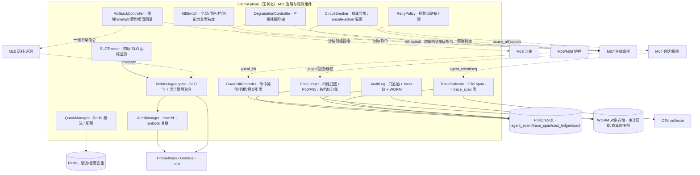
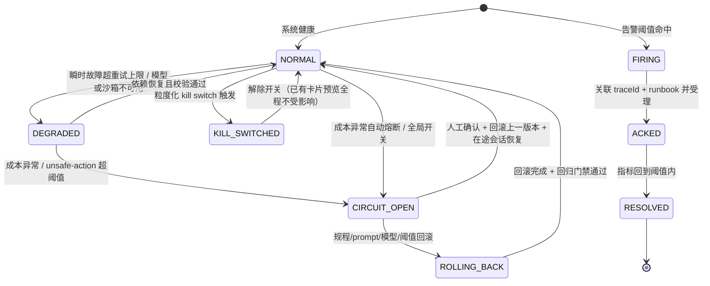

# M11 · 治理、观测与成本域（原 D8）

> **文档类型**：可独立交付 / 可独立验收的模块设计文档
> **来源章节**：`设计方案.md` v1.1 §5 D8、§9.2 熔断与回滚、§9.4 SLO 与告警、§9.6 风险与待决、§2.6 横切能力 X5/X11、§4.1 核心实体（AuditEvent）、§4.2 状态与枚举、§4.4 REST API 概要、§4.5 实时事件协议、§10.1 #10 控制点、§3.1 总体架构分层、§7.1 服务划分、§7.2 Monorepo 目录（infra/observability）、§1.6 成功指标、§1.7 设计原则、§2.2 非功能需求、§2.3 威胁模型、§8 总表 D8 行、§9.1 四阶段灰度、§9.3 对抗测试清单、§0 定稿决策 D-2/D-4/D-5、§11.8 手写观测与成本实现
> **版本**：v1.0　|　**拆分日期**：2026-11-15　|　**最近修订**：2026-11-16（v1.3，ADR-001：新增意图级联各级命中率（L1/L2）、升级率（L3+L4 占比，影子期目标 <30%）、ask_user 滥用拦截率、询问后任务完成率指标；补 `SPEC_MISSING`/`CLARIFICATION_REQUIRED`/`CLARIFICATION_LIMIT` 原因码与 `ask_user` 事件采集）；v1.4（ADR-002：新增偏好学习/衰减/遗忘的观测指标）　|　**状态**：设计定稿（v1.4）
> **对应编号**：D8 / FR-19（全链路 trace、只追加审计、成本分账、配额与熔断）、FR-21（重试 / 降级 / 熔断、粒度化 kill switch）/ X5（重试 / 降级 / 熔断，主承载）、X11（可观测与审计，主承载）/ D-2（回边 ≤2）、D-4（模型分档影子验证后灰度）、D-5（零 Agent 框架）
> **主责服务**：`control-plane`（`audit/` 只追加审计、指标与配额 API）、`infra/observability`（OTel collector / Grafana dashboards / 告警规则）、`infra/deploy`（熔断、语料撤回、事件响应预案 runbook）
> **一句话定义**：把「任一会话可完整重放、每一分钱可出账、任何故障可优雅降级且不降安全、任何异常可按粒度熔断并回滚」做成横切全链路、脱离其他模块也能单独提测的治理与观测能力。

---

## 0. 模块速览（零基础可读）

### 0.1 项目最小背景（不懂本模块的人先读这一段）

WidgetPilot 是一个「用自然语言生成手机桌面控件」的 AI Agent 产品：用户选一种规格（`2x1`/`1x2`/`2x2`/`2x4`/`4x2`/`4x4`）、输入描述、可选上传附件，系统生成 **TSX + React 控件代码**，经双向护栏、契约校验、一次性沙箱编译/渲染/断言后产出「控件包」，在网页上按手机桌面真实比例渲染成受限 iframe 卡片。**受环境与设备限制，本项目不生成 Lynx 代码、不编译移动端 bundle、不打包上传、不装机、不接手机系统 API、不模拟真实设备环境**（原文 §1.2 非目标）。

前面 M04–M10 的模块各自负责「生成链路的一段」，**本模块不产生产物、也不推进会话状态**，它是**横切支撑型模块**：原文 §2.1 模块依赖图里 M11 用虚线「横切采集」连到 M04/M07/M08/M09/M10，00 总览 §2.1 明确「支撑型模块同样有独立接口、字段与验收，**不因『支撑』而免验**」。它回答四个别处回答不了的问题：这次会话到底发生了什么（trace/审计）、花了多少钱（成本分账）、出故障时怎么不把事情弄得更糟（降级/熔断/回滚）、以及怎么知道系统正在变坏（指标/告警/SLO）。

### 0.2 端到端 14 步链路中本模块的位置

原文 §3.2 定义了 14 步主链路。**本模块不占单一顺序 step，而是贯穿全程采集、并在旁路做治理决策**；最集中的落点是第 ⑭ 步：

```
① 登录 → 新建会话（grid 可选预填）
② 输入描述 + 上传附件 → 传输层校验 → 对象存储 → attachment_id
③ 语义层校验（描述充分性 / 附件 role 明确性 / grid 合法）→ 不足则 AWAITING_INPUT
④ 进 LLM 护栏（注入 / PII / 意图白名单 / 预算前置）→ 命中不进模型
⑤ 意图与规格确定 → 按 widget_type + grid 确定性预取生成规程
⑥ 上下文装配（公共语料 + 规程 + 记忆 + AttachmentInsight，固定槽位、硬过滤优先）
⑦ 生成回路：先出 WidgetSpec，再出 TSX + React 代码；模型分档
⑧ 出 LLM 护栏（schema / 能力白名单 / 禁止内容 / PII / 描述符合度 / 规格一致）
⑨ 契约校验：spec ↔ manifest ↔ 代码能力声明 比对 + hash；不过不进沙箱
⑩ 一次性沙箱：TSX 编译 → 挂载渲染 → 尺寸/运行时错误/能力/交互断言 → 证据包
⑪ 生成 WidgetBundle（源码 + 编译产物 + manifest + 校验 + 沙箱结果 + hash），COMPLETED
⑫ 前端 artifact 事件 → 控件墙按 grid 真实比例渲染受限 iframe 卡片
⑬ 评测合格 → 脱敏 → 入库门禁 → 公共语料（可撤回）；失败案例回流为负例
⑭ 全流程按 seq 写 SSE 事件流与只追加审计；成本按模型档位分账 ★ M11 主责采集与治理
```

- **全程采集**：①–⑭ 每一步的 `agent_event` / `trace_span` / 护栏命中 / 成本都进本模块；原文 §2.2「可观测」要求「任一会话可重建『输入 → 护栏 → 检索 → 生成 → 校验 → 沙箱 → 交付 → 成本』完整路径」。
- **旁路治理**：重试 / 降级 / 熔断、粒度化 kill switch、unsafe-action 隔离、配额、指标告警、版本回滚**不改变主链路状态机**，只在故障时决定「继续 / 降级 / 暂停 / 回滚」。
- **两个闭环的关系**（§10.2）：任务内闭环（⑧⑨⑩ 失败 → 回到 ⑦ 自纠正 ≤2 次，D-2）由 M07/M03 执行；本模块负责把「业务失败是回边不是 retry」这条边界**在策略层固定下来**，并记录每次回边成本。
- **四阶段灰度**（§9.1）：影子模式 → 内部单用户 → 限流扩展 → 多用户；**模型分档、阈值、成本告警阈值按影子期实测校准后再灰度**（D-4、§9.4）。

### 0.3 为什么必须有这个模块（不可替代性）

1. **没有它，失败无法追责也无法复现**：原文 §2.2 合规要求「审计只追加且可完整重放一次会话」、§5 D8 验收「审计可完整重放一次会话」。生成代码不可信，出事后必须能按 `trace_id` + `seq` 还原「输入 → 护栏 → 检索 → 生成 → 校验 → 沙箱 → 交付 → 成本」。
2. **没有它，成本不可控**：模型 token + 沙箱机时 + 编译都在烧钱，必须归因到用户/会话/轮次/模型档位、出 P50/P95 账、按档位分账，且**预算触顶要确定性中断而不是提示模型省着点**（§1.7 #1、§2.2 成本行）。
3. **没有它，一次瞬时故障会变成一次事故**：429/5xx、沙箱启动失败必须指数退避有上限并优雅降级；**降级不降低安全级别**（§5 D8）；熔断时必须保留在途会话状态可恢复（§9.2）。
4. **没有它，无法按粒度止损**：全局开关 / 按用户 / 按模型档位 / 按能力类型降级、成本异常自动熔断、unsafe-action 超阈值自动隔离，以及「只暂停生成、不影响已有卡片预览」的粒度化 kill switch（§5 D8、§9.2）。
5. **没有它，无法知道系统在变坏**：SLO 四项 + 7 类告警项，每个告警关联 `traceId` 与 runbook（§9.4）。
6. **没有它，变更无法回滚**：任何规程 / prompt / 模型 / 阈值变更可回滚上一版本；公共语料可一键下架并重跑检索索引（§9.2）。

### 0.4 上下游邻居与 mermaid 图

```mermaid
flowchart LR
  M04["M04 账号/会话/编排"] -.agent_event / seq / checkpoint / 会话状态.-> M11
  M06["M06 输入校验/进护栏"] -.guard_hit（命中类型/判据/原文引用）.-> M11
  M07["M07 生成编排与成本"] -.usage / 回边 / 档位 / 预算计数.-> M11
  M08["M08 出护栏/契约/沙箱"] -.guard_hit / sandbox 结论 / 降级执行回报.-> M11
  M09["M09 产物与包管理"] -.manifest / hash / 交付事件 / 删除审计.-> M11
  M10["M10 知识/检索/评测"] -.评测指标 / 语料撤回审计 / 索引重建回报.-> M11
  M05["M05 附件处理"] -.上传/校验事件.-> M11
  M03["M03 手写 Harness 内核"] -.meter.py / events / eval 实现基座.-> M11
  M02["M02 前后端契约"] -.枚举 / OpenAPI / trace 字段.-> M11
  M11 -->|降级指令 / 熔断 / kill switch / 回滚| M07
  M11 -->|沙箱降级指令| M08
  M11 -->|一键下架指令| M10
  M11 -->|pause_all(scope) / 在途状态保护| M04
  M11 -->|cost / notice / error 事件 payload| M04
  M11 -->|指标 / 告警 / traceId + runbook| GRAF["Grafana / 告警平台"]
  M11 -->|评测与运行监控数据| M12["前端评测与回归 / 运行监控页"]
  M11 -->|只追加审计证据| OBJ[("WORM / 对象存储")]
```

- **上游（给本模块输入，全部可打桩）**：M04（事件与状态）、M06/M08（护栏命中）、M07（成本计量与回边）、M09（产物与交付）、M10（评测指标）、M05（附件事件）、M03（`meter.py` 计量基座）、M02（契约）。
- **下游（消费本模块输出）**：M07/M08/M10/M04（降级/熔断/下架/暂停指令）、前端 M12 相关「运行监控 / 评测与回归」页（§6.1/§6.2）、Grafana/告警平台、WORM 审计存储、`docs/runbook/`。
- **横切定位**：M11 是 X5 / X11 主承载、X4（成本分账治理）与 X10（回归指标告警）协同；**成本「计量执行」在 M07/M03，本模块做分账/治理/告警**（职责不可互换）。

### 0.5 原文对照表

| 本模块内容 | 原文章节 / 编号 |
|---|---|
| 全链路 trace、只追加审计、成本分账、配额熔断、kill switch、指标告警、降级阶梯、验收 | §5 D8、§8 总表 D8 行 |
| 全局开关 / 按用户·档位·能力类型降级 / 成本异常自动熔断 / unsafe-action 隔离 / 保留在途会话 / 语料一键下架 / 版本回滚 | §9.2 |
| SLO 四项、7 类告警项、每告警关联 `traceId` 与 runbook、阈值影子期校准 | §9.4 |
| 全链路路径「输入→护栏→检索→生成→校验→沙箱→交付→成本」、审计只追加可重放 | §2.2、§10.1 #10 |
| 成功指标五层（质量/安全/成本/体验/语料）与指标口径 | §1.6 |
| 横切能力 X5 / X11 定义 | §2.6 X5/X11 |
| `AuditEvent` 实体字段 | §4.1 |
| 状态与 `ReasonCode` 枚举 | §4.2 |
| `/api/metrics` / `/api/audit` / `/api/evals` / `/api/bundles/{id}/evidence` | §4.4 |
| `AgentEvent` 事件协议（`cost` / `notice` / `error` 通道） | §4.5 |
| 控制点 #10（观测/评测/成本/审计/恢复，失败去向「任一失败可重放；评测报告 + 成本账」） | §10.1 |
| 分层架构（控制面 / 数据面 / infra） | §3.1 |
| 服务划分与 monorepo 目录（`infra/observability`、`control_plane/audit/`） | §7.1、§7.2 |
| 威胁模型（越权 / 超大附件 / 循环生成耗尽预算 / 审计篡改） | §2.3、§2.4 #8 |
| 设计铁律（确定性门禁 / 私有数据不共享 / 门禁不可在线关闭 / 状态持久化） | §1.7 |
| 四阶段灰度（影子模式校准阈值） | §9.1、§0 D-4 |
| 对抗清单（死循环 / 成本触顶 / 进程被杀 / 越权 / iframe 逃逸） | §9.3 |
| 风险（iframe 并发性能 / 手写 harness 正确性 / 阈值初值） | §9.6 |
| 零 Agent 框架下 OTel SDK 保留、LangFuse 等禁用 | §0 D-5、§11.1 |
| 手写观测与成本实现（OTel span + 自建 `trace_span` 表、`meter.py` / `cost_ledger`） | §11.8、§11.2 |

---

## ⚠ 跨模块接线待办（M05 → M11，实现本模块时必须接线）

> 来源：M05 功能完整性审查（2026-11-21）。M05 的事件已真实发射到 Redis Streams，
> 但本模块的审计镜像与 deny 留证尚未覆盖 M05 —— 按下列接线，否则越权与失败无证据可回放。

| 接线点 | M05 实际产出（已实现） | 本模块必须做 |
|---|---|---|
| `attachment` 事件 | `{attachment_id, role, insight_ref, action}`，每会话 seq 单调（per-session Redis INCR，与 M04 同域） | 按 `seq` 写 `agent_event` 镜像与 `trace_span`；**不可用全局 seq**，否则续传丢事件 |
| `notice` 澄清事件 | `{attachment_id, clarify_hint, role:null}` | 计入澄清轮次统计（与规格缺失 `notice` 区分：本条带 `attachment_id`） |
| `alert` 告警事件 | 未注册 role 被拒时发 `{kind:"alert", payload:{role, reason:"UNREGISTERED_ROLE"}}` | 采集为治理告警（A18「写告警」），不推用户 SSE 流 |
| **AttachmentAudit deny（仍未实现，属本模块欠账）** | M05 上传/PATCH 越权返回 403（A12），但目前**没有只追加 deny 审计** | 本模块需提供 `AttachmentAudit` 追加接口（actor/action/decision/trace_id/prev_hash 入链）；M05 403 时写入。设计 §8.2 A12 要求「HTTP 403 + AttachmentAudit 记一条 deny」 |
| 失败证据引用 | A17 处理器失败写 `att/.../error.json` 带 hash，REST 响应 `evidenceRef` | 以 evidenceRef 为证据锚，不记录附件原文 |

**已知欠账**：上表 deny 审计是本模块与 M05 的共同未接线点；M05 代码阅读指南 §11 已标注，
本模块实现审计时必须回查此处，不能只做 M06/M08 的 `guard_hit`。

---

## 1. 模块定位与职责边界

### 1.1 为什么必须有（三条不可替代的职责）

1. **可重放的事实底座**：只追加审计 + hash 链/WORM + OTel `trace_span` 表，把「输入 → 护栏 → 检索 → 生成 → 校验 → 沙箱 → 交付 → 成本」每一步变成带 `trace_id` / `seq` / `prev_hash` 的证据，任一失败可重放（§10.1 #10）。
2. **确定性的止损层**：重试/降级/熔断/kill switch/回滚全是**纯代码策略判定**，不依赖模型自律；「降级不降低安全级别」「预算触顶确定性中断」「业务失败是回边不是 retry」是写在代码层的硬规则。
3. **可出账、可告警的运营面**：成本按用户/会话/轮次/模型档位四维归因并出 P50/P95；SLO 与 7 类告警项每个都关联 `traceId` 与 runbook，让「系统在变坏」可被发现、可定位、可执行预案。

### 1.2 做什么（职责清单）

| # | 职责 | 原文依据 / 说明 |
|---|---|---|
| R1 | 全链路 trace：任一会话可重建「输入→护栏→检索→生成→校验→沙箱→交付→成本」完整路径 | §2.2、§5 D8、§10.1 #10 |
| R2 | 只追加审计 + hash 链 / WORM；`AuditEvent` 不可 UPDATE/DELETE | §4.1、§2.2 |
| R3 | 护栏每次命中留「命中类型、判据与原文引用」，误拦截率可测 | §5 D8、§11.8 `guard_hit` 表 |
| R4 | 成本归因到用户 / 会话 / 轮次 / 模型档位；单会话总成本 P50/P95（模型 token + 沙箱机时 + 编译） | §1.6、§5 D8 |
| R5 | 按模型档位分账；回边与重复检索计入本轮；成本账可出账 | §1.6、§5 D4、§8 X4 行 |
| R6 | 瞬时故障（429/5xx、沙箱启动失败）指数退避**有上限**；业务失败是自纠正回边**不是 retry** | §5 D8、§2.6 X5 |
| R7 | 降级阶梯：沙箱不可用 → 静态校验 + 只读诊断；模型不可用 → 便宜模型 → 规则兜底；预算触顶 → 确定性中断转人工 | §5 D8、§9.2 |
| R8 | **降级不降低安全级别**；绝不跳过校验直接交付 | §5 D8、§5 D5 |
| R9 | 粒度化 kill switch：只暂停生成、不影响已有卡片预览 | §5 D8、§9.2 |
| R10 | 全局开关（停所有新生成）、按用户 / 模型档位 / 能力类型降级、成本异常自动熔断 | §9.2 |
| R11 | unsafe-action 超阈值自动隔离并告警 | §5 D8、§9.2 |
| R12 | 熔断时保留在途会话状态可恢复 | §9.2 |
| R13 | 公共语料可一键下架并重跑检索索引（**指令下发**；执行在 M10） | §9.2 |
| R14 | 任何规程 / prompt / 模型 / 阈值变更可回滚上一版本 | §9.2、§0 D-4 |
| R15 | 门禁不可在线关闭，所有对照在影子 / 离线完成 | §1.7 #8、§5 D8 |
| R16 | SLO 四项与 7 类告警项设阈值；每个告警关联 `traceId` 与 runbook；阈值按影子期实测校准 | §9.4 |
| R17 | Redis 限流 / 配额策略；纯代码策略判定（不用策略框架） | §5 D8、§11.1 |
| R18 | 指标与看板数据：评测与回归页、运行监控页（成本 P50/P95、配额、熔断、护栏命中趋势） | §6.1 / §6.2 |

### 1.3 不做什么（明确排除，含与相邻模块的边界切割）

| 不做 | 这块归哪个 Mxx | 边界说明 |
|---|---|---|
| 成本「计量执行」（token 计数、四维 `meter.py` 累加、每轮 usage 归一） | **M07 / M03（`agent_core/budget/meter.py`）** | 本模块接收计量结果做**分账 / 治理 / 告警**；原文 §5 D4 明确计量在生成编排域 |
| 会话状态机、checkpoint、租约、跨天恢复的执行 | **M04 / M03** | 本模块只下发 `pause_all(scope)` 并要求「保留在途会话状态可恢复」，不写状态、不改 `decide()` |
| 沙箱不可用时「静态校验 + 只读诊断」的**执行** | **M08** | 本模块只做降级决策与下发，不跑校验、不编译 |
| 公共语料「撤回 + 重跑检索索引」的**执行** | **M10** | 本模块只下发一键下架指令并留审计（§9.2 归治理域描述，执行归 M10） |
| 进/出 LLM 护栏的**判定** | **M06 / M08** | 本模块只采集 `guard_hit`（命中类型 / 判据 / 原文引用）并算命中率/误拦截率 |
| 离线回放评测、失败模式 rubric、回归门禁的**执行** | **M10** | 本模块消费评测指标做告警与看板，不重放轨迹 |
| 模型调用、模型分档、生成回路、自纠正回边 | **M07 / M03** | 本模块只在模型不可用时下发「便宜模型 → 规则兜底」的降级档位指令 |
| `seq` 生成、SSE 扇出、事件持久窗口 | **M04** | 本模块产生 `cost` / `notice` / `error` 的 **payload**，由 M04 编号与扇出 |
| 产物生成、hash、CSP、bridge 放行、包版本 | **M09** | 本模块只读 manifest / hash 做 trace 关联与证据引用 |
| 前端页面、卡片渲染、时间线 scrubber | **M13–M12** | 本模块只提供运行监控 / 评测与回归页的数据接口 |
| 用 LLM 专用观测平台 SDK 采集 trace | **明确禁止（D-5、§11.1）** | 只用 OpenTelemetry SDK（通用标准）+ 自建表 |
| 在线关闭门禁 / 在线 A/B 开关 | **明确禁止（§1.7 #8）** | 所有对照在影子 / 离线完成 |

> **最易混淆的两条边界**：① 「成本计量」与「成本分账治理」——`meter.py` 在 M03/M07 每 super-step 累加，本模块按用户/会话/轮次/档位出账与告警；② 「降级决策」与「降级执行」——本模块判定「沙箱不可用 → 静态校验 + 只读诊断」并下发，M08 才真正执行静态校验。

### 1.4 输入 / 输出与上下游契约

| 方向 | 内容 | 契约形式 |
|---|---|---|
| 入 | `AgentEvent[]`（全 18 种 `kind`，v1.3 含 `ask_user`，按 `seq`）、`trace_span`、checkpoint / 会话状态快照 | 内部采集接口（§4.3） |
| 入 | `guard_hit`（命中类型 / 判据 / 原文引用）、`sandbox_test` 结论、降级执行回报 | 内部采集接口 |
| 入 | 成本计量事件：`usage`（token）、`sandbox_minutes`（机时）、`compile_cost`（编译）、`model_tier`、`repair_count`、检索次数 | 内部采集接口（M07/M03 `meter.py` 产出） |
| 入 | 评测指标（一次通过率、沙箱通过率、安装率等，M10 产出） | 内部采集接口 |
| 入 | 故障信号：模型 429/5xx、沙箱启动失败、Redis 不可用、预算触顶、unsafe-action rate | 采集 + 策略判定 |
| 出 | `AuditEvent`（只追加、hash 链）、`TraceSpan`、`CostLedger` / P50/P95 报表 | PG 表 + 对象存储 + REST `/api/audit` `/api/metrics` |
| 出 | 降级 / 熔断 / kill switch / 回滚 / 一键下架**指令** | 内部接口（§4.3）下发 M04/M07/M08/M10 |
| 出 | `cost` / `notice` / `error` 的 `AgentEvent.payload` | 交 M04 编号后经 SSE 扇出 |
| 出 | 告警（含 `traceId` + runbook 条目）、指标与看板数据 | Prometheus/Grafana / Loki / 前端运行监控页 |
| 出 | `evidenceRef`（失败证据引用）、`trace_id`（告警关联） | 统一响应 / 审计证据 |

### 1.5 承载的横切能力 X*

- **X5（主承载，重试 / 降级 / 熔断）**：瞬时故障指数退避有上限；业务失败是**自纠正回边**不是 retry；沙箱不可用降级为静态校验 + 只读诊断；粒度化 kill switch（§2.6）。降级决策、RetryPolicy、熔断与回滚策略全在本模块。
- **X11（主承载，可观测与审计）**：全链路 trace、只追加审计、每步证据引用、成本账、护栏命中日志（§2.6）。**任一会话可重建完整路径**是本模块的验收核心。
- **X4（协同，成本管理）**：`meter.py` 计量执行在 M07/M03，本模块做**按档位分账、P50/P95 出账、预算触顶告警与熔断**（00 总览 §5：M07 计量执行、M11 分账治理）。
- **X10（协同，评测与回归门禁）**：M10 执行回放与门禁，本模块消费评测指标设告警阈值、关联 runbook（§9.4）。
- **X1（协同）**：熔断时「保留在途会话状态可恢复」依赖 M04 的 checkpoint/租约；本模块只保证不破坏恢复锚点。

### 1.6 关键设计原则

1. **降级不降低安全级别**（§5 D8）：任何降级路径都不跳过校验、不关闭护栏、不放宽能力白名单；沙箱不可用时至少保留静态校验 + 只读诊断。
2. **业务失败 ≠ 基础设施重试**（§5 D8、§11.3）：生成不合规走 M07 自纠正回边（≤2，D-2），429/5xx / 网络抖动 / 沙箱启动失败才走指数退避且有上限。
3. **预算触顶确定性中断**（§1.7 #1）：金额/次数上限写在代码层，不是「提示模型省着点」。
4. **只追加 + hash 链 / WORM**（§2.2）：审计不可 UPDATE/DELETE，`prev_hash` 成链，保证可完整重放一次会话。
5. **门禁不可在线关闭**（§1.7 #8）：所有 A/B 对照在影子模式或离线回放完成；阈值按影子期实测校准后再灰度（D-4、§9.4）。
6. **每个告警可定位**（§9.4）：告警必须带 `traceId` 与 runbook 条目，不只报「指标异常」。
7. **熔断保状态**（§9.2）：熔断/暂停只停「新生成」，保留在途会话 checkpoint 可恢复，不影响已有卡片预览。
8. **粒度化止损**（§5 D8、§9.2）：全局 → 按用户 → 按模型档位 → 按能力类型，逐级收窄，避免一刀切。
9. **零 Agent / LLM 观测框架**（D-5、§11.1）：OTel SDK（通用标准）+ 自建 `agent_event` / `trace_span` 表 + 纯代码策略判定；**不使用 LLM 专用观测平台 SDK**（LangFuse 等）。
10. **策略判定纯代码**：护栏 / 降级 / 熔断 / 限流规则不依赖 prompt 或策略框架（OPA/Casbin 在护栏链路禁用）。

---

## 2. 技术栈

### 2.1 分层选型表（层 | 选型 | 版本/约束 | 为什么 | 明确不用什么）

| 层 | 选型 | 版本 / 约束 | 为什么选 | 明确不用什么 |
|---|---|---|---|---|
| 分布式追踪 | **OpenTelemetry SDK**（通用可观测标准） | 语义约定版本写入 trace 属性 | 通用标准、与语言/供应商无关、能打 span 重建全链路 | **不用 LangFuse / LLM 专用观测平台 SDK**（§11.1） |
| 事件 / span 持久化 | **自建 `agent_event` / `trace_span` 表** | Postgres 只追加 | 原文 §5 D8 明确「自建表」；保证可完整重放一次会话 | 不用观测平台托管存储当唯一事实来源 |
| 指标 | Prometheus + Grafana | 按 SLO / 告警项建模 | 时序指标、P50/P95、告警规则与看板 | 不用 LLM 评测平台当指标源 |
| 日志 | Loki | 按 `trace_id` / `session_id` 索引 | 与 OTel/Prometheus 同一套标签体系，告警可下钻日志 | 不把大日志塞进 PG |
| 审计 | **WORM / hash-chain 审计** | 只追加、不可 UPDATE/DELETE、`prev_hash` 成链 | 防篡改、满足「审计可完整重放」合规（§2.2） | 不用可改写表存审计 |
| 策略判定 | **纯代码规则判定**（RetryPolicy / DegradationController / CircuitBreaker / KillSwitch） | 常量与阈值版本化、无在线关闭开关 | 确定性、可单测、不依赖 prompt 自律 | **不用 OPA / Casbin 等策略框架**（§11.1）、不用模型判熔断 |
| 限流 / 配额 | Redis 限流 | 按用户并发 / 预算 | 与 M11 配额策略对齐、原子计数 | 不用前端限流当控制面 |
| 主库 | PostgreSQL | 14+ | `agent_event` / `trace_span` / `cost_ledger` / `audit` / 幂等表 | 不用内存态存审计 |
| 对象存储 / WORM | S3 兼容 + 对象锁（WORM） | 大对象只存引用、带 hash | 审计证据载荷、成本账快照不可替换 | 不把日志/快照塞进 PG |
| 服务框架 | FastAPI + Pydantic v2 | Python 3.11+ | 与全局一致、OpenAPI 由 M02 消费 | 不引入 AI SDK / Agent 框架 |
| 部署与预案 | Helm / terraform / 网络策略 / CSP 模板 + `docs/runbook/` | 版本化、可回滚 | 支撑熔断、语料撤回、事件响应预案（§7.2） | 不做不可回滚的线上改配置 |

### 2.2 硬约束

- **D-5 零 Agent 框架（§11.1）**：禁止 LangChain / LangGraph / Temporal / AI SDK / CopilotKit / **LangFuse 等 LLM 专用观测 SDK** / OpenAI Agents SDK / MCP SDK / OPA / Casbin。观测只能用 OTel SDK + 自建表；策略判定必须纯代码。
- **D-2 回边 ≤2**：业务失败是自纠正回边（≤2）不是基础设施重试；本模块不得把回边计入 RetryPolicy 次数。
- **D-4 模型分档影子验证后灰度**：分档阈值与成本/告警阈值走配置中心版本化，影子验证后再灰度，变更触发回归。
- **门禁无在线关闭开关（§1.7 #8）**：`MAX_ITER=12` / `MAX_REPAIR=2` / 预算上限 / 熔断策略写在代码常量；所有对照在影子/离线完成。
- **降级不降低安全级别**：任何降级路径保留护栏与校验，绝不跳过校验直接交付。
- **审计只追加 + WORM**：`AuditEvent` 不可 UPDATE/DELETE，hash 链防篡改。
- **保留的通用基础设施**：FastAPI、Pydantic v2、Postgres、Redis、对象存储、OTel SDK、Prometheus、Loki、tiktoken（纯计数）、`httpx`。

### 2.3 运行时依赖

| 依赖 | 用途 | 不可用时的行为 |
|---|---|---|
| PostgreSQL | `agent_event` / `trace_span` / `cost_ledger` / `audit` / 幂等表 | 审计写入拒绝、不降级（审计不可丢）；恢复后按 `seq` 补写，不产生重复 |
| Redis | 限流 / 配额 / 告警去重 / SSE 扇出辅助 | 限流降级为本地令牌桶；故障注入验收要求「保状态且优雅降级」 |
| OTel collector | span 接收与导出 | 本地缓冲 span，恢复后补报；`trace_id` 不丢 |
| Prometheus / Grafana / Loki | 指标 / 看板 / 日志 | 告警降级为本地规则判定 + 审计留证；不因看板不可用停止治理 |
| WORM 对象存储 | 审计证据载荷、成本账快照 | 写失败则本次审计不提交，不产生无证据的「已完成」 |
| 配置中心（版本化阈值） | 告警 / 成本 / 分档阈值 | 回退到上一版本阈值（§9.2 回滚），不使用未校准初值上线 |
| `packages/contracts`（M02） | `AgentEvent` / `AuditEvent` / `ReasonCode` schema | CI 一致性校验失败即阻断发布 |
| M07/M03 `meter.py` 计量流 | 成本原始计数 | 计量流中断时成本账标 `incomplete=true`，不产 P95 结论 |

### 2.4 monorepo 代码落位（原文 §7.2、§11.2）

```
widgetpilot/
  services/
    control_plane/
      audit/                     # M11：AuditEvent 只追加写入 + hash 链 + WORM 归档
      observability/             # M11：agent_event / trace_span 表写入、guard_hit 表
      cost/                      # M11：cost_ledger 分账、P50/P95 出账
      governance/                # M11：RetryPolicy / DegradationController /
                                 #      CircuitBreaker / KillSwitch / RollbackController /
                                 #      QuotaManager / AlertManager
      api/                       # M11：/api/metrics、/api/audit、/api/admin/* 路由
  packages/
    agent_core/
      budget/meter.py            # M03 提供：四维硬上限计量（本模块消费其结果）
      events/seq.py              # M04/M03 提供：seq 生成（本模块消费）
      eval/gate.py               # M10 消费：回归门禁指标（本模块消费）
    contracts/                   # M02：openapi.yaml / events.schema.json / enums
  infra/
    observability/               # M11：OTel collector / Grafana dashboards / 告警规则
    deploy/                      # M11：Helm / terraform / 网络策略 / CSP 模板
    sandbox/                     # M08 镜像（本模块只下发降级指令）
  docs/
    runbook/                     # M11：熔断、语料撤回、事件响应预案（告警关联条目）
    adr/                         # 架构决策记录（阈值/回滚决策归档）
```

---

## 3. 设计架构

### 3.1 内部组件与职责（图 + 表）



| 组件 | 职责 | 关键不变量 |
|---|---|---|
| `TraceCollector` | 接 OTel span，写 `trace_span` 表，重建 8 段完整路径 | 每段带 `trace_id` / `session_id` / `seq`；跨服务 span 可串联 |
| `AuditLog` | 只追加审计 + `prev_hash` 链 + WORM 归档 | 不可 UPDATE/DELETE；hash 链可完整校验 |
| `GuardHitRecorder` | 护栏命中三要素（类型 / 判据 / 原文引用） | 每次命中留证；命中率与误拦截率可算 |
| `CostLedger` | 用户/会话/轮次/模型档位四维归因 + P50/P95 + 档位分账 | 回边与重复检索计入本轮；账可出账、可对账 |
| `MetricsAggregator` | 一次通过率 / 回边次数 / 护栏命中率·误拦截率 / 沙箱失败率 / 成本 P95 / 跨天恢复成功率 / unsafe-action rate；【v1.3 ADR-001 D-7/D-8】新增：意图级联各级命中率（L1/L2）、升级率（L3+L4 占比，影子期目标 <30%）、ask_user 滥用拦截率、询问后任务完成率；【v1.4 ADR-002】新增：偏好采纳率、误学率、清除后残留率（目标 0）、`suggest_grid` 命中率、记忆注入 token 成本（≤预算 5%）、偏好学习 LLM 调用次数（必须 0） | 指标口径与 §1.6 / §9.5 一致，离线报分布与置信区间 |
| `AlertManager` | 告警阈值判定 + `traceId` + runbook 关联 | 每个告警必带 traceId 与 runbook 条目；阈值影子期校准 |
| `RetryPolicy` | 仅瞬时故障指数退避**有上限** | 业务失败（回边）绝不进重试计数 |
| `DegradationController` | 三级降级阶梯 + 「降级不降低安全级别」 | 任何降级保留护栏与校验 |
| `CircuitBreaker` | 成本异常自动熔断、unsafe-action 超阈值自动隔离并告警 | 熔断保留在途会话状态可恢复 |
| `KillSwitch` | 全局 / 按用户 / 按模型档位 / 按能力类型；只暂停生成 | 已有卡片预览不受影响 |
| `QuotaManager` | Redis 限流 / 配额 | 按用户并发 / 预算，与四维预算对齐 |
| `RollbackController` | 规程 / prompt / 模型 / 阈值回滚上一版本、语料一键下架指令 | 版本化、可回滚、写审计 |
| `SLOTracker` | TTFT / SSE 首事件 / 沙箱测试 / 控件卡首帧 四项 P95 | 阈值来自 §9.4，实测可断言 |

### 3.2 处理流程与数据流（编号步骤）

**流程 A · 全链路 trace 重建（贯穿 ①–⑭）**

1. 各模块在每一步用 OTel SDK 打 span，注入 `trace_id` / `session_id` / `run_id` / `seq`。
2. `TraceCollector` 接收 span 并写 `trace_span` 表；`agent_event` 表由 M04 产生、本模块同步镜像采集。
3. 按 8 段路径归位：`输入(①-③) → 护栏(④) → 检索(⑥) → 生成(⑦) → 校验(⑧⑨) → 沙箱(⑩) → 交付(⑪⑫) → 成本(⑭)`。
4. 每段落 `AuditEvent`（`actor` / `action` / `decision` / `payload` / `trace_id` / `prev_hash`）。
5. 护栏命中由 M06/M08 推 `guard_hit`，`GuardHitRecorder` 落「命中类型、判据与原文引用」。
6. 大对象（日志 / 快照 / 证据载荷）写 WORM 对象存储，只存引用 + hash。
7. `AuditLog` 校验 `prev_hash` 链，链断即告警并拒绝标记「已完成」。
8. `GET /api/audit` 或 `GET /api/bundles/{id}/evidence` 按 `session_id` + `seq` 重放，还原完整路径。
9. 任一失败可重放；评测报告（M10）+ 成本账（本模块）作为控制点 #10 的证据（§10.1）。

**流程 B · 成本分账（对应 step14）**

1. M07/M03 `meter.py` 每 super-step 产出 `usage`（模型 token）、`sandbox_minutes`（机时）、`compile_cost`（编译）、`model_tier`、`repair_count`、检索次数。
2. `CostLedger` 按 **用户 / 会话 / 轮次 / 模型档位** 四维归因入库 `cost_record`。
3. **回边与重复检索计入本轮**（§1.6、§5 D4）：`repair_count` 与重复检索次数挂到同一 `run_id`。
4. 汇总单会话总成本 = 模型 token + 沙箱机时 + 编译；按 `model_tier`（`cheap`/`standard`/`frontier`）分账。
5. 计算 P50 / P95（按会话聚合），产出可出账报表到对象存储 `cost/{user_id}/{session_id}/ledger.json`。
6. 推 `cost` 事件 payload 给 M04 扇出到前端链路账（§6.3 底部链路账）。
7. `MetricsAggregator` 取成本 P95 进告警项；触顶则 `CircuitBreaker` 确定性中断。
8. `GET /api/metrics` 出账；账目与 `AuditEvent` 按 `trace_id` 可对账。

**流程 C · 降级 / 熔断 / kill switch / 回滚决策（旁路）**

1. 采集故障信号：模型 429/5xx、沙箱启动失败、Redis 不可用、预算触顶、unsafe-action rate。
2. 分类：**瞬时故障** → `RetryPolicy` 指数退避（有上限）；**业务失败** → 判定为 M07 自纠正回边，**不 retry**（D-2）。
3. 瞬时故障超上限 → `DegradationController` 按阶梯降级：
   - 沙箱不可用 → 下发 M08「静态校验 + 只读诊断」；
   - 模型不可用 → 下发 M07「便宜模型 → 规则兜底」；
   - 预算触顶 → 确定性中断 + `HUMAN_REQUIRED` 转人工。
4. **降级不降低安全级别**：三条路径都保留护栏与校验，绝不跳过校验直接交付。
5. 成本异常自动熔断 / unsafe-action 超阈值 → `CircuitBreaker` 自动隔离并告警。
6. 需要止损 → `KillSwitch`：全局（停所有新生成）/ 按用户 / 按模型档位 / 按能力类型；**只暂停生成，不影响已有卡片预览**。
7. 熔断时调用 `M04.pause_all(scope)`，保留在途会话 checkpoint 可恢复（§9.2）。
8. 公共语料一键下架 → 下发 M10 执行「撤回 + 重跑检索索引」，本模块留审计。
9. 规程 / prompt / 模型 / 阈值变更出问题 → `RollbackController` 回滚上一版本（§9.2、D-4）。
10. 所有决策写 `AuditEvent` + 推 `notice` / `error` 事件 payload；**不提供在线关闭门禁的开关**，对照只在影子/离线完成。

**流程 D · 指标与告警（§9.4）**

1. `MetricsAggregator` 聚合 7 类告警项 + 4 项 SLO 的时序数据。
2. `SLOTracker` 判定 TTFT P95 < 1s / SSE 首事件 P95 < 1.5s / 沙箱测试 P95 < 10s / 控件卡首帧 P95 < 500ms。
3. 告警阈值按**影子期实测校准**（§9.4），版本化、可回滚。
4. `AlertManager` 触发告警时**关联 `traceId` 与 runbook 条目**（熔断、语料撤回、事件响应预案）。
5. 告警写审计 + 推 Grafana / 运行监控页；每条告警可按 `traceId` 下钻到 Loki 日志与 `trace_span`。
6. 离线结果报分布与置信区间，不报单点估计（§1.6 / §9.5 口径）。

### 3.3 状态机

本模块**拥有** `DegradationLevel` / `CircuitBreakerState` / `KillSwitchState` / `AlertState` / `RollbackState`（完整 TS 定义见 §5.1），**参与但不拥有** `SessionState`（M04）、`BundleState`（M09）。治理状态是**旁路状态**，不改变会话主状态机。



### 3.4 关键机制、算法与「不变量清单」

**A. 全链路 trace 8 段路径（§2.2 / §10.1 #10）**

| 段 | 对应 step | 采集内容 | 证据 |
|---|---|---|---|
| 输入 | ①–③ | 描述 / 附件 / 规格 / 语义校验结论 | 输入快照 + 校验日志 |
| 护栏 | ④ | 进 LLM 护栏命中类型、判据、原文引用 | `guard_hit` 表 |
| 检索 | ⑥ | `retrieval_snapshot` / 引用 / 空结果转人工 | 索引版本 + 引用 |
| 生成 | ⑦ | 每轮 token / 成本 / 档位 / 回边 | `cost_record` + `agent_event` |
| 校验 | ⑧⑨ | 出护栏命中 / manifest 比对 / hash | 校验报告 |
| 沙箱 | ⑩ | 编译 / 渲染 / 断言 / 日志 / 快照 | 证据包 |
| 交付 | ⑪⑫ | `WidgetBundle` / `artifact` / 卡片渲染 | 渲染事件 |
| 成本 | ⑭ | 单会话总成本 / P50/P95 / 分账 | 成本账 |

**B. 只追加审计 + hash 链 / WORM**：`AuditEvent.seq` 每会话单调递增、`prev_hash` 成链、只追加不更新不删除；证据载荷写 WORM 对象存储并带 hash，读取时校验（本文 §6.5）。护栏每次命中留「命中类型 + 判据 + 原文引用」，用于算命中率 / 误拦截率（§11.8 `guard_hit` 表）。

**C. 成本四维归因与分账（§1.6 / §5 D8）**

```
session_total_cost = model_token_cost + sandbox_machine_minutes_cost + compile_cost
归因维度 = (user_id, session_id, run_id/轮次, model_tier)
分账 = GROUP BY model_tier  // cheap | standard | frontier
回边与重复检索计入本轮（同一 run_id），不摊到别轮
报表 = P50 / P95（按会话聚合），报分布与置信区间，不报单点估计
```

**D. 重试 vs 回边分离（§5 D8、§11.3）**

| 类型 | 触发 | 处理 | 上限 |
|---|---|---|---|
| 瞬时故障 | 模型 429/5xx、网络抖动、沙箱启动失败、Redis 不可用 | `RetryPolicy` 指数退避 | **有上限**【推导·需评审：建议 3 次、base 200ms、上限 2s】 |
| 业务失败 | 出护栏 / 契约 / 沙箱失败（生成不合规） | **M07 自纠正回边**（`REPAIR`） | `MAX_REPAIR=2`（D-2），超限 `HANDOFF` 转人工 |

**E. 三级降级阶梯（§5 D8、§9.2）——降级不降低安全级别**

| 触发 | 降级动作 | 执行方 | 安全级别 |
|---|---|---|---|
| 沙箱不可用（`SANDBOX_UNAVAILABLE`） | 静态校验 + 只读诊断，**绝不跳过校验直接交付** | M08 | 不降低（护栏 + 校验保留） |
| 模型不可用（`MODEL_ERROR` 429/5xx 超上限） | 便宜模型 → 规则兜底 | M07 | 不降低 |
| 预算触顶（`BUDGET_EXHAUSTED`） | 确定性中断 + `HUMAN_REQUIRED` 转人工 | M11 决策 / M04 落地 | 不降低（直接停，不放宽） |

**F. 粒度化 kill switch（§5 D8、§9.2）**

| 粒度 | 作用范围 | 不影响 |
|---|---|---|
| 全局开关 | 停所有**新生成** | 已有卡片预览、在途会话状态 |
| 按用户 | 停指定 `user_id` 的新生成 | 其他用户、已有卡片 |
| 按模型档位 | 停 `cheap`/`standard`/`frontier` 某档 | 其他档位 |
| 按能力类型 | 停含某 `Capability`（如 `local_storage`）的生成 | 其他能力 |

**G. 熔断与回滚（§9.2）**：全局开关、按用户/档位/能力类型降级、成本异常自动熔断、unsafe-action 超阈值自动隔离并告警；**熔断时保留在途会话状态可恢复**（`pause_all(scope)` 不写终态、不删 checkpoint）；公共语料可一键下架并重跑检索索引（指令下发 M10）；任何规程 / prompt / 模型 / 阈值变更可回滚上一版本（版本化配置 + 回归门禁）。

**H. SLO 与告警（§9.4，阈值按影子期实测校准）**

| SLO 项 | 目标【原文】 |
|---|---|
| TTFT | P95 < 1s |
| SSE 首事件 | P95 < 1.5s |
| 沙箱测试 | P95 < 10s |
| 控件卡首帧 | P95 < 500ms |

| 告警项（7 类，均设阈值） | 关联要求 |
|---|---|
| 一次生成通过率 | `traceId` + runbook |
| 回边次数 | `traceId` + runbook |
| 护栏命中率 / 误拦截率 | `traceId` + runbook |
| 沙箱失败率 | `traceId` + runbook |
| 成本 P95 | `traceId` + runbook |
| 跨天恢复成功率 | `traceId` + runbook |
| unsafe-action rate | `traceId` + runbook |

> 阈值的**具体数值原文未给出**，全部按影子期实测校准（§9.4），标注【推导·需评审】并版本化；不得伪装成原文结论。

**I. 门禁不可在线关闭（§1.7 #8）**：所有对照在影子 / 离线完成；`MAX_ITER=12` / `MAX_REPAIR=2` / 预算上限为代码常量，无关闭开关。

**不变量清单**：

| # | 不变量 | 断言方式 |
|---|---|---|
| I1 | `AuditEvent` 只追加、`prev_hash` 链可完整校验 | hash 链重算；无 UPDATE/DELETE 语句 |
| I2 | 任一会话可按 `session_id + seq` 完整重放 8 段路径 | 重放终点状态与终态一致 |
| I3 | 每次护栏命中都留「类型 + 判据 + 原文引用」 | `guard_hit` 三字段非空率 100% |
| I4 | 成本按四维归因、P50/P95 可出账、按档位分账 | 对账：分类汇总 = 总成本 |
| I5 | 回边与重复检索计入本轮 `run_id` | 账目轮次归属断言 |
| I6 | 瞬时故障重试有上限；业务失败重试次数 = 0 | 调用次数断言 + `Run` 计数不变 |
| I7 | 降级不降低安全级别（护栏/校验始终保留） | 降级路径仍产出校验报告 |
| I8 | kill switch 只暂停新生成、已有卡片预览可用 | 预览接口 200，新生成 202→暂停 |
| I9 | 熔断保留在途会话状态可恢复 | checkpoint 未删、resume 可续跑 |
| I10 | unsafe-action 超阈值自动隔离并告警 | 隔离标记 + 告警带 traceId |
| I11 | 每个告警带 `traceId` 与 runbook 条目 | 告警结构校验 |
| I12 | 变更可回滚上一版本、语料一键下架可下发 | 版本指针回退 + M10 收到指令 |
| I13 | 门禁无在线关闭开关 | 配置扫描无 `disable_gate` 类开关 |
| I14 | 成本 P50/P95 报表含分布与置信区间，不报单点估计 | 报表结构校验 |
| I15 | 告警阈值版本化、影子期校准后才灰度 | 版本记录 + 影子报告存在 |

### 3.5 与其他模块的时序（关键 3 个场景）

**场景 1：正常会话的 trace 与成本采集**
`M04 产生 agent_event(seq) → M11 TraceCollector 写 trace_span → M06/M08 guard_hit 落证 → M07 meter.py 每 super-step 报 usage/回边/档位 → M11 CostLedger 四维归因 → step14 写只追加审计 + 成本分账 → 前端链路账 / 运行监控页消费`

**场景 2：故障注入后的优雅降级（保状态）**
`模型返回 429 三次 → M11 RetryPolicy 指数退避达上限 → DegradationController 判定「模型不可用」→ 下发 M07 便宜模型 → 仍失败则规则兜底 → 全程护栏与校验保留（降级不降安全）→ 推 notice 事件 + 写审计 → 故障恢复后回 NORMAL，不产生重复产物`

**场景 3：unsafe-action 超阈值熔断 + 回滚 + 在途恢复**
`unsafe-action rate 超阈值 → M11 CircuitBreaker 自动隔离并告警（traceId + runbook）→ KillSwitch 按粒度暂停新生成（已有卡片预览不受影响）→ pause_all(scope) 保留在途 checkpoint → RollbackController 回滚上一版 prompt/阈值 → 回归门禁（M10）通过 → 解除熔断，在途会话 resume 续跑，状态完整`

### 3.6 部署形态与伸缩

| 服务 / 组件 | 状态 | 伸缩依据 | 说明 |
|---|---|---|---|
| `control-plane`（含 M11 audit / governance / cost） | 无状态（状态在 PG） | QPS | 可任意水平扩容；策略判定纯代码、无本地状态 |
| OTel collector | 无状态（缓冲） | span 吞吐 | 本地缓冲，恢复后补报 |
| Prometheus / Grafana / Loki | 有状态（时序/日志） | 指标与日志量 | 按 `trace_id` 下钻 |
| WORM 对象存储 | 有状态 | 审计证据量 | 只追加、对象锁、hash 校验 |
| Redis | 有状态 | 限流 / 告警去重 | 不可用时降级本地令牌桶 |
| `infra/deploy` / `docs/runbook` | 版本化配置 | 变更频次 | 支撑回滚与事件响应预案 |

---

## 4. 接口契约

> 本节给出本模块拥有/参与的全部接口的可实现粒度；统一响应格式、事件协议、状态枚举的完整定义均在本文件 §4.4 / §5.1 / §6.2 内重复写出，不依赖外部文档作为理解前提。

### 4.1 对外接口表（方法 | 路径 | 权限 | 请求 | 响应 | 状态码）

| 方法 | 路径 | 权限 | 请求 | 成功响应 | 状态码 |
|---|---|---|---|---|---|
| `GET` | `/api/metrics` | 管理员【原文 §4.4，角色见 §5.4 注】 | Query: `metric?`, `from?`, `to?`, `agg?`【契约约定】 | `{ code:"OK", data:{ series: MetricSeries[] } }`【契约约定】 | 200 / 401 / 403 |
| `GET` | `/api/audit` | 管理员【原文 §4.4】 | Query: `session_id?`, `trace_id?`, `from_seq?`, `cursor?`【契约约定】 | `{ code:"OK", data:{ events: AuditEvent[], next_cursor } }`【契约约定】 | 200 / 401 / 403 |
| `GET` | `/api/evals` | 管理员【原文 §4.4；主责 M10，本模块提供指标/告警数据】 | Query: `run_id?`【契约约定】 | `{ code:"OK", data:{ runs: EvalRun[] } }` | 200 / 401 / 403 |
| `GET` | `/api/bundles/{id}/evidence` | 本人【原文 §4.4；主责 M09，本模块提供 trace】 | — | `{ code:"OK", data:{ manifest, static_check, sandbox_test, trace } }`【契约约定】 | 200 / 403 / 404 |
| `POST` | `/api/internal/trace` | 内部服务【推导·需评审】 | `{ trace_id, session_id, span: TraceSpan }`【推导·需评审】 | `{ code:"OK" }` | 202 / 400 |
| `POST` | `/api/internal/guard-hit` | 内部服务【推导·需评审】 | `{ hit: GuardHitRecord }`【推导·需评审】 | `{ code:"OK" }` | 202 / 400 |
| `POST` | `/api/internal/cost` | 内部服务（M07/M03 `meter.py`）【推导·需评审】 | `{ record: CostRecord }`【推导·需评审】 | `{ code:"OK" }` | 202 / 400 |
| `POST` | `/api/admin/kill-switch` | 管理员【推导·需评审】 | `{ scope: KillSwitchScope, enabled: boolean, reason: string }`【推导·需评审】 | `{ code:"OK", data:{ state: KillSwitchState } }` | 200 / 403 |
| `POST` | `/api/admin/circuit-breaker` | 管理员【推导·需评审】 | `{ action: "open"\|"close", reason: string }`【推导·需评审】 | `{ code:"OK", data:{ state: CircuitBreakerState } }` | 200 / 403 |
| `POST` | `/api/admin/rollback` | 管理员【推导·需评审】 | `{ target: RollbackTarget, to_version: string }`【推导·需评审】 | `{ code:"OK", data:{ from_version, to_version } }` | 200 / 403 / 409 |
| `POST` | `/api/admin/corpus/takedown` | 管理员【推导·需评审】 | `{ scope: "all"\|"snapshot", reason: string }`【推导·需评审】 | `{ code:"OK", data:{ command_id, dispatched_to:"M10" } }` | 202 / 403 |
| `GET` | `/api/admin/slo` | 管理员【推导·需评审】 | Query: `from?`, `to?`【契约约定】 | `{ code:"OK", data:{ slo: SLOStatus[] } }` | 200 / 403 |
| `GET` | `/api/admin/cost-ledger` | 管理员【推导·需评审】 | Query: `user_id?`, `session_id?`, `model_tier?`【契约约定】 | `{ code:"OK", data:{ records: CostRecord[], p50, p95 } }` | 200 / 403 |
| `GET` | `/api/admin/alerts` | 管理员【推导·需评审】 | Query: `state?`, `cursor?`【契约约定】 | `{ code:"OK", data:{ alerts: AlertEvent[] } }` | 200 / 403 |

**统一响应**（原文 §4.4 / §6.9）：`{ code, message, traceId, retryable, evidenceRef? }`，`code` 与 `ReasonCode` 对齐；`data` 为【契约约定】补充。完整 `ApiResponse<T>` 定义见 §4.4。

### 4.2 事件接口（SSE `kind` 与 payload）

`AgentEventKind` 原文 §4.5 定稿 17 种，v1.3（ADR-001 D-7）扩充为 **18** 种——新增 `ask_user`（执行中澄清问题，payload `{ question_id, question, options?, allow_text, clarify_count, clarify_limit }`），本模块消费该事件用于 trace 采集与 ask_user 滥用拦截率统计。**本模块不新增 kind**；本模块产生 `cost` / `notice` / `error` 的 payload，消费全部 18 种做 trace（payload 形态为【契约约定】/【推导·需评审】）：

| `kind` | 本模块职责 | payload 要点 |
|---|---|---|
| `cost` | **产生**：每轮成本、累计成本、预算状态 | `{ token_used, sandbox_minutes, compile_cost, model_tier, session_total_cost, budget_state, repair_count, retrieval_count }`【契约约定】 |
| `notice` | **产生**：降级 / 预算 / 熔断 / 恢复 / 告警提示 | `{ code, message, degradation_level?, kill_switch_scope?, evidenceRef }`【推导·需评审】 |
| `error` | **产生**：治理侧终态（预算触顶、熔断终止） | `{ code, evidenceRef, traceId }` |
| `guard` / `validation` / `sandbox` | 消费：护栏命中与校验结论 | 供 `GuardHitRecorder` 与 trace 归位 |
| `run` / `plan` / `spec` / `attachment` / `skill` / `routing` / `code` / `artifact` / `checkpoint` / `interrupted` / `done` / `ask_user`（v1.3） | 消费：按 `seq` 写入 `agent_event` 镜像与 `trace_span`；`ask_user` 额外统计澄清轮次与滥用拦截率 | 不生成内容，只采集与编号关联 |

**关键约定**：所有事件必须带 `seq`（每会话单调递增）、`sessionId`、`runId`、`ts`、`phase`、`traceId`（完整 `AgentEvent` 结构见 §6.2）。前端 reducer 对未知 `kind` 忽略而非报错。**告警与熔断结论不推用户 SSE 流**（避免把治理事件当生成终态），只写审计 + Grafana/运行监控页 + `notice` 摘要。

### 4.3 内部接口与被调用签名（给代码签名，【契约约定】）

```python
# services/control_plane/observability/trace.py
def ingest_span(trace_id: str, session_id: str, span: TraceSpan) -> None: ...
def replay_session(session_id: str, from_seq: int = 0) -> list[AuditEvent]: ...

# services/control_plane/audit/append.py
def append(event: AuditEvent) -> int: ...                  # 返回 seq，只追加 + hash 链
def verify_chain(session_id: str) -> bool: ...            # prev_hash 链重算
def archive_to_worm(session_id: str) -> str: ...          # 返回证据引用

# services/control_plane/observability/guard_hit.py
def record(hit: GuardHitRecord) -> None: ...              # 命中类型/判据/原文引用

# services/control_plane/cost/ledger.py
def record_cost(rec: CostRecord) -> None: ...             # 四维归因
def session_total(session_id: str) -> float: ...
def percentile(metric: str, p: float) -> float: ...      # p in {0.5, 0.95}
def ledger_by_tier(model_tier: str) -> list[CostRecord]: ...

# services/control_plane/governance/retry.py
def should_retry(error: InfraError, attempt: int) -> bool: ...   # 指数退避有上限
def is_business_failure(reason_code: str) -> bool: ...   # True -> 回边，不 retry

# services/control_plane/governance/degradation.py
def decide(signal: FaultSignal) -> DegradationDirective: ...
# services/control_plane/governance/circuit_breaker.py
def evaluate_unsafe_action(rate: float) -> CircuitBreakerState: ...
def evaluate_cost_anomaly(p95: float) -> CircuitBreakerState: ...
# services/control_plane/governance/kill_switch.py
def set_switch(scope: KillSwitchScope, enabled: bool, reason: str) -> KillSwitchState: ...
def is_generation_paused(user_id: str, tier: str, capability: str) -> bool: ...
# services/control_plane/governance/quota.py
def check_quota(user_id: str, budget_dim: str) -> bool: ...     # Redis 限流
# services/control_plane/governance/rollback.py
def rollback(target: RollbackTarget, to_version: str) -> str: ...
def dispatch_corpus_takedown(scope: str) -> str: ...     # 下发 M10
# services/control_plane/governance/alerts.py
def fire(metric: str, value: float, trace_id: str) -> AlertEvent: ...  # 必带 traceId + runbook
```

**被上游 / 下游调用的签名**：
- M04 调用 `audit.append(...)` / `observability.ingest_span(...)`；M11 在熔断时调用 `M04.pause_all(scope)`（保留在途 checkpoint）。
- M07/M03 `meter.py` 调用 `cost.record_cost(rec)`；M11 在模型不可用时回调 `M07.set_tier("cheap")`、在预算触顶时调用 `M07.halt(reason="BUDGET_EXHAUSTED")`。
- M06/M08 调用 `guard_hit.record(hit)`；M11 下发 `M08.degrade_to_static_check()`。
- M10 调用 `metrics.push_eval_report(report)`；M11 下发 `dispatch_corpus_takedown(scope)` 由 M10 执行撤回 + 索引重建。
- M02 在 CI 调用 `contracts.validate(AuditEvent/AgentEvent/ReasonCode)`。

### 4.4 统一响应与错误码（完整定义）

```ts
type ApiResponse<T> = {
  code: string;            // 成功 "OK"；失败为 ReasonCode，与 §5.1 枚举对齐
  message: string;
  traceId: string;
  retryable: boolean;
  evidenceRef?: string;    // 失败时指向证据引用（审计事件 / 成本账 / 告警）
  data?: T;                // 【契约约定】成功载荷
};
```

`code` 与 `ReasonCode` 对齐。错误响应统一映射，前端按 `code` 展示具体原因与「从断点继续 / 改描述重试」入口，**不显示裸「失败」**。本模块典型失败码：`BUDGET_EXHAUSTED`（预算触顶）、`SANDBOX_UNAVAILABLE`（降级记录）、`MODEL_ERROR`（重试上限后）、`HUMAN_REQUIRED`（转人工）、`RETRY_EXHAUSTED`（回边超限，转发）。完整映射见 §5.4。

### 4.5 幂等、重试、超时、限流、并发约定

| 项 | 约定 |
|---|---|
| 幂等 | `audit.append` 以 `(session_id, seq)` 为幂等键，重复写入不产生第二条；`kill_switch.set_switch` / `circuit_breaker` 幂等；告警按 `(metric, trace_id, window)` 去重 |
| 重试 | 仅瞬时故障（429/5xx / 网络抖动 / 沙箱启动失败 / Redis 不可用）走指数退避且**有上限**【推导·需评审：3 次、base 200ms、上限 2s】；**业务失败（回边）绝不重试**；熔断/回滚指令重复下发幂等 |
| 超时 | OTel 上报超时【推导·需评审：建议 500ms】本地缓冲补报；成本采集超时标 `incomplete=true`，不产 P95 结论 |
| 限流 | Redis 限流，按用户并发 / 预算（四维：token / 轮次 / 工具调用 / 沙箱分钟）；与 M07 预算硬上限对齐 |
| 并发 | `audit.append` 用 PG 序列 + 唯一约束 `(session_id, seq)` 保证 `seq` 连续；hash 链串行追加；告警聚合按窗口幂等 |
| 乱序 | `agent_event` 采集按 `seq` 升序归位，乱序事件丢弃并记 `CONTRACT_MISMATCH` |
| 熔断并发 | `pause_all(scope)` 与在途 `resume` 并发时以 checkpoint 为准，不写终态、不删恢复锚点 |

### 4.6 接口状态表（契约状态 / 运行态 / 可重试）

| 接口 | 契约状态 | 运行态 | 可重试 | 说明 |
|---|---|---|---|---|
| `GET /api/metrics` | 定稿（原文 §4.4） | 同步 | 是 | 路径定稿；请求/响应字段为【契约约定】 |
| `GET /api/audit` | 定稿（原文 §4.4） | 同步 | 是 | 审计只追加、可完整重放 |
| `GET /api/evals` | 定稿（原文 §4.4，主责 M10） | 同步 | 是 | 本模块消费评测指标 |
| `GET /api/bundles/{id}/evidence` | 定稿（原文 §4.4，主责 M09） | 同步 | 是 | 本模块提供 trace 段 |
| `POST /api/internal/trace` / `guard-hit` / `cost` | 定稿（§5 D8 采集方向）+ 路径【推导·需评审】 | 异步（202） | 是（幂等键） | 内部采集，不暴露给前端 |
| `POST /api/admin/kill-switch` / `circuit-breaker` / `rollback` / `corpus/takedown` | 定稿（§9.2 方向）+ 路径【推导·需评审】 | 同步 / 异步（takedown 202） | 是（幂等） | 治理指令，写审计 |
| `GET /api/admin/slo` / `cost-ledger` / `alerts` | 定稿（§9.4 / §1.6 方向）+ 路径【推导·需评审】 | 同步 | 是 | 指标与出账 |
| 告警阈值 / unsafe-action 阈值 / 成本 P95 阈值 / SLO 达标阈值校准 | **影子校准中**（§9.4） | — | — | 阈值按影子期实测校准，版本化可回滚 |
| OTel collector / Prometheus / Grafana / Loki / WORM 存储 | **依赖外部** | — | — | 通用可观测基础设施，不用 LLM 专用 SDK |
| 规则兜底 / 便宜模型降级路径 | **可选**（§5 D8 阶梯末级） | 同步 | 是 | 不启用时直接确定性中断转人工，功能不缺失 |
| 按能力类型细粒度降级 | **可选**（§9.2 粒度之一） | 同步 | 是 | 不启用时按用户/档位粒度止损 |
| `401/403/404/409/422` 业务码映射 | 待 M02 定稿（见 §5.4 注） | — | — | 原文 `ReasonCode` 未含鉴权/冲突码 |

---

## 5. 状态、原因码与 API 状态

### 5.1 拥有或参与的状态机与完整枚举（TS 定义）

```ts
// ---- 本模块参与但由 M04 / M09 拥有的全局枚举（完整写出，便于独立阅读）----
type GridSpec = "2x2" | "2x4" | "4x2" | "4x4" | "2x1" | "1x2";
type WidgetType = "calendar" | "clock" | "alarm" | "task" | "custom";
type Capability = "date" | "timer" | "local_storage" | "static_data" | "theme" | "locale";
type AttachmentRole = "visual_reference" | "content_extraction" | "data_source" | "style_reference";
type ModelTier = "cheap" | "standard" | "frontier";

type SessionState =
  | "DRAFT" | "RUNNING" | "PAUSED" | "AWAITING_INPUT" | "VALIDATING"
  | "COMPLETED" | "FAILED" | "CANCELLED";

type BundleState = "GENERATED" | "INSTALLED" | "DELETED";

type ReasonCode =
  | "INPUT_INVALID" | "INTENT_OUT_OF_SCOPE" | "GUARD_INPUT_HIT" | "GUARD_OUTPUT_HIT"
  | "SPEC_CONFLICT" | "CAPABILITY_DENIED" | "CONTRACT_MISMATCH" | "COMPILE_FAILED"
  | "SANDBOX_TEST_FAILED" | "RETRY_EXHAUSTED" | "BUDGET_EXHAUSTED"
  | "SANDBOX_UNAVAILABLE" | "HUMAN_REQUIRED" | "MODEL_ERROR"
  | "SPEC_MISSING" | "CLARIFICATION_REQUIRED" | "CLARIFICATION_LIMIT";   // 后三个为 v1.3 新增（ADR-001），需 M02 收敛入 openapi.yaml

type AgentEventKind =
  | "run" | "plan" | "spec" | "attachment" | "skill" | "routing"
  | "code" | "guard" | "validation" | "sandbox" | "artifact"
  | "cost" | "checkpoint" | "interrupted" | "notice" | "error" | "done"
  | "ask_user";   // v1.3 新增（ADR-001 D-7），AgentEventKind 17 → 18 种

// ---- 本模块拥有的治理状态枚举（原文给出方向，取值与命名为【推导·需评审】）----
type DegradationLevel = "NORMAL" | "DEGRADED" | "FAILOVER_STATIC_CHECK" | "RULE_FALLBACK" | "HALTED";
type FaultSignal =
  | "MODEL_429" | "MODEL_5XX" | "SANDBOX_START_FAILED"
  | "REDIS_UNAVAILABLE" | "BUDGET_EXHAUSTED_SIGNAL" | "UNSAFE_ACTION_RATE";
type KillSwitchScope = "GLOBAL" | "USER" | "MODEL_TIER" | "CAPABILITY";
type KillSwitchState = "ARMED" | "PAUSED_GENERATION" | "RELEASED";
type CircuitBreakerState = "CLOSED" | "OPEN" | "HALF_OPEN" | "ROLLING_BACK";
type AlertSeverity = "INFO" | "WARN" | "CRITICAL";
type AlertState = "FIRING" | "ACKED" | "RESOLVED";
type CostDimension = "USER" | "SESSION" | "ROUND" | "MODEL_TIER";
type GuardHitType =
  | "INJECTION_PATTERN" | "PII" | "INTENT_OUT_OF_SCOPE" | "BUDGET_PRECHECK"
  | "SCHEMA" | "CAPABILITY_ALLOWLIST" | "FORBIDDEN_CONTENT" | "DESC_MISMATCH" | "SPEC_MISMATCH";
type RollbackTarget = "RECIPE" | "PROMPT" | "MODEL" | "THRESHOLD" | "RETRIEVAL_CONFIG";
type SLOMetric = "TTFT" | "SSE_FIRST_EVENT" | "SANDBOX_TEST" | "CARD_FIRST_FRAME";
type AlertMetric =
  | "FIRST_PASS_RATE" | "REPAIR_COUNT" | "GUARD_HIT_RATE" | "GUARD_FALSE_BLOCK_RATE"
  | "SANDBOX_FAIL_RATE" | "COST_P95" | "CROSS_DAY_RECOVERY_RATE" | "UNSAFE_ACTION_RATE";
```

**说明**：`DegradationLevel` 覆盖三级降级阶梯与「确定性中断」终态；`KillSwitchScope` 对应 §9.2 四种粒度；`CircuitBreakerState` 含 `ROLLING_BACK`（版本回滚）。原文 §4.2 只定稿全局枚举，本模块自有枚举为让接口可调用而补齐，全部标【推导·需评审】。

### 5.2 状态流转表

| 触发 | 前态 | 后态 | 副作用 | 事件 | 原因码 |
|---|---|---|---|---|---|
| 系统健康 | — | `NORMAL` | 正常采集 trace / 成本 | — | — |
| 瞬时故障超重试上限 | `NORMAL` | `DEGRADED` | 下发降级指令、`notice` 事件、写审计 | `notice` | `MODEL_ERROR` / `SANDBOX_UNAVAILABLE` |
| 依赖恢复且校验通过 | `DEGRADED` | `NORMAL` | 回滚降级标记、写审计 | `notice` | — |
| 沙箱不可用 | `DEGRADED` | `FAILOVER_STATIC_CHECK` | 下发 M08 静态校验 + 只读诊断（安全级别不变） | `notice` | `SANDBOX_UNAVAILABLE` |
| 模型不可用（便宜模型也失败） | `DEGRADED` | `RULE_FALLBACK` | 下发 M07 规则兜底 | `notice` | `MODEL_ERROR` |
| 预算触顶 | `NORMAL` / `DEGRADED` | `HALTED` | 确定性中断 + 转人工、写成本账 | `error` | `BUDGET_EXHAUSTED` / `HUMAN_REQUIRED` |
| 成本异常 / unsafe-action 超阈值 | `NORMAL` / `DEGRADED` | `OPEN` | 自动隔离 + 告警（traceId + runbook）、`pause_all(scope)` 保留在途状态 | `notice` | `BUDGET_EXHAUSTED` |
| 人工确认 + 回滚 + 在途恢复 | `OPEN` | `ROLLING_BACK` → `NORMAL` | 回滚上一版本、回归门禁、resume 续跑 | `notice` | — |
| 粒度化 kill switch 触发 | `NORMAL` | `PAUSED_GENERATION` | 只停新生成；已有卡片预览不受影响 | `notice` | — |
| 解除开关 | `PAUSED_GENERATION` | `RELEASED` → `NORMAL` | 恢复新生成 | `notice` | — |
| 告警阈值命中 | — | `FIRING` | 生成 `AlertEvent`（traceId + runbook） | — | — |
| 受理 / 指标回阈 | `FIRING` → `ACKED` → `RESOLVED` | — | 告警状态迁移留证 | — | — |
| 业务失败（生成不合规） | `RUNNING`（M04 态） | 回边 `REPAIR`（≤2） | **不新增 Run、不进 RetryPolicy**，`repair_count += 1` | `notice` | `GUARD_OUTPUT_HIT` 等 |

### 5.3 本模块产出 / 消费的 `ReasonCode` 子集

| 码 | 本模块角色 | 场景 |
|---|---|---|
| `BUDGET_EXHAUSTED` | **产出 / 消费** | 四维预算触顶 → 确定性中断（不自动重试）；成本异常自动熔断证据 |
| `SANDBOX_UNAVAILABLE` | **产出 / 消费** | 沙箱启动失败 → 降级为静态校验 + 只读诊断，写降级记录（绝不跳过校验） |
| `MODEL_ERROR` | **产出 / 消费** | 模型 429/5xx 超重试上限 → 便宜模型 → 规则兜底 |
| `RETRY_EXHAUSTED` | 消费（M03 判定） | 回边 > 2 → `HANDOFF` 转人工；本模块记为业务失败，不当 retry |
| `HUMAN_REQUIRED` | **产出** | 预算触顶 / 疑难 → 转人工，带部分产物 + 原因码 + 证据引用 |
| `GUARD_INPUT_HIT` / `GUARD_OUTPUT_HIT` | 消费（M06 / M08 判定） | 写 `guard_hit`（命中类型 / 判据 / 原文引用），算命中率与误拦截率 |
| `CAPABILITY_DENIED` | 消费 | unsafe-action 统计输入、越权能力拦截率（目标 100%） |
| `CONTRACT_MISMATCH` | 产出 | 采集乱序事件 / hash 链断裂 / 快照不一致 |
| `INPUT_INVALID` | 产出 | 治理指令请求体 / 采集请求体校验失败 |
| `SPEC_CONFLICT` / `COMPILE_FAILED` / `SANDBOX_TEST_FAILED` | 消费 | 作为回边（业务失败）归类，不计入基础设施重试 |
| `INTENT_OUT_OF_SCOPE` | 消费 | 护栏命中留证 |
| `SPEC_MISSING` / `CLARIFICATION_REQUIRED` / `CLARIFICATION_LIMIT` | 消费（v1.3 ADR-001） | 写入 trace 与审计；作为 ask_user 滥用拦截率、询问后任务完成率统计输入；`CLARIFICATION_LIMIT` 转人工计入 `HUMAN_REQUIRED` 归因 |

> 完整 17 个 `ReasonCode`（v1.3 含 `SPEC_MISSING` / `CLARIFICATION_REQUIRED` / `CLARIFICATION_LIMIT`，ADR-001）的 TS 定义见 §5.1；任何 `FAILED` / `HALTED` / `HUMAN_REQUIRED` 必须携带 `evidenceRef`，**前端不得只显示「失败」**。

### 5.4 HTTP 状态码与业务码映射

| HTTP | 场景 | `code` | `retryable` |
|---|---|---|---|
| 200 | 指标 / 审计 / 出账 / 治理指令成功 | `OK` | — |
| 202 | 内部采集已受理、一键下架指令已排队 | `OK` | — |
| 400 | 采集请求体 / 治理指令参数非法 | `INPUT_INVALID` | `false` |
| 401 | 未登录 / JWT 失效 | 【待 M02 定稿：原文 `ReasonCode` 未含鉴权码，可复用 `INPUT_INVALID` 或扩充枚举】 | `false` |
| 403 | 越权访问他人审计 / 非管理员调用治理接口 | 【待 M02 定稿】 | `false` |
| 404 | `trace_id` / `session_id` / 告警不存在 | 【待 M02 定稿】 | `false` |
| 409 | 重复回滚 / 对已 RELEASED 开关重复操作（幂等返回当前态） | 【待 M02 定稿】 | `false` |
| 422 | 语义校验 / 护栏命中（消费侧）/ 降级指令不合法 | `GUARD_INPUT_HIT` / `INPUT_INVALID` | `false` |
| 429 | 限流 / 配额触顶 | `BUDGET_EXHAUSTED` | `false`（确定性中断，不自动重试） |
| 503 | 模型 / 沙箱不可用（降级后仍不可用） | `MODEL_ERROR` / `SANDBOX_UNAVAILABLE` | `true`（有上限退避） |
| 5xx | 内部错误 / 审计链异常 | `MODEL_ERROR` / `CONTRACT_MISMATCH` | `true` |

> **注 1**：原文 §1.3 出现「平台管理员」视图，但 `User.role` 枚举只有 `user` / `curator` 两角色（D-3）。【推导·需评审】：`/api/metrics`、`/api/audit` 及 `/api/admin/*` 的管理员权限是否由 `curator` 扩展或单独配置，需 M04 + M11 + M02 共同定稿。
> **注 2**：`401/403/404/409` 对应业务码原文未显式列出，M02 在生成 `enums` 时必须明确「扩充枚举」还是「复用现有码」并 CI 固定。

### 5.5 接口的运行态约定（同步 / 异步 / 流式 / 挂起态 / 终态行为）

- **同步接口**：`/api/metrics`、`/api/audit`、`/api/admin/slo`、`/api/admin/cost-ledger`、`/api/admin/alerts`、`/api/admin/kill-switch`、`/api/admin/circuit-breaker`、`/api/admin/rollback` —— 请求即得到终态结论。
- **异步接口**：`POST /api/internal/trace` / `guard-hit` / `cost` 返回 `202` 只表示「采集已受理」；`POST /api/admin/corpus/takedown` 返回 `202` 表示「指令已下发 M10」，真正结论查 `command_id` 或审计。
- **流式接口**：本模块**不持有长连接**；`cost` / `notice` / `error` 的 payload 由 M04 编号后经 SSE 扇出（§4.2）。终态由显式 `done` / `error` 标志，无 `done` 的断连视为截断。
- **挂起态接口行为**：会话 `PAUSED` / `AWAITING_INPUT` 下，`GET /api/audit` 正常返回已落审计；熔断 `pause_all(scope)` 不写终态、不删 checkpoint，`resume` 可续跑；挂起期间无新增成本计量。
- **终态接口行为**：`COMPLETED` / `FAILED` / `CANCELLED` 下审计链封存（只追加不改）；`HALTED`（预算触顶）后新生成请求返回 `429` + `BUDGET_EXHAUSTED`，已生成卡片预览照常可用。
- **影子 / 离线态**：告警阈值校准、A/B 对照、门禁变更一律在影子/离线完成；**不提供在线关闭门禁的开关**。

---

## 6. 核心字段与元数据

### 6.1 持久化实体字段表（字段 | 类型 | 约束 | 含义）

| 实体 | 字段 | 类型【推导·需评审】 | 约束 | 含义 |
|---|---|---|---|---|
| `AuditEvent`（原文 §4.1，本模块主责） | `seq` | bigint | PK 一部分, 只追加 | 每会话单调递增，不更新不删除 |
| | `user_id` / `session_id` | uuid | NOT NULL | 归属与重放锚点 |
| | `actor` | text | NOT NULL | `user` / `curator` / `system` / `service` |
| | `action` | text | NOT NULL | 如 `GUARD_HIT` / `COST_RECORD` / `DEGRADE` / `CIRCUIT_OPEN` / `ROLLBACK` |
| | `decision` | text | NOT NULL | `ALLOW` / `DENY` / `DEGRADE` / `HALT` / `OK` |
| | `payload` | jsonb | NOT NULL | 证据载荷 |
| | `trace_id` | text | NOT NULL | 全链路 trace 与告警关联 |
| | `prev_hash` | text | NOT NULL | hash 链防篡改 |
| `TraceSpan`【推导·需评审】 | `span_id` / `parent_span_id` | text | NOT NULL | span 父子关系 |
| | `trace_id` / `session_id` / `run_id` / `seq` | text / bigint | NOT NULL | 归属与排序 |
| | `phase` | enum(`SessionState`) | NOT NULL | 所处会话阶段 |
| | `segment` | enum(8 段路径) | NOT NULL | 输入/护栏/检索/生成/校验/沙箱/交付/成本 |
| | `start_ts` / `end_ts` / `attributes` | timestamptz / jsonb | NOT NULL | 耗时与属性 |
| `GuardHitRecord`【推导·需评审】 | `id` | uuid | PK | 命中记录 |
| | `hit_type` | enum(`GuardHitType`) | NOT NULL | 命中类型 |
| | `criterion` | text | NOT NULL | 判据（确定性规则名） |
| | `source_quote` | text | NOT NULL | 原文引用 |
| | `guard_side` | enum("INPUT","OUTPUT") | NOT NULL | 进 / 出护栏 |
| | `trace_id` / `session_id` / `seq` | text / bigint | NOT NULL | 关联 |
| | `false_block` | bool | 默认 false | 人工抽检回标，算误拦截率 |
| `CostRecord`【推导·需评审】 | `id` | uuid | PK | 成本记录 |
| | `user_id` / `session_id` / `run_id` / `round_no` | uuid / text / int | NOT NULL | 四维归因 |
| | `model_tier` | enum(`ModelTier`) | NOT NULL | 分账档位 |
| | `token_cost` / `sandbox_minutes` / `compile_cost` | numeric | NOT NULL, ≥0 | 模型 token / 沙箱机时 / 编译 |
| | `repair_count` / `retrieval_count` | int | ≥0 | 回边与重复检索计入本轮 |
| | `total` | numeric | NOT NULL | 本条合计 |
| | `trace_id` | text | NOT NULL | 对账锚点 |
| `AlertEvent`【推导·需评审】 | `id` | uuid | PK | 告警 |
| | `metric` | enum(`AlertMetric`) | NOT NULL | 7 类告警项 |
| | `value` / `threshold` | numeric | NOT NULL | 实测值 / 阈值（影子校准） |
| | `severity` / `state` | enum | NOT NULL | 级别 / 状态机 |
| | `trace_id` | text | NOT NULL | 必带 |
| | `runbook_ref` | text | NOT NULL | 必带 runbook 条目 |
| `KillSwitchStateRow`【推导·需评审】 | `scope` / `target` / `enabled` / `reason` / `updated_at` | 各 enum/text/bool | NOT NULL | 粒度化开关当前态 |
| `RollbackRecord`【推导·需评审】 | `target` / `from_version` / `to_version` / `trace_id` | 各 enum/text | NOT NULL | 版本回滚留证 |
| `MetricSeries`【推导·需评审】 | `metric` / `window` / `p50` / `p95` / `ci95` / `samples` | 各 text/numeric | NOT NULL | 指标分布与置信区间 |

**字段归属原则（原文 §4.1）**：逐轮过程数据放事件流与 `Run`，不塞进主记录；大对象（日志 / 快照 / 证据载荷 / 成本账快照）一律存对象存储引用。

**【v1.4 ADR-002】`PreferenceEvent`（偏好证据层只追加表，schema 见 ADR-002 §3，本模块不新增字段）被 M11 审计消费**：与 `AuditEvent` 同按 `trace_id` / `session_id` / `user_id` 关联、只追加不可 UPDATE/DELETE、纳入 hash 链可校验，使审计可回答「谁在何时从何种信号写入了什么」（写入/覆盖/跳过/撤销四类 decision 留痕）。该事件**不含 PII 原文、附件原文与代码**（I-M1），M11 仅聚合统计不回灌正文；数据来源为 M07 的偏好后处理，本模块只做留证、聚合与告警。

### 6.2 本模块相关协议 schema 完整定义（不写「见别处」）

```ts
// ---- 只追加审计（原文 §4.1，本模块主责）----
type AuditEvent = {
  seq: number;                    // 每会话单调递增，只追加
  user_id: string;
  session_id: string;
  actor: "user" | "curator" | "system" | "service";
  action: string;                 // GUARD_HIT / COST_RECORD / DEGRADE / CIRCUIT_OPEN / ROLLBACK / ...
  decision: "ALLOW" | "DENY" | "DEGRADE" | "HALT" | "OK";
  payload: Record<string, unknown>;
  trace_id: string;
  prev_hash: string;              // hash 链防篡改
};

// ---- 实时事件协议（原文 §4.5，完整写出）----
type AgentEvent = {
  seq: number;                    // 每会话单调递增
  sessionId: string;
  runId: string;                  // 重连与跨天恢复的锚点
  ts: string;
  kind: AgentEventKind;           // 18 种（v1.3 含 ask_user），见 §5.1
  phase: SessionState;
  payload: unknown;               // 按 kind 用 discriminated union 收窄
  traceId: string;
};

// ---- 产物 manifest 元数据片段（原文 §4.3.2，本模块只读用于 trace / 成本关联）----
type WidgetBundleManifest = {
  spec_version: string;
  spec_hash: string;
  grid: GridSpec;
  widget_type: WidgetType;
  capabilities: Capability[];
  import_allowlist: string[];
  exports: { default: "Widget" };
  props: string[];
  recipe_version: string;         // 所用规程版本（回滚目标之一）
  retrieval_snapshot: string;     // M10 写入；本模块据此关联检索段 trace
  model: string;
  prompt_version: string;         // 回滚目标之一
  model_tier: ModelTier;          // 成本分账维度
};

// ---- 公共语料条目（原文 §4.1，M10 拥有；本模块在「一键下架」与审计中只读消费）----
type CorpusItem = {
  id: string;
  bundle_id: string;
  owner_user_id: string;          // 脱敏
  grid: GridSpec;
  widget_type: WidgetType;
  spec_version: string;
  recipe_version: string;
  quality_score: number;
  toxicity_check: {
    malicious_desc: boolean; overprivileged_code: boolean;
    flood: boolean; checked_at: string;
  };
  revoked_at: string | null;      // 一键下架后非 null
  state: "CANDIDATE" | "ACTIVE" | "REVOKED" | "REJECTED" | "EXPIRED";
  layer: "spec" | "recipe" | "sample" | "attachment";
  spec_ref: string; source_ref: string; summary_ref: string;
  retrieval_snapshot: string;
  hash: string;
  created_at: string;
};

// ---- 评测集用例（原文 §4.1，M10 拥有；本模块消费其结果做指标/告警）----
type EvalCase = {
  id: string;
  source: "history" | "adversarial" | "expert";
  input_ref: string;
  expected: {
    trajectory_assertions: string[];
    failure_mode: string;
    numeric_assertions: { field: string; op: "eq"|"gte"|"lte"; value: number }[];
  };
  rubric: { failure_mode: string; severity_weight: number }[];
  result: "PASS" | "FAIL" | "HANDOFF" | null;
  dataset_kind: "ci_private" | "offline_replay" | "human_calibration";
};

// ---- 本模块自有协议（原文给出方向，定义为【推导·需评审】）----
type TraceSpan = {
  span_id: string; parent_span_id: string | null;
  trace_id: string; session_id: string; run_id: string; seq: number;
  phase: SessionState;
  segment: "INPUT" | "GUARD" | "RETRIEVAL" | "GENERATION"
         | "VALIDATION" | "SANDBOX" | "DELIVERY" | "COST";
  start_ts: string; end_ts: string;
  attributes: Record<string, string | number | boolean>;
};
type GuardHitRecord = {
  id: string; hit_type: GuardHitType;
  criterion: string;              // 判据（确定性规则名）
  source_quote: string;           // 原文引用
  guard_side: "INPUT" | "OUTPUT";
  trace_id: string; session_id: string; seq: number;
  false_block: boolean;           // 人工抽检回标，算误拦截率
};
type CostRecord = {
  id: string;
  user_id: string; session_id: string; run_id: string; round_no: number;
  model_tier: ModelTier;
  token_cost: number; sandbox_minutes: number; compile_cost: number;
  repair_count: number; retrieval_count: number;   // 回边与重复检索计入本轮
  total: number;
  trace_id: string;
};
type CostLedger = {
  user_id: string; session_id: string;
  by_tier: Record<ModelTier, number>;
  session_total_cost: number;
  p50: number; p95: number; ci95: [number, number];
  report_ref: string;
  incomplete: boolean;            // 计量流中断时为 true，不产 P95 结论
};
type DegradationDirective = {
  level: DegradationLevel;
  signal: FaultSignal;
  action: "STATIC_CHECK_READONLY" | "CHEAP_MODEL" | "RULE_FALLBACK"
        | "DETERMINISTIC_HALT" | "NONE";
  target_module: "M07" | "M08" | "M04" | "M10";
  security_level_unchanged: true; // 恒为 true：降级不降低安全级别
  notice_code: string;
  trace_id: string;
};
type KillSwitchConfig = {
  scope: KillSwitchScope;
  target: string;                 // GLOBAL 时为空；USER/MODEL_TIER/CAPABILITY 时填具体值
  enabled: boolean;
  reason: string;
  affects_existing_cards: false;  // 恒为 false：已有卡片预览不受影响
  state: KillSwitchState;
};
type AlertEvent = {
  id: string; metric: AlertMetric;
  value: number; threshold: number;   // 阈值影子期校准
  severity: AlertSeverity; state: AlertState;
  trace_id: string;                   // 必带
  runbook_ref: string;                // 必带
  firing_ts: string;
};
type SLODefinition = {
  metric: SLOMetric;
  target_p95: number;                 // TTFT 1000 / SSE 1500 / SANDBOX 10000 / CARD 500（ms）
  observed_p95_ms: number;
  passed: boolean;
};
type MetricSeries = {
  metric: AlertMetric | SLOMetric;
  window: string;
  p50: number; p95: number; ci95: [number, number];
  samples: number;
};
type RollbackRecord = {
  target: RollbackTarget;
  from_version: string; to_version: string;
  trace_id: string; actor: string; created_at: string;
};
```

### 6.3 枚举与常量

| 常量 / 枚举 | 值 | 来源 |
|---|---|---|
| TTFT | P95 < `1s` | 原文 §9.4 / §2.2 |
| SSE 首事件 | P95 < `1.5s` | 原文 §9.4 |
| 沙箱测试 | P95 < `10s` | 原文 §9.4 |
| 控件卡首帧 | P95 < `500ms` | 原文 §9.4 |
| `MAX_REPAIR` | `2`（D-2，业务失败回边上限） | 原文 §0 / §11.3 |
| `MAX_ITER` | `12`（无关闭开关） | 原文 §11.3 |
| 四维预算 | token / 轮次 / 工具调用 / 沙箱分钟 | 原文 §5 D4、§2.6 X4 |
| 成本构成 | 模型 token + 沙箱机时 + 编译 | 原文 §1.6 |
| 成本归因维度 | 用户 / 会话 / 轮次 / 模型档位 | 原文 §5 D8 |
| `ModelTier` | `cheap` / `standard` / `frontier` | 原文 §4.2 |
| 告警项（7 类） | 一次生成通过率 / 回边次数 / 护栏命中率·误拦截率 / 沙箱失败率 / 成本 P95 / 跨天恢复成功率 / unsafe-action rate | 原文 §9.4 |
| 【v1.3 ADR-001 D-7/D-8】新增观测指标 | 意图级联各级命中率（L1/L2）、升级率（L3+L4 占比，影子期目标 <30%）、ask_user 滥用拦截率、询问后任务完成率 | ADR-001 D-7/D-8；升级率 >30% 说明级联层级设计失效（反模式红线） |
| 每个告警关联 | `traceId` + runbook 条目 | 原文 §9.4 |
| 降级阶梯 | 沙箱不可用→静态校验+只读诊断；模型不可用→便宜模型→规则兜底；预算触顶→确定性中断转人工 | 原文 §5 D8 |
| kill switch 粒度 | 全局 / 按用户 / 按模型档位 / 按能力类型 | 原文 §9.2 |
| 重试上限 / base / 上限 | `3` 次 / `200ms` / `2s`【推导·需评审】 | 最小合理推导 |
| 告警阈值 / unsafe-action 阈值 / 成本 P95 阈值 | 影子期实测校准【推导·需评审】 | 原文 §9.4 |
| OTel 上报超时 | `500ms`【推导·需评审】 | 最小合理推导 |
| `cell` | `80px`（卡片像素换算，协同 M16） | 原文 §6.5 |

### 6.4 manifest / hash / 版本 / 快照 / trace 元数据

| 元数据 | 载体 | 作用 |
|---|---|---|
| `trace_id` | `AuditEvent` / `AgentEvent.traceId` / `TraceSpan` / `GuardHitRecord` / `CostRecord` / `AlertEvent` | 全链路 trace 重建、告警关联 runbook、成本对账 |
| `prev_hash` | `AuditEvent` / checkpoint 表 | hash 链防篡改、只追加审计可完整重放 |
| `hash` | `WidgetBundle.hash` / `CorpusItem.hash` / 对象引用 | 整包摘要、防对象被替换 |
| `spec_hash` / `spec_version` | manifest | 契约校验与回滚目标 |
| `recipe_version` / `prompt_version` / `model` / `model_tier` | manifest | **版本回滚目标**（§9.2）与成本分账维度 |
| `retrieval_snapshot` | manifest（M10 写入） | 关联检索段 trace，保证可复现 |
| `seq` / `runId` | `AgentEvent` / `TraceSpan` | 重放锚点、乱序丢弃、跨天恢复 |
| `from_version` / `to_version` | `RollbackRecord`【推导·需评审】 | 规程/prompt/模型/阈值回滚留证 |
| `evidenceRef` | `ApiResponse` / `AuditEvent.payload` | 失败证据引用，前端不显示裸「失败」 |
| `report_ref` | `CostLedger` / 评测报告 | P50/P95 出账、置信区间 |

### 6.5 大对象与引用规范（对象存储 key）

| 前缀 | 内容 | 归属 / 要求 |
|---|---|---|
| `audit/{session_id}/{seq}.json` | 审计证据载荷（本文 §6.5） | M11 主责；只追加、带 `hash`、读取校验 |
| `audit/worm/{session_id}/{batch_id}.json` | WORM 归档批次【推导·需评审】 | M11；对象锁，不可改写 |
| `trace/{session_id}/{trace_id}/spans.json` | `TraceSpan[]` 快照【推导·需评审】 | M11；带 hash，按 `trace_id` 下钻 |
| `cost/{user_id}/{session_id}/ledger.json` | 成本账 / P50/P95 报表【推导·需评审】 | M11；可出账、可对账 |
| `guard/{session_id}/{hit_id}.json` | 护栏命中证据（判据 + 原文引用）【推导·需评审】 | M11；算命中率/误拦截率 |
| `evidence/{session_id}/{run_id}/sandbox.log` / `snapshot.png` | 沙箱日志 / 快照 | M08 拥有；M11 只读引用进证据链 |
| `eval/{case_id}/replay.json` | 离线回放轨迹 | M10 拥有；M11 只读消费指标 |
| `bundle/{user_id}/{bundle_id}/manifest.json` | manifest | M09 拥有；M11 只读关联 |
| `checkpoint/{run_id}/{rev}.json` | 状态快照 | M04 拥有；M11 熔断时**不删**此对象 |

所有引用必须带 `hash`，读取时校验，防止对象被替换（本文 §6.5）；审计证据进 WORM，禁止 UPDATE/DELETE。

---

## 7. 安全、威胁面与合规

### 7.1 不可信输入表

| 不可信输入 | 来源 | 本模块为何必须视其不可信 |
|---|---|---|
| 用户描述 / 附件 / 模型输出 / 检索结果 | 全链路事件 | 原文 §2.3：描述夹带注入指令、附件伪装、模型生成 `eval`/`fetch`、公共语料投毒；本模块采集但不执行 |
| `agent_event` / `trace_span` 上报 | 各服务 | 伪造 `seq` / `trace_id` 可破坏审计链与重放 |
| 成本计量上报 | M07/M03 `meter.py` | 少报/多报会污染 P50/P95 与熔断判定 |
| 护栏命中记录 | M06/M08 | 漏报命中率/误拦截率、抹掉原文引用 |
| 治理指令（kill switch / 熔断 / 回滚 / 下架） | 管理员 / 内部服务 | 越权调用可造成拒绝服务或误回滚 |
| 告警与指标数据 | 采集面 | 伪造指标可掩盖真实退化或误触发熔断 |
| 审计证据载荷对象 | 对象存储 | 对象被替换会导致重放结论被篡改 |

### 7.2 攻击路径（原文 §2.3 + §9.3 相关项）

1. **越权访问他人会话 / 包 / 审计 / 治理接口**（§9.3）：服务端 `user_id` 过滤，403。
2. **超大附件 / 循环生成耗尽预算**（§2.3 ⑦）：限流 + 配额 + `MAX_ITER` / 四维预算；预算触顶确定性中断。
3. **描述夹带注入指令 / 模型生成外联代码**（§2.3 ①③）：本模块只采集 `guard_hit`，拦截由 M06/M08；审计留原文引用。
4. **篡改审计 / 删除证据**（合规）：hash 链 + WORM + 只追加，链断即告警。
5. **iframe 逃逸 / 访问父页面 / 弹窗**（§9.3）：由 M09/M16 的 sandbox + CSP 拒绝并上报，本模块记录 `widget:error` 相关事件进证据链。
6. **伪造 unsafe-action rate 或成本 P95 触发误熔断**：指标窗口 + 影子校准阈值 + 人工确认回滚。

### 7.3 本模块控制点

| 控制点 | 确定性判据 | 失败去向 / 证据 |
|---|---|---|
| 租户与权限裁剪 | 服务端按 `user_id` / `role` 过滤每个审计/指标/治理接口 | 越权 403，不泄漏资源是否存在 |
| 只追加审计 + hash 链 + WORM | `prev_hash` 重算通过、无 UPDATE/DELETE | 链断告警 + 拒绝标记「已完成」 |
| 限流 / 配额 | Redis 原子计数 + 四维预算 | `BUDGET_EXHAUSTED` 确定性中断，不自动重试 |
| 重试分类 | 业务失败（`REPAIR`）不进 RetryPolicy；瞬时故障退避有上限 | 调用次数断言 + 审计 |
| 降级不降安全 | 每条降级路径 `security_level_unchanged === true` | 降级仍产出校验报告 |
| 熔断保状态 | `pause_all(scope)` 不写终态、不删 checkpoint | 在途会话可 `resume` |
| 告警可定位 | 每个 `AlertEvent` 带 `trace_id` + `runbook_ref` | 结构校验，缺字段即拒绝 |
| 门禁不可关闭 | 配置扫描无在线关闭开关 | 变更只在影子/离线对照 |
| 版本回滚 | `RollbackRecord` 留 `from_version`/`to_version` + 回归门禁 | 回滚写审计、可追溯 |

### 7.4 明确禁止

- 禁止 **UPDATE / DELETE 审计表**，禁止绕过 hash 链 / WORM 写证据。
- 禁止**降级时降低安全级别**：不跳过校验、不关闭护栏、不放宽能力白名单、不「跳过校验直接交付」。
- 禁止把**业务失败（自纠正回边）当基础设施重试**，禁止无限重试。
- 禁止提供**在线关闭门禁 / 在线 A/B 开关**（§1.7 #8）。
- 禁止**熔断时写在途会话终态或删除 checkpoint**（§9.2 要求可恢复）。
- 禁止 kill switch **影响已有卡片预览**。
- 禁止引入 **LangFuse / LLM 专用观测平台 SDK**、OPA/Casbin 策略框架（D-5、§11.1）。
- 禁止用**裁判模型 / 模型自报置信度**做熔断、评分、路由判据。
- 禁止把大对象（日志 / 快照 / 成本账 / 证据）塞进 PG，必须带 hash 引用。
- 禁止**告警不带 `traceId` 与 runbook 条目**就触发。

### 7.5 审计留证与合规

每次护栏命中、每次成本记录、每次重试、每次降级、每次熔断 / kill switch、每次回滚 / 一键下架、每次告警迁移都写 `AuditEvent`（`actor`、`action`、`decision`、`payload`、`trace_id`、`prev_hash`）。护栏命中额外留「命中类型 + 判据 + 原文引用」，供命中率 / 误拦截率统计与人工抽检回标（`false_block`）。

**合规**：附件与会话按用户隔离；留存期可配置（§2.2）；审计只追加且可完整重放一次会话；门禁无在线关闭开关；所有对照在影子 / 离线完成；成本账可对账、评测报告 + 成本账作为控制点 #10 的证据（§10.1）。

---

## 8. 独立验收方案（可脱离其他模块单独提测）

### 8.1 验收前置条件与上下游桩

| 依赖 | 本模块验收时的桩 | 说明 |
|---|---|---|
| M04 会话/编排 | **Fake SessionSource**：造 `AgentEvent[]`（按 `seq` 有序）、`pause_all(scope)` 记录仪、checkpoint 存在性桩 | 不需要真实状态机与租约 |
| M06 / M08 护栏 | **Fake GuardHitSource**：造 `guard_hit`（命中类型 / 判据 / 原文引用） | 不跑真实护栏规则 |
| M07 / M03 计量 | **Fake CostMeter**：造 `CostRecord`（token / 机时 / 编译 / 档位 / 回边 / 检索次数） | 不调模型、不跑 `meter.py` 真实计数 |
| M08 沙箱 | **Fake SandboxSignal**：可切换「正常 / 启动失败 / 超时」 | 验证降级指令下发，不跑编译 |
| M10 语料/评测 | **Fake CorpusTakedown**（记录收到的一键下架指令）+ **Fake EvalMetrics**（造评测指标） | 验证指令下发与指标消费，不跑回放 |
| M09 产物 | **Fake BundleEvidence**：造 manifest / hash / trace 引用 | 不需要真实编译产物 |
| M05 附件 | 桩造上传 / 校验事件 | 只验证事件采集 |
| M02 契约 | 用 `packages/contracts` 生成的 `AuditEvent` / `AgentEvent` / `ReasonCode` 模型 | 保证字段一致 |
| OTel / Prometheus / Grafana / Loki | **Fake Sink**（内存数组 + 可切换「不可用」开关） | 验证补报与降级，不依赖真实看板 |
| 基础设施 | 真实 Postgres + Redis（测试容器）+ 本地对象存储（MinIO / FS 适配，模拟 WORM） | 审计与限流不能全用内存替身 |
| 告警平台 | **Fake AlertSink**（记录 `traceId` / `runbook_ref`） | 断言告警可定位 |

> 有了 Fake SessionSource / CostMeter / GuardHitSource / SandboxSignal / CorpusTakedown 与有序 `AgentEvent[]`，本模块**完全不需要真实模型、沙箱、前端、编排进程、语料库就能独立提测**。

### 8.2 可断言验收用例表（编号 | Given/When/Then | 判据 | 断言方式）

| # | 用例（Given / When / Then） | 判据 | 断言方式 |
|---|---|---|---|
| A1 | Given 一段完整会话 `AgentEvent[]`；When `GET /api/audit`；Then 按 `seq` 重放还原 8 段路径 | 审计可完整重放一次会话（§5 D8 验收） | 重放终点状态与终态一致；8 段 `segment` 齐全 |
| A2 | Given 30 条审计；Then `prev_hash` 链可完整校验、无 UPDATE/DELETE | 只追加 + hash 链（I1） | hash 链重算全通过；审计表无更新语句 |
| A3 | Given 人为篡改第 10 条证据对象；When 读取；Then hash 校验失败并告警 | WORM 防篡改 | 校验抛错；`CONTRACT_MISMATCH` 告警 |
| A4 | Given 一次护栏命中；Then `GuardHitRecord` 三字段（类型/判据/原文引用）均非空 | 命中留证（I3） | 三字段非空率 100%；可算命中率 |
| A5 | Given 人工回标 `false_block=true` 的命中；Then 误拦截率可算出 | 误拦截率可测（§9.4） | 命中率 / 误拦截率两个数值均可复算 |
| A6 | Given 100 条 `CostRecord` 覆盖三档位；When 汇总；Then 分类汇总 = 总成本 | 四维归因 + 按档位分账（I4） | `SUM(by_tier) == session_total_cost` |
| A7 | Given 含回边与重复检索的一轮；Then `repair_count` / `retrieval_count` 挂在同一 `run_id` | 回边计入本轮（I5） | 账目轮次归属断言；不摊到别轮 |
| A8 | Given 成本样本；When 出报表；Then 含 P50 / P95 与 `ci95`，不报单点 | 成本 P50/P95 可出账（§5 D8 验收） | 报表含 `p50`/`p95`/`ci95`；`incomplete=false` |
| A9 | Given 模型返回 429 三次；Then 指数退避调用次数 = 上限后降级 | 瞬时故障退避有上限（I6） | 调用次数 = 上限；`DegradationDirective` 产生 |
| A10 | Given 生成不合规（业务失败）；Then 基础设施重试次数 = 0、`Run` 计数不变 | 业务失败是回边不是 retry（§5 D8） | 重试计数 0；`repair_count` +1 |
| A11 | Given 沙箱启动失败；When 降级；Then 下发 M08「静态校验 + 只读诊断」且 `security_level_unchanged=true` | 降级阶梯 + 不降安全（I7） | 指令 `action=STATIC_CHECK_READONLY`；恒 true 断言 |
| A12 | Given 模型不可用且便宜模型也失败；Then 下发 M07「规则兜底」，仍保留校验 | 第二级降级 | `action=RULE_FALLBACK`；校验报告仍产出 |
| A13 | Given 预算触顶；Then 确定性中断 + `HUMAN_REQUIRED` + `evidenceRef` | 预算触顶确定性中断（§1.7 #1） | `HALTED`；`retryable=false`；证据引用非空 |
| A14 | Given 任一降级路径；Then 护栏与校验记录仍存在、无「跳过校验直接交付」 | 降级不降低安全级别（§5 D8） | 三条路径均产出校验报告 |
| A15 | Given kill switch 全局触发；When 查已有卡片 `/preview`；Then 200；新生成请求被暂停 | 只暂停生成、不影响预览（I8、§5 D8） | 预览 200；新生成返回暂停态 |
| A16 | Given 按用户 / 档位 / 能力类型三种粒度分别触发；Then 仅目标范围被暂停 | 粒度化 kill switch（§9.2） | 非目标 `is_generation_paused=false` |
| A17 | Given unsafe-action rate 超阈值；Then 自动隔离 + 告警且告警带 `traceId` 与 `runbook_ref` | 超阈值隔离并告警（I10/I11） | 隔离标记真；告警两字段非空 |
| A18 | Given 熔断时存在在途会话；Then checkpoint 未删、`resume` 可续跑至终态 | 熔断保状态可恢复（I9、§9.2） | checkpoint 存在；resume 后状态完整 |
| A19 | Given 一键下架指令；Then M10 桩收到 `dispatch_corpus_takedown` 且写审计 | 语料一键下架（§9.2，执行在 M10） | 桩调用记录 1 条；审计 `action=CORPUS_TAKEDOWN` |
| A20 | Given prompt / 阈值版本变更出问题；When 回滚；Then `from_version`/`to_version` 正确且回归门禁通过 | 变更可回滚上一版本（§9.2） | `RollbackRecord` 两版本正确；门禁 `GATE OK` |
| A21 | Given 四项 SLO 实测样本；Then TTFT<1s / SSE<1.5s / 沙箱<10s / 卡片<500ms 各自判定 | SLO 四项（§9.4） | 四项 `passed` 布尔可断言，阈值来自原文 |
| A22 | Given 7 类告警项各触发一次；Then 每条告警都带 `traceId` + `runbook_ref` | 每告警可定位（§9.4） | 7 条结构校验全通过 |
| A23 | Given 配置扫描；Then 无在线关闭门禁 / 在线 A/B 开关 | 门禁不可在线关闭（I13） | 配置中无 `disable_gate` 类键 |
| A24 | Given 故障注入（Redis 不可用 / OTel 不可用 / 断线重连）；Then 保状态且优雅降级、恢复后补报不重复 | 故障注入后保状态优雅降级（§5 D8 验收） | 无状态丢失；`seq` 连续；审计无重复条 |
| A25 | Given 成本计量流中断；Then `CostLedger.incomplete=true` 且不产 P95 结论 | 不用残缺数据出账 | P95 字段为 null；标记为真 |
| A26 | Given 越权用户调用 `/api/admin/kill-switch`；Then 403 | 越权访问拦截（§9.3） | HTTP 403 + `AuditEvent` 记 `deny` |

### 8.3 量化指标与阈值

| 指标 | 目标 | 测量点 |
|---|---|---|
| TTFT | P95 < **1s**【原文 §9.4】 | A21 |
| SSE 首事件 | P95 < **1.5s**【原文 §9.4】 | A21 |
| 沙箱测试 | P95 < **10s**【原文 §9.4】 | A21 |
| 控件卡首帧 | P95 < **500ms**【原文 §9.4】 | A21 |
| 审计完整重放率 | **100%**（§5 D8 验收） | A1 |
| `prev_hash` 链校验通过率 | **100%** | A2 |
| 护栏命中三要素留证率 | **100%** | A4 |
| 成本分账对账误差 | **0**（分类汇总 = 总成本） | A6 |
| 成本 P50/P95 可出账 | 报表含 P50/P95 + 置信区间（§5 D8 验收） | A8 |
| 业务失败基础设施重试次数 | **0** | A10 |
| 瞬时故障重试上限 | 有上限【推导·需评审：3 次】 | A9 |
| 降级路径 `security_level_unchanged` | **恒 true** | A11/A12/A14 |
| 已有卡片预览可用性（kill switch 期间） | **100%** | A15 |
| 熔断后在途会话恢复成功率 | **100%**（§9.2） | A18 |
| 告警 `traceId` + runbook 携带率 | **100%**（§9.4） | A17/A22 |
| 告警 / unsafe-action / 成本 P95 阈值 | 影子期实测校准（§9.4）【推导·需评审】 | A17/A22 |
| 越权拦截率 | **100%** | A26 |
| 挂起 / 熔断期间计算资源与成本增量 | **0**（协同 M04 断言） | A18/A24 |
| 离线结果口径 | 报分布与置信区间，不报单点估计（§1.6 / §9.5） | A8 |

**【v1.4 ADR-002】记忆健康度指标**（口径与 ADR-002 §5 一致；原始事件由 M07 产出，本模块聚合、告警；离线只报分布，不报单点估计）：

| 指标 | 口径 | 目标 |
|---|---|---|
| 偏好采纳率 | 用户后续实际选择命中偏好建议的比例 | 影子期建立基线，逐版提升 |
| 误学率 | 写入后 30 天内被用户反向纠正 / 清除的比例 | 逐版下降；**超阈值触发权重回滚告警**（复用 `RollbackController`，写审计） |
| 清除后残留率 | 清除后再注入命中该用户偏好的次数 | **0** |
| `suggest_grid` 命中率 | 点选偏好建议占全部 `SPEC_MISSING` 回答的比例 | 影子期建立基线 |
| 记忆注入 token 成本 | 第 5 槽平均 token / session（计入 M07 四维预算的 `token` 维） | ≤ 预算 **5%** |
| 偏好学习 LLM 调用次数 | 偏好学习路径调用模型数（I-M2） | **0** |

> 误学率超过影子期校准阈值时，由 `AlertManager` 触发权重回滚告警（关联 `traceId` + runbook），并交 `RollbackController` 回滚 `source_weight` / 衰减参数上一版本（§6.3 / §9.2 / ADR-002 D-10）；偏好学习全程零 LLM 调用，不新增告警类别，仍复用既有 7 类告警关联机制。

### 8.4 出口条件（Definition of Done）

- §8.2 的 A1–A26 **全部通过**，且每条断言有自动化测试可复跑；
- 单元测试覆盖 RetryPolicy 全分支、降级阶梯、熔断状态机、kill switch 粒度、hash 链、成本分账、告警结构（对齐 M03 §11.9）；
- 故障注入（模型 429/5xx、沙箱启动失败、Redis 不可用、OTel 不可用、断线重连、成本触顶、跨天恢复）全绿；
- 四项 SLO 实测达标、7 类告警项可触发且每条可定位；
- 成本 P50/P95 可出账、审计可完整重放一次会话；
- `GATE OK` = 单元测试全绿 + 快照一致 + 端到端冒烟通过（§11.9），门禁只断言「已有能力不退化」；
- 影子模式可出阈值校准报告，所有对照在影子/离线完成，无在线关闭门禁开关；
- 所有【推导·需评审】项登记评审结论并回写 `packages/contracts` 与 `docs/runbook/`。

### 8.5 对抗与回归用例（来自原文 §9.3）

| §9.3 对抗用例 | 本模块断言 |
|---|---|
| 生成循环反复失败、附件处理超时、成本触顶 | 回边 ≤2 后转人工；确定性中断；不无限重试（A9 / A10 / A13） |
| 进程在 checkpoint 处被杀、用户跨月后重连 | 状态完整、无重复产物、`seq` 续传；熔断不删 checkpoint（A18 / A24） |
| 越权访问他人会话 / 包 / 语料撤回接口 | 服务端 `user_id` 过滤，403（A26） |
| iframe 尝试访问父页面 DOM / 外联 / 弹窗 | sandbox + CSP + 窄 bridge 拒绝并上报；本模块记录 `widget:error` 进证据链（A1 / A4 采集面） |
| 描述夹带注入指令 / 模型生成 `eval` / 未知 import | 本模块只采集 `guard_hit` 留证，拦截由 M06/M08 断言（A4 / A5） |
| 超大附件 / 循环生成耗尽预算 | 限流 + 配额 + 四维预算确定性中断（A13） |

**回归触发范围**：告警阈值 / unsafe-action 阈值 / 成本阈值 / SLO 阈值、RetryPolicy 参数、降级阶梯、kill switch 粒度、回滚目标、`AuditEvent` / `AgentEvent` / `ReasonCode` schema、`cost_ledger` 分账口径任一变更 → 重跑本模块全部用例 + 影子模式阈值校准 + M03 内核测试 + M04 状态/恢复测试 + M10 回归门禁。每次模型 / prompt / 规程 / 检索 / 阈值变更后**重跑 §9.3 对抗清单**，判据是「策略是否拦住动作」而非「模型是否口头拒绝」。

---

## 9. 依赖、风险与待决

### 9.0 【M06 协同】本模块对 M06 的接线义务（v1.5，勿遗漏）

> M06 的降级告警与级联观测指标由本模块承载。M06 已产 `fallback_reason` 与
> `IntentRouteLog` / `guard_hit` 复算函数，但告警接收与指标聚合归本模块。
> 背景见 `docs/modules/M06-模型依赖与测试缺口标注.md` §2 / `docs/M06-代码阅读指南.md` §7。
> 实现本模块时逐项核对：

| # | 接线义务 | M06 侧接线点 | 不接的后果 |
|---|---|---|---|
| 1 | **降级告警接收**：在编排层把 `validate_chain(on_fallback=...)` 回调接到本模块告警通道；`fallback_reason` 取值 `L2_EMBEDDER_UNAVAILABLE` / `L3_CLASSIFIER_UNAVAILABLE` / `L3_OUTPUT_UNPARSEABLE` / `L4_GATEWAY_UNAVAILABLE` / `L4_OUTPUT_*` | `validate_chain(on_fallback: Callable[[str], object])` / `IntentDecision.fallback_reason` | 端点劣化静默，升级率异常无告警（I15） |
| 2 | **级联指标复算**：意图级联各级命中率（L1/L2）、升级率（L3+L4 占比，影子期 <30%）从 `IntentRouteLog.stats()` 复算，不另立口径 | `services/guardrails/telemetry.py::IntentRouteLogStore.stats()` | 指标口径与 M06 留证不一致，A25 不可复算 |
| 3 | **误拦截率 FPR 消费**：从 guard_hit 标注复算（M06 `false_positive_rate()`），标注集由 M10 提供（见 M10 §9.0 #2） | `guard_hit.py::false_positive_rate()` | FPR 口径分裂（§3.4 E） |
| 4 | **error 事件消费**：M06 对越界/预算终态推 `error { code, evidenceRef }`；本模块据此采集终态分布，`evidenceRef` 指向 M06 带 sha256 的输入快照 | M06 §4.2 `error` 事件 / `ValidationResult.evidence_ref` | 终态无证据回放（§6.5） |

> 责任边界：M06 只产日志与复算函数；**告警通道、指标聚合、看板归本模块**。

### 9.1 外部依赖

| 依赖 | 类型 | 约束 |
|---|---|---|
| OpenTelemetry SDK / collector | 【依赖外部】通用标准 | 只用通用可观测标准，**不用 LLM 专用观测平台 SDK** |
| Prometheus / Grafana / Loki | 【依赖外部】 | 按 `trace_id` 下钻；不可用时降级本地规则判定 |
| WORM 对象存储 | 【依赖外部】 | 对象锁、只追加、hash 校验 |
| PostgreSQL / Redis / 对象存储 | 通用基础设施 | 与全局一致；审计不可降级 |
| `packages/contracts`（M02） | 内部契约 | schema / 枚举变更触发 CI 一致性校验 + 回归门禁 |
| `agent_core/budget/meter.py`（M03） | 内部实现基座 | 计量执行在 M07/M03，本模块消费结果 |
| M04 checkpoint / M10 回归门禁 / M08 降级执行 / M10 下架执行 | 内部上下游 | 均为可打桩接口（§8.1） |
| 配置中心（版本化阈值） | 内部 | 影子校准后灰度、可回滚上一版本 |

### 9.2 风险与缓解（原文 §9.6 相关 + 本模块特有）

| 风险 | 说明 | 缓解 |
|---|---|---|
| 模型分档阈值初值来自经验（§9.6） | 成本/告警阈值误设导致误熔断或漏报 | 阈值版本化，离线回放验证后再灰度；影子期实测校准（§9.4） |
| iframe 并发性能（§9.6） | 控件墙多卡片渲染影响首帧 SLO | 按需加载 / IntersectionObserver、错误隔离、超时熔断；SLOTracker 监测 |
| 手写 harness 正确性（§9.6） | 无框架兜底，幂等 / 并发 / schema 演进需自保证 | 以 §8.2 与 M03 §11.9 测试与判据为硬门禁：状态迁移纯函数单测、故障注入、副作用条数断言 |
| 沙箱渲染一致性（§9.6） | headless 与 iframe 差异进沙箱失败率告警 | 共用同一份 `WidgetRuntime` 契约，差异进评测集 |
| 审计链被篡改 / 证据对象被替换 | 破坏可重放性 | `prev_hash` 链 + WORM + 对象引用带 hash，链断即告警 |
| 计量流中断导致错误出账 | 残缺成本样本算 P95 | `incomplete=true` 时不产 P95 结论，恢复后补账 |
| 误熔断（unsafe-action rate / 成本 P95 被伪造或抖动） | 误停新生成 | 指标窗口 + 影子校准阈值 + 人工确认后回滚；熔断保在途状态 |
| 降级被滥用为「跳过校验」 | 安全级别被悄悄降低 | `security_level_unchanged` 恒 true 断言 + 代码常量，无在线关闭开关 |
| 告警风暴 | 同一根因重复告警 | 按 `(metric, trace_id, window)` 去重；每条带 runbook |
| 观测平台不可用 | 看不到系统在变坏 | 本地缓冲 + 补报、本地规则判定兜底，不因看板不可用停止治理 |
| 语料规模与检索成本（§9.6） | 关联到成本 P95 告警 | 协同 M10：硬过滤 + 缓存 + 索引快照按版本裁剪 |

### 9.3 待决项（标注【推导·需评审】，需评审确认）

| # | 待决项 | 建议 | 责任建议 |
|---|---|---|---|
| Q1 | `DegradationLevel` / `FaultSignal` / `KillSwitchScope` / `CircuitBreakerState` / `AlertMetric` / `RollbackTarget` 等自有枚举取值 | 见 §5.1，作为【推导·需评审】 | M11 + M02 定稿 |
| Q2 | 重试上限 `3` 次 / base `200ms` / 上限 `2s`、OTel 上报超时 `500ms` | 见 §6.3，影子期校准 | M11 + M03 |
| Q3 | 7 类告警阈值 / unsafe-action 阈值 / 成本 P95 阈值 / SLO 达标阈值 | 影子期实测校准（§9.4）【推导·需评审】 | M11 + M10 |
| Q4 | `POST /api/internal/*`、`/api/admin/*` 的路径与请求体 | 见 §4.1，【推导·需评审】最终以 `openapi.yaml` 为准 | M02 + M11 |
| Q5 | `audit/worm/*`、`trace/*`、`cost/*`、`guard/*` 对象存储 key | 见 §6.5，【推导·需评审】 | M11 + M02 |
| Q6 | `cost` / `notice` / `error` 的 `AgentEvent.payload` 结构 | 见 §4.2，【推导·需评审】，不新增 kind | M11 + M02 + M04 |
| Q7 | `/api/metrics`、`/api/audit`、`/api/admin/*` 的「管理员」角色（`User.role` 仅两角色） | 【推导·需评审】由 `curator` 扩展或单独配置 | M04 + M11 + M02 |
| Q8 | `401/403/404/409/422` 业务码是扩充 `ReasonCode` 还是复用 | 见 §5.4 注，M02 CI 固定 | M02 |
| Q9 | `cost_ledger` P50/P95 的窗口长度与置信区间算法 | 【推导·需评审】，报分布不报点估计 | M11 + M10 |
| Q10 | 一键下架「指令 → M10 执行」的确认/超时/重试协议 | 【推导·需评审】，需与 M10 索引重建幂等对齐 | M11 + M10 |
| Q11 | 版本回滚与回归门禁的先后次序（先回滚还是先门禁） | 【推导·需评审】，建议「回滚 → 影子回归 → 解除熔断」 | M11 + M10 + M04 |
| Q12 | WORM 归档批次大小与留存期 | 【推导·需评审】，留存期可配置（§2.2） | M11 + 合规 |

### 9.5 来自 M04 的待接线项（2026-11-21 生产接线修复后标注，实现本模块时勿漏）

> M04 生产编排回路已接通，agent loop 每个 super-step 都会发 `checkpoint` / `COST` 事件
> （`run.py:188-191`），审计账本已落 PG（`audit_event` 表，`PgAuditLedger.advisory lock` 串行化）。
> 但这些事件的**下游消费方（M11 的成本分账与审计汇总）尚未接入**。本模块实现时必须回头与 M04
> 接线，否则成本与审计数据产生却无人归集。证据见 `overviews/2026-11-20/ce3f186d-M1-M4功能完整性校验.md`。

| # | 缺口（M04 现状） | M04 侧已就绪的接线点 | 本模块实现时必须完成的接线动作 |
|---|---|---|---|
| 1 | `COST` 事件带 `budget_used` 落 Redis Streams（`RedisEventBus.emit`），但**无 M11 消费方做成本账归集/P95 出账** | `AgentEventKind.COST` payload `{budget_used: {...}}`（`run.py:190-191`）；usage 经 `provider.normalize_usage` 归一；事件 seq 单调 | 本模块按 §4.2 消费 `cost` 事件写 `cost_ledger`，按模型档位分账、报分布不报点估计；`incomplete=true` 时不产 P95；token 计数与供应商对账（见 `docs/modules/M04-模型依赖与测试缺口标注.md` §2.3） |
| 2 | 审计已落 PG `audit_event` 表（M04 `PgAuditLedger`），但**M11 的 WORM 归档 / 汇总 / 可重放查询未接** | `audit_event` 表字段见 M04 §6.1（seq/user_id/session_id/action/decision/payload/trace_id/prev_hash/chain_hash）；`PgAuditLedger.chain_valid()` 可重算整链 | 本模块按 §2.2/§6.5 把 `audit_event` 归档到 WORM、提供 `/api/audit` 查询与链断告警；复用 M04 的 hash 链定义（不要另起一套），链断即告警（§9.2） |
| 3 | 全链路 trace：M04 事件带 `trace_id`（`run.py:111` 生成），但 span 采集与 `seq ↔ span` 对齐表由 M18 承担 | `AgentEvent.trace_id` 字段已在 wire；`Deps.tracer` 注入点已在 `injection.py` | 本模块定义 `Span`/`Tracer` 契约（M03 Protocol 已就绪），确保 M04 事件 trace_id 与 M18 span 可对齐；降级不降安全恒真断言 |

### 9.4 变更触发的回归范围

| 变更 | 必跑回归 |
|---|---|
| 规程 / prompt / 模型 / 检索 / 阈值变更（§9.2、D-4） | 影子模式阈值校准 + 回归门禁（M10）+ A9–A20 治理用例 + §9.3 对抗清单 |
| `AuditEvent` / `AgentEvent` / `ReasonCode` schema 变更 | M02 CI 一致性校验 + A1/A2/A3 审计重放 + 契约测试 |
| RetryPolicy / 降级阶梯 / kill switch 粒度变更 | A9–A16 全量 + 故障注入 + M03 内核测试 |
| `cost_ledger` 分账口径 / 成本构成变更 | A6/A7/A8/A25 对账 + 成本 P95 告警校准 |
| 告警阈值 / SLO 阈值变更 | A17/A21/A22 + 影子期实测校准报告 |
| 回滚目标 / 版本指针格式变更 | A19/A20 + `RollbackRecord` 契约测试 |
| 对象存储 key / WORM / hash 规范变更 | A1/A2/A3 + §6.5 引用校验 + M04 审计重放 |

---

## 10. 术语速查与原文对照

### 10.1 术语速查表

| 术语 | 本模块语境下的含义 |
|---|---|
| 全链路 trace | 任一会话可重建「输入→护栏→检索→生成→校验→沙箱→交付→成本」8 段完整路径（§2.2） |
| 只追加审计 / hash 链 / WORM | `AuditEvent` 不可改删，`prev_hash` 成链，证据写 WORM 对象存储；保证可完整重放一次会话 |
| 护栏命中三要素 | 命中类型、判据、原文引用；用于命中率 / 误拦截率统计与人工抽检回标 |
| 成本四维归因 | 用户 / 会话 / 轮次 / 模型档位；单会话总成本 = 模型 token + 沙箱机时 + 编译 |
| 按档位分账 | 按 `cheap` / `standard` / `frontier` 分账；回边与重复检索计入本轮 |
| 业务失败 vs 基础设施重试 | 生成不合规走 M07 自纠正回边（≤2，D-2）；429/5xx / 沙箱启动失败才走指数退避且有上限 |
| 降级阶梯 | 沙箱不可用→静态校验+只读诊断；模型不可用→便宜模型→规则兜底；预算触顶→确定性中断转人工 |
| 降级不降低安全级别 | 任何降级都保留护栏与校验，绝不跳过校验直接交付（§5 D8） |
| 粒度化 kill switch | 全局 / 按用户 / 按模型档位 / 按能力类型；只暂停生成、不影响已有卡片预览 |
| 熔断保状态 | 成本异常 / unsafe-action 超阈值自动隔离；熔断只停新生成，保留在途 checkpoint 可恢复 |
| 一键下架 / 版本回滚 | 下发 M10 撤回 + 重跑索引；规程 / prompt / 模型 / 阈值可回滚上一版本（§9.2） |
| SLO 四项 | TTFT P95<1s、SSE 首事件 P95<1.5s、沙箱测试 P95<10s、控件卡首帧 P95<500ms |
| 告警项（7 类） | 一次通过率 / 回边次数 / 护栏命中率·误拦截率 / 沙箱失败率 / 成本 P95 / 跨天恢复成功率 / unsafe-action rate；每个关联 `traceId` + runbook |
| 门禁不可在线关闭 | 所有 A/B 对照在影子 / 离线完成，无在线关闭开关（§1.7 #8） |
| 影子模式 | 对历史描述跑生成但不展示；阈值按影子期实测校准后再灰度（§9.1 / §9.4） |
| `GATE OK` | 单元测试全绿 + 快照一致 + 端到端冒烟通过；门禁只断言「已有能力不退化」（§11.9） |
| 支撑型模块 | M11 横切采集全链路，用虚线连到 M04/M07/M08/M09/M10；同样有独立接口、字段与验收，不因「支撑」免验 |

### 10.2 原文对照章节号

`设计方案.md` v1.1：**§5 D8**（功能/技术栈/全链路 trace/护栏留证/成本分账/重试与回边/降级阶梯/kill switch/unsafe-action/门禁/验收）、**§8 总表 D8 行**（OTel SDK / 自建 trace 表 / Prometheus / WORM 审计；验收）、**§9.2**（全局开关 / 按用户·档位·能力类型降级 / 成本异常自动熔断 / unsafe-action 超阈值自动隔离 / 保留在途会话状态可恢复 / 公共语料一键下架并重跑索引 / 规程·prompt·模型·阈值变更可回滚上一版本）、**§9.4**（SLO 四项 / 7 类告警项 / 每告警关联 `traceId` 与 runbook / 阈值按影子期实测校准）、**§9.6**（模型分档阈值、iframe 并发性能、手写 harness 正确性、语料规模与检索成本等风险）、**§9.1**（四阶段灰度，影子模式校准阈值）、**§9.3**（对抗测试清单：死循环 / 成本触顶 / 进程被杀跨月重连 / 越权 / iframe 逃逸 / 注入）、**§0 D-2/D-4/D-5**（回边 ≤2 / 模型分档影子验证后灰度 / 零 Agent 框架）、**§1.6**（成功指标五层与指标口径：离线报分布与置信区间、无效优化判定）、**§1.7**（设计原则：确定性门禁、门禁无在线关闭开关、状态持久化、证据先于结论）、**§2.2**（非功能：可观测「任一会话可重建完整路径」、审计只追加可重放、成本确定性中断、SLO）、**§2.3**（威胁模型）、**§2.4 #8**（门禁不可在线关闭）、**§2.6 X5/X11**（重试/降级/熔断、可观测与审计定义）、**§3.1**（总体架构分层）、**§4.1**（`AuditEvent` / `CorpusItem` / `EvalCase` 字段）、**§4.2**（状态与 `ReasonCode` 枚举）、**§4.3.2**（manifest 元数据）、**§4.4**（`/api/metrics` / `/api/audit` / `/api/evals` / `/api/bundles/{id}/evidence`）、**§4.5**（`AgentEvent` 事件协议，`cost` 通道）、**§6.1/§6.2**（评测与回归页、运行监控页）、**§6.3**（链路账：token / 回边 / 检索引用 / 沙箱结论 / 成本）、**§7.1**（服务划分）、**§7.2**（Monorepo：`infra/observability`、`control_plane/audit/`、`docs/runbook/`）、**§10.1 #10**（控制点：观测/评测/成本/审计/恢复，失败去向「任一失败可重放；评测报告 + 成本账」）、**§10.2**（两个闭环，业务失败回边边界）、**§10.3**（贯穿约束：重试/降级/熔断、kill switch、只追加审计、门禁无在线关闭开关）、**§11.1**（禁止 LangFuse 等 LLM 观测 SDK 与 OPA/Casbin；OTel SDK 保留）、**§11.2**（`budget/meter.py` / `events` / `eval` 模块）、**§11.3**（`MAX_ITER` / `MAX_REPAIR`、回边与 RetryPolicy 分离）、**§11.4**（checkpoint 恢复，熔断不删）、**§11.8**（OTel span + 自建 `trace_span` 表、`guard_hit` 表、`cost_ledger`、事件手写实现）、**§11.9**（`GATE OK` 定义与测试判据）、**附录 A**（术语表）。

### 10.3 延伸阅读（以下均为非理解前提，本文件已自闭环）

- `00-总览与模块地图.md` —— 全局 14 步链路、模块依赖图（M11 为支撑型模块）与统一模板
- `01-共享契约基线.md` —— REST 全表、事件协议、`ReasonCode` 全表、对象存储 key 规范
- `M04-账号会话与编排域.md` —— `SessionState` / `seq` / checkpoint / `pause_all(scope)` 的执行方
- `M06-输入校验护栏与路由域.md` / `M08-出护栏契约校验与沙箱测试域.md` —— 护栏命中留证与降级执行的执行方
- `M07-生成编排与成本域.md` —— `meter.py` 计量执行、自纠正回边、四维预算（本模块做分账治理）
- `M09-产物与包管理域.md` —— `WidgetBundle` / manifest / `/api/bundles/{id}/evidence`
- `M10-知识检索与评测域.md` —— 评测指标产出、一键下架与索引重建的执行方、回归门禁
- `M02-前后端契约.md` —— `AuditEvent` / `AgentEvent` / `ReasonCode` schema 的单一事实来源
- `M03-手写Harness内核.md` —— `agent_core/budget/meter.py` 与 `events` / `eval` 的库级实现与单测
- `M18-链路追踪可视化.md` —— 本模块四张表（`trace_span` / `agent_event` / `guard_hit` / `cost_ledger`）的可视化消费方（本模块采集，M18 呈现）
- `M12-前端工程化与质量.md` —— 评测与回归页、运行监控页的前端工程化
