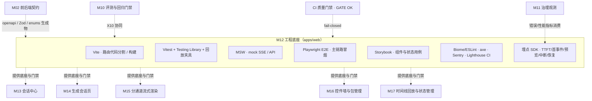
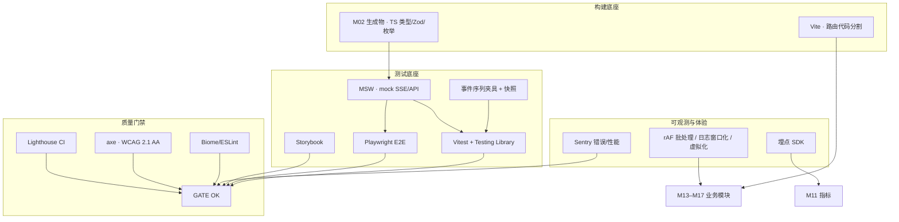
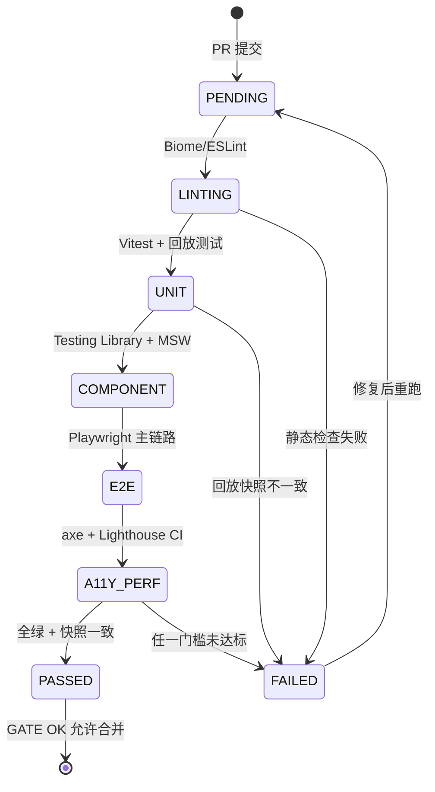

# M12 · 前端工程化与质量（原 W7）

> **文档类型**：可独立交付 / 可独立验收的模块设计文档
> **来源**：`设计方案.md` v1.1 §6.7、§6.8、§6.10、§8 W7 行、§7.2、§11.9、§9.4、§2.6 X10/X12、§0 D-5
> **版本**：v1.0　|　**拆分日期**：2026-11-15　|　**最近修订**：2026-11-16（v1.3，ADR-001：规格可选预填、缺省由系统询问补全；`AgentEventKind` 18 种含 `ask_user`，事件回放夹具覆盖；补 `SPEC_MISSING`/`CLARIFICATION_REQUIRED`/`CLARIFICATION_LIMIT` 原因码与 `POST /clarifications` mock）　|　**状态**：设计定稿（v1.3）
> **对应编号**：W7 / FR-22（质量侧）/ X10（协同）、X12（回放测试协同）
> **主责应用或包**：`apps/web`（工程底座）、`apps/web/e2e`、`apps/web/.storybook`、`infra/ci`
> **一句话定义**：为 M13–M17 提供 Vite 构建底座、分层测试夹具（MSW mock SSE/API）、事件序列回放测试、a11y AA / 性能预算 / 错误监控等质量门禁，本身不实现任何业务组件。

---

## 0. 模块速览（零基础可读）

### 0.1 项目在做什么（本模块所需的最小背景）

WidgetPilot 是一个「用自然语言生成手机桌面控件」的 AI Agent 产品：用户输入描述、可传附件（规格可选预填，缺省由系统询问补全，v1.3 ADR-001 D-6），系统生成 TSX + React 代码，经编译与隔离沙箱测试后产出控件包，最终按真实比例渲染成受限 iframe 卡片。前端是一套 React 19 SPA，包含会话中心、生成会话页、分通道流式渲染、控件墙、时间线回放等多个模块（M13–M17）。这些模块有大量**非功能性但决定成败**的共同需求：流式渲染不掉帧、事件序列可回放测试、iframe 不拖垮宿主、暗色主题与键盘可达、关键路径有埋点、错误有监控、代码按路由分割、每次提交有质量门禁。

M12 就是这套「工程底座 + 质量门禁」：它**不写业务组件**，但提供构建工具链、测试框架与夹具、mock 服务、埋点与监控 SDK、a11y / 性能 / E2E 门禁。原文 §8 W7 行把它定位为 `Vite / Vitest / MSW / Playwright / Storybook / axe / Sentry`，关键要点「**事件序列回放测试、a11y AA**」，验收「E2E 覆盖生成主链路」。

### 0.2 本模块在端到端 14 步链路中的位置

```
① 登录 → 新建会话（grid 可选预填，缺省由系统询问补全，v1.3 ADR-001 D-6）
② 输入描述 + 上传附件 → 传输层校验 → 对象存储 → attachment_id
③ 语义层校验 → 不足则 AWAITING_INPUT
④ 进 LLM 护栏 → 命中不进模型
⑤ 意图与规格确定 → 预取生成规程
⑥ 上下文装配（固定槽位、硬过滤优先）
⑦ 生成回路：先出 WidgetSpec，再出 TSX + React 代码
⑧ 出 LLM 护栏（schema / 能力白名单 / PII / 规格一致）
⑨ 契约校验：spec ↔ manifest ↔ 代码能力声明 + hash
⑩ 沙箱：编译 → 渲染 → 尺寸/运行时错误/能力/交互断言 → 证据包
⑪ 生成 WidgetBundle，COMPLETED
⑫ artifact 事件 → 控件墙按 grid 真实比例渲染卡片
⑬ 评测合格 → 脱敏 → 入库门禁 → 公共语料（可撤回）
⑭ 全流程按 seq 写 SSE 事件流与只追加审计；成本分账
```

本模块**不产生业务步骤**，而是横切为 ①–⑭ 的前端实现提供底座：构建（Vite）、测试（Vitest / Playwright / Storybook）、mock（MSW）、质量门禁（Biome / axe / Sentry / Lighthouse CI）、埋点（TTFT / 首事件延迟 / 预览打开耗时 / 中断率 / 恢复成功率）。它是 00 总览 §2.1 的**支撑型模块**（虚线连到 M13–M17），也是 §2.2 中 P3「M12 性能」与 P1「M02 契约测试」的落地处。**事件序列回放测试是重点**（§6.8 测试行加粗、§8 W7 行）。

### 0.3 为什么必须有这个模块

1. **流式渲染有硬性体验门槛**：原文 §6.10 要求「长会话无掉帧；上滑回看不跳回底部」，§6.7 要求 `rAF` 批处理、日志按行窗口化 + 关键词高亮、长列表虚拟化。没有统一底座，各模块会各写一套节流与滚动逻辑。
2. **事件序列回放测试是前端最能讲细节的一块**（§6.6、§6.8、§8 W7 行）：固定事件序列重放，断言任意时刻 `SessionView` 一致；新 `kind` 不破坏既有 reducer。这需要统一的夹具、MSW mock SSE/API 与快照机制，正是 M12 提供的。
3. **质量必须可量化、可门禁**：TTFT / SSE 首事件 P95、iframe 隔离、axe 无严重项、键盘可达、E2E 覆盖主链路（§6.10 七项）；a11y AA 与性能预算要进 CI（§6.8 质量行）。
4. **可观测与错误隔离**：关键路径埋点、前端错误与性能监控、iframe 与主线程隔离、卡片并发渲染不阻塞输入、`widget:error` 不拖垮宿主页面（§6.7、§6.10）都要有统一 SDK 与门禁。

### 0.4 上下游邻居（mermaid）



- **上游（被消费）**：M02 提供 `openapi.yaml` / Zod / 枚举生成物，M12 的 MSW 与测试夹具据此 mock；M10 在规程 / prompt / 模型 / 检索 / 阈值变更时触发回归门禁（X10 协同）。
- **下游（服务）**：M13–M17 全部前端模块复用 M12 的构建、测试、mock、监控、a11y 底座。
- **横切**：M12 协同 **X10（评测与回归门禁的 CI 执行侧）** 与 **X12（事件序列回放测试）**；00 总览 §3.2 中 M12 的「承载 X*」列为 `—`（无主承载），它是支撑型模块。

### 0.5 原文对照表

| 本模块内容 | 原文章节 |
|---|---|
| 前端技术栈全表（13 行逐行） | §6.8 |
| 体验与工程要点（乐观预览 / 骨架占位 / rAF / 日志窗口化 / 空态 / 代码分割 / 埋点 / iframe 隔离） | §6.7 |
| 前端验收表 7 项 | §6.10 |
| W7 技术栈与关键要点、验收 | §8 W7 行 |
| `apps/web` 代码落位 | §7.2 |
| 端到端冒烟（描述 → 生成 → 打断 → 恢复 → 沙箱 → 卡片） | §11.9 |
| 契约测试 / 纯函数单测 / 幂等恢复 / 故障注入 / 回归门禁 | §11.9 |
| SLO（TTFT/SSE/沙箱/控件卡首帧） | §9.4 |
| 零 Agent 框架 | §0 D-5、§11.1、§6.8 |
| FR-22 质量侧、X10/X12 协同 | 00 总览 §3.2 / §5、§8 W7 行 |

---

## 1. 模块定位与职责边界

### 1.1 为什么必须有（三个不可替代的职责）

1. **统一工程底座**：React 19 + TypeScript + Vite SPA、按路由代码分割、Tailwind + shadcn/ui、CodeMirror/Monaco、Recharts、`@tanstack/react-virtual`、OpenAPI→TS 生成链路都由 M12 装配（§6.8）。各业务模块只写业务，不各自搭轮子。
2. **事件序列回放测试与质量门禁**：Vitest + Testing Library + MSW（mock SSE/API）+ Playwright + Storybook，配合 Vitest 快照与固定事件序列夹具，把 §6.10 七项验收变成 CI 可断言用例（§6.8、§8 W7 行、§11.9）。
3. **可观测与可访问性**：关键路径埋点（TTFT、首事件延迟、预览打开耗时、中断率、恢复成功率）、Sentry 错误与性能监控、axe a11y AA、Lighthouse CI 性能预算（§6.7、§6.8、§9.4）。

### 1.2 做什么（职责清单）

| # | 职责 | 说明 |
|---|---|---|
| R1 | Vite 构建底座 + 按路由代码分割 | React 19 + TS SPA，可选 BFF（§6.8） |
| R2 | 技术栈全表装配（13 行） | 逐层落地，明确不用 AI SDK / CopilotKit / AG-UI SDK |
| R3 | 分层测试框架 | Vitest + Testing Library + Playwright + Storybook |
| R4 | MSW mock SSE / API | 让 M13–M17 可脱离后端独立提测 |
| R5 | **事件序列回放测试夹具与快照** | 固定事件序列、任意时刻 `SessionView` 断言、新旧混合 kind（重点） |
| R6 | 体验工程能力 | 乐观预览 + 进度、骨架占位、原子替换、rAF 批处理、日志窗口化 + 关键词高亮、长列表虚拟化 |
| R7 | 状态与主题 | 空态/加载/错误/无权限/已归档、时间带时区、暗色主题、i18n |
| R8 | 埋点 SDK | TTFT / 首事件延迟 / 预览打开耗时 / 中断率 / 恢复成功率 |
| R9 | 监控 | Sentry 前端错误与性能、iframe 与主线程隔离、`widget:error` 不拖垮宿主 |
| R10 | 质量门禁 | Biome/ESLint、axe（WCAG 2.1 AA）、Lighthouse CI、CI `GATE OK` |
| R11 | E2E 主链路冒烟 | 描述 + 附件 → 生成 → 打断 → 恢复 → 沙箱通过 → 卡片渲染（§11.9） |
| R12 | 契约测试底座 | 消费 M02 生成物，跑 schema / 能力白名单 / 事件 schema / 错误码（§11.9） |

### 1.3 不做什么（明确排除，边界切割点）

| 不做 | 归属模块 | 边界说明 |
|---|---|---|
| 具体业务组件：会话中心、生成会话页、分通道流、控件墙、时间线 | **M13–M17 各自** | M12 **只提供工程底座与质量门禁**，不实现业务组件（00 总览 §3.2、§8 W7 行） |
| event-sourced reducer / `SessionView` 业务逻辑 | **M17** | M12 只提供**回放测试的夹具与快照框架**，不实现 reducer 本身 |
| SSE 底层分帧 / partial-JSON 解析 / 增量 patch / rAF 业务节流逻辑 | **M15** | M12 提供 rAF 工具与 MSW mock 流，不实现业务分帧 |
| iframe sandbox / CSP / bridge 业务放行 | **M09 / M16** | M12 只提供隔离的测试断言与 `widget:error` 不拖垮宿主的 E2E 用例 |
| 包状态机 / 产物生成 / 契约定义 | **M09 / M02** | M12 消费 M02 生成物做契约测试，不定义契约 |
| 鉴权判定 / 后端状态机 / 评测执行 / 指标统计 | **M04 / M10 / M11** | M12 只做前端埋点采集与门禁执行 |
| 在线关闭门禁的开关 | 全系统禁止 | 原文 §1.7 #8、§8 全局口径 |

> **边界最易混淆的一处**：M12 与 M17 都涉及「回放测试」，但 M17 拥有 `reduceSessionView` / `replay` 的**实现**，M12 拥有**测试底座**（Vitest 夹具、固定事件序列、快照比对、CI 门禁）。M17 的回放测试用 M12 提供的框架跑，判据（任意时刻 `SessionView` 一致）属于 M17 的验收，框架与门禁属于 M12。

### 1.4 输入 / 输出与上下游契约

| 方向 | 内容 | 契约形式 |
|---|---|---|
| 入 | M02 生成物（`openapi.yaml` → TS 类型 / Zod / 枚举） | `packages/sdk/ts`，MSW 与测试据此 mock |
| 入 | M10 回归门禁触发（规程 / prompt / 模型 / 检索 / 阈值变更） | CI 事件 |
| 入 | 各业务模块的组件 / 路由 / 状态 | `apps/web/src/` |
| 出 | 构建产物（按路由代码分割的静态资源） | CDN / 静态托管 |
| 出 | 测试夹具 API（固定事件序列 / 快照 / mock handler） | `apps/web/test/` |
| 出 | 埋点事件（`TelemetryEvent`） | M11 指标消费 |
| 出 | 质量门禁结论（`QualityGateResult`、axe / Lighthouse 报告） | CI `GATE OK` |
| 出 | E2E / Storybook 报告 | CI 证据 |

### 1.5 承载的横切能力 X*

- **主承载 X*：无**（00 总览 §3.2 中 M12 的「承载 X*」列为 `—`）。M12 是支撑型模块，为所有模块提供工程底座与质量门禁。
- **协同 X10（评测与回归门禁）**：00 总览 §5 把 X10 协同列为 M11、M12；M12 承担**回归门禁的 CI 执行侧**（Vitest / Playwright / 契约测试 / 回放快照）。
- **协同 X12（流式事件协议与前端回放）**：M12 提供「事件序列回放测试」这一**重点测试能力**（§6.8 测试行、§8 W7 行），支撑 M17 的 reducer 可回放验收。
- **FR-22 质量侧**：M02 是 FR-22 主责（单一事实来源），M12 承担其质量侧——契约测试底座、生成物一致性校验的 CI 执行、a11y / 性能 / E2E 门禁。

### 1.6 关键设计原则

1. **底座与业务分离**：M12 不实现任何业务组件，只提供构建、测试、mock、监控、门禁（§8 W7 行）。
2. **可脱离后端独立提测**：MSW mock SSE/API + 固定事件序列夹具，让 M13–M17 不依赖真实模型 / 沙箱 / 后端（00 总览 §0 规则 5）。
3. **事件序列回放测试是重点**：固定序列重放、任意时刻 `SessionView` 一致、新 `kind` 不破坏 reducer（§6.6、§6.8、§6.10、§8 W7 行）。
4. **质量可量化、门禁 fail-closed**：§6.10 七项 + §9.4 SLO 全部转成 CI 可断言用例；`GATE OK` = 单元测试全绿 + 快照一致 + 端到端冒烟通过（§11.9）。
5. **体验有明确状态设计**：空态 / 加载 / 错误 / 无权限 / 已归档各有设计；时间带时区；WCAG 2.1 AA、键盘可达、暗色主题、i18n（§6.7）。
6. **零 Agent 框架（D-5）**：技术栈全表明确**不用** AI SDK / CopilotKit / AG-UI SDK；流式解析、事件层、reducer 全部手写（§6.8、§0 D-5）。
7. **门禁不可关闭**：所有对照在影子模式 / 离线回放完成，不提供在线关闭门禁的开关（§1.7 #8）。

---

## 2. 技术栈

### 2.1 分层选型表（§6.8 前端技术栈全表逐行覆盖）

| 层 | 选型 | 版本 / 约束 | 为什么选 | 明确不用什么 |
|---|---|---|---|---|
| 框架 | React 19 + TypeScript + Vite（SPA）；需 SSR/统一鉴权时加 BFF | React 19、TS 5.x、Vite 6.x；BFF 只做 SSO、聚合与 SSE ticket（§6.8 / §6.9） | 全站统一构建底座 | 不用 SSR 框架承载控件墙；BFF 不做鉴权判定 |
| 服务端状态 | TanStack Query | v5 | 快照、轮询兜底、精确失效（§6.6 / §6.8） | 不把服务端状态塞进 Zustand |
| 事件状态 | 自研 event-sourced reducer + Zustand（UI 态） | 纯函数、可回放、可单测（§6.6 / §6.8） | 支撑时间线 scrubber | **不用** AI SDK / CopilotKit / AG-UI SDK；不做 token 刷屏 |
| UI | Tailwind CSS + shadcn/ui（Radix） | Radix 无障碍原语 | 可访问性基础（WCAG 2.1 AA） | 不用自研无 a11y 组件 |
| 代码展示 | CodeMirror 6 / Monaco | 增量 patch、TSX 语法高亮 | 代码/预览双轨（§6.4 #2） | 不全文重绘 |
| 流式解析 | 原生 `fetch ReadableStream` + 自研分帧/半帧缓存 + 容错 partial-JSON 解析器 + Zod（仅 final 严格校验） | 不自己写正则解析 JSON；只在 `done` 严格校验（§6.4 #1） | 渐进渲染、不稳定字段不触发副作用 | **不引入 AI SDK**；不用正则硬解析 JSON |
| Agent 事件层 | 原生 `EventSource` / `fetch` + 自研 event-sourced reducer | 分通道派发、seq 去重、心跳、重连与回放全部手写（§6.4 / §6.8） | 无黑盒、可断言 | **不用** AI SDK / CopilotKit / AG-UI SDK / A2UI SDK / MCP SDK |
| 控件渲染 | iframe `sandbox` + CSP + `postMessage` bridge | `sandbox=["allow-scripts"]`（§4.3.3） | 与宿主隔离 | 不含 `allow-same-origin` / `top-navigation` / `forms` / `popups` |
| 图表 | Recharts / ECharts | 指标分布与置信区间（§6.6 / §6.8） | 报分布不报点估计 | 不用单点估计图 |
| 列表 | `@tanstack/react-virtual` | 会话、时间线、卡片墙虚拟化（§6.8） | 长会话无掉帧 | 不全量渲染 |
| 契约 | OpenAPI 3.1 → `openapi-typescript`；事件与协议用 Zod；枚举共享包 | 由 M02 生成（§6.8 / §6.9） | 单一事实来源 | 不手写重复类型 |
| 测试 | Vitest + Testing Library + MSW（mock SSE/API）+ Playwright（E2E）+ Storybook | **事件序列回放测试是重点**（§6.8） | 可脱离后端独立提测 | — |
| 质量 | Biome / ESLint、axe、Sentry、Lighthouse CI | a11y AA、性能预算（§6.7 / §6.8） | 门禁 fail-closed | 不提供关闭门禁的开关 |

### 2.2 硬约束（D-5 零 Agent 框架）

- **禁止引入**：Vercel AI SDK / `streamUI` / CopilotKit / AG-UI SDK / A2UI SDK / LangChain / LangGraph / Temporal / MCP SDK / LangFuse / LLM 专用观测平台 SDK（原文 §11.1、§0 D-5、§6.8）。
- **保留的通用基础设施**：React 19 / Vite / TypeScript / TanStack Query / Zustand / Zod / CodeMirror / Tailwind / Radix / Recharts / `@tanstack/react-virtual` / `EventSource` / `fetch ReadableStream` / OpenTelemetry SDK（通用可观测）（原文 §11.1 保留清单）。
- **流式解析硬约束**：只在 `done` 做严格 Zod 校验；流式中最后一个字符串字段视为不稳定，不触发任何副作用（路由、埋点、请求）（§6.4 #1）。
- **门禁硬约束**：`GATE OK` = 单元测试全绿 + 快照一致 + 端到端冒烟通过（§11.9）；门禁只断言「已有能力不退化」，不因新增能力缺失阻塞。
- **隔离硬约束**：iframe 与主线程隔离；卡片并发渲染不阻塞输入；`widget:error` 不拖垮宿主页面（§6.7、§6.10）。

### 2.3 运行时依赖

| 依赖 | 用途 | 不可用时的行为 |
|---|---|---|
| M02 `packages/sdk/ts` | TS 类型 / Zod / 枚举 | 类型不一致即构建失败（CI fail-closed） |
| CDN / 静态托管 | 构建产物分发 | 不影响源码与测试；降级为本地预览 |
| Sentry DSN | 前端错误与性能监控 | 埋点失败不影响渲染主链路 |
| CI runner | Vitest / Playwright / axe / Lighthouse | CI 不可用禁止合并（fail-closed） |
| MSW | mock SSE / API | 测试期替代后端；生产不加载 |
| Storybook | 组件与状态用例 | 独立静态站点，可选但纳入 CI |

### 2.4 monorepo 代码落位（§7.2）

```
apps/web/                          # M12 工程底座（M13–M17 业务代码也在此）
  vite.config.ts                   # 按路由代码分割 / 构建
  src/main.tsx  src/routes/        # 路由与懒加载边界
  src/lib/
    rafBatch.ts                    # rAF 批处理工具
    windowedLog.ts                 # 日志按行窗口化 + 关键词高亮
    telemetry.ts                   # 埋点 SDK（TTFT/首事件/预览/中断/恢复）
    errorBoundary.tsx              # 单卡/页面错误隔离
  test/
    fixtures/eventSequences.ts     # ★ 固定事件序列（回放测试重点）
    fixtures/snapshots/            # SessionView 快照
    msw/handlers.ts                # mock REST + SSE
    msw/sse.ts                     # mock SSE 分帧流
    setup.ts                       # Vitest / Testing Library 初始化
  e2e/                             # Playwright：生成主链路冒烟 + 7 项验收
  .storybook/                      # Storybook：空/加载/错误/无权限/已归档态
apps/web/.lighthouserc.json        # 性能预算
apps/web/biome.json                # Biome/ESLint
infra/ci/quality-gate.yml          # CI 质量门禁（GATE OK）
```

---

## 3. 设计架构

### 3.1 内部组件与职责（图 + 表）



| 组件 | 职责 | 关键不变量 |
|---|---|---|
| `vite.config.ts` | 构建、按路由代码分割 | 业务路由懒加载，首屏 bundle 受预算约束 |
| `eventSequences.ts` | 固定事件序列夹具（全 kind / 重复 seq / 乱序 / 未知 kind / 新旧混合） | 序列确定、可复跑、入库版本化 |
| `snapshots/` | `SessionView` 快照 | 回放不一致即失败 |
| `msw/handlers.ts` / `sse.ts` | mock REST 与 SSE 分帧流 | 与 M02 生成物一致，不手写第二套类型 |
| `telemetry.ts` | 关键路径埋点 | 埋点失败不影响主链路 |
| `rafBatch.ts` / `windowedLog.ts` | rAF 批处理、日志窗口化 + 关键词高亮 | delta 先写 ref，最多 60 次/秒 flush |
| `errorBoundary.tsx` | 页面 / 单卡错误隔离 | `widget:error` 不拖垮宿主 |
| `quality-gate.yml` | CI 门禁编排 | `GATE OK` 才允许合并 |

### 3.2 处理流程与数据流（编号步骤）

1. 开发者提交前端代码 → CI 触发 `quality-gate.yml`。
2. **静态检查**：Biome/ESLint 检查；M02 `contracts:check` 确认生成物一致（FR-22 质量侧）。
3. **单元测试**：Vitest 跑各模块单测；**事件序列回放测试**加载 `eventSequences.ts` 固定序列 → 重放 → 与 `snapshots/` 比对，断言任意时刻 `SessionView` 一致、新 `kind` 不破坏 reducer（重点）。
4. **组件测试**：Testing Library + MSW mock REST/SSE，测空态 / 加载 / 错误 / 无权限 / 已归档 / 暗色主题 / 键盘可达。
5. **Storybook 构建**：组件与状态用例可视化，axe 逐 story 扫描。
6. **E2E 冒烟**（§11.9）：Playwright 跑「描述 + 附件 → 生成 → 打断 → 恢复 → 沙箱通过 → 卡片渲染」主链路，并覆盖 §6.10 七项验收。
7. **a11y / 性能**：axe 无严重项、键盘可达；Lighthouse CI 校验性能预算（TTFT / SSE 首事件 / 控件卡首帧）。
8. **门禁结论**：`GATE OK` = 单元测试全绿 + 快照一致 + 端到端冒烟通过；否则 fail-closed 禁止合并。
9. **运行时**：业务模块用 `rafBatch` 批量 flush delta（≤60 次/秒）、`windowedLog` 按行窗口化 + 关键词高亮、虚拟列表；`telemetry` 上报 TTFT / 首事件延迟 / 预览打开耗时 / 中断率 / 恢复成功率；`Sentry` 采集错误与性能。
10. **iframe 隔离**：`errorBoundary` 捕获单卡 `widget:error`，卡片并发渲染不阻塞输入（§6.7、§6.10）。

### 3.3 状态机

**A. 质量门禁状态机（M12 拥有，【推导·需评审】）**



> `PENDING/LINTING/UNIT/COMPONENT/E2E/A11Y_PERF/PASSED/FAILED` 为【推导·需评审】：原文只给「`GATE OK` = 单元测试全绿 + 快照一致 + 端到端冒烟通过」，未给门禁阶段枚举名。

**B. 前端状态/体验态（M12 提供组件与断言，原文 §6.7）**：空态 / 加载 / 错误 / 无权限 / 已归档各有明确设计；暗色主题、i18n、时间带时区。这些是 UI 展示态，M12 提供 Storybook 用例与 axe 断言，不实现业务判定。

### 3.4 关键机制、算法与不变量清单

**A. 事件序列回放测试（重点，§6.8 / §8 W7 行）**

```ts
// apps/web/test/fixtures/eventSequences.ts
export const FIXED_SEQUENCE: AgentEvent[];        // 全 kind 覆盖
export const MIXED_OLD_NEW_SEQUENCE: AgentEvent[]; // 新旧混合 + 未知 kind
export const OUT_OF_ORDER_SEQUENCE: AgentEvent[];   // 重复 seq / 乱序 seq

// apps/web/test/replay.spec.ts
export function assertReplayConsistent(events: AgentEvent[]): void; // 任意前缀一致
export function assertSnapshotMatch(events: AgentEvent[], snapshotPath: string): void;
```

固定事件序列重放，断言任意时刻 `SessionView` 一致；新 `kind` 不破坏既有 reducer（§6.6、§6.10、§8 W7 行）。

**B. rAF 批处理（§6.4 #3 / §6.7）**：delta 先写 `ref`，按 `requestAnimationFrame` 批量 flush 到 state（最多 60 次/秒）；已完成的块 memo 化，只重渲染仍在增长的末块。

**C. 滚动锚定（§6.4 #4）**：仅当用户已处于底部时才自动滚到底；用户上滑回看时**不跳回**。

**D. 日志窗口化与关键词高亮（§6.7）**：测试 / 沙箱日志按行窗口化（最多 N 行）+ 关键词高亮；长列表用 `@tanstack/react-virtual` 虚拟化。

**E. 体验态与原子替换（§6.7）**：附件上传乐观预览 + 进度；生成中卡片按会话确定的规格（可能经询问补全，v1.3 ADR-001 D-6）**骨架占位**；完成**原子替换**（`artifact` 事件到达时替换占位卡片）。

**F. 埋点（§6.7）**：关键路径埋点 TTFT、首事件延迟、预览打开耗时、中断率、恢复成功率；每事件带 `traceId` / `sessionId` / `runId`。

**不变量清单**

| # | 不变量 | 断言方式 |
|---|---|---|
| I1 | `rafBatch` flush 频率 ≤ 60 次/秒 | 计时器 spy 断言 |
| I2 | 用户上滑回看时滚动位置不被自动拉回底部 | 滚动锚定 E2E 断言 |
| I3 | 固定序列重放任意时刻 `SessionView` 与快照一致 | 快照比对 |
| I4 | 新 `kind` / 未知 `kind` 不破坏回放 | 混合序列断言 |
| I5 | 生成中骨架占位按会话确定的 `grid`（可能经询问补全，v1.3 ADR-001 D-6）比例，完成时原子替换 | DOM 快照断言 |
| I6 | 空/加载/错误/无权限/已归档五态均有 Storybook 用例且 axe 无严重项 | story + axe 断言 |
| I7 | iframe 无法访问父页面 / 无法外联；`widget:error` 不拖垮宿主 | E2E 注入断言 |
| I8 | 卡片并发渲染不阻塞输入 | 输入延迟 < 阈值 + 无长任务 |
| I9 | 关键路径 5 类埋点齐全且带 `traceId` | 埋点事件断言 |
| I10 | `GATE OK` 三要素（单测全绿 + 快照一致 + E2E 冒烟）全满足才放行 | CI 退出码 |
| I11 | MSW mock 与 M02 生成物类型一致，无手写第二套类型 | 类型 + drift 断言 |
| I12 | 按路由代码分割，业务路由懒加载 | 构建产物 chunk 断言 |

### 3.5 与其他模块的时序（关键 3 个场景）

**场景 1：PR 质量门禁**
`提交 → Biome → contracts:check(M02) → Vitest 回放测试(重点) → Testing Library+MSW → Storybook+axe → Playwright E2E 冒烟 → Lighthouse → GATE OK`

**场景 2：事件序列回放测试（重点）**
`加载 eventSequences.ts 固定序列 → M17 的 reduceSessionView/replay 重放 → 与 snapshots/ 比对 → 断言任意前缀一致 + 新旧混合 kind 不破坏 → 快照不一致即失败`

**场景 3：运行时体验与监控**
`M15 流式 delta → rafBatch(≤60/s) → M14 渲染（上滑不跳回）→ windowedLog 日志窗口化 → telemetry 上报 TTFT/首事件/预览/中断/恢复 → Sentry 采集错误 → M11 消费指标`

### 3.6 部署形态与伸缩

| 形态 | 说明 |
|---|---|
| 构建产物 | `apps/web` 静态 SPA，按路由代码分割，CDN / 静态托管（§7.1），无服务端状态 |
| Storybook | 独立静态站点，CI 构建并跑 axe |
| 测试 / 门禁 | CI runner 执行，fail-closed；不提供在线关闭开关 |
| MSW | 仅测试期加载；浏览器 Service Worker / Node 拦截器，不进生产包 |
| 埋点 / Sentry | 客户端采集，异步上报，失败不影响主链路 |

---

## 4. 接口契约

> **M12 的特殊性**：它不实现业务 REST，而是**提供工程化接口**（构建 / 测试 / mock / 埋点 / 监控 / 门禁）。本节 4.1 用「接口 | 类型 | 权限 | 输入 | 输出 | 退出码/状态」对齐模板；4.1.5 给出它 mock 的业务接口清单（说明是 mock 非实现）。

### 4.1 消费 / 提供的接口表

#### 4.1.1 工程化命令接口

| 接口 | 类型 | 权限 | 输入 | 输出 | 退出码 / 状态 |
|---|---|---|---|---|---|
| `pnpm build` | Vite 构建 | 开发者 / CI | `apps/web` 源码 | 按路由分割的静态产物 | 0 / 非 0 |
| `pnpm dev` | Vite dev server | 开发者 | — | 本地预览 + HMR | — |
| `pnpm test:unit` | Vitest | 开发者 / CI | 测试文件 + 事件序列夹具 | 测试报告 | 0 / 非 0 |
| `pnpm test:e2e` | Playwright | CI | E2E 用例 + MSW | 冒烟报告 | 0 / 非 0 |
| `pnpm test:contract` | 契约测试（§11.9） | CI | M02 生成物 | schema / 白名单 / 事件 / 错误码报告 | 0 / 非 0 |
| `pnpm lint` | Biome/ESLint | CI | 源码 | lint 报告 | 0 / 非 0 |
| `pnpm a11y` | axe | CI | Storybook stories | axe 报告（严重项数） | 0 / 非 0 |
| `pnpm lighthouse` | Lighthouse CI | CI | 构建产物 | 性能预算报告 | 0 / 非 0 |
| `pnpm quality:gate` | CI 门禁编排 | CI | 上述全部结论 | `QualityGateResult` | `GATE OK` / `GATE FAIL` |

#### 4.1.2 埋点与监控接口（运行时函数）

| 接口 | 类型 | 权限 | 输入 | 输出 | 状态 |
|---|---|---|---|---|---|
| `track(name, value, ctx)` | 埋点 SDK | 前端内部 | `TelemetryEvent` | `void`（异步入队） | 失败静默不影响主链路 |
| `reportError(err, ctx)` | Sentry 上报 | 前端内部 | `Error` + `traceId` | `void` | 异步 |
| `reportWidgetError(traceId, code)` | 单卡错误埋点 | 前端内部 | `traceId` + `ReasonCode` | `void` | 异步 |
| `reportCardFirstFrame(ms)` | 首帧耗时埋点 | 前端内部 | `number` | `void` | 异步 |
| `withErrorBoundary(Component)` | 错误隔离 HOC | 前端内部 | React 组件 | 组件 | 同步 |

#### 4.1.3 测试夹具接口

| 接口 | 类型 | 输入 | 输出 |
|---|---|---|---|
| `loadEventSequence(name)` | 夹具加载 | `"fixed"` / `"mixed_old_new"` / `"out_of_order"` | `AgentEvent[]` |
| `assertReplayConsistent(events)` | 回放断言 | `AgentEvent[]` | `void`（不一致抛错） |
| `assertSnapshotMatch(events, path)` | 快照断言 | 序列 + 快照路径 | `void` |
| `createSseMock(events)` | MSW SSE mock | `AgentEvent[]` | `Response`（`text/event-stream`） |
| `installMswHandlers()` | MSW 安装 | — | `SetupServerApi` |

#### 4.1.4 体验工具接口

| 接口 | 类型 | 输入 | 输出 | 约束 |
|---|---|---|---|---|
| `rafBatch(flush)` | rAF 批处理 | `() => void` | 取消器 | ≤ 60 次/秒 |
| `windowedLog(lines, maxRows, keywords)` | 日志窗口化 | 日志行 + 行数 + 关键词 | 高亮后的可视行 | 最多 N 行 |
| `GridSkeleton(grid)` | 骨架占位 | `GridSpec` | 按真实比例的占位组件 | `cell=80px` |
| `atomicReplace(host, next)` | 原子替换 | 占位节点 + 产物节点 | `void` | `artifact` 到达时一次替换 |

#### 4.1.5 MSW mock 的业务接口清单（mock，非实现）

| 方法 | 路径 | mock 用途 | 真实实现归属 |
|---|---|---|---|
| `GET` | `/api/sessions` / `/api/sessions/{id}` | 会话列表 / 快照 | M04 |
| `GET` | `/api/sessions/{id}/events` | SSE 事件流（分帧流） | M04 / M15 |
| `POST` | `/api/sessions/{id}/messages` / `interrupt` / `resume` | 提交 / 打断 / 恢复 | M04 |
| `POST` | `/api/sessions/{id}/clarifications`（v1.3 新增，ADR-001 D-7） | 回答澄清问题（规格缺失 / 模型 ask_user），body: `{ question_id, answer }` | M04 |
| `GET` / `POST` | `/api/bundles` / `/api/bundles/{id}/install\|delete\|rollback` | 包列表 / 状态操作 | M09 / M16 |
| `GET` | `/api/bundles/{id}/preview` / `/evidence` | 预览 / 证据 | M09 / M16 |
| `GET` | `/api/metrics` | 指标分布 | M11 |
| `POST` | `/api/bff/sse-ticket` | 短期 SSE ticket | M02 BFF |

> MSW handler 的请求/响应类型**全部来自 M02 生成物**（I11），不手写第二套类型。上表路径为【契约约定】，最终以 `openapi.yaml` 为准。

### 4.2 事件接口（SSE `kind` 与 payload）

M12 的 `createSseMock` 与 `eventSequences.ts` 覆盖原文 §4.5 全部 `AgentEventKind`（v1.3 共 **18** 种，含 `ask_user`，ADR-001 D-7），用于回放测试与 E2E。事件统一带 `seq` / `sessionId` / `runId` / `ts` / `kind` / `phase` / `payload` / `traceId`（完整定义见 §6.2）。

| `kind` | payload 形态（mock 样例，【契约约定】） | 在测试中的作用 |
|---|---|---|
| `run` | `{ runId, phase, grid, attempt_no }` | 触发 `RUNNING` 态 |
| `plan` | `{ steps: string[] }` | 折叠步骤条 |
| `spec` | `{ delta: Partial<WidgetSpec> }` | partial 渐进 + 骨架占位 |
| `attachment` | `{ attachment_id, role, insight_ref }` | 附件 role 纠偏用例 |
| `skill` / `routing` | `{ recipe_id, model_tier }` | 链路账标签 |
| `code` | `{ from_line, to_line, text }` | 增量 patch / 代码双轨 |
| `guard` / `validation` / `sandbox` | `{ passed, items[], reason_code? }` | 护栏 / 校验 / 沙箱清单 |
| `artifact` | `{ bundle_id, preview_ref, grid }` | **原子替换骨架占位** + 热更新 |
| `cost` / `checkpoint` | `{ total, by_tier }` / `{ rev, node }` | 成本账 / 续传锚点 |
| `interrupted` | `{ reason_code, checkpoint_rev, resume_hint }` | 打断 / 恢复用例 |
| `notice` / `error` / `done` | `{ message, code? }` / `{ code, evidenceRef? }` / `{ bundle_id? }` | 状态与终态 |
| `ask_user`（v1.3 新增） | `{ question_id, question, options?, allow_text, clarify_count, clarify_limit }` | 澄清问题卡用例；回答经 `POST /clarifications` 回注（AgentEventKind 17 → 18 种，ADR-001 D-7） |
| **未知 `kind`** | 任意 | **回放测试覆盖新旧混合序列，验证不破坏 reducer**（§6.4 #9 / §6.10） |

**埋点事件（非 SSE，M12 自有 `TelemetryEvent`）**：`ttft` / `sse_first_event` / `preview_open` / `interrupt` / `recovery` / `widget_error` / `card_first_frame`，字段见 §6.2。

### 4.3 内部接口与函数签名（TS / Python）

```ts
// apps/web/src/lib/rafBatch.ts
export function rafBatch(flush: () => void): () => void; // 返回取消器，≤60 次/秒

// apps/web/src/lib/windowedLog.ts
export function windowedLog(lines: string[], maxRows: number, keywords: string[]): string[];

// apps/web/src/lib/telemetry.ts
export type TelemetryName =
  | "ttft" | "sse_first_event" | "preview_open" | "interrupt"
  | "recovery" | "widget_error" | "card_first_frame";
export function track(name: TelemetryName, value: number, ctx: TelemetryContext): void;
export function reportError(err: unknown, ctx: TelemetryContext): void;

// apps/web/test/fixtures/eventSequences.ts —— 事件序列回放测试重点
export function loadEventSequence(name: SequenceName): AgentEvent[];
export function assertReplayConsistent(events: AgentEvent[]): void;
export function assertSnapshotMatch(events: AgentEvent[], snapshotPath: string): void;

// apps/web/test/msw/sse.ts
export function createSseMock(events: AgentEvent[]): Response; // text/event-stream，按 \n\n 分帧
export function installMswHandlers(): SetupServerApi;

// infra/ci/quality-gate（脚本签名，【契约约定】）
export function runQualityGate(): Promise<QualityGateResult>;
```

```python
# apps/web/e2e/conftest.py（若 E2E 用 Python 辅助生成夹具，【契约约定】）
def build_event_fixture(kinds: list[str]) -> list[dict]: ...   # 生成固定 AgentEvent 序列
def assert_gate_ok(report_path: str) -> bool: ...
```

**被调用的上游接口**：M02 `contracts:check`（生成物一致性）；M10 `regression_gate.notify`（变更触发回归）；M17 `reduceSessionView` / `replay`（回放测试调用，M12 只提供夹具）。

### 4.4 统一响应与错误码

M12 的 MSW mock 必须复刻原文 §4.4 / §6.9 统一响应 `{ code, message, traceId, retryable, evidenceRef? }`，`code` 与 `ReasonCode` 对齐（完整定义见 §6.2）。错误态组件按 `code` 展示具体原因与「从断点继续 / 改描述重试」入口，**不显示裸「失败」**；`FAILED` 必须带 `evidenceRef`。MSW 用这些响应模拟 `400/401/403/404/409/422/429/503` 供错误态用例。

### 4.5 幂等、重试、超时、限流、并发约定

| 项 | 约定 |
|---|---|
| 幂等 | 生成脚本 / `runQualityGate` / 夹具加载可重复运行；回放测试天然幂等 |
| 重试 | CI 门禁失败即失败，不自动重试掩盖问题；瞬时网络故障退避有上限 |
| 超时 | E2E / Lighthouse / Sentry 上报设超时；无 `done` 的 mock SSE 视为截断重连 |
| 限流 | `rafBatch` ≤ 60 次/秒；日志最多 N 行；长列表虚拟化 |
| 并发 | 回放测试在 Vitest 并行跑固定序列；卡片并发渲染不阻塞输入（I8） |
| 错误隔离 | `withErrorBoundary` 捕获单卡 / 页面错误；`widget:error` 不拖垮宿主 |
| 快照 | 回放快照不一致即失败（`GATE OK` 三要素之一） |

### 4.6 接口状态表（契约状态 / 运行态 / 可重试）

| 接口 / 产物 | 契约状态 | 运行态 | 可重试 | 说明 |
|---|---|---|---|---|
| `pnpm build` / `lint` / `a11y` / `lighthouse` | **定稿**（§6.8 质量行） | CI 同步 | 是 | 门槛 fail-closed |
| `pnpm test:unit` / `test:e2e` / `test:contract` | **定稿**（§6.8 测试行、§11.9） | CI 同步 | 是 | 事件序列回放测试是重点 |
| `quality:gate`（`GATE OK`） | **定稿**（§11.9） | CI 同步 | 是 | 三要素全满足才放行 |
| MSW mock 业务接口 | **【契约约定】** | 测试期同步/流式 | 是 | 类型来自 M02 生成物 |
| 埋点 SDK / Sentry 上报 | **定稿**（§6.7 埋点与监控） | 运行时异步 | 是 | 失败不影响主链路 |
| `TelemetryEvent` 字段 | **【推导·需评审】** | — | — | 原文只给 5 类埋点名，未给字段结构（§6.2） |
| `QualityGateResult` / 门禁阶段枚举 | **【推导·需评审】** | — | — | 原文只给 `GATE OK` 定义（§3.3） |
| `rafBatch` / `windowedLog` / `GridSkeleton` | **【契约约定】** | 运行时同步 | — | 原文给行为未给函数签名 |
| 前端验收 7 项阈值 | **定稿**（§6.10） / 部分【影子校准中】 | — | — | TTFT/SSE 首事件为明确阈值；具体数值影子期校准 |
| 可选 BFF | **可选**（§6.8 / §7.1） | — | — | 直连 control-plane 亦可 |

> 契约状态取值：**定稿**（原文明确）/ **依赖外部**（依赖 M02 生成物）/ **影子校准中**（数值待影子期校准）/ **可选**（BFF、Storybook 独立站点）。

---

## 5. 状态、原因码与 API 状态

### 5.1 拥有或参与的状态机与完整枚举（TS 定义）

```ts
// 【推导·需评审】质量门禁状态机（M12 拥有，原文只给 GATE OK 定义）
type QualityGatePhase =
  | "PENDING" | "LINTING" | "UNIT" | "COMPONENT" | "E2E"
  | "A11Y_PERF" | "PASSED" | "FAILED";

// 【推导·需评审】埋点事件名（原文 §6.7 给 5 类关键路径，此处补全为枚举）
type TelemetryName =
  | "ttft" | "sse_first_event" | "preview_open" | "interrupt"
  | "recovery" | "widget_error" | "card_first_frame";

// 【推导·需评审】测试层
type TestLayer = "unit" | "component" | "contract" | "e2e" | "visual" | "a11y" | "perf";

// 【推导·需评审】事件序列夹具名
type SequenceName = "fixed" | "mixed_old_new" | "out_of_order" | "cross_day_recovery";

// 【推导·需评审】UI 体验态（原文 §6.7 给 5 类，M12 提供组件与断言）
type ViewStatus = "empty" | "loading" | "error" | "forbidden" | "archived";

// 原文 §4.2：会话状态（M12 消费，用于体验态与埋点上下文）
type SessionState =
  | "DRAFT" | "RUNNING" | "PAUSED" | "AWAITING_INPUT" | "VALIDATING"
  | "COMPLETED" | "FAILED" | "CANCELLED";

// 原文 §4.5：事件 kind（M12 mock / 回放夹具全量覆盖；v1.3 ADR-001 D-7 扩充为 18 种）
type AgentEventKind =
  | "run" | "plan" | "spec" | "attachment" | "skill" | "routing"
  | "code" | "guard" | "validation" | "sandbox" | "artifact"
  | "cost" | "checkpoint" | "interrupted" | "notice" | "error" | "done"
  | "ask_user";   // v1.3 新增：执行中澄清问题，payload { question_id, question, options?, allow_text, clarify_count, clarify_limit }

// 原文 §4.2：错误码（M12 mock 错误态与 Sentry 上报消费；v1.3 ADR-001 新增 3 码）
type ReasonCode =
  | "INPUT_INVALID" | "INTENT_OUT_OF_SCOPE" | "GUARD_INPUT_HIT" | "GUARD_OUTPUT_HIT"
  | "SPEC_CONFLICT" | "CAPABILITY_DENIED" | "CONTRACT_MISMATCH" | "COMPILE_FAILED"
  | "SANDBOX_TEST_FAILED" | "RETRY_EXHAUSTED" | "BUDGET_EXHAUSTED"
  | "SANDBOX_UNAVAILABLE" | "HUMAN_REQUIRED" | "MODEL_ERROR"
  | "SPEC_MISSING" | "CLARIFICATION_REQUIRED" | "CLARIFICATION_LIMIT";   // 后三个为 v1.3 新增（ADR-001），需 M02 收敛入 openapi.yaml
```

**终态**：`QualityGatePhase` 的 `PASSED`（`GATE OK`）/ `FAILED`；`SessionState` 的 `COMPLETED/FAILED/CANCELLED`。

### 5.2 状态流转表

| 触发 | 前态 | 后态 | 副作用 | 事件 / 动作 |
|---|---|---|---|---|
| PR 提交 | `[*]` | `PENDING` | 触发 `quality-gate.yml` | CI |
| lint 通过 | `PENDING` | `LINTING` → `UNIT` | 跑 Vitest + 回放测试 | 报告 |
| 回放快照不一致 | `UNIT` | `FAILED` | CI 失败（I3） | `GATE FAIL` |
| 组件 / E2E / a11y / perf 全绿 | `A11Y_PERF` | `PASSED` | `GATE OK` 允许合并 | CI |
| 任一门槛未达标 | 任意 | `FAILED` | fail-closed | `GATE FAIL` |
| `artifact` 事件 | 骨架占位 | 完成态 | **原子替换**（I5） | `artifact` |
| `interrupted` 事件 | 生成中 | 暂停态 | 保留部分产物、切「已暂停 · 从 XX 继续」 | `interrupted` |
| 埋点失败 | 任意 | 不变 | 静默丢弃，不影响主链路 | `track` 内部 |

### 5.3 ReasonCode 子集（本模块消费）

M12 通过 MSW mock 错误响应、`error` 事件、`widget:error` 埋点消费原因码，用于错误态组件、Sentry 上报与「不显示裸失败」断言。重点子集：

| 码 | 本模块处理 |
|---|---|
| `INPUT_INVALID` / `SPEC_CONFLICT` | 错误态用例；`retryable=false` |
| `GUARD_INPUT_HIT` / `GUARD_OUTPUT_HIT` | 护栏命中态；mock `422` |
| `CONTRACT_MISMATCH` / `COMPILE_FAILED` / `SANDBOX_TEST_FAILED` | 校验失败态；mock `validation`/`sandbox` 事件 |
| `CAPABILITY_DENIED` | `widget:error` 埋点用例 |
| `RETRY_EXHAUSTED` / `BUDGET_EXHAUSTED` / `HUMAN_REQUIRED` | 终态错误 + `evidenceRef` 断言 |
| `SANDBOX_UNAVAILABLE` / `MODEL_ERROR` | 降级态；mock `503` |
| `SPEC_MISSING` / `CLARIFICATION_REQUIRED` / `CLARIFICATION_LIMIT`（v1.3 ADR-001） | 澄清问题态用例：`SPEC_MISSING` → `notice` + `suggest_grid`；`CLARIFICATION_REQUIRED` → `ask_user` 事件卡；`CLARIFICATION_LIMIT` → 终态错误 + `evidenceRef` 断言 |

> 完整 17 个 `ReasonCode`（v1.3 含 `SPEC_MISSING` / `CLARIFICATION_REQUIRED` / `CLARIFICATION_LIMIT`，ADR-001）见基线 §7；所有 `FAILED` 必须携带 `evidenceRef`。

### 5.4 HTTP 状态码与业务码映射（MSW mock 覆盖）

| HTTP | 场景 | `code` | `retryable` |
|---|---|---|---|
| 200 | 成功 | `OK` | — |
| 202 | 异步已受理 | `OK` | — |
| 400 | 输入 / 规格非法 | `INPUT_INVALID` / `SPEC_CONFLICT` | `false` |
| 401 | 未登录 / JWT 失效 | 【待 M02 定稿】 | `false` |
| 403 | 越权 / 无权限态 | 【待 M02 定稿】 | `false` |
| 404 | 资源不存在 | 【契约约定】 | `false` |
| 409 | 状态冲突 | 【待 M02 定稿】 | `false` |
| 422 | 护栏命中 | `GUARD_INPUT_HIT` | `false` |
| 429 | 限流 / 配额触顶 | `BUDGET_EXHAUSTED` | `false` |
| 503 | 沙箱 / 模型不可用 | `SANDBOX_UNAVAILABLE` / `MODEL_ERROR` | `true` |

> `401/403/409` 业务码由 **M02 定稿**（基线 §5.3）；M12 的 MSW mock 必须复用 M02 定稿值，不自定义。

### 5.5 接口运行态约定（同步 / 异步 / 流式 / 挂起态 / 终态行为）

- **CI 接口**：`build` / `lint` / `test:*` / `a11y` / `lighthouse` / `quality:gate` 为同步、可重跑、确定性；`GATE FAIL` 禁止合并。
- **MSW mock 接口**：REST 为同步；`/events` 为流式 `text/event-stream`，终态由显式 `done` / `error` 标志；无 `done` 视为截断并重连。
- **埋点 / 监控接口**：运行时异步入队；失败静默，不影响渲染主链路。
- **挂起态**：`PAUSED` / `AWAITING_INPUT` 的体验态为「已暂停」，保留已生成部分 spec / 代码；Storybook 有用例。
- **终态**：`COMPLETED` / `FAILED` / `CANCELLED` 的体验态明确设计；`GATE OK` 为门禁终态。

---

## 6. 核心字段与元数据

### 6.1 核心字段表（字段 | 类型 | 约束 | 含义）

| 字段 | 类型 | 约束 | 含义 |
|---|---|---|---|
| `TelemetryEvent.name` | `TelemetryName` | 枚举 | 埋点名（TTFT / 首事件 / 预览 / 中断 / 恢复 / 错误 / 首帧） |
| `TelemetryEvent.value` | `number` | ≥ 0 | 耗时或计数 |
| `TelemetryEvent.ts` | `string` | UTC | 带时区 |
| `TelemetryEvent.sessionId` / `runId` | `string` | 非空 | 关联会话与恢复 |
| `TelemetryEvent.traceId` | `string` | 非空 | 关联 trace |
| `QualityGateResult.ok` | `boolean` | — | 是否 `GATE OK` |
| `QualityGateResult.phases` | `Record<QualityGatePhase, boolean>` | — | 各阶段结论 |
| `QualityGateResult.snapshotMatch` | `boolean` | — | 回放快照一致（三要素之一） |
| `QualityGateResult.e2eSmoke` | `boolean` | — | 端到端冒烟通过（三要素之一） |
| `EventFixture.name` | `SequenceName` | 枚举 | 固定序列名 |
| `EventFixture.events` | `AgentEvent[]` | 非空 | 事件序列 |
| `EventFixture.version` | `string` | 版本化 | 夹具版本，变更触发回归 |
| `PerfBudget.ttft_p95_ms` | `number` | `< 1000` | TTFT P95 < 1s（§6.10） |
| `PerfBudget.sse_first_event_p95_ms` | `number` | `< 1500` | SSE 首事件 P95 < 1.5s |
| `PerfBudget.card_first_frame_p95_ms` | `number` | `< 500` | 控件卡首帧 P95 < 500ms（§9.4） |
| `A11yResult.serious` | `number` | `= 0` | axe 严重项 = 0 |
| `A11yResult.keyboardReachable` | `boolean` | `true` | 键盘可达 |
| `ViewStatus` | `ViewStatus` | 枚举 | 空 / 加载 / 错误 / 无权限 / 已归档 |
| `AgentEvent.seq` / `kind` / `phase` | 同 §6.2 | — | 回放夹具字段 |

> `TelemetryEvent` / `QualityGateResult` / `EventFixture` / `PerfBudget` / `A11yResult` 字段为【推导·需评审】：原文只给埋点名、验收阈值与 `GATE OK` 定义，未给字段级结构。

### 6.2 相关协议 schema 完整定义（相关片段完整抄入）

**前端技术栈全表（原文 §6.8，完整抄入）**

```
| 层 | 选型 | 说明 |
| 框架 | React 19 + TypeScript + Vite（SPA）；需 SSR/统一鉴权时加 BFF | BFF 只做 SSO、聚合与 SSE ticket |
| 服务端状态 | TanStack Query | 快照、轮询兜底、精确失效 |
| 事件状态 | 自研 event-sourced reducer + Zustand（UI 态） | 可回放、可单测 |
| UI | Tailwind CSS + shadcn/ui（Radix） | 可访问性基础 |
| 代码展示 | CodeMirror 6 / Monaco | 增量 patch、语法高亮（TSX） |
| 流式解析 | 原生 fetch ReadableStream + 自研分帧/半帧缓存 + 容错 partial-JSON 解析器 + Zod（仅 final 严格校验） | 不自己写正则解析 JSON；不引入 AI SDK |
| Agent 事件层 | 原生 EventSource/fetch + 自研 event-sourced reducer，不用 AI SDK / CopilotKit / AG-UI SDK | 分通道派发、seq 去重、心跳、重连与回放全部手写 |
| 控件渲染 | iframe sandbox + CSP + postMessage bridge | 与宿主隔离 |
| 图表 | Recharts / ECharts | 指标分布与置信区间 |
| 列表 | @tanstack/react-virtual | 会话、时间线、卡片墙 |
| 契约 | OpenAPI 3.1 → openapi-typescript；事件与协议用 Zod；枚举共享包 | 单一事实来源 |
| 测试 | Vitest + Testing Library + MSW（mock SSE/API）+ Playwright（E2E）+ Storybook | 事件序列回放测试是重点 |
| 质量 | Biome / ESLint、axe、Sentry、Lighthouse CI | a11y AA、性能预算 |
```

**前端验收表 7 项（原文 §6.10，完整抄入）**

```
| 指标 | 目标 |
| TTFT / SSE 首事件 | P95 < 1s / 1.5s |
| 流式渲染 | 长会话无掉帧；上滑回看不跳回底部 |
| 事件回放 | 同一事件序列重放得到的 SessionView 一致；新 kind 不破坏既有 reducer |
| 中断 / 恢复 | 打断后状态正确；跨天后重连界面与离开前一致 |
| 纠偏 | 修改附件 role 后能从该步重跑且产物随之变化 |
| 隔离 | 控件 iframe 无法访问父页面、无法外联；widget:error 不拖垮宿主 |
| 可访问性 | axe 无严重项，键盘可达，E2E 覆盖主链路 |
```

**端到端冒烟（原文 §11.9，完整抄入）**

```
描述 + 附件 → 生成 → 打断 → 恢复 → 沙箱通过 → 卡片渲染
```

**统一响应（原文 §4.4 / §6.9，完整抄入）**

```ts
type ApiResponse<T> = {
  code: string;            // 成功 "OK"；失败为 ReasonCode
  message: string;
  traceId: string;
  retryable: boolean;
  evidenceRef?: string;
  data?: T;                // 【契约约定】成功载荷
};
```

**实时事件协议（原文 §4.5，完整抄入，回放夹具结构）**

```ts
type AgentEvent = {
  seq: number;                 // 每会话单调递增
  sessionId: string;
  runId: string;               // 重连与跨天恢复的锚点
  ts: string;
  kind: AgentEventKind;
  phase: SessionState;
  payload: unknown;            // 按 kind 用 discriminated union 收窄
  traceId: string;
};
```

**埋点 / 门禁 / 夹具结构（【推导·需评审】完整定义）**

```ts
type TelemetryContext = { sessionId: string; runId: string; traceId: string };
type TelemetryEvent = {
  name: TelemetryName;
  value: number;
  ts: string;
  sessionId: string;
  runId: string;
  traceId: string;
};

type EventFixture = {
  name: SequenceName;
  version: string;
  events: AgentEvent[];
};

type PerfBudget = {
  ttft_p95_ms: number;              // < 1000
  sse_first_event_p95_ms: number;   // < 1500
  card_first_frame_p95_ms: number;  // < 500
  sandbox_p95_ms: number;           // < 10000（§9.4）
};

type QualityGateResult = {
  ok: boolean;
  phases: Record<QualityGatePhase, boolean>;
  snapshotMatch: boolean;   // 回放快照一致
  e2eSmoke: boolean;        // 端到端冒烟通过
  a11y: { serious: number; keyboardReachable: boolean };
  perf: PerfBudget;
};
```

### 6.3 枚举与常量

| 常量 / 枚举 | 值 | 含义 |
|---|---|---|
| 前端验收 7 项 | 见 §6.2 完整表 | §6.10 |
| `TTFT` P95 | `< 1s` | 首 token 延迟（§6.10 / §9.4） |
| `SSE` 首事件 P95 | `< 1.5s` | 首事件延迟 |
| 控件卡首帧 P95 | `< 500ms` | §9.4 |
| 沙箱测试 P95 | `< 10s` | §9.4 |
| `rafBatch` 上限 | `60` 次/秒 | §6.4 #3 |
| `cell` | `80px` | 骨架占位真实比例（§6.5） |
| `MAX_ITER` / `MAX_REPAIR` | `12` / `2` | 上线常量，前端不裁决（§11.3 / D-2） |
| `import_allowlist` | `["react","@widget/bridge"]` | 能力白名单契约测试（§11.9） |
| 日志窗口 N 行 | 【推导·需评审】建议 `1000` | §6.4 #10 / §6.7 |
| `GATE OK` | 单测全绿 + 快照一致 + E2E 冒烟通过 | §11.9 |

### 6.4 manifest / hash / 版本 / 快照 / trace 等元数据

| 元数据 | 字段 | 用途 |
|---|---|---|
| 回放快照 | `apps/web/test/fixtures/snapshots/` | `GATE OK` 三要素之一；不一致即失败 |
| 夹具版本 | `EventFixture.version` | 夹具变更触发全量回放回归 |
| trace | `TelemetryEvent.traceId` / `AgentEvent.traceId` | 埋点与事件关联 trace |
| 证据引用 | `ApiResponse.evidenceRef` | 错误态用例断言 |
| 版本 | M02 `spec_version` / `recipe_version` | 契约测试消费，M12 不计算 |
| hash | M09 `WidgetBundle.hash` | 契约测试消费，M12 不计算 |
| 性能预算 | `PerfBudget` | Lighthouse CI 门槛 |

### 6.5 大对象与引用规范

| 前缀 | 内容 | 要求 |
|---|---|---|
| `apps/web/test/fixtures/snapshots/*.json` | `SessionView` 回放快照 | 版本化、可复跑、变更需评审 |
| `apps/web/test/fixtures/eventSequences.ts` | 固定事件序列 | 入库版本化，含全 kind / 乱序 / 未知 kind / 新旧混合 |
| `eval/{case_id}/replay.json` | 离线回放轨迹（M10） | 与事件序列格式对齐，大对象走引用 |
| 构建产物 chunk | 按路由代码分割的静态资源 | 带内容 hash，CDN 缓存 |

> 引用规范由 M02 `packages/contracts` 固定（基线 §9，【推导·需评审】）。日志最多保留 N 行，大日志走对象存储引用（§6.4 #10）；M12 的日志窗口化组件遵守该上限。

---

## 7. 安全、威胁面与合规

| 不可信输入 | 攻击路径（原文 §2.3） | 本模块控制点 | 明确禁止 |
|---|---|---|---|
| SSE 事件 payload / mock 数据 | 注入夹带、XSS via 草稿/日志 | Testing Library / E2E 用 React 转义渲染；Zod 校验边界 | 禁止 `dangerouslySetInnerHTML` / `eval(payload)` |
| iframe 内控件 | ⑥ iframe 逃逸 / 访问父页面 / 外联 | Storybook + E2E 断言隔离；`errorBoundary` 错误隔离 | 禁止 `widget:error` 拖垮宿主；禁止 `allow-same-origin` |
| 附件 / 上传预览 | 伪装类型 / 超大文件 | 乐观预览只做可逆本地展示；类型/大小错误即时提示（§6.7） | 禁止把预览当可信产物 |
| 越权数据 | ⑤ 越权访问他人会话/包 | MSW mock 复刻服务端 403；前端隐藏按钮只是体验（§6.9） | 禁止前端信任 `user_id`；禁止缓存越权数据 |
| 埋点 / 日志 | PII 泄漏到监控 | 埋点只带 `sessionId`/`runId`/`traceId`/数值，不带附件原文 / PII | 禁止上报描述原文 / 账号 / PII |
| 错误响应 | 泄漏堆栈 / 裸失败 | 统一错误映射复刻；错误态按 `code` 展示 | 禁止显示裸「失败」 |
| 公共语料 / 检索结果 | ④ 跨用户投毒 | 测试把检索结果标为不可信数据 | 禁止在测试中执行历史代码 |

**明确禁止**：在线关闭门禁的开关；`eval` / `innerHTML` 处理事件 payload；iframe `allow-same-origin`；埋点携带 PII；把 `202` 当成功；显示裸「失败」；引入 AI SDK / CopilotKit / AG-UI SDK。

**审计留证要求**：`QualityGateResult` / axe 报告 / Lighthouse 报告 / E2E 报告 / 回放快照作为可复跑证据；门禁只断言「已有能力不退化」，新缺口登记 backlog，判据升版时批量并入（§11.9）；契约变更写 `docs/adr/`（协同 M02）。

**合规**：附件原文 / 账号 / PII 永不进公共语料（D-1）；WCAG 2.1 AA、键盘可达、暗色主题、i18n、时间带时区（§6.7）；留存期可配置。

---

## 8. 独立验收方案（可脱离其他模块单独提测）

### 8.1 验收前置条件与上下游桩

| 依赖 | 本模块验收时的桩 | 说明 |
|---|---|---|
| M13–M17 业务组件 | **最小 stub 组件**（渲染态占位）或 Storybook stories | 验证底座与门禁，不验证业务实现 |
| M02 生成物 | 使用真实 `openapi-typescript` / Zod / 枚举生成物 | 保证 MSW 与类型一致 |
| M17 reducer | 注入真实 `reduceSessionView` / `replay` + fake 实现二选一 | 回放测试可用 fake 验证框架，也可用真实验证集成 |
| 后端 / SSE | **MSW mock**（`handlers.ts` + `sse.ts`） | 无需真实模型 / 沙箱 / 后端 |
| M11 指标 | Fake `metricsSink`（内存数组） | 断言埋点条数 |
| CI | 本地 `pnpm quality:gate` 复现 | 无需真实 CI 平台即可断言结论 |

> 有了 MSW mock + 固定事件序列夹具 + Storybook stories，本模块**完全不需要真实模型、沙箱、后端**就能独立提测底座与门禁。

### 8.2 可断言的验收用例清单（§6.10 七项逐条转化）

| # | 用例（Given / When / Then） | 判据 | 断言方式 |
|---|---|---|---|
| E1 | Given 埋点数据；When 统计 TTFT / SSE 首事件；Then P95 `< 1s` / `< 1.5s` | 验收① TTFT/SSE 首事件（§6.10） | 分位数断言 + Lighthouse 报告 |
| E2 | Given 5000 事件长会话流式渲染；Then 无掉帧、上滑回看不跳回底部 | 验收② 流式渲染（§6.10） | 帧率 + 滚动位置断言（I2） |
| E3 | Given 固定事件序列 E；When `replay(E)` 多次 + 任意前缀；Then `SessionView` 与快照一致 | 验收③ 事件回放（§6.10，重点） | 快照比对（I3） |
| E4 | Given 新旧混合序列（含未知 `kind`）；When 回放；Then 全绿、reducer 不被破坏 | 验收③ 新 kind 不破坏（§6.4 #9） | 夹具断言（I4） |
| E5 | Given 打断 → 跨天 → 重连 → 重放；Then 界面与离开前一致 | 验收④ 中断/恢复（§6.10） | 序列化快照比对 |
| E6 | Given 附件 role 纠偏；When 从该步重跑；Then 产物（code/spec）随之变化 | 验收⑤ 纠偏（§6.10） | 后续事件序列断言 |
| E7 | Given 控件 iframe；When 尝试访问父页面 / 外联；Then 被拒；Given `widget:error`；Then 宿主仍可交互 | 验收⑥ 隔离（§6.10） | Playwright 网络 + DOM 断言（I7） |
| E8 | Given axe 扫描 + 键盘遍历 + E2E 主链路；Then 严重项=0、可达、冒烟通过 | 验收⑦ 可访问性（§6.10） | axe 报告 + 键盘断言 + E2E 报告 |
| E9 | Given `rafBatch` 高频 delta；Then flush ≤ 60 次/秒 | rAF 批处理（I1） | 计时器 spy |
| E10 | Given 生成中；Then 按会话确定的 `grid`（可能经询问补全，v1.3 ADR-001 D-6）骨架占位；`artifact` 到达时原子替换（一次） | 体验工程要点（I5，§6.7） | DOM 快照 + 替换次数断言 |
| E11 | Given 空/加载/错误/无权限/已归档五态；Then 均有 Storybook story 且 axe 无严重项 | 五态明确设计（I6，§6.7） | story 存在性 + axe |
| E12 | Given 20 张卡片并发渲染 + 用户输入；Then 输入无阻塞、掉帧在阈值内 | iframe 隔离 / 并发不阻塞输入（I8） | 输入延迟 + 帧率 |
| E13 | Given 关键路径走完；Then 5 类埋点（TTFT/首事件/预览/中断/恢复）齐全且带 `traceId` | 埋点完整（I9，§6.7） | 埋点事件断言 |
| E14 | Given 端到端冒烟序列；Then 「描述+附件→生成→打断→恢复→沙箱→卡片」全通过 | §11.9 冒烟 | Playwright 报告 |
| E15 | Given 契约测试套件；Then schema / 能力白名单 / 事件 schema / 错误码 4 类全绿 | §11.9 契约测试 | 测试报告 |
| E16 | Given MSW handler 与 M02 生成物；Then 类型一致、无手写第二套接口类型 | 单一事实来源（I11） | 类型 + drift 断言 |
| E17 | Given 构建产物；Then 业务路由按路由代码分割（chunk 独立） | 按路由代码分割（I12，§6.7） | chunk 清单断言 |
| E18 | Given `quality:gate`；Then `GATE OK` 三要素（单测全绿 + 快照一致 + E2E 冒烟）全满足才 `ok=true` | `GATE OK`（I10 / §11.9） | `QualityGateResult` 断言 |
| E19 | Given 埋点 / Sentry 上报失败；Then 渲染主链路不受影响 | 监控不影响主链路 | 注入失败断言 |
| E20 | Given 日志 5000 行 + 关键词；Then 窗口化后最多 N 行且命中关键词高亮 | 日志窗口化（§6.7） | 行数 + 高亮断言 |

### 8.3 量化指标与阈值（§6.10 / §9.4）

| 指标 | 目标 | 测量点 |
|---|---|---|
| TTFT P95 | `< 1s` | E1 |
| SSE 首事件 P95 | `< 1.5s` | E1 |
| 控件卡首帧 P95 | `< 500ms`（§9.4） | E1 / E12 |
| 沙箱测试 P95 | `< 10s`（§9.4） | E14 |
| 流式渲染 | 长会话无掉帧；上滑不跳回 | E2 |
| 回放一致性 | 100%（任意前缀 + 新旧混合） | E3/E4 |
| axe 严重项 | 0；键盘可达 | E8/E11 |
| `rafBatch` 频率 | ≤ 60 次/秒 | E9 |
| 埋点完整率 | 5/5 类且带 `traceId` | E13 |
| 门禁 | `GATE OK` 三要素全满足 | E18 |

### 8.4 出口条件（Definition of Done）

- §8.2 的 E1–E20 **全部通过**，且每条断言有自动化测试可复跑；
- **事件序列回放测试**（E3/E4）为必过重点，固定序列夹具与快照入库、版本化（§6.8、§8 W7 行）；
- §6.10 七项验收逐条有对应用例（E1–E8）与阈值报告；
- 端到端冒烟（E14）覆盖「描述 + 附件 → 生成 → 打断 → 恢复 → 沙箱通过 → 卡片渲染」（§11.9）；
- `GATE OK` = 单元测试全绿 + 快照一致 + 端到端冒烟通过；CI 设为必需检查（fail-closed）；
- 门禁只断言「已有能力不退化」，新缺口登记 backlog，判据升版时批量并入（§11.9）。

### 8.5 对抗与回归用例（来自 §9.3 / §11.9）

| 对抗用例 | 本模块断言 |
|---|---|
| 注入描述 / 生成 `fetch` 外联代码 | 契约测试能力白名单 `["react","@widget/bridge"]`（E15）；iframe 外联被拦（E7） |
| 附件伪装扩展名 / 超大文件 | 乐观预览错误即时提示（§6.7），类型/大小错误用例 |
| `eval` / 未知 import / 系统 API | import 白名单契约测试（E15） |
| iframe 尝试访问父页面 DOM / 外联 / 弹窗 | sandbox + CSP + 窄 bridge 拒绝并上报（E7） |
| `2x1` 里塞月视图 | 骨架占位按真实比例 `160×80`（E10），规格冲突双拦由 M06/M08 |
| 事件协议新增未知 kind | 新旧混合序列回放全绿（E4） |
| 进程被杀、用户跨月后重连 | 中断/恢复界面一致（E5） |
| 死循环 / 成本触顶 | 回边 ≤2 后转人工；确定性中断（由 M07/M11 断言，M12 提供错误态用例） |

**回归触发**：技术栈版本、`rafBatch`/日志窗口化实现、事件序列夹具版本、回放快照、性能预算、a11y 规则、E2E 用例、M02 生成物任一变更 → 重跑本模块全部用例 + M17 回放测试 + M15 分帧测试 + M10 回归门禁（§9.5、基线 §0）。

---

## 9. 依赖、风险与待决

| 项 | 说明 | 处理 / 责任建议 |
|---|---|---|
| 技术栈版本 | 原文 §6.8 未给具体版本号（React 19 / Vite / Vitest 等） | 【契约约定】本文 §2.1 标注建议版本，最终以 `package.json` 锁定为准 |
| `TelemetryEvent` / `QualityGateResult` / `EventFixture` / `PerfBudget` 字段 | 原文只给埋点名、阈值与 `GATE OK` 定义 | 【推导·需评审】本文 §6.2 定义需评审 |
| 门禁阶段枚举 `QualityGatePhase` | 原文只给 `GATE OK` 三要素 | 【推导·需评审】本文 §3.3 / §5.1 定义需评审 |
| 体验工具函数签名（`rafBatch` / `windowedLog` / `GridSkeleton`） | 原文给行为未给签名 | 【契约约定】本文 §4.3 定义 |
| 埋点 5 类与新增 2 类 | 原文 §6.7 列 5 类关键路径埋点 | 【推导·需评审】本文补 `widget_error` / `card_first_frame` 两类，需评审 |
| 日志窗口行数 N / SSE 窗口 N | 原文「最多保留 N 行」「最近 N 条」未给数值 | 【推导·需评审】建议日志 1000 行、SSE 窗口 500，影子期校准，M02 固定到 CI |
| `401/403/409` 业务码 | 原文 `ReasonCode` 未含 | M02 定稿，M12 的 MSW mock 复用定稿值，不自定义 |
| MSW mock 业务接口路径 | 原文 §4.4 给路径、未给请求/响应细化 | 【契约约定】以 M02 `openapi.yaml` 为准 |
| 性能预算数值影子期校准 | TTFT / SSE 首事件阈值明确，"达标值由影子期校准" | 标记【影子校准中】，Lighthouse CI 监控 |
| 回放快照膨胀 | 固定序列 + 快照随协议演进增长 | 夹具版本化 + 变更触发全量回放；门禁只断言已有能力不退化 |
| iframe 并发性能 | 多卡片同时渲染（§9.6） | 按需加载 / 错误隔离 / 超时熔断由 M16 实现，M12 提供并发断言（E12） |

**变更触发的回归范围**：技术栈 / 夹具版本 / 快照 / 性能预算 / a11y 规则 / E2E / M02 生成物任一变更 → 本模块全量用例 + M17 回放测试 + M15 分帧测试 + M10 回归门禁 + 端到端冒烟重跑。

---

## 10. 术语速查与原文对照

| 术语 | 本模块语境下的含义 |
|---|---|
| 事件序列回放测试 | 固定 `AgentEvent[]` 重放，断言任意时刻 `SessionView` 一致；新 `kind` 不破坏 reducer（**重点**，§6.8 / §8 W7 行） |
| `GATE OK` | 单元测试全绿 + 快照一致 + 端到端冒烟通过（§11.9） |
| MSW | mock SSE/API，让前端模块脱离后端独立提测 |
| `rafBatch` | rAF 批处理，delta 先写 ref，最多 60 次/秒 flush（§6.4 #3） |
| 滚动锚定 | 仅底部时自动滚到底，上滑回看不跳回（§6.4 #4） |
| 骨架占位 / 原子替换 | 生成中按 `grid` 骨架占位，完成一次替换（§6.7） |
| 关键路径埋点 | TTFT、首事件延迟、预览打开耗时、中断率、恢复成功率（§6.7） |
| a11y AA | WCAG 2.1 AA、键盘可达、axe 无严重项（§6.7 / §6.10） |
| `TelemetryEvent` | 【推导·需评审】埋点事件结构（name/value/ts/sessionId/runId/traceId） |
| `QualityGateResult` | 【推导·需评审】CI 门禁结论（ok/phases/snapshotMatch/e2eSmoke/a11y/perf） |
| 零 Agent 框架 | 不用 AI SDK / CopilotKit / AG-UI SDK（D-5、§6.8） |

**原文对照章节号**：§6.7（体验与工程要点：乐观预览 / 骨架占位 / rAF / 日志窗口化 / 五态 / 代码分割 / 埋点 / iframe 隔离）、§6.8（前端技术栈全表 13 行，「事件序列回放测试是重点」）、§6.10（前端验收表 7 项）、§8 W7 行（Vite/Vitest/MSW/Playwright/Storybook/axe/Sentry；事件序列回放测试、a11y AA；E2E 覆盖生成主链路）、§7.2（`apps/web` 代码落位）、§11.9（端到端冒烟、契约测试、`GATE OK`、回归门禁）、§9.4（SLO：TTFT/SSE/沙箱/控件卡首帧）、§6.4（流式交互 10 个实现要点：partial JSON / 增量 patch / rAF / 滚动锚定 / SSE 分帧 / abort / 中断 / 跨天恢复 / 向前兼容 / 背压）、§6.6（event-sourced reducer、回放测试）、§4.5（事件协议）、§4.4（统一响应）、§2.6 X10/X12、§0 D-5、§9.3（对抗清单）、§9.6（iframe 并发性能）。

**延伸阅读**（非理解前提）：
- `00-总览与模块地图.md` —— 全局链路、模块依赖图、支撑型模块定位、统一模板
- `01-共享契约基线.md` —— 枚举 / 事件协议 / ReasonCode / 对象存储 key 的单一事实来源
- `M02-前后端契约.md` —— `openapi.yaml` / Zod / 枚举生成物（本模块 MSW 与契约测试的输入）
- `M17-时间线回放与状态管理.md` —— `reduceSessionView` / `replay` 实现（本模块提供回放测试框架）
- `M15-分通道流式渲染.md` —— SSE 分帧 / partial-JSON / rAF 业务实现（本模块提供工具与 mock 流）
- `M16-控件墙与包管理.md` —— iframe 隔离 / `widget:error`（本模块提供隔离断言）
- `M13 / M14` —— 业务组件与体验态（本模块提供底座与质量门禁）
- `M10-知识检索与评测域.md` —— 变更触发的回归门禁（X10 协同）
- `M11-治理观测与成本域.md` —— 埋点与错误监控的消费方
- `M08 / M09` —— 沙箱与产物协议（契约测试消费其 schema）
