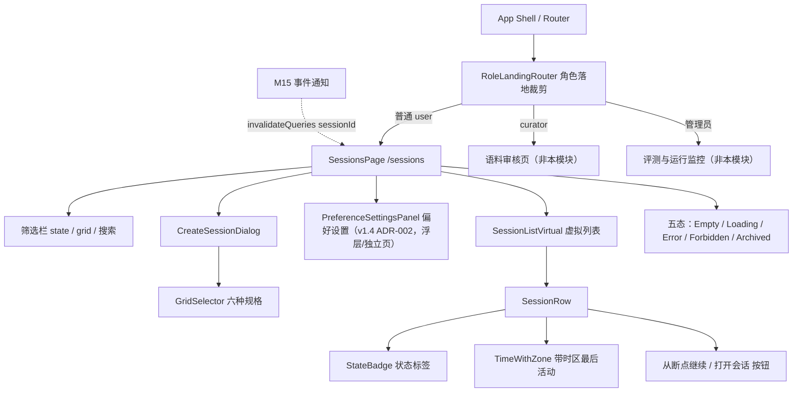
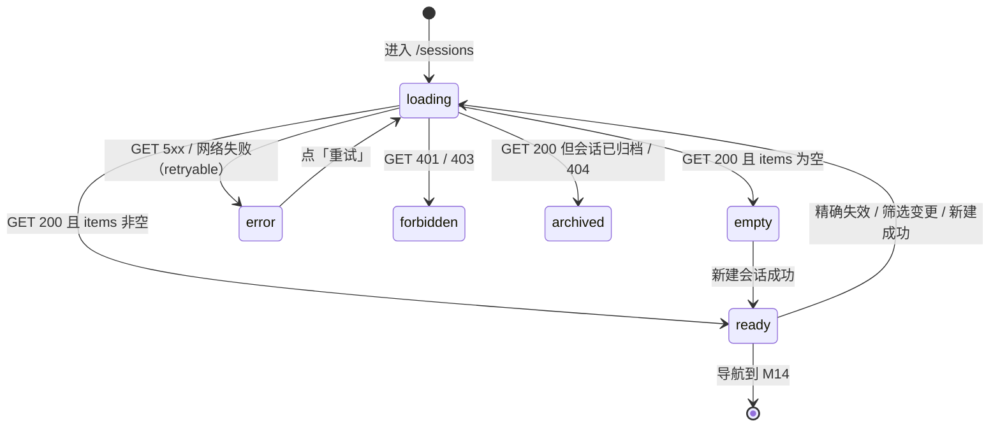

# M13 · 会话中心（原 W1）

> **文档类型**：可独立交付 / 可独立验收的模块设计文档（前端）
> **来源章节**：`设计方案.md` v1.1 §6.1 信息架构、§6.2 页面清单、§6.7 体验与工程要点、§6.8 前端技术栈、§6.10 前端验收、§7.3 前后端职责划分、§8 总表 W1 行、§4.4 REST 概要、§4.2 状态枚举、§2.6 X1
> **版本**：v1.1　|　**拆分日期**：2026-11-15　|　**最近修订**：2026-11-16（v1.3，ADR-001 D-6：`GridSelector` 改为可选预填，未选由系统询问补全）；2026-11-16（v1.4，ADR-002 记忆管理机制：会话中心偏好设置入口与清空二次确认）　|　**状态**：设计定稿
> **对应编号**：W1 / FR-02（会话列表与状态机）、FR-04（六种规格约束：可选预填 + 缺省询问） / X1（会话状态与断点恢复 · 前端侧）
> **主责应用**：`apps/web`（React 19 + TypeScript + Vite 单页应用，SPA 静态部署 / CDN）
> **一句话定义**：让用户一进来就能看到「全部会话、状态筛选、最后活动、跨天恢复入口、新建时可选预填规格」的首屏落地页，是普通用户的默认入口，也是整条生成链路的导航起点与跨天恢复的交接点。

---

## 0. 模块速览（零基础可读）

### 0.1 项目在做什么（本模块所需的最小背景）

WidgetPilot 是一个「用自然语言生成手机桌面控件」的 AI Agent 产品：用户选一种规格（`2x1`/`1x2`/`2x2`/`2x4`/`4x2`/`4x4`）、输入描述、可传图片/视频/文本附件，系统生成 TSX + React 控件代码，经编译、隔离沙箱测试与安全校验后，产出带完整证据链的控件包，最终在网页上按手机桌面真实比例渲染成可交互卡片。**本项目不生成 Lynx 代码、不编译移动端 bundle、不打包上传、不装机、不接手机系统 API、不模拟真实设备**（原文 §1.2、§1.7）。决定产品能否成立的三件事是：生成产物不可信要被确定性拦住、长任务可恢复、交互要让人看懂 Agent 在做什么（原文 §1.1）。

### 0.2 端到端 14 步链路中本模块的位置

```
① 登录 → 新建会话（grid 可选预填）        ← ★ 本模块 W1 就在这一步，并且是「① 之前」的首屏入口
② 输入描述 + 上传附件 → 传输层校验 → 对象存储 → attachment_id
③ 语义层校验（描述充分性 / 附件 role 明确性 / grid 合法）→ 不足则 AWAITING_INPUT
④ 进 LLM 护栏（注入 / PII / 意图白名单 / 预算前置）→ 命中不进模型
⑤ 意图与规格确定 → 按 widget_type + grid 确定性预取生成规程
⑥ 上下文装配（公共语料 + 规程 + 记忆 + AttachmentInsight，固定槽位、硬过滤优先）
⑦ 生成回路：先出 WidgetSpec，再出 TSX + React 代码；模型分档
⑧ 出 LLM 护栏（schema / 能力白名单 / 禁止内容 / PII / 描述符合度 / 规格一致）
⑨ 契约校验：spec ↔ manifest ↔ 代码能力声明 比对 + hash；不过不进沙箱
⑩ 一次性沙箱：TSX 编译 → 挂载渲染 → 尺寸/运行时错误/能力/交互断言 → 证据包
⑪ 生成 WidgetBundle（源码 + 编译产物 + manifest + 校验 + 沙箱结果 + hash），COMPLETED
⑫ 前端 artifact 事件 → 控件墙按 grid 真实比例渲染受限 iframe 卡片
⑬ 评测合格 → 脱敏 → 入库门禁 → 公共语料（可撤回）；失败案例回流为负例
⑭ 全流程按 seq 写 SSE 事件流与只追加审计；成本按模型档位分账
```

本模块不参与生成本身，它是**链路的第 ① 步之前与之后都存在的导航壳**：登录完成后先落到本模块（普通用户默认进会话中心，原文 §6.1）；用户从这里「新建会话（`grid` 可选预填，v1.3 D-6）」进入第 ① 步；生成过程中断、跨天后用户回到 App，也是从本模块的「跨天恢复入口」重新进入第 ① 步之后的状态。

### 0.3 为什么必须有这个模块

| # | 不可替代的理由 | 原文依据 |
|---|---|---|
| 1 | 用户需要一个能列出「全部会话」的地方，否则生成产物、断点、历史都无处可达 | §6.2 页面清单「全部会话」 |
| 2 | 长任务会跨天/月，用户回来时必须有一个「跨天恢复入口」把 `runId + Last-Event-ID + last_seq` 交给后续模块 | §6.2「跨天恢复入口」、§6.4 要点 8、§8 X1 行 |
| 3 | `grid` 是生成前必确定的一等约束，但**可跳过预选**——新建会话可不选，缺省由系统在语义层主动询问补全（不推断） | §1.5、**v1.3 ADR-001 D-6（修订原文「一等输入、显式选择」）**、§6.2「新建时选 `grid`」 |
| 4 | 角色视图要裁剪：普通用户 / 审核员 / 管理员默认落地不同 | §6.1「角色视图裁剪」、§1.3 |
| 5 | 首屏是体验基线，W1 行明确要求「首屏 < 1s（P95）」 | §8 W1 行、§6.10 |

### 0.4 上下游邻居（mermaid）

```mermaid
flowchart LR
  USER["用户 user / curator"] -->|打开 App 首屏| M13["M13 会话中心 W1"]
  M04["M04 账号会话编排域 D1"] -->|GET/POST /api/sessions · GET /api/sessions/{id}| M13
  M02["M02 前后端契约 W6"] -.枚举/OpenAPI/ReasonCode.-> M13
  M13 -->|新建：session_id + grid| M14["M14 生成会话页 W2"]
  M13 -->|恢复入口：sessionId + runId + Last-Event-ID + last_seq| M14
  M14 --> M15["M15 分通道流式渲染 W3"]
  M15 -.按 sessionId 触发精确失效.-> M13
  M17["M17 时间线回放/状态 W5"] -.只读 SessionView.-> M13
  M12["M12 前端工程化 W7"] -.MSW/Storybook/axe/Lighthouse.-> M13
```

- **上游**：M04（会话 REST 与状态机）、M02（契约与枚举）、M12（质量底座）。
- **下游**：M14（导航目标，接收 `session_id`、`grid`、`runId`、`last_seq`）、M15（由 M14 建立 SSE 连接）、M17（回放）。
- **横切**：M15 消费事件后按 `sessionId` 触发列表精确失效，使本模块状态标签与最新 `SessionState` 一致；M11 治理观测采集本模块的埋点（首屏、中断率、恢复成功率）。

### 0.5 原文对照表

| 本模块内容 | 原文章节 / 行 |
|---|---|
| 职责定义（全部会话 / 状态筛选 / 跨天恢复入口 / 新建时可选预填 grid，v1.3） | §6.1 信息架构、§6.2 页面清单「会话中心」行 |
| 关键组件（虚拟列表、状态标签、规格选择器） | §6.2 页面清单「关键组件」列 |
| 角色视图裁剪（普通用户默认进会话中心） | §6.1 末行、§1.3、§7.3 账号与权限行 |
| 首屏 < 1s（P95） | §8 总表 W1 行、§6.10 |
| 空态/加载/错误/无权限/已归档、时间带时区、暗色主题、键盘可达、WCAG 2.1 AA、i18n、按路由代码分割 | §6.7 |
| TanStack Query 按 sessionId 精确失效、`@tanstack/react-virtual` | §6.8 服务端状态层、列表层、§6.6 |
| 消费的 REST 接口 | §4.4 `GET`/`POST /api/sessions`、`GET /api/sessions/{id}` |
| 承载 X1 前端侧 | §2.6 X1 行、§5 X1 映射、§8 X1 行 |
| 前后端职责边界（前端只做状态可视化与断点入口） | §7.3「会话与状态」行、末行总原则 |

---

## 1. 模块定位与职责边界

### 1.1 为什么必须有

1. **导航起点**：登录后需要一个默认落地页；原文 §6.1 明确「普通用户默认进会话中心」。没有它，用户无法发起第一次生成，也无法回到历史会话。
2. **跨天恢复的交接点**：状态持久化在服务端（M04），但「用户从哪里回来」由前端决定；本模块把 `PAUSED` / `AWAITING_INPUT` 会话暴露成恢复入口，把 `runId + Last-Event-ID + last_seq` 交给 M14／M15，才能续传（§6.4 要点 8、§11.4 第 6 步）。
3. **规格的可选入口**：`grid` 可由用户在选择器预填（可跳过）；未选择时由系统在语义层主动询问补全、系统不推断（§1.5、v1.3 ADR-001 D-6），新建会话弹窗是生成前收集 `grid` 的地方（可选）。
4. **大规模历史可浏览**：会话会随时间累积，必须有虚拟列表才能满足首屏 < 1s（P95）与长列表不掉帧（§6.7、§8 W1 行）。

### 1.2 做什么（职责清单）

| # | 职责 | 说明 |
|---|---|---|
| R1 | 展示当前用户「全部会话」列表 | `GET /api/sessions`，按 `state` / `grid` 筛选 |
| R2 | 状态筛选与状态标签 | 按 8 种 `SessionState` 渲染彩色标签，可筛选 |
| R3 | 展示「最后活动」时间 | `updated_at` 带时区显示（§6.7 时间显示带时区） |
| R4 | 跨天恢复入口 | `PAUSED` / `AWAITING_INPUT` / 任意可恢复会话提供「从断点继续」 |
| R5 | 新建会话时**可选**预填 `grid` | 六种规格选择器（可跳过），提交 `POST /api/sessions`（`grid?`）；未选时由 M06 语义层询问补全（v1.3 D-6） |
| R6 | 角色视图裁剪（体验层） | 普通用户默认进本页，审核员默认进语料审核页，管理员看评测与运行监控（§6.1） |
| R7 | 五类 UI 态 | 空态 / 加载 / 错误 / 无权限 / 已归档各有明确设计（§6.7） |
| R8 | 服务端状态按 `sessionId` 精确失效 | TanStack Query，接收 M15 的事件通知刷新状态标签（§6.6、§6.8） |
| R9 | 虚拟列表 | `@tanstack/react-virtual`，只渲染可视窗口 |
| R10 | 可访问性与工程化 | 暗色主题、键盘可达、WCAG 2.1 AA、i18n、按路由代码分割（§6.7） |
| R11 | 关键路径埋点 | 首屏耗时、恢复入口点击率、中断率、恢复成功率（§6.7 埋点） |
| R12 | 【v1.4 ADR-002】偏好设置入口 | 会话中心提供「偏好设置」入口（面具/入口形态为【推导·需评审】），跳转到偏好设置浮层或独立页；允许查看与清空结构化偏好（`palette` / 常用规格 / 常用控件类型），清空需二次确认 |

### 1.3 不做什么（明确排除，含与相邻前端模块的边界切割）

| 不做 | 这块归哪个 Mxx | 边界说明 |
|---|---|---|
| 消费 SSE 事件流、分帧、半帧缓存、重连 | **M15（W3）** | 本模块不建 `EventSource`/`fetch ReadableStream` 长连接、不解析任何 `AgentEvent`；只被动接收「按 `sessionId` 精确失效」的通知（§6.4 要点 5、§6.6） |
| event-sourced reducer、`AgentEvent[] → SessionView` 纯函数、seq 去重回放 | **M17（W5）** | 本模块只读 `SessionView` 的展示投影，不实现、不调用 reducer，不做 seq 去重（§6.6） |
| 生成交互：描述输入、附件上传、规格预览卡、代码/预览双轨、时间线、链路账、异常态纠偏 | **M14（W2）** | 本模块只负责「新建 + 导航」，进入 M14 后不再出现（§6.3） |
| 时间线 scrubber 拖动回放、「从这里重生成」 | **M17（W5）** | 不在列表页提供（§6.4 亮点 3、§8 W5 行） |
| 控件墙卡片网格、隔离 iframe、安装/删除/回滚 | **M16（W4）** | 本模块不渲染任何控件卡片（§6.5） |
| 登录表单、JWT 签发、`user_id` 隔离判定、鉴权判定 | **M04（D1）/ 登录页** | 前端隐藏按钮只作为体验优化，权限裁剪在服务端（§7.3、§6.9） |
| `packages/contracts` 生成、OpenAPI / Zod 的 CI 一致性 | **M02（W6）** | 本模块只消费生成好的类型 |
| 测试框架、MSW/Playwright/axe/Sentry 底座 | **M12（W7）** | 本模块使用这些底座提测，不实现底座 |

> **最易混淆的边界**：状态标签要「看起来实时」，但本模块**不订阅 SSE**。实时性来自 M15 消费 `AgentEvent` 后调用 `queryClient.invalidateQueries(['session', sessionId])`，本模块只是被失效后重新发一次 `GET /api/sessions/{id}`。绝不在本模块里塞一个轻量 SSE 客户端，否则与 M15 重复且破坏「分通道渲染、reducer、回放、背压」单一归属（§7.3 流式事件行）。

### 1.4 输入 / 输出与上下游契约

| 方向 | 内容 | 契约形式 |
|---|---|---|
| 入 | 登录态 JWT、`UserRole`、当前语言 `locale`、当前主题 `theme` | 应用全局上下文（M04 / 设置页） |
| 入 | 会话列表 `Session[]`、`SessionSnapshot`（含 `last_seq`、`bundle_refs[]`、`run_id`） | REST（§4.1） |
| 入 | 按 `sessionId` 精确失效的通知（来自 M15 消费事件后的回调） | 应用内 `queryClient.invalidateQueries`【契约约定】 |
| 出 | 新建会话：`CreateSessionReq { title?, grid }`，得到 `session_id` | REST `POST /api/sessions` |
| 出 | 导航到 M14 携带：`sessionId`、`grid`、`runId`、`Last-Event-ID`、`last_seq`、`evidenceRef` | 路由参数 / 导航 state【推导·需评审：传递方式见 §9】 |
| 出 | 关键路径埋点（首屏、恢复入口点击、中断率、恢复成功率） | 埋点事件（M11 / M12 采集） |

### 1.5 承载的横切能力 X*

- **X1（前端侧承载）**：会话状态与断点恢复。本模块负责**状态可视化与断点入口**（§7.3「会话与状态」行：前端主导 = 状态可视化、断点入口；后端主导 = 手写状态机、checkpoint、租约续跑）。具体做法是：把后端持久化下来的 `SessionState`、`last_seq`、`runId` 渲染成状态标签与「从断点继续」按钮，并把 `runId + Last-Event-ID + last_seq` 交接给 M14/M15 完成续传。checkpoint / 租约 / 幂等副作用的实现归 M04 与 M03，本模块一概不碰。
- **X11（协同）**：本模块产生首屏、恢复入口点击、中断率、恢复成功率等埋点，供 M11 汇总。

### 1.6 关键设计原则

1. **策略、隔离、门禁统一在服务端裁决；前端负责事件消费、可回放状态、纠偏交互与可审计的操作入口**（原文 §7.3 末行）。落到本模块：角色视图裁剪只是体验优化，是否真正有权访问由服务端按 `user_id` 判定；本模块不因为「前端隐藏了管理员入口」就认为自己做了鉴权。
2. **状态可视化 ≠ 状态机**：`SessionState` 的唯一写入方是 M04，本模块只读展示，不本地推进状态、不乐观改写状态。
3. **首屏优先**：默认路由代码分割、虚拟列表、只拉列表摘要不拉大对象，保证 W1 行「首屏 < 1s（P95）」。
4. **精确失效**：TanStack Query 按 `sessionId` 精确失效，不做整表轮询兜底式的全量重渲染（§6.6、§6.8）。
5. **旁路必带原因码 + 证据引用**：`FAILED` 会话卡片不显示裸「失败」，要展示具体原因码文案与证据入口（§1.4、§6.4 亮点 6）。
6. **可逆才乐观**：新建会话需要服务端返回真实 `session_id` 才能跳转，**不做乐观插入**；乐观更新只用于草稿、面板切换等可逆操作（§6.6）。

---

## 2. 技术栈

### 2.1 分层选型表（逐层写选型 + 为什么 + 明确不用什么）

| 层 | 选型 | 版本 / 约束 | 为什么选 | 明确不用什么 |
|---|---|---|---|---|
| 框架 | React 19 + TypeScript + Vite（SPA） | React 19；需 SSR/统一鉴权时才加 BFF（§6.8） | 与整站一致，按路由代码分割天然支持 | 不用 Next.js 服务端渲染来做这个纯列表页；不引入 SSR 框架 |
| 服务端状态 | TanStack Query（`useQuery` / `useMutation` / `queryClient`） | `queryKey` 含 `sessionId`，精确失效（§6.6、§6.8） | 快照缓存、轮询兜底、按 `sessionId` 精确失效 | 不用 Redux / SWR 重复管理服务端状态；不把会话列表塞进全局 store |
| 事件状态 | 本模块**不持有**事件状态；`AgentEvent[] → SessionView` 的 event-sourced reducer 与 Zustand UI 态归 M17 / M14 | 本模块仅触发 `invalidateQueries`（§6.6） | 避免与 M15/M17 重复消费 SSE | **不用** 自研 reducer、**不用** Zustand 存会话列表、**不用** 任何 SSE 客户端 |
| UI | Tailwind CSS + shadcn/ui（Radix） | WCAG 2.1 AA 基础、暗色主题、键盘可达（§6.7、§6.8） | 可访问性原语齐全，状态标签/弹窗/筛选器现成 | 不用手写不可访问的自定义下拉；不用内联样式堆主题 |
| 代码展示 | 本模块**不涉及**（CodeMirror 6 / Monaco 归 M14 右轨） | — | 列表页不展示 TSX 代码 | **不引入** CodeMirror 6 / Monaco，避免首屏 bundle 变大 |
| 流式解析 | 本模块**不涉及**（原生 `fetch ReadableStream` + 自研分帧/半帧缓存 + 容错 partial-JSON 解析器 + Zod 归 M15） | — | 本模块不解析任何 SSE 帧或 partial JSON | **不引入** AI SDK / CopilotKit / AG-UI SDK；**不自己写正则解析 JSON**（§6.8、§11.1） |
| 图表 | 本模块**不涉及**（Recharts / ECharts 归评测与运行监控页） | — | 列表页无指标分布图 | **不引入** Recharts / ECharts，按路由代码分割隔离 |
| 列表 | `@tanstack/react-virtual` | 只渲染可视窗口（§6.8 列表层） | 满足首屏 < 1s 与万级会话不掉帧 | 不用一次性全量 `map` 渲染；不用 `react-window` 另起一套 |
| 契约 | OpenAPI 3.1 → `openapi-typescript`；事件与协议用 Zod；枚举共享包（`packages/contracts`） | 单一事实来源（§6.8、§6.9） | 请求/响应/枚举类型前后端一致 | 不手写与后端不一致的本地类型；不在本模块重复定义 `SessionState` 字面量 |
| 测试 | Vitest + Testing Library + MSW（mock REST）+ Playwright（E2E）+ Storybook | 事件序列回放测试是重点（§6.8） | 可用 MSW 桩完全脱离后端提测 | 不用真实后端联调才能验收；不用快照测试替代可断言用例 |
| 质量 | Biome / ESLint、axe、Sentry、Lighthouse CI | a11y AA、性能预算（§6.8） | 首屏预算与可访问性有 CI 门禁 | 不跳过 axe 严重项 |

> **零 Agent 框架硬约束（D-5 / §6.8 / §11.1）**：本模块及其依赖链**不使用** Vercel AI SDK、`streamUI`、CopilotKit、AG-UI SDK、A2UI SDK、LangChain/LangGraph、Temporal、MCP SDK、任何 LLM 专用观测 SDK。原生 `EventSource` / `fetch ReadableStream` 是通用浏览器能力，允许，但本模块连这个都不需要。

### 2.2 运行时依赖

| 依赖 | 用途 | 不可用 / 降级时的行为 |
|---|---|---|
| `control-plane`（M04） | `GET`/`POST /api/sessions`、`GET /api/sessions/{id}` | 5xx/网络故障 → 错误态 + `retryable` 重试入口；不伪造本地会话 |
| BFF（可选，M02） | JWT session → 首屏聚合、统一错误映射 | 直连 `control-plane` 亦可；**BFF 不做鉴权判定**（§6.9） |
| `packages/contracts`（M02） | 类型与枚举 | CI 校验不一致即构建失败 |
| M12 质量底座 | MSW / Storybook / axe / Sentry / Lighthouse CI | 验收时以测试桩替代，不影响运行时 |
| CDN / 静态托管 | SPA 静态资源与按路由 chunk | chunk 加载失败 → 错误态 + 重试 |

### 2.3 `apps/web` 代码落位

```
apps/web/
  src/
    routes/
      sessions/+page.tsx          # SessionsPage：路由 /sessions，按路由代码分割入口【推导·需评审：文件命名】
    features/sessions/
      SessionListVirtual.tsx      # @tanstack/react-virtual 虚拟列表
      SessionRow.tsx              # 单行：标题、最后活动、状态标签、恢复入口
      StateBadge.tsx              # 8 种 SessionState 标签 + 已归档态
      GridSelector.tsx            # 六种 GridSpec 规格选择器
      CreateSessionDialog.tsx     # 新建会话弹窗（选 grid）
      RoleLandingRouter.tsx       # 角色默认落地裁剪（体验层）
      states/
        EmptyState.tsx  LoadingSkeleton.tsx  ErrorState.tsx
        ForbiddenState.tsx  ArchivedState.tsx
      hooks/
        useSessionList.ts         # useQuery(['sessions', filters])
        useCreateSession.ts       # useMutation(POST /api/sessions)
        useSessionDetail.ts       # useQuery(['session', id])
        invalidateSession.ts      # invalidateQueries(['session', sessionId])
      utils/
        formatTimeWithZone.ts     # ISO UTC → 带时区显示
        sessionListQueryKey.ts    # queryKey 规范化
    components/                   # shadcn/ui 基础组件
    lib/apiClient.ts              # 统一响应 / 错误映射
```

> 上述组件名、hook 名、文件路径均为【推导·需评审】：原文只给出「虚拟列表、状态标签、规格选择器」三类组件与「TanStack Query 精确失效」的方向，未给具体命名。

---

## 3. 设计架构

### 3.1 组件树与职责表



| 组件 | 职责 | 关键不变量 |
|---|---|---|
| `SessionsPage` | 路由入口，编排筛选、新建、导航 | 按路由懒加载，不把 M14/M16 的 chunk 打进首屏 |
| `RoleLandingRouter` | 按 `UserRole` 决定默认落地页 | 只是体验裁剪，**不做鉴权判定**；服务端 403 才是终裁 |
| `SessionListVirtual` | 虚拟列表窗口化渲染 | 只挂载可视区 ± overscan 行；万级数据 DOM 节点数恒定 |
| `SessionRow` | 单行展示与导航 | 标题做纯文本转义，不 `dangerouslySetInnerHTML` |
| `StateBadge` | `SessionState` → 颜色/文案/图标 | 8 态 + 已归档态全覆盖；`FAILED` 必附原因码文案 |
| `GridSelector` | 六种 `GridSpec` 选择 | **可跳过**（默认「不选」）；选了即随请求提交；系统不推断未选的 `grid`（v1.3 D-6） |
| `CreateSessionDialog` | 收集 `title?` + `grid?` 并提交 | 成功后用真实 `session_id` 跳转，不乐观插入 |
| `useSessionList` / `useSessionDetail` | TanStack Query 查询 | `queryKey` 精确；`staleTime` 内不重复请求 |
| `invalidateSession` | 按 `sessionId` 精确失效 | 只失效目标会话，不整表重拉 |
| 五态组件 | 空 / 加载 / 错误 / 无权限 / 已归档 | 每种都有唯一可断言的 DOM 标识 |
| `PreferenceSettingsPanel`【v1.4 ADR-002】 | 偏好设置浮层/独立页：查看结构化偏好（`palette` / 常用规格 / 常用控件类型）、显式修改（`PUT`）、清空（`DELETE`，支持单字段或全清） | 只提交结构化字段，不读取历史代码/附件原文；清空必须二次确认；改动走 `PUT`/`DELETE`，读取走 `GET` |

### 3.2 渲染数据流（编号步骤）

1. 登录完成 → `App Shell` 读取 `UserRole` → `RoleLandingRouter` 把普通 `user` 导航到 `/sessions`（`curator` 进语料审核页，管理员进评测与运行监控，§6.1）。
2. `/sessions` 路由命中 → 按路由代码分割懒加载 `SessionsPage` chunk（§6.7）。
3. `useSessionList(filters)` 发 `GET /api/sessions`（`queryKey=['sessions', filters]`）→ TanStack Query 进入 `pending` → 渲染 `LoadingSkeleton`。
4. 响应 `{ code:"OK", data:{ items: Session[], next_cursor } }` → 写入缓存 → `SessionListVirtual` 只渲染可视窗口行。
5. 每行 `SessionRow` 读 `state` 渲染 `StateBadge`、读 `updated_at` 经 `formatTimeWithZone(iso, locale)` 渲染「最后活动」，读 `PAUSED`/`AWAITING_INPUT` 渲染「从断点继续」。
6. 用户改筛选（`state` / `grid`）→ 新 `queryKey` → 重新查询；命中缓存则零请求。
7. 用户「新建」→ `CreateSessionDialog` → `GridSelector` **可选**选 `grid`（可跳过）→ `useCreateSession` 发 `POST /api/sessions`（`grid?`）→ 得到 `session_id`（`state=DRAFT`）→ 失效 `['sessions']` → 导航 M14 并携带 `session_id + grid?`；未选时 M14 提交描述后由 M06 语义层询问补全（v1.3 D-6）。
8. 用户点开已有会话 → `GET /api/sessions/{id}` 取 `SessionSnapshot`（`last_seq`、`bundle_refs[]`、`run_id`）→ 导航 M14，携带 `sessionId + runId + Last-Event-ID(=last_seq) + last_seq + evidenceRef`，由 M14/M15 决定续传还是新开（§6.4 要点 8）。
9. M15 消费到会改变 `SessionState` 的事件后触发 `invalidateSession(queryClient, sessionId)` → 本模块重发 `GET /api/sessions/{id}` → 状态标签更新。本模块自身**不解析事件**。
10. 全程埋点：`performance.mark` 记首屏耗时，恢复入口点击、中断率、恢复成功率上报（§6.7）。

### 3.3 状态机（前端列表态、连接态、只读展示态）

本模块**不拥有** `SessionState`（M04 拥有）、**不拥有** SSE 连接态（M15 拥有）、**不拥有** `SessionView`（M17 拥有）。本模块拥有的是「列表查询态 + 五类 UI 态」。`SessionState` 在本模块只是只读投影。



| 前端状态 | 类型（TS，见 §5.1） | 触发 | 渲染 |
|---|---|---|---|
| 加载 | `loading` | 首次查询、失效、筛选变更 | `LoadingSkeleton` |
| 就绪 | `ready` | 有数据 | `SessionListVirtual` |
| 空态 | `empty` | 首次使用无会话 | `EmptyState` + 新建引导 |
| 错误 | `error` | 5xx / 网络 | `ErrorState` + 重试按钮 + `traceId` |
| 无权限 | `forbidden` | 401 / 403 | `ForbiddenState`（401 先跳登录） |
| 已归档 | `archived` | 会话超留存期 / 手动归档 / 404 | `ArchivedState` |

**连接态**：本模块不建立 SSE 连接，连接态 `SSEConnectionState`（`idle`/`connecting`/`streaming`/`reconnecting`/`paused`/`closed`/`truncated`）由 M15 定义与持有（完整 TS 见 §5.1，标注为 M15 归属）；本模块只在恢复入口把 `runId + Last-Event-ID + last_seq` 交出去，不感知连接是否建立。

### 3.4 关键机制与不变量清单

| # | 机制 | 不变量 | 断言方式 |
|---|---|---|---|
| I1 | 虚拟列表窗口化 | 万级会话下实际挂载的 `SessionRow` DOM 节点数 ≤ 可视区行数 + 2×overscan，恒定 | 渲染计数断言 |
| I2 | 按 `sessionId` 精确失效 | 事件通知只让目标会话重查，其余 `queryKey` 缓存不被清空 | 请求计数断言 |
| I3 | `grid` 可选预填（v1.3） | 未选 `grid` 时 `POST /api/sessions` 正常提交（`grid` 缺省）；选择了非法值则表单拦截；系统不推断 | 表单校验 + 请求体断言 |
| I4 | 状态只读 | 本模块任何代码不写入 `SessionState`；只发 GET 与一次 POST 新建 | 静态检查 + 无 reducer |
| I5 | 不订阅 SSE | 本模块无 `EventSource` / `ReadableStream` 引用 | 依赖扫描 |
| I6 | 旁路必带原因码 | `FAILED` 行渲染具体原因码文案 + 证据入口，不出现裸「失败」二字作为唯一信息 | DOM 文案断言 |
| I7 | 时间带时区 | 所有 `updated_at` 以 UTC 存储、按 `locale` + 时区渲染，显示带时区标识（§6.7） | 快照断言 |
| I8 | 首屏预算 | `/sessions` 首屏 chunk 不含 M14/M15/M16 代码（按路由代码分割，§6.7） | bundle 分析断言 |
| I9 | 不做乐观插入 | 新建必须拿到真实 `session_id` 才导航 | 导航时序断言 |
| I10 | 角色裁剪非鉴权 | 前端改 `UserRole` 不产生任何权限判定逻辑 | 代码审查 |

**精确失效约定**【契约约定】：M15 在消费到 `kind ∈ {run, checkpoint, interrupted, error, done, artifact}` 的事件后，调用 `queryClient.invalidateQueries({ queryKey: ['session', event.sessionId] })` 与 `['sessions']` 列表键；本模块不读取 `payload`，只重发快照请求。该回调的具体挂载点属于 M15 与 M14 的集成约定，本模块只暴露 `invalidateSession(queryClient, sessionId)` 纯函数。

### 3.5 与后端时序（关键 3 个场景）

**场景 1：首次登录进入**
`登录(M04) → UserRole → RoleLandingRouter → /sessions → GET /api/sessions(空) → EmptyState → 新建(选 grid) → POST /api/sessions → session_id → 导航 M14`。

**场景 2：跨天恢复（X1 前端侧）**
`用户 7 天后打开 App → GET /api/sessions → PAUSED 会话显示「从断点继续」→ 点击 → GET /api/sessions/{id} 取 last_seq/run_id → 导航 M14 携带 runId + Last-Event-ID → M15 按 runId+seq 重连续传 → M17 reducer 重放 → M14 界面与离开前一致`（§6.4 要点 8、§11.4 第 6 步）。本模块负责前 3 步的交接数据完整性。

**场景 3：会话状态实时刷新**
`M07 推进状态 → M04 发 AgentEvent(seq, phase) → M15 消费 → invalidateSession(sessionId) → 本模块重发 GET /api/sessions/{id} → StateBadge 从 RUNNING 变 VALIDATING/COMPLETED`。本模块全程不碰事件字节。

### 3.6 部署形态与伸缩

| 项 | 形态 | 说明 |
|---|---|---|
| 应用 | React SPA 静态构建 | 产物为静态文件，部署到 CDN / 静态托管（§7.1 `web` 服务「无状态 / CDN / 静态」） |
| 代码分割 | 按路由 `React.lazy` + `import()` | `/sessions` 首屏只加载本模块 chunk；M14（CodeMirror/Monaco）、M16（iframe 卡片）、评测页（Recharts）各自独立 chunk（§6.7 按路由代码分割） |
| 伸缩 | 前端无状态 | 水平扩展由 CDN 承担；会话数据全在 M04 |
| 鉴权 | BFF 可选 | JWT session → 短期 SSE ticket（供 M15）、首屏聚合、统一错误映射；**BFF 不做鉴权判定**（§6.9） |

---

## 4. 接口契约

### 4.1 本模块消费的 REST 接口表

统一响应包裹（原文 §4.4 / §6.9）：`{ code, message, traceId, retryable, evidenceRef?, data? }`，`code` 与 `ReasonCode` 对齐，成功为 `OK`；`data` 为【契约约定】补充，最终以 `packages/contracts/openapi.yaml` 为准。

| 方法 | 路径 | 权限 | 请求 | 成功响应 `data` | 状态码 |
|---|---|---|---|---|---|
| `GET` | `/api/sessions` | 本人 | Query: `state?: SessionState`, `grid?: GridSpec`, `cursor?: string`, `limit?: number`【推导·需评审：分页字段原文未给】 | `{ items: Session[], next_cursor: string \| null }` | `200` / `401` / `403` / `5xx` |
| `POST` | `/api/sessions` | 本人 | `{ title?: string, grid: GridSpec }`（§5.2 `CreateSessionReq`） | `Session`，其中 `state="DRAFT"`、`last_seq=0` | `200` / `400` / `401` / `403` / `409` |
| `GET` | `/api/sessions/{id}` | 本人 | Path: `id`；无请求体 | `{ session: Session, last_seq: number, bundle_refs: string[], run_id: string \| null }`【契约约定：快照字段细化】 | `200` / `401` / `403` / `404` |

**逐条说明**：
- `GET /api/sessions` 只返回会话摘要（`Session` 主记录字段：`id`、`title`、`state`、`grid`、`created_at`、`updated_at`、`last_seq`），**不返回**逐轮过程数据（spec 增量、代码 patch、护栏命中、回边、成本放事件流与 `Run`，§4.1 字段归属原则），也不返回大对象。
- `POST /api/sessions` 的 `grid` **可选**（v1.3 D-6）；选了必须是六种枚举之一，系统在服务端校验合法性（M06 语义层），前端 `GridSelector` 只做枚举约束，不做规格可行性判定（那是 M06 / M14 的事）；未选时由 M06 语义层询问用户补全。
- `GET /api/sessions/{id}` 是跨天恢复入口的数据来源：`last_seq` 作为 `Last-Event-ID`、`run_id` 作为 `runId`、`bundle_refs[]` 供 `COMPLETED` 会话跳控件墙。

### 4.2 消费 / 派发的 SSE 事件接口（`kind` 与 payload 形态）

**本模块不订阅 SSE 事件流**（§1.3 边界）。为保证「会话列表状态标签与最新状态一致」，下表列出会改变 `SessionState`、因而会间接触发本模块精确失效的 `AgentEventKind`；payload 形态按原文 §4.5 / §6.4 给出，本模块**不读取 payload**，只接收 M15 转来的 `sessionId` 失效通知。

| `kind` | payload 形态（原文 §4.5 / §6.4） | 对 `SessionState` 的影响 | 本模块的间接动作 |
|---|---|---|---|
| `run` | `{ runId, phase, grid, attempt_no }` | `DRAFT → RUNNING` / `PAUSED → RUNNING` | 失效该 `sessionId`，状态标签刷新 |
| `checkpoint` | `{ rev, node, state_blob_ref, lease_owner }` | 状态不变（仅进度） | 通常不失效；埋点可选 |
| `interrupted` | `{ reason_code, checkpoint_rev, resume_hint }` | `RUNNING → PAUSED` | 失效并显示「从断点继续」 |
| `error` | `{ code: ReasonCode, evidenceRef }` | `→ FAILED` | 失效并显示原因码文案 + 证据入口 |
| `done` | `{ bundle_id }` | `→ COMPLETED` | 失效并显示产物入口 |
| `artifact` | `{ bundle_id, preview_ref }` | 状态不变（产物就绪） | 失效以刷新 `bundle_refs[]` |
| `notice` | `{ message, code }` | `→ AWAITING_INPUT` 等 | 失效并显示补充建议 |
| 其余 `plan/spec/attachment/skill/routing/code/guard/validation/sandbox/cost` | 见 §6.3 枚举 | 不改变 `SessionState` | 本模块无动作 |

> 「失效通知回调」属于【契约约定】：原文只写「TanStack Query 按 sessionId 精确失效」（§6.6），未规定触发源，这里约定由 M15 消费事件后触发，本模块不建连接、不解析帧。

### 4.3 内部组件接口与函数签名（TS）

以下均为【推导·需评审】/【契约约定】：原文给出了「虚拟列表、状态标签、规格选择器」与「TanStack Query 精确失效」，未给具体函数与类型命名。

```ts
// ---- 查询 / 变更 hooks（契约约定，基于 TanStack Query）----
type SessionListFilters = {
  state?: SessionState;
  grid?: GridSpec;
  cursor?: string;
  limit?: number;
};

function useSessionList(
  filters: SessionListFilters
): UseQueryResult<{ items: Session[]; next_cursor: string | null }, ApiError>;

function useCreateSession(): UseMutationResult<
  Session,
  ApiError,
  { title?: string; grid: GridSpec }
>;

function useSessionDetail(id: string): UseQueryResult<SessionSnapshot, ApiError>;

// ---- 精确失效（契约约定，纯函数）----
function invalidateSession(queryClient: QueryClient, sessionId: string): void;

// ---- 组件 props（推导·需评审）----
type StateBadgeProps = {
  state: SessionState;
  archived?: boolean;
  reasonCode?: ReasonCode;
  evidenceRef?: string;
};

type GridSelectorProps = {
  value: GridSpec | null;
  onChange: (g: GridSpec) => void;
  disabled?: boolean;
};

type SessionRowProps = {
  session: Session;
  onOpen: (s: Session) => void;
  onResume: (s: Session) => void;
};

// ---- 工具函数（推导·需评审）----
function formatTimeWithZone(isoTs: string, locale: string, tz?: string): string;
function getRoleLanding(role: UserRole): "/sessions" | "/corpus-review" | "/eval-monitor";
function sessionsQueryKey(filters: SessionListFilters): readonly [string, SessionListFilters];
function sessionQueryKey(sessionId: string): readonly [string, string];
```

### 4.4 统一响应与错误码的前端处理约定

| 响应 | 前端处理 |
|---|---|
| `code:"OK"` | 正常渲染；`data` 写入 TanStack Query 缓存 |
| `code` ∈ `ReasonCode` 且 `retryable=true` | `ErrorState` 展示 `message` + `traceId` + 「重试」按钮 |
| `code` ∈ `ReasonCode` 且 `retryable=false` | 展示具体原因文案（§5.3），不显示裸「失败」；`evidenceRef` 渲染成「查看证据」入口 |
| HTTP `401` | 清登录态 → 跳登录页（不渲染无权限态） |
| HTTP `403` | `ForbiddenState`（越权访问他人会话，服务端 `user_id` 过滤，§7.3） |
| HTTP `404` | `ArchivedState`（会话不存在 / 已归档 / 超留存期） |
| HTTP `409` | 重复新建 / 状态冲突，提示「已在别处创建」并失效重查 |
| HTTP `5xx` | `ErrorState` + 指数退避重试（有上限，TanStack Query `retry`） |

约定：`message` 一律纯文本渲染，前端转义，不解析成 HTML。

### 4.5 幂等、重连、超时、背压、并发约定

| 项 | 约定 |
|---|---|
| 幂等 | `GET` 天然幂等；`POST /api/sessions` 用 `Idempotency-Key` 头防重复点击建会话【推导·需评审：原文未提此头，借用基线 §4.5 的约定】 |
| 重连 | 本模块无 SSE，重连归 M15；本模块只保证恢复入口携带 `runId + Last-Event-ID + last_seq`，缺一不可导航 |
| 超时 | TanStack Query `retry` 有上限、`retryDelay` 指数退避；`staleTime` 内命中缓存不重发 |
| 背压 | 虚拟列表窗口化 + 分页 `cursor/limit`；不一次性拉全量会话 |
| 并发 | `queryKey` 精确失效；筛选并发切换以最后一次为准（TanStack Query 取消旧请求） |
| 乱序 | 本模块不处理事件乱序（归 M17 reducer 按 `seq` 去重与乱序丢弃） |

### 4.6 接口状态表（契约状态 / 运行态 / 可重试）

| 接口 / 约定 | 契约状态 | 运行态 | 可重试 | 说明 |
|---|---|---|---|---|
| `GET /api/sessions` | 定稿（原文 §4.4） | 同步查询 | 是 | 请求/响应细化为契约约定 |
| `POST /api/sessions` | 定稿（原文 §4.4） | 同步（返回 `DRAFT` 会话） | 否（需幂等键） | 非异步 202；真正生成提交在 M14 |
| `GET /api/sessions/{id}` | 定稿（原文 §4.4） | 同步查询 | 是 | 跨天恢复先拉此快照 |
| 分页 `cursor`/`limit`/`next_cursor` | **依赖外部**（M02 `openapi.yaml`） | 同步 | 是 | 原文未给，基线 §5.2 亦未列，需 M02 定稿 |
| `Idempotency-Key` 头 | **依赖外部**（M02） | — | — | 原文未提 |
| 角色默认落地规则（含管理员） | **影子校准中 / 待决** | — | — | 原文 `role` 仅 `user`/`curator`，管理员视图见 §1.3 但未入枚举（基线 §5.4） |
| `401/403/409` 业务码映射 | **依赖外部**（M02） | — | — | 原文 `ReasonCode` 未含鉴权/冲突码（基线 §5.3） |
| 精确失效回调 `invalidateSession` | **可选**（集成约定） | 应用内同步 | — | 无此回调时降级为 `staleTime` 到期自动重查 |
| 「已归档」态判定 | **影子校准中 / 待决** | — | — | `SessionState` 无 `ARCHIVED` 枚举，见 §9 |

---

## 5. 状态、原因码与 API 状态

### 5.1 前端拥有或参与的状态与完整枚举（TS 定义）

```ts
// ---- 原文定义的领域枚举（前端只读投影，不得改写）----
type GridSpec = "2x2" | "2x4" | "4x2" | "4x4" | "2x1" | "1x2";
type WidgetType = "calendar" | "clock" | "alarm" | "task" | "custom";
type AttachmentRole =
  | "visual_reference" | "content_extraction" | "data_source" | "style_reference";
type Capability =
  | "date" | "timer" | "local_storage" | "static_data" | "theme" | "locale";
type ModelTier = "cheap" | "standard" | "frontier";
type UserRole = "user" | "curator";   // D-3；管理员视图见 §1.3 但未入枚举

type SessionState =
  | "DRAFT" | "RUNNING" | "PAUSED" | "AWAITING_INPUT" | "VALIDATING"
  | "COMPLETED" | "FAILED" | "CANCELLED";

type BundleState = "GENERATED" | "INSTALLED" | "DELETED";

// ---- 本模块拥有的前端 UI 态（推导·需评审）----
type SessionListViewState =
  | "loading" | "ready" | "empty" | "error" | "forbidden" | "archived";

// ---- TanStack Query 查询态（契约约定）----
type QueryStatus = "pending" | "error" | "success";

// ---- 由 M15 拥有、本模块只读声明的连接态（推导·需评审，归属 M15）----
type SSEConnectionState =
  | "idle" | "connecting" | "streaming" | "reconnecting"
  | "paused" | "closed" | "truncated";

// ---- 由 M17 拥有、本模块只读声明的视图态（推导·需评审，归属 M17）----
type SessionView = {
  sessionId: string;
  runId: string | null;
  state: SessionState;
  grid: GridSpec;
  lastSeq: number;
  specDraft: Partial<WidgetSpec> | null;
  events: AgentEvent[];
  artifact: { bundle_id: string; preview_ref: string } | null;
  reasonCode: ReasonCode | null;
  evidenceRef: string | null;
};
```

**归属澄清**：`SessionState` / `BundleState` / `GridSpec` 是前后端共用同一枚举（原文 §4.2），本模块只读；`SessionListViewState` 与 `QueryStatus` 本模块拥有；`SSEConnectionState` 归 M15、`SessionView` 归 M17，本模块为满足「零基础可读」在此给出完整声明并标注归属，不实现、不写入。

### 5.2 状态流转表（含 UI 五态）

| 触发 | 前态 | 后态 | 副作用 | 事件 / 接口 |
|---|---|---|---|---|
| 进入 `/sessions` | — | `loading` | 发 `GET /api/sessions` | REST |
| 200 且 `items.length > 0` | `loading` | `ready` | 写缓存、渲染虚拟列表 | REST |
| 200 且 `items.length === 0` | `loading` | `empty` | 渲染空态引导 | REST |
| 401 | `loading` | `forbidden` | 清登录态、跳登录 | REST |
| 403 | `loading` | `forbidden` | 渲染无权限态 | REST |
| 404 / 会话超留存期 | `loading` | `archived` | 渲染已归档态 | REST |
| 5xx / 网络失败 | `loading` | `error` | 记录 `traceId`、可重试 | REST |
| 点「重试」 | `error` | `loading` | 重发 GET | REST |
| 筛选变更 / 精确失效 / 新建成功 | `ready`/`empty` | `loading` | 按新 `queryKey` 重查 | REST / 失效通知 |
| `FAILED` 会话渲染 | `ready` | `ready` | 显示原因码文案 + 证据入口（不切态） | 只读 |
| `PAUSED` 会话渲染 | `ready` | `ready` | 显示「从断点继续」入口 | 只读 |

### 5.3 消费的 `ReasonCode` 子集与逐码 UI 文案策略

`FAILED` / `AWAITING_INPUT` 会话卡片要展示原因码，绝不只写「失败」（§1.4「任何旁路状态必须带原因码 + 证据引用」、§6.4 亮点 6「状态可解释」）。逐码文案策略：

| `ReasonCode` | 本模块卡片文案（示例） | 主操作入口 |
|---|---|---|
| `INPUT_INVALID` | 「输入不完整：请补充描述或检查规格」 | 「改描述重试」→ M14 |
| `INTENT_OUT_OF_SCOPE` | 「只支持控件生成请求」 | 「改描述重试」→ M14 |
| `GUARD_INPUT_HIT` | 「输入命中安全护栏，未进入模型」 | 查看证据 + 「改描述重试」 |
| `GUARD_OUTPUT_HIT` | 「生成内容被出护栏拦下，正在自纠正」 | 查看证据 |
| `SPEC_CONFLICT` | 「规格冲突：`2x1` 无法容纳月视图，建议改选 `4x4`」 | 「改选规格」→ M14 规格预览卡 |
| `CAPABILITY_DENIED` | 「控件声明了未授权能力」 | 查看证据 |
| `CONTRACT_MISMATCH` | 「产物契约不一致，未进入沙箱」 | 查看证据 |
| `COMPILE_FAILED` | 「TSX 编译未通过」 | 查看编译日志证据 |
| `SANDBOX_TEST_FAILED` | 「沙箱测试未通过」 | 查看沙箱日志证据 |
| `RETRY_EXHAUSTED` | 「自纠正 2 次仍未通过，已转人工」 | 查看证据 + 「从断点继续」 |
| `BUDGET_EXHAUSTED` | 「本会话预算触顶，已确定性中断」 | 查看成本账 + 「从断点继续」 |
| `SANDBOX_UNAVAILABLE` | 「沙箱暂不可用，已降级为静态校验 + 只读诊断」 | 查看降级记录 |
| `HUMAN_REQUIRED` | 「需人工处理」 | 查看部分产物 + 证据 |
| `MODEL_ERROR` | 「模型服务异常」 | 「重试」/「从断点继续」 |

> 文案为【契约约定】：原文只给了 `SPEC_CONFLICT` 的示范句（§6.4 亮点 6）与「不显示裸失败」的要求，其余逐码文案需与 M02 的 i18n 键对齐后定稿。`evidenceRef` 一律渲染成可点的「查看证据」入口。

### 5.4 HTTP 状态码与业务码到 UI 行为的映射

| HTTP | 场景 | `code` | UI 行为 | `retryable` |
|---|---|---|---|---|
| `200` | 查询/新建成功 | `OK` | `ready` / 导航 M14 | — |
| `400` | 请求体 / `grid` 非法 | `INPUT_INVALID` | 表单内联错误，不跳转 | `false` |
| `401` | JWT 失效 | 【待 M02 定稿】 | 跳登录 | `false` |
| `403` | 越权访问他人会话 | 【待 M02 定稿】 | `ForbiddenState` | `false` |
| `404` | 不存在 / 已归档 | 【待 M02 定稿】 | `ArchivedState` | `false` |
| `409` | 重复新建 / 状态冲突 | `CONTRACT_MISMATCH`(或扩充) | 提示并失效重查 | `false` |
| `422` | 语义校验 / 护栏命中 | `GUARD_INPUT_HIT` / `INTENT_OUT_OF_SCOPE` | 原因码文案 | `false` |
| `429` | 限流 / 配额触顶 | `BUDGET_EXHAUSTED` | 提示 + 成本账入口 | `false`（确定性中断，不自动重试） |
| `503` | 服务不可用 | `SANDBOX_UNAVAILABLE` / `MODEL_ERROR` | `ErrorState` + 有上限重试 | `true` |
| `5xx` | 内部错误 | `MODEL_ERROR` / `HUMAN_REQUIRED` | `ErrorState` + `traceId` | `true`（有上限） |

> `401/403/404/409` 的业务码原文 `ReasonCode` 未显式列出（基线 §5.3），M02 须明确「扩充枚举」还是「复用现有码」，前端只按 `code` 分派 UI，不自行解释。

### 5.5 接口运行态约定（同步查询 / 异步 202 / 流式 SSE / 挂起态 / 终态下的 UI 行为）

- **同步查询**：`GET /api/sessions`、`GET /api/sessions/{id}` 请求即得到终态结论 → `loading → ready/empty/error/forbidden/archived`。
- **异步 202**：本模块**不产生**异步 202。`POST /api/sessions` 同步返回 `DRAFT` 会话（原文 §4.4 无 202 标注）；真正的「生成提交」是 M14 的 `POST /api/sessions/{id}/messages`，返回 `202` 只是「已受理」，结论走 SSE，前端不得把 202 当成功（基线 §5.5）。本模块不消费该接口。
- **流式 SSE**：本模块不订阅。状态标签的实时性由 M15 → 精确失效 → 重查快照实现（§3.4 I2）。
- **挂起态会话**：`PAUSED` / `AWAITING_INPUT` 行显示「从断点继续 / 补充描述」入口，点击才拉 `GET /api/sessions/{id}` 并交接 `runId + Last-Event-ID + last_seq`。
- **终态会话**：`COMPLETED` 显示产物入口（`bundle_refs[]` → 控件墙）；`FAILED` 显示原因码文案 + 证据入口 + 「改描述重试 / 从断点继续」；`CANCELLED` 显示「已取消」+ 可新建；三者都不显示裸「失败」。

---

## 6. 核心字段与元数据

### 6.1 前端持有的核心字段与元数据表

| 字段 | 类型 | 来源 | 含义 / 用途 |
|---|---|---|---|
| `Session.id` | `string`（uuid/ULID）【推导·需评审】 | `GET /api/sessions` | 会话标识，导航与 `queryKey` 的锚点 |
| `Session.title` | `string` | 同上 | 会话标题（用户可含任意输入，**渲染必须转义**） |
| `Session.state` | `SessionState` | 同上 | 状态标签唯一数据源（只读） |
| `Session.grid` | `GridSpec \| null` | 同上 | 所选规格（可空，v1.3 D-6）；`grid_source` 标注来源 |
| `Session.created_at` / `updated_at` | `string`（ISO 8601 UTC） | 同上 | 创建 / 最后活动；带时区显示（§6.7） |
| `Session.last_seq` | `number`（bigint） | 同上 | SSE 重连锚点，`Last-Event-ID` 初值 |
| `SessionListFilters.state` / `.grid` / `.cursor` / `.limit` | `SessionState?` / `GridSpec?` / `string?` / `number?` | 本地 UI | 筛选与分页；进 `queryKey` |
| `SessionSnapshot.session` | `Session` | `GET /api/sessions/{id}` | 会话快照 |
| `SessionSnapshot.last_seq` | `number` | 同上 | 恢复续传游标 |
| `SessionSnapshot.bundle_refs` | `string[]` | 同上 | 产物引用（**引用，不下载大对象**） |
| `SessionSnapshot.run_id` | `string \| null` | 同上 | 恢复锚点 `runId` |
| `draftGrid` | `GridSpec \| null` | 本地 UI（Zustand/组件态） | 新建弹窗里选中的规格草稿（可逆，可乐观） |
| `draftTitle` | `string` | 本地 UI | 标题草稿（可逆，可乐观） |
| `UserRole` | `"user" \| "curator"` | 登录态 | 角色落地裁剪（体验层，非鉴权） |
| `locale` / `theme` | `string` / `"light" \| "dark"` | 设置 | i18n 与暗色主题（§6.7） |
| `traceId` | `string` | 统一响应 | 错误态展示，供 M11 追溯 |

**本模块不持有但参与交接的字段**（完整定义见 §6.2）：`SessionView.specDraft`（spec 草稿）、`AgentEvent[]`（事件序列）、`scrubber 位置`（时间线回放游标，归 M17）、`checkpoint_rev`、`evidenceRef`。这些字段不在列表页渲染，只在导航 M14 时作为恢复上下文透传。

### 6.2 相关协议 schema 完整定义（片段完整写出，不写「见别处」）

```ts
// ---- 统一响应（原文 §4.4 / §6.9，data 为契约约定补充）----
type ApiResponse<T> = {
  code: string;            // 成功 "OK"；失败为 ReasonCode，与枚举对齐
  message: string;
  traceId: string;
  retryable: boolean;
  evidenceRef?: string;
  data?: T;
};

// ---- 会话主记录与快照（契约约定，基于原文 §4.1 Session 实体）----
type Session = {
  id: string;
  user_id: string;
  title: string;
  state: SessionState;
  grid: GridSpec;
  created_at: string;      // ISO 8601 UTC
  updated_at: string;      // ISO 8601 UTC
  last_seq: number;
};

type SessionSnapshot = {
  session: Session;
  last_seq: number;
  bundle_refs: string[];
  run_id: string | null;
};

// ---- 请求体（原文基线 §5.2 / 契约约定）----
type CreateSessionReq = { title?: string; grid: GridSpec };
type PostMessageReq = {                 // 归 M14，本模块不调用，仅列出以界定边界
  description: string;
  grid: GridSpec;
  attachment_ids: string[];
};

// ---- 实时事件协议（原文 §4.5，完整复制，本模块不消费但需可读）----
type AgentEvent = {
  seq: number;                 // 每会话单调递增
  sessionId: string;
  runId: string;               // 重连与跨天恢复的锚点
  ts: string;
  kind: AgentEventKind;
  phase: SessionState;
  payload: unknown;            // 按 kind 用 discriminated union 收窄
  traceId: string;
};

// ---- 生成协议 WidgetSpec（原文 §4.3.1，完整复制）----
type WidgetSpec = {
  spec_version: string;
  widget_id: string;
  grid: GridSpec | null;             // 可选预填 + 缺省询问补全，系统不推断（v1.3 ADR-001 D-6）
  widget_type: WidgetType;
  intent: string;
  attachments: {
    attachment_id: string;
    role: AttachmentRole;            // 可在前端纠偏（M14）
    insight_ref: string;
  }[];
  layout_slots: { slot: string; content: string }[];
  capabilities: Capability[];
  data_contract: {
    sources: ("time" | "local_storage" | "static")[];
    storage_namespace: string;
  };
  style: { palette?: string[]; radius?: number; font_scale?: number };
  constraints: { forbidden: string[]; max_elements: number };
  language: "tsx";
  react_version: string;
  import_allowlist: ["react", "@widget/bridge"];
  export_contract: { default: "Widget" };
  props_contract: ["grid", "theme", "locale", "tick", "data"];
};

// ---- 前端视图态 SessionView（推导·需评审，归 M17，本模块只读声明）----
type SessionView = {
  sessionId: string;
  runId: string | null;
  state: SessionState;
  grid: GridSpec;
  lastSeq: number;
  specDraft: Partial<WidgetSpec> | null;
  events: AgentEvent[];
  artifact: { bundle_id: string; preview_ref: string } | null;
  reasonCode: ReasonCode | null;
  evidenceRef: string | null;
};
```

> 说明：`WidgetSpec` / `AgentEvent` 是跨模块共享协议，本模块在 §6.2 完整写出以保证「零基础可读、不依赖别处」；本模块运行时只用到 `Session` / `SessionSnapshot` / `ApiResponse` 三个类型。

### 6.3 枚举与常量

```ts
// AgentEventKind 17 种（原文 §4.5，完整复制）
type AgentEventKind =
  | "run" | "plan" | "spec" | "attachment" | "skill" | "routing"
  | "code" | "guard" | "validation" | "sandbox" | "artifact"
  | "cost" | "checkpoint" | "interrupted" | "notice" | "error" | "done";

// GridSpec（原文 §4.2 / §1.5）
type GridSpec = "2x2" | "2x4" | "4x2" | "4x4" | "2x1" | "1x2";

// ReasonCode 14 个（原文 §4.2，完整复制）
type ReasonCode =
  | "INPUT_INVALID" | "INTENT_OUT_OF_SCOPE" | "GUARD_INPUT_HIT" | "GUARD_OUTPUT_HIT"
  | "SPEC_CONFLICT" | "CAPABILITY_DENIED" | "CONTRACT_MISMATCH" | "COMPILE_FAILED"
  | "SANDBOX_TEST_FAILED" | "RETRY_EXHAUSTED" | "BUDGET_EXHAUSTED"
  | "SANDBOX_UNAVAILABLE" | "HUMAN_REQUIRED" | "MODEL_ERROR";
```

> **计数已核定**：`AgentEventKind` 原文 `run/plan/spec/attachment/skill/routing/code/guard/validation/sandbox/artifact/cost/checkpoint/interrupted/notice/error/done` 共 **17** 个字面量（原文 §4.5），本套 16 份模块文档统一按 **17 种** 口径，不擅自新增 kind。若确需扩充（如 `heartbeat`），须由 M02 走契约变更并触发 M10 回归门禁【推导·需评审】。

| 常量 | 值 | 含义 / 出处 |
|---|---|---|
| `cell` | `80px` | 前端卡片网格单元（§6.5），本模块规格选择器按此标注尺寸提示 |
| 首屏 P95 | `< 1s` | §8 W1 行、§6.10 |
| `TTFT` P95 | `< 1s` | §9.4 SLO（协同 M07/M15） |
| `SSE` 首事件 P95 | `< 1.5s` | §9.4 SLO（协同 M15） |
| `MAX_REPAIR` | `2` | D-2，本模块只展示 `RETRY_EXHAUSTED` 文案，不执行回边 |
| `MAX_ITER` | `12` | §11.3 上线常量，无关闭开关 |
| `import_allowlist` | `["react", "@widget/bridge"]` | 生成代码约束，本模块不执行代码 |

### 6.4 证据元数据

| 字段 | 类型 | 来源 | 本模块用途 |
|---|---|---|---|
| `runId` | `string` | `SessionSnapshot.run_id` / `AgentEvent.runId` | 跨天恢复交接给 M14/M15 的锚点 |
| `seq` / `last_seq` | `number` | 会话主记录 / 快照 | `Last-Event-ID` 初值；状态标签精确失效的游标 |
| `traceId` | `string` | `ApiResponse.traceId` / `AgentEvent.traceId` | 错误态展示，M11 追溯 |
| `evidenceRef` | `string` | 统一响应 `evidenceRef?` | `FAILED` 卡片「查看证据」入口 |
| `checkpoint_rev` | `number` | `checkpoint` / `interrupted` 事件 | 本模块不渲染，随恢复上下文透传给 M14 |
| `bundle_id` | `string` | `artifact` / `done` 事件、`bundle_refs[]` | `COMPLETED` 会话产物入口 |

### 6.5 大对象与引用（日志窗口化 N 行）

- 本模块**只持有引用**：`bundle_refs[]`、`evidenceRef`、`state_blob_ref` 等一律是对象存储引用（key 前缀为 `att/`、`code/`、`bundle/`、`evidence/`、`checkpoint/`、`audit/` 等，所有引用带 `hash`、读取时校验），绝不下载源码 / 编译产物 / 沙箱日志到列表页。
- 大日志走对象存储引用：沙箱日志、checkpoint 状态快照、审计载荷都是 `att/`、`code/`、`evidence/`、`checkpoint/`、`audit/` 前缀下的对象（基线 §9），本模块不触碰内容。
- **日志窗口化 N 行**由 M14/M15 承担（§6.4 要点 10「日志最多保留 N 行；大日志走对象存储引用」、§6.7「测试/沙箱日志按行窗口化」）；本模块列表页连日志都不显示，因此不持有 `N`。`N` 的具体取值属【推导·需评审】（工程基线建议 `N=500`，影子期实测校准，最终由 M15 定稿）。
- 字段归属原则（原文 §4.1）：逐轮过程数据（spec 增量、代码 patch、护栏命中、回边、成本）放事件流与 `Run`，不塞进 `Session` 主记录 —— 这正是列表页只拉摘要就能满足首屏预算的原因。

---

## 7. 安全、威胁面与合规

### 7.1 不可信输入清单与本模块控制点

| 不可信输入 | 攻击路径（原文 §2.3） | 本模块控制点 | 是否在本模块暴露 |
|---|---|---|---|
| SSE 事件 | 恶意事件注入 / 乱序 / 超大帧 | **不消费**，归 M15 分帧、按 `seq` 去重与乱序丢弃 | 否 |
| partial JSON | 未闭合 JSON 诱导解析崩溃 / 副作用 | **不解析**，归 M15 容错解析器 + 仅 final Zod 校验 | 否 |
| iframe 消息 | 父页面 DOM 访问 / 外联 / 弹窗 | **不含 iframe**，归 M16 `sandbox` + CSP + 窄 bridge | 否 |
| 生成代码 | `eval` / 未知 import / 系统 API | **不执行不展示代码**，归 M08 静态校验 + M16 隔离 | 否 |
| 用户描述 / 会话标题 | 会话标题夹带 `<script>` 造成存储型 XSS | `SessionRow.title` 纯文本渲染，转义，禁用 `dangerouslySetInnerHTML`；CSP 兜底（M12） | **是（主要暴露面）** |
| 路由参数 / 筛选输入 | `state`/`grid`/`cursor` 注入 | 只接受枚举白名单值；`cursor` 当作不透明字符串，不拼进 DOM/URL 逻辑 | 是 |
| JWT / `UserRole` 声明 | 前端篡改角色进入管理员页 | 角色裁剪只作体验；服务端按 `user_id` 对每个请求终裁，越权 403 | 是（前端不信任） |
| REST 响应 `message` | 错误信息夹带标记 | 纯文本渲染，不解析 HTML | 是 |

### 7.2 前端不做鉴权判定

角色视图裁剪（普通用户默认进会话中心、审核员默认进语料审核页、管理员看评测与运行监控，§6.1）**只是体验优化**；服务端按 `user_id` 对「每个 REST 请求与每条 SSE 事件」做权限校验（§6.9、§7.3）。本模块不因为「隐藏了入口」就认为拦截了越权，所有越权以服务端 403 为准并渲染 `ForbiddenState`。**禁止**在前端读取 JWT `role` 后据此决定是否发请求来「省一次 403」。

### 7.3 CSP / iframe 隔离 / 错误不拖垮宿主

- 本模块不含 iframe；SPA 整体 CSP（禁外联脚本、禁 `eval`、禁网络）由 M12/M16 统一配置，本模块遵守，不引入任何内联脚本或远程字体。
- 单行渲染错误用 `ErrorBoundary` 隔离到 `SessionRow` 粒度，一个坏数据不会让整个列表白屏；列表外层再包一层边界兜底。
- 恶意超长 `title` 用 CSS 截断（`text-overflow`），不撑破虚拟列表测量，避免布局抖动与 DoS。

### 7.4 审计操作入口

- 「新建会话」「从断点继续」「打开会话」「查看证据」都是可审计的操作入口：点击时携带 `sessionId`、`traceId`、时间戳写入埋点（M11 只追加审计），保证「任一会话可重建完整路径」（§2.2 可观测）。
- 本模块不写 `AuditEvent`（那是 M04/M11 的服务端职责），只提供前端入口与上下文。

### 7.5 明确禁止项

1. **禁止在前端做门禁裁决**：规格可行性、意图白名单、护栏命中、能力放行全部由服务端（M06/M08）裁决，本模块 `GridSelector` 只做「可选预填 + 枚举合法」（v1.3：可跳过），不判断「`2x1` 放不放得下月视图」。
2. **禁止乐观更新不可逆操作**：新建会话需要真实 `session_id`，不做乐观插入；乐观更新只用于 `draftGrid`/`draftTitle`/筛选/面板等可逆本地态（§6.6）。
3. **禁止消费 SSE / 实现 reducer / 展示生成交互**：分别归 M15 / M17 / M14。
4. **禁止把 `staleTime` 内的缓存当作「服务端已授权」**：缓存命中不发请求，不代表越权被允许；权限终裁始终在服务端。

---

## 8. 独立验收方案（可脱离其他模块单独提测）

### 8.1 验收前置条件与上下游桩

| 依赖 | 本模块验收时的桩 | 说明 |
|---|---|---|
| M04 REST | **MSW mock REST**：`GET /api/sessions`、`POST /api/sessions`、`GET /api/sessions/{id}`，可脚本返回 200/401/403/404/409/5xx 与任意 `SessionState` 组合 | 完全脱离后端 |
| M15 事件通知 | **mock 精确失效回调**：直接调用 `invalidateSession(queryClient, id)`，模拟「M15 消费到 `run`/`interrupted`/`error`/`done` 事件」 | 无需真实 SSE；另备一条 mock SSE 事件序列做回放交接断言 |
| M14 / M17 | **导航捕获桩**：记录透传的 `sessionId/grid/runId/Last-Event-ID/last_seq/evidenceRef`，不真正渲染 M14 | 验证交接数据完整 |
| M02 契约 | `openapi-typescript` 生成的类型 + 固定枚举 fixture | 保证字段一致 |
| M12 质量底座 | Storybook 组件桩（`StateBadge` 8 态、`GridSelector` 6 规格、五态组件）、Vitest + Testing Library、Playwright、axe、Lighthouse CI | 组件级可断言 |
| 时间与性能 | **fake clock**（`vi.useFakeTimers`）+ `performance.mark` | 校验「带时区」「7 天前」「首屏 < 1s」 |

> 有了 MSW REST 桩、mock 精确失效回调、导航捕获桩与 fake clock，本模块**不需要真实后端、不需要 SSE 服务、不需要 M14/M15/M17 实现**即可独立提测。

### 8.2 可断言用例表（≥12 条）

| # | Given / When / Then | 判据 | 断言方式 |
|---|---|---|---|
| C01 | Given MSW 返回 10000 条会话；When 渲染 `/sessions` 并滚动到底；Then 挂载的 `SessionRow` DOM 节点数恒定 | 虚拟列表窗口化 | `document.querySelectorAll('[data-testid=session-row]').length ≤ 可视行数 + 2×overscan`；滚动前后节点数不随总量增长 |
| C02 | Given 空列表 200；When 首屏加载；Then 出现空态引导且无 `session-row` | 空态 | `getByTestId('empty-state')` 存在；`queryAllByTestId('session-row').length === 0` |
| C03 | Given MSW 返回 5xx；When 首屏加载；Then 出现错误态、展示 `traceId` 与「重试」 | 错误态可重试 | `error-state` 存在；`traceId` 文本非空；点击重试后请求数 +1 |
| C04 | Given MSW 返回 403；When 首屏加载；Then 出现无权限态、不发起二次请求 | 无权限态 | `forbidden-state` 存在；`GET /api/sessions` 请求数 = 1 |
| C05 | Given MSW 返回 401；When 首屏加载；Then 清登录态并跳 `/login` | 未登录处理 | `localStorage` 中 token 被清；`location.pathname === '/login'` |
| C06 | Given 会话 `updated_at="2026-11-08T02:30:00Z"`、`locale="zh-CN"`、时区 `Asia/Shanghai`；When 渲染；Then 显示带时区标识的本地时间 | 时间带时区（§6.7） | 文案含 `10:30` 与 `UTC+8` 等价标识；跨天文案为「7 天前」（fake clock 固定 now） |
| C07 | Given 8 种 `SessionState` fixture（含 `FAILED` 带 `SPEC_CONFLICT`+`evidenceRef`）；When 渲染；Then 每种有唯一标签，`FAILED` 出现「规格冲突：`2x1` 无法容纳月视图，建议改选 `4x4`」及证据入口 | 状态标签 + 不显示裸失败 | `data-testid=state-badge` 计数 8；`FAILED` 卡不含单独「失败」结束文案；`查看证据` 链接 `href` 含 `evidenceRef` |
| C08 | Given `GridSelector` 未选；When 点「创建」；Then 正常发 `POST /api/sessions`（body 无 `grid` 字段），不出现「必选」错误 | `grid` 可选预填（v1.3 D-6） | MSW `POST` 请求数 = 1 且 body 无 `grid`；无表单错误 |
| C08b | Given `GridSelector` 选了非法值（契约外枚举）；When 点「创建」；Then 前端拦截不发请求 | 表单校验 | MSW `POST` 请求数 = 0；表单错误存在 |
| C09 | Given 选 `4x4` 并提交；When `POST` 返回 `session_id`；Then 用真实 id 导航 M14 且携带 `grid=4x4`，并失效 `['sessions']` | 不乐观插入 + 交接 | 导航捕获桩记录 `session_id === 返回值`、`grid === "4x4"`；`['sessions']` 失效调用 1 次；导航发生在响应之后 |
| C10 | Given `PAUSED` 会话、`last_seq=42`、`run_id="r-7"`；When 点「从断点继续」；Then 透传 `runId="r-7"`、`Last-Event-ID=42`、`last_seq=42` | **重连交接类**（X1） | 导航捕获桩三个字段全等；缺任一字段则用例失败 |
| C11 | Given `COMPLETED` 会话带 `bundle_refs=["b-1"]`；When 点开；Then 透传 `bundle_refs` 与 `last_seq`，供 M17 回放与 M16 产物入口 | **回放交接类** | 导航捕获桩 `bundle_refs` 非空、`last_seq` 等于快照值 |
| C12 | Given `AWAITING_INPUT` 且 `reasonCode=SPEC_CONFLICT`、`evidenceRef="ev-9"`；When 点开；Then 透传原因码与证据引用，使 M14 能展示「改选规格」纠偏 | **纠偏交接类** | 导航捕获桩 `reasonCode === "SPEC_CONFLICT"`、`evidenceRef === "ev-9"` |
| C12b | Given `AWAITING_INPUT` 且 `reasonCode=SPEC_MISSING`、`notice.spec_missing.suggest_grid=["2x2","4x4"]`；When 点开；Then 透传原因码与建议项，使 M14 能展示「选择规格」询问卡（v1.3 D-6） | **纠偏交接类（规格缺失询问）** | 导航捕获桩 `reasonCode === "SPEC_MISSING"`、`suggest_grid` 数组非空 |
| C13 | Given mock 精确失效回调携带 `sessionId="s-1"`；When 触发；Then 只重发 `GET /api/sessions/s-1`，其余会话缓存不失效 | 按 `sessionId` 精确失效 | MSW 请求日志只有 `s-1`；`queryClient` 中 `['sessions', filters]` 缓存条目未被移除 |
| C14 | Given mock SSE 事件序列 `run(1)→plan(2)→interrupted(3)`；When 由 M15 桩消费并触发失效；Then 状态标签由 `RUNNING` 变 `PAUSED` 并出现「从断点继续」 | 事件驱动刷新（本模块不解析帧） | 状态标签文案变化；本模块源码无 `EventSource`/`ReadableStream` 引用 |
| C15 | Given 首屏路由；When Lighthouse CI 跑；Then 首屏 `performance.mark('sessions-ready')` P95 < 1s，且首屏 chunk 不含 `codemirror`/`monaco`/`recharts` | **性能类**（W1 行 / 代码分割） | Lighthouse FCP/LCP 断言；bundle 分析产物中首屏 chunk 不含上述包名 |
| C16 | Given 全页；When axe 扫描 + 键盘 Tab 遍历；Then 无严重项，所有交互元素可聚焦、Enter 可触发 | WCAG 2.1 AA / 键盘可达（§6.7） | `axe` violations 严重项 = 0；Tab 序列覆盖新建/筛选/每行按钮 |
| C17 | Given `theme="dark"` 与 `locale="en"`；When 渲染；Then 暗色主题变量生效、文案走 i18n 英文 | 暗色主题 / i18n（§6.7） | `data-theme="dark"`；中文文案不出现 |
| C18 | Given 会话标题为 ``；When 渲染；Then 作为纯文本显示，无 `img` 元素、无脚本执行 | XSS 防护 | `querySelector('img')` 为 null；标题 `textContent` 等于原始字符串；`window.alert` 未被调用 |
| C19 | Given `role="curator"`；When 登录落地；Then 默认进语料审核页而非 `/sessions`；Given 前端被篡改为 `admin`；Then 服务端 403 仍生效（由 MSW 模拟） | 角色裁剪只是体验 | 落地路由断言；403 时 `forbidden-state` 出现，不以前端 `role` 放行 |
| C20 | Given 单次 `POST /api/sessions` 连点两次；When 带 `Idempotency-Key`；Then 只创建 1 个会话 | 幂等 | MSW 记录 `POST` 实际落库条数 = 1 |

### 8.3 量化指标与阈值

| 指标 | 目标 | 测量点 |
|---|---|---|
| 首屏（`/sessions` ready）P95 | **< 1s**（§8 W1 行、§6.10） | `performance.mark('sessions-ready')`，Lighthouse CI |
| `TTFT` P95 | < 1s（协同 M07/M15，§9.4） | 全链路埋点 |
| `SSE` 首事件 P95 | < 1.5s（协同 M15，§9.4） | 全链路埋点 |
| 虚拟列表 DOM 节点 | ≤ 可视行数 + 2×overscan，与总会话数无关 | C01 |
| rAF 批处理上限（协同 M15） | ≤ 60 次/秒（§6.4 要点 3） | 本模块不产出 delta，仅作为整站协同阈值登记 |
| 首屏 chunk 体积 | 不含 CodeMirror/Monaco/Recharts/ECharts | C15 bundle 分析 |
| a11y | axe 严重项 = 0，键盘全覆盖 | C16 |
| 越权拦截 | 100%（以服务端 403 为准） | C04/C19 |
| 恢复交接字段完整率 | 100%（`runId`+`Last-Event-ID`+`last_seq` 三项齐全） | C10 |

### 8.4 出口条件（Definition of Done）

- §8.2 的 C01–C20 **全部通过**，每条有自动化测试可复跑；
- 单元测试覆盖 `formatTimeWithZone`、`getRoleLanding`、`sessionsQueryKey`、五态分派、逐码文案映射；
- axe 无严重项，Lighthouse 首屏预算达标，键盘可达，暗色主题 / i18n 快照齐全；
- 按路由代码分割验证通过：加载 `/sessions` 不请求 M14/M15/M16 的 chunk；
- 端到端冒烟：登录 → 空态 → 新建选 `grid` → 导航 M14（桩）→ 跨天恢复入口交接数据完整；
- `GATE OK` = 单元测试全绿 + 快照一致 + 端到端冒烟通过（§11.9 全局口径）。

### 8.5 对抗与回归用例（来自 §9.3）

| 对抗用例 | 本模块断言 |
|---|---|
| 越权访问他人会话 / 包 / 语料撤回接口 | 服务端 `user_id` 过滤 403 → `ForbiddenState`（C04/C19），前端不因隐藏入口而放行 |
| 公共语料里夹带注入指令 | 本模块不消费语料；会话标题注入用纯文本转义拦下（C18） |
| 进程在 checkpoint 处被杀、用户跨月后重连 | 恢复入口必须透传 `runId + Last-Event-ID + last_seq`（C10），续传由 M15 验收 |
| 生成循环反复失败、成本触顶 | `FAILED` 卡片展示 `RETRY_EXHAUSTED` / `BUDGET_EXHAUSTED` 原因码文案而非裸失败（C07） |
| iframe 逃逸 / 外联 / 弹窗 | 本模块无 iframe；CSP 由 M12 断言 |

**回归触发范围**：`Session` 字段、`SessionState` 枚举、`GridSpec` 枚举、`ReasonCode`、统一响应格式、分页字段、角色落地规则、`queryKey` 命名、i18n 键、时区格式、按路由分割边界任一变更 → 重跑本模块全部用例 + M14 导航接收用例 + M15 失效回调集成用例。

---

## 9. 依赖、风险与待决

### 9.1 依赖

| 依赖 | 类型 | 说明 |
|---|---|---|
| M04（D1） | 强依赖 | 三个 REST 接口的真实实现与 `user_id` 隔离 |
| M02（W6） | 强依赖 | `openapi.yaml` / 枚举 / 错误码生成物，CI 一致性 |
| M14（W2） | 下游 | 接收导航与恢复上下文；本模块只交接不渲染 |
| M15（W3）/ M17（W5） | 弱依赖（集成约定） | 精确失效回调与回放上下文；无实现时可用 mock 桩独立验收 |
| M12（W7） | 强依赖（验收期） | MSW / Storybook / Vitest / Playwright / axe / Lighthouse / fake clock |
| M11（D8） | 弱依赖 | 采集首屏、中断率、恢复成功率埋点 |

### 9.2 风险与缓解

| 风险 | 缓解 |
|---|---|
| 首屏 < 1s 依赖后端列表接口与 CDN | 虚拟列表 + 只拉摘要 + 按路由代码分割 + `staleTime` 缓存；Lighthouse CI 设门禁 |
| 状态标签「看起来不实时」 | 精确失效回调（M15 触发）+ `staleTime` 到期自动重查兜底；绝不在本模块自建 SSE |
| 「已归档」态与后端状态枚举不一致 | 明确它是**前端 UI 态**，后端 `SessionState` 无 `ARCHIVED`；判定规则待决（§9.3） |
| 会话标题存储型 XSS | 纯文本转义 + CSP + 单行 ErrorBoundary（C18） |
| 角色裁剪被误当成鉴权 | 文档与代码注释强调「体验层，服务端终裁」；用例 C19 固定断言 |
| 管理员角色枚举缺失导致落地规则漂移 | 待 M02/M04 定稿（基线 §5.4） |

### 9.3 待决项（本文所有【推导·需评审】条目汇总）

| 编号（本文局部） | 待决内容 | 建议 / 责任 |
|---|---|---|
| T1 | 组件名 / hook 名 / 文件路径（`SessionsPage`、`SessionListVirtual`、`StateBadge`、`GridSelector`、`useSessionList` 等，§2.3 / §4.3） | 前端内部命名，评审确认后冻结 |
| T2 | `SessionListViewState` 六态、`QueryStatus` 的 TS 定义（§5.1） | 前端拥有，评审确认 |
| T3 | `SSEConnectionState`、`SessionView` 的完整 TS 定义（§5.1 / §6.2，归属 M15 / M17） | 由 M15 / M17 定稿，本模块只读声明 |
| T4 | 「已归档」UI 态的判定规则（留存期 / 手动归档 / 404），`SessionState` 无 `ARCHIVED` | M04 + M02 定稿是否扩枚举或加 `archived` 标志 |
| T5 | 管理员角色落地：`role` 仅 `user`/`curator`，但 §1.3 有管理员视图 | M04 + M02 + M11 定稿是否扩 `User.role`（基线 §5.4） |
| T6 | 列表分页字段 `cursor` / `limit` / `next_cursor` | M02 补入 `openapi.yaml` |
| T7 | `POST /api/sessions` 的 `Idempotency-Key` 防重复 | M02 定稿 |
| T8 | 恢复上下文 `runId + Last-Event-ID + last_seq` 的传递方式（路由参数 vs 导航 state） | M14 + M13 定稿 |
| T9 | `formatTimeWithZone` 的时区展示格式与 i18n 键 | 前端 + M02 i18n 键定稿 |
| T10 | `sessionsQueryKey` / `sessionQueryKey` 命名与精确失效回调挂载点 | 前端 + M15 定稿 |
| T11 | `AgentEventKind` 是否需要新增 kind | **已核定**：按原文 §4.5 的 17 种，不新增；如需扩充走 M02 契约变更 + M10 回归门禁（§6.3） |
| T12 | 日志窗口化 `N` 取值（本模块不持有，仅登记） | M15 定稿（基线建议 `N=500`） |
| T13 | 逐码 `ReasonCode` UI 文案与 i18n 键（§5.3） | 与 M02 对齐后定稿 |
| T14 | 首屏 `< 1s` 的测量口径（FCP / LCP / `performance.mark`） | M12 + M13 定稿 |
| T15 | `401/403/404/409` 业务码是扩充枚举还是复用 | M02 定稿（基线 §5.3） |

### 9.4 变更触发的回归范围

任一以下变更 → 重跑 §8.2 全部用例：`Session` / `SessionSnapshot` 字段、`SessionState` / `GridSpec` / `ReasonCode` 枚举、统一响应格式、REST 路径或状态码、分页契约、角色落地规则、`queryKey` 命名、i18n 键、时区格式、按路由代码分割边界。若涉及 `AgentEvent` 协议变更，追加 M15 失效回调集成用例与 M17 回放用例。

---

## 10. 术语速查与原文对照

### 10.1 术语速查

| 术语 | 本模块语境下的含义 |
|---|---|
| 会话中心 | W1，普通用户默认落地页：全部会话 / 状态筛选 / 最后活动 / 跨天恢复入口 / 新建时可选预填 `grid`（v1.3） |
| `grid` / `GridSpec` | 六种规格，一等约束；可选预填、缺省由系统询问补全，系统不推断（v1.3 ADR-001 D-6）；`grid_source` 标注来源 |
| `SessionState` | 8 态会话状态机，M04 拥有，本模块只读渲染成 `StateBadge` |
| 跨天恢复入口 | 把 `runId + Last-Event-ID + last_seq` 交给 M14/M15 的按钮，本模块只交接不续传 |
| 精确失效 | TanStack Query 按 `sessionId` 失效目标查询，不做整表重拉 |
| 虚拟列表 | `@tanstack/react-virtual`，只渲染可视窗口，保证首屏与万级列表性能 |
| 五类 UI 态 | 空态 / 加载 / 错误 / 无权限 / 已归档（§6.7），本模块拥有 |
| 角色视图裁剪 | 普通用户→会话中心、审核员→语料审核页、管理员→评测与运行监控；**只是体验，非鉴权** |
| `SessionView` | `AgentEvent[] → SessionView` 的 reducer 输出（M17 拥有），本模块只读声明 |
| X1（前端侧） | 会话状态与断点恢复：本模块负责状态可视化与断点入口，checkpoint/租约归 M04/M03 |
| `Last-Event-ID` | SSE 续传游标，初值取 `Session.last_seq` |

### 10.2 原文对照章节号

| 本模块内容 | `设计方案.md` 章节 |
|---|---|
| 信息架构、会话中心定位、角色视图裁剪 | §6.1 |
| 页面清单「会话中心」行（虚拟列表、状态标签、规格选择器） | §6.2 |
| 空态/加载/错误/无权限/已归档、时间带时区、暗色主题、键盘可达、WCAG 2.1 AA、i18n、按路由代码分割、埋点 | §6.7 |
| TanStack Query 服务端状态、`@tanstack/react-virtual`、契约/测试/质量分层 | §6.8、§6.6 |
| 前端验收表（TTFT / SSE 首事件 / 中断恢复 / 纠偏 / 隔离 / 可访问性） | §6.10 |
| 前后端职责划分（前端只做状态可视化与断点入口；服务端裁决策略/隔离/门禁） | §7.3 |
| 功能 → 技术栈 → 要点总表 W1 行（首屏 < 1s P95） | §8 W1 行 |
| 会话状态与断点恢复 X1 | §2.6 X1 行、§8 X1 行、§11.4 第 6 步 |
| 消费的 REST 接口 | §4.4 `GET`/`POST /api/sessions`、`GET /api/sessions/{id}` |
| 状态与枚举 | §4.2、§1.4、§1.5 |
| 统一响应与错误码 | §4.4、§6.9 |
| 核心实体 `Session` 与字段归属原则 | §4.1 |
| 威胁模型 / 对抗清单 / SLO | §2.3、§9.3、§9.4 |

### 10.3 延伸阅读（**非理解前提**，仅便于追溯）

- `00-总览与模块地图.md` —— 全局链路、模块地图、统一模板 §7
- `01-共享契约基线.md` —— REST 全表、事件协议、ReasonCode 全表、对象存储 key
- `M04-账号会话与编排域.md` —— 本模块三个 REST 接口的后端实现与状态机
- `M14-生成会话页.md` —— 本模块导航的下游目标与恢复上下文消费方
- `M15-分通道流式渲染.md` —— SSE 分帧、重连与精确失效通知的触发方
- `M17-时间线回放与状态管理.md` —— `SessionView` 与 event-sourced reducer 的拥有方
- `M02-前后端契约.md` —— 枚举 / OpenAPI / 错误码的单一事实来源
- `M12-前端工程化与质量.md` —— MSW / Storybook / axe / Lighthouse 底座
