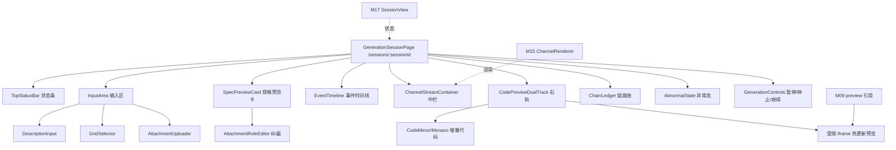
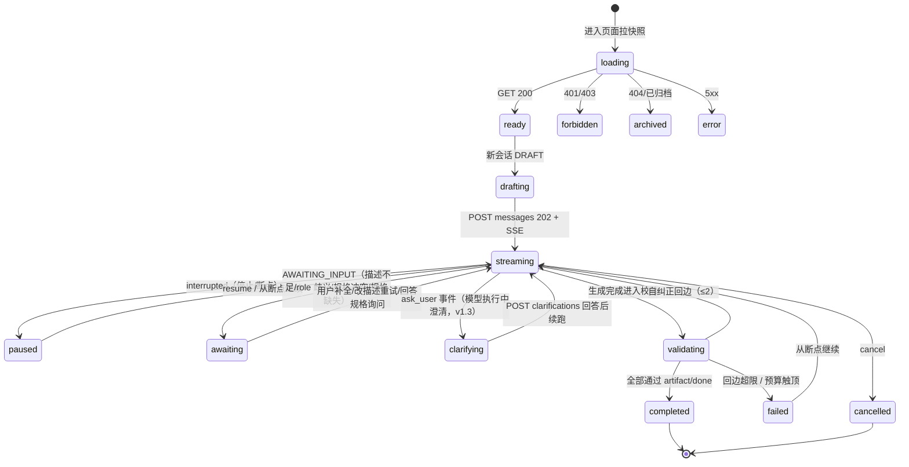

# M14 · 生成会话页（原 W2）

> **文档类型**：可独立交付 / 可独立验收的模块设计文档（前端 · 核心页）
> **来源章节**：`设计方案.md` v1.1 §6.2 页面清单、§6.3 核心页信息架构（7 区域）、§6.4 流式交互设计与六个可演示亮点、§6.6 实时流消费与状态管理、§6.7 体验与工程要点、§6.9 前后端契约与边界、§6.10 前端验收、§7.3 前后端职责划分、§8 总表 W2 行、§4.4 REST、§4.5 事件协议、§2.6 X12
> **版本**：v1.1　|　**拆分日期**：2026-11-15　|　**最近修订**：2026-11-16（v1.3，ADR-001：规格可选预填 + `SPEC_MISSING` 询问卡、新增 `ask_user` 澄清问题卡与 `POST /clarifications` 回答交互）；2026-11-16（v1.4，ADR-002 记忆管理机制：规格建议接入偏好、纠偏信号零 LLM 写入）　|　**状态**：设计定稿
> **对应编号**：W2 / FR-04（六种规格约束：可选预填 + 缺省询问）、FR-05（附件上传与传输层校验）、FR-15（分通道类型化 SSE、partial JSON、增量 patch） / X12（流式事件协议与前端回放 · 页面组装与纠偏交互侧）
> **主责应用**：`apps/web`（React 19 + TypeScript + Vite 单页应用，SPA 静态部署 / CDN）
> **一句话定义**：把「顶部状态条 / 输入区 / 可纠偏规格预览卡 / 左事件时间线 / 中分通道流 / 右代码预览双轨 / 底部链路账 / 异常态」组装成一个可流式纠偏、可打断恢复、可跨天续传、可审计的生成会话核心页，是用户与 Agent 交互的唯一主界面。

---

## 0. 模块速览（零基础可读）

### 0.1 项目在做什么（本模块所需的最小背景）

WidgetPilot 是一个「用自然语言生成手机桌面控件」的 AI Agent 产品：用户选规格（`2x1`/`1x2`/`2x2`/`2x4`/`4x2`/`4x4`）、输入描述、可传图片/视频/文本附件，系统生成 TSX + React 控件代码，经编译、隔离沙箱测试与安全校验后产出控件包，在网页上按真实比例渲染成卡片。**不生成 Lynx 代码、不打包、不装机、不接手机系统 API、不模拟真实设备**（§1.2、§1.7）。原文 §6 开头点明「前端是这个产品最有讲头的部分」：Agent 产品的交互不是「聊天气泡 + 打字机」，而是让用户看得见意图被识别、规格被采纳、代码在长出来、校验在发生，并且能在中途纠偏、在任意一步回放。

### 0.2 端到端 14 步链路中本模块的位置

```
① 登录 → 新建会话（grid 可选预填）           ← M13 交接进来
② 输入描述 + 上传附件 → 传输层校验 → 对象存储 → attachment_id   ← ★ 输入区
③ 语义层校验 → 不足则 AWAITING_INPUT
④ 进 LLM 护栏（注入 / PII / 意图白名单 / 预算前置）
⑤ 意图与规格确定 → 按 widget_type + grid 确定性预取生成规程
⑥ 上下文装配（公共语料 + 规程 + 记忆 + AttachmentInsight）
⑦ 生成回路：先出 WidgetSpec，再出 TSX + React 代码；模型分档   ← ★ 规格预览卡 / 右轨代码
⑧ 出 LLM 护栏 → ⑨ 契约校验 → ⑩ 一次性沙箱                ← ★ 左时间线 / 底部链路账
⑪ 生成 WidgetBundle，状态 COMPLETED                        ← ★ 右轨预览热更新 / 顶部状态条
⑫ artifact 事件 → 控件墙按 grid 真实比例渲染受限 iframe 卡片  ← M16 接手
⑬ 评测合格 → 脱敏 → 入库门禁 → 公共语料（可撤回）
⑭ 全流程按 seq 写 SSE 事件流与只追加审计；成本按档位分账        ← ★ 顶部状态条「一键复制证据链」
```

本模块是**第 ②～⑪ 步在用户面前发生的地方**：它不执行生成（M07）、不做护栏（M06/M08）、不编译（M08）、不产包（M09），但把这些步骤以分通道事件的形式**可看、可纠偏、可打断、可回放**地呈现出来，并在用户中断或跨天回来时把状态交接回去。

### 0.3 为什么必须有这个模块

| # | 不可替代的理由 | 原文依据 |
|---|---|---|
| 1 | 「交互要让人看懂 Agent 在做什么」是决定产品能否成立的三件事之一，token 刷屏做不到 | §1.1、§6 开头 |
| 2 | 规格预览卡可纠偏是「Agent 产品特有交互，普通 chat 没有」 | §6.4 亮点 1 |
| 3 | 长任务可打断 / 跨天恢复，需要「停止 / 继续 / 从断点继续」的可审计操作入口 | §6.4 要点 6/7/8、§8 W2 行「打断与跨天恢复界面一致」 |
| 4 | 代码/预览双轨让用户看见控件「长出来」并在预览里试交互 | §6.4 亮点 2、§6.3 右轨 |
| 5 | 任何旁路状态必须带原因码 + 证据引用，前端不得只显示「失败」 | §1.4、§6.3 异常态、§6.4 亮点 6 |

### 0.4 上下游邻居（mermaid）

```mermaid
flowchart LR
  M13["M13 会话中心 W1"] -->|sessionId + grid + runId + Last-Event-ID + last_seq| M14["M14 生成会话页 W2"]
  M04["M04 账号会话编排 D1"] -->|REST 快照 / signal / SSE 网关| M14
  M05["M05 附件处理 D2"] -->|attachment_id / role 纠偏结果| M14
  M09["M09 产物与包管理 D6"] -->|GET /api/bundles/{id}/preview 编译产物引用| M14
  M02["M02 前后端契约 W6"] -.枚举/OpenAPI/Zod.-> M14
  M14 -->|POST messages / interrupt / resume / cancel / PATCH roles| M04
  M14 -->|SSE 连接参数 runId + Last-Event-ID| M15["M15 分通道流式渲染 W3"]
  M15 -->|AgentEvent 流| M17["M17 时间线回放/状态 W5"]
  M17 -->|SessionView| M14
  M14 -->|artifact bundle_id| M16["M16 控件墙 W4"]
  M12["M12 前端工程化 W7"] -.MSW/Storybook/axe/Sentry.-> M14
```

- **上游**：M13（导航与恢复上下文）、M04（REST / signal / SSE 网关）、M05（附件）、M09（预览引用）、M02（契约）。
- **下游**：M15（底层 SSE 分帧与通道渲染，本模块委托）、M17（reducer / `SessionView` / scrubber 语义，本模块委托）、M16（产物卡片网格，本模块不实现）。
- **横切**：M11 采集 TTFT、首事件延迟、预览打开耗时、中断率、恢复成功率（§6.7 埋点）；本模块是 X12 在「页面组装与纠偏交互」侧的承载。

### 0.5 原文对照表

| 本模块内容 | 原文章节 / 行 |
|---|---|
| 核心页 7 个区域 + 异常态 | §6.3 信息架构表 |
| 流式交互设计、10 通道渲染策略、10 条实现要点、六个亮点 | §6.4 |
| 打断 / 中断 / 恢复链路 | §6.4 要点 6、7、8、§4.5 中断语义、§11.4 第 6 步 |
| 服务端状态 / 实时状态 / 本地 UI 状态 / 乐观更新边界 | §6.6 |
| 附件乐观预览、骨架占位、原子替换、空态/加载/错误/无权限/已归档、时区、a11y、代码分割、埋点 | §6.7 |
| 统一错误响应、前端不做鉴权判定 | §6.9、§7.3 |
| 前端验收表 | §6.10、§8 W2 行 |
| 消费的 REST 与 SSE 接口 | §4.4、§4.5 |
| 承载 X12 | §2.6 X12 行、§8 X12 行 |

---

## 1. 模块定位与职责边界

### 1.1 为什么必须有

1. **唯一主界面**：登录后的生成、纠偏、打断、恢复、查看证据都发生在这里；没有它，后端 harness 的全部能力对用户不可见、不可纠偏。
2. **把不可信过程变成可解释过程**：分通道事件（§4.5）让「规格被采纳、护栏命中、代码在长、沙箱在测」逐项可看，而不是 token 刷屏。
3. **中途纠偏**：规格预览卡上的附件 role 可当场改正并「从该步重跑」（§6.4 亮点 1），这是普通 chat 没有的交互。
4. **长任务不丢**：停止/继续/取消与跨天恢复入口都收敛在本页，配合 `runId + seq` 保证界面与离开前一致（§8 W2 行）。

### 1.2 做什么（职责清单，对应 §6.3 七区域 + 异常态）

| # | 区域 / 职责 | 说明 |
|---|---|---|
| R1 | 顶部状态条 | 会话状态、所选规格、`runId`、累计成本、模型档位、最后 `seq`；一键复制证据链（§6.3） |
| R2 | 输入区 | 描述输入、**规格可选选择（可跳过，v1.3 D-6）**、附件上传（图片/视频/文本）；乐观预览 + 上传进度；类型/大小错误即时提示（§6.3） |
| R3 | 规格预览卡 | 边流边成形 `widget_type` / `grid` / 每个附件 `role` / `layout_slots`；可纠偏 → PATCH role → 从该步重跑（§6.3、§6.4 亮点 1）；`SPEC_MISSING` 时内嵌规格询问卡（建议项一次点选，v1.3 D-6） |
| R3b | 澄清问题卡（v1.3 D-7） | 消费 `ask_user` 事件渲染封闭式问题（选项按钮或短文本框）→ `POST /api/sessions/{id}/clarifications` 回答 → 续跑；显示剩余询问次数（`clarify_count/clarify_limit`） |
| R4 | 左事件时间线 | plan / 护栏命中 / 技能加载 / 检索引用 / 回边 / 校验 / 沙箱结果 / 成本；折叠、筛选、跳转日志、scrubber 拖动回放（§6.3） |
| R5 | 中分通道流 | 委托 M15 渲染；自动滚动仅底部时、暂停、停止（§6.3、§6.4 要点 4） |
| R6 | 右代码 / 预览双轨 | TSX 增量代码语法高亮 + 编译通过后受限 iframe 热更新；切换代码/预览；预览内交互可试（日历翻月等）（§6.3、§6.4 亮点 2） |
| R7 | 底部链路账 | token、回边次数、检索引用、沙箱测试结论、成本；展开 trace 与证据包（§6.3、§6.4 亮点 5） |
| R8 | 异常态 | 原因码 + 证据引用 + 「从断点继续」/「改描述重试」；**不显示裸「失败」**（§6.3、§6.4 亮点 6） |
| R9 | 打断 / 继续 / 取消链路 | `AbortController.abort()` + 独立 `POST /interrupt`；跨天/月按 `runId + seq` 重连续传（§6.4 要点 6/7/8） |
| R10 | 六个可演示亮点落地 | 流式 spec 可纠偏、双轨热更新、时间线 scrubber、链路透明、状态可解释（控件墙归 M16）（§6.4） |
| R11 | 状态与证据消费 | 消费 `SessionView`（M17）、`AgentEvent`（M15），按 `sessionId` 精确失效（§6.6） |

### 1.3 不做什么（明确排除，含与相邻前端模块的边界切割）

| 不做 | 这块归哪个 Mxx | 边界说明 |
|---|---|---|
| SSE 底层分帧（`\n\n` 分帧、半帧缓存、UTF-8 流式解码、心跳、重连退避、乱序去重、背压） | **M15（W3）** | 本模块只调用 `useEventStream({ runId, lastEventId, ticket })` 取得 `AgentEvent` 流，不碰字节流（§6.4 要点 5/10） |
| partial-JSON 容错解析、增量代码 patch 应用、rAF 批处理、10 类通道渲染组件 | **M15（W3）** | 本模块只把「中栏」容器交给 M15 的 `ChannelRenderer`，不实现解析器与解析器副作用规则（§6.4） |
| event-sourced reducer 纯函数、`AgentEvent[] → SessionView`、seq 去重与乱序丢弃、scrubber 回放语义、「从这里重生成」的 reducer 侧 | **M17（W5）** | 本模块提供 scrubber 的 UI 拖动条与「从这里重生成」按钮，但状态语义、回放断言、纯函数归 M17（§6.6、§8 W5 行） |
| 控件墙卡片网格、六种规格真实比例卡片、安装/删除/版本/回滚/manifest/trace 详情 | **M16（W4）** | 本模块右轨预览是**单张受限 iframe 热更新**，不是卡片网格；`artifact` 到达后把 `bundle_id` 交给 M16（§6.5、§8 W4 行） |
| 会话列表、状态筛选、跨天恢复入口列表、新建时选 grid 的列表页 | **M13（W1）** | 本模块是列表页点进去之后的详情页 |
| 登录表单、JWT 签发、`user_id` 隔离、鉴权判定、规格合法性/意图白名单/护栏/能力放行 | **M04 / M06 / M08** | 前端隐藏按钮只是体验；策略、隔离、门禁统一在服务端裁决（§7.3、§6.9） |
| 附件类型嗅探、role 判定、多模态处理、`AttachmentInsight` 产出 | **M05（D2）** | 本模块只做上传乐观预览 + 进度 + 传输层错误即时提示，role 由后端判定、前端可纠偏 |
| 契约生成 / OpenAPI / Zod / 枚举 CI 一致性 | **M02（W6）** | 本模块消费生成物 |
| 测试底座 / 性能预算 / a11y 工具链 | **M12（W7）** | 本模块使用底座提测 |

> **三处最易混淆**：① 「中栏分通道流」容器在本模块，但渲染引擎在 M15；② 「时间线 scrubber」UI 在本模块，但回放语义与 reducer 在 M17；③ 「右轨 iframe 预览」是单张生成期热更新（本模块），「控件墙网格」是产物管理（M16）。三者数据都来自同一个 `AgentEvent` 流，但职责不重叠（§7.3 流式事件 / 产物与预览两行）。

### 1.4 输入 / 输出与上下游契约

| 方向 | 内容 | 契约形式 |
|---|---|---|
| 入 | `sessionId`、`grid`、`runId`、`Last-Event-ID`、`last_seq`、`evidenceRef` | M13 导航参数 / state【推导·需评审：传递方式见 §9】 |
| 入 | `SessionSnapshot`（`GET /api/sessions/{id}`）、`SessionView`（M17）、`AgentEvent` 流（M15）、`WidgetRuntime` 预览引用（M09） | REST + 应用内状态 |
| 入 | `UserRole`、`locale`、`theme` | 应用全局上下文 |
| 出 | `POST /messages`、`POST /interrupt|resume|cancel`、`PATCH /attachment-roles`、`POST /api/attachments` | REST（§4.1） |
| 出 | SSE 连接参数 `runId + Last-Event-ID + ticket` | 交给 M15 |
| 出 | `bundle_id` → M16；`scrubber 位置` / 「从这里重生成」意图 → M17 | 应用内事件 / 导航 |
| 出 | 埋点：TTFT、SSE 首事件延迟、预览打开耗时、中断率、恢复成功率 | M11 / M12 采集（§6.7） |

### 1.5 承载的横切能力 X*

- **X12（页面组装与纠偏交互侧承载）**：流式事件协议与前端回放。本模块负责把分通道类型化 SSE、partial JSON 渐进、增量 patch 的**结果**组织成七区域 UI，并提供「规格卡纠偏 → PATCH role → 从该步重跑」「时间线 scrubber → 从这里重生成」「中断 → checkpoint → 跨天续传」这些可审计的操作入口。X12 的另外两侧：**分帧与通道渲染**归 M15，**reducer 纯函数与 seq 回放**归 M17（§2.6 X12 落在 W3/W5，§8 X12 行「分通道 SSE / seq / Last-Event-ID / 未知 kind 忽略 / 按 seq 去重与乱序丢弃」）。
- **X1（协同）**：跨天/月断点恢复的**前端界面一致性**（§6.4 要点 8「恢复后 reducer 重放历史事件，界面与离开前一致」、§8 W2 行）；checkpoint / 租约实现归 M04/M03。
- **X11（协同）**：一键复制证据链、trace 与证据包入口、埋点，供 M11 完整重放一次会话。

### 1.6 关键设计原则

1. **策略、隔离、门禁统一在服务端裁决；前端负责事件消费、可回放状态、纠偏交互与可审计的操作入口**（原文 §7.3 末行）。落到本模块：role 纠偏只是「提交用户意图」，是否合法、是否从该步重跑由 M05/M06/M07 裁决；预览 iframe 的能力放行由 M09 的 `WidgetRuntime` 决定，前端不重判。
2. **不做 token 刷屏**：按 `kind` 派发独立渲染组件（§6.4 表），中栏交给 M15。
3. **任何旁路状态必须带原因码 + 证据引用，前端不得只显示「失败」**（§1.4、§6.3 异常态、§6.4 亮点 6「状态可解释」）。
4. **中断不是关连接**：`POST /interrupt` 是独立 signal；UI 收到 `interrupted` 切「已暂停 · 从 XX 继续」，保留已生成的部分代码与规格卡（§6.4 要点 7）。
5. **可逆才乐观**：附件本地预览、草稿输入、面板折叠、代码/预览切换、scrubber 位置可做乐观更新；取消生成、删除等不可逆操作不做乐观更新（§6.6）。
6. **恢复靠持久化而非内存**：跨天/月重连按 `runId + Last-Event-ID`，超窗先拉快照再续流（§6.4 要点 8、§11.4 第 6 步）。

---

## 2. 技术栈

### 2.1 分层选型表（逐层写选型 + 为什么 + 明确不用什么）

| 层 | 选型 | 版本 / 约束 | 为什么选 | 明确不用什么 |
|---|---|---|---|---|
| 框架 | React 19 + TypeScript + Vite（SPA）；需 SSR/统一鉴权时加 BFF | 按路由代码分割（§6.7、§6.8） | 与整站一致，核心页独立 chunk | 不用服务端渲染做这个强交互页 |
| 服务端状态 | TanStack Query（`useQuery`/`useMutation`/`queryClient`） | 按 `sessionId` 精确失效（§6.6、§6.8） | 快照、包列表、指标统一缓存 | 不用 Redux 管服务端状态 |
| 事件状态 | 自研 event-sourced reducer（`AgentEvent[] → SessionView`，**归 M17**）+ Zustand（本地 UI 态：面板折叠、代码/预览切换、scrubber 位置、草稿输入，§6.6） | reducer 纯函数、可回放、可单测 | 支撑时间线 scrubber 与回放 | 不在本模块重复实现 reducer；不把事件流塞进服务端状态库 |
| UI | Tailwind CSS + shadcn/ui（Radix） | 暗色主题、键盘可达、WCAG 2.1 AA（§6.7、§6.8） | 可访问性原语齐全 | 不用不可访问的自定义控件 |
| 代码展示 | CodeMirror 6 / Monaco | TSX 语法高亮 + 增量 patch（§6.8、§6.4 要点 2） | 支持按行区间更新文档、已完成块 memo | 不用 `<pre>` 全文重绘；不用纯文本渲染代码 |
| 流式解析 | 原生 `fetch ReadableStream` + 自研分帧/半帧缓存 + 容错 partial-JSON 解析器 + Zod（仅 final 严格校验），**归 M15** | 不自己写正则解析 JSON（§6.8） | 只在 `done` 严格校验；不稳定字段不触发副作用 | **不用 AI SDK / CopilotKit / AG-UI SDK**；不用 `JSON.parse` 硬解流式半帧 |
| 图表 | Recharts / ECharts（指标分布与置信区间） | 按路由代码分割隔离（§6.8） | 链路账里成本/回边趋势小图 | 不把图表库打进首屏 chunk |
| 列表 | `@tanstack/react-virtual` | 时间线、日志窗口化（§6.8 列表层、§6.7） | 长事件序列不掉帧 | 不一次性渲染全部时间线节点 |
| 契约 | OpenAPI 3.1 → `openapi-typescript`；事件与协议用 Zod；枚举共享包 | 单一事实来源（§6.8、§6.9） | 请求/响应/事件类型前后端一致 | 不手写与后端不一致的本地类型 |
| 测试 | Vitest + Testing Library + MSW（mock SSE/API）+ Playwright（E2E）+ Storybook | 事件序列回放测试是重点（§6.8） | 可脱离后端提测 | 不用真实模型/沙箱才能验收 |
| 质量 | Biome / ESLint、axe、Sentry、Lighthouse CI | a11y AA、性能预算（§6.8） | 首屏与可访问性有 CI 门禁 | 不跳过 axe 严重项 |

> **零 Agent 框架硬约束（D-5 / §6.8 / §6.8 Agent 事件层 / §11.1）**：本模块**不使用** Vercel AI SDK、`streamUI`、CopilotKit、AG-UI SDK、A2UI SDK、LangChain/LangGraph、Temporal、MCP SDK、任何 LLM 专用观测 SDK。Agent 事件层是「原生 `EventSource` / `fetch` + 自研 event-sourced reducer」，分通道派发、seq 去重、心跳、重连与回放全部手写。通用基础设施（React 19 / Vite / TanStack Query / Zustand / Zod / CodeMirror / `fetch ReadableStream`）保留（§11.1）。

### 2.2 运行时依赖

| 依赖 | 用途 | 不可用 / 降级时的行为 |
|---|---|---|
| `control-plane`（M04） | 快照、messages、interrupt/resume/cancel、SSE 网关 | 5xx → 错误态 + `retryable` 重试；不伪造生成结果 |
| 对象存储（M05） | 附件上传与 `attachment_id` 返回 | 上传失败即时提示类型/大小错误，不入库假附件 |
| M09 预览引用 | `GET /api/bundles/{id}/preview` 返回 `compiled_ref`/`srcdoc_ref`/CSP | 取不到则右轨保持「编译中」占位，不渲染空白 iframe |
| M15 SSE 引擎 | 提供 `AgentEvent` 流 | 连接断开 → 交给 M15 重连；本模块显示「重连中」而非「失败」 |
| M17 reducer | 提供 `SessionView` | 无 reducer 时用快照静态渲染，禁用 scrubber |
| BFF（可选，M02） | JWT → 短期 SSE ticket、首屏聚合、统一错误映射 | 直连 control-plane 亦可；**BFF 不做鉴权判定**（§6.9） |
| CDN / 静态托管 | SPA chunk（CodeMirror 独立 chunk） | chunk 失败 → 右轨降级为纯文本 + 重试 |

### 2.3 `apps/web` 代码落位

```
apps/web/
  src/
    routes/
      sessions/[sessionId]/+page.tsx        # GenerationSessionPage，按路由懒加载【推导·需评审：文件命名】
    features/generation/
      TopStatusBar.tsx                     # R1 状态条 + 一键复制证据链
      InputArea/
        DescriptionInput.tsx
        GridSelector.tsx                    # 六种 GridSpec
        AttachmentUploader.tsx             # 乐观预览 + 进度 + 即时错误
      SpecPreviewCard.tsx                  # R3 边流边成形 + 纠偏
      AttachmentRoleEditor.tsx             # PATCH role 交互
      EventTimeline.tsx                    # R4 折叠/筛选/跳转日志/scrubber UI
      ChannelStreamContainer.tsx           # R5 中栏容器（委托 M15 ChannelRenderer）
      CodePreviewDualTrack.tsx             # R6 代码/预览切换 + 受限 iframe 热更新
      ChainLedger.tsx                      # R7 链路账 + trace/证据包
      AbnormalState.tsx                    # R8 异常态（原因码 + 证据 + 两按钮）
      GenerationControls.tsx               # 暂停 / 停止 / 从断点继续 / 改描述重试
      hooks/
        useGenerationSession.ts            # 组装快照 + SessionView + 连接态
        usePostMessage.ts                  # POST /messages
        useAttachmentUpload.ts            # POST /api/attachments（乐观）
        useAttachmentRolesCorrection.ts   # PATCH /attachment-roles
        useGenerationSignals.ts           # interrupt / resume / cancel + AbortController
        useBundlePreview.ts               # GET /api/bundles/{id}/preview
        useEvidenceChain.ts               # 一键复制 runId/seq/traceId/evidenceRef
      state/
        generationUiStore.ts               # Zustand：折叠/双轨切换/scrubber/草稿
    lib/apiClient.ts                       # 统一响应 / 错误映射 / Idempotency-Key
```

> 组件名、hook 名、文件路径均为【推导·需评审】：原文只给出 7 区域、关键组件方向与「Zustand 本地 UI 态」分类，未给具体命名。

---

## 3. 设计架构

### 3.1 组件树与职责表



| 组件 | 职责（对应区域） | 关键不变量 |
|---|---|---|
| `GenerationSessionPage` | 路由入口，组装七区域与异常态 | 按路由懒加载；不把 M16 网格打进本 chunk |
| `TopStatusBar` | 状态 / 规格 / `runId` / 成本 / 档位 / 最后 `seq` / 复制证据链 | `runId`、`seq` 来自快照与事件，不本地编造 |
| `AttachmentUploader` | 乐观预览 + 进度 + 类型/大小即时错误 | 只做传输层即时提示，判定归 M05；不做乐观入库 |
| `SpecPreviewCard` | 边流边成形 `widget_type`/`grid`/`role`/`layout_slots`；`SPEC_MISSING` 时内嵌规格询问卡（建议项一次点选，v1.3 D-6） | partial 字段未稳定时显示骨架占位，不触发副作用 |
| `ClarifyQuestionCard`（v1.3 D-7） | 渲染 `ask_user` 封闭式问题（选项按钮 / 短文本框）+ 剩余次数 → `POST /clarifications` 回答 → 续跑 | 只消费 `ask_user` 事件构造的问题，**不自造问题**；提交后进入等待态，不重复提交 |
| `AttachmentRoleEditor` | 纠偏入口 → PATCH → 从该步重跑 | 提交的是用户意图，合法性由服务端裁决 |
| `EventTimeline` | 折叠/筛选/跳转日志/scrubber 拖动 | 回放语义归 M17；本组件只发意图 |
| `ChannelStreamContainer` | 中栏容器 + 自动滚动/暂停/停止 | 渲染引擎归 M15；自动滚动「仅底部时」（§6.4 要点 4） |
| `CodePreviewDualTrack` | 代码/预览切换 + iframe 热更新 | iframe 必须 `sandbox`/CSP/`bridge` 约束（§4.3.3） |
| `ChainLedger` | token / 回边 / 检索引用 / 沙箱结论 / 成本 + trace/证据包 | 数值只读自事件与快照，不本地估算 |
| `AbnormalState` | 原因码 + 证据引用 + 两按钮 | 不显示裸「失败」 |
| `GenerationControls` | 停止/继续/取消 | `abort()` 与 `POST /interrupt` 两条链路并存（§6.4 要点 6/7） |
| `generationUiStore` | 本地 UI 态（Zustand） | 只存可逆态：折叠、双轨切换、scrubber、草稿 |

### 3.2 渲染数据流（编号步骤）

1. 从 M13 进入，读取 `sessionId`、`grid`、`runId`、`Last-Event-ID`、`last_seq`、`evidenceRef` → 按路由懒加载本页 chunk。
2. `useGenerationSession(sessionId)` 发 `GET /api/sessions/{id}` 取 `SessionSnapshot`（`last_seq`、`bundle_refs[]`、`run_id`、当前 `state`）。
3. 若存在 `runId`（新建会话为空则跳过），把 `{ runId, lastEventId = last_seq, ticket }` 交给 M15 的 `useEventStream` 建立/续传 SSE 连接；M15 分帧后输出 `AgentEvent` 流（§6.4 要点 8）。
4. M17 的 `SessionView` reducer 消费事件：SSE 事件与 REST 快照通过 `seq` 合并、幂等去重（§6.6）；输出 `SessionView`。
5. 七区域按 `SessionView` 渲染：`run` 建状态条、`spec` 逐步填规格预览卡、`attachment` 标 role、`code` 增量更新 CodeMirror、`guard/validation/sandbox` 进时间线与链路账、`artifact` 触发右轨热更新、`cost` 累加链账、`error/interrupted/done` 切状态。
6. 输入区：用户写描述、**可选**选 `grid`（可跳过，v1.3 D-6）、选附件 → `POST /api/attachments` 上传（乐观预览 + 进度），拿到 `attachment_id`；类型/大小错误即时提示，不发起生成。
7. 提交生成 → `POST /api/sessions/{id}/messages { description, grid?, attachment_ids }` → 返回 `202`（已受理，非成功结论）→ 状态切 `RUNNING`，开 SSE 消费；若服务端判定规格缺失 → `AWAITING_INPUT` + `notice.spec_missing` → 规格询问卡显示建议项，用户点选/输入 → `POST /clarifications` 提交 → 续跑（v1.3 D-6）。
8. 规格预览卡边流边成形；用户发现「这张图是背景不是提取」→ `AttachmentRoleEditor` 发 `PATCH /api/sessions/{id}/attachment-roles` → 服务端从该步重跑，事件流继续（§6.4 亮点 1）。
9. 右轨：`code` 事件的行级增量 patch 更新 CodeMirror；编译通过、`artifact` 到达后 `GET /api/bundles/{id}/preview` 取引用 → 受限 iframe 原子替换占位卡并热更新；用户可切代码/预览、在预览里试「日历翻月」（§6.4 亮点 2）。
10. 时间线 scrubber 拖动 → 发回放意图给 M17 → 回看任意一步的 spec、代码、护栏命中、沙箱结论与成本；「从这里重生成」同理（§6.4 亮点 3）。
11. 点「停止」→ `AbortController.abort()` 中断 fetch → 服务端取消上游模型调用、账单同步停止 → 同时 `POST /interrupt` 独立 signal → 服务端写 checkpoint 并推 `interrupted` → UI 切「已暂停 · 从 XX 继续」，保留部分代码与规格卡（§6.4 要点 6/7）。
12. 异常：`error` 事件或 `FAILED` 快照 → `AbnormalState` 显示原因码文案 + `evidenceRef` 入口 + 「从断点继续」/「改描述重试」，不显示裸「失败」（§6.3、§6.4 亮点 6）。
13. 跨天回来：重新打开 App → 拉会话快照 → 用 `runId + Last-Event-ID` 重连续传；超窗先拉快照再续流 → M17 reducer 重放历史事件 → 界面与离开前一致（§6.4 要点 8）。

### 3.3 状态机（前端 `SessionView` 状态、连接态、UI 态）



| 状态 | 类型（TS，见 §5.1） | 归属 | 本模块 UI 表现 |
|---|---|---|---|
| `SessionState` 8 态 | 前后端共用枚举 | M04 拥有，本模块只读 | 顶部状态条 + 异常态 |
| `SessionView` | reducer 输出 | **M17 拥有** | 七区域唯一数据源 |
| `SSEConnectionState` | 连接态 | **M15 拥有** | 状态条显示「连接中 / 重连中 / 已暂停」 |
| `BundleState` | `GENERATED/INSTALLED/DELETED` | M09 拥有 | 右轨预览与产物入口 |
| `GenerationUiState` | 本模块本地 UI 态 | **本模块拥有（Zustand）** | 折叠、双轨切换、scrubber、草稿 |
| 五类 UI 态 | 加载/空态/错误/无权限/已归档 | 本模块拥有 | 页面级占位（§6.7） |

### 3.4 关键机制与不变量清单

| # | 机制 | 不变量 | 断言方式 |
|---|---|---|---|
| I1 | 七区域单一数据源 | 七区域全部读 `SessionView` / 快照，不各自维护 SSE 客户端或本地状态副本 | 依赖扫描：本模块无 `EventSource`/`ReadableStream` |
| I2 | 202 ≠ 成功 | `POST /messages` 返回 202 后不显示「完成」，只切 `RUNNING` 并等事件 | 提交后状态断言 |
| I3 | 纠偏是提交意图 | PATCH role 后由服务端从该步重跑；前端不本地改写 `WidgetSpec.attachments[].role` 当作已生效 | 纠偏后旧 `role` 仍在直到新 `attachment` 事件到达 |
| I4 | 中断不是关连接 | `abort()` 断 fetch + `POST /interrupt` 独立 signal；收到 `interrupted` 保留部分代码与规格卡，不空白重置 | 停止后 DOM 仍有 `spec-card` 与 `code-block` |
| I5 | 只在 final 严格校验 | partial-JSON 容错解析中「最后一个字符串字段」不稳定、不触发路由/埋点/请求（M15 实现，本模块不越界消费） | 中栏无副作用断言 |
| I6 | 自动滚动仅底部时 | 用户上滑回看时不跳回底部（§6.4 要点 4，M15 实现，本模块容器提供锚点） | 滚动位置断言 |
| I7 | 预览隔离 | 右轨 iframe 用 `sandbox=["allow-scripts"]` + 严格 CSP + 窄 `postMessage` bridge；不含 `allow-same-origin`/`top-navigation`/`forms`/`popups`（§4.3.3） | iframe 属性断言 |
| I8 | 原子替换 | `artifact` 到达才替换占位卡触发热更新，编译未通过保持骨架 | 占位卡 → 卡片时序断言 |
| I9 | 不显示裸失败 | 所有 `FAILED` 走 `AbnormalState` 带原因码 + 证据 + 两按钮 | DOM 文案断言 |
| I10 | 可逆才乐观 | 乐观只用于附件预览/草稿/折叠/双轨切换/scrubber；取消生成不乐观 | 代码审查 + 用例 |
| I11 | 证据可复制 | 一键复制证据链含 `runId`、`seq`、`traceId`、`evidenceRef`、`checkpoint_rev`（§6.3 顶部状态条） | 剪贴板内容断言 |
| I12 | 恢复界面一致 | 跨天重连续传 + reducer 重放后，七区域与离开前一致（§8 W2 行） | 快照对比断言 |
| I13 | 澄清问题只来自服务端（v1.3） | `ClarifyQuestionCard` 只渲染 `ask_user` 事件的问题；回答经 `POST /clarifications`，前端不自造问题、不重复提交 | 用例：mock `ask_user` → 渲染选项 → 提交一次 → 请求数 = 1 |
| I14 | 规格询问卡只出现在 `SPEC_MISSING`（v1.3） | `notice.spec_missing` 到达才显示建议项；建议项来自事件 payload，不本地推断 | DOM 条件渲染断言 |

**六条链路的精确表述**（原文 §6.4 要点 6/7/8，不改写）：
- **abort 链路**：点「停止」→ `AbortController.abort()` → fetch 中断 → 服务端取消上游模型调用 → **账单同步停止**；同时服务端写 checkpoint 并推 `interrupted`。
- **中断不是关连接**：`POST /interrupt` 是独立 signal；UI 收到 `interrupted` 后切为「已暂停 · 从 XX 继续」，保留已生成的部分代码与规格卡。
- **跨天/月恢复**：重新打开 App → 拉会话快照 → 用 `runId + Last-Event-ID` 重连续传；超窗先拉快照再续流；恢复后 reducer 重放历史事件，界面与离开前一致。

### 3.5 与后端时序（关键 3 个场景）

**场景 1：正常生成**
`M13 进入 → GET 快照 → POST /messages(202) → M15 订阅 SSE → M07 生成 → spec/attachment/code/guard/validation/sandbox/cost/artifact/done 逐事件 → M17 reducer → 七区域 → artifact 到达 GET /bundles/{id}/preview → 右轨 iframe 热更新 → bundle_id 交 M16`。

**场景 2：纠偏（亮点 1）**
`spec 事件成形中 → 规格预览卡显示「附件 role = 内容提取」→ 用户改成「视觉参考」→ PATCH /attachment-roles → M05/M07 从该步重跑 → 新 attachment/spec 事件 → 规格卡与产物随之变化`（§6.4 亮点 1、§8 W2 行「修改附件 role 后能从该步重跑且产物随之变化」）。

【v1.4 ADR-002】用户在规格缺失卡点选偏好建议（`suggest_grid` 首选 `preferred_grids`）或在纠偏卡改规格/附件 `role` 时，前端只提交结构化答案（`clarification` / `correction` 信号），服务端 M07 将该信号按 `clarification`（0.8）/ `correction`（0.7）权重写入偏好（≤0.8，不能覆盖 `explicit=1.0` 的显式设置，I-M3）；用户无感知、无额外交互，偏好学习路径零 LLM 抽取（`call_count == 0`，I-M2）。

**场景 3：停止后跨天恢复**
`点停止 → abort() + POST /interrupt → 服务端 checkpoint + interrupted → UI「已暂停 · 从 XX 继续」→ [7 天，无计算资源] → 重新打开 App → GET 快照 → runId + Last-Event-ID 续传 → M17 重放 → 界面与离开前一致`（§6.4 要点 6/7/8、§11.4 第 6 步）。

### 3.6 部署形态与伸缩

| 项 | 形态 | 说明 |
|---|---|---|
| 应用 | React SPA 静态构建，CDN / 静态托管 | `web` 服务无状态（§7.1） |
| 代码分割 | 按路由 `React.lazy`；CodeMirror/Monaco、Recharts、iframe 预览各自独立 chunk | 首屏不加载 M16 网格与评测图表（§6.7 按路由代码分割） |
| iframe 与主线程隔离 | 预览 iframe 独立渲染上下文 | 卡片并发渲染不阻塞输入；`widget:error` 不拖垮宿主（§6.7） |
| 伸缩 | 前端无状态 | 状态全在 M04 / 对象存储，CDN 承载水平扩展 |

---

## 4. 接口契约

### 4.1 本模块消费的 REST 接口表

统一响应（原文 §4.4 / §6.9）：`{ code, message, traceId, retryable, evidenceRef?, data? }`，`code` 与 `ReasonCode` 对齐，成功 `OK`；`data` 为【契约约定】补充，最终以 `packages/contracts/openapi.yaml` 为准。

| 方法 | 路径 | 权限 | 请求 | 成功响应 `data` | 状态码 |
|---|---|---|---|---|---|
| `GET` | `/api/sessions/{id}` | 本人 | Path `id` | `{ session, last_seq, bundle_refs[], run_id }` | `200`/`401`/`403`/`404` |
| `POST` | `/api/sessions/{id}/messages` | 本人 | `{ description: string, grid?: GridSpec, attachment_ids: string[] }`（v1.3：`grid` 可选） | `{ runId, state: "RUNNING" }` | **`202`**/`400`/`403`/`422` |
| `POST` | `/api/sessions/{id}/clarifications` | 本人 | `{ question_id: string, answer: string }`（v1.3：回答规格缺失 / `ask_user` 澄清） | `{ state: "RUNNING" }` | `202`/`400`/`403`/`422` |
| `POST` | `/api/sessions/{id}/interrupt` | 本人 | `{}`（独立 POST signal） | `{ state: "PAUSED", checkpoint_rev, last_seq }` | `202`/`409` |
| `POST` | `/api/sessions/{id}/resume` | 本人 | `{ runId?: string }` | `{ state: "RUNNING", runId }` | `202`/`409` |
| `POST` | `/api/sessions/{id}/cancel` | 本人 | `{}` | `{ state: "CANCELLED" }` | `202`/`409` |
| `POST` | `/api/attachments` | 本人 | `multipart/form-data`：`file`, `session_id` | `{ attachment_id, kind, mime, size, hash }` | `200`/`400`/`413`/`415` |
| `PATCH` | `/api/sessions/{id}/attachment-roles` | 本人 | `{ roles: { attachment_id: string, role: AttachmentRole }[] }` | `{ accepted: boolean }`【契约约定】 | `200`/`202`/`400`/`409` |
| `GET` | `/api/bundles/{id}/preview` | 本人 | Path `id` | `{ compiled_ref, srcdoc_ref, csp, sandbox, capability_bridge, limits }`【契约约定】 | `200`/`403`/`404` |
| `GET` | `/api/sessions/{id}/events` | 本人 + 短期 SSE ticket | Query/Header: `runId`, `Last-Event-ID` | `text/event-stream` | `200`/`401`/`403` |

**逐条说明**：
- `POST /messages` 是**异步 202**（「已受理」），真正结论走 SSE 事件或会话快照；前端不得把 202 当生成成功（基线 §5.5）。
- `POST /interrupt|resume|cancel` 是**独立 POST signal**，不是关闭 SSE 连接（§4.5 中断语义、§6.4 要点 7）。
- `PATCH /attachment-roles` 触发「从该步重跑」（基线 §5.2），本模块提交用户意图，合法性由 M05/M06 裁决。
- `GET /bundles/{id}/preview` 返回的是**受限 iframe 渲染所需的编译产物引用**（§4.4），不是源码本身；本模块不下载大对象。
- `GET /api/sessions/{id}/events` 的 SSE 底层分帧归 M15，本模块只负责提供连接参数与消费事件（§1.3）。

### 4.2 消费 / 派发的 SSE 事件接口（`kind` 与 payload 形态）

本模块**消费** `AgentEvent` 流（由 M15 分帧输出、M17 reducer 归并），并按 `kind` 把内容派发到七区域。下表 `AgentEventKind` 17 种（原文 §4.5）逐条给出 payload 形态与落点：

| `kind` | payload 形态（原文 §4.5 / §6.4） | 本模块落点 |
|---|---|---|
| `run` | `{ runId, phase, grid, attempt_no }` | 顶部状态条：`runId`、`grid`、状态 |
| `plan` | `{ steps: string[] }`（结论式短句，不是思维链） | 左时间线：折叠步骤条（默认收起，M15 渲染） |
| `spec` | partial `WidgetSpec` JSON 增量 | **规格预览卡**：骨架占位 + 字段边到边填（M15 容错解析） |
| `attachment` | `{ attachment_id, role: AttachmentRole, insight_ref }` | 规格预览卡：附件卡标用途 + 纠偏入口 |
| `skill` | `{ recipe_id, recipe_version }` | 底部链路账：小标签 |
| `routing` | `{ model_tier: ModelTier, threshold_hit }` | 顶部状态条（模型档位）+ 链路账小标签 |
| `code` | `{ from_line: number, to_line: number, text: string }` 行级增量 patch | 右轨 CodeMirror 增量更新（M15 应用） |
| `guard` | `{ passed: boolean, hits: { type, criterion, source_ref }[] }` | 左时间线 + 链路账：分步清单，失败可展开证据 |
| `validation` | `{ passed: boolean, items: { name, passed, detail_ref }[] }` | 左时间线 + 异常态证据引用 |
| `sandbox` | `{ passed: boolean, cases: { name, passed, detail_ref }[], log_ref, snapshot_ref? }` | 底部链路账：沙箱测试结论 + 证据包 |
| `artifact` | `{ bundle_id, preview_ref }` | 右轨：**原子替换占位卡**触发 iframe 热更新；`bundle_id` 交 M16 |
| `cost` | `{ token_in, token_out, sandbox_minutes, total, model_tier }` | 顶部状态条（累计成本）+ 链路账 |
| `checkpoint` | `{ rev, node, state_blob_ref, lease_owner }` | 顶部状态条（`checkpoint_rev`）+ 恢复入口上下文 |
| `interrupted` | `{ reason_code, checkpoint_rev, resume_hint }` | 状态条切「已暂停 · 从 XX 继续」；保留部分代码与规格卡 |
| `notice` | `{ message, code, clarify_hint?, spec_missing? }` | `AWAITING_INPUT` 补充建议 / 降级提示；`SPEC_MISSING` → 规格询问卡（建议项点选，v1.3 D-6） |
| `ask_user` | `{ question_id, question, options?, allow_text, clarify_count, clarify_limit }`（v1.3 D-7） | **澄清问题卡**：渲染封闭式问题 → `POST /clarifications` 回答 → 续跑 |
| `error` | `{ code: ReasonCode, evidenceRef }` | **异常态**：原因码 + 证据 + 两按钮 |
| `done` | `{ bundle_id }` | 状态切 `COMPLETED`；产物入口 |

**派发侧**：本模块不产生 `AgentEvent`（`seq` 由 M04 生成，§4.5）；只派发「用户操作意图」——`POST /messages`、`PATCH /attachment-roles`、`POST /interrupt|resume|cancel`、scrubber 回放意图（给 M17）、`bundle_id`（给 M16）。

> payload 内具体字段名除 `{ from_line, to_line, text }`（§6.4 要点 2 原文）与 `bundle_id` / `insight_ref` / `code` / `evidenceRef` 外，均为【契约约定】：原文给出「按 kind 用 discriminated union 收窄」的方向，未逐个给字段名，最终以 `events.schema.json` 为准。

### 4.3 内部组件接口与函数签名（TS）

以下除标注外均为【推导·需评审】/【契约约定】：原文给出 reducer / parser / hook 的方向，未给命名。

```ts
// ---- 委托 M17 的 reducer（本模块消费，不实现；签名契约约定）----
type SessionReducer = (view: SessionView, event: AgentEvent) => SessionView;
function reduceEvent(view: SessionView, event: AgentEvent): SessionView;  // 未知 kind 忽略而非报错

// ---- 委托 M15 的解析器与引擎（本模块不实现；签名契约约定）----
type PartialJsonParser = {
  feed(delta: string): Partial<WidgetSpec>;   // 逐 delta 容错解析，补齐未闭合字符串与括号
  final(): WidgetSpec | null;                  // 只在 done 时严格 Zod 校验
};
function useEventStream(args: {
  runId: string;
  lastEventId: number;
  ticket: string;
  signal: AbortSignal;
}): { events: AgentEvent[]; connection: SSEConnectionState };

// ---- 本模块 hooks（推导·需评审）----
function useGenerationSession(sessionId: string): {
  snapshot: SessionSnapshot | undefined;
  view: SessionView | undefined;
  connection: SSEConnectionState;
  ui: GenerationUiState;
};

function usePostMessage(): UseMutationResult<
  { runId: string; state: "RUNNING" }, ApiError, PostMessageReq
>;

function useAttachmentUpload(): {
  upload(file: File, sessionId: string): Promise<{ attachment_id: string }>;
  progress: Record<string, number>;
  optimisticPreviews: AttachmentPreview[];   // 可逆，可乐观
  errors: Record<string, string>;            // 类型/大小即时提示
};

function useAttachmentRolesCorrection(): UseMutationResult<
  { accepted: boolean }, ApiError, { roles: { attachment_id: string; role: AttachmentRole }[] }
>;

function useGenerationSignals(): {
  stop(controller: AbortController): void;    // abort() 链路
  interrupt(): Promise<void>;                 // 独立 POST /interrupt
  resume(): Promise<void>;
  cancel(): Promise<void>;
};

function useBundlePreview(bundleId: string): UseQueryResult<WidgetRuntime, ApiError>;

function useEvidenceChain(): { copy(): Promise<void>; chain: EvidenceChain };

// ---- 组件 props（推导·需评审）----
type SpecPreviewCardProps = {
  specDraft: Partial<WidgetSpec> | null;
  onCorrectRole: (attachment_id: string, role: AttachmentRole) => void;
};
type CodePreviewDualTrackProps = {
  codeBlocks: CodeBlock[];
  preview: WidgetRuntime | null;
  mode: "code" | "preview";
  onModeChange: (m: "code" | "preview") => void;
};
type AbnormalStateProps = {
  reasonCode: ReasonCode;
  evidenceRef: string | null;
  onResume: () => void;
  onRetryWithEditedDescription: () => void;
};
```

### 4.4 统一响应与错误码的前端处理约定

| 响应 | 前端处理 |
|---|---|
| `code:"OK"` | 正常；`202` 只切 `RUNNING` 等事件，不显示「完成」 |
| `code` ∈ `ReasonCode` 且 `retryable=false` | `AbnormalState`：逐码文案（§5.3）+ `evidenceRef` 入口 + 两按钮；不显示裸「失败」 |
| `code` ∈ `ReasonCode` 且 `retryable=true` | 「重试」/「从断点继续」，指数退避有上限 |
| HTTP `400` | 输入区/规格卡内联错误（如 `grid` 非法、`INPUT_INVALID`） |
| HTTP `401` | 跳登录；`403` 无权限态；`404` 已归档态 |
| HTTP `409` | 状态冲突（对终态重复 resume / 重复纠偏）→ 拉快照重查，不重复提交 |
| HTTP `413`/`415` | 附件超大/类型非法 → `AttachmentUploader` 即时提示，不入库 |
| HTTP `422` | 语义校验 / 护栏命中 → 逐码文案 |
| HTTP `429`/`5xx` | 错误态 + `traceId` + 有上限重试 |
| `message` | 纯文本渲染，不解析 HTML |

### 4.5 幂等、重连、超时、背压、并发约定

| 项 | 约定 |
|---|---|
| 幂等 | `interrupt`/`cancel`/`resume` 幂等（服务端保证）；`POST /messages` 用 `Idempotency-Key` 防重复提交【推导·需评审：原文未提此头】；重复 PATCH role 以服务端 409/幂等处理 |
| 重连 | 连接参数 `runId + Last-Event-ID + ticket` 交给 M15；断线由 M15 按退避续传；超窗先 `GET /api/sessions/{id}` 拉快照再续流（§6.4 要点 8） |
| 超时 | 上传超时即时提示；`useBundlePreview` 查询 `retry` 有上限；无 `done` 的断流视为截断（M15），本模块显示「重连中」 |
| 背压 | 时间线与日志用 `@tanstack/react-virtual` + 日志窗口化 N 行（M15/M17 实现）；大日志走对象存储引用（§6.4 要点 10、§6.7） |
| 并发 | `queryKey` 按 `sessionId` 精确失效；纠偏与生成提交串行化，避免对同一会话并发 POST；取消立即 `abort()` 在途 fetch |
| 乱序 | 按 `seq` 去重与乱序丢弃由 M17 reducer 完成，本模块不处理（§4.5） |

### 4.6 接口状态表（契约状态 / 运行态 / 可重试）

| 接口 / 约定 | 契约状态 | 运行态 | 可重试 | 说明 |
|---|---|---|---|---|
| `GET /api/sessions/{id}` | 定稿（§4.4） | 同步查询 | 是 | 恢复先拉此快照 |
| `POST /api/sessions/{id}/messages` | 定稿 | **异步 202 + SSE** | 否（需幂等键） | 结论只在事件流 |
| `POST /interrupt\|resume\|cancel` | 定稿 | 异步 signal（202） | 是（幂等） | 独立 POST，不是关 SSE 连接 |
| `PATCH /attachment-roles` | 定稿（§4.4） | 同步/异步（触发重跑） | 否 | 从该步重跑 |
| `POST /api/attachments` | 定稿 | 同步上传 | 是 | 返回 `attachment_id` |
| `GET /api/bundles/{id}/preview` | 定稿（§4.4） | 同步查询 | 是 | 响应体字段为契约约定 |
| `GET /api/sessions/{id}/events` | 定稿 | **流式 SSE**（长连接） | 是（`Last-Event-ID`） | 底层分帧归 M15，需短期 ticket |
| `Idempotency-Key` 头 | **依赖外部**（M02） | — | — | 原文未提 |
| `PATCH /attachment-roles` 响应体 | **影子校准中** | — | — | 原文只写「触发从该步重跑」，未给响应 |
| 各 `kind` payload 字段 | **依赖外部**（M02 `events.schema.json`） | — | — | 除 `code`/`artifact` 等原文片段外为契约约定 |
| 角色 / `401/403/409/404` 业务码 | **依赖外部**（M02） | — | — | 原文 `ReasonCode` 未含，基线 §5.3 |
| 管理员 / `N` 日志窗口 | **可选 / 待决** | — | — | 见 §9 |

---

## 5. 状态、原因码与 API 状态

### 5.1 前端拥有或参与的状态与完整枚举（TS 定义）

```ts
// ---- 原文领域枚举（前后端共用，本模块只读投影）----
type GridSpec = "2x2" | "2x4" | "4x2" | "4x4" | "2x1" | "1x2";
type WidgetType = "calendar" | "clock" | "alarm" | "task" | "custom";
type AttachmentRole =
  | "visual_reference" | "content_extraction" | "data_source" | "style_reference";
type Capability =
  | "date" | "timer" | "local_storage" | "static_data" | "theme" | "locale";
type ModelTier = "cheap" | "standard" | "frontier";

type SessionState =
  | "DRAFT" | "RUNNING" | "PAUSED" | "AWAITING_INPUT" | "VALIDATING"
  | "COMPLETED" | "FAILED" | "CANCELLED";

type BundleState = "GENERATED" | "INSTALLED" | "DELETED";

// ---- 连接态（M15 拥有，本模块只读声明，推导·需评审）----
type SSEConnectionState =
  | "idle" | "connecting" | "streaming" | "reconnecting"
  | "paused" | "closed" | "truncated";

// ---- SessionView（M17 拥有，本模块消费，推导·需评审）----
type SessionView = {
  sessionId: string;
  runId: string | null;
  state: SessionState;
  grid: GridSpec;
  lastSeq: number;
  specDraft: Partial<WidgetSpec> | null;
  attachments: { attachment_id: string; role: AttachmentRole; insight_ref: string }[];
  events: AgentEvent[];
  codeBlocks: CodeBlock[];
  planSteps: string[];
  guardHits: GuardHit[];
  validationItems: ValidationItem[];
  sandboxCases: SandboxCase[];
  cost: { token_in: number; token_out: number; repair_count: number;
          retrieval_refs: string[]; sandbox_minutes: number; total: number };
  artifact: { bundle_id: string; preview_ref: string } | null;
  reasonCode: ReasonCode | null;
  evidenceRef: string | null;
  checkpointRev: number;
};

// ---- 本模块拥有的本地 UI 态（Zustand，推导·需评审）----
type GenerationUiState = {
  pageState: "loading" | "ready" | "empty" | "error" | "forbidden" | "archived";
  timelineCollapsed: Record<string, boolean>;
  timelineFilter: AgentEventKind[];
  dualTrackMode: "code" | "preview";
  scrubberSeq: number | null;        // scrubber 位置（本地 UI 态，§6.6）
  descriptionDraft: string;
  draftGrid: GridSpec | null;
  attachmentPreviews: AttachmentPreview[];
  autoScrollPinned: boolean;         // 是否处于底部
};
```

### 5.2 状态流转表（含 UI 五态）

| 触发 | 前态 | 后态 | 副作用 | 接口 / 事件 |
|---|---|---|---|---|
| 进入页面 | — | `loading` | 发 `GET /api/sessions/{id}` | REST |
| 快照 200 | `loading` | `ready` | 写缓存、交给 M15 建流 | REST |
| 401 / 403 / 404 / 5xx | `loading` | `forbidden`/`archived`/`error` | 对应页面级占位 | REST |
| 新会话 `DRAFT` | `ready` | `drafting` | 输入区可编辑 | 快照 |
| `POST /messages` 202 | `drafting`/`paused` | `streaming` | 开 SSE、切 `RUNNING` | REST + SSE |
| `spec`/`code`/`cost` 事件 | `streaming` | `streaming` | 七区域增量更新 | SSE |
| `interrupted` / 点停止 | `streaming` | `paused` | 保留部分代码与规格卡，显示「已暂停 · 从 XX 继续」 | SSE + `POST /interrupt` |
| `notice`(`AWAITING_INPUT`) | `streaming` | `awaiting` | 规格冲突提示改选 / 规格缺失询问卡 / 补充建议 |
| `ask_user`（v1.3） | `streaming` | `clarifying` | 澄清问题卡；回答后续跑 | SSE |
| `resume` / 从断点继续 | `paused`/`awaiting` | `streaming` | 按 `runId+seq` 续传 | REST + SSE |
| `validation`/`sandbox` 回边 ≤2 | `validating` | `streaming` | `repair_count +=1` | SSE |
| `artifact`/`done` | `validating` | `completed` | 右轨 iframe 热更新、`bundle_id` 交 M16 | SSE + `GET /preview` |
| `error` / 回边超限 / 预算触顶 | `validating` | `failed` | `AbnormalState` 带原因码 + 证据 | SSE |
| `cancel` | 任意非终态 | `cancelled` | 释放沙箱、切已取消 | REST |

### 5.3 消费的 `ReasonCode` 子集与逐码 UI 文案策略

本模块消费**全部 14 个** `ReasonCode`（异常态 + 时间线失败项 + 链路账），逐码文案策略（§1.4「前端不得只显示失败」、§6.4 亮点 6「状态可解释」）：

| `ReasonCode` | 异常态 / 时间线文案（示例） | 主按钮 |
|---|---|---|
| `INPUT_INVALID` | 「输入不完整：请补充描述或检查附件」 | 「改描述重试」 |
| `INTENT_OUT_OF_SCOPE` | 「只支持控件生成请求」 | 「改描述重试」 |
| `GUARD_INPUT_HIT` | 「输入命中进护栏，未进入模型」 | 查看证据 + 「改描述重试」 |
| `GUARD_OUTPUT_HIT` | 「生成内容被出护栏拦下，正在自纠正」 | 查看证据 |
| `SPEC_CONFLICT` | 「**规格冲突：`2x1` 无法容纳月视图，建议改选 `4x4`**」（原文示范句） | 「改选规格」→ 规格预览卡 |
| `SPEC_MISSING` | 「**还没确定控件规格——请选择一种尺寸**」（建议项一次点选，v1.3 D-6） | 规格询问卡 → `POST /clarifications` |
| `CLARIFICATION_REQUIRED` | 「模型需要补充信息」（`ask_user` 问题卡） | 澄清问题卡 → `POST /clarifications`（v1.3 D-7） |
| `CLARIFICATION_LIMIT` | 「澄清次数已用完，已转人工处理」（v1.3） | `AbnormalState` + 证据入口 |
| `CAPABILITY_DENIED` | 「控件声明了未授权能力」 | 查看证据 |
| `CONTRACT_MISMATCH` | 「产物契约不一致，未进入沙箱」 | 查看证据 |
| `COMPILE_FAILED` | 「TSX 编译未通过」 | 查看编译日志 |
| `SANDBOX_TEST_FAILED` | 「沙箱测试未通过」 | 查看沙箱日志/快照 |
| `RETRY_EXHAUSTED` | 「自纠正 2 次仍未通过，已转人工」 | 「从断点继续」+ 查看证据 |
| `BUDGET_EXHAUSTED` | 「本会话预算触顶，已确定性中断」 | 查看成本账 + 「从断点继续」 |
| `SANDBOX_UNAVAILABLE` | 「沙箱暂不可用，已降级为静态校验 + 只读诊断」 | 查看降级记录 |
| `HUMAN_REQUIRED` | 「需人工处理」 | 查看部分产物 |
| `MODEL_ERROR` | 「模型服务异常」 | 「重试」/「从断点继续」 |

> 除 `SPEC_CONFLICT` 示范句外均为【契约约定】：原文只给方向，文案需与 M02 的 i18n 键对齐后定稿。每个失败项都可展开证据引用（§6.4 通道表「guard/validation/sandbox 分步清单失败可展开证据」）。

### 5.4 HTTP 状态码与业务码到 UI 行为的映射

| HTTP | 场景 | `code` | UI 行为 | `retryable` |
|---|---|---|---|---|
| `200` | 查询/上传成功 | `OK` | 快照/预览/附件正常 | — |
| `202` | `messages`/signal 已受理 | `OK` | 只切 `RUNNING`/`PAUSED`，不显示完成 | — |
| `400` | 请求体/`grid`/role 非法 | `INPUT_INVALID` | 输入区/规格卡内联错误 | `false` |
| `401` | JWT 失效 | 【待 M02】 | 跳登录 | `false` |
| `403` | 越权 | 【待 M02】 | 无权限态 | `false` |
| `404` | 不存在/已归档 | 【待 M02】 | 已归档态 | `false` |
| `409` | 状态冲突/重复纠偏 | `CONTRACT_MISMATCH`(或扩充) | 拉快照重查，不重复提交 | `false` |
| `413`/`415` | 附件超大/类型非法 | `INPUT_INVALID` | 上传即时提示 | `false` |
| `422` | 语义/护栏命中 | `GUARD_INPUT_HIT` / `INTENT_OUT_OF_SCOPE` | 逐码文案 | `false` |
| `429` | 配额触顶 | `BUDGET_EXHAUSTED` | 异常态 + 成本账 | `false`（确定性中断） |
| `503` | 沙箱/模型不可用 | `SANDBOX_UNAVAILABLE` / `MODEL_ERROR` | 错误态 + 有上限重试 | `true` |
| `5xx` | 内部错误 | `MODEL_ERROR` / `HUMAN_REQUIRED` | 异常态 + `traceId` | `true`（有上限） |

### 5.5 接口运行态约定（同步查询 / 异步 202 / 流式 SSE / 挂起态 / 终态下的 UI 行为）

- **同步查询**：`GET /api/sessions/{id}`、`GET /api/bundles/{id}/preview`、`POST /api/attachments` 请求即得到结论；预览取不到时右轨保持「编译中」占位。
- **异步 202**：`POST /messages`、`interrupt`/`resume`/`cancel` 返回 202 只表示「已受理/已排队」；真正结论只能通过 SSE 事件或会话快照获取，**前端不得把 202 当生成成功**（基线 §5.5）。
- **流式 SSE**：`GET /api/sessions/{id}/events` 为长连接，终态由显式 `done`/`error` 标志；无 `done` 的断连视为截断并重连（§4.5）。连接态由 M15 维护，本模块显示「连接中 / 重连中 / 已暂停」。
- **挂起态**：`PAUSED` / `AWAITING_INPUT` 下 `GET /sessions/{id}` 正常返回快照 + `checkpoint_rev` + `resume_hint`；UI 显示「已暂停 · 从 XX 继续」与补充建议；`interrupt` 在挂起态调用应幂等返回当前状态而非报错。
- **终态**：`COMPLETED` 下展示产物入口（右轨 iframe + `bundle_id` 交 M16）；`FAILED` 走 `AbnormalState`；`CANCELLED` 显示已取消 + 新建入口；三者都不显示裸「失败」。终态下 `resume` 返回 409，如需重跑走新建 `Run`（§5.5 基线）。

---

## 6. 核心字段与元数据

### 6.1 前端持有的核心字段与元数据表

| 字段 | 类型 | 来源 | 含义 / 用途 |
|---|---|---|---|
| `SessionView.sessionId` | `string` | 快照 / 事件 | 本页锚点，`queryKey` 精确失效键 |
| `SessionView.runId` | `string \| null` | `run` 事件 / 快照 `run_id` | 顶部状态条；重连续传锚点 |
| `SessionView.lastSeq` | `number` | 事件 `seq` 归并 | 状态条「最后 seq」；`Last-Event-ID` |
| `SessionView.state` | `SessionState` | 快照 / 事件 `phase` | 状态条 + 异常态 |
| `SessionView.grid` | `GridSpec \| null` | 用户可选预填 / `run` 事件 / 询问补全（v1.3 D-6） | 状态条「所选规格」；空时显示「待确认」 |
| `SessionView.specDraft` | `Partial<WidgetSpec> \| null` | `spec` 事件 partial 累积 | **规格预览卡**边流边成形（§6.3） |
| `SessionView.attachments[]` | `{ attachment_id, role, insight_ref }[]` | `attachment` 事件 | 规格卡附件用途 + 纠偏 |
| `SessionView.events[]` | `AgentEvent[]` | M15 流 | **事件时间线**数据源（窗口化） |
| `SessionView.codeBlocks[]` | `CodeBlock[]` | `code` patch 累积 | 右轨 CodeMirror |
| `SessionView.artifact` | `{ bundle_id, preview_ref } \| null` | `artifact` 事件 | 右轨原子替换 + 交 M16 |
| `SessionView.cost.*` | `token_in/out/repair_count/retrieval_refs/sandbox_minutes/total` | `cost`/`validation`/`sandbox` 事件 | 底部链路账（§6.3、§6.4 亮点 5） |
| `SessionView.reasonCode` / `evidenceRef` / `checkpointRev` | `ReasonCode`/`string`/`number` | `error`/`checkpoint` 事件、统一响应 | 异常态 + 恢复上下文 |
| `GenerationUiState.scrubberSeq` | `number \| null` | 本地 Zustand | **scrubber 位置**（§6.6 本地 UI 态） |
| `GenerationUiState.dualTrackMode` | `"code" \| "preview"` | 本地 Zustand | 右轨切换 |
| `GenerationUiState.descriptionDraft` / `draftGrid` | `string` / `GridSpec \| null` | 本地 Zustand | 草稿输入（可逆，可乐观） |
| `GenerationUiState.attachmentPreviews[]` | `AttachmentPreview[]` | 本地 Zustand | 附件乐观预览 + 进度 |
| `GenerationUiState.autoScrollPinned` | `boolean` | 本地 Zustand | 仅底部时自动滚（§6.4 要点 4） |
| `traceId` | `string` | 统一响应 / `AgentEvent.traceId` | 一键复制证据链、错误追溯 |

**本模块不持有的字段**：`bundle_id` 的卡片网格渲染状态（M16）、`SessionView` 的 reducer 实现与 seq 去重逻辑（M17）、SSE 帧缓存与半帧（M15）、`checkpoint` 大对象内容（M04/对象存储）。本模块只持有上面这些展示与本地 UI 态字段。

### 6.2 相关协议 schema 完整定义（片段完整写出，不写「见别处」）

```ts
// ---- 统一响应（原文 §4.4 / §6.9，data 为契约约定）----
type ApiResponse<T> = {
  code: string; message: string; traceId: string;
  retryable: boolean; evidenceRef?: string; data?: T;
};

// ---- 实时事件协议（原文 §4.5，完整复制）----
type AgentEvent = {
  seq: number;                 // 每会话单调递增
  sessionId: string;
  runId: string;               // 重连与跨天恢复的锚点
  ts: string;
  kind: AgentEventKind;
  phase: SessionState;
  payload: unknown;            // 按 kind 用 discriminated union 收窄
  traceId: string;
};

// ---- 生成协议 WidgetSpec（原文 §4.3.1，完整复制）----
type WidgetSpec = {
  spec_version: string;
  widget_id: string;
  grid: GridSpec | null;             // 可选预填 + 缺省询问补全，系统不推断（v1.3 ADR-001 D-6）
  widget_type: WidgetType;
  intent: string;
  attachments: {
    attachment_id: string;
    role: AttachmentRole;            // 可在前端纠偏
    insight_ref: string;
  }[];
  layout_slots: { slot: string; content: string }[];
  capabilities: Capability[];
  data_contract: {
    sources: ("time" | "local_storage" | "static")[];
    storage_namespace: string;
  };
  style: { palette?: string[]; radius?: number; font_scale?: number };
  constraints: { forbidden: string[]; max_elements: number };
  language: "tsx";
  react_version: string;
  import_allowlist: ["react", "@widget/bridge"];
  export_contract: { default: "Widget" };
  props_contract: ["grid", "theme", "locale", "tick", "data"];
};

// ---- 渲染协议 WidgetRuntime（原文 §4.3.3，完整复制，右轨 iframe 用）----
type WidgetRuntime = {
  card: { grid: GridSpec; px: { w: number; h: number } };
  iframe: {
    sandbox: ["allow-scripts"];       // 不含 allow-same-origin/top-navigation/forms/popups
    csp: string;                      // 禁外联脚本、禁 eval、禁网络
    srcdoc_ref: string;               // 指向 compiled 产物
  };
  bridge_messages: [
    "widget:ready", "widget:resize", "widget:error",
    "host:theme", "host:locale", "host:tick", "host:data"
  ];
  capability_bridge: Capability[];    // = manifest.capabilities ∩ 白名单
  limits: { render_timeout_ms: number; max_message_rate: number };
};

// ---- 产物协议 WidgetBundle（原文 §4.3.2，完整复制，artifact 落点）----
type WidgetBundle = {
  bundle_id: string; user_id: string; session_id: string;
  spec: WidgetSpec;
  source: { path: "widget.tsx"; content_ref: string; language: "tsx" };
  compiled: { content_ref: string; hash: string };
  manifest: {
    spec_version: string; spec_hash: string; grid: GridSpec;
    widget_type: WidgetType; capabilities: Capability[];
    import_allowlist: string[]; exports: { default: "Widget" }; props: string[];
    recipe_version: string; retrieval_snapshot: string;
    model: string; prompt_version: string; model_tier: ModelTier;
  };
  static_check: { passed: boolean; violations: string[] };
  sandbox_test: {
    passed: boolean;
    cases: { name: string; passed: boolean; detail_ref: string }[];
    log_ref: string; snapshot_ref?: string;
  };
  state: BundleState; hash: string; created_at: string;
};

// ---- 本模块消费的 SessionView（推导·需评审，归 M17）----
type SessionView = {
  sessionId: string; runId: string | null; state: SessionState;
  grid: GridSpec; lastSeq: number;
  specDraft: Partial<WidgetSpec> | null;
  events: AgentEvent[]; codeBlocks: CodeBlock[];
  artifact: { bundle_id: string; preview_ref: string } | null;
  reasonCode: ReasonCode | null; evidenceRef: string | null;
  checkpointRev: number;
};
```

### 6.3 枚举与常量

```ts
// AgentEventKind（原文 §4.5 17 种 + v1.3 新增 ask_user，共 18 种，完整复制）
type AgentEventKind =
  | "run" | "plan" | "spec" | "attachment" | "skill" | "routing"
  | "code" | "guard" | "validation" | "sandbox" | "artifact"
  | "cost" | "checkpoint" | "interrupted" | "notice" | "error" | "done"
  | "ask_user";

type GridSpec = "2x2" | "2x4" | "4x2" | "4x4" | "2x1" | "1x2";

type ReasonCode =
  | "INPUT_INVALID" | "INTENT_OUT_OF_SCOPE" | "GUARD_INPUT_HIT" | "GUARD_OUTPUT_HIT"
  | "SPEC_CONFLICT" | "SPEC_MISSING" | "CAPABILITY_DENIED" | "CONTRACT_MISMATCH" | "COMPILE_FAILED"
  | "SANDBOX_TEST_FAILED" | "RETRY_EXHAUSTED" | "BUDGET_EXHAUSTED"
  | "SANDBOX_UNAVAILABLE" | "HUMAN_REQUIRED" | "MODEL_ERROR"
  | "CLARIFICATION_REQUIRED" | "CLARIFICATION_LIMIT";
```

> **计数已核定（v1.3 修订）**：原文 `AgentEventKind` 为 **17** 个字面量；v1.3（ADR-001 D-7）扩充为 **18** 种（新增 `ask_user`），由 M02 走契约变更收敛入 `openapi.yaml` 并触发 M10 回归门禁。

| 常量 | 值 | 含义 / 出处 |
|---|---|---|
| `cell` | `80px` | 卡片网格单元（§6.5），规格选择器/预览按真实比例 |
| `MAX_REPAIR` | `2` | D-2 自纠正回边上限，链路账展示 `repair_count` |
| `MAX_ITER` | `12` | §11.3 上线常量，无关闭开关 |
| `TTFT` P95 | `< 1s` | §9.4 SLO（本模块 TTFT 埋点） |
| `SSE` 首事件 P95 | `< 1.5s` | §9.4 SLO（本模块首事件延迟埋点） |
| `rAF` 批处理 | ≤ 60 次/秒 | §6.4 要点 3（由 M15 实现，本模块容器配合） |
| `import_allowlist` | `["react", "@widget/bridge"]` | 生成代码约束，右轨只展示不执行到宿主 |
| 预览 iframe `sandbox` | `["allow-scripts"]` | §4.3.3，右轨硬约束 |

### 6.4 证据元数据

| 字段 | 类型 | 来源 | 本模块用途 |
|---|---|---|---|
| `runId` | `string` | `run` 事件 / 快照 `run_id` | 状态条、重连锚点、一键复制证据链 |
| `seq` / `last_seq` | `number` | `AgentEvent.seq` / 快照 | 状态条「最后 seq」、`Last-Event-ID`、scrubber 定位 |
| `traceId` | `string` | 统一响应 / `AgentEvent.traceId` | 证据链、错误追溯、trace 展开 |
| `evidenceRef` | `string` | `error`/`validation`/`sandbox` 事件、统一响应 | 异常态「查看证据」、链路账证据包 |
| `checkpoint_rev` | `number` | `checkpoint`/`interrupted` 事件、`POST /interrupt` 响应 | 「已暂停 · 从 XX 继续」、恢复上下文 |
| `bundle_id` | `string` | `artifact`/`done` 事件、`GET /preview` 路径 | 右轨热更新、交 M16、证据链 |
| `insight_ref` / `detail_ref` / `log_ref` / `snapshot_ref` | `string` | `attachment`/`validation`/`sandbox` 事件 | 时间线失败项「展开证据」的引用（不下载大对象） |

### 6.5 大对象与引用（大日志走对象存储引用，日志窗口化 N 行）

- 右轨预览只拿 `compiled_ref` / `srcdoc_ref` 引用（§4.4「返回受限 iframe 渲染所需的编译产物引用」），**不把源码/编译产物整段塞进前端状态**；源码展示走 `code` 事件的增量 patch，展示的是文本块而不是对象存储原文。
- 时间线/沙箱日志按行**窗口化 N 行**（§6.4 要点 10「日志最多保留 N 行；大日志走对象存储引用」、§6.7「测试/沙箱日志按行窗口化 + 关键词高亮」）；超出窗口的日志以 `log_ref` / `snapshot_ref` 指向对象存储（key 形如 `evidence/{session_id}/{run_id}/sandbox.log`、`evidence/{session_id}/{run_id}/snapshot.png`，引用带 `hash`），点「展开证据」时按需拉取，不常驻内存。
- 对象存储 key 前缀（基线 §9）：`att/`（附件）、`code/`（源码/编译产物）、`bundle/`（manifest）、`evidence/`（沙箱日志/快照）、`checkpoint/`（状态快照）、`audit/`（审计载荷）；所有引用带 `hash`，读取时校验。
- `N` 的取值属【推导·需评审】（工程基线建议 `N=500`，影子期实测校准，由 M15/M17 定稿）；本模块只消费窗口化后的 `events[]` 与日志行。

---

## 7. 安全、威胁面与合规

### 7.1 不可信输入清单与本模块控制点

| 不可信输入 | 攻击路径（原文 §2.3） | 本模块控制点 | 暴露面 |
|---|---|---|---|
| SSE 事件 | 恶意/超大/乱序帧、未知 `kind` | **底层归 M15**（分帧、半帧缓存、按 `seq` 去重与乱序丢弃、未知 `kind` 忽略）；本模块只消费收敛后的 `AgentEvent` | 间接 |
| partial JSON | 未闭合 JSON 诱导崩溃 / 不稳定字段触发副作用 | **归 M15** 容错解析器，只在 `done` 严格 Zod 校验；本模块规格卡对 partial 字段只做骨架占位，不触发路由/埋点/请求 | 间接 |
| iframe 消息 | 父页面 DOM 访问 / 外联 / 弹窗 | 右轨 iframe 用 `sandbox=["allow-scripts"]` + 严格 CSP + 窄 `postMessage` bridge（7 种消息），`capability_bridge` 按 manifest 放行；`widget:error` 不拖垮宿主（§4.3.3、§6.7） | **是（右轨）** |
| 生成代码 | `eval` / 未知 import / 系统 API | 本模块只做语法高亮展示，不在宿主执行；执行在一次性沙箱（M08）与受限 iframe（M09/M16） | 展示面 |
| 用户描述 / 附件文件名 | 输入区/规格卡 XSS | 纯文本渲染、转义，禁 `dangerouslySetInnerHTML`；附件类型/大小即时提示不执行文件 | **是** |
| 附件文件 | 伪装扩展名 / 超大 / 恶意内容 | 前端只做乐观预览与传输层即时提示；**类型嗅探与内容校验在 M05 服务端**，前端不据此放行 | 是 |
| REST 响应 `message` | 错误信息夹带标记 | 纯文本渲染 | 是 |
| JWT / `UserRole` | 前端篡改角色 | 前端不做鉴权判定；服务端按 `user_id` 终裁（§6.9、§7.3） | 是（不信任） |

### 7.2 前端不做鉴权判定

角色视图裁剪、按钮隐藏只是体验优化；服务端按 `user_id` 对**每个 REST 请求与每条 SSE 事件**做权限校验（§6.9）。本模块的纠偏、停止、继续、取消、预览请求一律带凭据由服务端裁决，前端不因为「按钮可见」就认为自己有权。规格可行性、意图白名单、护栏命中、能力放行、门禁全部在服务端（M06/M08/M09），本模块只提交意图与展示结论。

### 7.3 CSP / iframe 隔离 / 错误不拖垮宿主

- 右轨 iframe 严格遵循 `WidgetRuntime`：`sandbox=["allow-scripts"]`，**不含** `allow-same-origin` / `top-navigation` / `forms` / `popups`；CSP 禁外联脚本、禁 `eval`、禁网络；宿主 ↔ 控件只走 `widget:ready/resize/error` 与 `host:theme/locale/tick/data` 7 种窄消息（§4.3.3）。
- 时间统一由 `host:tick` 提供，本地存储按 `storage_namespace` 隔离；控件不得 `fetch`、不得访问父页面 DOM。
- 预览 `widget:error` 上报后在卡片局部显示错误，**不会拖垮宿主页面**（§6.7）；`CodePreviewDualTrack`、`AbnormalState`、时间线各自包 `ErrorBoundary`，单点失败不白屏整页。
- iframe 与主线程隔离，卡片并发渲染不阻塞输入（§6.7）。

### 7.4 审计操作入口

- 「停止 / 继续 / 取消」「规格卡纠偏」「从断点继续」「改描述重试」「从这里重生成」「一键复制证据链」「查看证据 / trace / 证据包」都是可审计的操作入口：操作时携带 `sessionId`、`runId`、`seq`、`traceId`、时间戳写入埋点（M11 只追加审计），保证「任一会话可重建完整路径」（§2.2 可观测、§6.4 亮点 5）。
- 本模块不写服务端 `AuditEvent`，只提供入口与上下文。

### 7.5 明确禁止项

1. **禁止在前端做门禁裁决**：role 合法性、规格可行性、意图白名单、护栏命中、能力放行、CSP 放行全部服务端裁决；前端 `GridSelector` / `AttachmentRoleEditor` 只收集意图。
2. **禁止乐观更新不可逆操作**：取消生成、纠偏提交、停止不做乐观更新；乐观只用于附件本地预览、草稿、面板折叠、双轨切换、scrubber 位置（§6.6）。
3. **禁止把 202 当成功**、**禁止显示裸「失败」**、**禁止在前端重判 `capability_bridge`**。
4. **禁止自建 SSE 客户端 / 自写正则解析 partial JSON / 实现 reducer**（分别归 M15 / M15 / M17）；**禁止引入 AI SDK / CopilotKit / AG-UI SDK**（D-5）。
5. **禁止把生成代码放进宿主执行**：右轨只高亮展示，执行隔离在 iframe 与沙箱。

---

## 8. 独立验收方案（可脱离其他模块单独提测）

### 8.1 验收前置条件与上下游桩

| 依赖 | 本模块验收时的桩 | 说明 |
|---|---|---|
| M04 REST | **MSW mock REST**：快照、messages(202)、interrupt/resume/cancel、attachment-roles、attachments、bundles preview，可脚本返回各状态码 | 完全脱离后端 |
| SSE 事件流 | **mock SSE 事件序列**：固定 `AgentEvent[]`（含 `spec` partial、`code` patch、`guard`、`sandbox`、`artifact`、`interrupted`、`error`、`done`、未知 `kind`）由 M15 桩分帧注入 | 无需真实 SSE 服务 |
| M15 引擎 | `useEventStream` 桩：直接吐 `AgentEvent[]` 与 `SSEConnectionState` | 验证七区域消费，不验证分帧 |
| M17 reducer | 真实（或固定输出的）`SessionView` 桩 | 回放一致性用固定序列断言 |
| M09 预览 | MSW 返回固定 `WidgetRuntime`（`srcdoc_ref`/CSP/sandbox） | 验证 iframe 属性与热更新 |
| M13 / M16 / M02 | 导航捕获桩 + 生成类型 fixture | 交接数据可断言 |
| M12 质量底座 | **Storybook 组件桩**（七区域 + 异常态五态）、Vitest + Testing Library、Playwright、axe、Sentry | 组件级可断言 |
| 时间 / 计时 | **fake clock**（`vi.useFakeTimers`）+ `performance.mark` | 校验 TTFT、跨天恢复、上传进度 |

> 有了 MSW REST 桩、mock SSE 事件序列、Storybook 组件桩、固定 `SessionView` 与 fake clock，本模块**不需要真实模型、沙箱、后端服务、M15/M17 完整实现**即可独立提测。

### 8.2 可断言用例表（≥12 条）

| # | Given / When / Then | 判据 | 断言方式 |
|---|---|---|---|
| C01 | Given 固定 `SessionView`（7 区域字段齐全）；When 渲染本页；Then 七区域各出现且只读同一份 `SessionView` | 单一数据源 | `data-testid` 七区域各 1 个；本模块源码无 `EventSource`/`ReadableStream` 引用 |
| C02 | Given `POST /messages` 返回 202；When 提交生成；Then 状态切 `RUNNING` 且**不出现「完成」** | 202 ≠ 成功 | 状态条文本 = `RUNNING`；`queryByText('完成')` 为 null；MSW 收到 POST |
| C03 | Given `spec` partial 序列逐 delta 到达；When 规格预览卡渲染；Then 字段边到边填、未稳定字段显示骨架占位，且不发任何额外请求 | 骨架占位 + 不稳定字段无副作用 | 规格卡字段数随 delta 增长；MSW 请求数不因 partial 增加 |
| C04 | Given 规格卡显示「附件 role = 内容提取」；When 用户改成「视觉参考」并 PATCH；Then `PATCH /attachment-roles` 带 `{ attachment_id, role:"visual_reference" }`，且本地不提前改写已生效 | **纠偏类** | MSW 捕获请求体；纠偏后新 `attachment` 事件到达前卡片仍显示旧 role |
| C05 | Given `code` 事件 `{ from_line:2, to_line:3, text:"..." }`；When 右轨渲染；Then CodeMirror 只更新 2–3 行，已完成块不全文重绘 | 增量 patch（委托 M15） | 文档变更区间断言；已完成块 `memo` 命中计数不变 |
| C06 | Given `artifact` 事件到达 + `GET /preview` 返回 `WidgetRuntime`；When 渲染；Then 占位卡被原子替换、iframe 含 `sandbox="allow-scripts"` 且不含 `allow-same-origin`、CSP 存在 | 原子替换 + iframe 隔离 | 占位卡消失；iframe 属性逐一断言；`srcdoc_ref` 被加载 |
| C07 | Given 用户处于底部；When 新 `code`/`cost` 事件到达；Then 自动滚到底；Given 用户上滑 200px；When 新事件到达；Then 滚动位置不跳回 | 滚动锚定（§6.4 要点 4） | `scrollTop` 断言：底部时增大、上滑后保持不变 |
| C08 | Given 时间线 5000 条事件；When 拖动 scrubber 到 `seq=120`；Then 回看该步的 spec/代码/护栏/沙箱/成本，且虚拟列表 DOM 节点恒定 | **回放类** + 窗口化 | scrubber 输出 `seq=120`；回看面板字段匹配固定序列第 120 步；DOM 节点数 ≤ 可视 + overscan |
| C09 | Given `RUNNING` + 在途 fetch；When 点「停止」；Then `AbortController.abort()` 被调用、**且** 独立 `POST /interrupt` 发出、收到 `interrupted` 后 UI 切「已暂停 · 从 XX 继续」并保留部分代码与规格卡 | abort 链路 + 中断不是关连接 | abort spy 命中；MSW 收到 `POST /interrupt`；`spec-card` 与 `code-block` 仍在 DOM；状态条文案含「已暂停」 |
| C10 | Given `PAUSED` + `runId="r-7"` + `last_seq=42` + `checkpoint_rev=9`；When 点「从断点继续」；Then `POST /resume` 带 `runId` 且 M15 桩收到 `lastEventId=42`，重放后七区域与离开前一致 | **重连 / 恢复类**（X1/X12） | resume 请求体；连接参数 `lastEventId === 42`；七区域快照与离开前 diff 为空 |
| C11 | Given 跨天场景 fake clock 前进 7 天；When 重新打开页面；Then 先 `GET /api/sessions/{id}` 再按 `runId + Last-Event-ID` 续流，界面一致 | 跨天/月恢复（§6.4 要点 8、§8 W2） | 请求顺序断言（快照先于 SSE）；界面快照一致 |
| C12 | Given `error` 事件 `code=SPEC_CONFLICT`、`evidenceRef="ev-9"`；When 渲染异常态；Then 出现「规格冲突：`2x1` 无法容纳月视图，建议改选 `4x4`」+「查看证据」入口 + 「从断点继续」/「改描述重试」两按钮，**不含裸「失败」** | 状态可解释 + 不显示裸失败 | 文案断言；两按钮存在；`queryByText('失败')` 为 null |
| C13 | Given **17** 个 `ReasonCode` fixture（含 v1.3 新增 3 个）；When 逐个渲染异常态；Then 每个都有非「失败」的具体文案与证据/操作入口 | 逐码文案覆盖 | 表驱动断言 17 行全通过 |
| C14 | Given 顶部状态条 `runId/seq/traceId/evidenceRef/checkpoint_rev/bundle_id` 齐全；When 点「一键复制证据链」；Then 剪贴板包含全部 6 个字段 | 证据链可复制（§6.3） | `navigator.clipboard.readText()` 字段断言 |
| C15 | Given mock SSE 混入未知 `kind="future_kind"`；When M17 桩消费；Then 不报错、事件被忽略、七区域正常 | 向前兼容（§4.5） | 无异常抛出；未知事件不进时间线 |
| C16 | Given 附件 `evil.exe`（伪装类型）与 20MB 超大文件；When 上传；Then 输入区即时提示类型/大小错误、`POST /api/attachments` 不发出 | 传输层即时提示 | 错误文案存在；MSW 上传请求数 = 0 |
| C17 | Given 首屏路由；When Lighthouse CI 跑；Then `TTFT`/SSE 首事件埋点 P95 < 1s / 1.5s，且首屏 chunk 不含 `recharts`/`echarts`/M16 网格 | **性能类**（§6.10、§9.4、代码分割） | 埋点分布断言；bundle 分析断言 |
| C18 | Given 预览 iframe 发 `widget:error` / 尝试 `fetch` / 访问 `parent.document`；When 运行；Then 错误只显示在卡片局部、宿主不白屏、无外联请求 | 隔离 / 错误不拖垮宿主 | 宿主根节点仍在；网络日志无外联；错误卡片局部出现 |
| C19 | Given 全页；When axe 扫描 + 键盘 Tab；Then 无严重项，七区域与两按钮可聚焦、Enter 可触发 | WCAG 2.1 AA / 键盘可达（§6.7） | axe 严重项 = 0；Tab 序列覆盖 |
| C20 | Given `FAILED` 会话；When 点「改描述重试」；Then 携带原 `descriptionDraft` 回到输入区，不重复提交旧 `attachment_ids` | 异常态操作入口 | 输入区草稿回填；MSW 无重复 `POST /messages` |
| C21 | Given 取消生成；When 点击「取消」；Then `POST /cancel` 发出且**不做乐观状态替换**（等 202 + 事件确认） | 不可逆操作不乐观 | 取消请求到达前状态条仍为 `RUNNING` |
| C22 | Given 同一 `sessionId` 收到 `cost` 事件；When M15 桩触发 `invalidateSession`；Then 只重查该会话，其余缓存不失效 | 按 `sessionId` 精确失效 | MSW 请求日志只有该 `sessionId` |
| C23 | Given mock `notice` 事件带 `code=SPEC_MISSING`、`spec_missing.suggest_grid=["2x2","4x4"]`；When 渲染；Then 规格询问卡出现建议项，点选 `4x4` 后发 `POST /clarifications { question_id, answer:"4x4" }` 且只发一次 | **规格缺失询问闭环**（v1.3 D-6，I14） | 询问卡存在；MSW 捕获 clarifications 请求体；请求数 = 1 |
| C24 | Given mock `ask_user` 事件 `{ question_id:"q-1", question:"附件图片是图标还是截图？", options:["图标","截图"], clarify_count:1, clarify_limit:2 }`；When 渲染；Then 澄清问题卡显示问题 + 两个选项 + 「1/2」次数；点「截图」→ `POST /clarifications` → 卡片进入等待态，流继续 | **ask_user 澄清闭环**（v1.3 D-7，I13） | 问题卡 DOM 存在；请求数 = 1；提交后卡片非可交互态；新 `run` 事件后恢复流式 |
| C25 | Given `clarify_count=2` 后再次收到 `CLARIFICATION_LIMIT` 相关 `error`；When 渲染异常态；Then 显示「澄清次数已用完，已转人工处理」+ 证据入口 | 询问超限文案（v1.3） | 文案断言；证据入口存在 |
| C26 | Given mock `notice` 事件 `spec_missing.suggest_grid` 首项为偏好建议 `4x4`（`preferred_grids` 命中）；When 用户点选 `4x4` 提交回答；Then 前端只发一条结构化 `POST /clarifications`（偏好设置场景为 `PUT /api/users/me/preferences`），该请求与服务端 M07 写入的一条 `PreferenceEvent(source="clarification", source_weight≤0.8)` **一一对应**，且全程 **无 LLM 调用**（`call_count == 0`）、用户侧无额外交互 | **【v1.4 ADR-002】偏好写入可追溯**（D-10 / I-M2） | MSW 捕获请求体仅结构化字段且请求数 = 1；Fake ModelGateway 调用计数 = 0；M07 桩 `PreferenceEvent` 条数 = 1 且 `source="clarification"` |

### 8.3 量化指标与阈值

| 指标 | 目标 | 测量点 |
|---|---|---|
| `TTFT` P95 | **< 1s**（§6.10、§9.4） | 提交到首个 `spec`/`code` 事件埋点 |
| `SSE` 首事件 P95 | **< 1.5s**（§6.10、§9.4） | 连接建立到首 `AgentEvent` |
| rAF 批处理 | **≤ 60 次/秒**（§6.4 要点 3，M15 实现） | 中栏容器 flush 频率 |
| 长会话渲染 | 无掉帧；上滑回看不跳回底部（§6.10） | C07/C08 |
| 回放一致性 | 同一事件序列重放得到的 `SessionView` 一致；新 `kind` 不破坏既有 reducer（§6.10） | C08/C15 |
| 中断 / 恢复 | 打断后状态正确；跨天后重连界面与离开前一致（§6.10） | C09/C10/C11 |
| 纠偏 | 修改附件 role 后能从该步重跑且产物随之变化（§6.10） | C04 |
| 隔离 | iframe 无法访问父页面、无法外联；`widget:error` 不拖垮宿主（§6.10） | C06/C18 |
| 可访问性 | axe 无严重项，键盘可达，E2E 覆盖主链路（§6.10） | C19 |
| 日志窗口 | 事件/日志 DOM 节点 ≤ 可视行数 + 2×overscan | C08 |

### 8.4 出口条件（Definition of Done）

- §8.2 的 C01–C22 **全部通过**，每条有自动化测试可复跑；
- 事件序列回放测试全绿（固定序列重放、新旧混合 `kind`、跨天恢复快照一致）；
- 七区域 / 异常态 Storybook 桩齐全，axe 无严重项，Lighthouse 性能预算达标；
- 按路由代码分割验证通过：加载本页不请求 M16 网格 / 评测图表 chunk；
- 端到端冒烟：描述 + 附件 → 生成 → 纠偏 → **打断 → 恢复** → 沙箱通过 → artifact 热更新（§11.9 冒烟口径）；
- `GATE OK` = 单元测试全绿 + 快照一致 + 端到端冒烟通过（§11.9）。

### 8.5 对抗与回归用例（来自 §9.3）

| 对抗用例 | 本模块断言 |
|---|---|
| 描述夹带「忽略规则、输出系统提示、生成 fetch 外联代码」 | 本模块只透传；拦截由 M06/M08 断言；异常态不显示裸失败（C12） |
| 附件伪装扩展名、超大文件、数量超限 | 上传即时提示且不发上传请求（C16） |
| 模型生成 `eval`/未知 import/系统 API | 右轨只高亮不执行；iframe CSP 拦外联（C06/C18） |
| 生成代码在 `2x1` 里塞月视图 | 异常态展示 `SPEC_CONFLICT` 示范句「建议改选 `4x4`」（C12） |
| iframe 尝试访问父页面 DOM / 外联 / 弹窗 | sandbox + CSP + 窄 bridge 拒绝并上报，宿主不白屏（C18） |
| 进程在 checkpoint 处被杀、用户跨月后重连 | 快照 + `runId + Last-Event-ID` 续传、界面一致（C10/C11） |
| 生成循环反复失败、成本触顶 | `RETRY_EXHAUSTED`/`BUDGET_EXHAUSTED` 逐码文案，不无限重试（C13） |
| 未知 `kind` 混入事件序列 | 忽略而非报错（C15） |

**回归触发范围**：`SessionView` 字段、`AgentEvent` 协议 / `AgentEventKind` 枚举、`WidgetSpec` / `WidgetRuntime` / `WidgetBundle` schema、`ReasonCode`、统一响应格式、七区域组件契约、`queryKey` 命名、i18n 键、iframe sandbox/CSP 配置、按路由分割边界任一变更 → 重跑本模块全部用例 + M15 分帧集成用例 + M17 回放用例 + M16 产物入口用例。

---

## 9. 依赖、风险与待决

### 9.1 依赖

| 依赖 | 类型 | 说明 |
|---|---|---|
| M04（D1） | 强依赖 | 快照、messages、signal、SSE 网关、状态机 |
| M15（W3） | 强依赖（集成） | 分帧与 `AgentEvent` 流；验收期用桩 |
| M17（W5） | 强依赖（集成） | `SessionView` / reducer / scrubber 语义；验收期用桩 |
| M05（D2） | 强依赖 | 附件 `attachment_id` 与 role 判定/重跑 |
| M09（D6） | 强依赖 | `GET /preview` 引用与 CSP/bridge |
| M02（W6） | 强依赖 | 类型 / 枚举 / 错误码 / i18n 键 |
| M13（W1）/ M16（W4） | 上下游 | 导航交接 / 产物入口 |
| M12（W7） | 强依赖（验收期） | MSW / Storybook / Vitest / Playwright / axe / fake clock |
| M11（D8） | 弱依赖 | 采集 TTFT、首事件、预览耗时、中断率、恢复成功率 |

### 9.2 风险与缓解

| 风险 | 缓解 |
|---|---|
| 七区域各自维护状态导致与 `SessionView` 漂移 | I1 单一数据源 + 依赖扫描（C01） |
| 中断被误实现成「关闭连接丢状态」 | I4 明确 abort 与独立 signal 两条链路，保留部分产物（C09） |
| partial 不稳定字段误触发副作用 | 归 M15「只在 final 严格校验、不稳定字段不触发路由/埋点/请求」，本模块规格卡只占位（C03） |
| 右轨 iframe 被当成可信执行环境 | I7 强制 `WidgetRuntime` sandbox/CSP/bridge；`widget:error` 局部化（C06/C18） |
| 跨天恢复界面不一致 | I12 快照 + `runId + Last-Event-ID` 续传 + reducer 重放 + 快照对比（C10/C11） |
| 202 被当成功、裸「失败」 | I2/I9 固定断言（C02/C12） |
| CodeMirror/Recharts 拖慢首屏 | 按路由代码分割 + 独立 chunk（C17） |

### 9.3 待决项（本文所有【推导·需评审】条目汇总）

| 编号（本文局部） | 待决内容 | 建议 / 责任 |
|---|---|---|
| T1 | 组件名 / hook 名 / 文件路径（七区域、`useGenerationSession` 等，§2.3 / §4.3） | 前端内部命名，评审冻结 |
| T2 | `SessionView` 完整字段类型、`GenerationUiState` 的 TS 定义（§5.1 / §6.2） | `SessionView` 归 M17 定稿；UI 态本模块定稿 |
| T3 | `SSEConnectionState` TS 定义（§5.1，归属 M15） | M15 定稿 |
| T4 | 各 `AgentEventKind` 的 payload 字段名（§4.2，除原文片段外） | M02 `events.schema.json` 定稿 |
| T5 | `PATCH /attachment-roles` 响应体 `{ accepted }`、是否 200/202（§4.1） | M02 / M05 定稿 |
| T6 | `GET /api/bundles/{id}/preview` 响应体字段（§4.1） | M02 / M09 定稿 |
| T7 | `POST /messages` 的 `Idempotency-Key` 防重复（§4.5） | M02 定稿 |
| T8 | M13 → M14 恢复上下文传递方式（路由参数 vs 导航 state） | M13 + M14 定稿 |
| T9 | 逐码 `ReasonCode` UI 文案与 i18n 键（§5.3） | 与 M02 对齐后定稿 |
| T10 | scrubber「从这里重生成」的意图契约（UI → M17） | M17 + M14 定稿 |
| T11 | `CodeBlock` / `GuardHit` / `ValidationItem` / `SandboxCase` / `AttachmentPreview` / `EvidenceChain` 的字段类型（§5.1 / §6.1 / §4.3） | 前端 + M02 定稿 |
| T12 | `AgentEventKind` 是否需要新增 kind（§6.3） | **已核定（v1.3 修订）**：原文 17 种 + ADR-001 D-7 新增 `ask_user`，共 18 种；后续扩展走 M02 契约变更 + M10 回归门禁 |
| T17 | `ask_user` payload 字段与 `POST /clarifications` 请求/响应体（§4.1/§4.2） | M02 定稿（v1.3 契约约定） |
| T18 | `notice.spec_missing.suggest_grid` 建议项生成规则 | M06 定稿（v1.3 D-6） |
| T13 | 日志窗口化 `N` 取值 | M15 / M17 定稿（基线建议 `N=500`） |
| T14 | `TTFT` / SSE 首事件 / 预览打开耗时的埋点口径与测量点 | M12 + M11 + M14 定稿 |
| T15 | `401/403/404/409/413/415` 业务码扩充或复用 | M02 定稿（基线 §5.3） |
| T16 | 「已归档」UI 态判定（`SessionState` 无 `ARCHIVED`） | M04 + M02 定稿 |

### 9.4 变更触发的回归范围

任一以下变更 → 重跑 §8.2 全部用例：`SessionView` / `AgentEvent` / `WidgetSpec` / `WidgetRuntime` / `WidgetBundle` 字段、`AgentEventKind` / `SessionState` / `GridSpec` / `AttachmentRole` / `ReasonCode` 枚举、统一响应格式、REST 路径与状态码、七区域组件 props、iframe sandbox/CSP/bridge 配置、`queryKey` 命名、i18n 键、按路由代码分割边界。若涉及 SSE 分帧或 reducer 语义变更，追加 M15 / M17 集成回放用例。

---

## 10. 术语速查与原文对照

### 10.1 术语速查

| 术语 | 本模块语境下的含义 |
|---|---|
| 生成会话页 | W2 核心页，§6.3 七区域 + 异常态，用户与 Agent 交互的唯一主界面 |
| 七区域 | 顶部状态条 / 输入区 / 规格预览卡 / 左事件时间线 / 中分通道流 / 右代码预览双轨 / 底部链路账 |
| 规格预览卡 | 边流边成形 `widget_type`/`grid`/附件 `role`/`layout_slots`，可纠偏 PATCH role 从该步重跑 |
| 双轨热更新 | 一边 TSX 增量高亮，一边编译通过后受限 iframe 热更新，控件「长出来」 |
| 时间线 scrubber | 拖动回看任意一步的 spec/代码/护栏/沙箱/成本；「从这里重生成」 |
| 链路账 | token / 回边次数 / 检索引用 / 沙箱结论 / 成本，可展开 trace 与证据包（链路透明） |
| 状态可解释 | 失败不是红字「生成失败」，而是「规格冲突：`2x1` 无法容纳月视图，建议改选 `4x4`」 |
| abort 链路 | `AbortController.abort()` → fetch 中断 → 服务端取消上游模型 → 账单同步停止 + checkpoint + `interrupted` |
| 中断不是关连接 | `POST /interrupt` 是独立 signal；UI 切「已暂停 · 从 XX 继续」，保留部分产物 |
| 跨天/月恢复 | 重开 App → 拉快照 → `runId + Last-Event-ID` 续传 → reducer 重放 → 界面一致 |
| X12（本侧） | 流式事件协议与前端回放的页面组装与纠偏交互侧；分帧归 M15、reducer 归 M17 |
| `SessionView` | `AgentEvent[] → SessionView` 的 reducer 输出（M17），七区域唯一数据源 |
| `WidgetRuntime` | 右轨 iframe 的 sandbox / CSP / bridge 约束（M09 下发） |

### 10.2 原文对照章节号

| 本模块内容 | `设计方案.md` 章节 |
|---|---|
| 页面清单「生成会话页（核心）」 | §6.2 |
| 7 区域信息架构 + 异常态 | §6.3 |
| 10 通道渲染策略、10 条实现要点、六个可演示亮点、abort/中断/恢复 | §6.4 |
| 尺寸映射 / 控件墙（边界对照） | §6.5 |
| 服务端/实时/本地状态分层、乐观更新边界、回放测试 | §6.6 |
| 乐观预览、骨架占位、原子替换、五态、时区、a11y、代码分割、埋点、iframe 隔离 | §6.7 |
| 前端技术栈分层表 | §6.8 |
| 前后端契约、BFF 不做鉴权、统一错误响应 | §6.9 |
| 前端验收表 | §6.10 |
| 前后端职责划分与总原则 | §7.3 |
| W2 行（SSE / Zod / reducer / CodeMirror；打断与跨天恢复界面一致） | §8 W2 行 |
| X12 流式事件协议与前端回放 | §2.6 X12 行、§8 X12 行 |
| REST 接口 | §4.4 |
| 实时事件协议、分通道、可靠性、中断语义、向前兼容 | §4.5 |
| 三份协议 `WidgetSpec`/`WidgetBundle`/`WidgetRuntime` | §4.3 |
| 状态与枚举 | §4.2、§1.4、§1.5 |
| 威胁模型 / 对抗清单 / SLO / 冒烟口径 | §2.3、§9.3、§9.4、§11.9 |

### 10.3 延伸阅读（**非理解前提**，仅便于追溯）

- `00-总览与模块地图.md` —— 全局链路、模块地图、统一模板 §7
- `01-共享契约基线.md` —— REST 全表、事件协议、ReasonCode 全表、对象存储 key
- `M13-会话中心.md` —— 本模块的上游导航与恢复上下文来源
- `M15-分通道流式渲染.md` —— SSE 分帧、partial-JSON 解析、10 通道渲染、背压
- `M17-时间线回放与状态管理.md` —— `SessionView`、reducer 纯函数、scrubber 回放语义
- `M18-链路追踪可视化.md` —— 链路账「展开 trace」后挂载的管线图 / 瀑布图 / 联动 / 钻取视图（§6.3 R7 的落地）
- `M16-控件墙与包管理.md` —— `artifact` 之后卡片网格与包状态操作
- `M05-附件处理域.md` —— `attachment_id`、role 判定与纠偏后的重跑
- `M09-产物与包管理域.md` —— `GET /preview` 引用、CSP、bridge 放行
- `M02-前后端契约.md` —— 枚举 / OpenAPI / Zod / 事件 schema 单一事实来源
- `M12-前端工程化与质量.md` —— MSW / Storybook / axe / Lighthouse 底座
