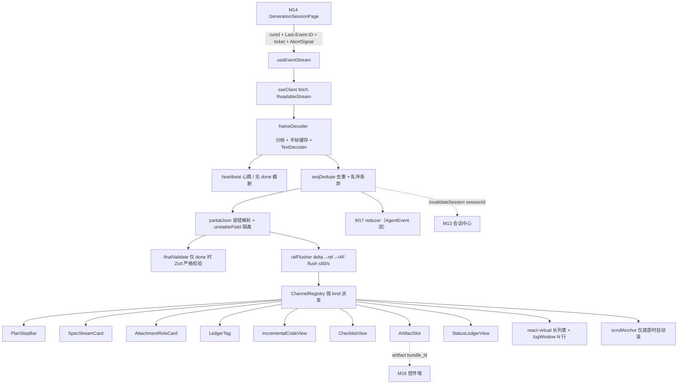
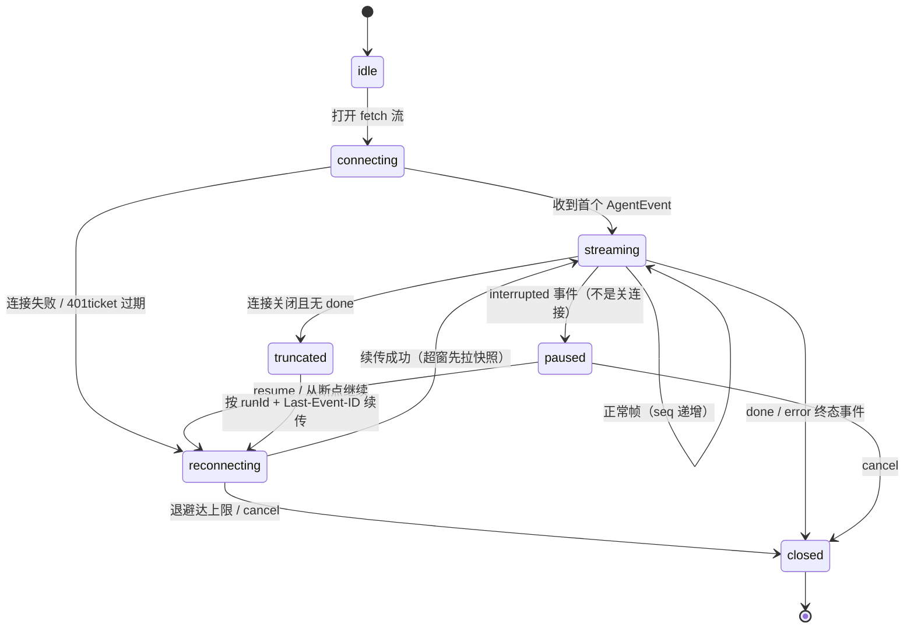

# M15 · 分通道流式渲染（原 W3）

> **文档类型**：可独立交付 / 可独立验收的模块设计文档（前端 · 流式渲染引擎）
> **来源章节**：`设计方案.md` v1.1 §6.4 流式交互设计全节（10 通道渲染策略表 + 10 条实现要点 + 六个亮点）、§6.8 前端技术栈（流式解析层 / Agent 事件层）、§4.5 实时事件协议、§6.6 实时流消费与状态管理、§6.7 体验与工程要点、§6.10 前端验收、§7.3 前后端职责划分、§8 总表 W3 行、§2.6 X12、§11.1/11.5（手写内核对照）
> **版本**：v1.0　|　**拆分日期**：2026-11-15　|　**最近修订**：2026-11-16（v1.3，ADR-001 同步）　|　**状态**：设计定稿
> **对应编号**：W3 / FR-15（分通道类型化 SSE、partial JSON 渐进渲染、增量代码 patch） / X12（流式事件协议与前端回放 · 分帧与通道渲染侧）
> **主责应用**：`apps/web`（React 19 + TypeScript + Vite 单页应用，SPA 静态部署 / CDN）
> **一句话定义**：把 SSE 字节流变成按 `kind` 派发的分通道类型化渲染，负责 `\n\n` 分帧与半帧缓存、UTF-8 流式解码、容错 partial-JSON 解析、增量代码 patch、rAF 节流、滚动锚定、重连续传与背压，是「不做 token 刷屏」这条产品判断的技术落地。

---

## 0. 模块速览（零基础可读）

### 0.1 项目在做什么（本模块所需的最小背景）

WidgetPilot 是一个「用自然语言生成手机桌面控件」的 AI Agent 产品：规格（`2x1`/`1x2`/`2x2`/`2x4`/`4x2`/`4x4`）为可选预填 + 缺省询问补全，系统不推断（v1.3 ADR-001 D-6）【v1.3 ADR-001】，用户输入描述、可传附件，系统生成 TSX + React 代码，经编译、隔离沙箱测试与安全校验后产出控件包，在网页上按真实比例渲染成卡片。**不生成 Lynx 代码、不打包、不装机、不接手机系统 API、不模拟真实设备**（§1.2、§1.7）。原文 §1.1 把「交互要让人看懂 Agent 在做什么」列为决定产品能否成立的三件事之一，并明确「流式输出若只是 token 刷屏，用户既无法纠偏也无法建立信任」。

### 0.2 端到端 14 步链路中本模块的位置

```
① 登录 → 新建会话（grid 可选预填）              （M13）
② 输入描述 + 上传附件 → attachment_id  （M14 输入区）
③ 语义层校验 → ④ 进 LLM 护栏 → ⑤ 意图与规格确定 → ⑥ 上下文装配
⑦ 生成回路：先出 WidgetSpec，再出 TSX + React 代码；模型分档   ← ★ 事件在这里产生
⑧ 出 LLM 护栏 → ⑨ 契约校验 → ⑩ 一次性沙箱                  ← ★ 事件在这里产生
⑪ 生成 WidgetBundle，状态 COMPLETED                        ← ★ artifact/done 事件
⑫ artifact 事件 → 控件墙按 grid 真实比例渲染受限 iframe 卡片  （M16）
⑬ 评测合格 → 脱敏 → 入库门禁 → 公共语料
⑭ 全流程按 seq 写 SSE 事件流与只追加审计；成本按档位分账      ← ★ 本模块消费这条 SSE 流
```

本模块不产生业务事件，也不执行生成/校验；它是**第 ⑦～⑭ 步与用户之间的「流翻译层」**：服务端按 `seq` 把全过程写成一条 SSE 流（M04 扇出），本模块把这条字节流分帧、解析、按 `kind` 派发给独立渲染组件，交给 M14 的七区域容器与 M17 的 reducer。用户看到的「规格在成形、代码在长、校验在发生」全部经由本模块。

### 0.3 为什么必须有这个模块

| # | 不可替代的理由 | 原文依据 |
|---|---|---|
| 1 | 「不做 token 刷屏」是产品判断，必须有按 `kind` 派发的分通道渲染引擎才能落地 | §6.4 开头、§1.1 |
| 2 | 结构化输出是**流式渐进**的：`WidgetSpec` 在传输中是未闭合 JSON，普通 `JSON.parse` 会崩，必须容错解析且只在 final 严格校验 | §6.4 要点 1、§11.5 |
| 3 | 长会话事件量大，必须 rAF 批处理、长列表虚拟化、日志窗口化与按 `seq` 去重，否则掉帧、内存膨胀 | §6.4 要点 3/10、§6.7、§8 W3 行「长会话无掉帧」 |
| 4 | SSE 会断线、会跨天恢复、会截断，必须自研分帧/半帧缓存/心跳/`Last-Event-ID` 续传 | §4.5 可靠性、§6.4 要点 5/8 |
| 5 | 中断不是关连接、未知 `kind` 要忽略，都是流层语义，必须有单一归属 | §4.5 中断语义 / 向前兼容、§6.4 要点 7/9 |

### 0.4 上下游邻居（mermaid）

```mermaid
flowchart LR
  M04["M04 账号会话编排 D1"] -->|SSE 字节流 seq/Last-Event-ID| M15["M15 分通道流式渲染 W3"]
  M14["M14 生成会话页 W2"] -->|连接参数 runId + Last-Event-ID + ticket + AbortSignal| M15
  M02["M02 前后端契约 W6"] -.events.schema.json / Zod / 枚举.-> M15
  M15 -->|AgentEvent 流| M17["M17 时间线回放/状态 W5"]
  M17 -->|SessionView| M14
  M15 -->|10 类通道渲染组件| M14
  M15 -->|artifact bundle_id| M16["M16 控件墙 W4"]
  M15 -.按 sessionId 触发精确失效.-> M13["M13 会话中心 W1"]
  M12["M12 前端工程化 W7"] -.MSW mock SSE / Vitest / Storybook.-> M15
  M11["M11 治理观测 D8"] -.采集首事件延迟/重连率.-> M15
```

- **上游**：M04（SSE 扇出、`seq` 生成、持久窗口、心跳）、M14（连接参数与 `AbortSignal`）、M02（事件 schema / Zod / 枚举）。
- **下游**：M17（`AgentEvent` 流 → `SessionView`）、M14（通道组件挂进中栏/时间线/链路账）、M16（`artifact` 交接）、M13（精确失效通知）。
- **横切**：M11 采集 SSE 首事件延迟、重连率、截断率；本模块是 X12 在「分帧与通道渲染」侧的承载。

### 0.5 原文对照表

| 本模块内容 | 原文章节 / 行 |
|---|---|
| 不做 token 刷屏、按 `kind` 派发独立渲染组件 | §6.4 开头 |
| 通道 → payload 形态 → 渲染策略表 | §6.4 通道表 |
| 10 条实现要点（partial JSON / 增量 patch / rAF / 滚动 / SSE 工程 / abort / 中断 / 恢复 / 向前兼容 / 背压） | §6.4「实现要点」1–10 |
| 六个可演示亮点中与流相关的（流式 spec 可纠偏、双轨热更新、时间线 scrubber、链路透明、状态可解释） | §6.4 六个亮点 |
| 流式解析层 / Agent 事件层选型与「不用 AI SDK」 | §6.8 |
| 实时事件协议 `AgentEvent` / `AgentEventKind`、分通道、可靠性、中断语义、向前兼容 | §4.5 |
| event-sourced reducer、seq 去重、回放 | §6.6 |
| rAF 批处理、日志窗口化、长列表虚拟化、iframe 不拖垮宿主 | §6.7 |
| 前端验收（只在 final 严格校验、长会话无掉帧、上滑不跳回） | §6.10、§8 W3 行 |
| 前后端职责划分「流式事件：前端主导分通道渲染、reducer、回放、背压」 | §7.3 |
| X12 流式事件协议与前端回放 | §2.6 X12 行、§8 X12 行 |
| 手写内核对照（partial.py / stream.py / final 严格校验） | §11.1、§11.2、§11.5 |

---

## ⚠ 跨模块接线待办（M05 → M15，实现本模块时必须接线）

> 来源：M05 功能完整性审查（2026-11-21）。M05 的 `attachment` 事件 payload
> 已按本模块 §6.4 契约补齐 `insight_ref` 字段——按此渲染，勿用旧 payload 假设。

| 接线点 | M05 实际产出（已实现） | 本模块必须做 |
|---|---|---|
| `attachment` payload | `{attachment_id, role, insight_ref, action}`（`action` ∈ UPLOAD/PATCH；`insight_ref` 带 `#sha256:`） | `AttachmentRoleCard` 按此字段渲染（§6.4 第 3 类）；**纠偏后同一 attachment_id 会有第二条 `action=PATCH` 事件**，须按 seq 覆盖而非追加卡片 |
| `notice` 澄清 payload | `{attachment_id, clarify_hint, role:null}` | 在输入区展示澄清提示（M06 也发 `notice`，靠 `attachment_id` 字段区分是附件歧义还是规格缺失） |
| 原文红线 | 事件只带 `insight_ref`，**永不带原文或 `object_key`** | 不在前端 artifact / 调试面板渲染 `att/*/original`；A10 红线 |

---

## 1. 模块定位与职责边界

### 1.1 为什么必须有

1. **把「不可信的字节流」变成「可断言的类型化事件」**：模型输出是唯一不可信变量（§11.3），SSE 上还叠加了半帧、乱序、截断、未知 `kind`、恶意超大帧。没有本模块，每个页面都要各自处理这些，必然重复且不一致。
2. **让「流式可纠偏」成立**：`spec` 通道的 partial JSON 骨架占位、`attachment` 通道的纠偏入口、`code` 通道的增量高亮，都是 Agent 产品特有交互（§6.4 亮点 1/2），依赖本模块的容错解析与按行 patch。
3. **性能与可靠性的单一归属**：rAF ≤ 60 次/秒、日志窗口化 N 行、按 `seq` 去重与乱序丢弃、`Last-Event-ID` 续传，收敛到一处才能验收（§8 W3 行「长会话无掉帧；上滑不跳回」）。
4. **零 Agent 框架约束下的自研替代**：D-5 / §11.1 明令不用 AI SDK / CopilotKit / AG-UI SDK，分帧、半帧缓存、delta 解析、seq 去重、心跳、重连与回放全部手写（§6.8 Agent 事件层）。

### 1.2 做什么（职责清单）

| # | 职责 | 说明 |
|---|---|---|
| R1 | SSE 分帧与半帧缓存 | 按 `\n\n` 分帧、缓存半帧、UTF-8 流式解码（`TextDecoder` 流式）、心跳识别（§6.4 要点 5） |
| R2 | 容错 partial-JSON 解析 | 补齐未闭合字符串与括号，逐 delta 解析；只在 `done` 严格 Zod 校验（§6.4 要点 1、§11.5） |
| R3 | 不稳定字段隔离 | 流式最后一个字符串字段视为不稳定，不触发任何副作用（路由 / 埋点 / 请求）（§6.4 要点 1） |
| R4 | 增量代码 patch | `{ from_line, to_line, text }` 按行区间更新 CodeMirror/Monaco；已完成块 memo 化，只重渲染末块（§6.4 要点 2） |
| R5 | rAF 批处理 | delta 先写 ref，按 `requestAnimationFrame` 批量 flush（最多 60 次/秒）（§6.4 要点 3） |
| R6 | 滚动锚定 | 仅当用户处于底部时自动滚到底；上滑回看不跳回（§6.4 要点 4） |
| R7 | 10 类通道派发 | 按 `kind` 派发给独立渲染组件，不构成 token 刷屏（§6.4 通道表） |
| R8 | 连接生命周期 | 心跳保活、显式 `done`/`error`（无 `done` 视为截断）、错误作为流事件、重连按 `runId + Last-Event-ID` 续传、超窗先拉快照（§4.5、§6.4 要点 5/8） |
| R9 | abort / 中断 / 恢复链路 | `AbortController.abort()` 中断 fetch；`POST /interrupt` 是独立 signal；`interrupted` 不关连接；跨天/月续传（§6.4 要点 6/7/8） |
| R10 | 向前兼容 | 派发器与对接的 reducer 对未知 `kind` 忽略而非报错（§4.5、§6.4 要点 9） |
| R11 | 背压 | 按 `seq` 去重与乱序丢弃、日志最多 N 行、大日志走对象存储引用（§6.4 要点 10） |
| R12 | 状态通知 | 消费到会改变 `SessionState` 的事件后按 `sessionId` 触发精确失效（§6.6、M13 集成约定） |

### 1.3 不做什么（明确排除，含与相邻前端模块的边界切割）

| 不做 | 这块归哪个 Mxx | 边界说明 |
|---|---|---|
| 业务 UI 布局：七区域（状态条 / 输入区 / 规格预览卡 / 时间线容器 / 中栏容器 / 右轨 / 链路账）、异常态、页面路由 | **M14（W2）** | 本模块只产出「可挂进容器的通道渲染组件」与 `AgentEvent` 流，不编排页面布局（§6.3） |
| reducer 状态语义：`AgentEvent[] → SessionView` 纯函数、`seq` 去重后的状态迁移、scrubber 回放语义、「从这里重生成」的 reducer 侧 | **M17（W5）** | 本模块**派发**事件、`seq` 层面去重与乱序丢弃，但 `SessionView` 的定义与状态语义归 M17（§6.6、§7.3「流式事件」共担事件 schema） |
| iframe 卡片网格、六种规格真实比例卡片、安装/删除/版本/回滚 | **M16（W4）** | 本模块的 `artifact` 通道只做「原子替换占位卡 + 触发 iframe 热更新」并交出 `bundle_id`（§6.4 通道表、§6.5） |
| 会话列表、状态筛选、跨天恢复入口列表 | **M13（W1）** | 本模块只触发按 `sessionId` 精确失效通知 |
| 附件类型嗅探、role 判定、多模态处理 | **M05（D2）** | 本模块 `attachment` 通道只渲染「role 卡片 + 纠偏入口」，纠偏提交与合法性归 M05/M06/M14 |
| 规格可行性、意图白名单、护栏、能力放行、门禁裁决 | **M06 / M08 / M09** | 前端不做鉴权判定，策略隔离门禁统一服务端裁决（§7.3、§6.9） |
| 契约生成 / OpenAPI / Zod schema 的 CI 一致性 | **M02（W6）** | 本模块消费 `events.schema.json` 与 Zod schema，不定义权威 schema |
| 测试底座 / a11y / 性能预算工具链 | **M12（W7）** | 本模块使用底座提测 |

> **与 M17 的边界最易混淆**：`seq` 去重、乱序丢弃发生在**两个层次**——本模块在「入队/派发层」按 `seq` 去重与丢弃（背压，§6.4 要点 10），M17 在「reducer 层」把 SSE 事件与 REST 快照通过 `seq` 合并、幂等去重（§6.6）。本模块不定义 `SessionView` 的任何字段，也不实现 reducer 纯函数；「向前兼容忽略未知 kind」在两层都要成立（§6.4 要点 9、§4.5）。

### 1.4 输入 / 输出与上下游契约

| 方向 | 内容 | 契约形式 |
|---|---|---|
| 入 | SSE 字节流（`text/event-stream`，帧含 `id: {seq}` / `event: {kind}` / `data: {json}` / 心跳注释帧） | `GET /api/sessions/{id}/events`（§4.1） |
| 入 | 连接参数 `runId`、`Last-Event-ID`、`ticket`、`AbortSignal` | M14 传入 |
| 入 | `events.schema.json` / Zod schema / `AgentEventKind` 枚举 | M02 生成物 |
| 出 | 收敛后的 `AgentEvent` 流（按 `seq` 有序、去重、去未知 kind 副作用） | 交给 M17 reducer |
| 出 | 10 类通道渲染组件（`React.ReactNode`） | 挂进 M14 中栏 / 时间线 / 链路账 |
| 出 | `artifact.bundle_id` → M16；`invalidateSession(sessionId)` → M13 | 应用内事件 |
| 出 | 精确失效通知、首事件延迟 / 重连率 / 截断率埋点 | M11 / M12 采集 |

### 1.5 承载的横切能力 X*

- **X12（分帧与通道渲染侧承载）**：流式事件协议与前端回放。本模块负责分通道类型化 SSE 的**接收侧**：分帧、半帧缓存、partial JSON、增量 patch、rAF 节流、seq 去重与乱序丢弃、`Last-Event-ID` 续传、心跳、未知 `kind` 忽略（§2.6 X12 落在 W3/W5，§8 X12 行「分通道 SSE / seq / Last-Event-ID / 未知 kind 忽略 / 按 seq 去重与乱序丢弃」）。X12 的另外两侧：**reducer 纯函数与 seq 回放**归 M17，**页面组装与纠偏交互**归 M14。
- **X1（协同）**：跨天/月按 `runId + seq` 重连续传的前端实现（§6.4 要点 8、§11.4 第 6 步）；checkpoint / 租约归 M04/M03。
- **X11（协同）**：产生 SSE 首事件延迟、重连率、截断率埋点，供 M11 完整重放。

### 1.6 关键设计原则

1. **策略、隔离、门禁统一在服务端裁决；前端负责事件消费、可回放状态、纠偏交互与可审计的操作入口**（原文 §7.3 末行）。落到本模块：本模块只消费与渲染事件，不判定事件是否「合法生成结果」，不重判能力/规格/护栏；`artifact` 的 iframe 放行由 M09 `WidgetRuntime` 决定。
2. **不做 token 刷屏**：按 `kind` 派发给独立渲染组件（§6.4 通道表），不把 delta 拼成一大段文本打字机。
3. **只在 `done` 时严格校验**：流式中的最后一个字符串字段视为不稳定，不触发任何副作用（路由 / 埋点 / 请求）（§6.4 要点 1、§11.5）。
4. **错误作为流事件，不是静默断连**；无 `done` 视为截断（§6.4 要点 5）。
5. **中断不是关连接**：`POST /interrupt` 是独立 signal，UI 切「已暂停 · 从 XX 继续」并保留部分产物（§6.4 要点 7、§4.5）。
6. **向前兼容**：对未知 `kind` 忽略而非报错（§4.5、§6.4 要点 9）。
7. **可逆才乐观**：本模块不做任何不可逆乐观更新；delta 先写 ref 再 rAF flush 是渲染缓冲，不是业务乐观（§6.6）。

---

## 2. 技术栈

### 2.1 分层选型表（逐层写选型 + 为什么 + 明确不用什么）

| 层 | 选型 | 版本 / 约束 | 为什么选 | 明确不用什么 |
|---|---|---|---|---|
| 框架 | React 19 + TypeScript + Vite（SPA） | 按路由代码分割（§6.7） | 通道组件用 `React.memo` 隔离重渲染 | 不用服务端渲染做流式 |
| 服务端状态 | TanStack Query（按 `sessionId` 精确失效） | 本模块只触发 `invalidateQueries`（§6.6、§6.8） | 状态标签/快照刷新单一入口 | 不把事件流塞进服务端状态库 |
| 事件状态 | 自研 event-sourced reducer（`AgentEvent[] → SessionView`，**归 M17**）+ Zustand（本地 UI 态归 M14） | 本模块只产出 `AgentEvent` 流与派发（§6.6、§6.8） | 纯函数可回放可单测 | 不在本模块定义 `SessionView` 或实现 reducer 语义 |
| UI | Tailwind CSS + shadcn/ui（Radix） | 暗色主题 / WCAG 2.1 AA（§6.7、§6.8） | 通道组件可访问性一致 | 不用不可访问的自绘列表 |
| 代码展示 | CodeMirror 6 / Monaco | 行级增量 patch、TSX 语法高亮（§6.4 要点 2、§6.8） | 按行区间更新文档而非全文重绘 | 不用 `<pre>` 全文替换；不用 `dangerouslySetInnerHTML` 渲染代码 |
| 流式解析 | **原生 `fetch ReadableStream` + 自研 `\n\n` 分帧/半帧缓存 + `TextDecoder` UTF-8 流式解码 + 容错 partial-JSON 解析器 + Zod（仅 final 严格校验）** | 不自己写正则解析 JSON（§6.8） | 补齐未闭合字符串与括号后交给原生 `JSON.parse`；只在 `done` 用 Zod 严格校验 | **不用 AI SDK / CopilotKit / AG-UI SDK / A2UI SDK**；**不用正则硬解 JSON**；不用 `JSON.parse` 直接解半帧 |
| 流式节流 | `requestAnimationFrame` 批量 flush（最多 60 次/秒）+ ref 缓冲 | delta 先写 ref（§6.4 要点 3） | 长会话不掉帧 | 不用每个 delta 一次 `setState` |
| Agent 事件层 | 原生 `EventSource` / `fetch` + 自研 event-sourced reducer 派发 | 分通道派发、seq 去重、心跳、重连与回放全部手写（§6.8） | 无黑盒，每步可断言 | **不用 AI SDK / CopilotKit / AG-UI SDK**；Vercel AI SDK `streamUI`、LangChain/LangGraph、Temporal、MCP SDK |
| 控件渲染 | iframe `sandbox` + CSP + `postMessage` bridge | 本模块只触发热更新，渲染约束由 M09 `WidgetRuntime` 下发（§6.8、§4.3.3） | 与宿主隔离 | 本模块不自建 iframe / 不实现卡片网格（M16） |
| 图表 | Recharts / ECharts | 本模块**不涉及**（链路账小图归 M14） | 按路由代码分割隔离 | 不引入图表库进本模块 chunk |
| 列表 | `@tanstack/react-virtual` + 日志窗口化 N 行 | 长事件序列 / 日志（§6.8、§6.4 要点 3/10） | 万级事件 DOM 节点恒定 | 不一次性渲染全部事件 |
| 契约 | OpenAPI 3.1 → `openapi-typescript`；事件与协议用 Zod；枚举共享包 | 单一事实来源（§6.8、§6.9） | `AgentEvent` / `WidgetSpec` 类型前后端一致 | 不手写与后端不一致的事件类型 |
| 测试 | Vitest + Testing Library + **MSW（mock SSE/API）** + Playwright + Storybook | 事件序列回放测试是重点（§6.8） | 可注入半帧 / 乱序 / 未知 kind 字节流 | 不用真实 SSE 服务才能验收 |
| 质量 | Biome / ESLint、axe、Sentry、Lighthouse CI | a11y AA、性能预算（§6.8） | rAF / 长会话性能有门禁 | 不跳过 axe 严重项 |

> **零 Agent 框架硬约束（D-5 / §6.8 / §11.1）**：本模块**不使用** Vercel AI SDK、`streamUI`、CopilotKit、AG-UI SDK、A2UI SDK、LangChain/LangGraph、Temporal、MCP SDK、任何 LLM 专用观测 SDK。`fetch ReadableStream`、`TextDecoder`、`EventSource`、`requestAnimationFrame`、Zod 是通用浏览器/库能力，允许且正是手写替代的基座（§11.1「保留的通用基础设施」）。

### 2.2 运行时依赖

| 依赖 | 用途 | 不可用 / 降级时的行为 |
|---|---|---|
| SSE 网关（M04） | `GET /api/sessions/{id}/events`，`seq` / `Last-Event-ID` / 心跳 / `X-Accel-Buffering: no` | 断流 → 按退避重连；无 `done` 视为截断；超窗先 `GET /api/sessions/{id}` 拉快照 |
| BFF（可选，M02） | JWT → 短期 SSE ticket、统一错误映射 | 直连 control-plane 亦可；**BFF 不做鉴权判定**（§6.9） |
| `packages/contracts`（M02） | `events.schema.json` / Zod / `AgentEventKind` | CI 校验不一致即构建失败；运行时对未知 `kind` 忽略 |
| 对象存储引用（M08/M11） | 大日志 `log_ref` / `snapshot_ref` | 窗口化日志只保留 N 行，超窗按需拉引用，不常驻内存 |
| M12 质量底座 | MSW mock SSE / Vitest / Storybook / fake clock / Lighthouse | 验收期以桩替代 |
| CDN / 静态托管 | 本模块与 CodeMirror 独立 chunk | chunk 失败 → 通道降级为纯文本 + 重试 |

### 2.3 `apps/web` 代码落位

```
apps/web/
  src/
    features/stream/
      transport/
        sseClient.ts               # fetch ReadableStream + AbortController + ticket
        frameDecoder.ts            # \n\n 分帧 + 半帧缓存 + TextDecoder 流式解码
        heartbeat.ts               # 心跳注释帧 / 无 done 截断判定
        reconnect.ts               # Last-Event-ID + runId 续传、退避上限、超窗快照
      parse/
        partialJson.ts             # 容错 partial-JSON：补齐未闭合字符串与括号
        finalValidate.ts           # 只在 done 用 Zod 严格校验 WidgetSpec
        unstableField.ts           # 标记最后一个字符串字段为不稳定，禁止副作用
      render/
        ChannelRegistry.tsx        # kind → 独立渲染组件注册表
        PlanStepBar.tsx            # plan 折叠步骤条
        SpecStreamCard.tsx         # spec 骨架占位
        AttachmentRoleCard.tsx     # attachment role 卡 + 纠偏入口
        LedgerTag.tsx              # skill/routing 小标签
        IncrementalCodeView.tsx    # code 增量 patch（CodeMirror/Monaco）
        ChecklistView.tsx          # guard/validation/sandbox 分步清单
        ArtifactSlot.tsx           # artifact 原子替换 + 触发 iframe 热更新
        StatusLedgerView.tsx       # cost/checkpoint/interrupted/notice/error/done 状态与账目
      pipeline/
        rafFlusher.ts              # delta 先写 ref，rAF 批量 flush（≤60 次/秒）
        seqDedupe.ts               # 按 seq 去重与乱序丢弃
        logWindow.ts               # 日志窗口化 N 行 + 大日志对象存储引用
        scrollAnchor.ts            # 仅底部时自动滚
      hooks/
        useEventStream.ts          # 组装 transport→parse→render→pipeline
        useChannelRenderer.ts      # 按 kind 取渲染组件
      types/
        streamView.ts              # 连接态 / 分帧器状态 / CodeDoc / PartialJsonState
    lib/apiClient.ts               # 统一响应 / 错误映射
```

> 组件名 / 文件名 / 函数签名均为【推导·需评审】：原文只给出「分帧/半帧缓存、容错 partial-JSON 解析器、增量 patch、rAF 批处理、10 类通道」的方向，未给具体命名。

---

## 3. 设计架构

### 3.1 组件树与职责表



| 组件 | 职责 | 关键不变量 |
|---|---|---|
| `sseClient` | 发起 `fetch` 流、持有 `AbortController`、带 ticket | 断流不静默，`error` 作为流事件 |
| `frameDecoder` | `\n\n` 分帧、半帧缓存、UTF-8 流式解码 | 多字节字符跨帧不被截断；半帧缓存有上限 |
| `heartbeat` | 识别 `: keepalive\n\n`、判定无 `done` 截断 | 心跳不进业务事件；无 `done` 的断连一律截断 |
| `seqDedupe` | 按 `seq` 去重与乱序丢弃（入队层背压） | `seq` 单调、无重复、无倒序 |
| `partialJson` | 补齐未闭合字符串与括号，逐 delta 解析 | **不自己写正则解析 JSON**；补齐后交原生 `JSON.parse` |
| `unstableField` | 标记最后一个字符串字段不稳定 | 不稳定字段 0 副作用（路由/埋点/请求） |
| `finalValidate` | 只在 `done` 用 Zod 严格校验 `WidgetSpec` | 流中绝不严格校验、绝不回灌修复 |
| `rafFlusher` | delta 先写 ref，rAF 批量 flush | ≤ 60 次/秒；不每个 delta 一次 setState |
| `IncrementalCodeView` | `{ from_line, to_line, text }` 按行区间更新文档 | 已完成块 memo 化，只重渲染末块 |
| `ArtifactSlot` | 原子替换占位卡、触发 iframe 热更新 | `artifact` 到达才替换，编译未通过保持骨架 |
| `ChannelRegistry` | 18 种 `kind`（v1.3）→ 独立渲染组件 | 未知 `kind` 忽略而非报错 |
| `logWindow` / `react-virtual` | 日志窗口化 N 行、长列表虚拟化 | 大日志走对象存储引用 |
| `scrollAnchor` | 仅底部时自动滚 | 上滑回看不跳回 |

### 3.2 渲染数据流（编号步骤）

1. M14 传入 `{ runId, lastEventId, ticket, signal }`，`useEventStream` 用原生 `fetch` 打开 `GET /api/sessions/{id}/events`（请求头带 `Last-Event-ID` / `ticket`，响应要求 `X-Accel-Buffering: no`）。
2. 读取 `response.body.getReader()`，每块 `Uint8Array` 交给 `TextDecoder('utf-8', { stream: true })` 做**流式解码**（多字节字符跨帧不丢）。
3. `frameDecoder` 按 `\n\n` 切帧；末尾不足一帧的字节进**半帧缓存**（有上限），与下一块拼接；每帧解析 `id`（`seq`）、`event`（`kind`）、`data`（JSON）。
4. 心跳帧（`: keepalive`）只续活，不进业务事件；`done` / `error` 帧标志终态；连接在无 `done` 的情况下关闭 → 判定**截断**并触发重连。
5. 每帧反序列化成 `AgentEvent { seq, sessionId, runId, ts, kind, phase, payload, traceId }`（§4.5）；`seqDedupe` 按 `seq` 去重、丢弃乱序（小于已见最大 `seq` 的帧）。
6. **两条支路**：
   - 支路 A：完整 `AgentEvent` 流交给 **M17 reducer**（`AgentEvent[] → SessionView`），并触发 `invalidateSession(sessionId)`（M13 精确失效）。本模块不定义 `SessionView`、不实现状态语义。
   - 支路 B：`payload` 按 `kind` 进 `ChannelRegistry` → 独立渲染组件。
7. `spec` 通道：`payload` 是逐步逼近 `WidgetSpec` 的 partial JSON → `partialJson.feed(delta)` 补齐未闭合字符串与括号 → `JSON.parse` 得到 `Partial<WidgetSpec>` → `SpecStreamCard` 骨架占位、字段边到边填；**最后一个字符串字段标不稳定，不触发任何副作用**；只在 `done` 用 Zod 严格校验。
8. `code` 通道：`{ from_line, to_line, text }` → `IncrementalCodeView.applyPatch` 按行区间更新 CodeMirror/Monaco 文档；已完成块 `React.memo`，只重渲染末块。
9. 所有 delta 先写 `ref`，`rafFlusher` 按 `requestAnimationFrame` 批量 flush（≤ 60 次/秒）；长事件列表用 `@tanstack/react-virtual`，日志 `logWindow` 最多 N 行，大日志换 `log_ref` 引用。
10. `scrollAnchor` 仅在 `autoScrollPinned=true`（用户处于底部）时自动滚到底；用户上滑则解除锚定，不跳回。
11. `artifact` 通道：`ArtifactSlot` 原子替换占位卡 → 触发 M14 右轨受限 iframe 热更新 → `bundle_id` 交 M16。
12. `interrupted` / `error` / `done` / `cost` / `checkpoint` / `notice` 进 `StatusLedgerView`，更新状态条与链路账；`error` 作为流事件渲染，**不是静默断连**。

### 3.3 状态机（连接态、`SessionView` 状态、分帧器状态）

本模块**拥有** SSE 连接态与分帧器状态；`SessionView` 与 `SessionState` 由 M04/M17 拥有，本模块只读声明。



| 状态 | 类型（TS，见 §5.1） | 归属 | 说明 |
|---|---|---|---|
| `SSEConnectionState` | `idle/connecting/streaming/reconnecting/paused/truncated/closed` | **本模块拥有** | 连接态 |
| `FrameDecoderState` | 半帧缓存 / 已见最大 `seq` / 心跳计时 | **本模块拥有** | 分帧器状态 |
| `SessionView` | reducer 输出 | **M17 拥有** | 本模块只产出 `AgentEvent` 流 |
| `SessionState` 8 态 | 前后端共用枚举 | M04 拥有 | 事件 `phase` 只读 |
| `BundleState` | `GENERATED/INSTALLED/DELETED` | M09 拥有 | `artifact` 交接 |
| 五类 UI 态 | 加载/空态/错误/无权限/已归档 | M14 拥有 | 本模块通道组件局部错误态 |
| rAF flush 态 | `pending ref` / `scheduled` / `flushed` | 本模块拥有 | ≤ 60 次/秒 |

### 3.4 关键机制与不变量清单 —— §6.4「实现要点」10 条逐条覆盖

> 以下 ①–⑩ 与 `设计方案.md` §6.4「实现要点」1–10 **一一对应，逐条落地**，编号与原文结论不改写。

**① partial JSON 容错解析器（补齐未闭合字符串与括号）逐 delta 解析；只在 `done` 时严格 Zod 校验；流式最后一个字符串字段视为不稳定、不触发任何副作用（路由/埋点/请求）**
- 实现：`partialJson.feed(delta)` 用**字符状态机**扫描（记录 `inString`、`escaped`、`{`/`[` 栈），在末尾补齐未闭合的 `"` 与 `}`/`]`，再调用原生 `JSON.parse` 得到 `Partial<WidgetSpec>`；**不自己写正则解析 JSON**（§6.8）。
- 只在收到 `done`（或该 `spec` 段的终帧）时调用 `finalValidate(WidgetSpecZod)` 严格校验；流中不校验、不回灌修复（§11.5「只在 final 用 Pydantic/JSON Schema 严格校验」）。
- `unstableField` 把「当前解析结果里最后一个字符串类型字段」标记为不稳定：其值可能是被截断的一半，**禁止**用于路由跳转、埋点上报、发起请求、触发纠偏默认项等任何副作用；只用于骨架占位展示。
- 不变量：`feed()` 任意前缀都不抛异常；Zod 严格校验调用次数 = 每段 `spec` 的 `done` 次数；不稳定字段副作用计数恒为 0。

**② 增量代码 patch `{ from_line, to_line, text }` 按行区间更新 CodeMirror/Monaco；已完成块 memo 化只重渲染仍在增长的末块**
- 实现：`applyCodePatch(doc, { from_line, to_line, text })` 调编辑器 `dispatch({ changes: { from, to, insert } })`，只替换行区间；`CodeBlock[]` 中已完成的块用 `React.memo` + 稳定 key，末块单独渲染。
- 不变量：一次 patch 只产生 1 次文档变更事务；已完成块的重渲染次数 = 0；绝不 `setValue` 全文重绘。

**③ delta 先写 ref，按 `requestAnimationFrame` 批量 flush（最多 60 次/秒）；长列表虚拟化、日志窗口化**
- 实现：delta 写入 `useRef` 缓冲，`rafFlusher` 在每帧 `requestAnimationFrame` 回调里一次性 `setState`；同一帧内多个 delta 合并；长事件/时间线用 `@tanstack/react-virtual`，日志 `logWindow` 保留最近 N 行。
- 不变量：flush 频率 ≤ 60 次/秒；单个 delta 不触发独立 `setState`；可视区外节点不挂载。

**④ 滚动锚定：仅当用户在底部时自动滚；用户上滑回看时不跳回**
- 实现：`scrollAnchor` 监听 `scrollTop + clientHeight >= scrollHeight - threshold` 维护 `autoScrollPinned`；仅 `true` 时 `flush` 后 `scrollTo(scrollHeight)`；用户上滑立即置 `false`。
- 不变量：上滑后新事件到达，`scrollTop` 不变；底部时新事件到达，`scrollTop` 增大到底。

**⑤ SSE 工程细节：按 `\n\n` 分帧并缓存半帧、UTF-8 流式解码、心跳、显式 `done`/`error`（无 `done` 视为截断）、`X-Accel-Buffering: no`、错误作为流事件**
- 实现：`TextDecoder('utf-8', { stream: true })` 跨块解码；`\n\n` 切帧、半帧缓存（有上限）；`: keepalive` 心跳只续活；连接关闭且未见 `done` → `truncated` → 重连；服务端响应头要求 `X-Accel-Buffering: no`（禁缓冲）；`error` 是 `AgentEvent { kind:"error" }` 流事件并带 `code + evidenceRef`，**不是静默断连**。
- 不变量：UTF-8 多字节字符跨帧零损坏；半帧缓存不无限增长；无 `done` 的断连 100% 判为截断；错误帧不导致连接被当作「正常结束」。

**⑥ abort 链路：点「停止」→ `AbortController.abort()` → fetch 中断 → 服务端取消上游模型调用 → 账单同步停止；同时服务端写 checkpoint 并推 `interrupted`**
- 实现：`useGenerationSignals.stop(controller)` 调 `controller.abort()`，`sseClient` 的 `signal` 使 fetch 中断；本模块不重试被主动 abort 的连接（区别于网络断连）；服务端负责取消上游模型、账单同步停止、写 checkpoint、推 `interrupted`。
- 不变量：主动 `abort()` 不触发自动重连；`interrupted` 帧到达后连接态切 `paused` 而非 `closed`。

**⑦ 中断不是关连接：`POST /interrupt` 是独立 signal；UI 收到 `interrupted` 后切「已暂停 · 从 XX 继续」，保留已生成的部分代码与规格卡**
- 实现：本模块把 `interrupted` 派发给 `StatusLedgerView`，并把连接态切 `paused`（保留流上下文、`lastSeq`、`checkpoint_rev`），**不销毁**已解析的 `specDraft` / `codeBlocks`；`POST /interrupt` 由 M14 独立发出，本模块不把「浏览器断流」等同于「业务中断」。
- 不变量：`paused` 态下 `SessionView` 的部分产物不清空；`resume` 时从 `lastSeq` 续传而非从头重放。

**⑧ 跨天/月恢复：重新打开 App → 拉会话快照 → 用 `runId + Last-Event-ID` 重连续传；超窗先拉快照再续流；恢复后 reducer 重放历史事件，界面与离开前一致**
- 实现：`reconnect` 读 `runId` + `Last-Event-ID`（= `Session.last_seq`）；服务端保留最近 N 条（§4.5），超窗时先 `GET /api/sessions/{id}` 拉 `SessionSnapshot` 再续流；`AgentEvent` 流交给 M17 reducer 重放。
- 不变量：续传首帧 `seq = last_seq + 1`（或超窗后快照 `last_seq + 1`）；`seq` 无缺口、无重复、无倒序；新旧混合事件序列可重放。

**⑨ 向前兼容：reducer 对未知 `kind` 忽略而非报错；回放测试覆盖新旧混合事件序列**
- 实现：`ChannelRegistry` 对未注册的 `kind` 返回 `null`（忽略、不抛异常），并把该 `AgentEvent` 原样交给 M17 reducer（M17 同样忽略未知 `kind`，§4.5）；回放测试用「旧序列 + 新 `future_kind`」混合断言。
- 不变量：未知 `kind` 不产生渲染节点、不抛异常、不阻断后续帧；新旧混合重放结果与旧序列一致。

**⑩ 背压：SSE 事件入队按 `seq` 去重与乱序丢弃；日志最多保留 N 行；大日志走对象存储引用**
- 实现：`seqDedupe` 维护 `maxSeenSeq`，丢弃 `seq <= maxSeenSeq` 的重复/乱序帧；`logWindow` 环形保留 N 行；超出窗口的日志以 `log_ref` / `snapshot_ref`（对象存储 key，基线 §9）按需拉取，不常驻内存；`rafFlusher` 合并同帧 delta。
- 不变量：派发序列 `seq` 严格递增；内存中的日志行数 ≤ N；大日志不进前端状态。

| 不变量 | 断言方式 |
|---|---|
| I1 `feed()` 任意前缀不抛异常、只在 `done` 严格 Zod 校验 | 单元测试全前缀 + Zod 调用次数 |
| I2 不稳定字段副作用计数 = 0 | 埋点/请求 spy 计数 |
| I3 一次 code patch = 1 次文档变更、已完成块重渲染 = 0 | 编辑器事务 + `memo` 命中计数 |
| I4 flush ≤ 60 次/秒、单 delta 不独立 setState | fake clock + rAF spy |
| I5 上滑后 `scrollTop` 不变 | 滚动位置断言 |
| I6 UTF-8 跨帧零损坏、无 `done` 必判截断、半帧缓存有上限 | 字节序列回放 |
| I7 主动 abort 不重连、`interrupted` → `paused` 保产物 | 重连 spy + 产物快照 |
| I8 续传 `seq` 连续、超窗先快照、混合序列可重放 | 事件序列断言 |
| I9 未知 `kind` 忽略不报错 | 混合序列回放 |
| I10 派发 `seq` 严格递增、日志 ≤ N 行 | 背压序列断言 |

**10 类通道渲染策略表**（原文 §6.4 表按 8 行分组；此处细分为可独立派发的 10 类渲染组件，覆盖全部 18 种 `AgentEventKind`（v1.3 新增 `ask_user`），分组结论不改写）：

| # | 通道（`kind`） | 独立渲染组件 | 渲染策略（原文 §6.4） |
|---|---|---|---|
| 1 | `plan` | `PlanStepBar` | 结论式短句（不是思维链）→ **折叠的步骤条，默认收起** |
| 2 | `spec` | `SpecStreamCard` | 逐步逼近完整的 `WidgetSpec` JSON → **partial JSON 容错解析 + 骨架占位**，字段边到边填规格预览卡 |
| 3 | `attachment` | `AttachmentRoleCard` | `role` 判定 + `insight_ref` → 附件卡片标出用途，**提供纠偏入口** |
| 4 | `skill` / `routing` | `LedgerTag` | 规程 id、模型档位、阈值命中 → **链路账里的小标签，不打断主视野** |
| 5 | `code` | `IncrementalCodeView` | 行级增量 patch → **只更新变化的块，不全文重绘** |
| 6 | `guard` | `GuardChecklist` | 通过项、命中项、失败原因码 → **分步清单，失败项可展开证据** |
| 7 | `validation` | `ValidationChecklist` | 契约/校验结果 → 分步清单，失败可展开证据 |
| 8 | `sandbox` | `SandboxChecklist` | 沙箱用例/日志/快照 → 分步清单 + 证据引用（`log_ref`/`snapshot_ref`） |
| 9 | `artifact` | `ArtifactSlot` | `bundle_id` + 预览引用 → **原子替换占位卡，触发 iframe 热更新** |
| 10 | `run` / `cost` / `checkpoint` / `interrupted` / `notice` / `error` / `done` / `ask_user` | `StatusLedgerView` | 状态与账目 → **状态条与链路账更新**；`interrupted` 切「已暂停 · 从 XX 继续」；`error` 作为流事件；`ask_user`（v1.3 ADR-001 D-7）渲染**澄清问题卡**，用户回答经 M14 `POST /clarifications` 提交 |

### 3.5 与后端时序（关键 3 个场景）

**场景 1：正常流式生成**
`M14 POST /messages(202) → M04 按 seq 扇出 run/plan/spec/attachment/routing/code/guard/validation/sandbox/cost/artifact/done → M15 分帧→去重→按 kind 派发→M17 reducer→M14 七区域 + M13 精确失效`。

**场景 2：断线重连（要点 5/8）**
`网络抖动断流且无 done → M15 判 truncated → 带 runId + Last-Event-ID 重连 → 服务端补发（超窗先 GET 快照）→ seq 连续补齐 → M17 重放`。

**场景 3：停止后跨月恢复（要点 6/7/8）**
`点停止 → AbortController.abort() 断 fetch + M14 独立 POST /interrupt → 服务端 checkpoint + interrupted → M15 切 paused、保留部分产物 → [跨月，无计算资源] → 重开 App → GET 快照 → runId + Last-Event-ID 续传 → M17 重放 → 界面一致`。

### 3.6 部署形态与伸缩

| 项 | 形态 | 说明 |
|---|---|---|
| 应用 | React SPA 静态构建，CDN / 静态托管 | `web` 无状态（§7.1） |
| 代码分割 | 按路由 `React.lazy`；CodeMirror/Monaco 独立 chunk | 首屏不加载编辑器（§6.7） |
| 长连接 | 每会话一条 SSE（`fetch ReadableStream`） | 服务端禁用缓冲 `X-Accel-Buffering: no`；中断走独立 POST signal（§3.3） |
| iframe 与主线程隔离 | `artifact` 触发的 iframe 渲染在独立上下文 | 卡片并发不阻塞输入；`widget:error` 不拖垮宿主（§6.7） |
| 伸缩 | 前端无状态，连接数由 SSE 网关（M04）承担 | 本模块不持有跨会话状态 |

---

## 4. 接口契约

### 4.1 本模块消费的 REST 接口表

统一响应（原文 §4.4 / §6.9）：`{ code, message, traceId, retryable, evidenceRef?, data? }`，`code` 与 `ReasonCode` 对齐；`data` 为【契约约定】补充，最终以 `packages/contracts/openapi.yaml` 为准。

| 方法 | 路径 | 权限 | 请求 | 成功响应 | 状态码 |
|---|---|---|---|---|---|
| `GET` | `/api/sessions/{id}/events` | 本人 + 短期 SSE ticket | Header/Query: `runId`, `Last-Event-ID`, `ticket`；响应头 `Content-Type: text/event-stream`、`Cache-Control: no-cache`、**`X-Accel-Buffering: no`** | `text/event-stream` 字节流（帧格式见 §4.2） | `200`/`401`/`403` |
| `GET` | `/api/sessions/{id}` | 本人 | Path `id` | `{ session, last_seq, bundle_refs[], run_id }`（超窗重连先拉此快照） | `200`/`401`/`403`/`404` |
| `POST` | `/api/sessions/{id}/interrupt` | 本人 | `{}`（独立 POST signal，由 M14 发出，本模块感知 `interrupted` 帧） | `{ state:"PAUSED", checkpoint_rev, last_seq }` | `202`/`409` |
| `POST` | `/api/sessions/{id}/resume` | 本人 | `{ runId?: string }`（由 M14 发出） | `{ state:"RUNNING", runId }` | `202`/`409` |
| `POST` | `/api/sessions/{id}/cancel` | 本人 | `{}`（由 M14 发出） | `{ state:"CANCELLED" }` | `202`/`409` |
| `GET` | `/api/bundles/{id}/preview` | 本人 | Path `id`（由 M14 消费，本模块只交 `bundle_id`） | `{ compiled_ref, srcdoc_ref, csp, sandbox, capability_bridge, limits }`【契约约定】 | `200`/`403`/`404` |

**SSE 帧格式约定**【契约约定，原文 §4.5 给出 `seq`/`kind`/`Last-Event-ID`/`done`/`error` 语义，帧文本为细化】：
```
id: 17
event: spec
data: {"seq":17,"sessionId":"s-1","runId":"r-7","ts":"...","kind":"spec","phase":"RUNNING","payload":{...},"traceId":"t-1"}

: keepalive

```
每帧以 `\n\n` 结束；`data` 为完整 `AgentEvent` JSON；心跳为注释帧；`done` / `error` 为显式终态 `event`；服务端保留最近 N 条供 `Last-Event-ID` 续传，超窗先拉快照。

### 4.2 消费 / 派发的 SSE 事件接口（`kind` 与 payload 形态）

本模块**消费**全部 18 种 `AgentEventKind`（原文 §4.5 定稿 17 种，v1.3 ADR-001 D-7 新增 `ask_user`），按 `kind` 收窄 `payload` 并派发；**不产生** `AgentEvent`（`seq` 由 M04 生成）。下表逐条给出 payload 形态与派发目标（§3.4 的 10 类通道）：

| `kind` | payload 形态（原文 §4.5 / §6.4） | 派发到 |
|---|---|---|
| `run` | `{ runId, phase, grid, attempt_no }` | `StatusLedgerView`（第 10 类）+ M13 精确失效 |
| `plan` | `{ steps: string[] }`（结论式短句） | `PlanStepBar`（第 1 类） |
| `spec` | partial `WidgetSpec` JSON 增量 | `SpecStreamCard`（第 2 类）→ `partialJson` / `finalValidate` |
| `attachment` | `{ attachment_id, role: AttachmentRole, insight_ref }` | `AttachmentRoleCard`（第 3 类） |
| `skill` | `{ recipe_id, recipe_version }` | `LedgerTag`（第 4 类） |
| `routing` | `{ model_tier: ModelTier, threshold_hit }` | `LedgerTag`（第 4 类） |
| `code` | `{ from_line: number, to_line: number, text: string }` | `IncrementalCodeView`（第 5 类）→ `applyCodePatch` |
| `guard` | `{ passed: boolean, hits: { type, criterion, source_ref }[] }` | `GuardChecklist`（第 6 类） |
| `validation` | `{ passed: boolean, items: { name, passed, detail_ref }[] }` | `ValidationChecklist`（第 7 类） |
| `sandbox` | `{ passed: boolean, cases: { name, passed, detail_ref }[], log_ref, snapshot_ref? }` | `SandboxChecklist`（第 8 类）→ `logWindow` |
| `artifact` | `{ bundle_id, preview_ref }` | `ArtifactSlot`（第 9 类）→ 交 M16 |
| `cost` | `{ token_in, token_out, sandbox_minutes, total, model_tier }` | `StatusLedgerView`（第 10 类） |
| `checkpoint` | `{ rev, node, state_blob_ref, lease_owner }` | `StatusLedgerView`（第 10 类） |
| `interrupted` | `{ reason_code, checkpoint_rev, resume_hint }` | `StatusLedgerView`（第 10 类）→ 连接态 `paused` |
| `notice` | `{ message, code }` | `StatusLedgerView`（第 10 类） |
| `ask_user` | `{ question_id, question, options?: string[], allow_text, clarify_count, clarify_limit }`（v1.3 ADR-001 D-7） | `StatusLedgerView`（第 10 类）→ 渲染**澄清问题卡**，用户回答经 M14 `POST /api/sessions/{id}/clarifications` 提交 |
| `error` | `{ code: ReasonCode, evidenceRef }` | `StatusLedgerView`（第 10 类）→ 错误作为流事件 |
| `done` | `{ bundle_id }` | `StatusLedgerView`（第 10 类）→ 终态 |

> payload 字段名除 `{ from_line, to_line, text }`（§6.4 要点 2 原文）、`bundle_id` / `insight_ref` / `log_ref` / `snapshot_ref` / `code` / `evidenceRef` 外均为【契约约定】：原文给出「按 `kind` 用 discriminated union 收窄」方向，未逐个给字段名，最终以 `events.schema.json` 为准。未知 `kind` 一律忽略（§4.5、要点 ⑨）。

### 4.3 内部组件接口与函数签名（TS）

以下除标注外均为【推导·需评审】/【契约约定】：原文给出 parser / reducer / hook 的方向，未给命名。

```ts
// ---- transport：原生 fetch ReadableStream（契约约定）----
function openEventStream(args: {
  sessionId: string;
  runId: string;
  lastEventId: number;
  ticket: string;
  signal: AbortSignal;
}): Promise<{ body: ReadableStream<Uint8Array>; headers: Headers }>;

// ---- 分帧：\n\n 分帧 + 半帧缓存 + UTF-8 流式解码（契约约定）----
type FrameDecoderState = {
  halfFrame: string;
  maxSeenSeq: number;
  lastHeartbeatAt: number;
};
function createFrameDecoder(): {
  push(chunk: Uint8Array): ParsedFrame[];   // TextDecoder stream:true
  state(): FrameDecoderState;
  reset(): void;
};
type ParsedFrame =
  | { type: "event"; id: number; kind: string; data: string }
  | { type: "heartbeat" }
  | { type: "done" }
  | { type: "error"; data: string };

// ---- 容错 partial-JSON（契约约定，要点 ①）----
type PartialJsonState<T> = {
  buffer: string;
  inString: boolean;
  escaped: boolean;
  stack: ("{" | "[")[];
  value: Partial<T>;
  unstableField: string | null;   // 最后一个字符串字段，禁止副作用
};
function createPartialJsonParser<T>(schema: ZodSchema<T>): {
  feed(delta: string): Partial<T>;
  final(): T | null;              // 只在 done 时严格 Zod 校验
  state(): PartialJsonState<T>;
};

// ---- 增量代码 patch（契约约定，要点 ②）----
type CodePatch = { from_line: number; to_line: number; text: string };
type CodeDoc = { blocks: CodeBlock[]; activeBlock: number };
function applyCodePatch(doc: CodeDoc, patch: CodePatch): CodeDoc;

// ---- rAF 批处理（契约约定，要点 ③）----
function createRafFlusher<T>(onFlush: (batch: T[]) => void): {
  push(delta: T): void;           // 先写 ref
  cancel(): void;
};                                 // flush 频率 ≤ 60 次/秒

// ---- 去重 / 背压（契约约定，要点 ⑩）----
function dedupeBySeq(events: AgentEvent[], maxSeenSeq: number): {
  accepted: AgentEvent[]; discarded: number;
};

// ---- 滚动锚定（契约约定，要点 ④）----
function createScrollAnchor(): {
  onScroll(top: number, height: number, viewport: number): void;
  pinned(): boolean;
  afterFlush(scrollTo: (y: number) => void, h: number): void;
};

// ---- 派发注册表（契约约定，要点 ⑨）----
type ChannelRegistry = Record<AgentEventKind, React.ComponentType<ChannelProps>>;
function dispatchByKind(
  event: AgentEvent,
  registry: ChannelRegistry
): React.ReactNode | null;         // 未知 kind 返回 null，忽略而非报错

// ---- 连接生命周期 hook（推导·需评审）----
function useEventStream(args: {
  sessionId: string; runId: string; lastEventId: number;
  ticket: string; signal: AbortSignal;
}): {
  events: AgentEvent[];           // 交给 M17 reducer
  connection: SSEConnectionState;
  renderChannel(kind: AgentEventKind): React.ReactNode | null;
};

// ---- 委托 M17 的 reducer（本模块不实现，仅声明边界）----
type SessionReducer = (view: SessionView, event: AgentEvent) => SessionView;
```

### 4.4 统一响应与错误码的前端处理约定

| 响应 | 前端处理 |
|---|---|
| `text/event-stream` 200 | 进入 `streaming`；逐帧解析、按 `kind` 派发 |
| 流内 `error` 事件 `{ code, evidenceRef }` | **作为流事件**渲染到 `StatusLedgerView`，交 M14 异常态逐码文案；**不是静默断连**，不吞掉 |
| 无 `done` 的连接关闭 | 判 `truncated` → 重连；不显示「完成」 |
| HTTP `401` / `403`（含 ticket 失效） | 不建流；交 M14 跳登录 / 无权限态；本模块不重判权限 |
| HTTP `5xx` / 网络故障 | `reconnecting`，指数退避有上限；达上限 `closed` 并上报 |
| HTTP `404`（超窗/会话不存在） | 先拉 `GET /api/sessions/{id}` 快照再决定续流或已归档态 |
| `data` 反序列化失败 | 单帧隔离：丢弃该帧、写埋点，不拖垮整条流 |
| `message` | 纯文本渲染，不解析 HTML |

### 4.5 幂等、重连、超时、背压、并发约定

| 项 | 约定 |
|---|---|
| 幂等 | `interrupt`/`resume`/`cancel` 幂等由 M04 保证；`seqDedupe` 保证同一 `seq` 只派发一次；`Last-Event-ID` 续传不重复消费 |
| 重连 | `runId + Last-Event-ID`；超窗先 `GET /api/sessions/{id}` 拉快照再续流；指数退避**有上限**；主动 `abort()` 不重连（要点 ⑥/⑧） |
| 超时 | 心跳保活；`render_timeout_ms` 由 `WidgetRuntime.limits` 下发（M09）；半帧缓存有上限，超限丢弃并计数 |
| 背压 | 按 `seq` 去重与乱序丢弃、日志最多 N 行、大日志对象存储引用、rAF 合并 delta（要点 ③/⑩） |
| 并发 | 单会话单条 SSE 连接；切换会话先 `abort()` 旧连接；同一帧内多 delta 合并；`ChannelRegistry` 组件 `React.memo` 隔离 |
| 乱序 | 入队层 `seq <= maxSeenSeq` 丢弃；reducer 层幂等合并归 M17（§6.6） |
| 中断 | `interrupted` → `paused` 保产物，`POST /interrupt` 是独立 signal（要点 ⑦） |

### 4.6 接口状态表（契约状态 / 运行态 / 可重试）

| 接口 / 约定 | 契约状态 | 运行态 | 可重试 | 说明 |
|---|---|---|---|---|
| `GET /api/sessions/{id}/events` | 定稿（§4.4） | **流式 SSE**（长连接） | 是（`Last-Event-ID`） | 需短期 ticket；`X-Accel-Buffering: no` |
| `GET /api/sessions/{id}` | 定稿 | 同步查询 | 是 | 超窗重连先拉此快照 |
| `POST /interrupt\|resume\|cancel` | 定稿 | 异步 signal（202） | 是（幂等） | 由 M14 发出，本模块感知帧 |
| `GET /api/bundles/{id}/preview` | 定稿 | 同步查询 | 是 | 由 M14 消费，本模块只交 `bundle_id` |
| SSE 帧文本格式（`\n\n` / `id` / `event` / `data` / 心跳） | **依赖外部**（M02 / M04 `sse.py`） | 流式 | — | 原文给语义，帧细节为契约约定 |
| 各 `kind` payload 字段 | **依赖外部**（M02 `events.schema.json`） | — | — | 除原文片段外为契约约定 |
| 短期 SSE ticket 签发 | **依赖外部**（M02 BFF） | — | — | BFF 不做鉴权判定（§6.9） |
| 服务端保留窗口 `N` / 日志 `N` / 心跳间隔 / 退避上限 | **影子校准中 / 待决** | — | — | 原文写「保留最近 N 条」未给数值（§9） |
| `401/403` 业务码映射 | **依赖外部**（M02） | — | — | 原文 `ReasonCode` 未含（基线 §5.3） |
| 未知 `kind` 忽略策略 | 定稿（§4.5、要点 ⑨） | 应用内 | — | 派发器与 M17 reducer 双层成立 |
| `X-Accel-Buffering: no` | 定稿（§6.4 要点 5，服务端设置） | — | — | 前端验收检查响应头 |

---

## 5. 状态、原因码与 API 状态

### 5.1 前端拥有或参与的状态与完整枚举（TS 定义）

```ts
// ---- 原文领域枚举（前后端共用，本模块只读投影）----
type GridSpec = "2x2" | "2x4" | "4x2" | "4x4" | "2x1" | "1x2";
type WidgetType = "calendar" | "clock" | "alarm" | "task" | "custom";
type AttachmentRole =
  | "visual_reference" | "content_extraction" | "data_source" | "style_reference";
type Capability =
  | "date" | "timer" | "local_storage" | "static_data" | "theme" | "locale";
type ModelTier = "cheap" | "standard" | "frontier";

type SessionState =
  | "DRAFT" | "RUNNING" | "PAUSED" | "AWAITING_INPUT" | "VALIDATING"
  | "COMPLETED" | "FAILED" | "CANCELLED";

type BundleState = "GENERATED" | "INSTALLED" | "DELETED";

// ---- 本模块拥有的连接态（推导·需评审）----
type SSEConnectionState =
  | "idle" | "connecting" | "streaming" | "reconnecting"
  | "paused" | "truncated" | "closed";

// ---- 本模块拥有的分帧器 / 解析 / flush 状态（推导·需评审）----
type FrameDecoderState = {
  halfFrame: string;              // 半帧缓存
  maxSeenSeq: number;             // 去重游标
  lastHeartbeatAt: number;
  decoder: TextDecoder;           // stream:true
};
type RafFlushState = "idle" | "scheduled" | "flushed";
type PartialJsonState<T> = {
  buffer: string; inString: boolean; escaped: boolean;
  stack: ("{" | "[")[]; value: Partial<T>; unstableField: string | null;
};

// ---- M17 拥有、本模块只读声明的视图态（推导·需评审）----
type SessionView = {
  sessionId: string;
  runId: string | null;
  state: SessionState;
  grid: GridSpec;
  lastSeq: number;
  specDraft: Partial<WidgetSpec> | null;
  events: AgentEvent[];
  codeBlocks: CodeBlock[];
  artifact: { bundle_id: string; preview_ref: string } | null;
  reasonCode: ReasonCode | null;
  evidenceRef: string | null;
  checkpointRev: number;
};

// ---- 五类 UI 态（M14 拥有，本模块通道局部，推导·需评审）----
type ChannelUiState = "loading" | "empty" | "error" | "forbidden" | "archived";
```

**归属澄清**：`SSEConnectionState`、`FrameDecoderState`、`RafFlushState`、`PartialJsonState` 本模块拥有；`SessionState` / `BundleState` / `GridSpec` 前后端共用、本模块只读；`SessionView` 归 M17、本模块只产出 `AgentEvent` 流；`ChannelUiState` 归 M14、本模块只在通道组件局部使用加载/错误占位。

### 5.2 状态流转表（含 UI 态）

| 触发 | 前态 | 后态 | 副作用 | 事件 / 接口 |
|---|---|---|---|---|
| 打开 fetch 流 | `idle` | `connecting` | 带 ticket / `Last-Event-ID` | `GET /events` |
| 收到首个 `AgentEvent` | `connecting` | `streaming` | 记 SSE 首事件延迟埋点 | SSE |
| 正常帧（`seq` 递增） | `streaming` | `streaming` | 去重 → 派发 → rAF flush | SSE |
| 连接失败 / ticket 失效 | `connecting`/`streaming` | `reconnecting` | 退避计时（有上限） | 网络 / 401 |
| 连接关闭且无 `done` | `streaming` | `truncated` | 标记截断率埋点 | SSE |
| 续传成功 | `reconnecting`/`truncated` | `streaming` | 超窗先拉快照 | `GET /sessions/{id}` + SSE |
| `interrupted` 帧 | `streaming` | `paused` | 保产物、切「已暂停 · 从 XX 继续」 | SSE |
| `resume` / 从断点继续 | `paused` | `reconnecting` | 按 `runId + seq` 续传 | REST + SSE |
| `done` / `error` 终态帧 | `streaming` | `closed` | 终态渲染 | SSE |
| `cancel` / 退避达上限 | 任意 | `closed` | 释放连接 | REST / 网络 |
| 单帧解析失败 / 单通道渲染错误 | `streaming` | `streaming` | 局部 `error` 占位，不拖垮整条流 | 局部 |
| 页面级 `loading`/`empty`/`forbidden`/`archived` | — | 对应 UI 态 | 交 M14 页面级占位 | REST |

### 5.3 消费的 `ReasonCode` 子集与逐码 UI 文案策略

本模块只消费 **`error` 流事件**里的 `code`（`ReasonCode`）与 `evidenceRef`，渲染到 `StatusLedgerView`，并把原因码交 M14 `AbnormalState` 出逐码文案（§5.3 of M14）。本模块自身的策略是「**不吞、不改写、不显示裸失败**」：

| `ReasonCode`（可能出现在 `error` 帧） | 本模块通道行为 |
|---|---|
| `INPUT_INVALID` / `INTENT_OUT_OF_SCOPE` / `GUARD_INPUT_HIT` | 流内错误项 + `evidenceRef`，交 M14「改描述重试」 |
| `GUARD_OUTPUT_HIT` / `SPEC_CONFLICT` / `CAPABILITY_DENIED` / `CONTRACT_MISMATCH` / `COMPILE_FAILED` | 分步清单失败项可展开证据（§6.4 通道表） |
| `SANDBOX_TEST_FAILED` / `RETRY_EXHAUSTED` / `BUDGET_EXHAUSTED` / `HUMAN_REQUIRED` | 状态与账目更新 + 证据引用 |
| `SANDBOX_UNAVAILABLE` / `MODEL_ERROR` | 降级/重试提示（作为流事件，不静默断连） |

> 逐码中文文案属【契约约定】，由 M14 与 M02 i18n 键定稿；本模块只保证 `code` 与 `evidenceRef` 原样传递、不丢失、不被截断成「失败」二字。

### 5.4 HTTP 状态码与业务码到 UI 行为的映射

| HTTP | 场景 | `code` | 本模块行为 | `retryable` |
|---|---|---|---|---|
| `200` + `text/event-stream` | 正常流 | `OK` | `streaming` | — |
| `202` | signal 已排队（M14） | `OK` | 等 `interrupted`/`run` 帧，不本地改连接态 | — |
| `400` | 连接参数非法 | `INPUT_INVALID` | 不建流、上报 | `false` |
| `401` | ticket / JWT 失效 | 【待 M02】 | 不建流、交 M14 跳登录；不重判权限 | `false` |
| `403` | 越权订阅他人流 | 【待 M02】 | 不建流、无权限态 | `false` |
| `404` | 会话不存在 / 超窗 | 【待 M02】 | 先拉快照，再决定续流或已归档 | `false` |
| `409` | 对终态重复 resume | `CONTRACT_MISMATCH`(或扩充) | 不重复建流 | `false` |
| `429` | 限流 / 配额触顶 | `BUDGET_EXHAUSTED` | 退避有上限，不无限重连 | `false`（确定性中断） |
| `503` / `5xx` | 网关 / 模型不可用 | `MODEL_ERROR` / `SANDBOX_UNAVAILABLE` | `reconnecting` 退避有上限 | `true` |
| 流内 `error` 帧 | 业务失败 | 对应 `ReasonCode` | **作为流事件**渲染，不当静默断连 | 依 `retryable` |

### 5.5 接口运行态约定（同步查询 / 异步 202 / 流式 SSE / 挂起态 / 终态下的 UI 行为）

- **同步查询**：`GET /api/sessions/{id}`（超窗快照）、`GET /api/bundles/{id}/preview`（M14 消费）请求即得到结论。
- **异步 202**：`interrupt`/`resume`/`cancel` 返回 202 只表示 signal 已受理；本模块**不**据 202 改连接态，只等流上的 `interrupted` / `run` 帧。
- **流式 SSE**：`GET /events` 长连接，终态由显式 `done` / `error` 标志；**无 `done` 的断连一律视为截断并重连**；心跳保活；错误作为流事件。
- **挂起态**：`paused` 下保留 `specDraft` / `codeBlocks` / `lastSeq` / `checkpoint_rev`，不销毁解析上下文；`resume` 从 `lastSeq` 续传而非从头重放。
- **终态**：`done` / `error` 到达后连接 `closed`；`artifact` 交 M16、`error` 交 M14 异常态；终态下 `resume` 由服务端 409，前端不重复建流。

---

## 6. 核心字段与元数据

### 6.1 前端持有的核心字段与元数据表

| 字段 | 类型 | 来源 | 含义 / 用途 |
|---|---|---|---|
| `FrameDecoderState.halfFrame` | `string` | 本地 | **半帧缓存**（有上限），与下一块拼接 |
| `FrameDecoderState.maxSeenSeq` | `number` | 本地 | `seq` 去重 / 乱序丢弃游标 |
| `FrameDecoderState.lastHeartbeatAt` | `number` | 本地 | 心跳计时，无 `done` 截断判定 |
| `PartialJsonState.buffer` | `string` | 本地 | 累积的 partial JSON 文本 |
| `PartialJsonState.inString` / `escaped` / `stack` | `boolean`/`boolean`/`("{"/"[")[]` | 本地 | 字符状态机，补齐未闭合字符串与括号 |
| `PartialJsonState.value` | `Partial<WidgetSpec>` | 本地 | 逐 delta 解析出的 **spec 草稿**（骨架占位数据源） |
| `PartialJsonState.unstableField` | `string \| null` | 本地 | 最后一个字符串字段，**禁止副作用** |
| `CodeDoc.blocks` / `activeBlock` | `CodeBlock[]` / `number` | `code` patch 累积 | 增量代码文档，已完成块 memo、末块增长 |
| `rafFlusher` 缓冲 `ref` | `T[]` | 本地 | delta 先写 ref，rAF 批量 flush |
| `logWindow` 环形缓冲 | `LogLine[]`（≤ N 行） | `sandbox`/`validation` 日志 | 日志窗口化，大日志走引用 |
| `scrollAnchor.autoScrollPinned` | `boolean` | 本地（M14 `GenerationUiState` 镜像） | 仅底部时自动滚 |
| `SSEConnectionState` | 枚举 | 本模块 | 连接态（见 §5.1） |
| `AgentEvent.seq` / `runId` / `sessionId` / `traceId` | `number`/`string`/`string`/`string` | SSE 帧 | 去重锚点、重连锚点、精确失效键、证据追溯 |
| `AgentEvent.phase` | `SessionState` | SSE 帧 | 只读投影，交 M17 |
| `AgentEvent.payload` | `unknown`（按 `kind` 收窄） | SSE 帧 | 10 类通道派发输入 |
| `scrubber 位置` | `number \| null` | **M14/M17 持有** | 本模块不持有；只提供有序 `AgentEvent[]` 供回放 |

**本模块不持有**：`SessionView` 的状态语义（M17）、页面布局与七区域（M14）、卡片网格（M16）、`checkpoint` 大对象内容（M04/对象存储）、iframe 渲染上下文（M09/M16）。

### 6.2 相关协议 schema 完整定义（片段完整写出，不写「见别处」）

```ts
// ---- 实时事件协议（原文 §4.5，完整复制）----
type AgentEventKind =
  | "run" | "plan" | "spec" | "attachment" | "skill" | "routing"
  | "code" | "guard" | "validation" | "sandbox" | "artifact"
  | "cost" | "checkpoint" | "interrupted" | "notice" | "error" | "done"
  | "ask_user";   // v1.3 新增（ADR-001 D-7），共 18 种

type AgentEvent = {
  seq: number;                 // 每会话单调递增
  sessionId: string;
  runId: string;               // 重连与跨天恢复的锚点
  ts: string;
  kind: AgentEventKind;
  phase: SessionState;
  payload: unknown;            // 按 kind 用 discriminated union 收窄
  traceId: string;
};

// ---- 统一响应（原文 §4.4 / §6.9，data 为契约约定）----
type ApiResponse<T> = {
  code: string; message: string; traceId: string;
  retryable: boolean; evidenceRef?: string; data?: T;
};

// ---- 生成协议 WidgetSpec（原文 §4.3.1，完整复制，spec 通道 final 校验目标）----
type WidgetSpec = {
  spec_version: string;
  widget_id: string;
  grid: GridSpec;                    // 可选预填 + 缺省询问补全，系统不推断（v1.3 ADR-001 D-6）
  widget_type: WidgetType;
  intent: string;
  attachments: {
    attachment_id: string;
    role: AttachmentRole;
    insight_ref: string;
  }[];
  layout_slots: { slot: string; content: string }[];
  capabilities: Capability[];
  data_contract: {
    sources: ("time" | "local_storage" | "static")[];
    storage_namespace: string;
  };
  style: { palette?: string[]; radius?: number; font_scale?: number };
  constraints: { forbidden: string[]; max_elements: number };
  language: "tsx";
  react_version: string;
  import_allowlist: ["react", "@widget/bridge"];
  export_contract: { default: "Widget" };
  props_contract: ["grid", "theme", "locale", "tick", "data"];
};

// ---- 渲染协议 WidgetRuntime（原文 §4.3.3，完整复制，artifact 触发的 iframe 约束）----
type WidgetRuntime = {
  card: { grid: GridSpec; px: { w: number; h: number } };
  iframe: {
    sandbox: ["allow-scripts"];       // 不含 allow-same-origin/top-navigation/forms/popups
    csp: string;                      // 禁外联脚本、禁 eval、禁网络
    srcdoc_ref: string;               // 指向 compiled 产物
  };
  bridge_messages: [
    "widget:ready", "widget:resize", "widget:error",
    "host:theme", "host:locale", "host:tick", "host:data"
  ];
  capability_bridge: Capability[];
  limits: { render_timeout_ms: number; max_message_rate: number };
};

// ---- 本模块内部协议（推导·需评审 / 契约约定，完整写出）----
type CodePatch = { from_line: number; to_line: number; text: string };   // 原文 §6.4 要点 2
type CodeBlock = { index: number; lines: string[]; complete: boolean };
type CodeDoc = { blocks: CodeBlock[]; activeBlock: number };

type ParsedFrame =
  | { type: "event"; id: number; kind: string; data: string }
  | { type: "heartbeat" }
  | { type: "done" }
  | { type: "error"; data: string };

type PartialJsonState<T> = {
  buffer: string; inString: boolean; escaped: boolean;
  stack: ("{" | "[")[]; value: Partial<T>; unstableField: string | null;
};

type LogLine = { seq: number; ts: string; text: string; ref?: string };  // 窗口化日志行

// ---- M17 拥有、本模块只读声明的 SessionView（推导·需评审）----
type SessionView = {
  sessionId: string; runId: string | null; state: SessionState;
  grid: GridSpec; lastSeq: number;
  specDraft: Partial<WidgetSpec> | null;
  events: AgentEvent[]; codeBlocks: CodeBlock[];
  artifact: { bundle_id: string; preview_ref: string } | null;
  reasonCode: ReasonCode | null; evidenceRef: string | null;
  checkpointRev: number;
};
```

### 6.3 枚举与常量

```ts
// AgentEventKind（原文 §4.5，17 种字面量，完整复制；v1.3 ADR-001 D-7 扩充为 18 种）
type AgentEventKind =
  | "run" | "plan" | "spec" | "attachment" | "skill" | "routing"
  | "code" | "guard" | "validation" | "sandbox" | "artifact"
  | "cost" | "checkpoint" | "interrupted" | "notice" | "error" | "done"
  | "ask_user";   // v1.3 新增

type GridSpec = "2x2" | "2x4" | "4x2" | "4x4" | "2x1" | "1x2";

type ReasonCode =
  | "INPUT_INVALID" | "INTENT_OUT_OF_SCOPE" | "GUARD_INPUT_HIT" | "GUARD_OUTPUT_HIT"
  | "SPEC_CONFLICT" | "CAPABILITY_DENIED" | "CONTRACT_MISMATCH" | "COMPILE_FAILED"
  | "SANDBOX_TEST_FAILED" | "RETRY_EXHAUSTED" | "BUDGET_EXHAUSTED"
  | "SANDBOX_UNAVAILABLE" | "HUMAN_REQUIRED" | "MODEL_ERROR"
  | "SPEC_MISSING" | "CLARIFICATION_REQUIRED" | "CLARIFICATION_LIMIT";   // v1.3 新增（ADR-001）
```

> **计数已核定（v1.3 修订）**：原文 `AgentEventKind` 为 **17** 个字面量（原文 §4.5）；v1.3（ADR-001 D-7，用户确认）经 M02 契约变更扩充为 **18** 种（新增 `ask_user`）。如再需扩充，仍须由 M02 走契约变更并触发 M10 回归门禁。

| 常量 | 值 | 含义 / 出处 |
|---|---|---|
| `rAF` 批处理上限 | `60` 次/秒 | §6.4 要点 3（最多 60 次/秒） |
| `TTFT` P95 | `< 1s` | §6.10、§9.4（协同 M07） |
| `SSE` 首事件 P95 | `< 1.5s` | §6.10、§9.4（本模块首帧埋点） |
| 帧分隔符 | `\n\n` | §6.4 要点 5 |
| 心跳帧 | `: keepalive\n\n` | §6.4 要点 5（契约约定文本） |
| 响应头 | `X-Accel-Buffering: no` | §6.4 要点 5（服务端禁缓冲） |
| `N`（SSE 保留窗口 / 日志行数） | 待决（基线建议 `500`） | §4.5「最近 N 条」、§6.4 要点 10 |
| `cell` | `80px` | §6.5，本模块不渲染卡片，仅登记 |
| `MAX_REPAIR` / `MAX_ITER` | `2` / `12` | D-2 / §11.3，本模块只透传不计回边 |

### 6.4 证据元数据

| 字段 | 类型 | 来源 | 本模块用途 |
|---|---|---|---|
| `runId` | `string` | `AgentEvent.runId` / 连接参数 | 重连续传锚点、跨天恢复 |
| `seq` / `Last-Event-ID` | `number` | 帧 `id` / 会话 `last_seq` | 去重、乱序丢弃、续传游标 |
| `traceId` | `string` | `AgentEvent.traceId` | 单帧丢弃/错误埋点、证据追溯 |
| `evidenceRef` | `string` | `error` 帧 / `guard`/`validation`/`sandbox` payload | 分步清单「展开证据」、交 M14 异常态 |
| `checkpoint_rev` | `number` | `checkpoint` / `interrupted` 帧 | 「从 XX 继续」、恢复上下文 |
| `bundle_id` / `preview_ref` | `string` | `artifact` / `done` 帧 | 交 M16、触发 iframe 热更新 |
| `log_ref` / `snapshot_ref` / `detail_ref` / `insight_ref` | `string` | `sandbox`/`validation`/`attachment` 帧 | 窗口外日志/证据的对象存储引用 |
| `state_blob_ref` | `string` | `checkpoint` 帧 | 本模块不下载，只透传引用 |

### 6.5 大对象与引用（大日志走对象存储引用，日志窗口化 N 行）

- **日志窗口化 N 行**（要点 ⑩）：`logWindow` 环形缓冲只保留最近 N 行 `LogLine`，时间线/沙箱日志用 `@tanstack/react-virtual` 渲染；DOM 节点数与事件总量无关。
- **大日志走对象存储引用**：超出窗口的日志、快照、checkpoint 状态、审计载荷只以 `log_ref` / `snapshot_ref` / `state_blob_ref` / `detail_ref` 引用（key 形如 `evidence/{session_id}/{run_id}/sandbox.log`、`evidence/{session_id}/{run_id}/snapshot.png`、`checkpoint/{run_id}/{rev}.json`、`audit/{session_id}/{seq}.json`），点「展开证据」时按需拉取，**不常驻前端内存**；所有引用带 `hash`，读取时校验。
- **半帧缓存有上限**：`FrameDecoderState.halfFrame` 设最大字节数，超限丢弃该帧并写埋点（防止超大帧耗尽内存，§2.3 威胁模型「超大附件 / 循环生成耗尽预算」在流层的对应控制）。
- 本模块**不下载**源码 / 编译产物 / 附件原文；`code` 通道展示的是行级 patch 文本，`artifact` 交的是 `bundle_id` 引用。

---

## 7. 安全、威胁面与合规

### 7.1 不可信输入清单与本模块控制点

| 不可信输入 | 攻击路径（原文 §2.3） | 本模块控制点 | 暴露面 |
|---|---|---|---|
| SSE 事件 / 字节流 | 恶意帧、超大帧、乱序 `seq`、未知 `kind`、无 `done` 截断 | `\n\n` 分帧 + 半帧缓存上限 + `seqDedupe` 去重乱序丢弃 + `ChannelRegistry` 未知 kind 忽略 + 无 `done` 判截断；单帧解析失败隔离 | **是（主战场）** |
| partial JSON | 未闭合 JSON 诱导崩溃；不稳定字段被拿去发请求/埋点/路由造成副作用 | 字符状态机补齐后交原生 `JSON.parse`，**不写正则硬解**；`unstableField` 标不稳定且 0 副作用；只在 `done` 用 Zod 严格校验 | **是（主战场）** |
| iframe 消息 | 父页面 DOM / 外联 / 弹窗 | `artifact` 只触发 M14/M16 的受限 iframe（`sandbox=["allow-scripts"]` + CSP + 窄 bridge），本模块不自建 iframe、不放行能力 | 间接 |
| 生成代码 | `eval` / 未知 import / 系统 API | `code` 通道只做语法高亮文本展示，用编辑器组件渲染，不 `dangerouslySetInnerHTML`、不在宿主 `eval`；执行在 M08 沙箱与 M09/M16 iframe | **是（展示面）** |
| `data` 帧 JSON | 原型污染 / 超大数字 / 未知字段 | 用 Zod / 白名单 `kind` 收窄；单帧反序列化失败隔离丢弃，不拖垮整条流 | 是 |
| REST 响应 `message` | 夹带标记 | 纯文本渲染 | 是 |
| JWT / `UserRole` / ticket | 前端篡改角色订阅他人流 | 前端不做鉴权判定；服务端按 `user_id` 对**每条 SSE 事件**校验（§6.9、§7.3） | 是（不信任） |

### 7.2 前端不做鉴权判定

SSE ticket 由 BFF 签发、服务端按 `user_id` 对每条事件做权限校验（§6.9、§7.3）；本模块 401/403 一律不建流、不重判权限、不因为「前端拿到了 ticket」就认为自己有权。规格可行性、意图白名单、护栏命中、能力放行、门禁裁决全部在服务端（M06/M08/M09），本模块只消费结论事件。

### 7.3 CSP / iframe 隔离 / 错误不拖垮宿主

- `artifact` 触发的 iframe 遵循 `WidgetRuntime`：`sandbox=["allow-scripts"]`、严格 CSP、7 种窄 `postMessage` bridge；时间由 `host:tick` 提供、存储按 `storage_namespace` 隔离（§4.3.3）。`widget:error` 不拖垮宿主（§6.7）。
- **错误不拖垮宿主**（本模块层）：单帧 JSON 反序列化失败、单通道渲染异常、超大帧、未知 `kind` 都隔离在局部——丢弃该帧 / 局部 `error` 占位 / 写埋点，**不抛异常到整条流、不白屏页面**；每个通道组件包 `ErrorBoundary`。
- `error` 是流事件而非静默断连：渲染到 `StatusLedgerView` 并交 M14 异常态，绝不把业务失败伪装成「正常结束」。

### 7.4 审计操作入口

- 本模块自身不写服务端 `AuditEvent`，但保证每条 `AgentEvent` 的 `seq` / `runId` / `traceId` / `evidenceRef` 原样、有序、不丢地交给 M17 reducer 与 M14 界面，使 M11 能「完整重放一次会话」（§2.2 可观测）。
- 连接生命周期事件（首帧延迟、重连次数、截断次数、丢弃帧数、不稳定字段拦截次数）写入埋点，供 M11 与 M12 采集。
- 「停止 / 从断点继续 / 纠偏入口 / 展开证据」这些可审计操作入口由 M14 提供，本模块提供其所需的流状态与上下文。

### 7.5 明确禁止项

1. **禁止在前端做门禁裁决**：不判定事件是否「合法生成结果」、不重判能力/规格/护栏、不因 ticket 存在就越权建流。
2. **禁止乐观更新不可逆操作**：本模块不做任何业务乐观更新；delta 先写 ref 是渲染缓冲，不是乐观状态。
3. **禁止用 `eval` / 正则硬解 partial JSON**：只允许字符状态机补齐 + 原生 `JSON.parse` + Zod；**禁止把不稳定字段用于路由 / 埋点 / 请求 / 默认纠偏项**。
4. **禁止只在流中做严格 Zod 校验或提前触发副作用**：严格校验只在 `done`。
5. **禁止把无 `done` 的断连当正常结束**、**禁止把 `error` 当静默断连**、**禁止把 `abort()` 当成断线重连**、**禁止把 `interrupted` 当成关连接清状态**。
6. **禁止无限缓冲半帧 / 全量日志 / 全文重绘代码**、**禁止每个 delta 一次 `setState`**。
7. **禁止引入 AI SDK / CopilotKit / AG-UI SDK / A2UI SDK / 任何 Agent 框架**（D-5、§6.8、§11.1）。

---

## 8. 独立验收方案（可脱离其他模块单独提测）

### 8.1 验收前置条件与上下游桩

| 依赖 | 本模块验收时的桩 | 说明 |
|---|---|---|
| M04 SSE 网关 | **MSW mock SSE**：用 `ReadableStream<Uint8Array>` 构造逐块字节流，可注入半帧、UTF-8 多字节跨帧、心跳、`done`/`error`、无 `done` 截断、乱序 `seq`、重复 `seq`、未知 `kind`、超大帧 | 完全脱离后端与真实 SSE 服务 |
| M14 连接参数 | `runId / lastEventId / ticket / AbortSignal` fixture | 不渲染七区域 |
| M17 reducer | **固定输出 reducer 桩** + 事件序列捕获 | 断言派发顺序与回放一致性，不实现状态语义 |
| M02 契约 | `events.schema.json` + Zod `WidgetSpec` schema + `AgentEventKind` fixture | 保证字段一致 |
| M16 / M13 | `bundle_id` 捕获桩、`invalidateSession` spy | 交接可断言 |
| M12 质量底座 | **Storybook 组件桩**（10 类通道组件）、Vitest + Testing Library、Playwright、axe | 组件级可断言 |
| 时间与帧 | **fake clock**（`vi.useFakeTimers`）+ rAF spy + `TextEncoder` 构造跨帧字节 | 校验 ≤60 次/秒、退避、心跳 |

> 有了 MSW mock SSE 字节序列、固定 reducer 桩、Storybook 通道桩与 fake clock，本模块**不需要真实模型、沙箱、后端、M14/M17 完整实现**即可独立提测；且所有 10 条实现要点都能用注入的字节序列逐条断言。

### 8.2 可断言用例表（≥12 条，逐条覆盖 10 要点）

| # | Given / When / Then | 判据 | 断言方式 |
|---|---|---|---|
| C01 | Given `spec` delta 序列 `{"grid":"2x` → `2","intent":"月` → `视图"}`；When 逐 delta `feed()`；Then 任意前缀不抛异常、最终得到 `Partial<WidgetSpec>` 骨架 | **要点 ①** partial JSON 容错（补齐未闭合字符串与括号） | `feed()` 全前缀无异常；`value.grid` 从 `null` 到 `"2x2"` 渐进；不写正则 |
| C02 | Given 同一 `spec` 段；When 流中多个 delta 到达、仅最后收到 `done`；Then Zod 严格校验**仅在 done 调用 1 次**，流中 0 次 | **要点 ①** 只在 final 严格校验 | `finalValidate` spy 调用次数 = `done` 次数；`feed()` 内 0 次 |
| C03 | Given 流中最后一个字符串字段 `intent` 处于半截（`"月`）；When 派发该 delta；Then 不触发任何路由跳转 / 埋点 / 网络请求 / 纠偏默认项 | **要点 ①** 不稳定字段不触发副作用 | router/埋点/fetch spy 计数全部 = 0；`unstableField === "intent"` |
| C04 | Given `code` patch `{ from_line:2, to_line:3, text:"const x=1;" }`；When `applyCodePatch`；Then 编辑器只产生 1 次行区间变更事务，已完成块重渲染次数 = 0 | **要点 ②** 增量 patch 不全文重绘 | 编辑器事务计数 = 1；`CodeBlock[0].complete` 的 `memo` 命中数不变；无 `setValue` 全文调用 |
| C05 | Given 1 秒内注入 600 个 delta（fake clock + rAF spy）；When flush；Then `setState` / flush 次数 ≤ 60 | **要点 ③** rAF ≤ 60 次/秒（**性能类**） | rAF 回调计数 ≤ 60；单 delta 无独立 `setState` |
| C06 | Given 5000 条事件 + 日志；When 渲染时间线；Then 可视区 DOM 节点恒定、内存日志行数 ≤ N | **要点 ③/⑩** 虚拟化 + 日志窗口化（**性能类**） | DOM 节点数 ≤ 可视 + 2×overscan；`logWindow.length ≤ N` |
| C07 | Given 用户处于底部 (`pinned=true`) 新帧到达；Then `scrollTop` 增大到底；Given 上滑 200px (`pinned=false`) 新帧到达；Then `scrollTop` 不变 | **要点 ④** 滚动锚定 / 上滑不跳回 | `scrollTop` 前后断言 |
| C08 | Given 字节流把 `月`(UTF-8 3 字节)切在两块之间、帧以 `\n\n` 结束且末尾留半帧；When 分帧；Then 中文不乱码、半帧与下一块拼成完整帧 | **要点 ⑤** UTF-8 流式解码 + 半帧缓存 | `ParsedFrame.data` 反序列化后 `intent === "月视图"`；`halfFrame` 拼接断言 |
| C09 | Given 心跳帧 `: keepalive` + 连接关闭但**无 `done`**；When 处理；Then 心跳不进业务事件、连接判 `truncated` 并触发重连 | **要点 ⑤** 心跳 / 无 done 视为截断 | 业务事件数不含心跳；`connection === "truncated"`；重连 spy 命中 |
| C10 | Given 响应含 `X-Accel-Buffering: no` 且流中带 `error` 帧 `{ code:"SPEC_CONFLICT", evidenceRef:"ev-9" }`；When 处理；Then 错误作为流事件渲染、连接不静默结束、`code`/`evidenceRef` 原样传递 | **要点 ⑤** 禁缓冲 / 错误作为流事件 | 响应头断言；`StatusLedgerView` 出现错误项；无「完成」文案 |
| C11 | Given `streaming` 在途 fetch；When `AbortController.abort()`；Then fetch 中断且**不触发自动重连**；服务端推 `interrupted` 后连接切 `paused` | **要点 ⑥/⑦** abort 链路 + 中断不是关连接 | abort spy 命中；重连 spy = 0；`connection === "paused"`；`specDraft`/`codeBlocks` 仍在 |
| C12 | Given `paused` + `runId="r-7"` + `last_seq=42` + fake clock 前进 30 天；When 恢复；Then 先 `GET /api/sessions/{id}` 快照、再按 `runId + Last-Event-ID=42` 续传，首帧 `seq=43` | **要点 ⑧** 跨天/月恢复（**重连类**） | 请求顺序（快照先于 SSE）；续传首帧 `seq === 43`；`seq` 无缺口 |
| C13 | Given 超窗（服务端只留最近 N 条）；When 重连；Then 先返回快照再续流，首事件 `seq = snapshot.last_seq + 1` | **要点 ⑧** 超窗先拉快照 | 首包为 snapshot；其后首事件 `seq` 断言 |
| C14 | Given 固定事件序列 + 混入未知 `kind="future_kind"`；When 派发与 M17 桩重放；Then 未知 kind 被忽略、不抛异常、不产生渲染节点、新旧混合重放结果与旧序列一致 | **要点 ⑨** 向前兼容（**回放类**） | `dispatchByKind` 返回 `null`；无异常；重放 `SessionView` diff 为空 |
| C15 | Given 同一事件序列重放两次；When 比对派发序列；Then 两次 `AgentEvent` 序列、`SessionView` 完全一致 | **回放类**（§6.10「同一事件序列重放得到的 SessionView 一致」） | 深比较相等；`seq` 严格递增 |
| C16 | Given 入队序列 `seq=[1,2,2,4,3,5]`；When `dedupeBySeq`；Then 输出 `[1,2,4,5]`，重复与乱序帧被丢弃 | **要点 ⑩** 按 seq 去重与乱序丢弃 | 输出序列断言；`discarded === 2` |
| C17 | Given `sandbox` 日志 2000 行（N=500）+ `log_ref="evidence/s-1/r-7/sandbox.log"`；When 窗口化；Then 内存只留最近 500 行，窗口外以引用按需拉取 | **要点 ⑩** 日志 N 行 + 大日志对象存储引用 | `logWindow.length === 500`；`ref` 断言；无整段日志进状态 |
| C18 | Given `attachment` 事件 `{ attachment_id:"a-1", role:"content_extraction", insight_ref:"ins-1" }`；When 渲染 `AttachmentRoleCard`；Then 出现「内容提取」用途标签与**纠偏入口**，点击派发纠偏意图（不本地改写已生效 role） | **纠偏类**（§6.4 亮点 1 的流侧） | 标签文案；纠偏入口存在；点击只派发意图、不发 PATCH（PATCH 归 M14/M05） |
| C19 | Given `artifact` 帧 `{ bundle_id:"b-1", preview_ref:"..." }`；When 渲染 `ArtifactSlot`；Then 占位卡被原子替换、触发 iframe 热更新、`bundle_id` 交 M16 | 原子替换 + 交接 | 占位卡消失；iframe 属性（`sandbox`/CSP）断言；M16 捕获桩收到 `b-1` |
| C20 | Given 生成中连续 10000 帧长会话；When 跑 Lighthouse / 帧率统计；Then 无掉帧、TTFT / SSE 首事件埋点 P95 达标 | **性能类**（§6.10、§8 W3 行） | 帧率统计；埋点分布 |
| C21 | Given 单帧 `data` 为非法 JSON / 超大帧；When 处理；Then 该帧被隔离丢弃、写埋点、整条流不中断、宿主不白屏 | 错误不拖垮宿主 | 后续帧正常消费；埋点条数 +1；无未捕获异常 |
| C22 | Given `error`/`done` 之外的 `run`/`interrupted` 帧；When 消费；Then 触发 `invalidateSession(sessionId)` 且只针对该会话 | 精确失效 | M13 spy 只收到该 `sessionId` |

### 8.3 量化指标与阈值

| 指标 | 目标 | 测量点 |
|---|---|---|
| `TTFT` P95 | **< 1s**（§6.10、§9.4） | 提交到首 `spec`/`code` 帧 |
| `SSE` 首事件 P95 | **< 1.5s**（§6.10、§9.4） | 连接建立到首个 `AgentEvent` |
| rAF flush | **≤ 60 次/秒**（§6.4 要点 3） | C05 |
| 长会话渲染 | 无掉帧；上滑回看不跳回底部（§6.10、§8 W3 行） | C07/C20 |
| 严格校验 | **只在 final 严格校验**；Zod 调用次数 = `done` 次数（§6.10） | C02 |
| 不稳定字段副作用 | **0**（路由/埋点/请求）（§6.10、§11.5） | C03 |
| UTF-8 跨帧正确率 | 100%（多字节字符零损坏） | C08 |
| 半帧缓存 | 有上限，超限丢弃并计数 | C08 |
| 截断判定率 | 无 `done` 断连 100% 判 `truncated` | C09 |
| `seq` 连续率 | 100%（无重复 / 无倒序 / 无缺口） | C12/C16 |
| 日志窗口 | 内存日志 ≤ N 行，大日志走引用 | C17 |
| 未知 `kind` | 忽略不报错，回放一致 | C14/C15 |
| 事件回放 | 同一序列重放 `SessionView` 一致（§6.10） | C15 |

### 8.4 出口条件（Definition of Done）

- §8.2 的 C01–C22 **全部通过**，每条有自动化测试可复跑；**§6.4 实现要点 ①–⑩ 逐条有对应用例覆盖**（C01–C03→①、C04→②、C05/C06→③、C07→④、C08–C10→⑤、C11→⑥⑦、C12/C13→⑧、C14/C15→⑨、C16/C17→⑩）；
- 事件序列回放测试全绿（固定序列、新旧混合 `kind`、跨天恢复、`seq` 去重）；
- 10 类通道组件 Storybook 桩齐全，axe 无严重项，Lighthouse 性能预算达标；
- 单元测试覆盖 `partialJson` 全前缀边界、`frameDecoder` 跨帧、`dedupeBySeq`、`rafFlusher`、`applyCodePatch`、`dispatchByKind`（对齐 §11.9 纯函数单测口径）；
- 端到端冒烟：描述 → 分通道流 → **打断 → 恢复** → `artifact` 热更新（§11.9）；
- `GATE OK` = 单元测试全绿 + 快照一致 + 端到端冒烟通过（§11.9）。

### 8.5 对抗与回归用例（来自 §9.3）

| 对抗用例 | 本模块断言 |
|---|---|
| 描述夹带注入指令 / 生成 fetch 外联代码 | 本模块只透传展示 `code` 文本，不执行；拦截由 M06/M08 断言（§7.1） |
| 超大帧 / 循环生成耗尽预算 | 半帧缓存上限 + 日志窗口化 + 按 `seq` 去重（C06/C17/C21） |
| 模型生成 `eval`/未知 import/系统 API | 代码只高亮不 `dangerouslySetInnerHTML`，iframe CSP 兜底（C19） |
| 公共语料夹带注入指令 | 本模块只消费结论事件，拦截由 M06/M08 断言 |
| 越权订阅他人 SSE 流 | 服务端 `user_id` 过滤 403；本模块 403 不建流、不重判权限 |
| 进程在 checkpoint 处被杀、跨月后重连 | `runId + Last-Event-ID` 续传、`seq` 连续、超窗先快照（C12/C13） |
| 生成循环反复失败、成本触顶 | `error`/`cost` 作为流事件，不当静默断连（C10） |
| 无 `done` 静默断连 / 未知 `kind` 混入 | 截断判定 + 忽略而非报错（C09/C14） |

**回归触发范围**：`AgentEvent` 协议 / `AgentEventKind` 枚举、帧格式（`\n\n` / `id` / `event` / `data` / 心跳）、`WidgetSpec` Zod schema、`ReasonCode`、连接态枚举、`seq` 去重规则、窗口 `N`、rAF 上限、半帧缓存上限、退避策略、`ChannelRegistry` 组件契约任一变更 → 重跑本模块全部用例 + M17 回放测试 + M14 通道挂载集成用例 + M13 失效回调用例；对齐 §11.9「规程/prompt/模型/检索/阈值变更触发全量回放」。

---

## 9. 依赖、风险与待决

### 9.1 依赖

| 依赖 | 类型 | 说明 |
|---|---|---|
| M04（D1） | 强依赖 | SSE 扇出、`seq` 生成、最近 N 条持久窗口、心跳、`X-Accel-Buffering: no` |
| M14（W2） | 强依赖（集成） | 连接参数、`AbortSignal`、七区域容器、signal 发出方 |
| M17（W5） | 强依赖（集成） | `AgentEvent` 流消费方、`SessionView` 定义方；验收期用桩 |
| M02（W6） | 强依赖 | `events.schema.json` / Zod / `AgentEventKind` / 短期 SSE ticket |
| M09 / M16 | 弱依赖 | `WidgetRuntime` 约束、`artifact` 的 `bundle_id` 接收方 |
| M13（W1） | 弱依赖 | 精确失效通知接收方 |
| M12（W7） | 强依赖（验收期） | MSW mock SSE / Storybook / Vitest / fake clock / Lighthouse |
| M11（D8） | 弱依赖 | 采集首事件延迟、重连率、截断率、丢弃帧数 |

### 9.2 风险与缓解

| 风险 | 缓解 |
|---|---|
| partial JSON 前缀解析崩溃 | 字符状态机补全 + 全前缀单测（C01）；不用正则硬解 |
| 不稳定字段误触发副作用 | `unstableField` 标记 + 0 副作用断言（C03）；只在 `done` 严格校验（C02） |
| 长会话掉帧 / 内存膨胀 | rAF ≤60/s、虚拟化、日志窗口 N 行、半帧缓存上限（C05/C06/C17） |
| UTF-8 多字节跨帧损坏 | `TextDecoder stream:true` + 半帧缓存（C08） |
| 断线丢事件 / 重复副作用 | `Last-Event-ID` + `runId` 续传、`seq` 去重、超窗快照（C12/C13/C16） |
| 无 `done` 被当正常结束、错误被吞 | 截断判定 + `error` 作为流事件（C09/C10） |
| 未知 `kind` 破坏既有流 | 派发器与 M17 reducer 双层忽略（C14/C15） |
| 中断被实现成「关连接清空状态」 | `paused` 保产物、独立 POST signal（C11） |
| 手写流层正确性无框架兜底 | 以 §8.2 全前缀/跨帧/回放/故障注入用例为硬门禁（§11.9、§11.10） |

### 9.3 待决项（本文所有【推导·需评审】条目汇总）

| 编号（本文局部） | 待决内容 | 建议 / 责任 |
|---|---|---|
| T1 | 组件名 / 文件名 / 函数签名（`frameDecoder.ts`、`partialJson.ts`、`useEventStream` 等，§2.3 / §4.3） | 前端内部命名，评审冻结 |
| T2 | `SSEConnectionState`、`FrameDecoderState`、`RafFlushState`、`PartialJsonState` 的 TS 定义（§5.1） | 本模块拥有，评审确认 |
| T3 | `SessionView` 完整字段类型（§5.1 / §6.2，归属 M17） | M17 定稿，本模块只读声明 |
| T4 | `ChannelUiState` 五类 UI 态（§5.1，归属 M14） | M14 定稿 |
| T5 | 各 `AgentEventKind` 的 payload 字段名（§4.2，除原文片段外） | M02 `events.schema.json` 定稿 |
| T6 | SSE 帧文本格式（`id`/`event`/`data`/心跳 `: keepalive`）、`X-Accel-Buffering: no` 响应头归属（§4.1） | M02 / M04 `sse.py` 定稿 |
| T7 | `CodeBlock` / `LogLine` / `ParsedFrame` / `ChannelRegistry` 的字段类型（§6.2 / §4.3） | 前端 + M02 定稿 |
| T8 | `AgentEventKind` 是否需要新增 kind（§6.3） | **已核定（v1.3 修订）**：原文 17 种，v1.3（ADR-001 D-7）新增 `ask_user` 为 18 种；再扩展走 M02 契约变更 + M10 回归门禁 |
| T9 | `N`：服务端 SSE 保留窗口、前端日志窗口行数 | 基线建议 `N=500`；M04 + M15 影子期校准（§9.4） |
| T10 | 半帧缓存上限字节数、心跳间隔、重连退避上限与初始值 | 影子期实测校准，M04 + M15 定稿 |
| T11 | 短期 SSE ticket 的签发/刷新/失效处理 | M02 BFF 定稿（BFF 不做鉴权判定） |
| T12 | 逐码 `ReasonCode` 文案与 i18n 键（§5.3） | 与 M14 / M02 对齐后定稿 |
| T13 | `TTFT` / SSE 首事件 / 截断率的埋点口径与测量点 | M12 + M11 + M15 定稿 |
| T14 | `401/403/404/409` 业务码扩充或复用 | M02 定稿（基线 §5.3） |
| T15 | 10 类通道 vs 原文 8 行分组的组件粒度（§3.4） | 前端评审确认（分组结论不改写） |

### 9.4 变更触发的回归范围

任一以下变更 → 重跑 §8.2 全部用例：`AgentEvent` / `AgentEventKind` / `WidgetSpec` / `WidgetRuntime` 字段，SSE 帧格式与响应头，Zod schema，`ReasonCode`，连接态枚举，`seq` 去重规则，窗口 `N`，rAF 上限，半帧缓存上限，退避策略，10 类通道组件 props，iframe sandbox/CSP 配置。若涉及规程 / prompt / 模型 / 检索 / 阈值变更，按 §11.9 触发 M17 全量回放 + M10 回归门禁。

---

## 10. 术语速查与原文对照

### 10.1 术语速查

| 术语 | 本模块语境下的含义 |
|---|---|
| 分通道类型化 SSE | 服务端按 `kind` 推类型化事件，前端按 `kind` 派发独立渲染组件，**不做 token 刷屏** |
| `\n\n` 分帧 / 半帧缓存 | SSE 帧以 `\n\n` 结束，末尾不足一帧的字节缓存到下一块；配 `TextDecoder stream:true` 处理 UTF-8 跨帧 |
| partial JSON | 流式未闭合 `WidgetSpec` JSON；字符状态机补齐未闭合字符串与括号后交原生 `JSON.parse`，仅在 `done` 用 Zod 严格校验 |
| 不稳定字段 | 流式最后一个字符串字段，视为未定稿，**不触发路由/埋点/请求等任何副作用** |
| 增量代码 patch | `{ from_line, to_line, text }` 按行区间更新编辑器，已完成块 memo 化、只重渲染末块 |
| rAF 批处理 | delta 先写 ref，按 `requestAnimationFrame` 批量 flush（≤ 60 次/秒），长列表虚拟化、日志窗口化 |
| 滚动锚定 | 仅用户处于底部时自动滚；上滑回看不跳回 |
| 截断 | 连接关闭且未见 `done` → 判 `truncated` → 按 `runId + Last-Event-ID` 重连 |
| 中断不是关连接 | `POST /interrupt` 独立 signal；`interrupted` 切 `paused` 保产物，不清空状态 |
| 向前兼容 | 派发器与 M17 reducer 对未知 `kind` 忽略而非报错 |
| 背压 | 按 `seq` 去重与乱序丢弃、日志最多 N 行、大日志对象存储引用 |
| 精确失效 | 消费到状态类事件后按 `sessionId` 触发 `invalidateQueries`（M13 集成约定） |
| X12（本侧） | 流式事件协议与前端回放的分帧与通道渲染侧；reducer 归 M17、页面组装归 M14 |
| `SessionView` | M17 的 reducer 输出；本模块只产出有序 `AgentEvent` 流 |

### 10.2 原文对照章节号

| 本模块内容 | `设计方案.md` 章节 |
|---|---|
| 不做 token 刷屏、按 kind 派发独立渲染组件 | §6.4 开头 |
| 通道 → payload → 渲染策略表（8 行分组） | §6.4 通道表 |
| 10 条实现要点（partial JSON / 增量 patch / rAF / 滚动 / SSE 工程 / abort / 中断 / 恢复 / 向前兼容 / 背压） | §6.4「实现要点」1–10 |
| 六个可演示亮点 | §6.4 六个亮点 |
| 流式解析层、Agent 事件层、代码展示、列表、契约、测试、质量选型 | §6.8 |
| `AgentEvent` / `AgentEventKind` / 分通道 / 可靠性 / 中断语义 / 向前兼容 | §4.5 |
| event-sourced reducer、seq 去重、回放、服务端/实时/本地状态分层 | §6.6 |
| rAF 批处理、日志窗口化、长列表虚拟化、iframe 不拖垮宿主、代码分割 | §6.7 |
| 前端验收（TTFT / SSE 首事件 / 长会话无掉帧 / 上滑不跳回 / 只在 final 严格校验 / 事件回放） | §6.10、§8 W3 行 |
| 前后端职责划分「流式事件：前端主导分通道渲染、reducer、回放、背压」+ 末行总原则 | §7.3 |
| X12 流式事件协议与前端回放 | §2.6 X12 行、§8 X12 行 |
| 三份协议 `WidgetSpec`/`WidgetBundle`/`WidgetRuntime` | §4.3 |
| 状态与枚举 | §4.2、§1.4、§1.5 |
| 统一响应与错误码 | §4.4、§6.9 |
| 手写内核对照（partial.py / stream.py / final 严格校验 / 测试判据） | §11.1、§11.2、§11.5、§11.9 |
| 威胁模型 / 对抗清单 / SLO / 对象存储 key | §2.3、§9.3、§9.4、基线 §9 |

### 10.3 延伸阅读（**非理解前提**，仅便于追溯）

- `00-总览与模块地图.md` —— 全局链路、模块地图、统一模板 §7
- `01-共享契约基线.md` —— REST 全表、事件协议、ReasonCode 全表、对象存储 key
- `M04-账号会话与编排域.md` —— SSE 扇出、`seq` 生成、持久窗口、心跳、续传
- `M14-生成会话页.md` —— 七区域容器、连接参数、signal 发出方、异常态逐码文案
- `M17-时间线回放与状态管理.md` —— `SessionView`、reducer 纯函数、scrubber 回放语义
- `M16-控件墙与包管理.md` —— `artifact` 之后的卡片网格与受限 iframe
- `M13-会话中心.md` —— 按 `sessionId` 精确失效的接收方
- `M02-前后端契约.md` —— 事件 schema / Zod / 枚举 / 短期 SSE ticket 单一事实来源
- `M12-前端工程化与质量.md` —— MSW mock SSE / Vitest / Storybook / axe / Lighthouse 底座
- `M03-手写Harness内核.md` —— `structured/partial.py`、`events/sse.py`、`events/seq.py` 的库级实现与 §11.9 测试判据
