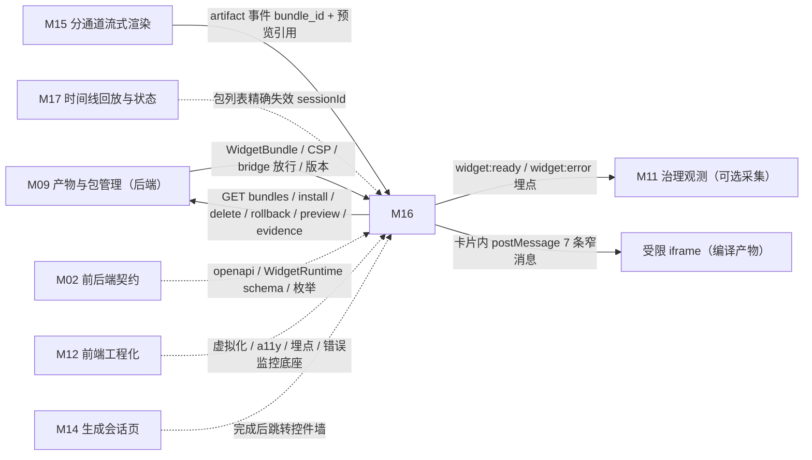
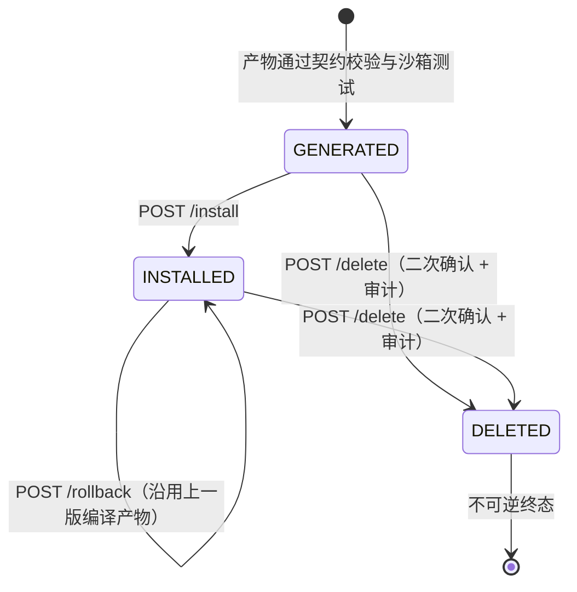
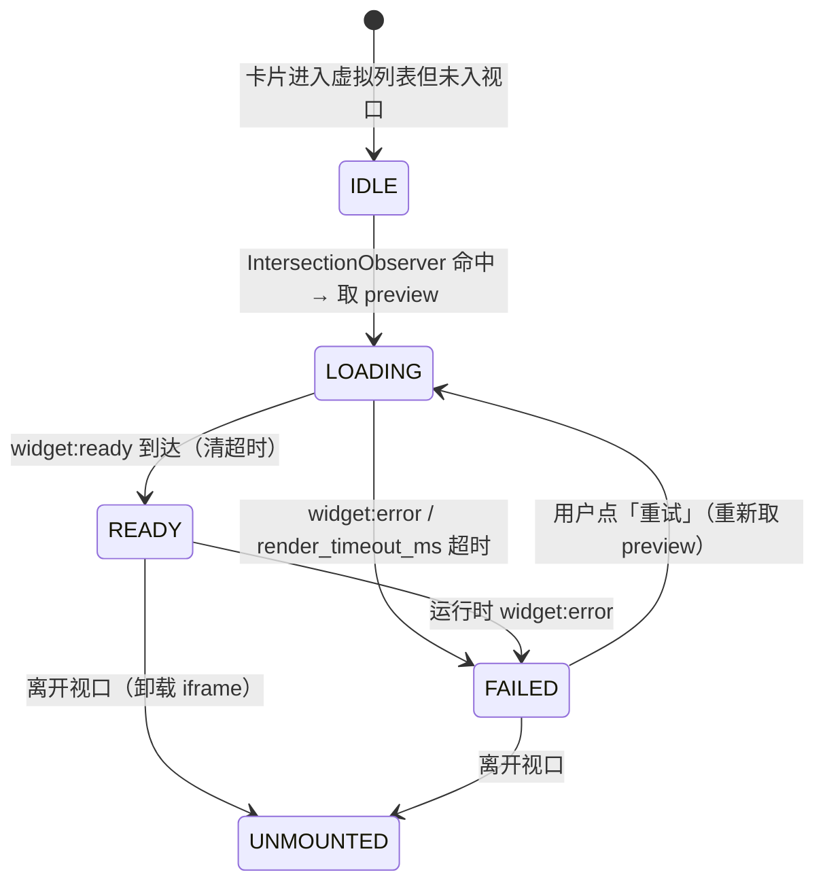

# M16 · 控件墙与包管理（原 W4）

> **文档类型**：可独立交付 / 可独立验收的模块设计文档
> **来源**：`设计方案.md` v1.1 §6.5、§6.4 亮点 4、§4.3.3、§4.3.2、§8 W4 行、§9.6、§6.7、§6.10、§2.6 X9、§7.2、§7.3
> **版本**：v1.0　|　**拆分日期**：2026-11-15　|　**最近修订**：2026-11-16（v1.3，ADR-001 同步）　|　**状态**：设计定稿
> **对应编号**：W4 / FR-14 / X9（前端侧）
> **主责应用或包**：`apps/web`（控件墙路由 `/widgets`）、`packages/widget_bridge`（宿主 ↔ iframe narrow bridge）
> **一句话定义**：把通过契约校验与沙箱测试的控件包，按六种真实规格比例渲染成隔离 iframe 卡片网格，并提供安装 / 删除 / 回滚 / 版本 / 证据查看的可审计管理入口。

---

## 0. 模块速览（零基础可读）

### 0.1 项目在做什么（本模块所需的最小背景）

WidgetPilot 是一个「用自然语言生成手机桌面控件」的 AI Agent 产品：规格（`2x1` / `1x2` / `2x2` / `2x4` / `4x2` / `4x4`）为可选预填 + 缺省询问补全，系统不推断（v1.3 ADR-001 D-6），用户输入描述、可传附件，系统生成 TSX + React 代码，编译并在一次性沙箱里做尺寸 / 能力 / 交互断言，通过后产出带完整证据链的控件包（`WidgetBundle`），最终在网页上按手机桌面的**真实比例**渲染成可交互卡片。本项目不装机、不接手机系统 API、不模拟真实设备；产物只在浏览器的受限 iframe 中渲染，但严格遵循真实控件的六种规格约束。决定产品能否成立的三件事是「生成产物不可信」「长任务可恢复」「交互要让人看懂」，本模块承接第一件事的**用户侧最后一环**：把不可信代码关进隔离 iframe，并用证据链让用户敢用。

### 0.2 本模块在端到端 14 步链路中的位置

```
① 登录 → 新建会话（grid 可选预填）
② 输入描述 + 上传附件 → 传输层校验 → 对象存储 → attachment_id
③ 语义层校验（描述充分性 / 附件 role 明确性 / grid 合法）→ 不足则 AWAITING_INPUT
④ 进 LLM 护栏（注入 / PII / 意图白名单 / 预算前置）→ 命中不进模型
⑤ 意图与规格确定 → 按 widget_type + grid 确定性预取生成规程
⑥ 上下文装配（公共语料 + 规程 + 记忆 + AttachmentInsight，固定槽位、硬过滤优先）
⑦ 生成回路：先出 WidgetSpec，再出 TSX + React 代码；模型分档
⑧ 出 LLM 护栏（schema / 能力白名单 / 禁止内容 / PII / 描述符合度 / 规格一致）
⑨ 契约校验：spec ↔ manifest ↔ 代码能力声明 比对 + hash；不过不进沙箱
⑩ 一次性沙箱：TSX 编译 → 挂载渲染 → 尺寸/运行时错误/能力/交互断言 → 证据包
⑪ 生成 WidgetBundle（源码 + 编译产物 + manifest + 校验 + 沙箱结果 + hash），COMPLETED
⑫ ★ 前端 artifact 事件 → 控件墙按 grid 真实比例渲染受限 iframe 卡片  ←── 本模块
⑬ 评测合格 → 脱敏 → 入库门禁 → 公共语料（可撤回）；失败案例回流为负例
⑭ 全流程按 seq 写 SSE 事件流与只追加审计；成本按模型档位分账
```

本模块负责**第 ⑫ 步**：产物就绪后在控件墙呈现，并覆盖其后的「安装 / 删除 / 回滚 / 查看详情」等 App 内状态操作（原文 §1.4 产物状态机 `GENERATED → INSTALLED → DELETED`）。它是「证据先于结论」铁律的落地点：只有通过⑨契约校验与⑩沙箱测试的产物才允许进入控件墙（原文 §1.7 #7、§10.1 #9）。

### 0.3 为什么必须有这个模块

1. **产物不可信，需要一个确定性的展示笼子**：模型生成的代码可能越权调用能力、越出规格尺寸、渲染报错。控件墙是用户真正看到并交互产物的地方，必须用 `sandbox="allow-scripts"` + 严格 CSP + 窄 `postMessage` bridge 把不可信代码隔离（原文 §2.4 #4、§3.3 渲染协议）。
2. **规格是一等约束（可选预填 + 缺省询问，v1.3 ADR-001 D-6），必须按真实比例呈现**：六种规格约束了 `layout_slots`、静态校验尺寸断言与前端卡片真实比例；统一拉伸会掩盖「`2x1` 放不下月视图」这类规格冲突，用户就无法建立对规格的信任（原文 §1.5、§6.5）。
3. **包操作不可逆，需要可审计的管理入口**：删除不可逆、需二次确认 + 审计，且**不做乐观更新**；版本可回滚到上一版编译产物。这些约束必须在 UI 层被正确执行，否则会与服务端状态机冲突（原文 §6.5、§5 D6）。
4. **证据链要可溯源**：卡片详情要展示 manifest、静态校验、沙箱测试用例与快照、本次成本、trace 入口、参考了哪些公共语料，让用户能回答「这个控件凭什么可信」（原文 §6.5、§6.4 亮点 4）。

### 0.4 上下游邻居（mermaid）



- **上游**：M09 提供产物索引、CSP、`capability_bridge` 放行结果、版本链；M15 在 `artifact` 事件到达时通知热更新；M02 提供 `WidgetRuntime` / `WidgetBundle` schema 与枚举；M12 提供虚拟化、可访问性与监控底座。
- **下游**：M09 接收包状态操作；受限 iframe 接收宿主 7 条 bridge 消息、回送 3 条 widget 消息。
- **横切**：M16 承载 **X9（沙箱测试与运行时隔离）的前端侧**——线上 iframe sandbox + CSP + bridge 这一半（原文 §2.6、00 总览 §5）。

### 0.5 原文对照表

| 本模块内容 | 原文章节 |
|---|---|
| 尺寸映射 `cell=80px`、真实比例不拉伸、受限 iframe、`widget:ready`/`widget:error`、失败卡片原因码 | §6.5 |
| 包状态机 `GENERATED→INSTALLED→DELETED`、删除二次确认 + 审计、不做乐观更新、版本回滚 | §6.5、§1.4、§5 D6 |
| 卡片详情：manifest / 静态校验 / 沙箱用例与快照 / 成本 / trace / 公共语料溯源 | §6.5、§6.4 亮点 4/5 |
| `WidgetRuntime` 渲染协议（sandbox / CSP / 7 条 bridge_messages / capability_bridge / limits） | §4.3.3、§3.3 |
| `WidgetBundle` 产物协议（manifest / hash / versions / state） | §4.3.2、§4.1 |
| 消费的 6 个 bundles REST 接口 | §4.4、01 基线 §5 |
| iframe 与主线程隔离、并发渲染不阻塞输入、`widget:error` 不拖垮宿主 | §6.7、§6.10 |
| 按需加载 / IntersectionObserver / 错误隔离 / 超时熔断 | §9.6 |
| 承载 X9 前端侧、职责边界 | §2.6、§7.3、§8 W4 行 |
| 技术栈落位 | §6.8、§7.2 |
| 验收表（隔离 / 并发 / a11y） | §6.10、§8 W4 行、§9.3 |

---

## 1. 模块定位与职责边界

### 1.1 为什么必须有（三个不可替代的职责）

1. **不可信产物的用户侧隔离边界**：生成代码绝不在编排进程里执行（原文 §1.7 #6），线上渲染只能发生在 `sandbox="allow-scripts"` 的 iframe 里，且不含 `allow-same-origin` / `top-navigation` / `forms` / `popups`。控件墙是这条硬边界③（用户侧渲染在受限 iframe）的唯一实现处。
2. **规格真实比例的呈现者**：`grid` 是生成前必确定的一等约束（可选预填 + 缺省询问，v1.3 ADR-001 D-6；原文 §1.5），卡片必须按 `cell=80px` 映射出的真实像素渲染，**不统一拉伸**，否则规格约束在最后一公里失效。
3. **可审计的包管理入口**：删除不可逆、需二次确认 + 审计、不做乐观更新；回滚沿用上一版编译产物。这些是 App 内状态操作（不触发真实装机），必须由本模块把服务端状态机正确暴露给用户。

### 1.2 做什么（职责清单）

| # | 职责 | 说明 |
|---|---|---|
| R1 | 消费 `GET /api/bundles` 渲染卡片网格 | 按 `sessionId` 精确失效（TanStack Query），仅当前用户包 |
| R2 | 六种规格 → 真实像素映射 | `cell=80px`，`2x1→160×80` … `4x4→320×320`，不统一拉伸 |
| R3 | 卡片内受限 iframe 渲染 | `sandbox=["allow-scripts"]` + 服务端下发 CSP + `srcdoc/compiled` 产物，窄 `postMessage` bridge |
| R4 | 加载编译产物并上报状态 | 消费 `GET /api/bundles/{id}/preview`；`widget:ready` / `widget:error` 上报 |
| R5 | 失败卡片可解释 | 显示 `ReasonCode` + 「查看沙箱日志」入口，不显示裸「失败」 |
| R6 | 包状态操作 | `install` / `delete` / `rollback`，二次确认、审计、不可逆操作不做乐观更新 |
| R7 | 卡片详情面板 | manifest、静态校验、沙箱测试用例与快照、本次成本、trace 入口、参考的公共语料（可溯源） |
| R8 | iframe 与主线程隔离 | 卡片并发渲染不阻塞输入；单卡 `widget:error` 不拖垮宿主页面 |
| R9 | 性能与错误防护 | 按需加载 / `IntersectionObserver`、错误隔离、`render_timeout_ms` 超时熔断、消息速率限制 |
| R10 | 能力放行消费 | `capability_bridge = manifest.capabilities ∩ 全局白名单`，未声明调用拒绝并上报 |

### 1.3 不做什么（明确排除，边界切割点）

| 不做 | 归属模块 | 边界说明 |
|---|---|---|
| 生成 `WidgetBundle`、hash、版本链、按用户隔离存储、**CSP 下发**、`capability_bridge` 计算、bridge 放行裁决 | **M09** | M16 只**消费** M09 下发的 `WidgetRuntime` 结论与编译产物引用；CSP 字符串、白名单交集在服务端生成，前端不自行计算放行集合 |
| 卡片网格 UI 的容器路由、空态/加载态整体框架 | **M16 自做** | 本模块拥有控件墙路由与网格布局，但复用的通用 UI 组件由 M12 底座提供 |
| SSE 底层分帧、partial-JSON 解析、增量代码 patch、rAF 节流、重连与背压、事件流渲染 | **M15** | M16 只消费 `artifact` 事件的 `bundle_id` 触发热更新，**不渲染事件流** |
| 代码 / 预览双轨、规格预览卡、时间线 scrubber、业务 UI 布局 | **M14 / M17** | M16 是产物**完成后**的独立页面，不承载生成过程的交互布局 |
| 后端 `BundleState` 状态机、安装/删除/回滚的服务端实现 | **M09** | M16 只调用 REST 并据响应刷新视图，不在前端维护权威状态 |
| 后端 `SessionState` 状态机、checkpoint / 租约 | **M04** | 与 M16 无关 |
| 公共语料入库门禁、撤回、检索 | **M10** | M16 只在卡片详情展示「参考了哪些公共语料」的**引用**，不做检索与治理 |
| 具体业务组件（会话中心、生成页、流式渲染） | **M13–M17 各自** | M12 只提供工程底座，M16 只做控件墙 |
| 鉴权判定、JWT 签发、`user_id` 隔离 | **M04** | 前端隐藏按钮只是体验；越权由服务端 403 |

> **边界最易混淆的一处**：产物生成与 CSP 下发在 **M09**，卡片网格 UI 在 **M16**。M09 是「产物与包管理域（后端）」，产出 `WidgetBundle` 与 `WidgetRuntime`；M16 是「控件墙与包管理（前端 W4）」，把 M09 的结论画成卡片并暴露操作入口。二者同名「包管理」但一侧是权威状态与存储、一侧是视图与交互。

### 1.4 输入 / 输出与上下游契约

| 方向 | 内容 | 契约形式 |
|---|---|---|
| 入 | `WidgetBundle` 列表项（`bundle_id` / `grid` / `state` / `hash` / `versions[]`） | REST `GET /api/bundles`（§4.1） |
| 入 | `WidgetRuntime`（`card.px` / `iframe.csp` / `capability_bridge` / `limits`） | `GET /api/bundles/{id}/preview` 响应（§6.2） |
| 入 | 证据（`manifest` / `static_check` / `sandbox_test` / `cost` / `trace` / `corpus_refs`） | `GET /api/bundles/{id}/evidence` 响应 |
| 入 | `artifact` SSE 事件（`bundle_id` + 预览引用）触发热更新 | SSE（§4.2） |
| 入 | iframe 回送 `widget:ready` / `widget:resize` / `widget:error` | `postMessage` 窄协议（§4.2.2） |
| 出 | `install` / `delete` / `rollback` 请求 | REST POST（§4.1） |
| 出 | 宿主下发 `host:theme` / `host:locale` / `host:tick` / `host:data` | `postMessage` 窄协议（§4.2.2） |
| 出 | `widget:error` 埋点、卡片首帧耗时埋点 | M12 监控底座（§7） |

### 1.5 承载的横切能力 X*

- **X9（前端侧主承载）**：沙箱测试与运行时隔离。原文 X9 = 「TSX 编译、渲染、尺寸/能力/交互断言在一次性沙箱；线上 iframe sandbox + CSP + bridge」（§2.6）。前半在 M08，运行时前半（CSP / bridge 放行裁决）在 M09，**M16 承载线上 iframe 隔离、卡片并发渲染、bridge 消息收发、`widget:error` 隔离这一前端侧**。00 总览 §5 把 X9 主承载列为 M08（测试）/ M09（运行时）/ M16（卡片）。
- **X11（协同）**：卡片详情消费 `trace` 入口与 `evidenceRef`，审计与可观测归 M11；本模块只展示，不生成审计。

### 1.6 关键设计原则

1. **证据先于结论**：只有 `static_check.passed = true` 且 `sandbox_test.passed = true` 的产物才进控件墙；任何旁路卡片必须带 `ReasonCode` + 证据引用（原文 §1.7 #7、§8 全局口径）。
2. **隔离是最终控制面**：能力边界与运行时隔离比 prompt 声明更可靠（原文 §2.3）；iframe 不含 `allow-same-origin`，控件不得 `fetch`、不得访问父页面 DOM、不得调用系统 API。
3. **真实比例不拉伸**：`grid` 决定像素，规格约束贯穿 `layout_slots` / 静态尺寸断言 / 卡片渲染（原文 §1.5、§6.5）。
4. **不可逆操作不做乐观更新**：删除、安装、回滚走「请求 → 服务端确认 → 刷新」，避免与权威 `BundleState` 冲突（原文 §6.5、§6.6）。
5. **错误隔离**：单卡 `widget:error` 被边界捕获，不能拖垮宿主页面；并发渲染不阻塞输入（原文 §6.7、§6.10）。
6. **零 Agent 框架（D-5）**：本模块是纯前端渲染与交互，不引入 AI SDK / CopilotKit / AG-UI SDK 等任何 Agent 框架（§6.8、§0 D-5）。

---

## 2. 技术栈

### 2.1 分层选型表

| 层 | 选型 | 版本 / 约束 | 为什么选 | 明确不用什么 |
|---|---|---|---|---|
| 框架 | React 19 + TypeScript + Vite（SPA） | React 19、TS 5.x、Vite 6.x（对齐 §6.8） | 与全站一致；SPA 由 CDN / 静态托管 | 不用 SSR 框架承载控件墙；需统一鉴权时 BFF 只做 SSO/聚合/ticket |
| 服务端状态 | TanStack Query | v5，按 `sessionId` 精确 `invalidateQueries` | 快照 / 轮询兜底 / 精确失效（§6.6） | 不把包列表塞进 Zustand |
| UI | Tailwind CSS + shadcn/ui（Radix） | Radix 无障碍原语 | 可访问性基础，二次确认用 Radix Dialog | 不用自研无 a11y 的模态 |
| 控件渲染 | iframe `sandbox` + CSP + `postMessage` bridge | `sandbox=["allow-scripts"]`，CSP 由 M09 下发 | 与宿主隔离，能力按 manifest 放行（§4.3.3） | **不用** `allow-same-origin` / `top-navigation` / `forms` / `popups`；不用任意 JSON-RPC |
| 网格尺寸 | `grid → px` 常量映射 + CSS 固定宽高 | `cell=80px` | 真实比例、不拉伸 | 不用 `transform: scale` 统一拉伸 |
| 列表 / 卡片墙 | `@tanstack/react-virtual` | 虚拟化长列表 | 大量包时只渲染可视卡片（§6.8） | 不一次挂载全部 iframe |
| 按需加载 | `IntersectionObserver` + 懒挂载 iframe | 视口内才 `srcdoc` / 加载编译产物 | 控件墙多卡片并发性能（§9.6） | 不首屏全量加载 |
| 图表（详情成本/指标） | Recharts / ECharts | 与 M17 一致 | 指标分布与置信区间（§6.8） | — |
| 契约 | OpenAPI 3.1 → `openapi-typescript`；事件/协议 Zod；枚举共享包 | 由 M02 生成 | 单一事实来源（§6.9） | 不手写重复类型 |
| 代码/产物展示 | CodeMirror 6 / Monaco（详情查看 TSX 源码） | 只读 + TSX 语法高亮 | 详情面板展示 manifest / 源码（§6.8） | 不在卡片 iframe 内嵌编辑器 |
| 测试 | Vitest + Testing Library + MSW + Playwright + Storybook | MSW mock bundles API / iframe message | 隔离与包操作用例可断言（§6.8） | — |
| 质量 / 监控 | Biome/ESLint、axe、Sentry、Lighthouse CI | WCAG 2.1 AA | a11y、错误隔离、性能预算（§6.7、§6.8） | — |
| Agent 事件层 | 原生 `EventSource` / `fetch` + 自研消费 | 只消费 `artifact` | 分通道派发由 M15 负责 | **不用** AI SDK / CopilotKit / AG-UI SDK / A2UI SDK |

### 2.2 硬约束（D-5 零 Agent 框架）

- **禁止引入**：Vercel AI SDK / `streamUI` / CopilotKit / AG-UI SDK / A2UI SDK / LangChain / LangGraph / Temporal / MCP SDK（原文 §11.1、§0 D-5）。控件墙是渲染层，`artifact` 事件消费与 bridge 全部手写。
- **保留的通用基础设施**：React 19 / Vite / TypeScript / TanStack Query / Zustand / Zod / Tailwind / Radix / Recharts / `@tanstack/react-virtual` / CodeMirror / `IntersectionObserver` / `postMessage`（原文 §11.1 保留清单）。
- **隔离硬约束**：iframe `sandbox` 只有 `allow-scripts`；CSP 禁外联脚本、禁 `eval`、禁网络；时间统一由 `host:tick` 提供，本地存储按 `storage_namespace` 隔离（§4.3.3、§5 D6）。
- **删除二次确认**：不可逆，删除前必须弹确认并记录审计意图（§6.5）。

### 2.3 运行时依赖

| 依赖 | 用途 | 不可用时的行为 |
|---|---|---|
| M09 control-plane `/api/bundles*` | 包列表 / 状态操作 / preview / evidence | 展示错误态 + `ReasonCode`，不本地伪造 `BundleState` |
| 对象存储（经 M09 签名引用） | 编译产物 `compiled_ref`、沙箱快照 | 卡片显示加载失败 + 重试入口，不拖垮宿主 |
| M15 SSE 流 | `artifact` 事件触发热更新 | 退化为 TanStack Query 定时轮询兜底（§6.8「轮询兜底」） |
| M02 `packages/contracts` | `WidgetRuntime` / `WidgetBundle` 类型、枚举 | CI 生成物为准，类型不一致即构建失败 |
| M12 监控底座 | Sentry / 埋点 / a11y | 埋点失败不影响渲染主链路 |

### 2.4 monorepo 代码落位（§7.2）

```
apps/web/
  src/routes/widgets/                 # 控件墙路由（M16）
    WidgetWall.tsx                    # 网格容器、空态/加载/错误/无权限/已归档
    GridCard.tsx                      # 单卡：真实比例 px + 受限 iframe + 错误边界
    gridToPx.ts                       # cell=80px 尺寸映射常量
    PackageActions.tsx                # install / delete(二次确认) / rollback
    BundleDetailDrawer.tsx            # manifest / 静态校验 / 沙箱用例与快照 / 成本 / trace / 语料溯源
    useBundles.ts                     # TanStack Query：GET /api/bundles，按 sessionId 失效
    useBundlePreview.ts               # GET /api/bundles/{id}/preview
    useBundleEvidence.ts              # GET /api/bundles/{id}/evidence
    lazyMount.ts                      # IntersectionObserver 按需加载 + 超时熔断
packages/widget_bridge/
  host.ts                             # 宿主侧：发 host:* / 收 widget:* / 能力放行消费
  messages.ts                         # 7 条 bridge_messages 类型与 payload
  capability.ts                       # GLOBAL_CAPABILITY_WHITELIST 与放行校验（前端侧镜像校验）
packages/contracts/                    # M02：widget_runtime.schema.json / widget_bundle.schema.json / enums
```

---

## 3. 设计架构

### 3.1 内部组件与职责（图 + 表）

```mermaid
flowchart TB
  subgraph WALL["apps/web 控件墙（M16）"]
    Q["useBundles · TanStack Query"] --> GRID["WidgetWall · 真实比例网格"]
    GRID --> CARD["GridCard · card.px + ErrorBoundary"]
    CARD --> IO["lazyMount · IntersectionObserver + 超时熔断"]
    IO --> IFRAME["受限 iframe · sandbox=allow-scripts + CSP"]
    CARD --> BR["hostBridge · host.ts"]
    BR <-->|postMessage 7 条窄消息| IFRAME
    ACT["PackageActions · 二次确认 + 审计"] -->|install/delete/rollback| API["M09 /api/bundles*"]
    DET["BundleDetailDrawer"] -->|preview/evidence| API
    ART["artifact 事件监听（消费 M15）"] -->|invalidateQueries(sessionId)| Q
  end
  IFRAME -->|widget:ready / widget:error| BR
  BR -->|埋点 widget:error / 首帧耗时| MON["M12 Sentry / 埋点"]
  API --> Q
```

| 组件 | 职责 | 关键不变量 |
|---|---|---|
| `useBundles` | 拉取包列表、按 `sessionId` 精确失效、轮询兜底 | 只返回当前用户包；不缓存越权数据 |
| `gridToPx` | `grid → {w,h}` 真实像素映射 | 六规格齐全、不拉伸、无 `scale` |
| `GridCard` | 单卡容器 + 受限 iframe + `ErrorBoundary` | `widget:error` 被边界捕获，隔离到单卡 |
| `lazyMount` | 视口内才挂载 iframe + `render_timeout_ms` 熔断 | 首屏并发 iframe 数受控；超时强制卸载 |
| `hostBridge` | 收发 7 条窄消息、`capability_bridge` 放行、消息速率限制 | 非白名单消息丢弃；未声明能力拒绝并上报 |
| `PackageActions` | 安装 / 删除 / 回滚；删除二次确认 | 不可逆操作不乐观更新；请求成功后刷新 |
| `BundleDetailDrawer` | 证据与溯源展示 | 展示 `ReasonCode` 而非裸「失败」 |

### 3.2 处理流程与数据流（编号步骤）

1. 用户进入控件墙路由 → `useBundles` 发 `GET /api/bundles`（携带 JWT，权限本人）→ 返回 `BundleListItem[]`。
2. `WidgetWall` 按 `grid` 分组/布局，用 `gridToPx` 计算每张卡片固定 `w × h` 像素，虚拟化仅渲染视口内卡片。
3. `lazyMount` 用 `IntersectionObserver` 观察卡片；进入视口才调用 `GET /api/bundles/{id}/preview` 取编译产物引用与 `WidgetRuntime`。
4. 卡片创建受限 iframe：`sandbox=["allow-scripts"]`、注入 M09 下发的 `csp`、加载 `srcdoc_ref` 指向的 `compiled` 产物；设置 `render_timeout_ms` 定时器。
5. 控件加载完成回送 `widget:ready` → 宿主清超时、标记 `ready`、记录卡片首帧耗时埋点；随后宿主下发 `host:theme` / `host:locale`。
6. 周期性下发 `host:tick` 提供统一时间；按需下发 `host:data`（静态数据/受限本地存储数据，按 `storage_namespace` 隔离）。
7. 控件运行时错误 → 回送 `widget:error` → `hostBridge` 校验 + `GridCard.ErrorBoundary` 捕获 → 该卡显示 `ReasonCode` + 「查看沙箱日志」，宿主页面不受影响。
8. M15 的 `artifact` 事件到达（同一会话产物就绪）→ `invalidateQueries(['bundles', sessionId])` 精确失效 → 列表刷新并原子替换占位卡片，触发 iframe 热更新。
9. 用户点「安装 / 删除 / 回滚」→ 删除先弹二次确认（Radix Dialog）→ 发 `POST /api/bundles/{id}/{action}` → **等服务端确认后再 `invalidateQueries`**，不做乐观更新。
10. 用户点「查看详情」→ `GET /api/bundles/{id}/evidence` → 抽屉展示 manifest / 静态校验 / 沙箱用例与快照 / 本次成本 / trace 入口 / 参考的公共语料（可溯源）。
11. 消息速率超过 `max_message_rate` 或渲染超过 `render_timeout_ms` → 熔断：卸载该 iframe、显示原因码，不拖垮宿主（§9.6）。

### 3.3 状态机

**A. 包状态机（由 M09 拥有，M16 消费并展示，完整见 §5.1）**



**B. 卡片渲染状态机（M16 前端侧，【推导·需评审】）**



> `IDLE/LOADING/READY/FAILED/UNMOUNTED` 及卡片级 `ErrorBoundary` 为【推导·需评审】：原文只描述 `widget:ready`/`widget:error` 上报与「失败卡片显示原因码」，未给前端卡片状态枚举名。

### 3.4 关键机制、算法与不变量清单

**A. 尺寸映射（`cell = 80px`，原文 §6.5，完整抄入）**

| `grid` | 网格 | 像素 `{w,h}` |
|---|---|---|
| `2x1` | 2 列 1 行 | `{ w:160, h:80 }` |
| `1x2` | 1 列 2 行 | `{ w:80, h:160 }` |
| `2x2` | 2×2 | `{ w:160, h:160 }` |
| `2x4` | 2 列 4 行 | `{ w:160, h:320 }` |
| `4x2` | 4 列 2 行 | `{ w:320, h:160 }` |
| `4x4` | 4×4 | `{ w:320, h:320 }` |

计算：`w = 列数 × 80`，`h = 行数 × 80`。**按会话确定的规格真实比例渲染，不统一拉伸**（原文 §6.5；v1.3 ADR-001 D-6：规格由选择器预填或询问补全确定，进入控件墙时必已确定）。

**B. iframe 隔离与窄 bridge**：`sandbox=["allow-scripts"]`；CSP 禁外联脚本、禁 `eval`、禁网络；宿主 ↔ 控件只走 7 条消息（§6.3）；`capability_bridge = manifest.capabilities ∩ 全局白名单`，未声明调用拒绝并上报（§4.3.3）。

**C. 并发与错误隔离**：iframe 与主线程隔离；卡片并发渲染不阻塞输入；单卡 `widget:error` 由 `ErrorBoundary` 捕获，不拖垮宿主页面（§6.7、§6.10）。按需加载 / `IntersectionObserver` / 错误隔离 / `render_timeout_ms` 超时熔断（§9.6）。

**不变量清单**

| # | 不变量 | 断言方式 |
|---|---|---|
| I1 | 六规格像素映射与 `cell=80px` 完全一致，无拉伸 | `gridToPx` 单元测试逐项断言 |
| I2 | iframe `sandbox` 恰好为 `["allow-scripts"]`，不含其余 token | DOM 属性断言 |
| I3 | `capability_bridge` 等于 `manifest.capabilities ∩ GLOBAL_CAPABILITY_WHITELIST` | 集合相等断言 |
| I4 | 宿主只发送 7 条白名单消息；未知消息丢弃 | `postMessage` 拦截断言 |
| I5 | 单卡 `widget:error` 后宿主页面仍可交互、其余卡片不受影响 | E2E 注入错误断言 |
| I6 | 删除/安装/回滚在服务端响应前不改变列表视图（无乐观更新） | 请求 pending 期 DOM 快照断言 |
| I7 | 删除必经二次确认，取消则不发请求 | 交互断言 |
| I8 | 失败卡片显示 `ReasonCode` + 「查看沙箱日志」，无裸「失败」文案 | 文案与字段断言 |
| I9 | 视口外卡片不挂载 iframe（按需加载） | iframe 数量断言 |
| I10 | 渲染超 `render_timeout_ms` 强制熔断卸载 | 计时器断言 |

### 3.5 与其他模块的时序（关键 3 个场景）

**场景 1：产物就绪热更新**
`M08 校验/沙箱通过 → M09 生成 WidgetBundle(COMPLETED) → M04 推 artifact(bundle_id) → M15 分帧 → M16 invalidateQueries(sessionId) → GET /api/bundles → 占位卡片原子替换 → iframe 热更新`

**场景 2：单卡运行时失败隔离**
`iframe 内 widget:error → hostBridge 校验 → GridCard.ErrorBoundary 捕获 → 该卡 FAILED(原因码 + 查看沙箱日志) → 宿主页面与其它卡片保持 READY`

**场景 3：删除包（不可逆）**
`用户点删除 → Radix Dialog 二次确认 → POST /api/bundles/{id}/delete → M09 写审计 + DELETED → 响应 200 → M16 invalidateQueries → 列表移除；期间不做乐观更新`

### 3.6 部署形态与伸缩

| 形态 | 说明 |
|---|---|
| `web` 静态 SPA | 控件墙是 CDN 静态资源，无服务端状态；随 `web` 整体伸缩（§7.1） |
| 卡片 iframe | 每卡一个一次性渲染上下文，客户端资源；并发数由 `IntersectionObserver` + 虚拟化 + 熔断上限约束（§9.6） |
| 无状态 | M16 不持有权威状态；`BundleState` 全在 M09/PG，`useBundles` 只是可失效缓存 |
| 降级 | SSE `artifact` 不可用时退化为 TanStack Query 轮询兜底（§6.8）；单个 preview 失败只影响单卡 |

---

## 4. 接口契约

> 本节列出本模块**消费**的全部接口并给出可直接实现的粒度。完整 REST 全表与统一响应格式由 M02 的 `packages/contracts/openapi.yaml` 生成；本节相关响应体为【契约约定】，最终以 `openapi.yaml` 为准。

### 4.1 消费 / 提供的接口表（方法 | 路径 | 权限 | 请求 | 响应 | 状态码）

| 方法 | 路径 | 权限 | 请求 | 成功响应（【契约约定】） | 状态码 |
|---|---|---|---|---|---|
| `GET` | `/api/bundles` | 本人（JWT） | Query: `session_id?`, `state?`, `cursor?`, `limit?` | `{ code:"OK", data:{ items: BundleListItem[], next_cursor } }` | 200 / 401 / 403 |
| `POST` | `/api/bundles/{id}/install` | 本人 | `{}`（独立 POST） | `{ code:"OK", data:{ bundle_id, state:"INSTALLED" } }` | 200 / 403 / 404 / 409 |
| `POST` | `/api/bundles/{id}/delete` | 本人 | `{}`（二次确认后发） | `{ code:"OK", data:{ bundle_id, state:"DELETED", audit_seq } }` | 200 / 403 / 404 / 409 |
| `POST` | `/api/bundles/{id}/rollback` | 本人 | `{ to_version?: string }` | `{ code:"OK", data:{ bundle_id, state:"INSTALLED", rolled_back_to, compiled_ref } }` | 200 / 403 / 404 / 409 |
| `GET` | `/api/bundles/{id}/preview` | 本人 | — | `{ code:"OK", data: WidgetRuntime }`（含 `compiled_ref` / `csp` / `capability_bridge` / `limits`） | 200 / 403 / 404 |
| `GET` | `/api/bundles/{id}/evidence` | 本人 | — | `{ code:"OK", data: EvidenceView }`（manifest / static_check / sandbox_test / cost / trace_ref / corpus_refs） | 200 / 403 / 404 |

> `EvidenceView` / `BundleListItem` / `WidgetRuntime` 的完整字段定义见 §6.1 / §6.2。删除 `audit_seq`、回滚 `to_version` 为【契约约定】：原文只写「带审计与二次确认」「回滚到上一版编译产物」，未给字段名。

### 4.2 事件接口（SSE `kind` 与 payload）

**4.2.1 M16 消费的 SSE `kind`（由 M15 分帧后转交，M16 不自行分帧）**

| `kind` | payload 要点 | M16 的动作 |
|---|---|---|
| `artifact` | `{ bundle_id: string; preview_ref: string; grid: GridSpec }` | `invalidateQueries(['bundles', sessionId])`，原子替换占位卡片、触发 iframe 热更新 |
| `error` | `{ code: ReasonCode; evidenceRef?: string }` | 对应卡片显示原因码 + 查看沙箱日志，不显示裸「失败」 |
| `done` | `{ bundle_id?: string }` | 结束热更新等待态 |
| `notice` | `{ message: string; code?: string }` | 可选：降级/回滚提示 |

SSE 事件结构统一带 `seq` / `sessionId` / `runId` / `ts` / `phase` / `traceId`（完整见 §6.2），M16 对未知 `kind` 忽略而非报错（原文 §4.5 向前兼容）。

**4.2.2 iframe `postMessage` bridge 事件（7 条窄消息，原文 §4.3.3）**

| 方向 | 消息名 | payload（【契约约定】） | 用途 |
|---|---|---|---|
| widget → host | `widget:ready` | `{ grid: GridSpec; ts: number }` | 控件加载完成，清超时、记录首帧 |
| widget → host | `widget:resize` | `{ w: number; h: number }` | 控件请求尺寸（须仍在 `card.px` 约束内） |
| widget → host | `widget:error` | `{ code: ReasonCode; message: string; stack_ref?: string }` | 运行时错误上报，触发错误隔离 |
| host → widget | `host:theme` | `{ theme: "light" \| "dark" }` | 下发主题 |
| host → widget | `host:locale` | `{ locale: string }` | 下发语言 |
| host → widget | `host:tick` | `{ now: string }` | 统一时间源（控件不得自取系统时间） |
| host → widget | `host:data` | `{ key: string; value: unknown; namespace: string }` | 静态数据 / 受限本地存储，按 `storage_namespace` 隔离 |

> 这 7 条是**窄协议，非任意 JSON-RPC**（原文 §4.3.3）。控件不得 `fetch`、不得访问父页面 DOM、不得调用系统 API；时间统一由 `host:tick` 提供。

### 4.3 内部接口与函数签名（TS）

```ts
// apps/web/src/routes/widgets/gridToPx.ts
export const CELL = 80 as const;
export function gridToPx(grid: GridSpec): { w: number; h: number };

// packages/widget_bridge/messages.ts
export type BridgeMessageKind =
  | "widget:ready" | "widget:resize" | "widget:error"
  | "host:theme" | "host:locale" | "host:tick" | "host:data";
export type BridgeEnvelope = { kind: BridgeMessageKind; payload: unknown; ts: number };

// packages/widget_bridge/capability.ts
export const GLOBAL_CAPABILITY_WHITELIST: readonly Capability[];
export function capabilityBridge(manifestCaps: Capability[]): Capability[]; // = manifestCaps ∩ 白名单
export function isAllowed(kind: BridgeMessageKind, caps: Capability[]): boolean;

// packages/widget_bridge/host.ts
export function attachBridge(iframe: HTMLIFrameElement, rt: WidgetRuntime): () => void; // 返回解绑
export function postHostMessage(iframe: HTMLIFrameElement, kind: BridgeMessageKind, payload: unknown): void;
export function onWidgetMessage(ev: MessageEvent, rt: WidgetRuntime): void; // 校验 origin + 7 条白名单

// apps/web/src/routes/widgets/useBundles.ts
export function useBundles(sessionId: string): UseQueryResult<BundleListResponse>;
export function invalidateBundles(sessionId: string): void; // queryClient.invalidateQueries

// apps/web/src/routes/widgets/lazyMount.ts
export function observeCard(el: Element, onEnter: () => void, onLeave: () => void): IntersectionObserver;
export function withRenderTimeout(ms: number, onTimeout: () => void): () => void; // 返回取消器

// apps/web/src/routes/widgets/PackageActions.ts（不可逆操作，不做乐观更新）
export async function installBundle(id: string): Promise<BundleActionResult>;
export async function deleteBundle(id: string): Promise<BundleActionResult>; // 调用前已完成二次确认
export async function rollbackBundle(id: string, toVersion?: string): Promise<BundleActionResult>;
```

**被调用的上游接口**：M15 通过 `emitArtifact(bundle_id, preview_ref, grid)` 通知 M16（【契约约定】回调名）；M12 提供 `reportWidgetError(traceId, code)` 与 `reportCardFirstFrame(ms)` 埋点函数（【契约约定】）。

### 4.4 统一响应与错误码

统一响应（原文 §4.4 / §6.9）：`{ code, message, traceId, retryable, evidenceRef? }`，`data` 为【契约约定】补充；`code` 与 `ReasonCode` 对齐，成功为 `"OK"`。前端按 `code` 展示具体原因与「查看沙箱日志 / 从断点继续」入口，**不显示裸「失败」**。`FAILED` 卡片必须携带 `evidenceRef`。

### 4.5 幂等、重试、超时、限流、并发约定

| 项 | 约定 |
|---|---|
| 幂等 | `install` / `delete` / `rollback` 由 M09 用幂等键保证（【契约约定】沿用 `session_id + step + payload_hash`）；重复安装/删除返回 409 或当前状态，不产生重复副作用 |
| 重试 | 仅瞬时故障（5xx / 网络抖动）指数退避有上限；业务码（4xx）不自动重试；**不做乐观更新**（§6.5、§6.6） |
| 超时 | `WidgetRuntime.limits.render_timeout_ms` 到点强制卸载 iframe；preview 请求超时走错误态 |
| 限流 | `WidgetRuntime.limits.max_message_rate` 限制 bridge 消息速率；超阈值丢弃并上报 |
| 并发 | 虚拟化 + `IntersectionObserver` 控制同时挂载 iframe 数；卡片并发渲染不阻塞输入（§9.6） |
| 乱序 | SSE 事件按 `seq` 由 M15/M17 去重与乱序丢弃；M16 只按 `invalidateQueries` 拉取最新快照，不自行按 seq 排序 |
| 删除 | 二次确认（Radix Dialog）后才发请求；取消不发请求；删除不可逆 |

### 4.6 接口状态表（契约状态 / 运行态 / 可重试）

| 接口 | 契约状态 | 运行态 | 可重试 | 说明 |
|---|---|---|---|---|
| `GET /api/bundles` | 定稿（原文 §4.4） | 同步 | 是 | 请求/响应字段为【契约约定】 |
| `POST /api/bundles/{id}/install` | 定稿 | 同步 | 否（幂等键去重） | 不做乐观更新 |
| `POST /api/bundles/{id}/delete` | 定稿 | 同步 | 否（不可逆） | 二次确认 + 审计 |
| `POST /api/bundles/{id}/rollback` | 定稿 | 同步 | 否（幂等） | 沿用上一版编译产物 |
| `GET /api/bundles/{id}/preview` | 定稿 | 同步 | 是 | 返回 `WidgetRuntime` |
| `GET /api/bundles/{id}/evidence` | 定稿 | 同步 | 是 | 证据与溯源 |
| `audit_seq` / `to_version` / `EvidenceView` 字段 | **【推导·需评审】** | — | — | 原文未给字段名，M02 定稿到 openapi.yaml |
| 7 条 bridge message payload | **【契约约定】** | 异步消息 | — | 原文只给消息名，payload 为最小推导 |
| `401/403/409` 业务码映射 | **待 M02 定稿** | — | — | 原文 `ReasonCode` 未含鉴权/冲突码 |

---

## 5. 状态、原因码与 API 状态

### 5.1 拥有或参与的状态机与完整枚举（TS 定义）

```ts
// 原文 §4.2：产物状态机（由 M09 拥有，M16 消费展示）
type BundleState = "GENERATED" | "INSTALLED" | "DELETED";

// 原文 §4.2：规格与能力
type GridSpec = "2x2" | "2x4" | "4x2" | "4x4" | "2x1" | "1x2";
type WidgetType = "calendar" | "clock" | "alarm" | "task" | "custom";
type Capability = "date" | "timer" | "local_storage" | "static_data" | "theme" | "locale";
type ModelTier = "cheap" | "standard" | "frontier";

// 原文 §4.3.3：7 条窄 bridge 消息
type BridgeMessageKind =
  | "widget:ready" | "widget:resize" | "widget:error"
  | "host:theme" | "host:locale" | "host:tick" | "host:data";

// 【推导·需评审】卡片渲染状态机（原文只描述 ready/error 上报）
type CardRenderState = "IDLE" | "LOADING" | "READY" | "FAILED" | "UNMOUNTED";

// 原文 §4.2：会话状态（M16 不拥有，仅展示 artifact 时读取 phase）
type SessionState =
  | "DRAFT" | "RUNNING" | "PAUSED" | "AWAITING_INPUT" | "VALIDATING"
  | "COMPLETED" | "FAILED" | "CANCELLED";
```

**终态**：`BundleState = DELETED`（不可逆）；`CardRenderState = UNMOUNTED`（离开视口，可重挂载）。

### 5.2 状态流转表

| 触发 | 前态 | 后态 | 副作用 | 事件 |
|---|---|---|---|---|
| 产物通过契约校验 + 沙箱测试 | — | `GENERATED` | 进控件墙，生成卡片占位 | `artifact` |
| `POST /install` 成功 | `GENERATED` | `INSTALLED` | 写审计、`invalidateQueries` | — |
| `POST /rollback` 成功 | `INSTALLED` | `INSTALLED` | 编译产物引用切到上一版、iframe 热更新 | `notice` |
| `POST /delete` 成功（二次确认后） | `GENERATED` / `INSTALLED` | `DELETED` | 写审计、列表移除、语料失效由 M10 处理 | — |
| `widget:ready` 到达 | `LOADING` | `READY` | 清超时、记录首帧 | `widget:ready` |
| `widget:error` / 超时 | `LOADING` / `READY` | `FAILED` | 错误边界捕获、显示原因码 + 查看沙箱日志 | `widget:error` |
| 离开视口 | `READY` / `FAILED` | `UNMOUNTED` | 卸载 iframe、解绑 bridge | — |

### 5.3 ReasonCode 子集（本模块消费）

| 码 | 场景 | 卡片表现 |
|---|---|---|
| `CONTRACT_MISMATCH` | 产物契约校验未过 | 不进控件墙 / 原因码 + 证据引用 |
| `COMPILE_FAILED` | TSX 编译失败 | 原因码 + 查看编译日志 |
| `SANDBOX_TEST_FAILED` | 沙箱断言失败 | 原因码 + 查看沙箱日志与快照 |
| `CAPABILITY_DENIED` | 运行时未声明能力调用 | `widget:error` 上报 + 卡片原因码 |
| `SPEC_CONFLICT` | 规格冲突（如 `2x1` 塞月视图） | 原因码 + 建议改选规格 |
| `SANDBOX_UNAVAILABLE` | 沙箱不可用降级 | 只读诊断态，不跳过校验直接交付 |
| `INPUT_INVALID` | 包操作请求非法 | 错误态 + 原因码 |

> 完整 14 个 `ReasonCode` 见原文 §4.2；v1.3（ADR-001）新增 `SPEC_MISSING` / `CLARIFICATION_REQUIRED` / `CLARIFICATION_LIMIT`，共 17 个。所有失败卡片必须携带 `evidenceRef`，**不显示裸「失败」**（§1.4、§8 全局口径）。

### 5.4 HTTP 状态码与业务码映射

| HTTP | 场景 | `code` | `retryable` |
|---|---|---|---|
| 200 | 查询 / 操作成功 | `OK` | — |
| 400 | 请求体非法 | `INPUT_INVALID` | `false` |
| 401 | 未登录 / JWT 失效 | 【待 M02 定稿】 | `false` |
| 403 | 越权访问他人包 / preview / evidence | 【待 M02 定稿】 | `false` |
| 404 | 包不存在 / 已 `DELETED` | 【契约约定：`INPUT_INVALID` 或扩充】 | `false` |
| 409 | 重复安装 / 对 `DELETED` 再删除 / 状态冲突 | 【待 M02 定稿】 | `false` |
| 5xx | M09 / 对象存储不可用 | `SANDBOX_UNAVAILABLE` / `MODEL_ERROR` | `true`（有上限退避） |

> `401/403/409` 对应业务码原文 `ReasonCode` 未显式列出，由 **M02 定稿**是「扩充枚举」还是「复用现有码」并在 CI 固定（原文 §4.2、基线 §5.3）。

### 5.5 接口运行态约定（同步 / 异步 / 流式 / 挂起态 / 终态行为）

- **同步接口**：6 个 `bundles*` REST 均为请求即得到终态结论；`install/delete/rollback` 必须等响应到达才刷新视图。
- **流式接口**：`artifact` 由 M15 的 SSE 长连接消费，M16 不自建连接；无 `done` 的断流视为截断，退化为轮询兜底。
- **iframe 消息**：`postMessage` 为异步消息，`widget:ready` 前处于 `LOADING`，`render_timeout_ms` 到点熔断。
- **挂起态行为**：`PAUSED` / `AWAITING_INPUT` 会话尚无产物，`GET /api/bundles` 返回空列表 → 控件墙显示空态（不显示错误）。
- **终态行为**：`DELETED` 包不再出现在列表；对 `DELETED` 的 `install/rollback` 返回 409；预览已删除包返回 404。

---

## 6. 核心字段与元数据

### 6.1 核心字段表（字段 | 类型 | 约束 | 含义）

| 字段 | 类型 | 约束 | 含义 |
|---|---|---|---|
| `BundleListItem.bundle_id` | `string` | PK，服务端生成 | 控件包标识 |
| `BundleListItem.grid` | `GridSpec` | 枚举 | 决定卡片真实像素 |
| `BundleListItem.widget_type` | `WidgetType` | 枚举 | 控件类型 |
| `BundleListItem.state` | `BundleState` | 枚举 | 包状态 |
| `BundleListItem.hash` | `string`（sha256 hex） | 整包摘要 | 防篡改，读取时校验 |
| `BundleListItem.versions` | `string[]` | 非空 | 版本链（git 式） |
| `BundleListItem.created_at` | `string`（timestamptz） | UTC | 前端展示带时区 |
| `WidgetRuntime.card.px` | `{ w:number; h:number }` | `cell=80px` | 真实比例像素 |
| `WidgetRuntime.iframe.sandbox` | `["allow-scripts"]` | 字面量数组 | 不含其余 token |
| `WidgetRuntime.iframe.csp` | `string` | M09 下发 | 禁外联脚本 / eval / 网络 |
| `WidgetRuntime.capability_bridge` | `Capability[]` | `manifest ∩ 白名单` | 放行集合 |
| `WidgetRuntime.limits.render_timeout_ms` | `number` | > 0 | 渲染熔断 |
| `WidgetRuntime.limits.max_message_rate` | `number` | > 0 | bridge 消息速率上限 |
| `EvidenceView.manifest` | `WidgetBundle.manifest` | 见 §6.2 | 能力/版本/检索快照 |
| `EvidenceView.static_check` | `{ passed:boolean; violations:string[] }` | — | 静态校验结论 |
| `EvidenceView.sandbox_test.cases` | `{ name:string; passed:boolean; detail_ref:string }[]` | — | 沙箱用例 |
| `EvidenceView.cost` | `{ total:number; by_tier:Record<ModelTier,number> }`【契约约定】 | — | 本次成本 |
| `EvidenceView.trace_ref` | `string` | — | trace 入口 |
| `EvidenceView.corpus_refs` | `string[]`【契约约定】 | 可溯源 | 参考了哪些公共语料 |
| `EvidenceView.sandbox_test.snapshot_ref` | `string?` | 对象存储引用 | 沙箱快照 |

> `EvidenceView` 整体、`BundleListItem`、`cost` / `corpus_refs` / `audit_seq` / `to_version` 为【契约约定】或【推导·需评审】：原文只列出「manifest、静态校验、沙箱测试用例与快照、本次成本、trace 入口、参考了哪些公共语料」这些展示项，未给字段名与类型。

### 6.2 相关协议 schema 完整定义（相关片段完整抄入）

**渲染协议 `WidgetRuntime`（原文 §4.3.3，完整抄入）**

```ts
type WidgetRuntime = {
  card: { grid: GridSpec; px: { w: number; h: number } };  // 真实比例
  iframe: {
    sandbox: ["allow-scripts"];       // 不含 allow-same-origin / top-navigation / forms / popups
    csp: string;                      // 禁外联脚本、禁 eval、禁网络
    srcdoc_ref: string;               // 指向 compiled 产物
  };
  bridge_messages: [
    "widget:ready", "widget:resize", "widget:error",
    "host:theme", "host:locale", "host:tick", "host:data"
  ];                                  // 窄协议，非任意 JSON-RPC
  capability_bridge: Capability[];    // = manifest.capabilities ∩ 白名单；未声明调用拒绝并上报
  limits: { render_timeout_ms: number; max_message_rate: number };
};
```

宿主 ↔ 控件只走上述消息；时间统一由 `host:tick` 提供，本地存储按 `storage_namespace` 隔离；控件不得 `fetch`、不得访问父页面 DOM、不得调用系统 API（原文 §4.3.3）。

**产物协议 `WidgetBundle`（原文 §4.3.2，完整抄入，卡片详情消费）**

```ts
type WidgetBundle = {
  bundle_id: string;
  user_id: string;
  session_id: string;
  spec: WidgetSpec;
  source: { path: "widget.tsx"; content_ref: string; language: "tsx" };
  compiled: { content_ref: string; hash: string };
  manifest: {
    spec_version: string;
    spec_hash: string;
    grid: GridSpec;
    widget_type: WidgetType;
    capabilities: Capability[];      // 与 spec 一致，静态校验比对
    import_allowlist: string[];
    exports: { default: "Widget" };
    props: string[];
    recipe_version: string;          // 所用规程版本
    retrieval_snapshot: string;      // 所用检索快照与引用
    model: string; prompt_version: string; model_tier: ModelTier;
  };
  static_check: { passed: boolean; violations: string[] };
  sandbox_test: {
    passed: boolean;
    cases: { name: string; passed: boolean; detail_ref: string }[];
    log_ref: string; snapshot_ref?: string;
  };
  state: BundleState;
  hash: string;                      // 整包摘要，防篡改
  created_at: string;
};
```

> **同一份 manifest 贯穿四处**（原文 §4.3.2）：生成侧按 spec 产码 → 静态校验比对能力声明 → 沙箱测试按声明放行 → 运行时 bridge 按声明放行 → 评测按声明出判据。M16 的 `capability_bridge` 即第四处的消费结果。

**统一响应（原文 §4.4 / §6.9，完整抄入）**

```ts
type ApiResponse<T> = {
  code: string;            // 成功 "OK"；失败为 ReasonCode
  message: string;
  traceId: string;
  retryable: boolean;
  evidenceRef?: string;    // 失败时指向证据引用
  data?: T;                // 【契约约定】成功载荷
};
```

**SSE 事件结构（原文 §4.5，完整抄入，M16 消费 `artifact`）**

```ts
type AgentEvent = {
  seq: number;                 // 每会话单调递增
  sessionId: string;
  runId: string;
  ts: string;
  kind: AgentEventKind;        // 18 种（v1.3），artifact 属于其一
  phase: SessionState;
  payload: unknown;
  traceId: string;
};
```

### 6.3 枚举与常量

| 常量 / 枚举 | 值 | 含义 |
|---|---|---|
| `CELL` | `80`（px） | 网格单元（原文 §6.5） |
| `grid → px` | `2x1=160×80, 1x2=80×160, 2x2=160×160, 2x4=160×320, 4x2=320×160, 4x4=320×320` | 真实比例，不拉伸 |
| `bridge_messages` | 7 条：`widget:ready` `widget:resize` `widget:error` `host:theme` `host:locale` `host:tick` `host:data` | 窄协议 |
| `GLOBAL_CAPABILITY_WHITELIST` | `["date","timer","local_storage","static_data","theme","locale"]` | 即 `Capability` 全集 |
| `capability_bridge` | `manifest.capabilities ∩ 白名单` | 未声明调用拒绝并上报 |
| `iframe.sandbox` | `["allow-scripts"]` | 不含 `allow-same-origin` / `top-navigation` / `forms` / `popups` |
| `import_allowlist` | `["react","@widget/bridge"]` | 生成代码唯一允许的 import（§11.1） |
| `export_contract.default` | `"Widget"` | 默认导出组件名 |
| 控件卡首帧 P95 | `< 500ms` | SLO（§9.4） |

### 6.4 manifest / hash / 版本 / 快照 / trace 等元数据

| 元数据 | 字段 | 用途 |
|---|---|---|
| manifest | `WidgetBundle.manifest`（§6.2 完整定义） | 卡片详情展示；`capabilities` 决定 `capability_bridge` |
| hash | `WidgetBundle.hash` / `compiled.hash` | 整包摘要，读取编译产物时校验防替换 |
| 版本 | `WidgetBundle.versions[]` / `manifest.recipe_version` / `retrieval_snapshot` | 回滚到上一版编译产物；可复现 |
| 快照 | `sandbox_test.snapshot_ref?` | 卡片详情「沙箱测试用例与快照」 |
| trace | `EvidenceView.trace_ref` | 卡片详情 trace 入口 |
| 成本 | `EvidenceView.cost`【契约约定】 | 本次成本展示 |
| 语料溯源 | `EvidenceView.corpus_refs`【契约约定】 | 参考了哪些公共语料（可溯源） |
| 检索快照 | `manifest.retrieval_snapshot` | 绑定版本快照，保证可复现（§5 D7） |

### 6.5 大对象与引用规范

| 前缀 | 内容 | 要求 |
|---|---|---|
| `code/{session_id}/{run_id}/compiled.js` | 编译产物（`srcdoc_ref` / `compiled_ref` 指向） | 必须带 `hash`，读取时校验；只经 M09 签名引用加载 |
| `bundle/{user_id}/{bundle_id}/manifest.json` | manifest | 与 `hash` 绑定，不存大对象在索引 |
| `evidence/{session_id}/{run_id}/sandbox.log` / `snapshot.png` | 沙箱日志 / 快照 | 「查看沙箱日志」指向 `sandbox_test.log_ref` / `snapshot_ref` |
| `audit/{session_id}/{seq}.json` | 删除/安装/回滚审计证据 | 只追加，不更新不删除 |

> 引用规范全文由 M02 `packages/contracts` 固定（基线 §9，【推导·需评审】）。大对象一律不入库，只存引用；所有引用必须带 `hash`，读取时校验，防止对象被替换（§4.1 字段归属原则）。

---

## 7. 安全、威胁面与合规

| 不可信输入 | 攻击路径（原文 §2.3 / §9.3） | 本模块控制点 | 明确禁止 |
|---|---|---|---|
| 模型生成的 `compiled` 产物 | ③ 生成调用 `eval`/`fetch`/系统 API 的代码；⑥ iframe 逃逸或访问父页面 | `sandbox=["allow-scripts"]` + 严格 CSP（禁外联脚本/eval/网络）+ 窄 bridge；`capability_bridge` 按声明放行 | 禁止 `allow-same-origin` / `top-navigation` / `forms` / `popups`；禁止任意 JSON-RPC；禁止控件 `fetch` / 访问父页面 DOM / 系统 API |
| iframe 回送的 `postMessage` | 伪造 `widget:*` 消息、消息洪泛 | 校验 `event.origin` + 只收 7 条白名单消息 + `max_message_rate` 限流 | 禁止 `eval(payload)`；禁止把 payload 直接插入 DOM |
| 运行时错误 | 单卡崩溃拖垮宿主页面 | `GridCard.ErrorBoundary` 错误隔离 + `render_timeout_ms` 熔断 | 禁止让异常冒泡到宿主 |
| 越权访问 | ⑤ 越权访问他人会话/包 | 前端按 JWT 调用 `bundles*`，服务端按 `user_id` 过滤；403 不泄漏资源是否存在 | 禁止只靠前端隐藏按钮；禁止信任前端传入的 `user_id` |
| 删除/回滚操作 | 误删、重放导致重复副作用 | 二次确认 + 审计 + 幂等键；删除不可逆 | 禁止乐观更新；禁止跳过二次确认 |
| 公共语料引用 | ④ 恶意产物跨用户投毒传播 | 卡片详情只展示 `corpus_refs` 引用，检索/入库门禁在 M10 | 禁止在前端执行语料里的历史代码 |

**明确禁止**：iframe 内 `fetch`、访问父页面 DOM、调用系统 API、任意网络请求；`allow-same-origin` 等 sandbox token；把不可信 payload 当代码执行；不可逆操作乐观更新；显示裸「失败」。

**审计留证要求**：每次 `install` / `delete` / `rollback` 由 M09 写 `AuditEvent`（`actor`、`action`、`decision`、`trace_id`、`prev_hash`）；M16 的 `widget:error` 埋点写 `traceId` 与 `code`，供 M11 重建「交付 → 运行时」路径。删除的二次确认意图也应留痕（【契约约定】`audit_seq` 返回给前端）。

**合规**：附件原文 / 账号 / PII 永不进公共语料；卡片详情展示的语料引用为脱敏后的 `spec / 代码 / 过程摘要`（D-1）；用户 `share_enabled` 关闭后产物不进公共语料（M10 裁决）。

---

## 8. 独立验收方案（可脱离其他模块单独提测）

### 8.1 验收前置条件与上下游桩

| 依赖 | 本模块验收时的桩 | 说明 |
|---|---|---|
| M09 `/api/bundles*` | **MSW mock**：返回固定 `BundleListItem[]` / `WidgetRuntime` / `EvidenceView`；`install/delete/rollback` 记录调用并返回状态 | 无需真实后端与对象存储 |
| 编译产物 | **Stub iframe `srcdoc`**：一段回送 `widget:ready` 的脚本；另备一段回送 `widget:error` 的脚本 | 验证隔离与错误边界，不编译真实 TSX |
| M15 SSE | **Fake artifact emitter**：脚本触发 `emitArtifact(bundle_id, preview_ref, grid)` | 无需真实 SSE 长连接 |
| M02 契约 | 使用 `openapi-typescript` 生成的请求/响应模型 | 保证字段一致 |
| M12 监控 | Fake `reportWidgetError` / `reportCardFirstFrame`（内存数组） | 断言埋点条数 |
| 基础设施 | jsdom + Testing Library（DOM）/ Playwright（真实 iframe 隔离）；`IntersectionObserver` polyfill | 卡片状态与隔离可断言 |

> 有了 MSW mock + Stub iframe + Fake artifact emitter，本模块**完全不需要真实模型、沙箱、后端就能独立提测**。

### 8.2 可断言的验收用例清单

| # | 用例（Given / When / Then） | 判据 | 断言方式 |
|---|---|---|---|
| B1 | Given 六规格包；When 渲染卡片；Then 像素分别为 `160×80 / 80×160 / 160×160 / 160×320 / 320×160 / 320×320` | 真实比例不拉伸 | `gridToPx` 单元断言 + DOM `clientWidth/Height` |
| B2 | Given 任一卡片；When 读取 iframe `sandbox`；Then 恰好 `["allow-scripts"]` | 隔离硬约束 | `getAttribute("sandbox")` === `"allow-scripts"` |
| B3 | Given CSP 下发；When iframe 内尝试 `fetch("https://x")`；Then 被 CSP 拦截且宿主无外联请求 | 无法外联 | Playwright 网络断言：0 个外联请求 |
| B4 | Given iframe 内脚本尝试 `window.parent.document`；Then 抛错且读不到父页面 DOM | 无法访问父页面 | 页面脚本异常被 `widget:error` 捕获；宿主 DOM 未变 |
| B5 | Given `manifest.capabilities=["date"]` 且白名单全集；Then `capabilityBridge` 返回 `["date"]` | capability_bridge 交集 | 集合相等断言（I3） |
| B6 | Given 未声明 `timer` 的控件调用定时器能力；Then 宿主拒绝并上报 `CAPABILITY_DENIED` | 未声明调用拒绝 | `reportWidgetError` 收到该 code |
| B7 | Given 宿主向 iframe 发未知消息 `"rpc:any"`；Then 被丢弃 | 只走 7 条窄协议 | `postMessage` 拦截断言（I4） |
| B8 | Given 一张卡片 iframe 回送 `widget:error`；Then 该卡显示 `ReasonCode` + 「查看沙箱日志」，其余卡片仍 `READY`、宿主可交互 | 错误隔离不拖垮宿主 | DOM 断言 + 其余卡片状态断言（I5） |
| B9 | Given 卡片进入视口；Then 才挂载 iframe；视口外卡片不挂载 | 按需加载 / IntersectionObserver | iframe 数量 = 视口内卡片数（I9） |
| B10 | Given `render_timeout_ms=500` 且 Stub 不发 `widget:ready`；When 600ms；Then 熔断卸载并显示超时原因码 | 超时熔断 | 计时器 + DOM 断言（I10） |
| B11 | Given 用户点「删除」；When 弹二次确认且点「取消」；Then 未发出 `POST /delete` | 二次确认 | MSW 记录 0 次调用（I7） |
| B12 | Given 点「删除」并确认；When 请求 pending；Then 列表视图不变（无乐观更新）；响应 200 后才移除 | 不可逆操作不乐观更新 | pending 期 DOM 快照 + 响应后断言（I6） |
| B13 | Given `artifact` 事件带新 `bundle_id`；Then `invalidateQueries(['bundles',sessionId])` 被精确调用并原子替换占位卡 | 精确失效 + 热更新 | Query spy 断言 + DOM 占位替换 |
| B14 | Given `GET /api/bundles/{id}/evidence`；When 打开详情；Then 展示 manifest / static_check / sandbox_test.cases / snapshot_ref / cost / trace_ref / corpus_refs | 详情齐全可溯源 | 抽屉各区块存在性断言 |
| B15 | Given 失败卡片（`SANDBOX_TEST_FAILED`）；Then 显示原因码 + `evidenceRef` 指向的「查看沙箱日志」，无裸「失败」 | 证据先于结论 | 文案与字段断言（I8） |
| B16 | Given 20 张卡片、其中 1 张 `widget:error`；When 并发渲染 + 用户输入；Then 输入响应无阻塞、掉帧数在阈值内 | 并发渲染不阻塞输入 | 输入延迟 < 阈值；无长任务告警 |
| B17 | Given 未知 SSE `kind="future_kind"`；Then M16 忽略不报错 | 向前兼容 | 无异常抛出 |
| B18 | Given 越权 `GET /api/bundles/{他人id}/preview` 返回 403；Then 显示无权限态且不泄漏资源信息 | 越权拦截 | 403 → 无权限态；无资源详情 |

### 8.3 量化指标与阈值

| 指标 | 目标 | 测量点 |
|---|---|---|
| 控件卡首帧 P95 | `< 500ms`（§9.4） | `widget:ready` 与挂载时间差 |
| 尺寸映射准确率 | 100%（六规格逐项） | B1 |
| iframe 越界拦截率 | 100%（访问父页面 / 外联 / 弹窗） | B3/B4 |
| `widget:error` 宿主存活率 | 100%（单卡错误后宿主可交互） | B8 |
| 不可逆操作乐观更新次数 | 0 | B12 |
| 视口外 iframe 挂载数 | 0 | B9 |
| axe 严重项 | 0；键盘可达（WCAG 2.1 AA） | §6.10 可访问性 |

### 8.4 出口条件（Definition of Done）

- §8.2 的 B1–B18 **全部通过**，且每条断言有自动化测试（Vitest / Playwright）可复跑；
- `gridToPx` / `capabilityBridge` / bridge 白名单 / `ErrorBoundary` 均有单元与集成测试；
- 真实 iframe 隔离用例（B3/B4/B8）在 Playwright 下通过，非 jsdom 近似；
- axe 无严重项、二次确认键盘可达；
- 端到端冒烟中的「卡片渲染」段通过（§11.9：描述 → 生成 → 打断 → 恢复 → 沙箱通过 → 卡片渲染）；
- `GATE OK` = 单元测试全绿 + 快照一致 + 端到端冒烟通过。

### 8.5 对抗与回归用例（来自 §9.3 / §6.10）

| 对抗用例 | 本模块断言 |
|---|---|
| 生成 `eval` / 未知 import / 访问系统 API | 出护栏 + import 白名单 + bridge 拒绝（B3/B4/B6） |
| iframe 尝试访问父页面 DOM / 外联 / 弹窗 | sandbox + CSP + 窄 bridge 拒绝并上报（B3/B4/B7/B8） |
| `2x1` 里塞月视图 | 规格冲突在 spec 层 + 沙箱尺寸断言双拦；M16 不拉伸、按 `160×80` 呈现（B1） |
| 用户删除控件后仍被检索到 | 语料失效由 M10 断言；M16 保证 `DELETED` 列表移除（B12） |
| 公共语料夹带注入指令 | M16 只展示 `corpus_refs` 引用、不执行历史代码 |
| `widget:error` 不拖垮宿主 | 错误隔离（B8/B16） |

**回归触发**：`grid → px` 映射、`WidgetRuntime` schema、7 条 bridge 消息、`capability_bridge` 算法、`BundleState` 枚举、二次确认流程任一变更 → 重跑本模块全部用例 + M09 包状态机测试 + M12 E2E 主链路。

---

## 9. 依赖、风险与待决

| 项 | 说明 | 处理 / 责任建议 |
|---|---|---|
| iframe 并发性能 | 控件墙多卡片同时渲染可能拖慢主线程（原文 §9.6） | 按需加载 / `IntersectionObserver`、错误隔离、`render_timeout_ms` 超时熔断；虚拟化首屏 iframe 数 |
| 沙箱渲染与用户 iframe 差异 | headless 沙箱与用户 iframe 可能有细微差异（§9.6） | 共用同一份 `WidgetRuntime` 契约与 bridge 实现，差异进评测集 |
| preview/evidence 响应体字段 | 原文只给用途，未给字段名与类型 | 【推导·需评审】由 M02 定稿到 `openapi.yaml`：`BundleListItem` / `EvidenceView` / `audit_seq` / `to_version` |
| 卡片渲染状态机枚举 | 原文只描述 `widget:ready`/`widget:error` | 【推导·需评审】`CardRenderState = IDLE/LOADING/READY/FAILED/UNMOUNTED` 需评审 |
| 7 条 bridge message 的 payload | 原文只给消息名 | 【契约约定】最小推导，M02 在 `widget_runtime.schema.json` 固定 |
| `401/403/409` 业务码 | 原文 `ReasonCode` 未含鉴权/冲突码 | M02 定稿「扩充枚举」或「复用现有码」并在 CI 固定 |
| `render_timeout_ms` / `max_message_rate` 数值 | 原文 `limits` 只给字段未给值 | 【推导·需评审】建议 `render_timeout_ms=3000`、`max_message_rate=60/s`，影子期实测校准 |
| 卡片首帧 500ms SLO | 受编译产物大小与宿主机器影响 | Lighthouse CI 监控；首帧埋点由 M12 采集 |

**变更触发的回归范围**：schema / 枚举 / 尺寸映射 / bridge 协议 / CSP 模板 / 二次确认逻辑任一变更 → 本模块全量用例 + M09 集成 + M12 E2E + M10 评测集（若涉及 `WidgetRuntime`）。

---

## 10. 术语速查与原文对照

| 术语 | 本模块语境下的含义 |
|---|---|
| `cell=80px` | 网格单元；`grid` 列/行数 × 80 得到卡片真实像素 |
| `WidgetRuntime` | 渲染协议：iframe sandbox / CSP / 7 条窄 `postMessage` / `capability_bridge` / `limits` |
| `capability_bridge` | `manifest.capabilities ∩ 全局白名单`，运行时按此放行，未声明调用拒绝并上报 |
| `widget:ready` / `widget:error` | 控件 → 宿主的上报消息；前者清超时、后者触发错误隔离 |
| `host:tick` | 宿主统一时间源；控件不得自取系统时间 |
| `GENERATED→INSTALLED→DELETED` | 包状态机；删除不可逆、二次确认 + 审计、不做乐观更新 |
| `rollback` | 回滚到上一版编译产物，`compiled_ref` 切换并触发 iframe 热更新 |
| `EvidenceView` | 【契约约定】卡片详情载荷：manifest / 静态校验 / 沙箱用例与快照 / 成本 / trace / 语料溯源 |
| `IntersectionObserver` | 按需加载：卡片进入视口才挂载 iframe（§9.6） |
| `ErrorBoundary` | 单卡错误隔离，保证 `widget:error` 不拖垮宿主页面 |

**原文对照章节号**：§6.5（控件墙与管理页：尺寸映射 / iframe / 包操作 / 卡片详情）、§6.4 亮点 4（控件墙）、§4.3.3（`WidgetRuntime` 7 条消息 / capability_bridge / limits）、§4.3.2（`WidgetBundle` 产物协议）、§4.2（枚举）、§4.4（REST `/api/bundles*`）、§4.5（事件协议）、§8 W4 行（技术栈 / 关键要点 / 验收）、§9.6（iframe 并发性能 / 沙箱渲染一致性）、§6.7（iframe 与主线程隔离 / 错误不拖垮宿主）、§6.10（前端验收：隔离 / 并发）、§2.6 X9、§7.2（代码落位）、§7.3（前后端职责划分）、§9.3（对抗清单）、§9.4（SLO）、§11.9（端到端冒烟）。

**延伸阅读**（非理解前提）：
- `00-总览与模块地图.md` —— 全局链路、模块地图与统一模板
- `01-共享契约基线.md` —— REST 全表、`WidgetRuntime`/`WidgetBundle` schema、ReasonCode 全表、对象存储 key
- `M09-产物与包管理域.md` —— 产物生成、CSP 下发、`capability_bridge` 裁决、包状态机（本模块上游）
- `M15-分通道流式渲染.md` —— `artifact` 事件与 SSE 分帧（本模块上游）
- `M02-前后端契约.md` —— `WidgetRuntime` schema 与统一响应的单一事实来源
- `M12-前端工程化与质量.md` —— 虚拟化、a11y、Sentry 与 E2E 底座
- `M17-时间线回放与状态管理.md` —— 包列表精确失效与回放
- `M18-链路追踪可视化.md` —— 卡片详情「trace 入口」点开后挂载的只读视图组件
