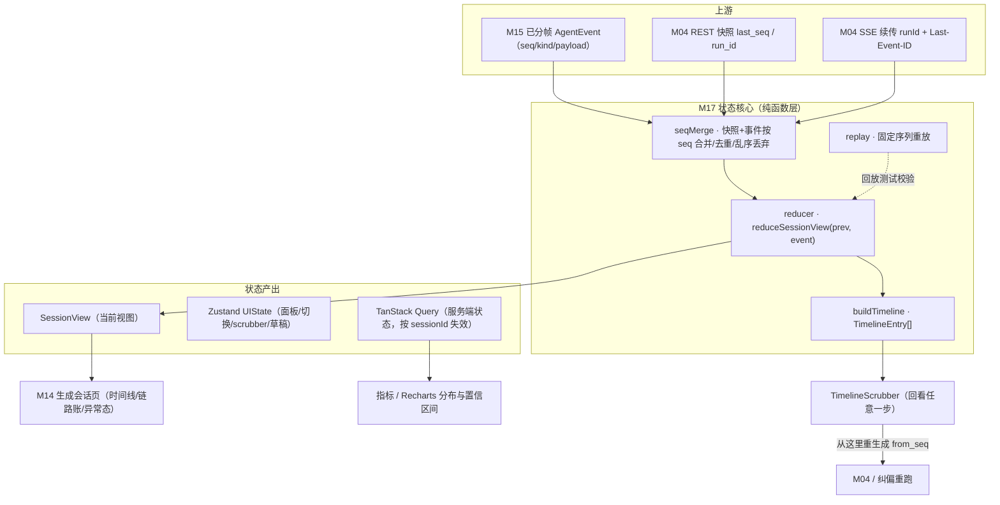
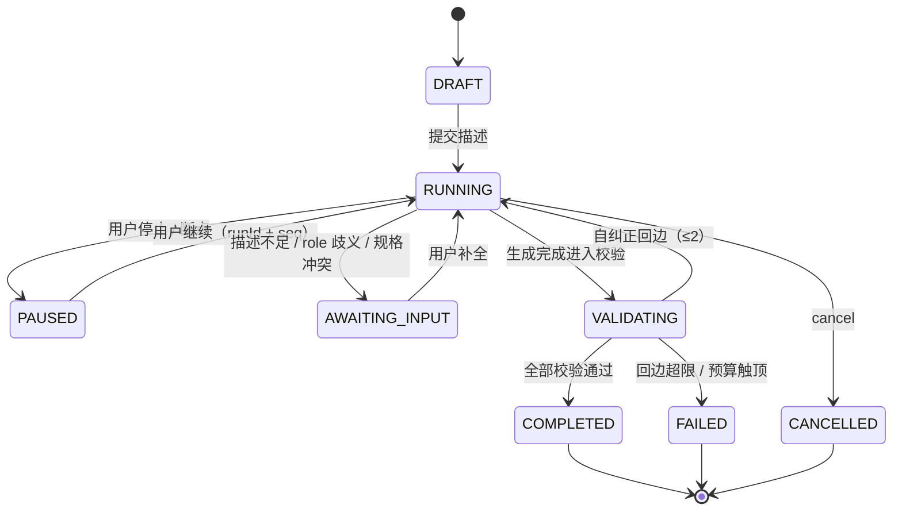
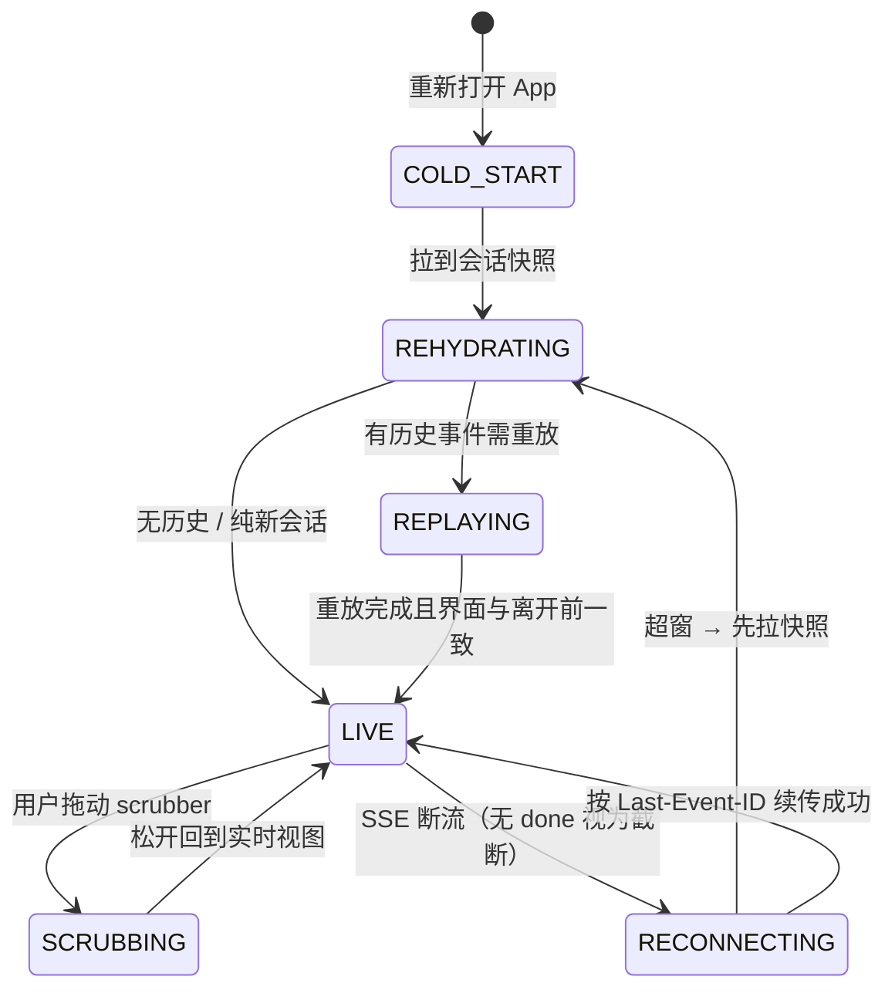

# M17 · 时间线回放与状态管理（原 W5）

> **文档类型**：可独立交付 / 可独立验收的模块设计文档
> **来源**：`设计方案.md` v1.1 §6.6、§6.4 亮点 3/8/9、§4.5、§4.2、§8 W5 行、§6.10、§7.3、§11.9、§2.6 X12/X1
> **版本**：v1.0　|　**拆分日期**：2026-11-15　|　**最近修订**：2026-11-16（v1.3，ADR-001 同步）　|　**状态**：设计定稿
> **对应编号**：W5 / FR-16 / X12（前端侧）、X1（前端侧）
> **主责应用或包**：`apps/web`（状态层 `src/state/`）、`packages/contracts`（消费 M02 事件 schema）
> **一句话定义**：用一条自研纯函数 `AgentEvent[] → SessionView` 把服务端 SSE 事件流与 REST 快照按 `seq` 归约成可回放、可单测的会话视图，并支撑时间线 scrubber 回看任意一步与跨天/月断点恢复。

---

## 0. 模块速览（零基础可读）

### 0.1 项目在做什么（本模块所需的最小背景）

WidgetPilot 是一个「用自然语言生成手机桌面控件」的 AI Agent 产品：规格为可选预填 + 缺省询问补全，系统不推断（v1.3 ADR-001 D-6），用户输入描述、可传附件，系统生成 TSX + React 代码，经编译与隔离沙箱测试后产出控件包。生成不是一次 HTTP 响应就结束，而是一条**长链路流式过程**——服务端按 `seq` 推送分通道类型化 SSE 事件（`plan` / `spec` / `code` / `guard` / `validation` / `sandbox` / `cost` / `artifact` …），用户会中途打断、纠偏、上滑回看，甚至**跨天/月回来继续**。因此前端不能只把事件「打印到屏幕上」，而必须把事件流确定性地归约成一份可回放的状态，才能做到「过程可回放、任意一步可纠偏、跨天回来界面与离开前一致」。本模块就是这份状态的唯一生产者。

### 0.2 本模块在端到端 14 步链路中的位置

```
① 登录 → 新建会话（grid 可选预填）
② 输入描述 + 上传附件 → 传输层校验 → 对象存储 → attachment_id
③ 语义层校验 → 不足则 AWAITING_INPUT
④ 进 LLM 护栏 → 命中不进模型
⑤ 意图与规格确定 → 预取生成规程
⑥ 上下文装配（固定槽位、硬过滤优先）
⑦ 生成回路：先出 WidgetSpec，再出 TSX + React 代码
⑧ 出 LLM 护栏（schema / 能力白名单 / PII / 规格一致）
⑨ 契约校验：spec ↔ manifest ↔ 代码能力声明 + hash
⑩ 沙箱：编译 → 渲染 → 尺寸/运行时错误/能力/交互断言 → 证据包
⑪ 生成 WidgetBundle，COMPLETED
⑫ artifact 事件 → 控件墙按 grid 真实比例渲染卡片
⑬ 评测合格 → 脱敏 → 入库门禁 → 公共语料（可撤回）
⑭ ★ 全流程按 seq 写 SSE 事件流与只追加审计；成本分账  ←── 本模块消费的事件流
```

本模块**不产生业务步骤**，而是横切消费第 ①–⑭ 步产生的**全部 SSE 事件与 REST 快照**：它是 §3.2 第 14 步「按 `seq` 写 SSE 事件流」的前端对偶，也是 §6.4 #8「跨天/月恢复」、#9「向前兼容」、亮点 3「时间线 scrubber」的实现处。原文 §8 W5 行把它定位为 `reducer 纯函数 / scrubber / Recharts`，验收为「任意一步可回看、可从该步重生成；回放测试全绿」。

### 0.3 为什么必须有这个模块

1. **流式过程必须可回放**：原文 §1.2 目标 3「前端做到流式可纠偏、过程可回放」。若事件只驱动一次性 DOM 更新，用户无法拖动 scrubber 回看任意一步的 spec、代码、护栏命中、沙箱结论与成本（§6.4 亮点 3）。
2. **状态不能存在前端内存里、跨天要能复原**：长链路会被打断、用户会跨天回来。原文 §6.4 #8 要求「重新打开 App → 拉会话快照 → `runId + Last-Event-ID` 重连续传 → 超窗先拉快照 → reducer 重放历史事件，界面与离开前一致」。这只有「事件可重放 + 纯函数归约」才能确定性保证。
3. **新 kind 不能破坏既有 reducer**：服务端事件协议会演进，原文 §4.5 / §6.4 #9 明确「前端 reducer 对未知 `kind` 必须忽略而非报错」「回放测试覆盖新旧混合事件序列」。
4. **§6.6 明确点名这是「前端最能讲细节的一块」**：固定事件序列重放，断言任意时刻的 `SessionView` 一致；回放测试是前端验收表与 §11.9 的核心判据。

### 0.4 上下游邻居（mermaid）

```mermaid
flowchart LR
  M04["M04 账号/会话/编排"] -->|REST 会话快照 last_seq / SSE 扇出 seq| M17
  M15["M15 分通道流式渲染"] -->|已分帧 AgentEvent（含 seq/kind/payload）| M17
  M02["M02 前后端契约"] -.AgentEvent / AgentEventKind / SessionState schema.-> M17
  M17 -->|SessionView / TimelineEntry[]| M14["M14 生成会话页（时间线/链路账/异常态）"]
  M17 -->|scrubber 位置 / 面板折叠 / 代码预览切换 / 草稿| Z["Zustand UI 状态（本模块拥有）"]
  M17 -->|从这里重生成 from_seq / 纠偏 roles| M04
  M17 -->|指标分布与置信区间| M11["M11 指标 / M10 评测"]
  M12["M12 前端工程化"] -.Vitest 回放测试 / Recharts / Recharts a11y 底座.-> M17
  M17 -.按 sessionId 精确失效.-> Q["TanStack Query（服务端状态）"]
```

- **上游**：M15 交付已分帧的 `AgentEvent`（M17 **不做底层分帧**）；M04 提供 REST 会话快照 `last_seq` 与 SSE 续传；M02 提供事件 / 枚举 schema。
- **下游**：M14 消费 `SessionView` 渲染时间线、链路账、异常态；M11/M10 提供指标数据由本模块用 Recharts 画分布与置信区间。
- **横切**：M17 承载 **X12（流式事件协议与前端回放）与 X1（会话状态与断点恢复）的前端侧**（原文 §2.6、00 总览 §5）。

### 0.5 原文对照表

| 本模块内容 | 原文章节 |
|---|---|
| 服务端状态 TanStack Query、按 `sessionId` 精确失效 | §6.6 |
| 自研 event-sourced reducer `AgentEvent[] → SessionView`、SSE 与 REST 快照按 `seq` 合并、幂等去重 | §6.6、§4.5 |
| 本地 UI 状态 Zustand（面板折叠 / 代码预览切换 / scrubber 位置 / 草稿输入） | §6.6 |
| 乐观更新仅用于可逆操作；包删除 / 取消生成不做乐观更新 | §6.6、§6.4 #2 |
| 回放测试固定序列重放、任意时刻 `SessionView` 一致 | §6.6、§6.10 |
| 时间线 scrubber 回看任意一步的 spec / 代码 / 护栏命中 / 沙箱结论 / 成本、从这里重生成 | §6.4 亮点 3、§6.10 |
| 跨天/月恢复：快照 + `runId + Last-Event-ID` 续传 + 超窗先拉快照 + reducer 重放 | §6.4 #8、§11.4 #6 |
| 未知 `kind` 忽略、新旧混合事件序列回放、按 `seq` 去重与乱序丢弃 | §4.5、§6.4 #9/#10 |
| Recharts 指标分布与置信区间 | §6.6、§6.8、§8 W5 行 |
| 事件协议 `AgentEvent` / `AgentEventKind` 完整定义 | §4.5 |
| 前后端职责划分（事件 schema 共担、状态枚举契约共担） | §7.3 |
| 契约测试 / 幂等与恢复 / 端到端冒烟判据 | §11.9 |

---

## 1. 模块定位与职责边界

### 1.1 为什么必须有（三个不可替代的职责）

1. **唯一的状态归约入口**：所有分通道事件必须经同一条纯函数归约成 `SessionView`，否则时间线、链路账、异常态各自维护状态会不一致，scrubber 也无法回看历史任意一步（原文 §6.6）。
2. **可恢复性的前端保证**：跨天/月恢复靠「快照 + 续传 + reducer 重放历史事件」，界面与离开前一致（原文 §6.4 #8）。这是 X1「挂起不占计算资源、跨天/月可恢复」在前端的落地点。
3. **向前兼容与可测性**：reducer 对未知 `kind` 忽略而非报错，回放测试覆盖新旧混合序列；纯函数使状态迁移可单测、可断言（原文 §4.5、§6.4 #9、§11.9）。

### 1.2 做什么（职责清单）

| # | 职责 | 说明 |
|---|---|---|
| R1 | 服务端状态分层 | TanStack Query 管会话快照 / 包列表 / 指标，按 `sessionId` 精确失效（§6.6） |
| R2 | 实时事件状态 | 自研 event-sourced reducer：`AgentEvent[] → SessionView`，纯函数、可回放、可单测 |
| R3 | 快照与事件合并 | SSE 事件与 REST 快照通过 `seq` 合并、幂等去重、乱序丢弃（§6.6、§6.4 #10） |
| R4 | 本地 UI 状态 | Zustand 管面板折叠、代码/预览切换、scrubber 位置、草稿输入（§6.6） |
| R5 | 乐观更新边界 | 仅附件本地预览 / 草稿 / 面板切换等可逆操作乐观；包删除 / 取消生成不乐观（§6.6） |
| R6 | 时间线构建 | 由事件序列生成 `TimelineEntry[]`，每步可回看 spec / 代码 / 护栏命中 / 沙箱结论 / 成本 |
| R7 | scrubber 回放 | 拖动回看任意一步视图；支持「从这里重生成」 |
| R8 | 跨天/月恢复 | 拉快照 → `runId + Last-Event-ID` 续传 → 超窗先拉快照 → reducer 重放历史事件 |
| R9 | 向前兼容 | reducer 对未知 `kind` 忽略而非报错；回放测试覆盖新旧混合序列 |
| R10 | 指标可视化 | Recharts 画指标分布与置信区间（报分布不报点估计，§1.6 指标口径） |
| R11 | 回放测试 | 固定事件序列重放，断言任意时刻 `SessionView` 一致（§6.6、§6.10） |

### 1.3 不做什么（明确排除，边界切割点）

| 不做 | 归属模块 | 边界说明 |
|---|---|---|
| SSE 底层分帧（`\n\n` 分帧 / 半帧缓存 / UTF-8 流式解码）、partial-JSON 容错解析、增量代码 patch 落地、rAF 节流、滚动锚定、abort 链路、背压 | **M15** | M17 接收 M15 已解析、已编号 `seq` 的 `AgentEvent`；**不做传输层与分帧**，只做归约 |
| 业务 UI 布局（输入区 / 规格预览卡 / 代码预览双轨 / 时间线组件本身 / 链路账 / 异常态的视觉呈现） | **M14** | M17 提供 `SessionView` 与 `TimelineEntry[]` 数据，不画业务组件布局 |
| 后端 `SessionState` 状态机、checkpoint / 租约 / 幂等副作用、`seq` 生成与 SSE 扇出 | **M04**、**M03** | M17 只消费 `phase`，不拥有权威状态；`seq` 连续性由服务端保证 |
| 事件 schema / 枚举的定义与生成、`packages/contracts` | **M02** | M17 消费 M02 生成的 `AgentEvent` / `SessionState` 类型 |
| 控件墙卡片渲染、包状态操作 | **M16** | M17 只按 `sessionId` 失效包列表查询键 |
| 指标计算、评测执行、告警 | **M10 / M11** | M17 只用 Recharts 展示指标分布与置信区间 |
| 具体业务组件与工程底座（构建 / 测试框架 / a11y / 监控） | **M13–M17 各自 / M12** | M17 是状态层，不实现业务组件，不提供工程门禁 |

> **边界最易混淆的一处**：M15 与 M17 都处理「流」，但 M15 是**传输与渲染层**（把字节流变成事件、把事件画到屏幕上、节流与重连），M17 是**状态层**（把事件归约成可回放的 `SessionView`）。M15 输出 `AgentEvent`，M17 输入 `AgentEvent`；二者通过「事件对象」解耦，回放测试因此可以完全脱离网络与 DOM。

### 1.4 输入 / 输出与上下游契约

| 方向 | 内容 | 契约形式 |
|---|---|---|
| 入 | 已分帧 `AgentEvent`（`seq` / `sessionId` / `runId` / `ts` / `kind` / `phase` / `payload` / `traceId`） | M15 交付（§4.2 / §6.2） |
| 入 | REST 会话快照（`session` / `last_seq` / `bundle_refs[]` / `run_id` / `checkpoint_rev` / `resume_hint`） | `GET /api/sessions/{id}`（§4.1） |
| 入 | SSE 续传参数（`runId` + `Last-Event-ID`）、超窗快照 | `GET /api/sessions/{id}/events` |
| 入 | 指标数据（分布 + 置信区间） | `GET /api/metrics`（M11） |
| 出 | `SessionView`（当前视图） | 供 M14 渲染 |
| 出 | `TimelineEntry[]`（每步快照） | 供 scrubber 回看 |
| 出 | Zustand `UIState`（面板/切换/scrubber/草稿） | 供 M14 交互组件 |
| 出 | 纠偏 / 从这里重生成请求 | `PATCH /api/sessions/{id}/attachment-roles`、【契约约定】`POST /api/sessions/{id}/regenerate` |
| 出 | `invalidateQueries(['bundles', sessionId])` 精确失效 | TanStack Query |

### 1.5 承载的横切能力 X*

- **X12（前端侧主承载）**：流式事件协议与前端回放 —— 分通道 SSE、`seq`、`Last-Event-ID`、event-sourced reducer、`seq` 去重与乱序丢弃、未知 kind 忽略（原文 §2.6、§8 X12 行）。与 M15 共担，M17 负责「回放」这一半。
- **X1（前端侧协同）**：会话状态与断点恢复 —— 跨天/月按 `runId + seq` 恢复后重放历史事件，界面与离开前一致（原文 §2.6、§6.4 #8）。后端状态机在 M04 / M03。

### 1.6 关键设计原则

1. **reducer 是纯函数**：`SessionView = reduce(events)` 无 I/O、无 `Date.now()`、无 `Math.random()`、不读写 DOM；同样的输入永远得到同样的输出（原文 §6.6「纯函数、可回放、可单测」、§11.3 `decide()` 同款思想）。
2. **事件是唯一事实来源**：`SessionView` 完全由事件序列导出，REST 快照只作为 `last_seq` 锚点与超窗兜底，不另立一套并行状态（§6.6）。
3. **`seq` 幂等与有序**：按 `seq` 去重与乱序丢弃；`seq <= maxAppliedSeq` 的事件丢弃（原文 §4.5、§6.4 #10）。
4. **向前兼容**：未知 `kind` 忽略而非报错；回放测试覆盖新旧混合事件序列（原文 §4.5、§6.4 #9）。
5. **可逆才乐观**：乐观更新仅用于附件本地预览、草稿、面板切换等可逆操作；包删除、取消生成等不可逆操作不做乐观更新（§6.6、§6.4 #2）。
6. **服务端裁决状态**：`phase` 来自事件的 `phase` 字段，前端不自行推断权威 `SessionState`（原文 §7.3「策略、隔离、门禁统一在服务端裁决」）。
7. **零 Agent 框架（D-5）**：reducer 自研，不引入 AI SDK / CopilotKit / AG-UI SDK（§6.8、§0 D-5）。

---

## 2. 技术栈

### 2.1 分层选型表

| 层 | 选型 | 版本 / 约束 | 为什么选 | 明确不用什么 |
|---|---|---|---|---|
| 框架 | React 19 + TypeScript + Vite（SPA） | 与全站一致（§6.8） | 状态层随 `apps/web` 交付 | 不用额外状态框架承载业务状态 |
| 服务端状态 | TanStack Query v5 | 按 `sessionId` 精确 `invalidateQueries` | 快照 / 轮询兜底 / 精确失效（§6.6、§6.8） | 不把服务端快照塞进 Zustand |
| 实时事件状态 | **自研 event-sourced reducer** | 纯函数 `AgentEvent[] → SessionView` | 可回放、可单测（§6.6） | **不用** Redux / XState / AI SDK / CopilotKit / AG-UI SDK / A2UI SDK；不做 token 刷屏 |
| 本地 UI 状态 | Zustand | 面板折叠 / 代码预览切换 / scrubber 位置 / 草稿输入 | 与服务端状态分层（§6.6） | 不把 `SessionView` 放进 Zustand |
| 事件协议校验 | Zod（消费 M02 生成的 schema） | final 严格校验；**reducer 不依赖它** | 事件边界校验由 M15/M02 完成 | 不在 reducer 里做网络校验 |
| 图表 | Recharts / ECharts | 指标分布 + 置信区间 | 报分布不报点估计（§6.8、§8 W5 行） | 不用单点估计图 |
| 列表（时间线） | `@tanstack/react-virtual` | 长事件序列虚拟化 | 长会话无掉帧（§6.10） | 不全量渲染历史步骤 |
| 契约 | OpenAPI 3.1 → `openapi-typescript`；事件/协议 Zod；枚举共享包 | M02 生成 | 单一事实来源（§6.9） | 不手写重复类型 |
| 测试 | Vitest + Testing Library + MSW（mock SSE/API）+ Playwright + Storybook | **事件序列回放测试是重点**（§6.8） | 固定序列重放可断言 | — |
| 质量 | Biome/ESLint、axe、Sentry、Lighthouse CI | WCAG 2.1 AA | a11y / 性能预算（§6.7、§6.8） | — |
| Agent 事件层 | 原生 `EventSource` / `fetch` + 自研 reducer | M15 分帧、M17 归约 | 分通道派发、seq 去重、心跳、重连与回放全部手写 | **不用** AI SDK / CopilotKit / AG-UI SDK |

### 2.2 硬约束（D-5 零 Agent 框架）

- **禁止引入**：Vercel AI SDK / `streamUI` / CopilotKit / AG-UI SDK / A2UI SDK / LangChain / LangGraph / Temporal / MCP SDK（原文 §11.1、§0 D-5）。reducer 与回放全部手写。
- **保留的通用基础设施**：React 19 / Vite / TypeScript / TanStack Query / Zustand / Zod / Recharts / `@tanstack/react-virtual`（原文 §11.1 保留清单）。
- **reducer 纯度硬约束**：不得引用 `window` / `document` / `Date.now()` / `Math.random()` / `fetch`；单测在 Node 环境即可跑，无需浏览器。
- **门禁无在线关闭开关**：`MAX_REPAIR=2` 等由后端裁决，前端只展示，不提供关闭回放 / 去重逻辑的开关。

### 2.3 运行时依赖

| 依赖 | 用途 | 不可用时的行为 |
|---|---|---|
| M15 事件流 | 已分帧 `AgentEvent` | 退化为 TanStack Query 轮询快照兜底；不自建分帧 |
| M04 `GET /api/sessions/{id}` | 会话快照 `last_seq` / `run_id` / `resume_hint` | 恢复失败展示错误态 + `ReasonCode`，不伪造状态 |
| M04 SSE `/events` | `runId + Last-Event-ID` 续传、心跳 | 无 `done` 视为截断并重连；超窗先拉快照 |
| M11 `/api/metrics` | 指标分布与置信区间 | 图表显示空态，不影响状态归约 |
| M02 `packages/contracts` | `AgentEvent` / `AgentEventKind` / `SessionState` 类型 | 类型不一致即构建失败 |
| M12 监控底座 | Sentry / 埋点 / Vitest 回放 | 埋点失败不影响归约主链路 |

### 2.4 monorepo 代码落位（§7.2）

```
apps/web/src/state/
  sessionView.ts          # SessionView / TimelineEntry 类型定义（本模块核心）
  reducer.ts              # reduceSessionView(prev, event) 纯函数；按 kind 派发
  replay.ts               # replay(events, initial?) / buildTimeline(events)
  seqMerge.ts             # mergeSnapshotAndEvents(snapshot, events)：seq 去重 + 乱序丢弃
  useSessionStream.ts     # 订阅 M15 事件 + 续传 + 重放，产出 SessionView
  useServerState.ts       # TanStack Query：会话快照 / 包列表 / 指标，按 sessionId 失效
  useUIStore.ts           # Zustand：面板折叠 / 代码预览切换 / scrubber 位置 / 草稿输入
  optimistic.ts           # 可逆操作乐观更新封装（白名单）
  timeline/
    TimelineScrubber.tsx  # 拖动回看任意一步（供 M14 布局内使用）
    regenerateFrom.ts     # 「从这里重生成」请求封装
  metrics/MetricChart.tsx # Recharts 分布 + 置信区间
  __tests__/
    replay.spec.ts        # 固定序列重放、任意时刻一致、新旧混合 kind（重点）
    seqMerge.spec.ts      # 去重 / 乱序 / 快照合并
    reducer.spec.ts       # 全 kind 分支、未知 kind 忽略
packages/contracts/        # M02：events.schema.json / enums（AgentEventKind / SessionState）
```

---

## 3. 设计架构

### 3.1 内部组件与职责（图 + 表）



| 组件 | 职责 | 关键不变量 |
|---|---|---|
| `seqMerge` | 快照 `last_seq` 与事件 `seq` 合并、去重、乱序丢弃 | 只接受 `seq > maxAppliedSeq`；重复 seq 丢弃 |
| `reducer` | 单个事件归约到 `SessionView` | 纯函数；未知 `kind` 返回 `prev` 不变 |
| `replay` | 从头重放事件序列 | 同一序列任意多次结果一致 |
| `buildTimeline` | 每步生成 `TimelineEntry` 快照 | 任意步含 spec / 代码 / 护栏 / 沙箱 / 成本 |
| `useSessionStream` | 订阅、续传、超窗、重放编排 | 恢复后 `SessionView` 与离开前一致 |
| `useServerState` | TanStack Query 服务端状态 | 按 `sessionId` 精确失效，不污染其他会话 |
| `useUIStore` | Zustand 本地 UI 状态 | 与 `SessionView` 分离；不可逆操作不乐观 |
| `TimelineScrubber` | 拖动回看 | 位置是 UI 态，不改变权威 `SessionView` |

### 3.2 处理流程与数据流（编号步骤）

1. 用户打开生成会话页 → `useServerState` 发 `GET /api/sessions/{id}` 取会话快照（`last_seq`、`run_id`、`phase`、`resume_hint`）。
2. `useSessionStream` 用 `runId + Last-Event-ID` 订阅 SSE 续传；M15 分帧后交付 `AgentEvent`。
3. `seqMerge` 以快照 `last_seq` 为 `maxAppliedSeq` 基线：丢弃 `seq <= maxAppliedSeq` 的重复/乱序事件，只保留严格递增的新事件。
4. `reduceSessionView(prev, event)` 按 `kind` 派发归约，更新 `SessionView`（spec 增量、代码 patch 累积、护栏命中列表、沙箱结论、成本、`phase`、`lastSeq`）。
5. 每个被接受的事件同时追加一条 `TimelineEntry`（深拷贝当前视图关键字段），供 scrubber 回看任意一步。
6. `artifact` 事件到达 → 除更新 `SessionView` 外，调用 `invalidateQueries(['bundles', sessionId])` 精确失效包列表（协同 M16 热更新）。
7. 收到 `interrupted` → `phase=PAUSED`，UI 切「已暂停 · 从 XX 继续」，**保留**已生成的部分 spec / 代码 / 规格卡（原文 §6.4 #7）。
8. 用户拖动 scrubber → 只改变 Zustand `scrubberSeq`（UI 态），回看渲染 `TimelineEntry[scrubberSeq]`，**不改变**权威 `SessionView`。
9. 用户点「从这里重生成」→ 发【契约约定】`POST /api/sessions/{id}/regenerate` `{ from_seq, roles? }`；附件 role 纠偏走原文 `PATCH /api/sessions/{id}/attachment-roles`（§4.4、§7.3）。
10. 用户关闭 App、跨天回来 → 重新打开 → 步骤 1 拉快照 → 若事件窗口超 N 条则**先拉快照再续流** → `replay(historicalEvents)` 重放历史事件 → 界面与离开前一致（§6.4 #8）。
11. 未知 `kind` 事件 → `reduceSessionView` 返回 `prev`（忽略、不报错、不追加 timeline 步骤）（§4.5、§6.4 #9）。
12. 指标数据 → `MetricChart` 用 Recharts 画分布与置信区间（报分布不报点估计，§1.6 指标口径）。

### 3.3 状态机

**A. 会话状态机（M17 消费 `phase`，不拥有；原文 §1.4 / §4.2）**



**B. 前端回放/恢复状态机（M17 拥有，【推导·需评审】）**



> `COLD_START/REHYDRATING/REPLAYING/LIVE/SCRUBBING/RECONNECTING` 为【推导·需评审】：原文只描述「重新打开 App → 拉快照 → 续传 → 重放」的行为，未给前端恢复状态枚举名。

### 3.4 关键机制、算法与不变量清单

**A. event-sourced reducer（核心，原文 §6.6）**

```ts
// 纯函数：无 I/O、无 Date.now、无 Math.random、不读写 DOM
export function reduceSessionView(prev: SessionView, event: AgentEvent): SessionView;
export function replay(events: AgentEvent[], initial?: SessionView): SessionView; // = events.reduce(reduceSessionView, initial ?? emptyView())
export function buildTimeline(events: AgentEvent[]): TimelineEntry[];
```

`SessionView` 完全由事件序列导出；同一序列任意多次 `replay` 结果一致（可单测）。`payload` 按 `kind` 用 discriminated union 收窄（原文 §4.5）。

**B. `seq` 合并与幂等去重（原文 §4.5、§6.4 #10）**

```ts
export function mergeSnapshotAndEvents(
  snapshot: SessionSnapshot,                 // 含 last_seq
  live: AgentEvent[],                       // SSE 新事件
  seen?: Set<number>                        // 已应用 seq 集合
): { ordered: AgentEvent[]; maxAppliedSeq: number; seen: Set<number> };
// 规则：seq <= last_seq 丢弃；seq 已见于 seen 丢弃；seq 非严格递增丢弃；其余按 seq 升序保留
```

**C. 时间线 scrubber（原文 §6.4 亮点 3）**：`TimelineEntry` 每步携带 `seq`、`kind`、`phase`、以及当步的 `spec` 快照、`code` 快照、`guardHits`、`sandbox`、`cost`；拖动 `scrubberSeq` 回看任意一步的 spec、代码、护栏命中、沙箱结论与成本。

**D. 乐观更新白名单（原文 §6.6）**：可逆操作（附件本地预览、草稿输入、面板折叠、代码/预览切换、scrubber 位置）走 Zustand 立即生效；不可逆操作（包删除、取消生成、安装、回滚、从这里重生成）**不做乐观更新**，等服务端确认。

**E. 向前兼容**：`reduceSessionView` 的 `default` 分支返回 `prev`，不抛错；回放测试覆盖新旧混合事件序列（含未知 `kind`）（§4.5、§6.4 #9）。

**不变量清单**

| # | 不变量 | 断言方式 |
|---|---|---|
| I1 | `reduceSessionView` 为纯函数（同输入同输出、无副作用） | 冻结输入 + 调用前后对象引用/内容断言 |
| I2 | `replay(events)` 多次运行结果深度一致 | `expect(replay(e)).toEqual(replay(e))` |
| I3 | 任意前缀 `replay(events[0..k])` 等于逐步归约到第 k 步的 `SessionView` | 前缀回放断言（§6.6「任意时刻一致」） |
| I4 | 未知 `kind` 被忽略，`SessionView` 不变、不抛错 | 注入 `future_kind` 断言 |
| I5 | 重复 `seq` / 乱序 `seq` 被丢弃，`lastSeq` 严格递增 | `seqMerge` 单元断言 |
| I6 | 快照 `last_seq` 之后的事件才被接受（超窗先拉快照） | 合并用例断言 |
| I7 | 恢复后 `SessionView` 与离开前一致（跨天） | 序列化快照比对 |
| I8 | 不可逆操作无乐观更新；可逆操作乐观 | 操作白名单单测 + DOM 快照 |
| I9 | `TimelineEntry[k]` 的 spec/代码/护栏/沙箱/成本与第 k 步一致 | scrubber 回看断言 |
| I10 | 按 `sessionId` 精确失效，不污染其他会话 Query 缓存 | `invalidateQueries` spy 断言 |

### 3.5 与其他模块的时序（关键 3 个场景）

**场景 1：正常流式归约**
`M04 SSE(seq) → M15 分帧 → M17 seqMerge → reduceSessionView → SessionView + TimelineEntry → M14 时间线/链路账；artifact 时 invalidateQueries(sessionId) → M16 热更新`

**场景 2：跨天/月恢复**
`重新打开 App → M13 恢复入口 → M17 GET /api/sessions/{id}(last_seq, run_id) → runId + Last-Event-ID 续传 → 超窗先拉快照 → replay(historicalEvents) → 界面与离开前一致（I7）`

**场景 3：拖动 scrubber 与从这里重生成**
`用户拖动 scrubber（仅改 Zustand scrubberSeq）→ 回看 TimelineEntry[k] 的 spec/代码/护栏/沙箱/成本 → 点「从这里重生成」→ POST /regenerate{from_seq}（或 PATCH attachment-roles 纠偏）→ 服务端开新 Run → 新事件流按 seq 继续归约`

### 3.6 部署形态与伸缩

| 形态 | 说明 |
|---|---|
| 纯前端状态层 | 随 `apps/web` 静态 SPA 交付，无独立服务、无服务端状态（§7.1） |
| 内存态 | `SessionView` / `TimelineEntry[]` / Zustand 在浏览器内存；**恢复不依赖内存**——靠快照 + 续传 + 重放重建（原文 §1.7 #5） |
| 长会话 | 时间线用 `@tanstack/react-virtual` 虚拟化；日志最多保留 N 行、大日志走对象存储引用（原文 §6.4 #10 背压） |
| 伸缩 | 无状态服务伸缩与本模块无关；回放测试在 CI 用 Vitest 并行跑固定序列 |

---

## 4. 接口契约

> 本节列出本模块**消费的全部接口**与**提供的内部纯函数接口**。REST 全表与统一响应由 M02 的 `packages/contracts/openapi.yaml` 生成；相关响应体为【契约约定】，最终以 `openapi.yaml` 为准。

### 4.1 消费 / 提供的接口表（方法 | 路径 | 权限 | 请求 | 响应 | 状态码）

| 方法 | 路径 | 权限 | 请求 | 成功响应（【契约约定】） | 状态码 |
|---|---|---|---|---|---|
| `GET` | `/api/sessions/{id}` | 本人（JWT） | — | `{ code:"OK", data:{ session, last_seq, bundle_refs[], run_id, checkpoint_rev, resume_hint } }` | 200 / 401 / 403 / 404 |
| `GET` | `/api/sessions/{id}/events` | 本人 + 短期 SSE ticket | Query/Header: `runId`, `Last-Event-ID` | `text/event-stream`（`AgentEvent` 帧） | 200 / 401 / 403 |
| `GET` | `/api/bundles` | 本人 | Query: `session_id` | `{ code:"OK", data:{ items, next_cursor } }` | 200 / 401 / 403 |
| `GET` | `/api/metrics` | 管理员 | Query: `metric`, `range` | `{ code:"OK", data:{ distribution, confidence_interval } }` | 200 / 401 / 403 |
| `PATCH` | `/api/sessions/{id}/attachment-roles` | 本人 | `{ roles:{ attachment_id, role }[] }` | `{ code:"OK", data:{ runId, state:"RUNNING" } }` | 202 / 400 / 403 / 422 |
| `POST` | `/api/sessions/{id}/regenerate`【契约约定】 | 本人 | `{ from_seq: number; roles?: PatchRolesReq["roles"] }` | `{ code:"OK", data:{ runId, state:"RUNNING" } }` | 202 / 400 / 403 / 409 |

> `regenerate` 路径、`from_seq` 字段、`checkpoint_rev`/`resume_hint`/`distribution`/`confidence_interval` 为【契约约定】或【推导·需评审】：原文 §6.4 亮点 3 只写「从这里重生成」、§4.4 只列 `PATCH attachment-roles`，未给通用重生成路径与这些字段名，由 **M02 定稿**到 `openapi.yaml`。

### 4.2 事件接口（SSE `kind` 与 payload）

M17 的 reducer 消费 §4.5 定义的**全部 `AgentEventKind`**，逐个 `kind` 归约到 `SessionView`。`AgentEvent` 统一带 `seq` / `sessionId` / `runId` / `ts` / `kind` / `phase` / `payload` / `traceId`（完整结构见 §6.2）。

| `kind` | payload 要点（【契约约定】） | reducer 对 `SessionView` 的归约动作 |
|---|---|---|
| `run` | `{ runId, phase, grid, attempt_no }` | 设 `runId` / `phase` / `grid`，重置本轮增量计数 |
| `plan` | `{ steps: string[] }` | 追加计划步骤条（结论式短句，非思维链） |
| `spec` | `{ delta: Partial<WidgetSpec> }` | 合并进 `spec`（partial JSON 渐进，字段边到边填） |
| `attachment` | `{ attachment_id, role, insight_ref }` | 更新 `attachments[]` 的 role 判定结果 |
| `skill` | `{ recipe_id, model_tier }` | 追加链路账小标签 |
| `routing` | `{ threshold_hit, widget_type }` | 追加路由/档位标签 |
| `code` | `{ from_line, to_line, text }` | 按行区间应用增量 patch 到 `code` 文档 |
| `guard` | `{ hits: { type, judge, ref }[] }` | 追加 `guardHits[]` |
| `validation` | `{ passed, items[], reason_code? }` | 追加 `validation[]`，失败项可展开证据 |
| `sandbox` | `{ passed, cases[], log_ref, snapshot_ref? }` | 更新 `sandbox` 结论 |
| `artifact` | `{ bundle_id, preview_ref, grid }` | 设 `bundleRef`；触发 `invalidateQueries(['bundles', sessionId])` |
| `cost` | `{ total, by_tier }` | 累加 `cost` |
| `checkpoint` | `{ rev, node, state_blob_ref }` | 记录 `checkpointRev`（只读展示） |
| `interrupted` | `{ reason_code, checkpoint_rev, resume_hint }` | `phase=PAUSED`，保留部分 spec/代码 |
| `notice` | `{ message, code? }` | 追加通知到链路账 |
| `ask_user` | `{ question_id, question, options?, allow_text, clarify_count, clarify_limit }`（v1.3 ADR-001 D-7） | `phase=AWAITING_INPUT` 挂起：保留已生成 spec/代码与 `clarify_count` checkpoint；用户经 `POST /api/sessions/{id}/clarifications` 回答后，由后续 `run` 事件恢复 `RUNNING` 继续归约（`GENERATING → AWAITING_INPUT → GENERATING` 显式状态转移） |
| `error` | `{ code: ReasonCode, evidenceRef? }` | `phase=FAILED`，记录原因码 + 证据引用 |
| `done` | `{ bundle_id? }` | 标记终态，停止续传等待 |
| **未知 `kind`** | 任意 | **返回 `prev` 不变、不抛错、不追加 timeline 步骤**（向前兼容，§4.5 / §6.4 #9） |

> 分通道约定（原文 §4.5 / §6.4）：`plan` 结论式短句、`spec` partial JSON、`code` 行级增量 patch、`guard/validation/sandbox` 分步清单、`artifact` 原子替换、`cost/checkpoint/interrupted/notice/error/done` 状态与账目。M17 只做归约，**渲染策略由 M15 / M14 负责**。

### 4.3 内部接口与函数签名（TS / Python）

```ts
// apps/web/src/state/sessionView.ts
export type SessionView = { /* 完整定义见 §6.2 */ };
export type TimelineEntry = { /* 完整定义见 §6.2 */ };

// apps/web/src/state/reducer.ts —— 纯函数
export function reduceSessionView(prev: SessionView, event: AgentEvent): SessionView;
export function emptyView(sessionId: string): SessionView;

// apps/web/src/state/replay.ts
export function replay(events: AgentEvent[], initial?: SessionView): SessionView;
export function replayPrefix(events: AgentEvent[], k: number): SessionView; // 任意时刻视图
export function buildTimeline(events: AgentEvent[]): TimelineEntry[];

// apps/web/src/state/seqMerge.ts
export function mergeSnapshotAndEvents(
  snapshot: SessionSnapshot, live: AgentEvent[], seen?: Set<number>
): { ordered: AgentEvent[]; maxAppliedSeq: number; seen: Set<number> };
export function dedupeBySeq(events: AgentEvent[]): AgentEvent[]; // 去重 + 乱序丢弃

// apps/web/src/state/useUIStore.ts —— Zustand
export const useUIStore: UseBoundStore<StoreApi<UIState>>;
export function setScrubberSeq(seq: number | null): void;
export function togglePanel(id: PanelId): void;
export function setDraft(text: string): void; // 可逆：乐观
// 【契约约定】可逆乐观更新白名单
export function optimistic<T>(key: ReversibleKey, patch: Partial<T>): void;

// apps/web/src/state/useServerState.ts —— TanStack Query
export function useSessionSnapshot(sessionId: string): UseQueryResult<SessionSnapshot>;
export function invalidateSession(sessionId: string): void; // 精确失效
export function invalidateBundles(sessionId: string): void;

// apps/web/src/state/timeline/regenerateFrom.ts
export async function regenerateFrom(sessionId: string, fromSeq: number): Promise<void>;
export async function patchAttachmentRoles(sessionId: string, roles: PatchRolesReq["roles"]): Promise<void>;
```

**Python 侧对照（M03 事件源，M17 只消费其产物，函数签名【契约约定】）**

```python
# packages/agent_core/events/replay.py（由 M03 定义，此处仅示例对照）
def emit(seq: int, phase: str, decision: Decision) -> AgentEvent: ...
def replay(events: list[AgentEvent]) -> dict: ...
```

**被调用的上游接口**：M15 通过 `onEvent(ev: AgentEvent)` 回调交付已分帧事件；M04 在恢复时返回快照；M02 通过生成类型约束 `AgentEvent` 字段。

### 4.4 统一响应与错误码

统一响应（原文 §4.4 / §6.9，完整见 §6.2）：`{ code, message, traceId, retryable, evidenceRef? }`，`code` 与 `ReasonCode` 对齐，成功 `"OK"`。M17 的 `error` 事件携带 `code` + `evidenceRef`；`SessionView.phase=FAILED` 时必须带原因码与证据引用，**前端不得只显示「失败」**（§1.4、§8 全局口径）。

### 4.5 幂等、重试、超时、限流、并发约定

| 项 | 约定 |
|---|---|
| 幂等 | 事件按 `seq` 幂等去重（相同 `seq` 二次到达不改变 `SessionView`）；`replay` 天然幂等 |
| 重试 | SSE 断流按 `Last-Event-ID` 续传；超窗先拉快照；瞬时故障指数退避有上限；业务 `error` 事件不自动重试 |
| 超时 | 心跳保活；无 `done` 的断流视为截断并重连；重连后先 `mergeSnapshotAndEvents` 再归约 |
| 限流 / 背压 | 事件入队按 `seq` 去重与乱序丢弃；日志最多保留 N 行；大日志走对象存储引用（原文 §6.4 #10） |
| 并发 | 单会话事件严格按 `seq` 串行归约；不同会话 `SessionView` 隔离，`invalidateQueries` 按 `sessionId` 精确失效 |
| 乐观更新 | 仅可逆操作（附件本地预览 / 草稿 / 面板切换 / scrubber）；包删除 / 取消生成等不可逆操作不做乐观更新 |
| 乱序 | `seq <= maxAppliedSeq` 或 `seen` 命中的事件丢弃 |

### 4.6 接口状态表（契约状态 / 运行态 / 可重试）

| 接口 | 契约状态 | 运行态 | 可重试 | 说明 |
|---|---|---|---|---|
| `GET /api/sessions/{id}` | 定稿（原文 §4.4） | 同步 | 是 | 恢复锚点 `last_seq` / `run_id` |
| `GET /api/sessions/{id}/events` | 定稿 | **流式**（长连接） | 是（`Last-Event-ID`） | 需短期 ticket；无 `done` 视为截断 |
| `GET /api/bundles` | 定稿 | 同步 | 是 | `artifact` 到达时精确失效 |
| `GET /api/metrics` | 定稿（原文 §4.4） | 同步 | 是 | 指标分布与置信区间 |
| `PATCH /api/sessions/{id}/attachment-roles` | 定稿 | 异步（202 + SSE） | 否（需幂等键） | 纠偏后从该步重跑 |
| `POST /api/sessions/{id}/regenerate` | **【契约约定】** | 异步（202 + SSE） | 否 | 原文只写「从这里重生成」，路径/字段待 M02 定稿 |
| 内部 `reduceSessionView` / `replay` / `seqMerge` | 定稿（原文 §6.6 给出机制） | 同步纯函数 | — | 函数签名为【契约约定】 |
| `SessionView` / `TimelineEntry` 字段 | **【推导·需评审】** | — | — | 原文只给 `AgentEvent[] → SessionView` 方向，未给字段 |
| `401/403/409` 业务码映射 | **待 M02 定稿** | — | — | 原文 `ReasonCode` 未含鉴权/冲突码 |

---

## 5. 状态、原因码与 API 状态

### 5.1 拥有或参与的状态机与完整枚举（TS 定义）

```ts
// 原文 §4.2：会话状态（M17 消费 phase，不拥有）
type SessionState =
  | "DRAFT" | "RUNNING" | "PAUSED" | "AWAITING_INPUT" | "VALIDATING"
  | "COMPLETED" | "FAILED" | "CANCELLED";

// 原文 §4.5：事件 kind（完整枚举，reducer 全量消费；v1.3 ADR-001 D-7 新增 ask_user，共 18 种）
type AgentEventKind =
  | "run" | "plan" | "spec" | "attachment" | "skill" | "routing"
  | "code" | "guard" | "validation" | "sandbox" | "artifact"
  | "cost" | "checkpoint" | "interrupted" | "notice" | "error" | "done"
  | "ask_user";   // v1.3 新增

// 原文 §4.2：会话携带的规格 / 类型 / 档位
type GridSpec = "2x2" | "2x4" | "4x2" | "4x4" | "2x1" | "1x2";
type WidgetType = "calendar" | "clock" | "alarm" | "task" | "custom";
type AttachmentRole = "visual_reference" | "content_extraction" | "data_source" | "style_reference";
type Capability = "date" | "timer" | "local_storage" | "static_data" | "theme" | "locale";
type ModelTier = "cheap" | "standard" | "frontier";

// 原文 §4.2：ReasonCode（完整， reducer 消费 error/validation 事件的 code；v1.3 ADR-001 新增 3 个）
type ReasonCode =
  | "INPUT_INVALID" | "INTENT_OUT_OF_SCOPE" | "GUARD_INPUT_HIT" | "GUARD_OUTPUT_HIT"
  | "SPEC_CONFLICT" | "CAPABILITY_DENIED" | "CONTRACT_MISMATCH" | "COMPILE_FAILED"
  | "SANDBOX_TEST_FAILED" | "RETRY_EXHAUSTED" | "BUDGET_EXHAUSTED"
  | "SANDBOX_UNAVAILABLE" | "HUMAN_REQUIRED" | "MODEL_ERROR"
  | "SPEC_MISSING" | "CLARIFICATION_REQUIRED" | "CLARIFICATION_LIMIT";   // v1.3 新增

// 【推导·需评审】前端恢复/回放状态机（原文只给行为未给枚举名）
type ReplayPhase =
  | "COLD_START" | "REHYDRATING" | "REPLAYING" | "LIVE" | "SCRUBBING" | "RECONNECTING";

// 【推导·需评审】本地 UI 枚举
type PanelId = "timeline" | "ledger" | "trace" | "evidence";
type ViewMode = "code" | "preview";
type ReversibleKey = "attachment_preview" | "draft" | "panel_toggle" | "view_mode" | "scrubber";
```

**终态**：`SessionState` 的 `COMPLETED` / `FAILED` / `CANCELLED`（收到 `done` / `error` 后不再续传）；`ReplayPhase` 的 `LIVE` 为稳定态。

### 5.2 状态流转表

| 触发 | 前态 | 后态 | 副作用 | 事件 `kind` |
|---|---|---|---|---|
| 新建/提交 | `DRAFT` | `RUNNING` | 设 `runId`，开始归约 | `run` |
| `interrupt` | `RUNNING` | `PAUSED` | 保留部分 spec/代码，UI 切「已暂停 · 从 XX 继续」 | `interrupted` |
| `resume` / 续传 | `PAUSED` | `RUNNING` | 按 `runId + seq` 恢复、重放 | `run` |
| 描述不足 / role 歧义 / 规格冲突 / 规格缺失 / 模型执行中澄清（v1.3） | `RUNNING` | `AWAITING_INPUT` | 保存 timeline 步 | `notice` / `ask_user`（v1.3） |
| 用户回答澄清（`POST /clarifications`，v1.3） | `AWAITING_INPUT` | `RUNNING` | `clarify_count += 1`，按续传恢复归约 | `run` |
| 生成完成进入校验 | `RUNNING` | `VALIDATING` | 归约 `validation` / `sandbox` | `validation` / `sandbox` |
| 自纠正回边（≤2） | `VALIDATING` | `RUNNING` | `REPAIR`，`repairCount += 1` | `notice` |
| 全部通过 | `VALIDATING` | `COMPLETED` | `artifact` + `invalidateBundles(sessionId)` + `done` | `artifact` / `done` |
| 回边超限 / 预算触顶 | `VALIDATING` | `FAILED` | 原因码 + 证据引用 + 保留部分产物 | `error` |
| `cancel` | 任意非终态 | `CANCELLED` | 释放，标记终态 | `interrupted` |
| 重新打开 App | `[*]` | `COLD_START` → `REHYDRATING` → `REPLAYING` → `LIVE` | 拉快照 + 续传 + 重放 | — |
| 拖动 scrubber | `LIVE` | `SCRUBBING` | 仅改 Zustand `scrubberSeq` | — |

### 5.3 ReasonCode 子集（本模块消费）

M17 通过 `error` / `validation` / `interrupted` / `notice` 事件消费原因码，写入 `SessionView.failure` 与 `TimelineEntry`，供 M14 展示「不显示裸失败」。重点子集：

| 码 | 本模块处理 |
|---|---|
| `INPUT_INVALID` / `SPEC_CONFLICT` | `phase=AWAITING_INPUT`，timeline 记录补充建议 |
| `GUARD_INPUT_HIT` / `GUARD_OUTPUT_HIT` | 追加 `guardHits[]`，可展开证据 |
| `CONTRACT_MISMATCH` / `COMPILE_FAILED` / `SANDBOX_TEST_FAILED` | 追加 `validation[]` / `sandbox`，标失败项 |
| `CAPABILITY_DENIED` | `validation` 记录拒绝项 |
| `RETRY_EXHAUSTED` / `BUDGET_EXHAUSTED` / `HUMAN_REQUIRED` | `phase=FAILED`，写 `evidenceRef` |
| `SANDBOX_UNAVAILABLE` / `MODEL_ERROR` | `notice` 降级记录；状态不直接 `FAILED` |

> 完整 14 个 `ReasonCode` 见原文 §4.2；所有 `FAILED` 必须携带 `evidenceRef`。

### 5.4 HTTP 状态码与业务码映射

| HTTP | 场景 | `code` | `retryable` |
|---|---|---|---|
| 200 | 快照 / 指标 / 包列表查询成功 | `OK` | — |
| 202 | 纠偏 / 重生成已受理 | `OK` | — |
| 400 | 请求体 / `from_seq` 非法 | `INPUT_INVALID` | `false` |
| 401 | 未登录 / JWT 失效 | 【待 M02 定稿】 | `false` |
| 403 | 越权访问他人会话 / SSE / 指标 | 【待 M02 定稿】 | `false` |
| 404 | 会话不存在 | 【契约约定：`INPUT_INVALID` 或扩充】 | `false` |
| 409 | 对终态会话重复重生成 / 状态冲突 | 【待 M02 定稿】 | `false` |
| 422 | role 纠偏语义校验失败 | `INPUT_INVALID` | `false` |
| 429 | 限流 / 配额触顶 | `BUDGET_EXHAUSTED` | `false` |
| 503 | 模型 / 沙箱不可用 | `SANDBOX_UNAVAILABLE` / `MODEL_ERROR` | `true`（有上限退避） |

> `401/403/409` 业务码由 **M02 定稿**「扩充枚举」或「复用现有码」并在 CI 固定（基线 §5.3）。

### 5.5 接口运行态约定（同步 / 异步 / 流式 / 挂起态 / 终态行为）

- **同步接口**：`GET /sessions/{id}` / `/metrics` / `/bundles` 请求即得到终态结论。
- **异步接口**：`PATCH attachment-roles` / `POST regenerate` 返回 `202` 只是「已受理」，**真正结论只能通过 SSE 事件或快照获取**，前端不得把 202 当成功。
- **流式接口**：`/events` 为长连接，终态由显式 `done` / `error` 标志；无 `done` 的断连一律视为截断并重连。
- **挂起态行为**：`PAUSED` / `AWAITING_INPUT` 下快照正常返回 `checkpoint_rev` + `resume_hint`；`SessionView` 保留已生成部分 spec / 代码；续传按 `runId + seq`。
- **终态行为**：`COMPLETED` / `FAILED` / `CANCELLED` 下不再续传；`replay(historicalEvents)` 仍可离线重放整条历史；scrubber 可回看整个 timeline。
- **超窗行为**：事件窗口超 N 条时先拉快照再续流，快照 `last_seq` 作为 `maxAppliedSeq` 基线（I6）。

---

## 6. 核心字段与元数据

### 6.1 核心字段表（字段 | 类型 | 约束 | 含义）

| 字段 | 类型 | 约束 | 含义 |
|---|---|---|---|
| `AgentEvent.seq` | `number` | 每会话单调递增 | 续传游标、去重与乱序丢弃依据 |
| `AgentEvent.sessionId` | `string` | 非空 | 会话锚点，按 `sessionId` 精确失效 |
| `AgentEvent.runId` | `string` | 非空 | 重连与跨天恢复锚点 |
| `AgentEvent.ts` | `string` | UTC | 时间线显示带时区 |
| `AgentEvent.kind` | `AgentEventKind` | 枚举 | 分通道派发 |
| `AgentEvent.phase` | `SessionState` | 枚举 | 权威状态，前端不推断 |
| `AgentEvent.payload` | `unknown` | 按 kind 收窄 | 分通道载荷 |
| `AgentEvent.traceId` | `string` | 非空 | 关联 trace / 证据 |
| `SessionView.sessionId` / `runId` | `string` | 非空 | 视图归属 |
| `SessionView.phase` | `SessionState` | 枚举 | 当前权威状态 |
| `SessionView.lastSeq` | `number` | ≥ 0 | 已应用最大 seq |
| `SessionView.spec` | `Partial<WidgetSpec>` | 渐进合并 | 规格预览卡数据源 |
| `SessionView.code` | `string` | 增量 patch 累积 | 代码/预览双轨数据源 |
| `SessionView.attachments` | `{ attachment_id, role, insight_ref }[]` | — | 附件 role 判定 |
| `SessionView.guardHits` | `{ type, judge, ref }[]` | — | 护栏命中 |
| `SessionView.validation` | `{ passed, items[], reason_code? }[]` | — | 校验分步清单 |
| `SessionView.sandbox` | `{ passed, cases[], log_ref, snapshot_ref? } \| null` | — | 沙箱结论 |
| `SessionView.cost` | `{ total, by_tier }` | — | 成本账 |
| `SessionView.bundleRef` | `string?` | — | `artifact` 产物引用 |
| `SessionView.failure` | `{ code, evidenceRef }?` | `FAILED` 时必填 | 原因码 + 证据引用 |
| `TimelineEntry.seq` | `number` | 对应事件 seq | scrubber 定位 |
| `TimelineEntry.snapshot` | `SessionView` 关键字段深拷贝 | — | 任意一步回看 |
| `UIState.scrubberSeq` | `number \| null` | `null` = 实时 | scrubber 位置 |
| `UIState.panels` | `Record<PanelId, boolean>` | — | 面板折叠 |
| `UIState.viewMode` | `ViewMode` | — | 代码 / 预览切换 |
| `UIState.draft` | `string` | — | 草稿输入 |
| `SessionSnapshot.last_seq` | `bigint` | ≥ 0 | 恢复基线 |
| `SessionSnapshot.run_id` | `string` | — | 续传锚点 |
| `SessionSnapshot.checkpoint_rev` | `int`【契约约定】 | ≥ 0 | 只读展示 |
| `SessionSnapshot.resume_hint` | `string`【契约约定】 | — | 「从 XX 继续」文案依据 |

> `SessionView` / `TimelineEntry` / `UIState` / `SessionSnapshot` 的字段为【推导·需评审】：原文 §6.6 只给出 `AgentEvent[] → SessionView` 方向与 Zustand 四类 UI 状态，未给字段级定义。

### 6.2 相关协议 schema 完整定义（相关片段完整抄入）

**事件协议 `AgentEvent` / `AgentEventKind`（原文 §4.5，完整抄入；v1.3 扩充 18 种）**

```ts
type AgentEventKind =
  | "run" | "plan" | "spec" | "attachment" | "skill" | "routing"
  | "code" | "guard" | "validation" | "sandbox" | "artifact"
  | "cost" | "checkpoint" | "interrupted" | "notice" | "error" | "done"
  | "ask_user";   // v1.3 新增（ADR-001 D-7）

type AgentEvent = {
  seq: number;                 // 每会话单调递增
  sessionId: string;
  runId: string;               // 重连与跨天恢复的锚点
  ts: string;
  kind: AgentEventKind;
  phase: SessionState;
  payload: unknown;            // 按 kind 用 discriminated union 收窄
  traceId: string;
};
```

**可靠性与向前兼容（原文 §4.5，完整抄入）**

```
- 分通道：plan（结论式计划）、spec（partial JSON 渐进）、attachment（role 判定结果）、
  code（增量 patch）、validation（护栏/契约/沙箱结果）、artifact（产物就绪）、
  notice（成本、降级、提示）。每类独立渲染组件。
- 可靠性：Last-Event-ID 续传 + 服务端保留最近 N 条，超窗先拉快照；心跳保活；
  显式 done / error；事件按 seq 在前端 reducer 去重与乱序丢弃。
- 中断语义：interrupt 不是关闭连接——服务端写 checkpoint，流上推 interrupted，
  UI 切为「已暂停 · 从 XX 继续」；重连按 runId + seq 恢复。
- 向前兼容：前端 reducer 对未知 kind 必须忽略而非报错。
```

**`SessionView` / `TimelineEntry`（【推导·需评审】完整定义，本模块核心）**

```ts
type SessionView = {
  sessionId: string;
  runId: string;
  phase: SessionState;
  lastSeq: number;
  maxAppliedSeq: number;
  grid: GridSpec | null;
  spec: Partial<WidgetSpec>;
  code: string;
  attachments: { attachment_id: string; role: AttachmentRole; insight_ref: string }[];
  plan: string[];
  skillTags: { recipe_id: string; model_tier: ModelTier }[];
  guardHits: { type: string; judge: string; ref: string }[];
  validation: { passed: boolean; items: string[]; reason_code?: ReasonCode }[];
  sandbox: { passed: boolean; cases: { name: string; passed: boolean; detail_ref: string }[]; log_ref: string; snapshot_ref?: string } | null;
  cost: { total: number; by_tier: Partial<Record<ModelTier, number>> };
  bundleRef: string | null;
  checkpointRev: number | null;
  failure: { code: ReasonCode; evidenceRef?: string } | null;
  repairCount: number;
};

type TimelineEntry = {
  seq: number;
  kind: AgentEventKind;
  phase: SessionState;
  ts: string;
  snapshot: SessionView;   // 当步深拷贝：含 spec / code / guardHits / sandbox / cost
};
```

**Zustand `UIState`（【推导·需评审】完整定义）**

```ts
type UIState = {
  panels: Record<PanelId, boolean>;   // timeline / ledger / trace / evidence 折叠
  viewMode: ViewMode;                 // "code" | "preview"
  scrubberSeq: number | null;         // null = 跟随实时
  draft: string;                      // 草稿输入
  setScrubberSeq(seq: number | null): void;
  togglePanel(id: PanelId): void;
  setViewMode(mode: ViewMode): void;
  setDraft(text: string): void;
};
```

**统一响应（原文 §4.4 / §6.9，完整抄入）**

```ts
type ApiResponse<T> = {
  code: string;            // 成功 "OK"；失败为 ReasonCode
  message: string;
  traceId: string;
  retryable: boolean;
  evidenceRef?: string;
  data?: T;                // 【契约约定】成功载荷
};
```

**会话快照 `SessionSnapshot`（【契约约定】请求/响应细化）**

```ts
type SessionSnapshot = {
  session: { id: string; user_id: string; title: string; state: SessionState; grid: GridSpec; last_seq: number };
  last_seq: number;
  bundle_refs: string[];
  run_id: string;
  checkpoint_rev: number;       // 【契约约定】
  resume_hint: string;          // 【契约约定】
};
```

### 6.3 枚举与常量

| 常量 / 枚举 | 值 | 含义 |
|---|---|---|
| `AgentEventKind` | 见 §6.2 完整 TS 定义 | 分通道类型，reducer 全量消费 |
| `SessionState` | 见 §5.1 完整 TS 定义 | 前后端共用同一枚举 |
| `ReasonCode` | 见 §5.1 完整 TS 定义（17 个，v1.3 ADR-001 新增 3 个） | 与错误码对齐 |
| `MAX_REPAIR` | `2`（D-2） | 回边上限，前端只展示 `repairCount` |
| `MAX_ITER` | `12`（§11.3） | agent loop 上线常量，前端不裁决 |
| SSE 保留窗口 N | 【推导·需评审】建议 `500` | 超窗先拉快照再续流 |
| 日志保留行数 N | 【推导·需评审】建议 `1000` | 日志窗口化（§6.4 #10） |
| `ReversibleKey` | `attachment_preview` / `draft` / `panel_toggle` / `view_mode` / `scrubber` | 乐观更新白名单（§6.6） |

### 6.4 manifest / hash / 版本 / 快照 / trace 等元数据

| 元数据 | 字段 | 用途 |
|---|---|---|
| 事件 `seq` | `AgentEvent.seq` / `SessionView.lastSeq` | 去重、乱序丢弃、续传游标 |
| `runId` | `AgentEvent.runId` / `SessionSnapshot.run_id` | 跨天恢复锚点 |
| `Last-Event-ID` | SSE header/query | 断线重连续传 |
| checkpoint | `checkpoint` 事件 `{ rev, node, state_blob_ref }`、`SessionSnapshot.checkpoint_rev` | 只读展示「从 XX 继续」 |
| trace | `AgentEvent.traceId` | 关联证据链，链路账展开 trace |
| 证据引用 | `SessionView.failure.evidenceRef` | 失败时指向证据，不显示裸失败 |
| 成本账 | `SessionView.cost.total` / `by_tier` | 链路账、Recharts 分布 |
| 快照 | `TimelineEntry.snapshot` | scrubber 任意步回看 |
| hash / 版本 | 由 M09 的 `WidgetBundle.hash` / `versions[]` 提供 | M17 只展示引用，不计算 |

### 6.5 大对象与引用规范

| 前缀 | 内容 | 要求 |
|---|---|---|
| `checkpoint/{run_id}/{rev}.json` | 状态快照 | 大对象不入库；M17 只展示 `rev` 与 `state_blob_ref` 引用 |
| `evidence/{session_id}/{run_id}/sandbox.log` / `snapshot.png` | 沙箱日志 / 快照 | `sandbox.log_ref` / `snapshot_ref` 指向，详情只读 |
| `eval/{case_id}/replay.json` | 离线回放轨迹 | 与 M10 回放评测共用轨迹格式（延伸，非本模块产物） |
| `code/{session_id}/{run_id}/widget.tsx` | TSX 源码 | M17 的 `SessionView.code` 是增量 patch 累积的字符串，**不代替大对象引用** |

> 引用规范全文由 M02 `packages/contracts` 固定（基线 §9，【推导·需评审】）。所有引用必须带 `hash`，读取时校验；日志最多保留 N 行，大日志走对象存储引用（§6.4 #10）。

---

## 7. 安全、威胁面与合规

| 不可信输入 | 攻击路径（原文 §2.3） | 本模块控制点 | 明确禁止 |
|---|---|---|---|
| SSE 事件 `payload` | 伪造 / 夹带注入指令的事件影响视图 | 按 M02 Zod schema 校验边界；`payload` 按 `kind` 收窄；reducer 不做 `eval` | 禁止 `eval(payload)`；禁止把 payload 直接 `innerHTML` |
| 事件 `seq` | 重复 / 乱序 / 倒序注入破坏状态 | `seqMerge` 去重与乱序丢弃；`seq` 严格递增 | 禁止信任乱序事件；禁止前端自增权威 seq |
| 未知 `kind` | 协议演进导致 reducer 崩溃 | `default` 分支返回 `prev`，忽略不报错 | 禁止 `throw` 未知 kind |
| 会话 / 事件归属 | ⑤ 越权访问他人会话 / 订阅他人 SSE | 按 `sessionId` 精确失效；服务端按 `user_id` 过滤每个请求与每条事件 | 禁止只靠前端隐藏；禁止信任前端传的 `user_id` |
| 公共语料 / 检索结果 | ④ 跨用户投毒、夹带注入 | 本模块只把检索引用当普通数据展示，不执行 | 禁止把检索到的历史代码回喂执行 |
| 草稿 / 附件预览 | XSS via 草稿文本 | 可逆乐观更新只改 UI 态，文本以 React 转义渲染 | 禁止 `dangerouslySetInnerHTML` |
| 不可逆操作 | 误删 / 重放导致重复副作用 | 包删除 / 取消生成不做乐观更新，等服务端确认 | 禁止乐观更新不可逆操作 |

**明确禁止**：reducer 内任何 I/O 与不确定性来源；`eval` / `innerHTML` 处理事件 payload；乐观更新包删除 / 取消生成；把 `202` 当生成成功；显示裸「失败」。

**审计留证要求**：本模块不产生 `AuditEvent`（由 M04/M11），但必须保留 `traceId` 与 `evidenceRef` 用于「完整重放一次会话」；回放测试的固定事件序列与断言快照应作为可复跑证据（§11.9「快照一致」）。`FAILED` 视图必须带 `code` + `evidenceRef`。

**合规**：附件原文 / 账号 / PII 永不进公共语料（D-1）；时间线显示带时区（§6.7）；会话与事件按 `user_id` 隔离；留存期可配置。

---

## 8. 独立验收方案（可脱离其他模块单独提测）

### 8.1 验收前置条件与上下游桩

| 依赖 | 本模块验收时的桩 | 说明 |
|---|---|---|
| M15 事件流 | **固定 `AgentEvent[]` 夹具**（含全 kind、重复 seq、乱序 seq、未知 kind、新旧混合序列） | reducer 是纯函数，无需真实网络 |
| M04 快照 / SSE | **MSW mock** `GET /sessions/{id}`（返回 `last_seq` / `run_id`）、模拟续传帧 | 无需真实后端 |
| M11 指标 | 返回固定 `distribution` + `confidence_interval` | 验证 Recharts 出图，不验证统计 |
| M02 契约 | 使用生成的 `AgentEvent` / `AgentEventKind` 类型 | 保证字段一致 |
| M12 测试底座 | Vitest + Testing Library + Storybook | 回放测试是重点 |
| 浏览器 | Node（纯函数单测）+ jsdom（UI 态）+ Playwright（scrubber E2E） | 分层验收 |

> 有了固定事件序列夹具 + MSW mock，本模块**完全不需要真实模型、沙箱、后端、SSE 长连接**就能独立提测——这正是「event-sourced reducer 纯函数」带来的可测性。

### 8.2 可断言的验收用例清单

| # | 用例（Given / When / Then） | 判据 | 断言方式 |
|---|---|---|---|
| C1 | Given 固定事件序列 E；When `replay(E)` 两次；Then 两次 `SessionView` 深度相等 | 纯函数确定性（I2） | `expect(replay(E)).toEqual(replay(E))` |
| C2 | Given E；When 对每个前缀 `replay(E[0..k])` 与逐步归约比较；Then 任意时刻一致 | 任意时刻 `SessionView` 一致（I3） | 前缀循环断言（§6.6 / §6.10） |
| C3 | Given E 中插入未知 `kind="future_kind"`；When `replay`；Then 无异常、该事件被忽略、`SessionView` 与不含该事件时相同 | 向前兼容（I4） | 无 throw + 深比较 |
| C4 | Given 新旧混合事件序列（旧 kind + 新 kind + 未知 kind）；Then 回放全绿 | 回放测试覆盖新旧混合（§6.4 #9） | 夹具断言 |
| C5 | Given 事件序列含重复 `seq=17` 两次；When `dedupeBySeq`；Then 只保留 1 条 | seq 幂等去重（I5） | 输出长度与 seq 集合断言 |
| C6 | Given 乱序注入 `seq=20,18,19,21`；Then 输出按 `18,19,20,21` 且 `lastSeq` 严格递增 | 乱序丢弃（I5） | 顺序与 maxAppliedSeq 断言 |
| C7 | Given 快照 `last_seq=100` 与事件 `seq=99,100,101`；When `mergeSnapshotAndEvents`；Then 只接受 `101` | 快照+事件按 seq 合并（I6） | `ordered` 只含 101 |
| C8 | Given 跨天恢复场景：快照 `last_seq=100` + 历史事件 `1..100` + 续传 `101..`；When `replay(historical)` + 合并；Then `SessionView` 与离开前序列化快照一致 | 跨天恢复界面一致（I7 / §6.10） | 序列化快照深比较 |
| C9 | Given 超窗（> N 条）重连；Then 先拉快照再把 `last_seq` 设为 `maxAppliedSeq` | 超窗先拉快照（I6 / §6.4 #8） | 调用顺序 spy + 基线断言 |
| C10 | Given `spec` 事件渐进送达 3 次 partial delta；Then `SessionView.spec` 字段边到边填完整、不丢字段 | partial 渐进归约 | `spec` 深比较 |
| C11 | Given `code` 增量 patch `{from_line,to_line,text}` 三次；Then `SessionView.code` 按行区间累积正确 | 增量 patch 归约 | 字符串逐行断言 |
| C12 | Given `interrupted` 事件；Then `phase=PAUSED` 且已生成 spec/code 保留 | 中断不是关连接（§6.4 #7） | 字段断言 |
| C13 | Given `error` 事件带 `code=SANDBOX_TEST_FAILED` + `evidenceRef`；Then `SessionView.failure` 两字段非空、无裸「失败」 | 证据先于结论 | 字段断言 |
| C14 | Given `artifact` 事件；Then `invalidateQueries(['bundles', sessionId])` 被精确调用，且不影响其他 sessionId 的查询 | 按 sessionId 精确失效（I10） | Query spy 断言 |
| C15 | Given 拖动 scrubber 到 `TimelineEntry[5]`；Then 回看视图的第 5 步 spec/代码/护栏/沙箱/成本与该步一致，权威 `SessionView` 不变 | scrubber 回看任意一步（I9） | `TimelineEntry[5].snapshot` 比对 |
| C16 | Given 点「从这里重生成」`from_seq=5`；Then 发出 `POST /regenerate{from_seq:5}` 且**不做乐观更新** | 从这里重生成（§6.4 亮点 3） | MSW 请求断言 + 视图 pending 不变 |
| C17 | Given 附件 role 纠偏 `PATCH attachment-roles`；Then 从该步重跑且后续 `code`/产物变化 | 纠偏可重跑（§6.10） | 事件序列后续断言 |
| C18 | Given 可逆操作（草稿 / 面板切换 / scrubber）；Then Zustand 立即生效；Given 包删除 / 取消生成；Then 无乐观更新 | 乐观更新白名单（I8 / §6.6） | UI 态与请求时序断言 |
| C19 | Given 指标 `distribution` + `confidence_interval`；Then Recharts 画出分布 + 置信区间（非单点估计） | 报分布不报点估计 | 组件快照断言 |
| C20 | Given 长会话 5000 事件；Then 时间线虚拟化、无掉帧、上滑回看不跳回底部 | 流式渲染（§6.10） | 帧率与滚动断言 |

### 8.3 量化指标与阈值

| 指标 | 目标 | 测量点 |
|---|---|---|
| 回放一致性 | 100%（同序列任意多次 / 任意前缀一致） | C1/C2 |
| 未知 kind 破坏率 | 0（忽略不报错） | C3/C4 |
| seq 去重 / 乱序丢弃正确率 | 100% | C5/C6 |
| 跨天恢复界面一致率 | 达标值由影子期校准（§9.4） | C8 |
| 流式渲染 | 长会话无掉帧；上滑不跳回底部（§6.10） | C20 |
| SSE 首事件 P95 | `< 1.5s`（协同 M15/M04） | 首帧延迟 |
| TTFT P95 | `< 1s`（协同 M07/M15） | 首 token |
| 不可逆操作乐观更新次数 | 0 | C18 |

### 8.4 出口条件（Definition of Done）

- §8.2 的 C1–C20 **全部通过**，且每条断言有自动化测试（Vitest / Playwright）可复跑；
- **事件序列回放测试**（C1–C4、C8）为必过重点，固定序列夹具入库可复跑（§6.8「事件序列回放测试是重点」、§11.9「快照一致」）；
- reducer 全 `kind` 分支、未知 kind、`seqMerge` 去重/乱序/快照合并均有单测；
- 跨天恢复与「从这里重生成」在 Playwright E2E 下通过；
- `GATE OK` = 单元测试全绿 + 快照一致 + 端到端冒烟通过（§11.9）；门禁只断言「已有能力不退化」。

### 8.5 对抗与回归用例（来自 §9.3 / §6.10）

| 对抗用例 | 本模块断言 |
|---|---|
| 生成循环反复失败 / 成本触顶 | 回边 ≤2 后 `FAILED` + 原因码；本模块只归约 `repairCount`，不无限重试（C13） |
| 进程被杀、用户跨月后重连 | 状态完整、无重复产物、`seq` 续传（C7/C8/C9） |
| 公共语料里夹带注入指令 | 本模块把检索引用当普通数据，不执行；拦截由 M06/M08 断言 |
| 事件协议新增未知 kind | reducer 忽略不报错（C3/C4） |
| 断线重连无事件丢失 | `Last-Event-ID` 续传 + 去重（C7/C9，对齐 §8 X12 行） |
| 纠偏 role 后从该步重跑且产物变化 | C17 |

**回归触发**：`AgentEvent` schema / `AgentEventKind` 枚举 / `seq` 规则 / `SessionState` 枚举 / reducer 任一分支 / 快照字段 / scrubber 逻辑任一变更 → 重跑本模块全部用例 + M15 集成 + M04 恢复测试 + M03 内核回放测试（§11.9）。

---

## 9. 依赖、风险与待决

| 项 | 说明 | 处理 / 责任建议 |
|---|---|---|
| `SessionView` / `TimelineEntry` 字段 | 原文只给 `AgentEvent[] → SessionView` 方向，未给字段 | 【推导·需评审】本文 §6.2 定义需评审，M02 在 `events.schema.json` 固定 |
| `POST /api/sessions/{id}/regenerate` 路径 / `from_seq` | 原文只写「从这里重生成」，未列路径 | 【契约约定】由 **M02 定稿**到 `openapi.yaml`；附件纠偏走既有 `PATCH attachment-roles` |
| SSE 保留窗口 N / 日志保留行数 N | 原文写「最近 N 条」「最多保留 N 行」未给数值 | 【推导·需评审】建议窗口 500、日志 1000 行，影子期校准，M02 固定到 CI |
| 租约 TTL / 心跳间隔 | 原文未给数值（属 M04/M03） | 与本模块恢复时序相关；M04 定稿后同步重放用例 |
| `401/403/409` 业务码 | 原文 `ReasonCode` 未含 | M02 定稿「扩充枚举」或「复用现有码」并 CI 固定 |
| 管理员角色 / `refresh` 路径 | 原文 §1.3 提及管理员但 `role` 两角色；refresh 未列 | 由 M02 定稿（基线 §5.4） |
| 事件 `payload` 各 kind 结构 | 原文只给通道形态描述 | 【契约约定】本文 §4.2 给出最小结构，M02 用 Zod discriminated union 固定 |
| 长会话内存占用 | `TimelineEntry[]` 逐步深拷贝可能膨胀 | 虚拟化 + 日志窗口化 + 大对象走引用（§6.4 #10）；必要时只存 delta + 索引 |
| 跨天恢复时间边界 | 「跨天/月」无精确定义 | 恢复不依赖前端内存，靠快照 + 续传 + 重放；阈值由影子期校准 |

**变更触发的回归范围**：事件 schema / 枚举 / reducer / seq 规则 / scrubber / 快照字段 / 指标口径任一变更 → 本模块全量回放测试 + M15 分帧集成 + M04 恢复 + M03 内核回放 + M10 回归门禁（若涉及事件协议）。

---

## 10. 术语速查与原文对照

| 术语 | 本模块语境下的含义 |
|---|---|
| `event-sourced reducer` | 前端 `AgentEvent[] → SessionView` 纯函数，支撑回放与时间线（附录 A） |
| `SessionView` | 【推导·需评审】由事件序列归约出的当前会话视图，含 spec / 代码 / 护栏 / 沙箱 / 成本 / phase |
| `TimelineEntry` | 【推导·需评审】每步 `SessionView` 快照，供 scrubber 回看任意一步 |
| `seq` | 每会话单调递增事件号；去重、乱序丢弃、`Last-Event-ID` 续传的依据 |
| `runId` / `Last-Event-ID` | 跨天恢复锚点与续传游标 |
| `partial JSON` | 流式渐进解析未闭合 JSON，仅在 final 做严格校验（由 M15/M02 处理，M17 只合并 `spec` delta） |
| `增量 patch` | `code` 事件 `{from_line,to_line,text}`，按行区间累积到 `SessionView.code` |
| `乐观更新` | 仅可逆操作（附件预览 / 草稿 / 面板 / scrubber）；不可逆操作禁用 |
| `scrubber` | 时间线拖动控件，回看任意一步 spec / 代码 / 护栏命中 / 沙箱结论 / 成本 |
| `从这里重生成` | 从选中步骤重跑，附件 role 纠偏走 `PATCH attachment-roles` |
| ` TanStack Query / Zustand` | 服务端状态（精确失效）与本地 UI 状态的分层 |
| `Recharts` | 指标分布与置信区间（报分布不报点估计） |

**原文对照章节号**：§6.6（实时流消费与状态管理：TanStack Query / event-sourced reducer / seq 合并 / Zustand / 乐观更新 / 回放测试）、§6.4 #3（时间线 scrubber 亮点）、#8（跨天/月恢复）、#9（向前兼容 / 新旧混合序列）、#10（背压 / seq 去重与乱序丢弃）、#2（增量 patch）、#7（中断不是关连接）、§4.5（实时事件协议：`AgentEvent` / `AgentEventKind` / 分通道 / 可靠性 / 向前兼容）、§4.2（状态与枚举）、§8 W5 行（reducer 纯函数 / scrubber / Recharts / 验收）、§6.10（前端验收：事件回放 / 中断恢复 / 纠偏 / 流式渲染）、§7.3（前后端职责划分）、§11.9（契约测试 / 幂等与恢复 / 端到端冒烟 / GATE OK）、§2.6 X12/X1、§6.8（测试栈「事件序列回放测试是重点」）、§1.6（指标口径：分布与置信区间）。

**延伸阅读**（非理解前提）：
- `00-总览与模块地图.md` —— 全局链路、模块地图与统一模板
- `01-共享契约基线.md` —— `AgentEvent` / 枚举 / ReasonCode 全表 / 状态流转表 / 对象存储 key
- `M15-分通道流式渲染.md` —— SSE 分帧、partial-JSON、rAF 节流、重连与背压（本模块上游）
- `M14-生成会话页.md` —— 时间线 / 链路账 / 异常态的 UI 布局（本模块下游）
- `M04-账号会话与编排域.md` —— 快照 / `seq` 生成 / SSE 续传 / 跨天恢复（本模块上游）
- `M02-前后端契约.md` —— 事件 schema 与枚举的单一事实来源
- `M12-前端工程化与质量.md` —— Vitest 回放测试底座与 E2E 主链路
- `M03-手写Harness内核.md` —— 服务端 `decide()` 纯函数与 `events/replay.py` 对照
- `M18-链路追踪可视化.md` —— 与本模块 scrubber 双向联动（`seq ↔ span` 对齐）的 trace 视图；`scrubberSeq` store 由本模块拥有
