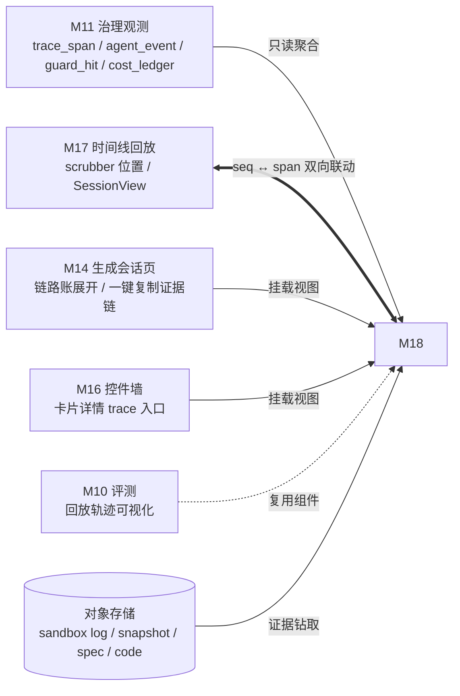
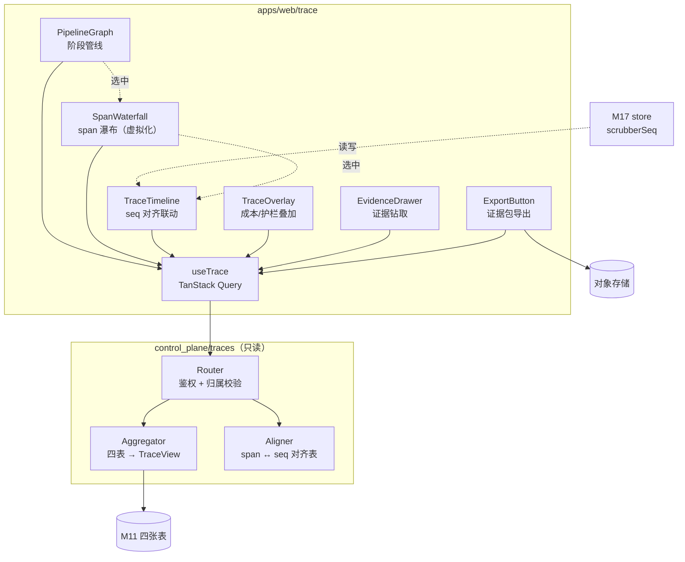
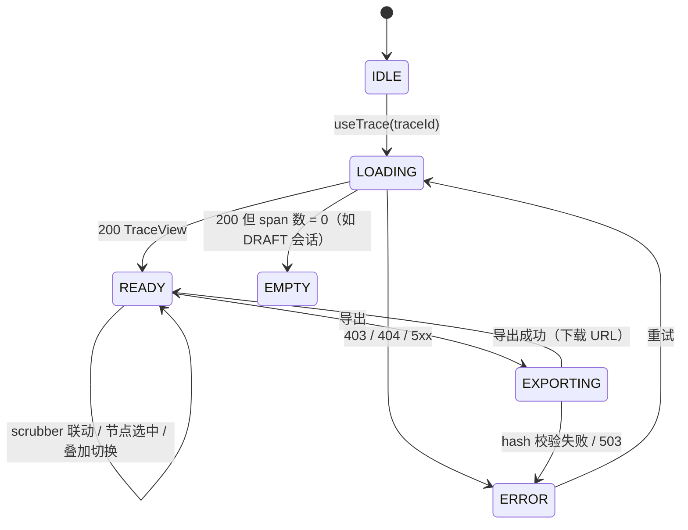

# M18 · 链路追踪可视化（v1.2 增补模块，原文 §12.4）

> **文档类型**：可独立交付 / 可独立验收的模块设计文档
> **递进层定位**：**L7 闭环增强第一环（可解释）**——依赖 L5 的 M11 trace 数据与 L6 的 scrubber；其 TraceExport 格式是 M19 评测体系的评测 artifact（00 总览 §2.3）
> **来源**：`设计方案.md` **v1.2 §12.4（本模块的原文增补章节）**、§5 D8（全链路 trace）、§2.2（可观测）、§10.1 #10、§6.3/6.4（链路账与时间线）、§6.5（卡片详情 trace 入口）、§6.6（scrubber 回放）、§4.5（事件协议）；本模块是拆分评审发现的**能力缺口补充**，不改变原架构决策
> **版本**：v1.0　|　**拆分日期**：2026-11-16　|　**最近修订**：2026-11-16（v1.3，ADR-001 同步）　|　**状态**：设计定稿（含 4 项待决，见 §9）
> **对应编号**：FR-19（可视化呈现侧）/ X11（可观测的可视化部分）
> **主责应用或包**：`apps/web/trace/`（前端视图）+ `services/control_plane/traces/`（只读聚合 API）
> **一句话定义**：把 M11 已采集的 `trace_span` / `agent_event` / `guard_hit` / `cost_ledger` 数据渲染成「阶段管线图 + Span 瀑布图 + 事件时间线联动 + 成本/护栏叠加」四种只读视图，让「任一会话可重建完整路径」从一句采集承诺变成用户能看、能点、能钻取、能导出的界面。

---

## 0. 模块速览（零基础可读）

### 0.1 项目在做什么（本模块所需的最小背景）

WidgetPilot 是一个「用自然语言生成手机桌面控件」的 AI Agent 产品：规格为可选预填 + 缺省询问补全，系统不推断（v1.3 ADR-001 D-6），用户输入描述、可传附件，系统生成 TSX + React 代码，经编译与一次性沙箱测试后产出控件包。链路很长（14 步：登录 → 附件 → 校验 → 护栏 → 路由 → 上下文 → 生成 → 出护栏 → 契约校验 → 沙箱 → 产物 → 卡片 → 语料回流 → 审计成本），中间有护栏命中、自纠正回边（≤2 次）、模型分档、预算触顶等各种分支。

原文 §2.2「可观测」给了一个承诺：**任一会话可重建「输入 → 护栏 → 检索 → 生成 → 校验 → 沙箱 → 交付 → 成本」完整路径**。M11 已把这条路径落成只追加的 `trace_span` 表；但「重建」不等于「看见」—— 用户在界面上点开链路账时看到什么？怎么从一次失败回边定位到是哪段 prompt、哪条检索引用、哪个护栏判据造成的？这就是本模块要补的**可视化链路追踪**。

### 0.2 端到端 14 步链路中的位置

```
① 登录 → 新建会话（grid 可选预填）
② 输入描述 + 上传附件
③ 语义层校验
④ 进 LLM 护栏
⑤ 意图与规格确定
⑥ 上下文装配
⑦ 生成回路：先出 WidgetSpec，再出代码
⑧ 出 LLM 护栏
⑨ 契约校验
⑩ 一次性沙箱
⑪ 生成 WidgetBundle
⑫ 控件墙渲染卡片
⑬ 评测合格 → 语料回流
⑭ 全流程按 seq 写事件流与只追加审计        ← ★ 本模块把 ⑭ 沉淀的数据渲染出来
```

本模块**不参与任何业务步骤**，是纯只读的呈现层：读 M11 的表，画图，提供钻取与导出。它服务的场景有三类：① 生成失败后用户/开发者定位原因；② 运营与审核员核对「这个产物参考了什么、花了多少钱、过了哪些门禁」；③ 评测（M10）与治理（M11）的报告下钻。

### 0.3 为什么必须有这个模块（缺口在哪）

| 已有的 | 模块 | 缺的 |
|---|---|---|
| `trace_span` / `agent_event` / `guard_hit` / `cost_ledger` 数据采集 | M11 | 数据有了，**没有渲染设计** |
| 底部链路账「展开 trace 与证据包」、顶部「一键复制证据链」 | M14 | 只有**入口**，展开后是什么视图没有定义 |
| scrubber 按 `seq` 回放事件流 | M17 | 回放的是**事件**，不是 **span 时间轴**；两者没有对齐关系 |
| 卡片详情 trace 入口 | M16 | 点进去看什么、怎么钻取没有定义 |

没有本模块，「链路透明」「可解释」「可审计」三个卖点都停留在口号：链路账只是几个汇总数字，失败排查只能翻数据库。

### 0.4 上下游邻居（mermaid）



- **上游（数据）**：M11（四张只读表）、对象存储（证据对象）。
- **上游（交互）**：M17（scrubber 位置与 `SessionView`，双向联动）、M14 / M16（挂载点）。
- **下游**：无 —— 本模块是链路终点，只输出视图与导出文件。
- **横切**：承载 **X11（可观测）的可视化部分**；数据采集与告警仍在 M11。

### 0.5 原文对照

| 本模块内容 | 原文章节 / 编号 |
|---|---|
| 「任一会话可重建完整路径」承诺（本模块把它变成可见界面） | §2.2 可观测、§5 D8 R1、§10.1 #10 |
| `trace_span` 8 段路径（输入/护栏/检索/生成/校验/沙箱/交付/成本） | §2.2、§5 D8（表结构为 M11 §6.1【推导·需评审】，本模块沿用） |
| 链路账（token、回边次数、检索引用、沙箱结论、成本，展开 trace 与证据包） | §6.4 亮点 5、§6.3 R7 |
| 一键复制证据链（`runId`、`seq`、`traceId`、`evidenceRef` 等） | §6.3 R1、§6.4 亮点 5 |
| 时间线 scrubber 拖动回看任意一步 | §6.6、§6.4 亮点 3 |
| 卡片详情 trace 入口、参考了哪些公共语料（可溯源） | §6.5、§6.4 亮点 4 |
| `AgentEvent` 18 种 kind（v1.3 新增 `ask_user`）、`seq` 单调、`traceId` 字段 | §4.5 |
| 前端验收「trace 与证据包可展开」「事件回放一致」 | §6.10、§8 W5/W7 行 |
| SLO（控件卡首帧 P95 < 500ms 等） | §9.4 |
| 权限模型（服务端按 `user_id` 校验、管理员视图待决） | §6.9、§5 D1、基线 §5.4 |

---

## 1. 模块定位与职责边界

### 1.1 为什么必须有

三个不可替代的职责：

1. **把「可重建」变成「可看见」**：M11 的承诺只到数据层；没有视图，排查一次失败要人工拼 SQL。本模块提供从汇总到单 span 的逐层下钻。
2. **把三类数据对齐到同一条时间轴**：span（耗时）、事件（`seq`）、成本/护栏（归因）本来分散在三张表；用户需要一个心智模型 ——「这条链路上每一步花了多久、多少钱、有没有被拦」。对齐关系（`span.seq ↔ event.seq`）是本模块的核心资产。
3. **把证据链变成可交接的工件**：「一键复制证据链」升级为「导出可校验的 trace 证据包」，供人工评审、评测归档、事故复盘使用。

### 1.2 做什么（职责清单）

| # | 职责 | 说明 |
|---|---|---|
| R1 | Trace 只读聚合 API | 把 `trace_span` + `agent_event` + `guard_hit` + `cost_ledger` 聚合成 `TraceView`，一次查询返回完整视图模型 |
| R2 | 阶段管线图 `PipelineGraph` | 14 步链路节点图：节点状态（通过/回边/失败/跳过/降级）、回边画弧线、预算触顶与熔断标记 |
| R3 | Span 瀑布图 `SpanWaterfall` | span 树按时间轴渲染（父行可折叠），标注 TTFT、每段耗时占比、回边循环；意图级联各级（L1 规则路由 / L2 语义路由 / L3 小模型分类 / L4 主 LLM）各为独立 span 可逐级下钻【契约约定·v1.3 ADR-001 D-8】 |
| R4 | 事件时间线联动 | `seq ↔ span` 双向映射：scrubber 拖到某事件高亮对应 span；点 span 跳到对应事件区间 |
| R5 | 成本/护栏叠加层 | span 按 `CostRecord` 着色（档位/金额），`GuardHitRecord` 标红可展开判据与原文引用 |
| R6 | 证据钻取 | span / 事件 → `evidence_refs`（沙箱日志、快照、spec、编译产物对象引用）→ 预览或下载 |
| R7 | Trace 证据包导出 | 导出含 span 树 + 事件序列 + 成本账 + 护栏命中 + hash 链的 JSON，导入端可校验完整性 |
| R8 | 会话 trace 列表 | 一个会话多次 `Run`（挂起/恢复/重跑）的 trace 清单与对比入口 |
| R9 | 挂载点组件 | 提供给 M14（链路账展开区）、M16（卡片详情）、M10（评测轨迹页）的即插组件 |

### 1.3 不做什么（明确排除，边界切割点）

| 不做 | 归属模块 | 边界说明 |
|---|---|---|
| trace / 事件 / 命中 / 成本的**采集与写入** | M11 | M18 只读四张表；不新建采集点、不写任何业务表 |
| 事件流的**状态语义与回放 reducer**（`AgentEvent[] → SessionView`） | M17 | M18 复用 `SessionView` 与 scrubber 位置，不重复实现回放 |
| SSE 分帧、partial-JSON、流式渲染 | M15 / M17 | trace 查询是普通 REST，不走流式 |
| 链路账的**汇总数字**（token 总数、回边次数、成本合计） | M14 | M14 从 `SessionView` 直接取；M18 提供的是「展开后」的明细视图 |
| 指标看板、告警规则、熔断面板 | M11 | M18 不做聚合统计图（P50/P95 趋势等归 M11 管理面板） |
| 评测执行与 rubric 判定 | M10 | M18 只被评测轨迹页复用渲染组件 |
| 修改 / 重放执行 | M04 / M03 | 「从这里重生成」入口由 M17 拥有，M18 的视图只提供跳转 |
| 权限模型定义 | M04 / M02 | M18 遵循，不定义 |

### 1.4 输入 / 输出与上下游契约

| 方向 | 内容 | 契约形式 |
|---|---|---|
| 入 | `trace_id` / `session_id` / `run_id` 查询参数；JWT（含 `user_id`、`role`） | REST（§4.1） |
| 入 | M11 四张表的行（`TraceSpan` / `GuardHitRecord` / `CostRecord` / `agent_event`） | 服务内直读（同进程 SQL），不暴露内部接口给外部服务 |
| 入 | M17 的 scrubber 位置（`seq`）与 `SessionView` | Zustand store 共享（§4.3） |
| 出 | `TraceView` JSON、四种视图组件（`React.ReactNode`）、导出文件 | REST + 组件 props（§4.3） |
| 出 | 导出证据包对象 | 对象存储 `trace-export/`（§6.5） |

### 1.5 承载的横切能力

- **X11（本模块部分）**：可观测的**可视化** —— 让 trace 可看、可点、可导出；采集、存储、告警、审计仍归 M11。
- **X12（协同）**：与 M17 的 scrubber 联动依赖事件协议的 `seq` 单调性，本模块消费不修改。

### 1.6 关键设计原则

1. **纯只读**：除导出缓存对象外，不产生任何写副作用；任何视图操作都不可改变会话状态。
2. **一套对齐关系服务全部视图**：`seq ↔ span` 映射表（§3.4）只算一次，四种视图共用，保证「管线图、瀑布图、时间线讲的是同一个故事」。
3. **数据不搬家**：前端不冗余存储 trace 数据；查询即取，TanStack Query 按 `traceId` 缓存与失效。
4. **证据先于结论**：每个失败节点必须能下钻到证据对象（日志/快照/判据/原文引用），视图上不允许出现「只有红点没有原因」的状态。
5. **大 trace 不卡死**：span 数无上限（循环 + 多轮回边可能产生数千 span），瀑布图虚拟化渲染。
6. **权限沿用服务端裁决**：`user_id` 归属校验在 API 层；管理员跨用户视图依赖基线 Q2 待决项，未定稿前不放开。

---

## 2. 技术栈

| 层 | 选型 | 版本 / 约束 | 为什么 | 明确不用什么 |
|---|---|---|---|---|
| 聚合 API | FastAPI + SQL（只读） | Python 3.11+ | 与 M11 同库同进程，直读四张表；Pydantic 输出 `TraceView` | 不新建微服务；不做写接口 |
| 前端框架 | React 19 + TypeScript + Vite | apps/web 内 | 与 M13–M12 同栈 | — |
| 服务端状态 | TanStack Query | `["trace", traceId]` 精确失效 | 查询即取、可重试、缓存友好 | 不把 trace 塞进 reducer |
| 瀑布图渲染 | **自研 SVG + `@tanstack/react-virtual`** | 虚拟化行渲染 | span 树行数不定，现成图表库（Recharts/Gantt）不适合树形时间轴 | 不引入重型甘特图/绘图库 |
| 管线图渲染 | 自研 SVG（DAG 布局） | 固定 14 节点 + 回边弧 | 节点集合固定，自研布局最简 | 不引入完整图可视化库（d3-full） |
| 联动状态 | Zustand（共享 scrubber 位置） | M17 已有 store | 跨视图同步毫秒级、无请求 | 不用事件总线 |
| 时间处理 | 原生 `Intl.DateTimeFormat` | 带时区（§6.7） | 与 M13 口径一致 | — |
| 契约 | `packages/contracts`（M02） | OpenAPI 3.1 + Zod | `TraceView` schema 进契约，前后端同源 | — |
| 测试 | Vitest + Testing Library + MSW（mock `/api/traces/*`）+ Playwright | 与 M12 统一 | 固定 trace fixture 驱动视图断言 | — |

### 2.1 硬约束

- **零 Agent 框架 / 零 LLM 观测平台**（D-5、§11.1）：不引入 LangFuse 等平台的 trace UI SDK；视图基于自建表数据。
- **只读**：聚合 API 无 POST/PUT/DELETE 业务语义（导出落缓存对象除外，且幂等）。
- **门禁不可在线关闭**：trace 不暴露任何「跳过校验」类信息展示之外的执行能力。

### 2.2 运行时依赖

| 依赖 | 用途 | 不可用时的行为 |
|---|---|---|
| PostgreSQL（M11 四张表） | trace 数据源 | 视图显示 `MODEL_ERROR`/503 与重试；不缓存陈旧数据冒充最新 |
| 对象存储 | 证据钻取与导出包 | 钻取显示「证据暂不可用 + 对象 key」，不阻塞主视图 |
| M17 store | scrubber 联动 | store 缺席时视图独立渲染（联动降级为静态高亮） |

### 2.3 代码落位

```
services/control_plane/traces/
  router.py           # GET /api/traces/*（§4.1）
  aggregator.py       # build_trace_view()：四表 → TraceView
  align.py            # seq ↔ span 对齐表构建（§3.4）
apps/web/trace/
  api/useTrace.ts     # TanStack Query 封装
  PipelineGraph.tsx   # R2 阶段管线图
  SpanWaterfall.tsx   # R3 瀑布图（虚拟化）
  TraceTimeline.tsx   # R4 事件时间线联动
  TraceOverlay.tsx    # R5 成本/护栏叠加
  EvidenceDrawer.tsx  # R6 证据钻取抽屉
  ExportButton.tsx    # R7 导出
  TracePage.tsx       # 独立页（/sessions/:id/traces/:traceId）
packages/contracts/
  trace_view.schema.json   # TraceView / SpanNode / PipelineNode（M02 固定）
```

---

## 3. 设计架构

### 3.1 内部组件与职责



| 组件 | 职责 | 关键不变量 |
|---|---|---|
| `Aggregator` | 一次查询拼装 `TraceView`（span 树 + 事件摘要 + 命中 + 成本） | 输出必须自洽：span 总耗时覆盖全部 segment，无孤儿 span |
| `Aligner` | 构建 `seq → span_id` 区间映射 | 每个 `seq` 恰好映射到一个 span（或 `null` 表示事件先于首个 span）；映射单调 |
| `Router` | JWT 解析 + `user_id` 归属校验（管理员逻辑待 Q2） | 越权一律 403，不泄漏 trace 是否存在 |
| `PipelineGraph` | 14 节点状态图 + 回边弧 | 节点状态只能来自 `SessionState`/`segment` 派生，不自行发明状态 |
| `SpanWaterfall` | 时间轴树渲染，行虚拟化 | 渲染行数 ≤ 视口行数 + buffer；`duration = end - start` ≥ 0 |
| `TraceTimeline` | 事件序列条 + 与 scrubber 双向同步 | 高亮 span 与 scrubber `seq` 恒一致（I3） |
| `EvidenceDrawer` | 证据对象预览/下载 | 打开前校验对象 `hash`（基线 §9） |
| `ExportButton` | 生成并下载证据包 | 导出前完成 hash 链校验，校验失败不导出（I4） |

### 3.2 处理流程（用户点开一次 trace 的完整数据流）

1. 用户在 M14 链路账点「展开 trace」（或 M16 卡片详情、M10 轨迹页）→ 携带 `traceId` 挂载 `TracePage` / 嵌入组件。
2. `useTrace(traceId)` 发起 `GET /api/traces/{traceId}` → `Router` 校验 JWT 与归属 → `Aggregator` 并行读四张表 → `Aligner` 构建 `seq ↔ span` 映射 → 返回 `TraceView`。
3. 前端按 `TraceView.pipeline` 渲染管线图：14 节点着色；`repair_count > 0` 的段画回边弧；`BUDGET_EXHAUSTED` / 熔断节点加预算标记。
4. `SpanWaterfall` 以 span 树渲染时间轴：根 span = `run`，二级 = 8 段 `segment`，叶子 = tool / guard / sandbox / compile 调用；行点击选中。意图级联各级（L1–L4）呈现为叶子级独立 span，标注命中层、置信度、耗时与成本档【契约约定·v1.3 ADR-001 D-8】。
5. `TraceTimeline` 渲染 `agent_event` 摘要条（按 18 种 `kind` 分色，含 v1.3 `ask_user`），并通过 M17 store 读取 scrubber `seq`，高亮映射 span。
6. 用户点失败 span → `TraceOverlay` 展开该 span 的 `GuardHitRecord`（判据 + 原文引用）与 `CostRecord`（档位/金额）→ `EvidenceDrawer` 列出 `evidence_refs`，点击预览沙箱日志 / 快照（读取时校验对象 hash）。
7. 用户点「导出证据包」→ `POST`-like 幂等导出 → 服务端校验 hash 链 → 生成 JSON 落对象存储 → 返回临时下载 URL。
8. 用户在 M17 拖动 scrubber → store 更新 `scrubberSeq` → `TraceTimeline` 与瀑布图同步高亮（反向：瀑布图点 span → store 写 `scrubberSeq` → M17 时间线跳转）。

### 3.3 状态机（前端视图态）



```ts
type TraceViewState = "IDLE" | "LOADING" | "READY" | "EMPTY" | "ERROR" | "EXPORTING";
type SpanStatus = "OK" | "REPAIRED" | "DENIED" | "FAILED" | "SKIPPED" | "DEGRADED";
```

**节点状态派生规则**【契约约定】：`OK`=通过；`REPAIRED`=该段产生过回边（`repair_count>0` 或相邻 `REPAIR` 事件）；`DENIED`=护栏命中且未进入下一段；`FAILED`=该段原因码为失败码；`SKIPPED`=降级路径未执行（如沙箱不可用）；`DEGRADED`=走了降级阶梯（M11）。状态由 `Aligner` 在服务端派生，前端只渲染不判定。

### 3.4 关键机制与不变量（本模块最核心的一条：seq ↔ span 对齐）

**A. 对齐表构建**【契约约定】

`TraceSpan` 带有 `seq` 字段（M11 §6.1），`agent_event` 天然按 `seq` 排序。`Aligner` 的规则：

```
对每个 span：负责区间 [span.seq, next_span.seq - 1]
即：事件 e 属于 span s  ⟺  s.seq ≤ e.seq < 下一个兄弟/后继 span 的 seq
根 span（run）覆盖全部事件；事件 seq 小于首个 span 的 seq 时映射为 null（对齐缺口，视图上标注）
```

- 映射单调且无重叠：`seq` 递增时映射的 span 只会沿树的前序遍历前进。
- 深层事件（如某次 tool 调用的 `code` 事件）映射到最深包含它的 span。
- 对齐缺口（`null` 映射）必须在 UI 标注「事件先于首个 span」，不允许静默丢弃 —— 这本身是 M11 采集的完整性信号。

**不变量清单**：

| # | 不变量 | 断言方式 |
|---|---|---|
| I1 | 只读：除 `trace-export/` 缓存对象外零写副作用 | 导出外全部 GET；审计无 `M18` 写入记录 |
| I2 | span 树前序遍历与 `seq` 区间一一对应、无重叠无遗漏 | 对齐表单测：区间并集 = [min_seq, max_seq]，交集为空 |
| I3 | 高亮一致性：瀑布图选中 span ⇔ 时间线高亮事件区间 ⇔ scrubber `seq` 三者同步 | Playwright 联动断言 |
| I4 | 导出必先过 hash 链校验：`prev_hash` 链任一环失败则拒绝导出并返回原因 | 篡改 fixture 导出被拒 |
| I5 | 权限：非本人 trace 一律 403，响应不区分「不存在/无权限」 | 越权用例 |
| I6 | 大 trace 性能：`span_count > 1000` 时瀑布图实际渲染 DOM 行数 ≤ 视口 + buffer | 渲染行数断言 |
| I7 | 节点状态只能取自 `SpanStatus` 六值，派生逻辑只在服务端 `Aligner` | schema 枚举校验 |
| I8 | 失败节点必有证据：`FAILED/DENIED` 的 span 的 `evidence_refs` 非空（采集侧保证，视图侧校验并告警缺口） | fixture 断言 |
| I9 | 事件 18 种 `kind` 全部能渲染（含未来新增 kind 走「未知类型」灰块，不报错） | 全 kind fixture |

**B. 导出证据包格式**【契约约定】

```ts
type TraceExport = {
  format_version: string;                 // 如 "1.0"
  trace_id: string; session_id: string; run_id: string;
  view: TraceView;                        // §6.2 完整视图模型
  events: AgentEvent[];                   // 按 seq 全量
  hash_chain: { first_seq: number; last_seq: number; chain_ok: boolean; verified_at: string };
  manifest_refs: string[];                // 涉及的 spec/manifest/code 对象 key（带 #sha256:）
  exported_by: string; exported_at: string;
};
```

导入端（人工评审、评测归档）只需重算 `prev_hash` 链即可验证未篡改；证据对象按 `manifest_refs` 的 key + hash 从对象存储取。

### 3.5 与其他模块的时序（关键 3 个场景）

**场景 1：失败排查（生成失败 → 定位根因）**
`M14 异常态（原因码 + evidenceRef）→ 点「查看完整链路」→ M18 管线图定位红色节点（如 ⑩ 沙箱）→ 瀑布图展开该段 span → Overlay 看到第 2 次回边的护栏命中判据与原文引用 → EvidenceDrawer 打开沙箱日志与快照 → 复制 traceId 给人工处理`

**场景 2：与 M17 回放联动**
`M17 scrubber 拖到 seq=42（某次 code patch）→ store.scrubberSeq=42 → M18 对齐表命中 span「CALL_MODEL #3」→ 瀑布图滚动并高亮该行；反向：瀑布图点 span → scrubber 跳到该 span 首个事件`

**场景 3：治理/评测下钻**
`M11 告警（traceId）→ 打开 M18 → 管线图看到预算触顶节点 → 导出证据包 → 附在工单/评测归档（M10 离线回放集引用同一格式）`

### 3.6 部署形态与伸缩

| 部分 | 形态 | 伸缩 |
|---|---|---|
| 聚合 API | `control-plane` 内新路由（无独立服务） | 随 control-plane 水平扩容；聚合查询走只读副本【推导·需评审】 |
| 前端视图 | `apps/web` 按路由代码分割（`/trace` chunk 独立） | CDN 静态 |
| 导出 | 同步生成小包；大包（>5MB）走异步任务 + 对象存储【推导·需评审】 | 导出并发由 Redis 限流（M11 策略） |

---

## 4. 接口契约

### 4.1 对外 REST 接口（全部只读）

| 方法 | 路径 | 权限 | 请求 | 成功响应 | 状态码 |
|---|---|---|---|---|---|
| `GET` | `/api/traces/{traceId}` | 本人（管理员待 Q2） | — | `{ code:"OK", data: TraceView }` | 200 / 403 / 404 |
| `GET` | `/api/sessions/{id}/traces` | 本人 | Query: `run_id?`, `cursor?`, `limit?` | `{ data:{ items: TraceSummary[], next_cursor? } }` | 200 / 403 |
| `GET` | `/api/traces/{traceId}/export` | 本人 | Query: `format=json`（唯一支持值） | `{ data:{ download_url, expires_in, export_ref } }`；服务端先落 `trace-export/` | 200 / 403 / 404 / 422（hash 校验失败）/ 503 |
| `GET` | `/api/traces/{traceId}/align` | 本人 | — | `{ data:{ mapping: { seq, span_id \| null }[] } }`（调试与大 trace 分段拉取用） | 200 / 403 |

**`TraceSummary`**【契约约定】：`{ trace_id, run_id, started_at, ended_at, duration_ms, span_count, repair_count, total_cost, guard_hit_count, outcome: SpanStatus, reason_code? }`。

> 完整 REST 全表、统一响应格式、权限模型见 `01-共享契约基线.md` §5 与原文 §4.4 / §6.9；本节接口为**新增补充**，需并入 `packages/contracts/openapi.yaml`（M02）。

### 4.2 事件接口

本模块**不产生、不消费 SSE 流**。与实时性的全部交互通过 M17 store 的 `scrubberSeq` 完成（进程内同步，无网络）。若 M17 store 缺席（如从 M16 卡片详情独立打开），联动降级为静态视图，不报错。

### 4.3 内部接口与函数签名（【契约约定】，最终以代码与 `trace_view.schema.json` 为准）

```python
# services/control_plane/traces/aggregator.py
def build_trace_view(trace_id: str, user_id: str) -> TraceView: ...
    # 404 if not found; 403 if owner mismatch（管理员逻辑待 Q2）

# services/control_plane/traces/align.py
def build_alignment(spans: list[TraceSpan], events: list[AgentEvent]) -> list[AlignEntry]: ...
    # AlignEntry = { seq: int, span_id: str | None }，单调、无重叠

def derive_span_status(span, hits, events) -> SpanStatus: ...   # 六值状态派生（唯一实现处）
```

```tsx
// apps/web/trace
function useTrace(traceId: string): UseTraceResult;             // { view, state, refetch }
function PipelineGraph(props: { pipeline: PipelineNode[]; onSelect(node): void }): JSX.Element;
function SpanWaterfall(props: { spans: SpanNode[]; selectedSpanId?: string;
  onSelect(spanId: string): void }): JSX.Element;               // 内部虚拟化
function TraceTimeline(props: { events: AgentEventSummary[]; alignment: AlignEntry[] }): JSX.Element;
function EvidenceDrawer(props: { spanId: string; evidenceRefs: EvidenceRef[] }): JSX.Element;
// store（M17 拥有，M18 读写 scrubberSeq）
interface TraceLinkStore { scrubberSeq: number | null; setScrubberSeq(seq: number | null): void }
```

**被上游复用**：M14 `ChainLedger` 展开区挂 `PipelineGraph + SpanWaterfall`（传入 `traceId`）；M16 卡片详情挂只读 `PipelineGraph`；M10 轨迹页复用全部视图组件渲染回放 fixture。

### 4.4 统一响应与错误码

沿用基线 §5.1 `{ code, message, traceId, retryable, evidenceRef?, data? }`。本模块涉及的失败码：`403` 归基线 **Q1 待决**；`404`（trace 不存在）同样归 Q1；`422` 用于导出前 hash 校验失败【契约约定：复用 `CONTRACT_MISMATCH`，证据为被篡改环序号】；`503` 沿用 `MODEL_ERROR` 语义之外的存储不可用【推导·需评审】。

### 4.5 幂等、重试、超时、限流、并发约定

| 项 | 约定 |
|---|---|
| 幂等 | 全部 GET 天然幂等；导出按 `(trace_id, format, content_hash)` 幂等，重复导出返回同一 `export_ref` |
| 重试 | 5xx 可重试（`retryable=true`），前端 TanStack Query 默认 3 次退避；403/404 不重试 |
| 超时 | 聚合查询超时【推导·需评审：建议 3s】；大 trace 走 `align` 分段接口分页拉取 |
| 限流 | 导出接口按用户限流（Redis，M11 策略）；查询接口随 control-plane 全局限流 |
| 并发 | 只读无并发冲突；导出并发写对象存储以 `content_hash` 为 key，天然幂等 |

### 4.6 接口状态表（契约状态 / API 状态）

| 接口 | 契约状态 | 运行态 | 可重试 | 说明 |
|---|---|---|---|---|
| `GET /api/traces/{traceId}` | **新增·待 M02 并入契约** | 同步 | 5xx 是 | 主体查询 |
| `GET /api/sessions/{id}/traces` | **新增·待 M02 并入契约** | 同步 | 是 | 分页【契约约定：cursor】 |
| `GET /api/traces/{traceId}/export` | **新增·待 M02 并入契约** | 同步（大包异步·推导） | 5xx 是 | hash 校验失败 422 |
| `GET /api/traces/{traceId}/align` | **新增·可选**（调试/分段） | 同步 | 是 | 大 trace 分页拉取 |
| `TraceView` schema | **待 M02 固定** `trace_view.schema.json` | — | — | §6.2 完整定义 |
| `403/404` 业务码 | **依赖外部**（基线 Q1） | — | — | 与全文档集共用同一待决 |
| M17 store `scrubberSeq` | 定稿（M17 拥有） | 进程内 | — | 缺席时降级 |

---

## 5. 状态、原因码与 API 状态

### 5.1 本模块拥有的状态与枚举（完整定义）

```ts
type TraceViewState = "IDLE" | "LOADING" | "READY" | "EMPTY" | "ERROR" | "EXPORTING";
type SpanStatus = "OK" | "REPAIRED" | "DENIED" | "FAILED" | "SKIPPED" | "DEGRADED";
type Segment = "input" | "guard_input" | "retrieval" | "generation"
             | "guard_output" | "contract_check" | "sandbox" | "delivery" | "cost";
            // 8 段路径 + cost，与 M11 TraceSpan.segment 枚举一致【推导·需评审：段名以 M11 定稿为准】

type TraceView = {
  trace_id: string; session_id: string; run_id: string;
  pipeline: PipelineNode[];                 // ≤14 节点
  spans: SpanNode[];                        // 树，前序遍历序
  alignment: AlignEntry[];                  // seq ↔ span_id
  events_summary: AgentEventSummary[];      // 18 种 kind 的摘要行（v1.3 含 ask_user）
  guard_hits: GuardHitView[];               // 判据 + 原文引用 + guard_side
  costs: CostView[];                        // 按 round_no 聚合
  outcome: SpanStatus; reason_code?: ReasonCode;
  hash_chain_ok: boolean;
};

type PipelineNode = {
  step_no: number;                          // 1..14
  name: string;                             // 如 "contract_check"
  status: SpanStatus;
  span_ids: string[];                       // 该步涉及的 span
  reason_code?: ReasonCode; evidence_refs: string[];
};

type SpanNode = {
  span_id: string; parent_span_id: string | null;
  segment: Segment; name: string; seq: number;
  start_ts: string; end_ts: string; duration_ms: number;
  status: SpanStatus;
  attrs: {                                  // 来自 TraceSpan.attributes【推导·需评审】
    model_tier?: ModelTier; tokens?: number; cost?: number;
    repair_count?: number; retrieval_refs?: string[];
    tool?: string; case_name?: string;
  };
  evidence_refs: string[];
  children: SpanNode[];
};
```

**参与但不拥有**：`SessionState`（M04）、`AgentEvent` / `AgentEventKind` 18 种（基线 §6，v1.3 新增 `ask_user`）、`ReasonCode` 17 个（基线 §7，v1.3 新增 3 个）、`SessionView` 与 scrubber（M17）。

### 5.2 状态流转表

| 触发 | 前态 | 后态 | 副作用 | 说明 |
|---|---|---|---|---|
| 挂载视图 / 换 `traceId` | `IDLE`/`READY` | `LOADING` | 发起 GET | 旧数据立即清除，不展示陈旧 trace |
| 查询成功且有 span | `LOADING` | `READY` | 渲染四视图 + 构建对齐索引 | — |
| 查询成功但 span 数 = 0 | `LOADING` | `EMPTY` | 显示「该会话尚无执行数据（DRAFT 或未开始）」 | 不是错误 |
| 403 / 404 / 5xx | `LOADING` | `ERROR` | 按 code 显示文案；403 不区分不存在 | I5 |
| scrubber `seq` 变化（M17） | `READY` | `READY` | 重算高亮 span | I3，无网络请求 |
| 用户选中节点/span | `READY` | `READY` | 三视图同步高亮 + 打开 `EvidenceDrawer`（若失败） | — |
| 导出请求 | `READY` | `EXPORTING` | 服务端 hash 校验 → 落对象存储 → 返回 URL | 校验失败转 `ERROR` |
| 导出成功 | `EXPORTING` | `READY` | 触发下载 | `export_ref` 写入审计（M11） |

### 5.3 本模块产出 / 消费的 `ReasonCode`

| 码 | 角色 | 场景 |
|---|---|---|
| 全部 14 个 `ReasonCode` | **只展示** | 失败节点/事件行显示码与文案，**不判定、不派生**（派生只在服务端 `Aligner`） |
| `CONTRACT_MISMATCH` | 产出（导出路径） | hash 链校验失败拒绝导出，`evidenceRef` 指向被篡改环 |
| `MODEL_ERROR` / 存储不可用 | 转发 | 503 场景，`retryable=true` |
| 403/404 业务码 | 消费 | **基线 Q1 待决**，与全文档集一致 |

> M18 不新增 `ReasonCode`（新增须走 M02 契约变更 + M10 回归门禁）。

### 5.4 HTTP 状态码与业务码映射

| HTTP | 场景 | `code` | `retryable` |
|---|---|---|---|
| 200 | 查询 / 导出 URL | `OK` | — |
| 403 | 非本人 trace | 【Q1 待决】 | `false` |
| 404 | trace / 会话不存在 | 【Q1 待决】 | `false` |
| 422 | 导出 hash 校验失败 | `CONTRACT_MISMATCH` | `false` |
| 503 | 库 / 对象存储不可用 | 【推导·需评审】 | `true` |

### 5.5 接口的运行态约定（API 状态）

- **全部同步只读**：无 202 异步受理；大 trace 的导出异步化是【推导·需评审】项，未实现前同步返回（大包可能超时，前端显示重试）。
- **数据时效**：`RUNNING` 会话的 trace 只反映已落库的 span（M11 每 super-step 落盘），视图必须标注「数据截至 `seq=N`」，不假装实时。
- **终态语义**：`COMPLETED/FAILED/CANCELLED` 会话的 trace 是完整快照；`PAUSED` 会话的 trace 标注「未完成」。
- **`EMPTY` 不是错误**：`DRAFT` 或未产生 span 的会话返回空视图 + 引导文案。
- **导出时效**：`download_url` 短时有效【契约约定：`expires_in=300s`】；过期重新导出（幂等命中缓存）。

---

## 6. 核心字段与元数据

### 6.1 持久化实体（本模块**只新增一张缓存表**，其余只读）

| 实体 | 字段 | 类型【推导·需评审】 | 约束 | 含义 |
|---|---|---|---|---|
| `TraceExportRecord`（新增） | `export_ref` | text | PK | `trace-export/{user_id}/{trace_id}/{content_hash}.json` |
| | `trace_id` / `user_id` | text / uuid | NOT NULL, INDEX | 归属 |
| | `content_hash` | text | NOT NULL | 导出内容 sha256；幂等键 |
| | `created_at` | timestamptz | NOT NULL | 缓存时间，过期可重算 |

**只读引用的实体（M11 §6.1 拥有，字段此处不再重复定义，只列引用关系）**：`TraceSpan`（`span_id/parent_span_id/trace_id/session_id/run_id/seq/phase/segment/start_ts/end_ts/attributes`）、`GuardHitRecord`（`hit_type/criterion/source_quote/guard_side/trace_id/session_id/seq/false_block`）、`CostRecord`（`user_id/session_id/run_id/round_no/model_tier/token_cost/sandbox_minutes/compile_cost/repair_count/retrieval_count/total/trace_id`）、`agent_event`（按 `seq` 全量）。

### 6.2 本模块相关协议 schema 完整定义

`TraceView` / `PipelineNode` / `SpanNode` / `AlignEntry` / `AgentEventSummary` / `GuardHitView` / `CostView` / `TraceExport` 的**完整 TS 定义见 §5.1 与 §3.4B**，最终由 M02 固定到 `packages/contracts/trace_view.schema.json` 并纳入 CI 校验。`AgentEvent` 18 种 `kind`（v1.3 新增 `ask_user`）、`SessionState`、`ReasonCode` 17 个（v1.3 新增 3 个）、`ModelTier` 沿用基线 §3/§6/§7 定义，本模块不扩充；意图级联各级 span 的呈现字段（命中层 / 置信度 / 成本档）随 M06 级联 trace 采集定稿【契约约定·v1.3 ADR-001 D-8】。

### 6.3 枚举与常量

| 常量 | 值 | 含义 |
|---|---|---|
| `PIPELINE_STEPS` | `14` | 管线图固定节点数（对应原文 14 步） |
| `SPAN_STATUS` | 6 值 | `OK/REPAIRED/DENIED/FAILED/SKIPPED/DEGRADED`（§5.1） |
| `WATERFALL_VIRTUAL_BUFFER` | `10` 行 | 虚拟化视口外缓冲 |
| `LARGE_TRACE_SPANS` | `1000` | 超过则强制虚拟化 + 建议分段拉取 |
| `EXPORT_EXPIRES_S` | `300` | 下载 URL 有效期【契约约定】 |
| `AGG_TIMEOUT_MS` | `3000` | 聚合查询超时【推导·需评审】 |

### 6.4 元数据 / 证据字段（本模块消费与产出）

| 字段 | 来源 | 用途 |
|---|---|---|
| `traceId` | `AgentEvent.traceId` / `TraceSpan.trace_id` / `CostRecord.trace_id` | 视图主键、导出、告警关联 |
| `runId` / `session_id` | 事件与 span | 归属校验、trace 列表 |
| `seq` | 事件 / span | **对齐表的锚点**（§3.4） |
| `checkpoint_rev` | M04 | 节点标注「该步运行在 rev=N」，恢复前后 trace 可区分 |
| `evidence_refs` | span / 事件 / 节点 | 证据钻取对象 key（带 `#sha256:`） |
| `hash_chain_ok` / `chain_verified_at` | 导出时计算 | 导出包完整性声明 |
| `recipe_version` / `retrieval_snapshot` / `model_tier` / `prompt_version` | span attrs（M11 采集） | 管线图与瀑布图的「可复现指纹」展示 |
| `corpus_refs` | M10 检索引用 | 「参考了哪些公共语料」溯源列表（§6.5） |

### 6.5 大对象与引用规范（本模块使用）

| 前缀 | 内容 | 要求 |
|---|---|---|
| `evidence/{session_id}/{run_id}/sandbox.log` / `snapshot.png` | 沙箱日志 / 快照（M08 产出） | 钻取只读；打开前校验 hash |
| `spec/{session_id}/{run_id}/spec.json`、`code/{session_id}/{run_id}/widget.tsx` | spec / 源码（M07/M09） | 钻取只读 |
| `trace-export/{user_id}/{trace_id}/{content_hash}.json` | **本模块新增**导出包【推导·需评审】 | 幂等；带 `hash_chain_ok` 声明 |

引用规范全文见基线 §9（本身为【推导·需评审】）；所有引用必须带 `hash`，读取时校验。

---

## 7. 安全、威胁面与合规

| 不可信输入 | 攻击路径（原文 §2.3） | 本模块控制点 | 明确禁止 |
|---|---|---|---|
| `traceId` 路径参数 | ⑤ 越权访问他人会话/trace | `Router` 按 `user_id` 归属校验每个请求；403 不泄漏资源存在性 | 禁止前端隐藏入口替代服务端校验（I5） |
| trace 内容 | 敏感信息外泄（描述、附件摘要、PII 命中详情） | 视图遵循 M11 同样的可见范围；导出包含原文引用与命中详情，仅本人可导 | **导出包永不进公共语料**；不含附件原文 |
| 导出包 | 被当作投毒载体回流 | 导出格式固定、只读；M10 入库门禁不接收 `trace-export/` | 禁止把导出包当语料来源 |
| 对象 key | 路径穿越 / 伪造 key | key 由服务端从 span/事件生成，前端提交的 key 一律忽略 | 不接受用户提供的对象 key |
| hash 链 | 篡改 trace 后导出 | 导出前全链重算（I4）；失败 422 + 环序号 | 校验失败不得降级放行 |

**审计留证**：导出操作写 `AuditEvent`（`action=TRACE_EXPORT`，`payload={trace_id, content_hash}`，由 M11 落库）；视图查看本身不留审计（只读、高频）。**合规**：trace 含用户描述与命中详情，按用户隔离；管理员跨用户访问依赖基线 Q2 定稿，未定稿前不提供。

---

## 8. 独立验收方案（可脱离其他模块单独提测）

### 8.1 验收前置条件与上下游桩

| 依赖 | 本模块验收时的桩 | 说明 |
|---|---|---|
| M11 四张表 | **固定 trace fixture**：3 组 JSON（① 一次通过的简单控件；② 含 2 次回边 + 护栏命中 + 预算触顶失败的复杂任务；③ 跨天恢复的会话），直接灌入测试库 | 不需要真实模型/沙箱/生成 |
| M17 store | 内存版 `TraceLinkStore`（可脚本设定 `scrubberSeq`） | 联动可测，无需真实回放页 |
| M14 / M16 | Storybook 挂载桩页面 | 只测组件，不测宿主页 |
| 对象存储 | 本地 MinIO/FS + 预置证据对象（日志/快照/spec，带 hash） | 钻取与导出可测 |
| M02 契约 | 使用本地 `trace_view.schema.json` 草案 | 保证字段一致 |
| 基础设施 | 真实 Postgres（测试容器） | 聚合 SQL 真实执行 |

> 有了 fixture + 内存 store + 本地对象存储，本模块**完全不需要模型、沙箱、前端宿主页就能独立提测**。

### 8.2 可断言的验收用例清单

| # | 用例（Given / When / Then） | 判据 | 断言方式 |
|---|---|---|---|
| V1 | Given fixture②（2 次回边 + 失败）；When 打开管线图；Then 14 节点渲染且失败步为 `FAILED`、回边步为 `REPAIRED`、预算节点有触顶标记 | 状态派生正确 | `Aligner` 单测 + DOM 断言 |
| V2 | Given fixture①；When 打开瀑布图；Then 根 span=run、二级=8 段 segment、叶子含 tool/guard/sandbox；`duration = end-start` 全部成立 | 树结构与时间轴 | schema + 数值断言 |
| V3 | Given fixture②；When 构建 `alignment`；Then 映射单调、无重叠，区间并集 = [min_seq, max_seq] | I2 | `build_alignment` 单测 |
| V4 | Given 对齐缺口（事件 seq < 首个 span seq）；Then UI 标注「事件先于首个 span」且映射为 `null` | 缺口不静默 | fixture 注入 + DOM 断言 |
| V5 | Given scrubber `seq=42`（fixture② 中某 code patch）；Then 瀑布图高亮 `CALL_MODEL #3`，时间线高亮该事件 | I3 联动 | 内存 store 驱动 + Playwright |
| V6 | Given 瀑布图点某 span；Then store `scrubberSeq` 更新为该 span 首 `seq`，M17 桩时间线跳转 | I3 反向联动 | 同上 |
| V7 | Given fixture② 的 `DENIED` span；Then Overlay 展示 `hit_type/criterion/source_quote/guard_side` 四字段齐全 | 证据先于结论（I8） | DOM 字段断言 |
| V8 | Given `FAILED` span 的 `evidence_refs` 为空（采集缺口）；Then 视图显示「证据缺失」告警条而非红点 | I8 视图侧校验 | fixture 注入 + 断言 |
| V9 | Given fixture①；When 导出；Then 响应含 `download_url/expires_in=300/export_ref`，包内 `hash_chain_ok=true` | 导出成功 | API 断言 + 解包校验 |
| V10 | Given 篡改 `prev_hash` 的 fixture；When 导出；Then 422 + `CONTRACT_MISMATCH` + 环序号 | I4 | API 断言 |
| V11 | Given 用户 B 请求用户 A 的 traceId；Then 403 且响应不区分「不存在/无权限」 | I5 | HTTP 断言 |
| V12 | Given 1500 span 的大 trace；Then 瀑布图实际渲染 DOM 行数 ≤ 视口 + buffer=10 | I6 | 渲染行数断言 |
| V13 | Given 18 种 `kind` 全量事件 fixture（v1.3 含 `ask_user`）；Then 时间线全部渲染；追加未知 kind `"future_kind"` 不报错、渲染灰块 | I9 向前兼容 | 全 kind fixture |
| V14 | Given fixture③（跨天恢复）；Then 管线图标注 `checkpoint_rev` 断点，恢复前后 span 分属不同 run 且可并列对比 | 恢复可视化 | fixture 断言 |
| V15 | Given `DRAFT` 会话；Then 状态 `EMPTY` + 引导文案，不是 `ERROR` | 空态语义 | DOM 断言 |
| V16 | Given `RUNNING` 会话 trace；Then 视图标注「数据截至 seq=N」 | 时效标注 | DOM 断言 |
| V17 | Given 同一 trace 重复导出 2 次；Then `export_ref` 相同（幂等），对象存储仅 1 份 | 幂等 | 对象计数断言 |
| V18 | Given 导出操作；Then `AuditEvent` 新增 `TRACE_EXPORT` 一条（含 `content_hash`） | 只读边界外的留证 | M11 表查询断言 |

### 8.3 量化指标与阈值

| 指标 | 目标 | 测量点 |
|---|---|---|
| Trace 视图首帧 P95 | < 500ms（对齐原文控件卡首帧 SLO 口径） | V1 渲染计时 |
| 聚合查询 P95 | < 1s（fixture 量级）；`AGG_TIMEOUT_MS=3s` 硬顶【推导·需评审】 | API 计时 |
| 联动同步延迟 | 同帧内（< 16ms，rAF 级） | V5/V6 |
| 大 trace 渲染 | 1500 span 无掉帧（Playwright 性能轨迹） | V12 |
| 越权拦截率 | 100% | V11 |
| 导出 hash 校验覆盖率 | 100%（导出必校验） | V10 |

### 8.4 出口条件（Definition of Done）

- §8.2 的 V1–V18 全部通过且可自动化复跑；
- `trace_view.schema.json` 并入 `packages/contracts` 并通过 M02 CI 一致性校验；
- `TraceView` 聚合 SQL 在 fixture 与 10 倍放大数据下均不出慢查询；
- 与 M17 联动双向打通（store 契约测试通过）；M14/M16 挂载点联调冒烟通过；
- `GATE OK` = 单元测试全绿 + fixture 快照一致 + 挂载冒烟通过（§11.9 口径）。

### 8.5 对抗与回归用例

| 对抗用例 | 本模块断言 |
|---|---|
| 越权访问他人 trace / 导出 | 403（V11） |
| 篡改 trace（改 span/事件/hash）后导出 | hash 链拦截（V10，I4） |
| 死循环 / 成本触顶产生的超长 trace | 虚拟化 + 分段拉取不卡死（V12） |
| 未知事件 kind / 对齐缺口 | 灰块与缺口标注，不静默不崩溃（V4/V13） |
| 导出包被试图回流公共语料 | M10 门禁拒绝（M10 侧断言，本模块保证格式可识别） |

**回归触发**：`TraceView` schema、对齐算法、`SpanStatus` 派生规则、M11 四张表结构、`AgentEventKind` 任一变更 → 重跑本模块全部用例 + M17 回放测试 + M14 链路账冒烟。

---

## 9. 依赖、风险与待决

| 项 | 说明 | 处理 / 责任建议 |
|---|---|---|
| `TraceSpan.segment` 段名枚举 | M11 §6.1 为【推导·需评审】（8 段），本模块沿用 | M11 + M02 定稿后本模块同步；派生规则不改 |
| `403/404` 业务码 | 基线 Q1 待决 | 与全文档集一致，M02 定稿 |
| 管理员跨用户 trace 视图 | 基线 Q2 待决（`User.role` 两角色） | M04 + M11 + M02 定稿；未定稿前不实现 |
| 聚合查询走只读副本 | 大 trace 聚合可能拖主库 | 【推导·需评审】：control-plane 连接串区分读写；影子期实测 |
| 大 trace 导出异步化 | >5MB 同步导出可能超时 | 【推导·需评审】：先同步实现，超限再加异步任务 + 通知 |
| M11 采集完整性（I8 的上游保证） | 视图侧只能「告警缺口」，不能凭空补证据 | 采集缺口率进 M11 告警项；本模块 V8 只做暴露 |
| 与 M17 store 的耦合 | store 字段变更影响联动 | store 契约进 M17 §4.3；变更触发双方回归 |

---

## 10. 术语速查与原文对照

| 术语 | 本模块语境下的含义 |
|---|---|
| `TraceView` | 一次查询返回的完整视图模型：管线 + span 树 + 对齐表 + 命中 + 成本 |
| `segment` | 8 段路径（输入/护栏/检索/生成/校验/沙箱/交付/成本），来自 M11 `TraceSpan` |
| `alignment` | `seq ↔ span_id` 单调映射表；四视图共用，保证「同一个故事」 |
| `SpanStatus` | 六值节点状态：通过/回边/拦截/失败/跳过/降级；只在服务端派生 |
| `pipeline` | 14 步链路节点图，状态着色 + 回边弧 + 预算/熔断标记 |
| `evidence_refs` | 带 `#sha256:` 的对象存储引用；钻取打开前必须校验 hash |
| `TraceExport` | 可离线校验的证据包：重算 `prev_hash` 链即可验真 |
| `scrubberSeq` | M17 拥有的共享状态；M18 与 M17 双向联动的唯一通道 |
| `EMPTY` | 空态（无 span），不是错误 |

**原文对照**：§2.2（可观测承诺 → 本模块实现「看见」）、§5 D8 R1（全链路 trace）、§10.1 #10（任一失败可重放）、§6.3 R1/R7（一键复制证据链、链路账展开 trace）、§6.4 亮点 3/5（scrubber、链路透明）、§6.5（卡片详情 trace 入口、语料溯源）、§6.6（事件回放与 seq）、§4.5（事件协议）、§6.9（权限）、§9.4（SLO）、§6.10 / §8 W5 行（前端验收）。

**延伸阅读**（非理解前提）：
- `00-总览与模块地图.md` —— 全局链路、模块地图、统一模板、跨模块待决汇总（§9.1）
- `01-共享契约基线.md` —— REST 全表、事件协议、ReasonCode 全表、对象存储 key、Q1/Q2 待决项
- `M11-治理观测与成本域.md` —— 本模块全部数据的采集方与四张表的拥有者
- `M17-时间线回放与状态管理.md` —— `SessionView` / reducer / scrubber，联动对象
- `M14-生成会话页.md`、`M16-控件墙与包管理.md` —— 视图挂载点（链路账、卡片详情）
- `M10-知识检索与评测域.md` —— 轨迹页复用本模块组件
- `M02-前后端契约.md` —— `trace_view.schema.json` 定稿与 CI 校验
