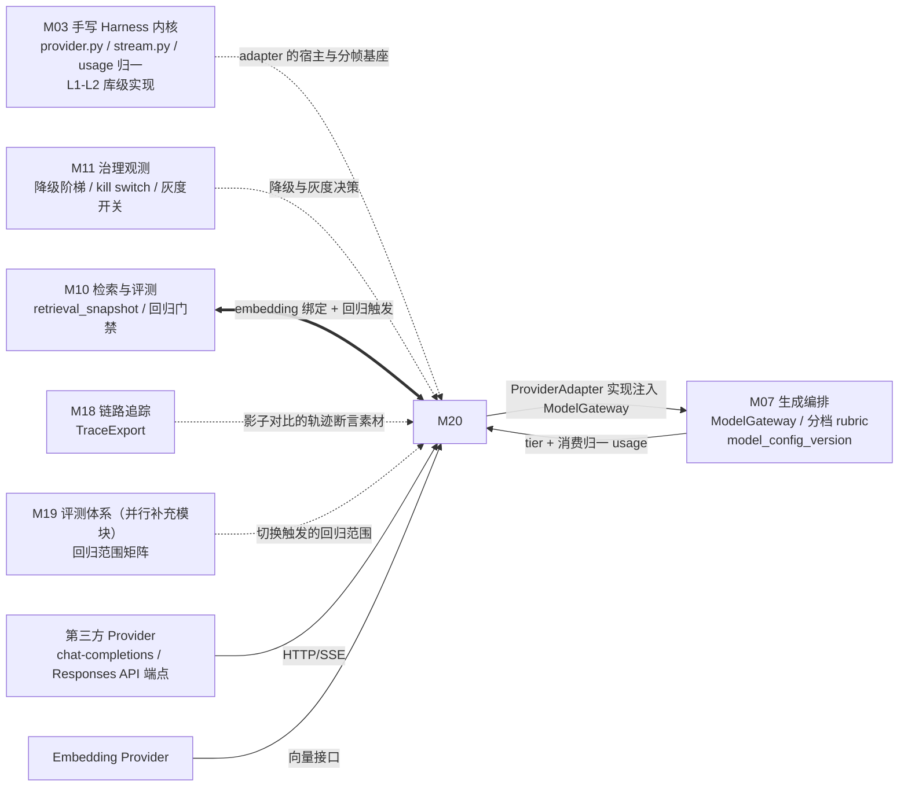
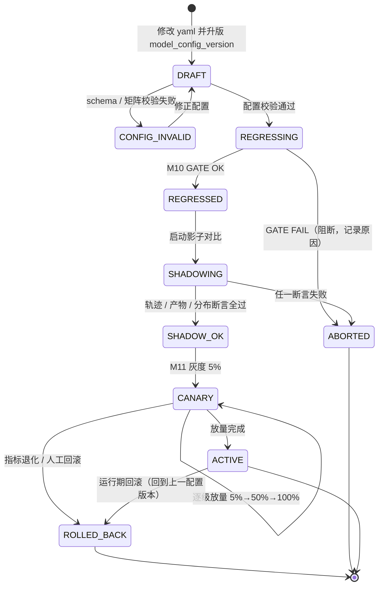

# M20 · LLM Provider 模型接入与切换（v1.2 增补模块，原文 §12.1）

> **文档类型**：补充模块（可独立交付 / 可独立验收）
> **递进层定位**：**L7 闭环增强第三环（可切换）**——依赖 L3 的 M03 provider 实现；切换门禁消费 M19 的回归范围矩阵与影子对比（00 总览 §2.3）
> **来源**：`设计方案.md` **v1.2 §12.1（本模块的原文增补章节）**、§11.7（模型直连 httpx / usage 归一 / 换模型只改配置）、§0 D-4（模型分档，阈值版本化、影子验证后再灰度）、§2.5（关键技术决策：model gateway 直连）、§5 D4（验收：换模型只改配置）、§9.1（影子模式）、§9.2（熔断与回滚）；本模块是拆分评审发现的**能力缺口补充**，不改变原架构决策
> **版本**：v1.0　|　**拆分日期**：2026-11-16　|　**最近修订**：2026-11-20（v1.4，Responses API wire adapter 设计增补，未实现）　|　**状态**：设计定稿（含待决项，见 §9）
> **对应编号**：FR-21（重试 / 降级的供应商接入侧）/ D-4 关联 / X4（成本·单价与计量归一侧）/ X5（降级链·接入侧）/ X10（回归门禁触发侧）；**无新增 FR、无新增 ReasonCode**
> **主责包**：`packages/agent_core/model/providers/`（ProviderAdapter 实现与注册表）+ `infra/deploy/model_providers.yaml`（供应商配置，单一事实来源）
> **一句话定义**：把 M03 已实现的「单供应商直连」升级为一套**可切换**的供应商接入体系——`ProviderAdapter` 接口规范、`model_providers.yaml` 配置 registry、模型能力矩阵、四场景切换流程（回归 → 影子 → 灰度 → 回滚）、降级 fallback 链与 embedding provider 切换规范——让「换模型只改配置」从一句验收口号变成有接口、有判据、有演练 runbook 的工程机制。
> **v1.4 设计增补（2026-11-20，未实现）**：新增 `wire_api: chat_completions | responses` 与 `adapter_responses` 的 wire 规范——Responses API 作为支持厂商的首选 wire，chat-completions 作为跨厂商兜底；本轮只冻结接口、事件映射与配置字段，不新增代码、不改测试。

---

## 0. 模块速览（零基础可读）

### 0.1 项目在做什么（本模块所需的最小背景）

WidgetPilot 是一个「用自然语言生成手机桌面控件」的 AI Agent 产品：规格（`2x1`–`4x4` 六种）为可选预填 + 缺省询问补全，系统不推断（v1.3 ADR-001 D-6），用户输入描述、可传附件，系统生成 TSX + React 代码，经编译与一次性沙箱测试后产出控件包。生成链路的第 ⑦ 步要调用大模型（先出 `WidgetSpec` 再产代码），成本按模型档位（`cheap / standard / frontier` 三档，§4.2 `ModelTier`）分账。

原设计定稿了两个关键决策：**D-5 零 Agent 框架**——模型调用不用任何 SDK，由 M03 手写 `model/provider.py` 用 `httpx` 直连 chat-completions 兼容端点、`stream.py` 自研 SSE 分帧、usage 字段归一；**D-4 模型分档**——简单控件用便宜模型、复杂任务用强模型，分档阈值版本化、影子验证后再灰度。M07 在此之上装了 `ModelGateway` 与 `model_config_version`，验收写明「换模型只改配置」「新增供应商只加一个 adapter」（§11.10）。v1.4 增补把「一个 adapter」细化为**两类 wire adapter**：同 wire 的供应商只加配置，新 wire（Responses API）才加 adapter。

### 0.2 端到端 14 步链路中的位置

```
① 登录 → 新建会话（grid 可选预填）
② 附件 → ③ 语义校验 → ④ 进护栏 → ⑤ 路由/技能预取
⑥ 上下文装配（固定槽位，M07）
⑦ 生成回路：先出 WidgetSpec，再出 TSX + React 代码；模型分档
     └─ CALL_MODEL 分支 → ModelGateway（M07）→ ★ 本模块：解析档位 →
        能力矩阵校验 → 选中 provider/model_id → ProviderAdapter.complete/stream
        → usage 归一 →（失败时走本模块 fallback 链）
⑧ 出护栏 → ⑨ 契约校验 → ⑩ 沙箱 → ⑪ WidgetBundle → ⑫ 卡片
⑬ 评测合格 → 语料回流（M10）
⑭ 全流程按 seq 写事件流与只追加审计；成本按模型档位分账
```

本模块**不参与任何业务步骤**：它是第 ⑦ 步之下、供应商 HTTP 端点之上的「接入与切换层」。服务对象有三类：① 运行时——给每次 `CALL_MODEL` 解析出该用的 provider 与 model_id，失败时按 fallback 链换供应商；② 变更时——把「换供应商 / 换模型版本 / 调整分档映射」做成有门禁的流程；③ 检索侧——规范 embedding provider 的接入与切换（M10 索引与 embedding 版本强绑定）。

### 0.3 为什么必须有这个模块（缺口在哪）

| 已有的 | 模块 | 缺的 |
|---|---|---|
| `provider.py` httpx 直连 chat-completions、`stream.py` SSE 分帧、`normalize_usage` usage 归一（单供应商实现） | M03 | **没有 ProviderAdapter 接口规范**：第二个供应商的 adapter 该长什么样、必须实现哪些方法、健康检查怎么报，无约定 |
| 现有 wire 只有 chat-completions（OpenAI-compatible） | M03 / M07 | **没有 Responses API wire adapter**：支持 `/v1/responses` 的厂商无法用上类型化事件与推理项；不支持该协议的厂商又不能被强制切换（v1.4 只设计、不实现） |
| `ModelGateway`（`gateway.py` / `usage.py`）+ `model_config_version` | M07 | **没有配置文件 schema**：`model_config_version` 里面具体是什么结构、密钥放哪、参数默认值，无定义 |
| 三档分档 rubric（三因子 → `ModelTier`） | M07 | **没有能力矩阵**：档位怎么映射到具体 model_id、每个模型的上下文窗口 / json_mode / 单价 / SSE quirk 怎么登记，无设计 |
| 影子模式与灰度（四阶段） | §9.1 / M11 | **没有切换流程**：换供应商要走哪些门禁、影子对比比什么、灰度怎么放量、怎么回滚，无流程 |
| 降级阶梯与 kill switch 决策 | M11 | **没有 fallback 链**：M11 决定「要降级」，但降级到哪个供应商的哪个模型、与业务自纠正回边怎么区分，无机制 |
| 索引快照绑定 embedding 版本（`RetrievalSnapshot.embedding_model_version`） | M10 | **没有 embedding provider 切换规范**：切 embedding 必须全量重建索引并升版快照，dim 变化怎么迁移，无步骤 |
| 换模型只改配置（I10） | M07 | **没有 per-adapter 契约测试**：新增 adapter 怎么证明它与既有 adapter 行为一致，无测试规范 |

没有本模块，「换模型只改配置」只是单供应商实现上的一句口号：第一个真实的多供应商切换、第一次模型版本升级、第一次 embedding 换型，都会变成一次性改代码冒险。

### 0.4 上下游邻居（mermaid）



- **上游（调用方）**：M07 的 `ModelGateway` 是唯一调用入口（`tier` → 本模块解析出 provider/model_id）。
- **基座**：M03 的 `model/`（`provider.py` 直连、`stream.py` 分帧、usage 归一）是 adapter 的实现基座；本模块定义其上的**接口规范与配置体系**，不改 M03 的分帧与归一内核。
- **决策方**：分档决策与成本计量归 M07；降级 / 熔断 / kill switch 决策归 M11（本模块只提供 fallback 链这个**执行机制**）。
- **门禁方**：回归门禁执行归 M10；回归范围矩阵见 M19（评测体系，并行编写的补充模块）。
- **横切**：X4 的「每模型单价登记」侧、X5 的「降级执行链」侧、X10 的「模型变更触发回归」侧。

### 0.5 原文对照

| 本模块内容 | 原文章节 / 编号 |
|---|---|
| 模型直连 httpx、usage 归一、换模型只改配置、新增供应商只加 adapter | §11.7、§11.10、§2.5、§5 D4 验收 |
| 模型分档三档、阈值版本化、影子验证后再灰度 | §0 D-4、§5 D4、§9.6 |
| 模型变更触发回归门禁 | §9.5、§5 D7、§11.9 第六层 |
| 模型分档 / 阈值变更的对照在影子模式完成 | §9.1 |
| 任何模型变更可回滚到上一版本 | §9.2 |
| 降级阶梯（「降级不降安全」） | §9.2、§5 D8 |
| 按档位分账（单价的登记来源） | §5 D4、§11.8、§2.6 X4 |
| 基础设施重试（429/5xx）与业务回边分离 | §11.3 |
| 索引快照版本写进 manifest、可复现 | §11.7、§5 D7 |
| 温度等采样参数 | §11.7 / M07 复现指纹补齐项【推导·需评审】 |

---

## 1. 模块定位与职责边界

### 1.1 为什么必须有

三个不可替代的职责：

1. **把「一个 adapter」规范成「一类 adapter」**：M03 已有一个能跑的单供应商实现，但第二个供应商接入时，接口形状、健康检查、能力登记、测试口径全靠临场发挥。本模块把 adapter 变成有 Protocol、有契约测试、有录制回放的标准件。
2. **把「切换」从运维冒险变成带门禁的流程**：换供应商 / 换模型版本 / 调分档映射，每一项都同时影响产物质量、成本与数据流向。本模块定义「配置版本化 → 回归门禁 → 影子对比 → 灰度放量 → 可回滚」的统一流程与判据——**判据是评测不退化（确定性断言 + 分布与置信区间），不是模型自报质量**。
3. **把 embedding 切换的坑提前填掉**：M10 的索引快照与 embedding 版本强绑定，切 embedding 而不重建索引等于让新向量查旧索引——检索静默劣化且不可复现。这是所有 provider 切换里最容易踩的坑，必须有显式规范。

### 1.2 做什么（职责清单）

| # | 职责 | 说明 |
|---|---|---|
| R1 | `ProviderAdapter` Protocol 接口规范 | `complete / stream / normalize_usage / health_check / capabilities` 五方法；adapter 无状态、纯配置实例化、可被 fake 替换 |
| R2 | Provider Registry 与配置文件 | `model_providers.yaml` 完整 schema；配置版本化（沿用 M07 `model_config_version`）、热加载、变更即触发回归 |
| R3 | 模型能力矩阵 | 每个 model_id 登记 `{context_window, max_output_tokens, json_mode, vision, prompt_caching, cost_per_1m, latency_class, sse_quirks}`；矩阵缺失即拒绝启动（fail-fast）；M07 分档 rubric 经 `tier_mapping` 落到具体 model_id |
| R4 | 切换四场景流程 | ①换供应商 ②同供应商换模型版本 ③降级链 ④分档映射调整；每场景统一走「配置版本化 → M10 回归门禁 → 影子验证 → M11 灰度 → 回滚」 |
| R5 | 影子验证机制 | 新旧 provider 各跑同一 dataset（M10 离线回放集），用 M18 `TraceExport` 做轨迹与产物对比断言 |
| R6 | fallback 降级链 | `frontier → standard → cheap` 每档内 provider 有序备选；基础设施故障才走链，与 M07 业务自纠正回边严格分离 |
| R7 | 兼容性保障 | usage 归一字段表、JSON mode 兼容矩阵与降级、SSE 分帧 quirk 登记、工具调用不依赖原生 function calling、prompt caching 差异适配 |
| R8 | Embedding provider 接入与切换规范 | `embedding_providers` 配置段；索引快照与 embedding 版本强绑定；切换必全量重建 M10 索引并升版 `retrieval_snapshot`；dim 变化迁移步骤 |
| R9 | 密钥与日志安全 | `api_key_ref` 只引用 secret/env；请求日志脱敏；供应商数据出境合规登记 |
| R10 | per-adapter 契约测试 | 录制回放 HTTP fixtures（CI 不真实调用 API）、usage 归一单测（I10：两供应商切换代码 diff=0）、fallback 故障注入、能力矩阵决策单测 |
| R11 | 切换演练 runbook | 回滚步骤、embedding 重建步骤、灰度放量与熔断联动，落 `docs/runbook/` |
| R12 | 双 wire adapter 规范（v1.4 设计增补，未实现） | `wire_api: chat_completions \| responses` 按 provider 配置；Responses 端点与类型化事件归一到现有内核；不支持的厂商保留 chat-completions 兜底 |

### 1.3 不做什么（明确排除，边界切割点）

| 不做 | 归属模块 | 边界说明（这块归哪个 Mxx） |
|---|---|---|
| 单供应商 complete/stream 的**调用实现**（httpx 请求、SSE 分帧、半帧缓存、UTF-8 解码、usage 归一算法） | **M03** | `agent_core/model/`（`provider.py` / `stream.py`）已定稿；本模块只定义其上的 adapter 接口规范与配置，**不改分帧与归一内核** |
| 模型分档决策（三因子 rubric）与四维成本计量、按档位分账 | **M07** | M07 判 `ModelTier`、累加 usage、写 `cost_ledger`；本模块只提供 tier → model_id 的解析与单价登记 |
| 降级 / 熔断 / kill switch 的**决策**与配额 | **M11** | M11 决定「何时降级、何时熔断、灰度放给谁」；本模块提供 fallback 链这个执行机制与健康上报 |
| 检索算法、四层语料、向量库、索引快照的**拥有** | **M10** | M20 只定义 embedding provider 的**接入与切换规范**；索引重建由 M10 执行 |
| 回归门禁的**执行**（回放、rubric、GATE 判定） | **M10** | 本模块只触发（模型 / 配置变更事件），判定在 M10；回归范围矩阵见 M19 |
| 出护栏、契约校验、沙箱 | **M08** | 影子验证消费的产物断言判据来自 M08 的既有校验结论，本模块不新造校验 |
| 业务自纠正回边（spec / 代码校验失败重试 ≤2） | **M07 / M03** | 与本模块 fallback 链严格分离（§3.4 C） |
| prompt 正文、槽位装配顺序、caching 前缀构造 | **M07 / M03** | 本模块只适配供应商侧 caching 参数，不动槽位装配 |

> **最易混淆的两条切割**：① **M03 是调用实现、M20 是接入规范**——`provider.py` 的 httpx 代码归 M03，第二个供应商怎么写 adapter、配置长什么样、能力怎么登记归 M20；② **M11 是降级决策、M20 是降级执行链**——「要不要降级」在 M11，「降级后下一个 provider/model 是谁、怎么切换流量」在本模块。

### 1.4 输入 / 输出与上下游契约

| 方向 | 内容 | 契约形式 |
|---|---|---|
| 入 | M07 `ModelGateway` 的解析请求：`ModelTier`（cheap/standard/frontier） | 库级接口 `resolve(tier)`（§4.3） |
| 入 | `model_providers.yaml`（经 `model_config_version` 版本化） | 配置文件 + 启动/热加载校验（§6.2） |
| 入 | M11 指令：灰度放量比例、kill switch、降级触发 | 内部事件 / 开关配置 |
| 入 | 供应商 HTTP 响应与 SSE 流 | `chat_completions` 或 `responses` wire（§4.1 / §4.7） |
| 入 | M10 回归门禁结论（`GATE OK / GATE FAIL`） | 内部接口（切换流程门禁位） |
| 出 | `ResolvedModel { provider, model_id, params, capability }` 与已注入的 adapter | 库级返回值，M07 的 `complete()` 据此调用 |
| 出 | 归一 `Usage`（沿用 M07 定义） | 库级返回值，M07 计量、M11 分账 |
| 出 | 健康状态与 fallback 事件 | `notice` 事件 payload（降级提示）+ M11 指标 |
| 出 | `ProviderSwitchRecord`（切换留痕） | PG 表（§6.1）+ `AuditEvent` |

### 1.5 承载的横切能力 X*

- **X4（协同，单价登记侧）**：成本管理——能力矩阵的 `cost_per_1m` 是 M07 按档位计价与 M11 分账的单价来源；计量执行仍在 M07，分账治理仍在 M11。
- **X5（协同，接入侧）**：重试 / 降级——本模块提供 fallback 链执行机制与 `RetryPolicy` 的供应商侧参数；降级决策、熔断、kill switch 归 M11。
- **X10（协同，触发侧）**：评测与回归——本模块的配置变更事件是回归门禁的触发源之一；门禁执行归 M10，范围矩阵见 M19。
- **X11（协同）**：每次切换写 `AuditEvent` 与 `ProviderSwitchRecord`（hash 链），供 M11 审计与 M18 追溯。

### 1.6 关键设计原则

1. **adapter 无状态、纯配置实例化**：adapter 只从 `ProviderConfig` 构造，不读全局状态、不缓存跨请求信息；同一配置构造两个实例行为完全一致（对齐 M03「一切跨进程依赖接口注入」的可打桩前提）。
2. **密钥永不落配置文件**：`api_key_ref` 只引用 `env:*` 或 secret manager 路径；配置文件可入库、可评审、可 diff，密钥不随配置流转。
3. **矩阵缺失即拒绝启动（fail-fast）**：`tier_mapping` 指向的 model_id 若不在能力矩阵中，服务拒绝启动——缺登记的模型不允许上线跑流量。
4. **判据是评测不退化，不是模型自报质量**：切换的每一步门禁都基于确定性断言（轨迹、产物、主指标分布与置信区间），沿用 §9.5「无效优化」判定规则。
5. **基础设施故障与业务失败严格分离**：429/5xx / 网络抖动走本模块 fallback 链与有上限退避；spec / 代码校验失败走 M07 自纠正回边（≤2）。两者计数互不污染（§11.3 原则）。
6. **兼容性差异配置化，不改内核**：SSE quirk、json_mode、prompt caching 差异全部登记进能力矩阵，由 adapter 参数化处理；M03 的分帧与归一内核零改动。
7. **旧快照永远可回滚**：embedding 切换不覆盖旧索引快照；模型配置回滚 = 回退到上一 `model_config_version`，历史复现指纹不失效。
8. **CI 零真实外呼**：per-adapter 契约测试用录制回放 fixtures，任何 CI 环境不得真实调用供应商 API（成本与可重复性双重原因）。
9. **Responses 优先、chat-completions 兜底（v1.4）**：wire 差异配置化，业务只见 `ModelOutput` / `Delta` / `Usage`；不依赖 `previous_response_id`、服务端 `store` 或原生工具调用，多轮历史与工具协议仍由 M03/M07 自有链路负责。

---

## 2. 技术栈

### 2.1 分层选型表

| 层 | 选型 | 版本 / 约束 | 为什么 | 明确不用什么 |
|---|---|---|---|---|
| adapter 协议 | Python `typing.Protocol` | 五方法接口（§4.1） | 与 M03 `ModelGateway` 注入接口同风格，结构化子类型、无继承耦合 | 不用抽象基类注册机制、不用供应商官方 SDK |
| HTTP 客户端 | `httpx`（M03 既有） | 按 `wire_api` 直连 `/v1/chat/completions` 或 `/v1/responses` | 与 §11.7 定稿一致，无 SDK 黑盒 | 不用 openai-python / 各供应商 SDK |
| SSE 解析 | M03 `stream.py` 分帧 + wire 事件解码器 | `\n\n` 分帧内核不变；chat-completions delta 与 Responses 类型化事件各自归一为 `Delta` | 兼容性差异配置化（§3.4 D / §4.7） | 不为每个供应商 fork 分帧器 |
| 配置 | YAML + Pydantic v2 严格校验 | `model_providers.yaml`，`model_config_version` 版本化 | 可 diff、可评审、可回滚；启动即全量校验 | 不把供应商配置散落环境变量、不做无版本的热改 |
| 密钥 | env / secret manager 引用 | `api_key_ref: "env:XXX"`，启动解析 | 密钥不进 git、不进日志 | 禁止明文密钥入配置 |
| 灰度路由 | 确定性哈希（`user_id` 分桶） | 同一用户在同一 switch 周期内桶位稳定 | 灰度期间用户体验一致、归因干净 | 不用随机路由 |
| 影子对比 | M18 `TraceExport` + 确定性断言 | 轨迹 kind 序列 / 产物 hash / 主指标分布 | 证据先于结论，可校验 | 不用模型自评、不用裁判模型打分 |
| 契约测试 | 录制回放 fixtures + pytest | CI 零外呼 | 新 adapter 一致性可断言 | 不在 CI 打真实 API |
| 持久化 | PostgreSQL（`provider_switch` 表） | 只追加 + `prev_hash` 链 | 切换留痕可审计 | 不用内存记录切换历史 |

### 2.2 硬约束

- **D-5 零 Agent 框架**：不引入 LiteLLM / OpenRouter SDK / 任何统一网关框架；统一适配层就是本模块的 `ProviderAdapter` Protocol + 手写 wire adapter（`chat_completions` / `responses`，§11.10）。
- **不新增 ReasonCode、不新增事件 kind**：失败复用 `MODEL_ERROR` / `CONTRACT_MISMATCH` 等既有码（v1.3 后共 17 个，ADR-001 新增 3 个）；降级提示复用 `notice` 事件（新增须走 M02 契约变更 + M10 回归门禁）。
- **门禁不可绕过**：影子 / 灰度阶段的门禁位（回归结论、影子报告）缺失时，切换流程不得推进到下一状态；无在线跳过开关。
- **CI 零真实外呼**：测试一律录制回放；`health_check` 在 CI 中以 fake 实现。
- **回滚优先**：任何切换状态可回退到上一 `model_config_version`；回滚路径必须先于放量路径就绪。

### 2.3 运行时依赖

| 依赖 | 用途 | 不可用时的行为 |
|---|---|---|
| 供应商 HTTP 端点 | 模型推理 | 429/5xx 走 `RetryPolicy` 指数退避（有上限，沿用 M03 §4.5 建议值）→ fallback 链下一项 → 全败上报 M11 |
| Embedding Provider | M10 检索的向量生成 | 检索降级为 BM25 + 硬过滤（M10 既有行为，`degraded=true`）；embedding 切换流程暂停 |
| 配置中心 / 配置文件分发 | `model_providers.yaml` 下发与热加载 | 冻结在最后已知版本并告警，**不动态改配置**（对齐 M07 §2.3 口径） |
| secret / env | `api_key_ref` 解析 | 启动失败（fail-fast），不降级为无密钥运行 |
| PostgreSQL | `provider_switch` 留痕 | 切换流程暂停（留痕不可缺），运行时路由不受影响 |
| M10 回归门禁 | 切换门禁位 | 门禁不可用 = 门禁未过，切换不得推进 |

### 2.4 monorepo 代码落位

```
packages/agent_core/model/
  providers/                 # ★ 本模块新增
    protocol.py              # ProviderAdapter Protocol + ProviderRequest/ResolvedModel
    registry.py              # 配置加载、校验、resolve(tier)、热加载、fail-fast
    adapter_openai_compat.py # OpenAI-compatible 通用 adapter（M03 provider.py 之上的参数化封装）
    adapter_responses.py     # ★ v1.4 设计占位：Responses API wire adapter（未实现）
    response_events.py       # ★ v1.4 设计占位：response.* 类型化事件 → Delta 归一（未实现）
    fallback.py              # 降级链执行 + RetryPolicy 装配
    shadow.py                # 影子跑批与 TraceExport 对比断言
    health.py                # health_check 周期探测 + 上报 M11
  provider.py                # M03 既有：httpx 直连内核（本模块不改）
  stream.py                  # M03 既有：SSE 分帧内核（本模块不改）
  usage.py                   # M03 既有：usage 归一内核（本模块不改）
infra/deploy/
  model_providers.yaml       # ★ 供应商配置单一事实来源（§6.2 schema）
  model_providers.v*.yaml    # 版本化历史（可回滚）
services/orchestrator/
  model/gateway.py           # M07 既有：消费 resolve() 结果
services/control_plane/
  admin/switches.py          # 【推导·需评审】切换状态查询 / 审批的运维只读接口
docs/runbook/
  provider-switch.md         # 切换与回滚演练 runbook（R11）
  embedding-migration.md     # embedding 切换 runbook
```

---

## 3. 设计架构

### 3.1 内部组件与职责

```mermaid
flowchart TB
  subgraph CORE["agent_core/model/providers"]
    REG["ProviderRegistry\n加载/校验 yaml、resolve(tier)、热加载"]
    CAP["CapabilityMatrix\n能力矩阵校验与查询"]
    ADP["ProviderAdapter 实现\nchat_completions / responses 两种 wire"]
    FB["FallbackChain\n档内备选 + RetryPolicy"]
    HL["HealthProbe\n周期 health_check → 上报 M11"]
    SH["ShadowRunner\n新旧 provider 同 dataset 对比"]
  end
  M07["M07 ModelGateway"] -->|resolve(tier)| REG
  REG --> CAP
  REG -->|ResolvedModel| ADP
  ADP -->|complete/stream| M03["M03 provider.py + stream.py\nhttpx 直连 + SSE 分帧内核（不改）"]
  ADP -->|类型化事件归一| RE["Responses 事件解码器\n【v1.4 设计占位，未实现】"]
  ADP -->|normalize_usage| U["M03 usage 归一（不改）"]
  FB --> REG
  HL --> ADP
  HL -.健康/降级上报.-> M11["M11 治理观测（决策方）"]
  M11 -.灰度比例 / kill switch.-> REG
  SH --> ADP
  SH -->|轨迹与产物断言| M18["M18 TraceExport"]
  SH -.dataset.-> M10["M10 离线回放集 / 回归门禁"]
  EMB["EmbeddingAdapter"] -.embedding 接入规范.-> M10V[("M10 向量索引\nretrieval_snapshot")]
  CFG[("infra/deploy/\nmodel_providers.yaml")] --> REG
```

| 组件 | 职责 | 关键不变量 |
|---|---|---|
| `ProviderRegistry` | 加载 `model_providers.yaml`、Pydantic 严格校验、按 `model_config_version` 版本化、`resolve(tier)` 纯函数解析、配置热加载 | 启动时矩阵缺失 / schema 非法即拒绝启动；resolve 为纯函数：同 tier + 同配置版本必得同一 model_id |
| `CapabilityMatrix` | 每个 model_id 的能力与单价登记、查询与校验 | 矩阵是 resolve 的强制依赖；缺失即 `CONTRACT_MISMATCH` 拒绝启动 |
| `ProviderAdapter` | 每供应商的五方法实现（§4.1） | 无状态；同配置实例化两次行为一致；可被 fake 整体替换；按 `wire_api` 选 `chat_completions` / `responses` |
| Responses 事件解码器【v1.4 设计占位，未实现】 | 把 `response.output_text.delta` / `response.completed` 等类型化事件归一为 `Delta`，终态不再依赖 `[DONE]` | M03 `\n\n` 分帧与半帧缓存内核不变；输出与 chat-completions wire 同构 |
| `FallbackChain` | 档内 provider 有序备选；只对基础设施故障生效 | fallback 计数独立于 `repair_count`；链上每一步都有退避上限 |
| `HealthProbe` | 周期 `health_check`，结果推 M11 | 只上报不决策；熔断判定归 M11 |
| `ShadowRunner` | 新旧 provider 各跑同一 dataset，产出对比报告 | 断言只含确定性判据（轨迹 / 产物 / 分布）；不真实服务用户流量 |
| `EmbeddingAdapter` | embedding 供应商接入；切换时输出迁移清单 | 切换必绑定「全量重建 + 快照升版」；旧快照保留可回滚 |

### 3.2 处理流程与数据流（编号步骤）

**流程 A · 运行时解析与调用（每次 `CALL_MODEL`）**

1. M07 `ModelGateway.complete(messages, tier, stream=True)` 被调用（M07 §4.3 既有签名）。
2. Gateway 调 `ProviderRegistry.resolve(tier)`：读当前生效 `model_config_version`，经该档 `tier_mapping` 取目标 model_id，组装 `ResolvedModel{provider, model_id, params: {temperature=0, max_tokens, timeout_s}, capability}`。
3. Registry 校验 `ResolvedModel.model_id` 在能力矩阵中（启动已 fail-fast，此处为防御性再校验）。
4. Gateway 用 `ResolvedModel` 取对应 `ProviderAdapter` 实例，调 `adapter.complete()`；adapter 按 `wire_api` 走 `chat_completions`（M03 `provider.py` httpx 直连 + `stream.py` 分帧）或 `responses`（`/v1/responses` + 类型化事件解码，v1.4 设计占位未实现）。
5. 响应 `usage` 经 `adapter.normalize_usage()` 归一为统一 `Usage{prompt_tokens, completion_tokens, total_tokens, provider, model, model_version}`（M07 §6.2 定义，零改动沿用）；Responses wire 的 `input_tokens` / `output_tokens` 走同一归一路径。
6. 模型输出统一为 `{"tool","args"}` JSON 文本约定（M03 §11.6），**不使用原生 function calling，也不启用 Responses 内置工具**——任何能输出文本的端点均可接入。
7. 供应商 429/5xx / 网络抖动 → `FallbackChain`（流程 C）。
8. 归一 usage 交回 M07 计量（`cost_ledger`），事件与审计由 M07/M11 既有链路落库。

**流程 B · 切换流程（四场景共用主干，§3.4 A 展开）**

1. 变更发起：修改 `model_providers.yaml` 并升版 `model_config_version`（配置版本化，可 diff 可回滚）。
2. 配置校验：Pydantic schema 全量校验 + 能力矩阵完备性校验（fail-fast）。
3. M10 回归门禁：模型变更属于 `RegressionScope.MODEL`，全量回放三层评测集，产出 `GATE OK / FAIL`（判据：确定性轨迹断言 + 主指标分布与置信区间不退化）。
4. 影子验证：新旧 provider 各跑同一 dataset（M10 离线回放集），`ShadowRunner` 用 M18 `TraceExport` 对比——轨迹 kind 序列、护栏命中、终态、产物 `spec.json` / `widget.tsx` hash 一致性断言，以及主指标分布对比。
5. 灰度放量：M11 开关按用户 / 比例放量（确定性哈希分桶，同一 switch 周期内桶位稳定）；逐级放量【推导·需评审：建议 5% → 50% → 100%】，每级观察 SLO 与成本指标。
6. 激活或回滚：放量完成写 `ProviderSwitchRecord.state=ACTIVE`；任一判据退化即回滚到上一 `model_config_version`（秒级生效，§3.4 A）。

**流程 C · fallback 降级链（仅基础设施故障）**

1. `adapter.complete()` 抛基础设施错误（429/5xx / 超时 / 连接失败），`RetryPolicy` 指数退避重试（有上限，沿用 M03 §4.5 建议值 3 次）。
2. 重试耗尽 → `FallbackChain` 取当前档位链的下一个 provider/model（如同为 `frontier` 档的备选项），发 `notice` 事件 `{message: "provider 降级", code, from_provider, to_provider}`。
3. 下一项同样受退避上限约束；链耗尽 → 上报 M11（转人工 / 熔断决策归 M11），会话按 M07 既有 `MODEL_ERROR` / `HUMAN_REQUIRED` 语义处置。
4. 全程：不触发业务 `REPAIR` 回边、`repair_count` 不变、不新增 `Run`；fallback 消耗的 token 照常计入 M07 四维预算（复用 M07 既有 `BUDGET_EXHAUSTED` 中断）。

**流程 D · embedding 切换（§3.4 E 展开步骤）**

### 3.3 状态机（切换状态机，本模块拥有）



```ts
// 【推导·需评审】状态名与放量为工程补齐，原文只定稿「影子验证后再灰度」「可回滚」
type ProviderSwitchState =
  | "DRAFT" | "CONFIG_INVALID" | "REGRESSING" | "REGRESSED"
  | "SHADOWING" | "SHADOW_OK" | "CANARY" | "ACTIVE"
  | "ROLLED_BACK" | "ABORTED";

type ProviderSwitchKind =
  | "PROVIDER_SWAP"      // 场景①：换供应商
  | "MODEL_BUMP"         // 场景②：同供应商换模型版本
  | "FALLBACK_REORDER"   // 场景③：降级链调整
  | "TIER_REMAP"         // 场景④：分档映射调整
  | "EMBEDDING_SWAP";    // embedding 切换（附加 §3.4 E 步骤）

type ProviderHealth = "HEALTHY" | "DEGRADED" | "UNAVAILABLE";  // 只上报，判定归 M11
```

**参与但不拥有**：`SessionState`（M04）、`ModelTier` 三值（§4.2 原文）、`ReasonCode` 17 个（§4.2，v1.3 ADR-001 新增 3 个）、`RegressionScope`（M10）、`GateVerdict`（M10）、灰度四阶段（§9.1 / M11）。

### 3.4 关键机制、算法与不变量

**A. 切换四场景统一流程（配置版本化 → 回归 → 影子 → 灰度 → 回滚）**

| 场景 | yaml 变更点 | 额外门禁 | 回滚动作 |
|---|---|---|---|
| ① 换供应商 | `providers` 新增或 `tier_mapping` 改指新 provider | 全量回归 + 影子对比 + 数据出境合规确认（§7） | 回退 `model_config_version` |
| ② 同供应商换模型版本 | `models.{model_id}` 版本字段更新 | 全量回归 + 影子对比（复现指纹仅 `model_version` 项变化，M07 §3.5 场景 3 口径） | 回退版本字段 |
| ③ 降级链调整 | `fallback_chain` 重排 | 回归（故障注入用例）+ 影子可选【推导·需评审：链重排不影响正常路径，回归即可】 | 回退链顺序 |
| ④ 分档映射调整 | `tier_mapping` / M07 `tier_rubric_version` 调整 | 全量回归 + 影子对比（D-4：阈值版本化、影子验证后再灰度） | 回退映射版本 |
| embedding 切换 | `embedding_active` 改指新条目 | 全量回归 + 检索质量影子对比 + **索引全量重建**（E） | 回退 `embedding_active`，旧快照仍可用 |

**统一判据（所有场景）**：评测不退化——① M10 回归门禁 `GATE OK`（确定性轨迹断言）；② 主指标（一次生成通过率、规格合规率、沙箱通过率、安装率）分布与置信区间不劣化，触发 §9.5「无效优化」判定规则即阻断；③ 影子产物断言（`spec.json` / `widget.tsx` 通过 M08 既有校验、关键对象 hash 与断言一致）。**任何「模型自评更好」「官方榜单更高」不构成放行依据。**

**B. 影子对比协议（ShadowRunner）**【契约约定】

```
输入：switch_id、dataset = M10 离线回放集（脱敏历史 60% / 失败案例 30% / 专家构造 10%）
执行：同一 dataset 分别以「当前 provider（基线）」与「候选 provider（候选）」完整跑生成链路
      （影子模式，不服务真实用户流量，§9.1 口径）
对比素材：两侧各自的 M18 TraceExport（span 树 + 事件序列 + hash 链）
断言（全部确定性）：
  A1 轨迹结构：AgentEvent.kind 序列在「忽略 delta 内容」粒度上同构（事件种类与顺序一致）
  A2 终态一致：每 case 的 DONE/HANDOFF/FAILED 归类一致（FAILED 原因码一致或候选更优）
  A3 产物合法：候选侧全部产物过 M08 既有契约校验与沙箱断言判据
  A4 护栏命中：注入 / 越权样本 100% 被拦（对抗子集）
  A5 指标分布：主指标 bootstrap 置信区间与基线重叠且点估计不下降（跑多次，M10 §9.5 口径）
输出：shadow_report 落对象存储（§6.6），附 ProviderSwitchRecord
```

**C. fallback 链与业务回边的分离（本模块最易混淆的一条）**

| 维度 | fallback 链（本模块） | 自纠正回边 `REPAIR`（M07/M03） |
|---|---|---|
| 触发 | 供应商 429/5xx、超时、网络抖动（基础设施故障，M03 §4.4 `INFRA_FAILURE`） | spec / 代码校验失败、护栏命中（业务失败） |
| 计数 | 独立 fallback 计数，不进 `State.repair_count` | `repair_count += 1`，上限 `MAX_REPAIR=2`（D-2） |
| 目标 | 换供应商 / 模型重发**同一**请求 | 把 `{field, expected, got}` 回灌**重新生成** |
| 预算 | token 照常计入 M07 四维（可能提前触发 `BUDGET_EXHAUSTED`） | 回边计入本轮成本（M07 既有） |
| 超限去向 | 链耗尽 → 上报 M11 决策（转人工 / 熔断） | `HANDOFF` + `RETRY_EXHAUSTED` |
| 语义 | 「这条路暂时不通，换条路」 | 「这个产物不合格，改了重做」 |

**D. 兼容性保障逐项（差异全部登记进能力矩阵，内核零改动）**

| 兼容项 | 机制 | 矩阵字段 |
|---|---|---|
| wire 协议【v1.4 设计占位，未实现】 | provider 级 `wire_api: chat_completions \| responses`：Responses 优先、chat-completions 兜底；两 wire 都向内核产出同构 `ModelOutput` / `Delta` / `Usage`，业务代码无感 | `wire_api`（provider 级配置，见 §6.2） |
| usage 归一 | `adapter.normalize_usage()` 把各供应商 usage 字段（含可选 cost、思考 token 等变体）归一为 M07 既有 `Usage` 五字段结构；`prompt_tokens / completion_tokens / total_tokens` 三字段强制齐备，缺失即抛 `MODEL_ERROR`（计量不可缺） | `usage_fields_extra: string[]`【契约约定：登记供应商附加字段名，归一时丢弃或映射】 |
| JSON mode | `json_mode: native` → 请求附加供应商的 json 输出参数（如 `response_format`，写入 `ProviderConfig.json_params`）；`prompt_only` → 纯 prompt-first。**本项目本就 prompt-first**（系统提示放 schema + 示例、final 严格校验、repair 回边，M03 §11.5），从不依赖 constrained decoding——native json_mode 只降低首轮格式出错概率，不影响校验与回边路径，因此两种取值天然兼容 | `json_mode: "native" \| "prompt_only"` |
| SSE 分帧 | M03 `stream.py` 分帧内核（`\n\n` 分帧 + 半帧缓存 + UTF-8 解码）不变；chat-completions 的 delta 与 Responses 的 `response.output_text.delta` / `response.completed` 类型化事件由 wire 事件解码器各自归一；CRLF、keep-alive 等差异仍由 post-processor 处理 | `sse_quirks: string[]`【推导·需评审：值域建议 `crlf_frames / no_done_marker / usage_in_final_frame / comment_keepalive`】 |
| 工具调用 | **不依赖原生 function calling**：模型输出统一为 `{"tool","args"}` JSON 文本约定，由 M03 自研解析器校验后分发（§11.6）；请求不携带 `tools` / `function_call` 参数 | 无需字段（全供应商一致行为） |
| prompt caching | M07 固定槽位 1–2（系统契约 + 规程）为稳定 caching 前缀；供应商差异：`auto`（自动缓存无参数）、`explicit`（需在消息上打标记，标记参数写入 `ProviderConfig.caching_params`）、`none`（不支持，成本按全价计） | `prompt_caching: "auto" \| "explicit" \| "none"`【推导·需评审】 |
| vision | 带附件任务至少 `standard` 档（M07 rubric）；若所选 model_id `vision=false` 且任务带附件视觉输入，resolve 阶段直接拒绝并沿档内链取下一支持项 | `vision: boolean` |

**E. embedding 切换六步（索引快照与 embedding 版本强绑定）**

1. **预检**：新 embedding 条目（`name, model_id, dim, cost`）写入 `embedding_providers`，先不切 `embedding_active`；确认 M10 `RetrievalSnapshot.embedding_model_version` 的绑定关系不变式——**快照中的向量只能由其登记的 embedding 版本生成**。
2. **全量重建**：以新 embedding 对四层语料全量重嵌入，M10 执行 `rebuild_index(scope="all")`，产出**新**索引集合（不覆盖旧集合；dim 变化时新集合必须是独立表 / collection，pgvector 按快照版本分表【推导·需评审】）。
3. **快照升版**：冻结新 `retrieval_snapshot`（登记新 `embedding_model_version` / `dim` / `candidate_set_hash`）；旧快照与其索引**原样保留**。
4. **影子验证**：同一 query 集合分别查新旧快照，对比 top-k 命中与排序分布；M10 回归门禁走 `RegressionScope.RETRIEVAL`。
5. **切换与缓存失效**：`embedding_active` 改指新条目；缓存键 `(spec_hash, recipe_version, retrieval_snapshot)` 含快照版本，自动全量失效，不返回跨快照陈旧结果（M10 既有不变量 I9）。
6. **回滚窗口**：旧快照保留至回滚窗口结束【推导·需评审：建议 ≥30 天】；期间任何时刻可回退 `embedding_active`，历史任务凭旧 `retrieval_snapshot` 仍可精确复现（M10 I10）。

**不变量清单**：

| # | 不变量 | 断言方式 |
|---|---|---|
| I1 | adapter 无状态：同配置实例化两次，行为与输出完全一致 | 双实例快照对比单测 |
| I2 | 矩阵缺失即拒绝启动：`tier_mapping` 指向的 model_id 不在矩阵 → 启动失败 `CONTRACT_MISMATCH` | 删除矩阵条目的启动注入测试 |
| I3 | resolve 纯函数：同 tier + 同配置版本 → 同一 `ResolvedModel` | 参数化单测 |
| I4 | usage 归一后结构统一，换供应商业务代码 diff=0（M07 I10 沿用） | 两供应商配置切换，代码库 diff=空 + `Usage` 结构相同 |
| I5 | usage 三核心字段缺失即失败：`prompt_tokens / completion_tokens / total_tokens` 任一缺失抛 `MODEL_ERROR`，不产出无计量调用 | fixture 缺字段注入 |
| I6 | fallback 与回边分离：fallback 期间 `repair_count` 不变、不新增 `Run` | 故障注入计数断言 |
| I7 | fallback 有界：链长度 × 重试上限确定总尝试次数上限，超限必上报 M11 | 故障注入计数断言 |
| I8 | 切换门禁不可跳过：状态机每次推进都必须有对应证据引用（回归 run_id / 影子报告 ref） | 状态机审计回放断言 |
| I9 | 回滚 = 配置版本回退：回滚后运行时立即用旧版本 resolve，历史复现指纹不失效 | 回滚演练 + 复现断言 |
| I10 | embedding 绑定：快照向量只能由快照登记的 embedding 版本生成；跨版本查询在预检即拒绝 | 绑定校验单测 |
| I11 | CI 零真实外呼：全测试套件外呼计数 = 0 | 外呼探针（socket 拦截）断言 |
| I12 | 密钥零泄漏：配置文件、日志、异常消息、TraceExport 中无密钥明文 | 全量正则扫描断言 |

### 3.5 与其他模块的时序（关键 3 个场景）

**场景 1：运行时一次 CALL_MODEL（含降级）**
`M07 CALL_MODEL → resolve(standard) → pa-core → adapter.complete → 供应商 503 → RetryPolicy 退避 3 次 → FallbackChain 取 pb-sonnet → notice 事件（降级提示）→ 成功 → normalize_usage → M07 计量 cost_ledger → M11 可见降级记录`

**场景 2：换供应商全流程（场景①）**
`修改 yaml（provider_b 全量条目 + tier_mapping 改指）→ 升版 model_config_version v7→v8 → schema + 矩阵校验通过 → M10 全量回放 GATE OK → ShadowRunner 双侧跑离线回放集 → TraceExport 断言 A1–A5 全过 → M11 灰度 5%（哈希分桶）→ 观察 SLO/成本 → 50% → 100% → ProviderSwitchRecord=ACTIVE → AuditEvent 留痕`

**场景 3：embedding 换型**
`新增 emb_b（dim 768→1024）→ 全量重嵌入 → 新索引集合 → 冻结新 retrieval_snapshot → 检索影子对比 GATE OK → embedding_active 切换 → 缓存全量失效 → 灰度观察 → 旧快照保留 30 天可回滚`

### 3.6 部署形态与伸缩

| 部分 | 形态 | 伸缩 |
|---|---|---|
| `providers/` 库代码 | 随 `orchestrator` 等宿主服务发布（与 M03 同为链接库） | 无独立进程；连接池与并发计入宿主 |
| `model_providers.yaml` | 配置中心分发，`model_config_version` 版本化 | 配置只读；热加载经版本号轮询【推导·需评审】 |
| `HealthProbe` | 宿主服务内低频协程（建议 60s 周期【推导·需评审】） | 探测结果推 M11，不自治熔断 |
| `ShadowRunner` | eval-runner 内批任务（手动 / 切换流程触发） | 与 M10 回放共用批处理伸缩 |
| `provider_switch` 表 | PG，低写入量（每次切换一行 + 状态更新） | 无伸缩压力 |

---

## 4. 接口契约

> 本模块对外接口 = **库级 API（ProviderAdapter Protocol 与 Registry 函数）** + **一份配置文件 schema**，不是 REST 服务；无 SSE 事件流。运维只读接口为【推导·需评审】，需 M02 决定是否并入 `openapi.yaml`。

### 4.1 核心接口：`ProviderAdapter` Protocol（【契约约定】，最终以 `packages/agent_core/model/providers/protocol.py` 为准）

```python
from typing import Protocol, Iterator, Literal

class ProviderAdapter(Protocol):
    """供应商适配器：无状态、纯配置实例化、可被 fake 整体替换。

    构造约束：adapter 只接收 ProviderConfig（来自 model_providers.yaml 校验后对象），
    不读全局状态、不缓存跨请求信息、不自行解析密钥以外的环境状态。
    """

    def complete(self, req: "ProviderRequest") -> "ModelOutput":
        """非流式 / 聚合完成。内部按 provider 的 wire_api 走 chat-completions
        或 Responses API；返回的 usage 必为归一结构（不变量 I5）。"""

    def stream(self, req: "ProviderRequest") -> Iterator["Delta"]:
        """流式完成。内部经 M03 stream.py 分帧 + wire 事件解码器归一
        （chat-completions delta / Responses 类型化事件）；流中不触发任何副作用（M03 §11.5）。"""

    def normalize_usage(self, raw: dict) -> "Usage":
        """供应商 usage 原始字段 → M07 统一 Usage。
        prompt_tokens / completion_tokens / total_tokens 缺一即抛 MODEL_ERROR。"""

    def health_check(self) -> "HealthStatus":
        """轻量探测（如 GET /models 或 1-token 请求，取 ProviderConfig.probe 配置）。
        只返回 HEATHLY/DEGRADED/UNAVAILABLE，不做任何熔断决策（决策归 M11）。"""

    def capabilities(self) -> "ProviderCapabilities":
        """返回该 adapter 支持的能力声明，与能力矩阵登记互相校验：
        声明与矩阵不一致 → 启动警告，影子期不一致 → 阻断切换。"""

@dataclass(frozen=True)
class ProviderRequest:
    messages: list["Message"]          # M07/M03 既有消息结构
    model_id: str                      # 能力矩阵中已登记
    params: dict                       # {temperature=0, max_tokens, timeout_s}
    tier: Literal["cheap", "standard", "frontier"]
    stream: bool
    trace_id: str                      # 贯穿日志与审计
```

**与 M03 注入接口的关系**：M03 §4.3 的 `ModelGateway(Protocol)` 是 loop 层注入点（`complete(messages, tier, stream) -> ModelOutput`）；本模块 `ProviderAdapter` 是 gateway 之下的每供应商实现规范。**生产装配**：`ModelGateway` 的生产实现 = `ProviderRegistry`（resolve）+ 当前激活 `ProviderAdapter`；**测试替身**：fake provider 即整体替换 adapter（对齐 M03 §8.1 的 fake model 口径）。

### 4.2 事件接口

本模块**不产生、不消费 SSE 流**。降级 / 熔断提示复用既有 `notice` 事件通道（M04 编号、M07 产生 payload 时引入本模块提供的事实）：`{message: string, code: string, from_provider?: string, to_provider?: string, switch_id?: string}`【契约约定：payload 字段为增量，kind 不新增】。切换审计走 `AuditEvent`（M11 落库），不走用户 SSE。

### 4.3 内部接口与函数签名（【契约约定】）

```python
# packages/agent_core/model/providers/registry.py
def load_config(path: str, expected_version: str | None = None) -> "ModelProvidersConfig": ...
    # Pydantic 全量校验；矩阵缺失 / schema 非法 / 密钥引用非法 → 拒绝启动（I2）
def resolve(tier: ModelTier, config_version: str | None = None) -> "ResolvedModel": ...
    # 纯函数（I3）：tier → tier_mapping → model_id + params + capability
def current_version() -> str: ...                 # 当前生效 model_config_version
def reload() -> str | None: ...                   # 热加载；失败冻结在最后已知版本并告警

# packages/agent_core/model/providers/fallback.py
def execute_with_fallback(req: ProviderRequest, tier: ModelTier) -> "ModelOutput": ...
    # RetryPolicy 退避（有上限）→ 档内链下一项 → 全败上报 M11；
    # 全程不触碰 repair_count（I6），总尝试次数有界（I7）

# packages/agent_core/model/providers/health.py
def probe_all() -> dict[str, HealthStatus]: ...   # 周期探测，结果推 M11

# packages/agent_core/model/providers/shadow.py
def run_shadow(switch_id: str, dataset: "EvalDataset",
               baseline_version: str, candidate_version: str) -> "ShadowReport": ...
    # 双侧跑批 + A1–A5 断言；任一失败 → 报告 verdict=BLOCK

# packages/agent_core/model/providers/embedding.py
def embed(texts: list[str], provider: str | None = None) -> list[list[float]]: ...
def check_binding(snapshot: "RetrievalSnapshot", active_embedding: str) -> bool: ...
    # I10：快照登记的 embedding 版本 ≠ 当前激活版本 → False（跨版本查询预检拒绝）

# services/orchestrator/model/gateway.py（M07 既有签名，装配关系不变）
def complete(messages, tier, stream=True) -> "ModelStream": ...
    # 内部改为 resolve() + adapter 装配；对外签名与语义零变化
```

**被上游 / 被调用**：M07 `ModelGateway` 消费 `resolve()` 与 adapter；M11 消费健康上报与 `ProviderSwitchRecord` 审计；M10 接收模型变更回归触发、执行 embedding 索引重建；M18 提供影子对比的 `TraceExport`。

### 4.4 统一响应与错误码

沿用基线 §5.1 `{ code, message, traceId, retryable, evidenceRef?, data? }`。本模块是库级实现，错误以 `CoreError`（M03 §4.4 分类）上抛，经 M07/M04 边界映射为 HTTP；不新增 `ReasonCode`。

### 4.5 幂等、重试、超时、限流、并发约定

| 项 | 约定 |
|---|---|
| 幂等 | `resolve()` 纯函数幂等；切换状态机每步推进幂等（重复执行同状态迁移需相同证据引用，否则拒绝）；`embed()` 无副作用天然幂等 |
| 重试 | 仅基础设施故障走 `RetryPolicy` 指数退避**有上限**（沿用 M03 §4.5 建议值：3 次，base 0.5s）；fallback 链每项独立计数；业务失败永不进本模块重试 |
| 超时 | 单次调用超时取 `params.timeout_s`（per-model 登记）；`health_check` 独立短超时【推导·需评审：建议 5s】 |
| 限流 | 供应商侧并发上限写入 `ProviderConfig.max_concurrency`【推导·需评审】，超限排队不溢出；M11 配额与熔断为外部决策 |
| 并发 | adapter 无状态可任意并发；配置热加载用版本号原子替换（读侧无锁）；`provider_switch` 状态机单写者（运维流程驱动） |
| 影子 | 影子跑批与在线流量物理隔离（eval-runner 批处理），不抢在线配额 |

### 4.6 接口状态表（契约状态 / 运行态 / 可重试）

| 接口 | 契约状态 | 运行态 | 可重试 | 说明 |
|---|---|---|---|---|
| `ProviderAdapter` 五方法 Protocol | **新增·待 M03/M02 评审固化** | 同步 / 流式 | 按错误分类 | §4.1；与 M03 `ModelGateway` 注入接口对齐 |
| `resolve(tier)` | 新增·纯函数 | 同步 | — | I3；M07 gateway 调用 |
| `load_config / reload` | 新增 | 启动 / 热加载 | reload 可重试 | fail-fast 校验（I2） |
| `execute_with_fallback` | 新增 | 同步（内含重试） | 链内有界重试 | I6/I7 |
| `health_check` | 新增 | 周期异步 | 是 | 只上报 M11，不自治决策 |
| `run_shadow` | 新增 | 异步批处理 | 可重跑（新报告） | 断言 A1–A5 |
| `embed / check_binding` | 新增 | 同步 | 是 | I10 绑定校验 |
| `model_providers.yaml` schema | **待 M02 固定** `model_providers.schema.json` | — | — | §6.2 完整定义 |
| `ProviderSwitchRecord` 表 | **【推导·需评审】** | 只追加 + 状态更新 | — | §6.1 |
| 运维切换状态查询接口 | **【推导·需评审】**（管理员只读） | 同步 | 是 | 是否入 openapi.yaml 待 M02 定稿 |
| `notice` 降级 payload 字段 | **【契约约定】增量**（kind 不新增） | 流式 | — | §4.2 |
| 灰度放量为 5%→50%→100%、旧快照保留 ≥30 天、探测周期 60s | **影子校准中** | — | — | §9 待决 |

### 4.7 Responses API wire adapter（v1.4 设计增补，未实现）

> 本节只冻结 wire 映射与配置字段；`adapter_responses.py` / `response_events.py` 本轮不落地，代码与测试均不改。

| 维度 | `chat_completions`（现有） | `responses`（v1.4 设计） |
|---|---|---|
| 端点 | `POST {base_url}/chat/completions` | `POST {base_url}/responses` |
| 请求 | `messages` + system/developer 角色 | `input` + `instructions` |
| 文本输出 | `choices[0].message.content` | `output_text`，或 `output[]` 中 `type=message` 的 content parts |
| 流式增量 | `choices[0].delta.content`，`[DONE]` 终止 | `response.output_text.delta` 产出文本，`response.completed` 终态；不依赖 `[DONE]` |
| usage | `prompt_tokens / completion_tokens / total_tokens` | `input_tokens / output_tokens / total_tokens`，归一到同一 `Usage`（I5 三字段必填） |
| 工具 | 不携带 `tools`；输出 `{"tool","args"}` JSON | 同样不启用原生 function calling / 内置工具；仍解析 `{"tool","args"}` JSON 文本 |
| 多轮 | M03 重放完整 `messages` | M03 重放完整 `input`；不使用 `previous_response_id` / 服务端 `store` |

**槽位映射**：M07 固定槽位「系统契约 + 规程」→ `instructions`；「检索片段 + 附件洞察 + 用户记忆 + 会话结论 + 当前用户输入」→ `input`（保持顺序，prompt caching 前缀不变）。映射是 adapter 内部行为，`ProviderRequest.messages` 与 M07 对外接口均不变。

**不变式**：① M03 `\n\n` 分帧与半帧缓存内核零改动；② 输出 `Delta` / `ModelOutput` / `Usage` 与现有 wire 同构，上层 diff=0；③ 不在服务端保存响应状态（`store=false`），复现指纹仍由 M03 checkpoint + `model_config_version` 决定；④ 若某厂商的 Responses 实现缺 `response.completed` 或 usage 不在终态事件，登记进 `sse_quirks` 并按 I5 fail-fast，不静默产出无计量调用。

**配置落点**（见 §6.2）：provider 级 `wire_api: responses`，配套 `responses: { store: false, use_previous_response_id: false, terminal_event: "response.completed" }`。

---

## 5. 状态、原因码与 API 状态

### 5.1 本模块拥有的状态与枚举（完整定义）

```ts
// —— 本模块拥有【推导·需评审】——
type ProviderSwitchState =
  | "DRAFT" | "CONFIG_INVALID" | "REGRESSING" | "REGRESSED"
  | "SHADOWING" | "SHADOW_OK" | "CANARY" | "ACTIVE"
  | "ROLLED_BACK" | "ABORTED";                    // §3.3 状态机
type ProviderSwitchKind =
  | "PROVIDER_SWAP" | "MODEL_BUMP" | "FALLBACK_REORDER"
  | "TIER_REMAP" | "EMBEDDING_SWAP";
type ProviderHealth = "HEALTHY" | "DEGRADED" | "UNAVAILABLE";   // 只上报
type JsonModeMode = "native" | "prompt_only";
type PromptCachingMode = "auto" | "explicit" | "none";
type LatencyClass = "fast" | "normal" | "slow";                 // 【契约约定：定性分级，供分档参考与 SLO 归因】

// —— 参与但不拥有（§4.2 / 01 基线原文逐字；v1.3 ADR-001 新增末 3 个）——
type ModelTier = "cheap" | "standard" | "frontier";
type ReasonCode =
  | "INPUT_INVALID" | "INTENT_OUT_OF_SCOPE" | "GUARD_INPUT_HIT" | "GUARD_OUTPUT_HIT"
  | "SPEC_CONFLICT" | "CAPABILITY_DENIED" | "CONTRACT_MISMATCH" | "COMPILE_FAILED"
  | "SANDBOX_TEST_FAILED" | "RETRY_EXHAUSTED" | "BUDGET_EXHAUSTED"
  | "SANDBOX_UNAVAILABLE" | "HUMAN_REQUIRED" | "MODEL_ERROR"
  | "SPEC_MISSING" | "CLARIFICATION_REQUIRED" | "CLARIFICATION_LIMIT";   // v1.3 新增
```

### 5.2 状态流转表

**切换状态机**（证据引用缺一即不可推进，I8）：

| 触发 | 前态 | 后态 | 副作用 | 证据引用 |
|---|---|---|---|---|
| 修改 yaml + 升版配置 | — | `DRAFT` | 建 `ProviderSwitchRecord`，写 `AuditEvent` | 配置 diff |
| schema / 矩阵校验失败 | `DRAFT` | `CONFIG_INVALID` | 记录失败项，允许修正重来 | 校验报告 |
| 配置校验通过 | `DRAFT`/`CONFIG_INVALID` | `REGRESSING` | 触发 M10 回归（`RegressionScope.MODEL` 等） | 配置版本 |
| M10 `GATE OK` | `REGRESSING` | `REGRESSED` | 登记回归 run_id | `regression_run_id` |
| M10 `GATE FAIL` | `REGRESSING` | `ABORTED` | 阻断切换，记录原因 | 回归报告 ref |
| 启动影子对比 | `REGRESSED` | `SHADOWING` | 双侧跑批 | dataset 版本 |
| A1–A5 全过 | `SHADOWING` | `SHADOW_OK` | 影子报告落对象存储 | `shadow_report_ref` |
| 任一断言失败 | `SHADOWING` | `ABORTED` | 阻断，附失败断言编号 | 影子报告 ref |
| M11 灰度放量 | `SHADOW_OK` | `CANARY` | 哈希分桶按比例路由新 provider | 灰度开关配置 |
| 逐级放量 / 观察通过 | `CANARY` | `CANARY` | 更新 `canary_percent` | 指标快照 |
| 指标退化 / 人工回滚 | `CANARY`/`ACTIVE` | `ROLLED_BACK` | 回退配置版本，写审计 | 回滚证据 |
| 放量完成 | `CANARY` | `ACTIVE` | 全量生效，写审计 | 指标快照 |

**健康状态**（本模块只上报，判定归 M11）：`HEALTHY → DEGRADED`（探测超时 / 错误率上升）`→ UNAVAILABLE`（连续失败）；恢复沿原路返回。健康变化只影响 fallback 链的候选排序与 M11 面板，不直接改路由（路由变更必须走配置版本）。

### 5.3 本模块产出 / 消费的 `ReasonCode` 子集

| 码 | 本模块角色 | 场景 | 证据 |
|---|---|---|---|
| `MODEL_ERROR` | **产出 / 转发** | 供应商 429/5xx 重试超限、fallback 链耗尽、usage 三核心字段缺失（I5）、响应解析失败 | 供应商响应摘要 + 重试次数 + 链路径 |
| `CONTRACT_MISMATCH` | **产出** | 启动时矩阵缺失 / schema 非法（I2）、adapter 声明与矩阵不一致、embedding 跨版本绑定拒绝（I10）、影子产物断言失败 | 校验报告 / 差异字段 |
| `BUDGET_EXHAUSTED` | **消费**（M07 判定） | fallback 重试消耗 token 提前触顶四维预算 | 成本账 + 触发维度 |
| `HUMAN_REQUIRED` | **消费 / 转发** | fallback 链全档失败后，按 M11 决策转人工 | 链路径 + 健康记录 |
| `RETRY_EXHAUSTED` | 不产出（业务回边语义，归 M07/M03） | —（本模块故障是基础设施类，不走此码） | — |
| `SANDBOX_UNAVAILABLE` | 不产出（M08/M11） | — | — |

> M20 不新增 `ReasonCode`；fallback 与业务回边的语义分离靠计数与触发源区分（§3.4 C），不靠新码。

### 5.4 HTTP 状态码与业务码映射

本模块无自有 REST；下表为库级错误经 M07 / M04 边界映射后的对照（与 M03 §5.4 口径一致），运维接口【推导·需评审】遵循同表：

| HTTP | 场景 | `code` | `retryable` |
|---|---|---|---|
| 200 | 运维查询切换状态 / 影子报告 | `OK` | — |
| 400 | 配置提交请求体非法 | `INPUT_INVALID` | `false` |
| 403 | 非管理员操作切换流程 | 【基线 Q1 待决】 | `false` |
| 422 | 配置校验失败 / 矩阵缺失 / 绑定拒绝 / 影子断言失败 | `CONTRACT_MISMATCH` | `false` |
| 429 | 供应商并发上限排队溢出 | `MODEL_ERROR` | `true`（有上限退避） |
| 503 | 供应商不可用 / fallback 链耗尽 | `MODEL_ERROR` | `true`（有上限退避） |
| 5xx | 未分类内部错误 | `MODEL_ERROR` / `HUMAN_REQUIRED` | `false` |

### 5.5 接口的运行态约定

- **同步纯函数**：`resolve()`、`check_binding()`、`capabilities()`——调用即得确定结论，无 I/O 副作用。
- **同步流式**：`complete / stream` 由 M07 `CALL_MODEL` 触发，属请求生命周期内同步执行；流中不触发副作用（M03 §11.5 承接）。
- **异步批处理**：`run_shadow`、embedding 全量重建——结果经报告对象与状态机查询，不实时返回。
- **运维多阶段流程**：切换状态机为小时级人工驱动流程（`DRAFT → ACTIVE`），每步推进需证据引用；灰度期间运行时按配置版本 + 灰度开关逐请求解析，用户无感知。
- **热加载语义**：`reload()` 成功即原子替换生效版本；失败冻结在最后已知版本并告警，**绝不半加载**（部分 provider 新版部分旧版）。
- **终态语义**：`ACTIVE` / `ROLLED_BACK` / `ABORTED` 为切换终态；`ROLLED_BACK` 后可发起新 `DRAFT`（新 switch_id）。

---

## 6. 核心字段与元数据

### 6.1 持久化实体字段表

| 实体 | 字段 | 类型【推导·需评审】 | 约束 | 含义 |
|---|---|---|---|---|
| `ProviderSwitchRecord`（新增） | `switch_id` | text | PK | `psw_{ulid}`，一次切换全周期标识 |
| | `switch_kind` | enum(`ProviderSwitchKind`) | NOT NULL | 五场景之一 |
| | `from_config_version` / `to_config_version` | text | NOT NULL | 配置版本对 |
| | `state` | enum(`ProviderSwitchState`) | NOT NULL | 状态机当前值 |
| | `regression_run_id` | text | 门禁位（`REGRESSED` 后非空） | M10 `EvalRun` 引用（I8） |
| | `shadow_report_ref` | text | 门禁位（`SHADOW_OK` 后非空） | 影子报告对象引用（带 hash） |
| | `canary_percent` | int | 0..100 | 当前灰度比例 |
| | `activated_at` / `rolled_back_at` / `created_at` | timestamptz | UTC | 时间戳 |
| | `rollback_to_version` | text | 可空 | 回滚目标版本 |
| | `prev_hash` | text | NOT NULL | 状态变更 hash 链，防篡改 |
| `ProviderHealthRecord`（新增，低频） | `provider` / `checked_at` / `status` / `latency_ms` / `error_summary` | — | 只追加 | 探测历史，供 M11 归因 |

### 6.2 `model_providers.yaml` 完整 schema（本模块核心资产，【契约约定】）

```yaml
schema_version: "1.0"
model_config_version: "v7"            # 沿用 M07 版本号；任何变更必须升版（变更即触发回归）

providers:
  provider_a:                         # key = provider name（adapter 实例化键）
    name: provider_a
    wire_api: "chat_completions"      # chat_completions（默认）| responses【v1.4 设计占位】
    base_url: "https://api.provider-a.com/v1"    # 【安全】仅 HTTPS；上线域名白名单校验
    api_key_ref: "env:PROVIDER_A_API_KEY"        # 只引用 secret/env，密钥不落配置文件（R9）
    max_concurrency: 16               # 【推导·需评审】供应商侧并发上限
    probe: { kind: "get_models", timeout_s: 5 }  # health_check 方式【推导·需评审】
    models:
      pa-mini:
        tier_mapping: ["cheap"]       # 该模型可服务的档位（可多值）
        model_version: "2026-06"      # 供应商模型版本，入复现指纹
        params: { temperature: 0, max_tokens: 8192, timeout_s: 45 }
      pa-core:
        tier_mapping: ["standard"]
        model_version: "2026-06"
        params: { temperature: 0, max_tokens: 16384, timeout_s: 60 }
      pa-max:
        tier_mapping: ["frontier"]
        model_version: "2026-06"
        params: { temperature: 0, max_tokens: 32768, timeout_s: 90 }
  provider_b:
    name: provider_b
    wire_api: "responses"              # 【v1.4 设计占位】该 provider 支持 Responses API
    responses:                         # Responses wire 参数（§4.7）
      store: false                     # 不依赖服务端状态，历史由 M03 重放
      use_previous_response_id: false  # 跨天恢复走 M03 checkpoint，不走供应商续接
      terminal_event: "response.completed"
    base_url: "https://api.provider-b.com/v1"
    api_key_ref: "secret://llm/provider-b-key"   # secret manager 引用同样合法
    max_concurrency: 8
    probe: { kind: "get_models", timeout_s: 5 }
    models:
      pb-haiku:  { tier_mapping: ["cheap"],    model_version: "3.5", params: { temperature: 0, max_tokens: 8192,  timeout_s: 45 } }
      pb-sonnet: { tier_mapping: ["standard"], model_version: "4.0", params: { temperature: 0, max_tokens: 16384, timeout_s: 60 } }
      pb-opus:   { tier_mapping: ["frontier"], model_version: "4.0", params: { temperature: 0, max_tokens: 32768, timeout_s: 90 } }

capability_matrix:                    # 每个 model_id 一行；矩阵缺失即拒绝启动（I2）
  pa-mini:
    context_window: 128000
    max_output_tokens: 8192
    json_mode: "prompt_only"          # native | prompt_only
    vision: false
    prompt_caching: "none"            # auto | explicit | none【推导·需评审】
    cost_per_1m: { input: 0.10, output: 0.40 }   # USD；M07 计价 / M11 分账的单价来源
    latency_class: "fast"             # fast | normal | slow
    sse_quirks: []                    # 值域见 §3.4 D【推导·需评审】
    usage_fields_extra: []            # 供应商附加 usage 字段登记
    data_residency: "cn-east"         # 【推导·需评审】数据合规区域登记（§7）
  pa-max:
    context_window: 200000
    max_output_tokens: 32768
    json_mode: "native"
    vision: true
    prompt_caching: "auto"
    cost_per_1m: { input: 3.00, output: 15.00 }
    latency_class: "slow"
    sse_quirks: ["usage_in_final_frame"]
    usage_fields_extra: ["reasoning_tokens"]
    data_residency: "global"

fallback_chain:                       # 档内有序备选；仅基础设施故障生效（§3.4 C）
  frontier: ["pa-max", "pb-opus"]
  standard: ["pa-core", "pb-sonnet"]
  cheap:    ["pa-mini", "pb-haiku"]

embedding_providers:                  # §6.4；切换规范见 §3.4 E
  emb_a:
    name: emb_a
    base_url: "https://api.provider-a.com/v1"
    api_key_ref: "env:EMB_A_API_KEY"
    model_id: "emb-a-v3"
    dim: 1024
    cost_per_1m_tokens: 0.02
  emb_b:
    name: emb_b
    base_url: "https://api.provider-b.com/v1"
    api_key_ref: "env:EMB_B_API_KEY"
    model_id: "emb-b-v2"
    dim: 768
    cost_per_1m_tokens: 0.01

embedding_active: "emb_a"             # 当前激活 embedding；切换必须走 §3.4 E 六步
```

**schema 硬规则**：① `tier_mapping` 引用的 model_id 必须同时出现在该 provider 的 `models` 与 `capability_matrix`，否则启动失败（I2）；② `fallback_chain` 引用的 model_id 必须登记且 `tier_mapping` 包含该档；③ `api_key_ref` 值必须匹配 `env:*` 或 `secret://*` 前缀，其余形式校验失败；④ `base_url` 必须 HTTPS 且在上线域名白名单内【推导·需评审：防 SSRF，§8.5】；⑤ 三个档位的 `fallback_chain` 均不得为空；⑥【v1.4 设计占位】`wire_api` 只允许 `chat_completions | responses`，默认 `chat_completions`；选 `responses` 时 `responses.store` / `responses.use_previous_response_id` 必须为 `false`（违反即在启动校验拒绝，本轮仅冻结 schema 不实现）。

### 6.3 能力矩阵字段定义（`ModelCapability`）

| 字段 | 类型 | 约束 | 含义 / 消费方 |
|---|---|---|---|
| `context_window` | int | >0 | 上下文窗口；M07 装配预算的硬约束参考 |
| `max_output_tokens` | int | >0，≤`params.max_tokens` | 输出上限；越限请求在 resolve 阶段即拒绝 |
| `json_mode` | `native \| prompt_only` | 枚举 | JSON 输出模式（§3.4 D）；`native` 时请求附加 `ProviderConfig.json_params` |
| `vision` | bool | — | 是否支持视觉输入；带附件任务 resolve 时强校验（M07 rubric 附件因子） |
| `prompt_caching` | `auto \| explicit \| none`【推导·需评审】 | 枚举 | caching 差异（§3.4 D）；`explicit` 时 adapter 打标记 |
| `cost_per_1m` | `{input: number, output: number}` | ≥0 | 每 1M token 单价；X4 计价与 M11 分账来源 |
| `latency_class` | `fast \| normal \| slow`【契约约定】 | 枚举 | 定性延迟分级；SLO 归因与分档参考，不做硬门禁 |
| `sse_quirks` | string[] | 值域【推导·需评审】 | 流式分帧差异登记（§3.4 D），adapter post-processor 消费 |
| `usage_fields_extra` | string[] | — | 供应商附加 usage 字段（归一时丢弃或映射） |
| `data_residency` | string【推导·需评审】 | — | 数据合规区域（§7） |

> **【v1.3 ADR-001 D-8】端点能力位扩充**：新增 `embedding` 端点与 `classify`（低档分类）端点能力位，纳入能力矩阵与 `model_providers.yaml` 配置版本化。意图级联的语义路由模型（L2 embedding）与分类小模型（L3）经同一 Provider 抽象接入；切换流程（§3.4 A）同样适用于语义路由模型与分类小模型——其模型版本纳入 `repro_fingerprint`，由 M06 消费；对应变更按 M19 回归范围矩阵触发回归（intent_samples / 相似度阈值 / L3 分类器版本）。
>
> **【v1.4 设计占位】** wire 协议由 provider 级 `wire_api` 决定，不进入 per-model 能力矩阵：同一 provider 下多模型共享 wire；fallback 跨 wire 时只依赖归一后的 `ModelOutput` / `Usage`，不把 wire 差异泄漏给 M07。

### 6.4 `embedding_providers` 配置段与绑定关系

| 字段 | 类型 | 约束 | 含义 |
|---|---|---|---|
| `name` | string | 唯一键 | embedding provider 标识 |
| `base_url` / `api_key_ref` | string | 同 §6.2 硬规则 | 端点与密钥引用 |
| `model_id` | string | NOT NULL | embedding 模型标识，写入 `RetrievalSnapshot.embedding_model_version` |
| `dim` | int | >0 | 向量维度；dim 变化必须走全量重建（§3.4 E 步骤 2） |
| `cost_per_1m_tokens` | number | ≥0 | embedding 单价，M11 分账 |

**绑定不变式（I10）**：M10 `RetrievalSnapshot{index_version, embedding_model_version, bm25_version, rerank_version, candidate_set_hash}` 中的 `embedding_model_version` 必须等于生成该快照向量时的 `embedding_providers.{active}.model_id + 版本`。`check_binding()` 在检索入口预检：当前激活 embedding 与快照登记不一致 → 拒绝查询（`CONTRACT_MISMATCH`），不允许「新向量查旧索引」或反之。

### 6.5 枚举与常量

| 常量 | 值 | 含义 | 标注 |
|---|---|---|---|
| `temperature` | `0` | 采样温度默认值（复现优先，M07 §6.3 口径） | 【推导·需评审：写入 params，入复现指纹】 |
| `RETRY_MAX` | `3` | 单 provider 基础设施重试上限（退避 base 0.5s） | 【推导·需评审：沿用 M03 §4.5 建议值】 |
| `CANARY_STEPS` | `5% → 50% → 100%` | 灰度放量阶梯 | 【推导·需评审】 |
| `HEALTH_PROBE_INTERVAL_S` | `60` | 健康探测周期 | 【推导·需评审】 |
| `EMBEDDING_RETENTION_DAYS` | `30` | 旧索引快照回滚保留窗口 | 【推导·需评审】 |
| `PROBE_TIMEOUT_S` | `5` | health_check 超时 | 【推导·需评审】 |
| `sse_quirks` 值域 | `crlf_frames / no_done_marker / usage_in_final_frame / comment_keepalive` | 流式差异登记 | 【推导·需评审：随接入供应商扩充，扩充需登记 + 契约测试】 |

### 6.6 元数据与大对象引用

| 元数据 | 产生位置 | 用途 |
|---|---|---|
| `model_config_version` | `model_providers.yaml` | 全局配置版本；变更即触发 M10 回归；入 M07 复现指纹的模型项 |
| `switch_id` | `ProviderSwitchRecord` | 贯穿回归 run、影子报告、灰度开关与审计的切换标识 |
| `shadow_report_ref` | 对象存储 `provider-switch/{switch_id}/shadow_report.json`（带 `#sha256:`） | 影子断言证据（I8） |
| `regression_run_id` | M10 `EvalRun` | 回归门禁证据（I8） |
| `retrieval_snapshot` | M10 | embedding 绑定锚点（I10）；写进 manifest 保证可复现 |
| `model_version` / `tier_mapping` | yaml | 复现指纹 `model / model_version` 项（M07 §3.4 G） |
| `cost_per_1m` | 能力矩阵 | M07 计价与 M11 分账单价 |
| `AuditEvent` | 每次状态机推进 / 回滚 / 灰度调整 | `action=PROVIDER_SWITCH`，hash 链留证 |

---

## 7. 安全、威胁面与合规

| 不可信输入 | 攻击路径（原文 §2.3 关联） | 本模块控制点 | 明确禁止 |
|---|---|---|---|
| 配置文件 | 恶意配置注入（`base_url` 指向内网 / 攻击者端点，SSRF；`api_key_ref` 指向攻击者收集端） | Pydantic 全量校验 + HTTPS 强制 + 上线域名白名单【推导·需评审】+ 密钥引用前缀白名单；配置变更是版本化 + 评审 + 回归触发的受控流程 | 禁止明文密钥入配置；禁止运行时绕过版本化直改内存配置 |
| 密钥 | 泄漏到日志 / 异常 / trace / 配置仓库 | 密钥只在 adapter 进程内存解析（`api_key_ref` → env/secret）；日志与异常消息密钥脱敏（I12 全量扫描） | 禁止把密钥写入任何持久化对象（含 `ProviderSwitchRecord` / `AuditEvent` / 影子报告） |
| 用户描述（发往供应商） | 敏感数据出境 / 第三方留存 | 请求日志脱敏：adapter 层请求日志只记 `{provider, model, tier, token 数, 耗时, 状态码, 首行截断摘要}`，**不留用户描述全文**；供应商侧数据留存策略不可控，只能靠选型与登记 | 禁止把用户描述全文写入供应商之外的任何新存储；禁止在影子报告 / TraceExport 之外复制请求体 |
| 供应商数据流向 | 数据出境合规（用户描述会发往第三方供应商） | 能力矩阵 `data_residency` 登记合规区域；**换供应商 = 数据流向变更**，切换流程把合规确认列为 `DRAFT → REGRESSING` 的前置检查项【推导·需评审】 | 禁止未经合规确认切换 `data_residency` 区域变更的供应商 |
| 供应商响应 | 恶意 / 畸形响应（超长 usage、伪造字段、超大 delta 打爆内存） | usage 归一严格校验（I5 缺字段即失败）；delta 流量上限与 `max_output_tokens` 双重约束；分帧缓存有界（M03 既有半帧缓存） | 禁止信任供应商 usage 直接计费前不做归一校验 |
| 能力矩阵造假 | 登记 `vision=true` 实际不支持 / 单价虚低 | `capabilities()` 声明与矩阵互校；影子期以真实行为 fixture 断言矩阵真实性；单价与账单对账抽查（M11） | 禁止绕过矩阵直连供应商 |
| fallback 链 | 降级链被滥用绕过安全路径（降级到不支持的模型继续跑视觉任务） | fallback 候选同样过矩阵校验（vision / json_mode 不满足即跳过该候选）；**降级不降安全**（§9.2 原则：校验链路不因换供应商而减弱） | 禁止降级路径跳过 M07/M08 任何门禁 |

**审计留证**：每次切换状态推进、每次回滚、每次灰度比例调整、每次健康探测结论（UNAVAILABLE）写 `AuditEvent`（`action=PROVIDER_SWITCH / PROVIDER_HEALTH`，`actor=system/运维`，hash 链）。**合规**：① 密钥管理遵循 secret manager 轮换；② 数据出境：用户描述与检索片段会发往第三方供应商，属产品隐私告知范围，供应商清单与 `data_residency` 变更需产品 / 法务评审记录【推导·需评审】；③ 请求日志保留期与 M11 审计口径一致，不含描述全文。

---

## 8. 独立验收方案（可脱离其他模块单独提测）

### 8.1 验收前置条件与上下游桩

| 依赖 | 本模块验收时的桩 | 说明 |
|---|---|---|
| 供应商 HTTP | **录制回放 fixtures**：真实录制 3 组供应商交互（正常流式 / 429+5xx / 畸形响应），以本地 mock HTTP server 回放 | per-adapter 契约测试零外呼（I11）；CI 不真实调用 API |
| 供应商 SSE 流 | fixtures 内含各 quirk 样本（CRLF 帧、无 `[DONE]`、usage 末帧、keep-alive 注释帧） | quirk 登记与 post-processor 可断言 |
| Fake ProviderAdapter | 内存实现五方法，可脚本化错误（超时 / 缺 usage 字段 / 畸形 JSON） | fallback 链、归一失败、双实例一致性测试 |
| M07 ModelGateway | 真实 gateway + fake adapter（保持 resolve/计量装配真实） | I10 换配置代码 diff=0 可断言 |
| M10 回归门禁 | **Fake RegressionGate**：按 dataset 版本返回可脚本化 `GATE OK / FAIL` | 状态机门禁位可测，不跑真实回放 |
| 影子对比素材 | 预置 2 组 `TraceExport` fixture（来自 M18 导出格式）+ 对应 dataset | A1–A5 断言离线可跑 |
| M11 灰度开关 | 内存版开关（可脚本设定 `canary_percent` 与分桶结果） | 灰度路由确定性可测 |
| Embedding | fake `embed()`（固定向量）+ 预置新旧两个 `RetrievalSnapshot` fixture | 绑定校验（I10）与迁移步骤断言 |
| 基础设施 | 真实 Postgres（测试容器）+ 本地对象存储（MinIO/FS）+ 本地 mock HTTP server | `provider_switch` 表与报告落盘真实执行 |

> 有了「fixtures 回放 + fake adapter + fake 门禁 + 预置 TraceExport」，本模块**完全不需要真实供应商、真实回放评测、真实灰度面板就能独立提测**；两条 runbook（切换回滚 / embedding 迁移）用 fixture 环境做全流程演练。

### 8.2 可断言的验收用例清单

| # | 用例（Given / When / Then） | 判据 | 断言方式 |
|---|---|---|---|
| W1 | Given provider A 与 B 的录制 fixtures；When 各自 `normalize_usage()`；Then 输出 `Usage` 结构完全一致（五字段同型），三核心字段齐备 | usage 归一统一（I4/I5） | 双 fixture 归一输出 schema 断言 |
| W2 | Given `model_config_version=v1` 指向 provider A、切 `v2` 指向 provider B；When 同题经 gateway 重跑；Then 业务代码 diff=0 | **换模型只改配置**（M07 I10 沿用） | 代码库 diff=空；仅 `Usage.provider/model` 不同 |
| W3 | Given `json_mode=prompt_only` 的 model_id；When 生成 `WidgetSpec`；Then 走纯 prompt-first + final 严格校验 + repair 回边路径，行为与 `native` 侧一致 | JSON mode 兼容（§3.4 D） | 两种取值下校验/回边事件序列同构断言 |
| W4 | Given fixture 含 `crlf_frames + usage_in_final_frame` quirks；When `stream()`；Then 帧正确切分、usage 在末帧正确归一，`stream.py` 内核零改动 | SSE quirk 配置化（I12 内核不动） | 解析结果断言 + 内核文件 diff=空 |
| W5 | Given 请求不携带原生 function calling 参数；When 模型输出 `{"tool","args"}` JSON；Then M03 解析器正常分发 | 工具调用不依赖原生 FC（§11.6） | 请求体断言（无 `tools` 字段）+ 分发成功 |
| W6 | Given `tier_mapping` 指向的 model_id 从能力矩阵中删除；When 启动；Then 拒绝启动，`code=CONTRACT_MISMATCH`，指明缺失条目 | 矩阵缺失 fail-fast（I2） | 启动注入测试 |
| W7 | Given 同 tier + 同配置版本；When `resolve()` 100 次；Then `ResolvedModel` 完全一致且 resolve 无 I/O | resolve 纯函数（I3） | 快照相等 + I/O 探针为零 |
| W8 | Given 场景①（换供应商）完整配置变更；When 走切换流程；Then `DRAFT→REGRESSING→REGRESSED→SHADOWING→SHADOW_OK→CANARY→ACTIVE` 每步证据引用非空 | 门禁不可跳过（I8） | `provider_switch` 表审计回放断言 |
| W9 | Given M10 Fake Gate 返回 `GATE FAIL`；When 切换流程；Then 状态终止于 `ABORTED`，运行时仍用旧配置版本 | 门禁阻断 | 状态断言 + `current_version()` 不变 |
| W10 | Given 影子对比中候选侧 A3 产物断言失败；When 出报告；Then `verdict=BLOCK` 且 `shadow_report_ref` 记录失败断言编号 | 影子判据确定性 | 报告结构断言 |
| W11 | Given provider A 持续 503（fake）；When `execute_with_fallback(frontier)`；Then 退避 3 次后切链内下一项 pb-opus，`notice` 降级事件产生，`repair_count` 不变、不新增 `Run` | fallback 与回边分离（I6） | 调用计数 + `State.repair_count` + `Run` 计数断言 |
| W12 | Given 链内全部候选不可用；When fallback；Then 总尝试次数 = 链长 × `RETRY_MAX`，耗尽后上报 M11，会话按 `MODEL_ERROR` 处置 | fallback 有界（I7） | 尝试次数精确断言 |
| W13 | Given M11 灰度 `canary_percent=5`；When 100 个固定 user_id 解析路由；Then 恰约 5 个命中新 provider 且同一 user 在 switch 周期内桶位稳定 | 灰度确定性哈希 | 分桶计数 + 二次解析一致性断言 |
| W14 | Given `ACTIVE` 状态发生指标退化；When 回滚；Then `current_version()` 立即回到 `from_config_version`，历史复现指纹不失效 | 回滚 = 版本回退（I9） | 回滚演练 + 复现指纹对比断言 |
| W15 | Given embedding 从 emb_a(dim1024) 切 emb_b(dim768)；When 未重建索引即查询；Then `check_binding()` 拒绝（`CONTRACT_MISMATCH`）；完成六步迁移后查询通过且缓存全量失效 | embedding 绑定与迁移（I10） | 绑定校验单测 + 缓存键断言 |
| W16 | Given 旧 `retrieval_snapshot`（emb_a）；When 切换到 emb_b 后以旧快照复现历史任务；Then 检索结果与历史逐项一致 | 旧快照可回滚可复现 | 快照重放断言 |
| W17 | Given 全测试套件执行；When 扫描外呼；Then 真实供应商 API 调用数 = 0；扫描全部日志 / 配置 / 报告对象，密钥明文命中 = 0 | CI 零外呼（I11）+ 密钥零泄漏（I12） | socket 探针 + 正则全量扫描 |
| W18 | Given 请求日志落盘；When 检查；Then 每条仅含 provider/model/tier/token 数/耗时/状态码/首行截断摘要，无用户描述全文 | 日志脱敏（§7） | 日志结构断言 |
| W19【v1.4 设计占位，未实现】 | Given Responses API 录制 fixture（`response.output_text.delta` + `response.completed`，末帧含 usage）；When `adapter_responses.stream()`；Then 产出与 chat-completions fixture 同构的 `Delta` 序列与 `Usage`，`stream.py` 分帧内核 diff=空、不依赖 `[DONE]` | wire 归一（§4.7） | fixture 回放断言 + 内核文件 diff=空 |
| W20【v1.4 设计占位，未实现】 | Given 同题同配置，仅把 provider 的 `wire_api` 从 `chat_completions` 切到 `responses`；When 经 gateway 重跑；Then 业务代码 diff=0、轨迹 kind 序列与产物 hash 一致，仅 `Usage.provider/model` 允许变化 | 双 wire 等价（R12 / §4.7） | 代码库 diff=空 + 轨迹与产物断言 |

### 8.3 量化指标与阈值

| 指标 | 目标 | 测量点 |
|---|---|---|
| 换供应商业务代码改动量 | **0**（仅配置版本变化） | W2 |
| usage 归一结构一致率（跨供应商） | 100% | W1 |
| 启动矩阵覆盖率 | 100%（缺失即拒绝启动） | W6 |
| resolve 确定性 | 同输入同输出 100% | W7 |
| 切换状态机证据完整率 | 100%（每步推进证据非空） | W8 |
| fallback 期间 `repair_count` 污染率 | 0 | W11 |
| fallback 总尝试次数可预测率 | 100%（= 链长 × 上限） | W12 |
| 灰度分桶偏差 | 目标比例 ±1 个百分点内 | W13 |
| 回滚生效延迟 | 秒级（配置版本原子替换）【推导·需评审：建议 < 30s】 | W14 |
| embedding 跨版本查询拦截率 | 100% | W15 |
| 旧快照复现一致率 | 100% | W16 |
| CI 真实外呼次数 | 0 | W17 |
| 密钥泄漏命中 | 0 | W17 |
| 影子断言误放行率 | 0（任一确定性断言失败必 BLOCK） | W10 |

### 8.4 出口条件（Definition of Done）

- §8.2 的 W1–W20 全部通过且可自动化复跑（W19/W20 为 v1.4 设计占位，adapter 落地后才纳入执行）；
- `model_providers.schema.json` 并入 `packages/contracts` 并通过 M02 CI 一致性校验；
- `ProviderAdapter` Protocol 与 M03 `ModelGateway` 注入接口的装配关系经 M03 评审确认（不改 L1/L2 与分帧内核）；
- per-adapter 契约测试（录制回放）进入 CI 且全供应商覆盖；故障注入（429/5xx/超时/链耗尽/矩阵缺失/密钥缺失）全绿；
- 两条 runbook（`provider-switch.md` / `embedding-migration.md`）在 fixture 环境完成一次全流程演练留档；
- `GATE OK` = 单元测试全绿 + fixtures 快照一致 + mock server 端到端冒烟通过（§11.9 口径）；
- 首次真实切换在影子期完成全流程后，方可按 §10 灰度阶段放量。

### 8.5 对抗与回归用例

| 对抗用例 | 本模块断言 |
|---|---|
| 配置注入恶意 `base_url`（内网地址 / 攻击者端点） | 域名白名单 + HTTPS 校验拒绝，启动失败（§6.2 硬规则） |
| 配置注入 `api_key_ref` 指向外部收集端 | 引用前缀白名单（`env:*` / `secret://*`）拒绝 |
| 密钥试图写进配置 / 日志 / 影子报告 | W17 全量扫描拦截；写入路径在代码层不存在 |
| 能力矩阵造假（登记 vision=true 实际不支持） | `capabilities()` 互校 + 影子期行为 fixture 断言，不一致阻断切换 |
| 供应商返回畸形 usage（缺字段 / 超大数值） | I5 归一校验失败即 `MODEL_ERROR`，无计量不结算 |
| fallback 被用于绕过门禁（降级路径跳过校验） | I6 + §7「降级不降安全」：候选仍过矩阵校验，M07/M08 门禁零豁免 |
| 未重建索引切换 embedding | I10 绑定校验在检索入口拒绝，静默劣化不可能发生 |
| 回滚后旧供应商已下线 | 回滚目标版本指向仍保留的历史配置 + 供应商保留窗口【推导·需评审：切换评审项】 |

**回归触发**：`model_providers.yaml` schema、`ProviderAdapter` Protocol、能力矩阵字段、fallback 链顺序、`sse_quirks` 值域、embedding 绑定规则、切换状态机任一变更 → 重跑本模块全部用例 + M03 内核测试（分帧 / 归一不受影响的证明）+ M10 回归门禁 + M02 CI 一致性；**模型 / 配置版本每次升版**（运行时变更）→ 按 M19 回归范围矩阵确定的范围触发 M10 回归门禁。

---

## 9. 依赖、风险与待决

### 9.0 【M06 协同】本模块对 M06 的接线义务（v1.5，勿遗漏）

> M06 的四级意图级联（ADR-001 D-8）中 **L2 embedding / L3 分类器**的模型能力由本模块提供。
> M06 已定义好可注入端口与默认零依赖实现，本模块只需按 Protocol 提供真实实现并注入。
> 背景见 `docs/modules/M06-模型依赖与测试缺口标注.md` §1.1/§1.2。实现本模块时逐项核对：

| # | 接线义务 | M06 侧接线点 | 不接的后果 |
|---|---|---|---|
| 1 | **L2 embed 端点 → `Embedder`**：提供 embedding provider（本地权重或 emb 端点），实现 `services.guardrails.ports.Embedder`（`embed(text)->Embedding` + `similarity(a,b)->float`），注入 `classify_intent(embedder=...)` / `SemanticRouter(embedder=...)`；权重 + 意图样本库放 `infra/models/intents/<version>/`（≥30 条/意图） | `ports.py::Embedder`（runtime_checkable） | L2 只能用默认 bigram，真实相似度/阈值 0.75 无法校准，长尾描述裁定质量不可验收 |
| 2 | **L3 classify 低档端点 → `IntentClassifier`**：经 ModelGateway 低档档位（token ≤ `MAX_CLARIFY_TOKENS=512`）实现 `ports.IntentClassifier`（`classify(text, max_tokens)->LowTierResult`），注入 `classify_intent(classifier=...)` | `ports.py::IntentClassifier` | L3 恒返回"不可解析"→ 全部升级 L4，LLM 成本失控（D-8 初衷失效） |
| 3 | **切换回归联动**：embedding provider / 样本库 / 低档模型版本变更时，触发 M10 回归门禁复算意图路由准确率与升级率（见 M10 §9.0 与 M06 `change_gate.py`） | M06 `ConfigSnapshot` / `RegressionGate.check()` hook | 换模型后阈值失配无门禁，L2/L3 静默劣化 |
| 4 | **契约对照**：真实实现类须通过 M06 mock 桩同契约自检（`tests/unit/test_m06_routing_ports.py` 的 `test_*_satisfy_protocols`） | 三个 Protocol 的 `runtime_checkable` | 签名不符导致注入后运行期报错 |

> 责任边界：M06 只做级联判定与留证；**embedding 推理、端点调用、凭证持有全部归 M20/M07**，护栏进程不持凭证。
> L4 主 LLM 兜底（`ports.IntentGateway`）由 M07 经 ModelGateway 前沿档位注入，见 M07 §9.0。

### 9.0b 【M07 协同】本模块对 M07 的接线义务（勿遗漏）

> M7 本次全量实现模型分档、L4 Gateway 与复现能力：按 `ModelTier` 选端点、L4 `IntentGateway` 前沿档、Responses 双 wire 归一都依赖本模块。
> 当前生产 `_EnvModelGateway` 单一 `MODEL_NAME`（`deps.py:276`，M7 盘点 B5），L4 端口默认 None（B4），
> Responses wire「v1.4 仅设计未实现」（M7 文档 :452，change-contract Open :41 责任人 M20）。逐项核对：

| # | 接线义务 | M07 侧接线点 | 不接的后果 |
|---|---|---|---|
| 1 | **提供模型分档端点**：定稿 `model_providers.yaml`，按 `ModelTier` 选端点替换单一 `MODEL_NAME`（schema【推导·需评审】本模块 :976） | `services/orchestrator/deps.py:38-40,276` 单一 `MODEL_NAME`；`M07...md:404-414`/:1167；M7 盘点 B5 :125 | 三因子 rubric 分档失去意义，全档共用一个端点，成本/质量不可分层（B5） |
| 2 | **提供 L4 前沿档端点供 M07 实现 `IntentGateway`**：真模型留端点、无 key fail-fast、测试显式注入 mock | `services/guardrails/ports.py:54-65` `IntentGateway`；`guardrail_adapter.py:117,211` 传 None；M07 文档 §9.0 #1 :1129；M7 盘点 B4 :124 | L4 恒走 `StructuredFallback` 白名单归类，前沿档能力缺失（B4） |
| 3 | **Responses API wire adapter**：实现 chat-completions / responses 双 wire 归一（本模块 §10 `wire_api` / Responses wire adapter「本轮未实现」:998-999） | M7 文档 :452/:1146；change-contract Open :41（责任人 M20） | M7 网关只能跑 chat-completions 单一线协议，Responses 能力无法真测 |
| 4 | **分档阈值切换触发 M10 回归**：`tier_mapping` / `model_version` / embedding 绑定等切换时触发 M10 回归门禁，与既有本模块 §9.0 #3 联动 | 本模块 §9.0 #3 :966、§9「变更触发的回归范围」:987；`model_config_version` / `tier_mapping` | 分档阈值切换后无门禁，M07 分档与 M10 检索阈值失配静默劣化 |

> 维护约定：新增 M07 协同缺口时同步到 M07 文档与本文档，并在 M7 模型缺口文档反向索引留痕。

| 项 | 说明 | 处理 / 责任建议 |
|---|---|---|
| `ProviderAdapter` Protocol 定稿 | 本模块新增接口，需与 M03 `ModelGateway` 注入接口、L1/L2 签名对齐 | **【推导·需评审】** M03 + M02 评审后固化到 `providers/protocol.py` |
| Responses API 不是跨厂商通用协议（v1.4） | 各厂商 Responses 支持度与字段行为不一：部分缺失 `previous_response_id`、内置工具或统一终态事件 | 双 wire 策略：`responses` 仅用于支持厂商，`chat_completions` 兜底；不启用服务端状态与原生工具；差异登记 `sse_quirks`，缺关键事件即 fail-fast |
| `model_providers.yaml` schema | 配置结构为【契约约定】，原文未给 | **【推导·需评审】** M02 固定 `model_providers.schema.json` 并入契约 CI |
| 灰度放量的具体阶梯与观察窗口 | 原文只定稿「影子验证后再灰度」（D-4） | **【推导·需评审】** 建议 5%→50%→100%，每级观察窗口与 SLO 阈值由 M11 + M07 影子期校准 |
| 旧索引快照保留窗口 | 原文未定 | **【推导·需评审】** 建议 ≥30 天，与「任何变更可回滚」（§9.2）对齐，存储成本随语料规模评估 |
| `data_residency` 合规确认流程 | 原文无数据出境条款，用户描述发往第三方供应商为客观事实 | **【推导·需评审】** 切换流程加合规前置检查；产品 / 法务评审记录落 `docs/adr/` |
| 供应商单价与账单对账 | `cost_per_1m` 为登记值，账单可能有折扣 / 缓存计价差异 | M11 对账抽查；差异超阈值【推导·需评审：建议 5%】告警并修矩阵 |
| prompt caching 差异带来的成本波动 | `explicit` 标记失效会使缓存命中归零、成本上升 | caching 命中率进 M11 指标；`prompt_caching` 变更视为成本相关变更触发回归 |
| `sse_quirks` 值域随供应商扩充 | 新供应商可能引入未登记 quirk | 扩充须登记 + 契约测试 + post-processor 用例；未登记 quirk 触发 `MODEL_ERROR` 而非静默错帧 |
| 配置热加载的原子性 | 半加载（部分 provider 新版）风险 | 版本号原子替换 + 半加载自检（reload 失败整体回滚到旧版本），需评审 |
| 与 M19 回归范围矩阵的衔接 | 模型变更触发的回归范围由 M19 定义 | 本模块只触发，范围判定引用 M19 矩阵概念；M19 定稿前按全量回放执行（保守） |
| 来自 M04 的待接线：生产模型网关配置（2026-11-21 标注） | M04 生产编排回路已接通，但本机无真实模型端点/key，端到端生成无法真测；`deps._EnvModelGateway` 用统一 `MODEL_NAME`，未接 M20 的多 Provider 矩阵/分档/切换 | M04 已就绪接线点：`MODEL_ENDPOINT`/`MODEL_API_KEY`/`MODEL_NAME`（`deps.py:37-39`，compose `x-app-env` 已注入），`build_deps` 缺一即 fail-fast；`Deps.model.complete(messages, tier, stream)` 的 tier 参数已按契约传入（`run.py:142`） | 本模块定稿 `model_providers.yaml` 后，把 M04 的 `_EnvModelGateway` 接到 `ProviderAdapter`（`complete`/`stream`/`normalize_usage`/`health_check`/`capabilities`），按 tier 选端点并落分档矩阵；`wire_api` 切换走本模块的双 wire 策略；切换后按 M19 回归门禁验证，勿让 M04 裸连单一端点 |

**变更触发的回归范围**：`model_providers.yaml` schema / `ProviderAdapter` Protocol / 能力矩阵 / fallback 链 / 状态机 / embedding 绑定规则任一变更 → 本模块全量用例 + M03 内核测试 + M02 CI + M10 回归门禁；`model_config_version` 升版 / `tier_mapping` / `model_version` / `embedding_active` 任一运行时变更 → 按 M19 回归范围矩阵触发 M10 回归门禁 + 影子对比（按 §3.4 A 场景表）。

---

## 10. 术语速查与原文对照

### 10.1 术语速查

| 术语 | 本模块语境下的含义 |
|---|---|
| `ProviderAdapter` | 五方法 Protocol（complete/stream/normalize_usage/health_check/capabilities）；无状态、纯配置实例化、可被 fake 替换 |
| `wire_api`【v1.4 设计占位】 | provider 级线协议选择：`chat_completions`（默认）或 `responses`；只影响 adapter 内部请求/事件映射，上层无感 |
| Responses wire adapter【v1.4 设计占位】 | 把 `/v1/responses` 的 `input`/`instructions`、`output_text` 与类型化 SSE 事件归一到现有 `ModelOutput` / `Delta` / `Usage`；本轮未实现 |
| `ProviderRegistry` | 加载与校验 `model_providers.yaml`、`resolve(tier)` 纯函数解析、热加载、fail-fast |
| `model_providers.yaml` | 供应商配置单一事实来源；`model_config_version` 版本化、可 diff 可回滚、密钥只存引用 |
| `能力矩阵` | 每个 model_id 的能力 / 单价 / quirk 登记；缺失即拒绝启动；分档 rubric 经 `tier_mapping` 落到 model_id |
| `tier_mapping` | 档位 → model_id 的映射；M07 三因子 rubric 判档，本模块解析到具体模型 |
| `切换四场景` | 换供应商 / 换模型版本 / 降级链调整 / 分档映射调整；统一走回归 → 影子 → 灰度 → 回滚 |
| `影子验证` | 新旧 provider 各跑同一 dataset，用 M18 `TraceExport` 做轨迹与产物确定性断言；判据是评测不退化 |
| `fallback 链` | 档内 provider 有序备选，仅基础设施故障生效；计数独立于 `repair_count`，与业务回边严格分离 |
| `sse_quirks` | 流式分帧差异登记进能力矩阵，由 adapter post-processor 参数化处理，M03 内核零改动 |
| `json_mode` | `native`（附加响应格式参数）/ `prompt_only`（纯 prompt-first + repair）；本项目本就 prompt-first，两种取值天然兼容 |
| `embedding 绑定` | `RetrievalSnapshot.embedding_model_version` 与激活 embedding 强一致；跨版本查询预检拒绝 |
| `ProviderSwitchRecord` | 切换全周期留痕：状态机 + 门禁证据引用 + 灰度比例 + hash 链 |
| `回滚` | 配置版本原子回退（模型）或 `embedding_active` 回退（embedding）；旧快照保留期内可复现 |
| `api_key_ref` | 密钥引用（`env:*` / `secret://*`）；密钥永不落配置文件、日志与审计 |
| `data_residency` | 供应商数据合规区域登记；换供应商 = 数据流向变更，需合规确认 |

### 10.2 原文对照

| 本模块内容 | 原文章节 |
|---|---|
| 模型直连 httpx、usage 归一、换模型只改配置（本模块把它升级为多供应商切换体系） | §11.7、§2.5 |
| 「新增供应商只加一个 adapter」（本模块给出 adapter 的接口规范与测试口径） | §11.10、§5 D4 验收 |
| Responses API wire adapter（v1.4 设计增补，未实现） | §11.7、§12.1 v1.5 增补 |
| 模型分档三档、阈值版本化、影子验证后再灰度（本模块的 `tier_mapping` 与切换门禁） | §0 D-4、§5 D4、§9.6 |
| 模型变更触发回归门禁（本模块是触发源之一，执行在 M10） | §9.5、§5 D7、§11.9 第六层 |
| 影子模式（本模块 ShadowRunner 的流程口径与流量隔离） | §9.1 |
| 熔断与回滚：「任何模型变更可回滚到上一版本」（本模块回滚机制的原文依据） | §9.2 |
| 降级阶梯与「降级不降安全」（本模块 fallback 链的边界约束） | §9.2、§5 D8 |
| 基础设施重试与业务回边分离（fallback 与 `REPAIR` 分离的原文原则） | §11.3 |
| 索引快照版本与可复现（embedding 绑定的原文依据） | §11.7、§5 D7 |
| 按档位分账（`cost_per_1m` 单价登记的用途） | §5 D4、§11.8、§2.6 X4 |
| 工具调用 `{"tool","args"}` JSON 约定（不依赖原生 function calling 的依据） | §11.6 |
| 采样参数与复现指纹（`temperature=0` 入指纹） | §5 D4 验收、M07 §3.4 G【推导·需评审】 |

### 10.3 延伸阅读（非理解前提，本模块内容已自闭环）

- `M03-手写Harness内核.md` —— `model/provider.py` / `stream.py` / usage 归一的库级实现与 L1/L2 签名；`ModelGateway` 注入接口（adapter 的宿主与基座）
- `M07-生成编排与成本域.md` —— `ModelGateway`、`model_config_version`、分档 rubric、I10（换模型代码 diff=0）、四维预算与 `cost_ledger`
- `M10-知识检索与评测域.md` —— `RetrievalSnapshot` 版本绑定、索引重建、回归门禁执行、缓存键
- `M11-治理观测与成本域.md` —— 降级 / 熔断 / kill switch 决策、灰度开关、成本分账治理、审计落库
- `M18-链路追踪可视化.md` —— `TraceExport` 导出格式（影子对比的轨迹断言素材来源）
- `M19-评测与优化体系.md` —— 回归范围矩阵（模型 / 配置变更触发的回归范围判定）与实验卡
- `M05-附件处理域.md` —— `AttachmentInsight`（vision 能力校验的上游输入）
- `01-共享契约基线.md` —— 枚举 / `ModelTier` / `ReasonCode` / 统一响应格式
- `00-总览与模块地图.md` —— 模块地图、统一模板、四阶段灰度全局口径（§10）、跨模块待决汇总（§9.1）

---

> **回溯说明**：本文是对 `设计方案.md` §11.7 等既有章节的结构化拆分与验收化重述之上的 **v1.2 增补模块（原文 §12.1 已回写本模块结论，决策编号 D-6）**，不新增架构决策、不改变技术选型（D-5 零框架、httpx 直连、OpenAI-compatible 统一适配层均沿用原文）、不新增 FR / ReasonCode / 事件 kind；原文已定稿内容逐字对齐，推导处已标注【契约约定】/【推导·需评审】。若与原文冲突，以 `设计方案.md` 为准并记录到 `docs/adr/`。
